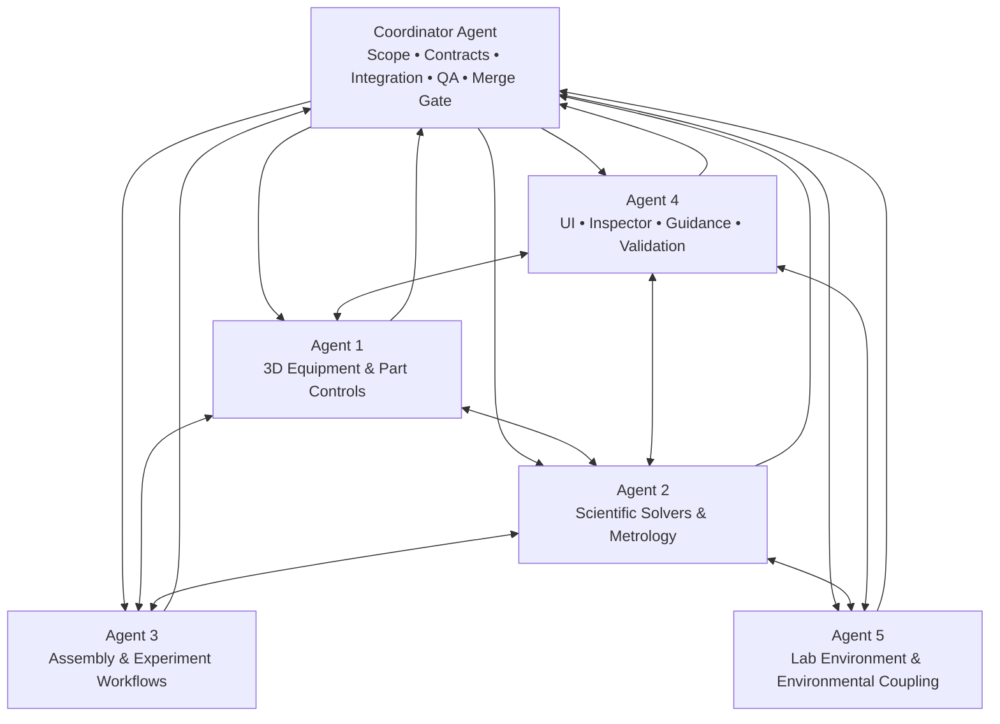

# OPENLAB 3D — MÔ HÌNH ĐIỀU PHỐI 6 AGENT

**Mục tiêu:** Cho phép 5 agent chuyên trách triển khai song song 5 mockup cải tiến OpenLab 3D, dưới sự kiểm soát của 1 Coordinator Agent. Đây là kế hoạch nâng cấp không phá vỡ hệ thống hiện hữu.

**Tài liệu đầu vào bắt buộc**
- `01_MOCKUP_CAU_TAO_3D_VA_DIEU_KHIEN_TUNG_CHI_TIET.md`
- `02_MOCKUP_BO_GIAI_KHOA_HOC_DINH_LUAT_VA_DO_LUONG.md`
- `03_MOCKUP_GHEP_NOI_THIET_BI_VA_QUY_TRINH_THI_NGHIEM.md`
- `04_MOCKUP_GIAO_DIEN_HUONG_DAN_VA_KIEM_DINH.md`
- `05_MOCKUP_MOI_TRUONG_PHONG_LAB_VAT_LY_TUONG_TAC.md`
- `BAO_CAO_TONG_THE_KIEN_TRUC_VA_HE_THONG_OPENLAB3D.md` (Master v3.0.0 — nguồn kiến trúc chuẩn)
- `CAY_HE_THONG_OPENLAB3D.md` (cây thư mục, dùng để định vị mã nguồn; phải kiểm tra lại trên branch thực tế)

---

## 1. Quyết định kiến trúc điều phối

Chạy **5 agent chuyên môn song song** và **1 Coordinator Agent**. Coordinator không phải agent thứ sáu cùng sửa một phân hệ; nó là người quản lý hợp đồng tích hợp, phân quyền file, kiểm soát phụ thuộc, giải quyết xung đột, chạy hồi quy và quyết định merge.

### Sơ đồ vai trò

## 2. Nguyên tắc không phá vỡ hệ thống

1. Không viết lại OpenLab 3D từ đầu.
2. Giữ nguyên 36 Asset ID, slug, catalog key, connector ID và public asset path hiện tại, trừ khi Coordinator phê duyệt migration có tương thích ngược.
3. Giữ nguyên 4-layer architecture và CIA 6-stage pipeline: User Action → Assembly Graph → Device State → Scientific Solvers → 3D Rendering → HUD/Feedback.
4. Giữ `AssetDefinition`, `SceneInstance`, `instanceState`, `window.OL3D_EQUIPMENT_MODULE`, `EquipmentModuleContract` và adapter v2.2/v2.3.
5. Giữ nguyên module HTML độc lập và 7 cổng kiểm định; mọi mở rộng phải qua adapter/schema version.
6. Không để UI tự tính lại định luật; solver là nguồn duy nhất của derived physical result.
7. Không để mesh, DOM hoặc UI làm nguồn dữ liệu khoa học. State + topology + environment + simulation time mới là đầu vào.
8. Không để một agent tự ý sửa file thuộc quyền sở hữu của agent khác.
9. Không merge chức năng chỉ vì giao diện hiển thị; phải có test chứng minh chuỗi nhân quả.
10. Bất kỳ thông số nào chưa xác minh phải có provenance/status rõ ràng (`verified`, `reported`, `illustrative`, `assumed`, `needs-review`); không nâng giả định thành chuẩn thực nghiệm.

## 3. Phân công 5 agent chuyên trách

### AGENT 1 — EQUIPMENT GEOMETRY & PART-LEVEL CONTROL

**Nguồn chính:** Mockup 01.

**Sứ mệnh:** Bảo đảm từng thiết bị và từng chi tiết có thể nhận diện, chọn, thao tác, điều khiển và phản hồi đúng cơ cấu vật lý của chính thiết bị đó.

**Phạm vi:**
- 36 thiết bị trong catalog hiện hữu.
- Mesh/sub-mesh, named nodes, hit targets, pivot, anchor, giới hạn chuyển động.
- Nút bấm, công tắc, núm xoay, tay quay, van, cần gạt, thanh trượt, kẹp, móc, bàn đo, bộ phận hiển thị.
- Per-device `DeviceControlProfile`, `PartControlSpec`, alias node legacy và state mapping.
- Đồng bộ mesh với `instanceState` thông qua contract hiện tại.

**File sở hữu chính (sau khi xác nhận trên repo):**
- `src/three-runtime/ProceduralLabModels.ts`
- `src/device-control/DeviceControlProfilesData.ts`
- Các file mới dưới `src/device-control/profiles/` hoặc thư mục tương đương do Coordinator duyệt.
- Các asset/node module độc lập liên quan trực tiếp đến mesh, nếu được cấp phạm vi riêng.

**Không được sửa:**
- `src/App.tsx`
- `src/domain/types.ts`
- `src/device-control/DeviceControlEngine.ts`
- `src/three-runtime/LabViewport3D.tsx`
- `src/three-runtime/AssemblySystem.ts`
- `src/three-runtime/LabEnvironmentEngine.ts`
- Các solver do Agent 2 sở hữu.

**Đầu ra bắt buộc:**
- Ma trận 36 thiết bị × các bộ phận tương tác.
- Danh mục node hiện có / node thiếu / alias cần giữ.
- Profile từng thiết bị và capability thực.
- Mapping `partId → action → stateKey → visualFeedback`.
- Giới hạn cơ học, hành trình, góc quay, nấc điều khiển và guard.
- Bộ test tương tác riêng theo thiết bị và regression mesh.

**Điều kiện hoàn thành:** Không có chi tiết nào khai báo `interactive` nhưng không có handler/state/feedback; không tạo capability không phù hợp với cấu tạo thật.

### AGENT 2 — SCIENTIFIC SOLVERS, LAWS & METROLOGY

**Nguồn chính:** Mockup 02.

**Sứ mệnh:** Bảo đảm mọi con số và hiện tượng xuất hiện đều được sinh ra bởi mô hình khoa học đúng miền áp dụng, đúng đơn vị, đúng topology và có truy xuất nguồn đầu vào.

**Phạm vi:**
- Circuit solver: Ohm, Kirchhoff, nguồn có điện trở trong, tải, ngắn mạch/bảo vệ.
- Optical solver: hình học tia, Snell, thấu kính, lăng kính, tán sắc, giới hạn mô hình quang học.
- Fluid/thermal solver: bảo toàn khối lượng, thể tích, thủy tĩnh, dòng chảy ở mức mô hình đã xác định, truyền nhiệt.
- Induction solver: Faraday–Lenz và phụ thuộc tốc độ biến thiên từ thông.
- Mechanical solver: trọng lực, Hooke, lực, mô-men, ma sát, cân bằng.
- Metrology: GHĐ, ĐCNN, hiệu chuẩn, sai số, độ không đảm bảo, giá trị thô/đã hiệu chỉnh/hiển thị.
- FSM khoa học và validation miền giá trị.

**File sở hữu chính:**
- Thư mục mới `src/scientific-solvers/` hoặc cấu trúc solver sẵn có sau khi audit.
- `scripts/scientific-profiles.ts` (nếu Coordinator xác nhận file này chỉ thuộc phạm vi solver).
- Bộ test solver mới dưới `scripts/tests/science/` hoặc vị trí được duyệt.

**Không được sửa:**
- `src/App.tsx`, `src/domain/types.ts`, `LabViewport3D.tsx`.
- `AssemblySystem.ts` và các connector registry.
- `LabEnvironmentEngine.ts` (chỉ đọc interface environment đã thống nhất).
- UI React và geometry mesh.

**Đầu ra bắt buộc:**
- Catalog phương trình: biến, đơn vị SI, miền hợp lệ, giả định, điều kiện biên.
- Input/output contract typed của từng solver.
- Dependency manifest chỉ rõ solver cần biến môi trường nào và topology nào.
- Provenance và uncertainty/metrology profile.
- Unit tests, boundary tests, deterministic tests, dimensional checks, regression tests.

**Điều kiện hoàn thành:** Không có kết quả hiển thị hard-coded/demo; mọi derived result có thể truy ngược về input và công thức.

### AGENT 3 — ASSEMBLY, CONNECTORS & EXPERIMENT WORKFLOWS

**Nguồn chính:** Mockup 03.

**Sứ mệnh:** Làm cho thiết bị có thể lắp ghép, kết nối, cấp/nhận vật chất hoặc năng lượng và tạo topology thực nghiệm đúng như thao tác ngoài đời.

**Phạm vi:**
- Connector kinds, compatibility matrix, snap tolerance, local coordinates, orientation, DoF constraints.
- AssemblyGraph attach/detach, occupancy, release, rollback, instance isolation.
- Kết nối điện, cơ khí, chất lỏng, quang học, nhiệt và giá đỡ.
- Experiment workflow và chuỗi bước thực hành; không biến workflow thành animation ép kết quả.
- Điều kiện đủ/thiếu của mạch kín, trục quang, bình hứng, móc treo, vật đặt trên cân.

**File sở hữu chính:**
- `src/three-runtime/AssemblySystem.ts`
- `scripts/verify-assembly-acceptance.ts`
- Các module mới `src/experiments/` hoặc `src/assembly/` nếu được duyệt.
- Các connector registry riêng trong phạm vi Assembly.

**Không được sửa:**
- `App.tsx`, `domain/types.ts`, `LabViewport3D.tsx`.
- `ProceduralLabModels.ts` hoặc `DeviceControlProfilesData.ts`.
- Solver implementation; chỉ gọi interface được thống nhất với Agent 2.
- UI Components do Agent 4 sở hữu.

**Đầu ra bắt buộc:**
- Connector registry và compatibility matrix.
- Bản đồ topology cho từng kịch bản thí nghiệm.
- Test attach/detach/re-attach, wrong connector, tolerance, DoF, occupancy, multi-instance, pointer cancel.
- Workflow state/guard/expected scientific outputs.

**Điều kiện hoàn thành:** Không xuất hiện hiện tượng nếu topology hoặc điều kiện lắp ráp cần thiết chưa tồn tại; tháo lắp không để orphan edge hoặc transform bị khóa.

### AGENT 4 — USER INTERFACE, INSPECTOR, GUIDANCE & VALIDATION UX

**Nguồn chính:** Mockup 04.

**Sứ mệnh:** Cung cấp UI điều khiển và hướng dẫn cho cùng một state/action của thiết bị, giúp học sinh thấy đúng chi tiết, hiểu thao tác và biết lý do thành công/thất bại.

**Phạm vi:**
- EquipmentHoverCard Glassmorphism và khôi phục nội dung hover có ảnh/thông số/hướng dẫn.
- EquipmentPreviewPanel, EquipmentRealPhotoView, EquipmentThumbnailSvg.
- DeviceControlInspector: điều khiển theo PartControlSpec nhưng không tạo state vật lý riêng.
- StudentGuidedStepPanel, StudentEquipmentSidebar và UI đánh giá/kiểm định.
- HUD: số đo, đơn vị, trạng thái, cảnh báo, provenance và gợi ý thích ứng.
- Accessibility: keyboard, pointer, touch, focus, tooltip placement, responsive.

**File sở hữu chính:**
- `src/components/common/EquipmentHoverCard.tsx`
- `src/components/common/EquipmentPreviewPanel.tsx`
- `src/components/common/EquipmentRealPhotoView.tsx`
- `src/components/common/EquipmentThumbnailSvg.tsx`
- `src/components/panels/DeviceControlInspector.tsx`
- `src/components/student/StudentEquipmentSidebar.tsx`
- `src/components/student/StudentGuidedStepPanel.tsx`
- Các UI component liên quan khác chỉ khi Coordinator ghi rõ.

**Không được sửa:**
- `App.tsx`, `domain/types.ts`, `LabViewport3D.tsx`.
- DeviceControlEngine và solver.
- AssemblySystem, LabEnvironmentEngine.
- Không tự tính lại công thức hoặc thay đổi instanceState trực tiếp trong component.

**Đầu ra bắt buộc:**
- UI states: idle, hover, selected-device, selected-part, disabled, error, warning, measuring, stable.
- Component contract/props/events.
- Hướng dẫn dựa trên profile + FSM + topology + solver result.
- Visual regression, interaction tests, keyboard/touch tests.

**Điều kiện hoàn thành:** UI điều khiển là một cách phát cùng action với thao tác 3D; hai cách không có state song song và luôn đồng bộ.

### AGENT 5 — LAB ENVIRONMENT & PHYSICAL CONTEXT

**Nguồn chính:** Mockup 05.

**Sứ mệnh:** Biến phòng lab thành môi trường có điều kiện vật lý thật sự tác động đúng các hệ thống được đăng ký phụ thuộc; không phải phông nền trang trí và không làm mọi biến tác động mọi thiết bị.

**Phạm vi:**
- Lab room geometry, bench, floor, placement zones, SI/world coordinate frames.
- Environment variables theo Master v3.0.0; xác minh danh sách chính thức trước triển khai.
- Presets môi trường và local fields nếu có căn cứ: ánh sáng, nhiệt độ, áp suất, độ ẩm, gió, trọng trường, O₂/CO₂, từ trường, nhiệt độ bàn/mẫu.
- Device-environment dependency map và subscribe/emit contract.
- Môi trường theo khu vực và điều kiện thí nghiệm (dark room, ventilation, heating zone...) chỉ khi thuộc phạm vi mô hình thực tế.
- Environmental HUD/preset data; UI Modal giao cho Agent 4 nếu cần sửa UI.

**File sở hữu chính:**
- `src/three-runtime/LabEnvironmentEngine.ts`
- Các file mới dưới `src/environment/` hoặc `src/three-runtime/environment/` được Coordinator phê duyệt.
- Environment preset/data và dependency registry riêng.

**Không được sửa:**
- `App.tsx`, `domain/types.ts`, `LabViewport3D.tsx`.
- ProceduralLabModels, AssemblySystem và solver files.
- UI components do Agent 4 sở hữu.

**Đầu ra bắt buộc:**
- Environment contract typed, units, ranges, steps, defaults, provenance.
- Phân biệt global room variables, sample-specific properties và device-local fields.
- Dependency map từng thiết bị/subsystem/solver.
- Presets và test isolated influence: thay biến nào chỉ tác động hệ thống đăng ký phụ thuộc biến đó.
- Regression về reset/preset/time scale/zone boundary.

**Điều kiện hoàn thành:** Không có coupling vô căn cứ; cùng một input environment và state tạo kết quả xác định; thay đổi môi trường không phá vỡ baseline ngoài phạm vi phụ thuộc.

**Cổng xác minh nguồn môi trường bắt buộc trước khi code:** Mockup 05 hiện mô tả 25 biến theo cách chia 13 biến phòng + 12 biến mẫu; Master v3.0.0 và cây hệ thống mô tả 13 biến môi trường toàn cục. Agent 5 phải kiểm tra `LabEnvironmentEngine.ts`, `LabEnvironmentSpecModal.tsx`, type definitions và runtime thực tế để lập bảng đối chiếu. Không được mặc định đưa cả 25 biến vào global environment. Phải đề xuất canonical model phân biệt biến toàn cục, thuộc tính mẫu và trường cục bộ; Coordinator phê duyệt danh sách key, phạm vi, đơn vị và backward compatibility trước khi triển khai. Nếu 12 thuộc tính mẫu chỉ là dữ liệu gắn với specimen/material thì chúng phải ở đúng miền dữ liệu đó, không phát tán thành biến phòng.

---

## 4. Quyền sở hữu file và vùng cấm sửa

| Vùng mã nguồn | Chủ sở hữu | Quy tắc |
|---|---|---|
| `ProceduralLabModels.ts` | Agent 1 | Không agent khác sửa trực tiếp |
| `DeviceControlProfilesData.ts` | Agent 1 | Schema gốc chỉ đổi khi Coordinator duyệt |
| `src/scientific-solvers/**` | Agent 2 | Agent khác chỉ dùng public contract |
| `scripts/scientific-profiles.ts` | Agent 2 | Báo trước nếu ảnh hưởng generator |
| `AssemblySystem.ts` | Agent 3 | Connector contract phải được freeze trước |
| `verify-assembly-acceptance.ts` | Agent 3 | Test hiện hành phải được giữ |
| UI component được liệt kê | Agent 4 | Không tự mutate physical state |
| `LabEnvironmentEngine.ts` | Agent 5 | Không mở rộng biến global tùy tiện |
| `App.tsx` | Coordinator | Chỉ tích hợp actions/selectors/provider |
| `domain/types.ts` | Coordinator | Quản lý type/schema chung, có version |
| `DeviceControlEngine.ts` | Coordinator | Điều phối action → guard → state |
| `LabViewport3D.tsx` | Coordinator | Chỉ sửa adapter/raycast bridge sau khi có đề xuất cụ thể |
| `BehaviorRegistry.ts` | Coordinator | Đăng ký behavior qua contract |
| `HtmlEquipmentModuleRegistry.ts` | Coordinator | Bảo vệ backward compatibility và 7 gates |

**Lưu ý:** Đường dẫn trên lấy từ cây hệ thống được cung cấp; Coordinator phải xác nhận file thực tế trên branch đang dùng trước khi phân quyền. Không được suy đoán khi cây repo đã thay đổi.

## 5. Shared contracts phải freeze trước khi code song song

Coordinator phải công bố một gói contract nhỏ, có version, trước khi cho phép các agent thay đổi mã nguồn:

1. `PartControlSpec` — Agent 1 cung cấp đề xuất, Coordinator duyệt schema.
2. `DeviceAction` / `DeviceStatePatch` — Coordinator sở hữu.
3. `SolverInput` / `SolverResult` — Agent 2 đề xuất, Coordinator duyệt.
4. `AssemblyTopologySnapshot` / `ConnectorEvent` — Agent 3 đề xuất, Coordinator duyệt.
5. `EnvironmentSnapshot` / `EnvironmentDependency` — Agent 5 đề xuất, Coordinator duyệt.
6. `GuidanceContext` / `UIEvent` — Agent 4 đề xuất, Coordinator duyệt.
7. `ProvenanceStatus` và `MeasurementRecord` — dùng thống nhất giữa solver, environment, UI và báo cáo.

Không agent nào tự ý tạo type trùng tên hoặc định nghĩa một nguồn state thứ hai. Nếu cần đổi contract đã freeze, mở `CONTRACT_CHANGE_REQUEST.md`, nêu lý do, ảnh hưởng, migration và test rồi chờ Coordinator chấp thuận.

## 6. Cách chạy song song an toàn

### Phương án ưu tiên: 5 Git worktrees/branches độc lập

- Tạo branch gốc/checkpoint trước khi bắt đầu.
- Tạo 5 branch hoặc worktree riêng: `agent-01-equipment`, `agent-02-science`, `agent-03-assembly`, `agent-04-ui`, `agent-05-environment`.
- Mỗi agent chỉ ghi trong vùng sở hữu và thư mục báo cáo riêng.
- Coordinator làm việc trên branch `integration/openlab3d-upgrade`.
- Tất cả commit phải có prefix: `[A1]`, `[A2]`, `[A3]`, `[A4]`, `[A5]`.
- Không cherry-pick vào integration cho tới khi agent gửi report + test result + danh sách files changed.

Nếu nền tảng agent không hỗ trợ worktree, chạy 5 phiên audit/design song song trước; sau khi freeze contract mới cho phép sửa mã theo từng lượt. **Không cho 5 agent ghi đồng thời vào cùng một working tree** vì dễ ghi đè và tạo race condition.

### Các pha

**PHASE 0 — Baseline & inventory (Coordinator)**
- Kiểm tra branch, commit SHA, working tree sạch hay bẩn.
- Đọc Master Spec v3.0 và cây repo thực tế.
- Chạy baseline build/typecheck/tests trước thay đổi.
- Lập file `BASELINE_REPORT.md`.
- Chốt file owner, contracts, dependency map, risk register.

**PHASE 1 — Parallel read-only audit (5 agents)**
- Cả 5 agent đọc các mockup và mã nguồn.
- Không sửa file.
- Mỗi agent xuất `agent-reports/AGENT_0X_AUDIT.md`.
- Coordinator hợp nhất phát hiện, xử lý các điểm mâu thuẫn và chốt contract.

**PHASE 2 — Parallel implementation (5 agents)**
- Mỗi agent chỉ code trong vùng đã giao.
- Có thể tạo file mới trong vùng sở hữu.
- Mỗi pull request/commit phải nhỏ, có test.
- Không tự điều chỉnh file chung hoặc phạm vi agent khác.

**PHASE 3 — Agent-to-agent interface review**
- A1 ↔ A2: controls/state keys ↔ solver inputs/outputs.
- A1 ↔ A3: part IDs/node aliases ↔ connector targets/DoF.
- A2 ↔ A3: solver topology inputs ↔ actual assembly graph.
- A2 ↔ A5: solver environment dependencies ↔ environment snapshot.
- A4 ↔ A1/A2/A3/A5: UI actions/guidance ↔ same state and authoritative results.
- Mọi xung đột được chuyển Coordinator, không tự sửa chéo.

**PHASE 4 — Integration (Coordinator)**
Thứ tự tích hợp tham khảo:
1. Contracts/types/adapters.
2. Environment interface (Agent 5).
3. Device control profiles/geometry bindings (Agent 1).
4. Scientific solvers (Agent 2).
5. Assembly/topology/workflows (Agent 3).
6. UI/guidance/inspection (Agent 4).
7. App/viewport/behavior bridge (Coordinator).

Thứ tự này là thứ tự tích hợp, không phải yêu cầu các agent phải chạy tuần tự. Họ vẫn làm việc song song trên contract đã freeze.

**PHASE 5 — Regression & scientific acceptance (Coordinator + agent owners)**
- Build, TypeScript strict check, lint nếu dự án có.
- Chạy tất cả test hiện hành trước/sau.
- Chạy 24 SCI scenarios, 24 Assembly acceptance tests và 7 HTML module gates nếu script tồn tại.
- Chạy test mới của 5 agent.
- So sánh asset count, Asset ID, node aliases, connector registry, state keys.
- Kiểm tra 36 thiết bị, 8 mẫu kính hiển vi, môi trường và 3–5 workflow tích hợp ưu tiên.
- Không ghi PASS khi chỉ kiểm tra static/mock output.

**PHASE 6 — Merge gate & release candidate**
- Coordinator ghi `INTEGRATION_REPORT.md`.
- Nếu có P0/P1 hoặc regression chưa giải quyết: không merge.
- Chỉ merge khi baseline compatibility, test, provenance và rollback plan đạt.
- Tạo checkpoint/backup/tag trước release.

## 7. Quy trình giao tiếp và báo cáo bắt buộc

Mỗi agent gửi Coordinator các báo cáo sau:

1. `AGENT_0X_AUDIT.md` — hiện trạng, phát hiện, căn cứ file/dòng.
2. `AGENT_0X_IMPLEMENTATION_PLAN.md` — giải pháp và phạm vi file.
3. `AGENT_0X_CONTRACT_REQUESTS.md` — schema/API cần thống nhất.
4. `AGENT_0X_CHANGELOG.md` — file đã thay đổi và lý do.
5. `AGENT_0X_TEST_REPORT.md` — lệnh chạy, kết quả thật, test chưa chạy.
6. `AGENT_0X_HANDOFF.md` — cách tích hợp, dependency, known limitations.

Mọi báo cáo phải phân biệt:
- `VERIFIED`: xác nhận bằng code/test/nguồn kỹ thuật.
- `OBSERVED`: quan sát được trong runtime, chưa được đo chuẩn.
- `PROPOSED`: thiết kế đề xuất.
- `ASSUMED`: giả định tạm thời.
- `NOT_TESTED`: chưa có bằng chứng chạy.

## 8. Cơ chế giải quyết xung đột

Khi xảy ra xung đột:
1. Không tự sửa file của agent khác.
2. Tạo `CONFLICT_REPORT.md` ghi file, symbol, contract và tác động.
3. Nêu tối thiểu hai phương án và backward-compatibility.
4. Coordinator quyết định owner và cách merge.
5. Chạy lại test của cả hai phân hệ sau khi giải quyết.

Mức ưu tiên giải quyết: P0 bảo toàn dữ liệu/contract; P1 tính đúng định luật/đơn vị/nhân quả; P2 chức năng và UX; P3 thẩm mỹ/tối ưu.

## 9. Definition of Done cho từng agent

Một agent chỉ được coi là hoàn tất khi:
- Phạm vi và file ownership được tuân thủ.
- Không phá API cũ hoặc có migration được duyệt.
- Có test cho hành vi chính, biên và lỗi.
- Có test regression phù hợp.
- Không có số đo/hiện tượng hard-coded giả làm kết quả vật lý.
- Không tạo state trùng hoặc circular dependency.
- Có log và handoff đủ để Coordinator tích hợp.
- Khai rõ phần chưa làm và giới hạn.

## 10. Prompt khởi chạy Coordinator Agent

Bạn là **OPENLAB3D COORDINATOR AGENT**, chịu trách nhiệm điều phối 5 agent chuyên môn để cải tiến OpenLab 3D mà không phá vỡ cấu trúc hiện hữu.

Nhiệm vụ:
1. Đọc Master Spec v3.0.0, cây hệ thống và đủ 5 mockup.
2. Xác nhận repo/branch/commit và chạy baseline trước khi giao việc.
3. Tạo 5 agent với vai trò và file ownership ở Mục 3–4.
4. Cho 5 agent audit read-only song song trước; hợp nhất phát hiện.
5. Freeze shared contracts ở Mục 5.
6. Chỉ sau đó cho 5 agent triển khai song song trên branch/worktree tách biệt.
7. Ngăn mọi file ownership conflict; không để agent tự sửa file chung.
8. Thu nhận báo cáo, test evidence, handoff từ từng agent.
9. Tích hợp theo Mục 6; tự sở hữu các file điều phối chung.
10. Chạy regression toàn hệ thống và chỉ công nhận kết quả có bằng chứng.

**Quyền hạn:** Có quyền từ chối thay đổi phá vỡ contract, sai định luật, thiếu provenance hoặc không có test. Không có quyền tự ý viết lại kiến trúc, xóa thiết bị hoặc thay đổi Asset ID.

**Cấm:** Không giao cả 5 agent cùng sửa `App.tsx`, `domain/types.ts`, `LabViewport3D.tsx`, `DeviceControlEngine.ts` hoặc các file chung. Không merge chỉ vì agent báo “done”. Không tự bịa kết quả test.

**Đầu ra cuối:** `BASELINE_REPORT.md`, `COORDINATION_PLAN.md`, `CONTRACTS_FREEZE.md`, 5 agent handoff reports, `INTEGRATION_REPORT.md`, `REGRESSION_REPORT.md`, `RELEASE_CANDIDATE_NOTES.md`.

Bắt đầu bằng PHASE 0 và PHASE 1. Chỉ chuyển sang triển khai sau khi Coordinator xác nhận file ownership và shared contracts. Nếu công cụ hiện tại không hỗ trợ tạo 5 agent/worktree thực sự, phải báo rõ và đề xuất chế độ 5 phiên làm việc song song cô lập; không giả vờ đã khởi chạy agent.

## 11. Prompt khởi chạy cho từng agent

Mỗi agent nhận prompt chung sau và phần vai trò tương ứng ở Mục 3:

> Bạn là Agent chuyên trách số X của OpenLab 3D. Chỉ làm trong phạm vi và file ownership đã giao. Đọc Master Spec v3.0.0 và mockup tương ứng. Bắt đầu bằng audit read-only, nêu file/dòng và bằng chứng. Không sửa mã trước khi Coordinator freeze contract. Khi được phép triển khai, làm thay đổi nhỏ, có version, backward-compatible, test trước/sau và báo cáo handoff. Không sửa file thuộc agent khác, không tạo nguồn state thứ hai, không hard-code kết quả vật lý. Khi thiếu dữ liệu, gắn `needs-review` và hỏi Coordinator qua contract request, không tự giả định.

---

## 12. Bảng theo dõi tiến độ Coordinator

| Agent | Audit | Contract | Plan | Implementation | Tests | Handoff | Merge |
|---|---|---|---|---|---|---|---|
| A1 — Equipment/Controls | NOT STARTED | NOT STARTED | NOT STARTED | NOT STARTED | NOT STARTED | NOT STARTED | BLOCKED |
| A2 — Scientific Solvers | NOT STARTED | NOT STARTED | NOT STARTED | NOT STARTED | NOT STARTED | NOT STARTED | BLOCKED |
| A3 — Assembly/Workflows | NOT STARTED | NOT STARTED | NOT STARTED | NOT STARTED | NOT STARTED | NOT STARTED | BLOCKED |
| A4 — UI/Guidance | NOT STARTED | NOT STARTED | NOT STARTED | NOT STARTED | NOT STARTED | NOT STARTED | BLOCKED |
| A5 — Environment | NOT STARTED | NOT STARTED | NOT STARTED | NOT STARTED | NOT STARTED | NOT STARTED | BLOCKED |
| Coordinator | BASELINE PENDING | FREEZE PENDING | PLAN PENDING | INTEGRATION PENDING | REGRESSION PENDING | REPORT PENDING | BLOCKED |

**Trạng thái ban đầu có chủ ý:** Tất cả đều `NOT STARTED`; tài liệu này là kế hoạch điều phối, không tuyên bố các agent đã được chạy hoặc mã nguồn đã thay đổi.
