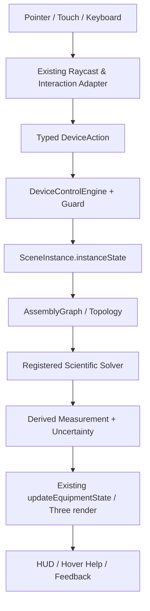

# MOCKUP 01 — NÂNG CẤP CẤU TẠO 3D VÀ ĐIỀU KHIỂN TỪNG CHI TIẾT THIẾT BỊ

**Mã:** `OL3D-MU-01-PHYSICAL-CONTROL` · **Đối tượng:** 36 thiết bị hiện hữu · **Trạng thái:** Design specification, chưa triển khai

## 0. Cam kết bảo toàn hệ thống hiện hữu (NON-DESTRUCTIVE UPGRADE)

Tài liệu này là mockup/đặc tả cải tiến, không phải lệnh tái viết dự án. Mọi triển khai phải theo nguyên tắc **ADD / ADAPT / VERIFY — NOT REPLACE**.

1. Giữ nguyên React 19, TypeScript strict, Vite 6, Three.js/WebGL và pipeline PBR đang có.
2. Giữ nguyên kiến trúc 4 lớp `OL3D-MASTER-SPEC v1.0`: Environment → Equipment → Interaction/Physics → App/Pedagogy.
3. Giữ nguyên chu trình nhân quả CIA 6 giai đoạn: User Action → Assembly Graph → Device State → Scientific Solvers → 3D Rendering → HUD/Feedback.
4. Giữ nguyên `AssetDefinition`, `SceneInstance`, `instanceState`, `window.OL3D_EQUIPMENT_MODULE`, `EquipmentModuleContract` và adapter tương thích v2.2/v2.3.
5. Không đổi Asset ID, slug, catalog key, tên node hiện đang được runtime tham chiếu, connector ID, state key hoặc đường dẫn public nếu chưa có migration plan tương thích ngược.
6. Không xóa/đổi tên các file nòng cốt. Ưu tiên thêm adapter, profile extension, solver service, schema version và test.
7. Mỗi thay đổi phải chạy typecheck, build, unit tests, assembly acceptance, scientific interaction regression và kiểm tra trực quan trên scene.
8. Không được gắn nhãn `PASS`, `verified` hoặc `validated` chỉ vì component tồn tại hoặc hình ảnh đẹp. Cần bằng chứng thực thi.
9. Dữ liệu nguồn có trạng thái `reported`, `illustrative`, `not-verified`, `partially-verified` phải tiếp tục giữ nguyên trạng thái và được đưa vào danh sách xác minh.
10. Khi phát hiện mâu thuẫn trong hồ sơ (ví dụ cân 500 g có thông số vỏ/tải bất thường, giá trị đơn vị không đồng nhất), không tự sửa số liệu; tạo `SPEC_CONFLICT` và yêu cầu đối chiếu datasheet/mẫu thật.

### 0.1. Bản đồ module hiện hữu cần kế thừa

| Vai trò | File hiện có | Cách mở rộng an toàn |
|---|---|---|
| Điều phối trạng thái | `src/App.tsx` | Bổ sung action/selector typed; không tạo state gốc song song |
| Viewport, raycast, drag-drop | `src/three-runtime/LabViewport3D.tsx` | Đăng ký hit targets và handler theo profile; tránh cài logic vật lý chuyên ngành dày đặc vào component |
| Mesh 3D | `src/three-runtime/ProceduralLabModels.ts` | Bổ sung named submeshes theo schema; giữ node legacy và alias |
| Kiểu dữ liệu | `src/domain/types.ts` | Mở rộng optional versioned fields; không phá payload cũ |
| Điều khiển | `src/device-control/DeviceControlEngine.ts` | Thêm mapping input→action→state và guard |
| Hồ sơ điều khiển | `src/device-control/DeviceControlProfilesData.ts` | Làm giàu profile từng asset; profile phải khai báo capabilities thực |
| Lắp ráp | `src/three-runtime/AssemblySystem.ts` | Thêm connector/constraint mới theo registry và migration |
| Môi trường | `src/three-runtime/LabEnvironmentEngine.ts` | Thêm environment adapter, không tạo environmental engine thứ hai |
| Hành vi | `src/three-runtime/BehaviorRegistry.ts` | Đăng ký behavior có type, lifecycle, teardown |
| UI hướng dẫn | `EquipmentHoverCard.tsx`, `EquipmentPreviewPanel.tsx`, `StudentGuidedStepPanel.tsx` | Kết nối dữ liệu profile, trạng thái và help content |
| Kiểm thử | `scripts/verify-assembly-acceptance.ts`, `scripts/verify-scientific-interaction.ts`, `scripts/scientific-profiles.ts` | Mở rộng kiểm thử; giữ nguyên test đã đạt |

### 0.2. Luồng dữ liệu đích (giữ nguyên CIA)



### 0.3. Phân loại thay đổi

- **P0 – bảo toàn:** thay đổi có nguy cơ phá vỡ state, module, connector, world units hoặc bộ giải hiện tại; không merge nếu chưa có regression.
- **P1 – đúng định luật:** sai causal dependency, sai dấu, sai đơn vị, hiển thị hiện tượng không có nguyên nhân.
- **P2 – điều khiển thực:** chi tiết 3D không điều khiển được, thiếu travel/range/lock/feedback.
- **P3 – giáo dục/UX:** hướng dẫn, tooltip, chú giải, accessibility, report.

## 1. Tầm nhìn mockup

Mục tiêu là biến từng mesh con có ý nghĩa cấu tạo thành một điểm tương tác có hành vi, giới hạn và phản hồi đúng cơ cấu thực. Không phải mọi mesh đều cần kéo riêng; một chi tiết được xem là ‘điều khiển được’ khi người học có thể thực hiện đúng thao tác thực tế (nhấn, xoay, trượt, kẹp, mở, đặt, kết nối, đọc) và hệ thống cập nhật trạng thái hợp lệ. Các bề mặt thụ động như vỏ hoặc mặt kính được chọn/đọc/chạm nhưng không được phép có hành vi giả.

## 2. Tiêu chuẩn chung cho một chi tiết có thể điều khiển

| Thuộc tính | Yêu cầu bắt buộc | Kiểm chứng |
| --- | --- | --- |
| partId / nodeName | Ổn định, không trùng; ánh xạ đúng `mesh.name` và node legacy | Kiểm tra scene graph, profile lookup |
| interactionKind | click, rotary, linear-slider, drag, clamp, toggle, connector, touch/read-only | Kiểm tra đúng loại input |
| axis / pivot | Trục quay/trượt và tâm cơ học thực | Đối chiếu ảnh thiết bị/datasheet |
| range / step | Giới hạn min/max, step, detent, travel | Boundary tests min/max/out-of-range |
| constraints | DOF, collision, lock, snap tolerance, occupancy | Assembly/physics test |
| action | Typed event riêng, không sửa trực tiếp mesh state | Event log + reducer/engine |
| state effect | Thay đổi `instanceState` có kiểu và nguồn gốc | State transition test |
| visual feedback | Mesh, indicator, scale, display thay đổi theo state | Screenshot/video regression |
| physical feedback | Solver, giá trị đo hoặc hiện tượng thực thay đổi | Scientific acceptance |
| help | Tên, chức năng, cách thao tác, lỗi thường gặp | HoverCard/keyboard/touch test |
| teardown | Hủy listener/timer/texture/animation khi tháo instance | Memory/leak test |
### 2.1. Chuẩn thao tác chuột/cảm ứng

- `hover`: highlight nhẹ đúng mesh đang tương tác; hiển thị hộp hướng dẫn, không đổi state vật lý.
- `pointerdown`: chốt partId, instanceId, hit point, local coordinate và trạng thái ban đầu.
- `pointermove`: tính input theo delta đã chiếu lên trục hoặc mặt phẳng điều khiển; clamp theo range.
- `pointerup`: commit action nếu hợp lệ; cập nhật assembly graph/solver qua CIA; nếu không hợp lệ rollback có giải thích.
- `pointercancel`: phục hồi state trước thao tác; không để object/connector ở trạng thái nửa ghép.
- `keyboard`: phím mũi tên/+/−/Enter/Escape cho các nút và núm điều khiển có focus; không bắt buộc dùng drag.
- `touch`: dùng vùng hit đủ lớn; kéo giữ tránh xung đột scroll; thao tác dài phải có feedback.

### 2.2. Cơ cấu điều khiển dùng chung (không áp dụng máy móc)

| Control archetype | Mô hình | Thuộc tính cần khai báo | Ví dụ |
| --- | --- | --- | --- |
| Rotary | Quay quanh pivot | axis, minAngle, maxAngle, detents, friction, torque feel | Núm nguồn, van, mâm vật kính |
| Linear slider | Trượt dọc trục | axis, travelM, stepM, hardStops, lock | Hàm thước cặp, carriage ray |
| Toggle/button | Trạng thái rời rạc | pressed/down, debounce, interlock | TARE, công tắc nguồn |
| Spring/dial | Đàn hồi hoặc kim chỉ thị | k, damping, zero, range, scale | Lực kế, galvanometer |
| Clamp/hook | Kẹp hoặc treo | jawGap, maxLoad, compatibleParts | Kẹp giá, móc lực kế |
| Valve | Điều chỉnh tiết diện dòng | openingAngle, effectiveArea, leakage | Buret, phễu chiết, bình nước |
| Connector | Ghép cơ/điện/quang/lưu chất | kind, polarity, orientation, occupancy, tolerance | Giắc bắp chuối, vòi rót |
| Passive/read-only | Chọn/đọc/chú giải | labels, dimensions, inspect data | Thân kính, vạch chia, mẫu vật |
## 3. Mẫu `DeviceControlProfile` mở rộng không phá vỡ schema cũ

Các trường mới nên là optional và có `schemaVersion`; runtime đọc profile cũ qua adapter mặc định. Không đổi contract của module `.HTML`.

```ts
type ControlKind = 'rotary' | 'linear' | 'button' | 'toggle' | 'drag' | 'clamp' | 'valve' | 'connector' | 'read-only';
interface PartControlSpec {
  partId: string; nodeName: string; kind: ControlKind; enabled: boolean;
  axisLocal?: [number, number, number]; pivotLocalM?: [number, number, number];
  min?: number; max?: number; step?: number; unit?: string;
  detents?: number[]; travelM?: number; hardStops?: boolean;
  guardIds?: string[]; actionType: string; helpKey: string;
  visualBindings: string[]; solverBindings: string[];
}
interface DeviceControlExtension { schemaVersion: '1.0'; assetId: string; parts: PartControlSpec[];
  defaultStateVersion: number; compatibility: { legacyNodeAliases: Record<string,string>; preserveLegacyKeys: true };
}
```

## 4. Quy trình thực hiện cho mỗi thiết bị

1. Đọc source dossier và `mockCatalog.ts`; so sánh với module `.html` và mesh thực trong `ProceduralLabModels.ts`.
2. Lập danh sách partId từ mesh đang tồn tại; chỗ nào thiếu mesh nhưng là cơ cấu trọng yếu thì đề xuất node mới, không thay tên node cũ.
3. Ghi nhận thao tác thực, trục/pivot/range và giới hạn; dùng ảnh sản phẩm hoặc datasheet để xác minh trước khi chốt kích thước.
4. Khai báo `PartControlSpec`; action phải cập nhật state, không mutate trực tiếp geometry trong event handler.
5. Bổ sung `updateEquipmentState` binding cho mesh, chỉ cập nhật render khi giá trị đổi.
6. Kiểm thử input/limits/rollback/keyboard/touch/teardown.
7. So sánh trực quan với thiết bị mẫu và test hồi quy scene.

## 5. Hồ sơ cải tiến chi tiết 36 thiết bị

## 01. Cân điện tử hiện số 500 g

- **Asset ID:** `OL3D-EQP-BAL-0001`
- **Archetype:** `electronic-balance` · **Category:** `mass-measurement`
- **Nhóm GDPT liên quan:** G02
- **Tên tiếng Anh trong hồ sơ:** *Precision Electronic Balance 500 g*
- **Nguyên tắc:** giữ assetId, slug, module hiện hữu; chỉ mở rộng control profile, state, solver adapter và test có version.
### 5.01.1. Bằng chứng cấu tạo hiện có trong hồ sơ nguồn

### 3. Đặc tả Kích thước Hình học & Tỷ lệ SI (Three.js)
* **Kích thước thực tế (mm)**: Rộng/Đường kính = 200 mm, Cao = 85 mm, Sâu = 240 mm
* **Kích thước bao trong Three.js (mét)**: Rộng (X) = 0.2 m, Cao (Y) = 0.085 m, Sâu (Z) = 0.24 m
* **Khối lượng tĩnh định danh**: Xem thuộc tính khoa học referenceMass
* **Quy chuẩn gốc tựa**: `anchor: "base-center"`, `upAxis: "Y"` (Đáy mô hình chạm sàn/mặt bàn tại $y = 0.000\text{ m}$).
* **Hướng mặt chính diện**: Quay về phía trục $+Z$ ($z > 0$).

### 4. Cấu trúc Cây Node 3D & Phối công thức Vật liệu PBR
* **Các sub-mesh node con**: `body`, `scale_display`, `tare_button_3d`, `weighing_pan`, `pan_plate`, `measurement_anchor`
* **Các lớp vật liệu Three.js sử dụng**: `MeshPhysicalMaterial`, `MeshStandardMaterial`, `MeshBasicMaterial`
* **Kỹ thuật đồ họa nổi bật**: ExtrudeGeometry with Bevel; Torus Chamfered Edge Reflectors; State Sync via userData; Optical Ray Tracing & Refraction
* **Bảng chi tiết các mesh thành phần & shader**:
| Tên Mesh Part | Lớp Geometry Three.js | Lớp Vật liệu PBR & Thông số | Render Order | Chức năng kỹ thuật trong mô hình |
| :--- | :--- | :--- | :---: | :--- |
| `body` | `ExtrudeGeometry (Bevel)` | MeshPhysicalMaterial (White ABS, roughness 0.25) | 1 | Thân vỏ OHAUS Scout chống hóa chất |
| `weighing_pan` | `CylinderGeometry + Torus` | MeshPhysicalMaterial (SUS304 Inox, metalness 0.94) | 2 | Mâm cân Inox lún 2.2mm khi chịu lực |
| `scale_display` | `PlaneGeometry (Offset)` | MeshBasicMaterial (CanvasTexture LED) | 3 | Màn hình LCD 7 đoạn nghiêng 20° |

### 5. Cổng Ghép nối Động học & Quan hệ Lắp ráp
* Thiết bị độc lập không chứa cổng gắn riêng, tương tác thông qua đặt tựa lên đĩa cân, móc treo lực kế hoặc thả chìm vào bình chứa.

### 6. Trạng thái Động & Bộ Điều khiển Tương tác
* **Các năng lực tương tác hỗ trợ**: `selectable`, `translatable`, `rotatable`, `showDimensions`, `weighObject`, `readScale`
* **Thuộc tính đo lường / Khoa học**:
  - Khối lượng chuẩn ($m_{ref}$): **1450 g** (Trạng thái: `reported`)
* **Thông số metrology thiết bị đo**:
  - Đại lượng đo: `mass`
  - Giới hạn đo (GHĐ): **0 g** đến **500 g**
  - Độ chia nhỏ nhất (ĐCNN): **0.01 g**
  - Hỗ trợ hiệu chỉnh điểm 0 / Trừ bì: **Có (Tare supported)**

### 5.01.2. Danh sách điểm điều khiển đề xuất

| Node/part | Tương tác thực tế | Hành vi bắt buộc | Phân loại |
| --- | --- | --- | --- |
| weighing_pan | Đặt/nhấc vật | Nhận tổng tải; mâm cân võng vi mô theo tải, không cho xuyên hoặc đặt lơ lửng. | Điều khiển |
| tare_button_3d | Nhấn TARE/ZERO | Lưu offset bì hiện tại; màn hình về zero trong khi vật bì vẫn còn. | Điều khiển |
| scale_display | Đọc màn hình | Hiển thị khối lượng theo độ phân giải/độ ổn định đã khai báo. | Điều khiển |
| power/mode controls | Bật/tắt/chọn đơn vị nếu mặt máy có | Chỉ triển khai điều khiển nếu panel/node có thật trên mẫu thiết bị; không tự thêm nút không có căn cứ. | Điều khiển |
| leveling feet / bubble | Điều chỉnh cân bằng | Ảnh hưởng trạng thái sẵn sàng/zero nếu phần cứng được mô tả; không biến chân cân thành núm trang trí. | Điều khiển |

### 5.01.3. Chuỗi tương tác chi tiết

**Bước 1 — weighing_pan: Đặt/nhấc vật.** Nhận tổng tải; mâm cân võng vi mô theo tải, không cho xuyên hoặc đặt lơ lửng.

- Input event: `BAL_1_CONTROL_ACTION` → `DeviceControlEngine.dispatch(...)`.
- Guard: kiểm tra instance còn tồn tại, thiết bị không bị khóa, part được enable, thao tác trong giới hạn và không vi phạm connector/assembly.
- Commit: cập nhật state key có version; gọi `updateEquipmentState` ở render tick kế tiếp.
- Reject: giữ lại state trước thao tác, phát mã lỗi cụ thể và gợi ý thao tác đúng.

**Bước 2 — tare_button_3d: Nhấn TARE/ZERO.** Lưu offset bì hiện tại; màn hình về zero trong khi vật bì vẫn còn.

- Input event: `BAL_2_CONTROL_ACTION` → `DeviceControlEngine.dispatch(...)`.
- Guard: kiểm tra instance còn tồn tại, thiết bị không bị khóa, part được enable, thao tác trong giới hạn và không vi phạm connector/assembly.
- Commit: cập nhật state key có version; gọi `updateEquipmentState` ở render tick kế tiếp.
- Reject: giữ lại state trước thao tác, phát mã lỗi cụ thể và gợi ý thao tác đúng.

**Bước 3 — scale_display: Đọc màn hình.** Hiển thị khối lượng theo độ phân giải/độ ổn định đã khai báo.

- Input event: `BAL_3_CONTROL_ACTION` → `DeviceControlEngine.dispatch(...)`.
- Guard: kiểm tra instance còn tồn tại, thiết bị không bị khóa, part được enable, thao tác trong giới hạn và không vi phạm connector/assembly.
- Commit: cập nhật state key có version; gọi `updateEquipmentState` ở render tick kế tiếp.
- Reject: giữ lại state trước thao tác, phát mã lỗi cụ thể và gợi ý thao tác đúng.

**Bước 4 — power/mode controls: Bật/tắt/chọn đơn vị nếu mặt máy có.** Chỉ triển khai điều khiển nếu panel/node có thật trên mẫu thiết bị; không tự thêm nút không có căn cứ.

- Input event: `BAL_4_CONTROL_ACTION` → `DeviceControlEngine.dispatch(...)`.
- Guard: kiểm tra instance còn tồn tại, thiết bị không bị khóa, part được enable, thao tác trong giới hạn và không vi phạm connector/assembly.
- Commit: cập nhật state key có version; gọi `updateEquipmentState` ở render tick kế tiếp.
- Reject: giữ lại state trước thao tác, phát mã lỗi cụ thể và gợi ý thao tác đúng.

**Bước 5 — leveling feet / bubble: Điều chỉnh cân bằng.** Ảnh hưởng trạng thái sẵn sàng/zero nếu phần cứng được mô tả; không biến chân cân thành núm trang trí.

- Input event: `BAL_5_CONTROL_ACTION` → `DeviceControlEngine.dispatch(...)`.
- Guard: kiểm tra instance còn tồn tại, thiết bị không bị khóa, part được enable, thao tác trong giới hạn và không vi phạm connector/assembly.
- Commit: cập nhật state key có version; gọi `updateEquipmentState` ở render tick kế tiếp.
- Reject: giữ lại state trước thao tác, phát mã lỗi cụ thể và gợi ý thao tác đúng.

### 5.01.4. Các tình huống biên phải xử lý

- Thao tác đúng biên min/max: dừng cơ học tại hard stop, không cho giá trị vượt range.
- Kéo thả/hủy giữa chừng: rollback đầy đủ transform, part state và assembly relation.
- Hai instance cùng assetId: state độc lập theo instanceId, không chia sẻ offset/measurement.
- Thiết bị ở kệ/ngoài vị trí làm việc: chỉ cho phép thao tác mà cơ cấu thực tế cho phép; không tự tạo liên kết.
- Mất focus hoặc chuyển mode giao diện: nhả pointer capture, không để núm/cần tiếp tục chạy.
- Thiết bị thiếu dữ liệu cấu tạo/giới hạn: khóa chức năng chưa đủ căn cứ và ghi `NEEDS_VERIFICATION`, không phỏng đoán giá trị.

### 5.01.5. Kiểm thử riêng cho thiết bị

- **BAL-PART-HIT:** Raycast nhận đúng từng partId, không nhận nhầm mesh bên cạnh.
- **BAL-CONTROL-RANGE:** Giá trị điều khiển luôn nằm trong range; min/max và detent đúng.
- **BAL-CONTROL-STATE:** Action làm đổi state đúng một lần; không có double click hoặc state race.
- **BAL-PHYSICAL-LOCK:** Các hard stop, DOF và khóa cơ học hoạt động đúng.
- **BAL-VISUAL-SYNC:** Mesh/kim/mặt nước/màn hình phản ánh cùng một state authoritative.
- **BAL-CANCEL-ROLLBACK:** Pointer cancel phục hồi cả transform và state.
- **BAL-INSTANCE-ISOLATION:** Nhiều instance không rò rỉ state.
- **BAL-HELP-CARD:** Hover/focus/touch hiển thị hướng dẫn đúng part.
- **BAL-ACCESSIBILITY:** Các điều khiển quan trọng thao tác được bằng bàn phím.
- **BAL-TEARDOWN:** Unmount/detach không để listener, timer hay texture rò rỉ.

### 5.01.6. Mức ưu tiên và điều kiện chấp thuận

- **P0:** giữ nguyên node legacy ``body`, `scale_display`, `tare_button_3d`, `weighing_pan`, `pan_plate`, `measurement_anchor`
* **Các lớp vật liệu Three.js sử dụng**: `MeshPhysicalMaterial`, `MeshStandardMaterial`, `MeshBasicMaterial`
* **Kỹ thuật đồ họa nổi bật**: ExtrudeGeometry with Bevel; Torus Chamfered Edge Reflectors; State Sync via userData; Optical Ray Tracing & Refraction
* **Bảng chi tiết các mesh thành phần & shader**:
| Tên Mesh Part | Lớp Geometry Three.js | Lớp Vật liệu PBR & Thông số | Render Order | Chức năng kỹ thuật trong mô hình |
| :--- | :--- | :--- | :---: | :--- |
| `body` | `ExtrudeGeometry (Bevel)` | MeshPhysicalMaterial (White ABS, roughness 0.25) | 1 | Thân vỏ OHAUS Scout chống hóa chất |
| `weighing_pan` | `CylinderGeometry + Torus` | MeshPhysicalMaterial (SUS304 Inox, metalness 0.94) | 2 | Mâm cân Inox lún 2.2mm khi chịu lực |
| `scale_display` | `PlaneGeometry (Offset)` | MeshBasicMaterial (CanvasTexture LED) | 3 | Màn hình LCD 7 đoạn nghiêng 20° |` và không phá interaction đang có.
- **P1:** các bộ phận có tác động trực tiếp tới phép đo/hiện tượng phải điều khiển được và nối vào state thật.
- **P2:** bổ sung chi tiết phụ, nhãn, camera focus và help card khi không ảnh hưởng hành vi khoa học.
- **Trạng thái hồ sơ nguồn:** `published` | Đo lường: `partially-verified`
* **Gói module HTML độc lập**: Đã đóng gói tại thư mục `public/libraries3DLab/OL3D-EQP-BAL-0001_can-dien-tu-hien-so-500g` (Tập tin: `undefined`).. Nếu chưa `verified`, cần xác minh trước khi chốt kích thước/định mức.

## 02. Ống đong thủy tinh 100 ml

- **Asset ID:** `OL3D-EQP-CYL-0001`
- **Archetype:** `graduated-cylinder` · **Category:** `volume-measurement`
- **Nhóm GDPT liên quan:** G04, G02
- **Tên tiếng Anh trong hồ sơ:** *100 ml Graduated Cylinder*
- **Nguyên tắc:** giữ assetId, slug, module hiện hữu; chỉ mở rộng control profile, state, solver adapter và test có version.
### 5.02.1. Bằng chứng cấu tạo hiện có trong hồ sơ nguồn

### 3. Đặc tả Kích thước Hình học & Tỷ lệ SI (Three.js)
* **Kích thước thực tế (mm)**: Rộng/Đường kính = 32 mm, Cao = 255 mm
* **Kích thước bao trong Three.js (mét)**: Rộng (X) = 0.065 m, Cao (Y) = 0.255 m, Sâu (Z) = 0.065 m
* **Khối lượng tĩnh định danh**: Xem thuộc tính khoa học referenceMass
* **Quy chuẩn gốc tựa**: `anchor: "base-center"`, `upAxis: "Y"` (Đáy mô hình chạm sàn/mặt bàn tại $y = 0.000\text{ m}$).
* **Hướng mặt chính diện**: Quay về phía trục $+Z$ ($z > 0$).

### 4. Cấu trúc Cây Node 3D & Phối công thức Vật liệu PBR
* **Các sub-mesh node con**: `body`, `pouring_lip`, `scale_marks`, `liquid_surface`, `liquid_body`
* **Các lớp vật liệu Three.js sử dụng**: `MeshStandardMaterial`, `MeshBasicMaterial`
* **Kỹ thuật đồ họa nổi bật**: CanvasTexture Dynamic Readout; Torus Chamfered Edge Reflectors; Dynamic Liquid Level & Meniscus
* **Bảng chi tiết các mesh thành phần & shader**:
| Tên Mesh Part | Lớp Geometry Three.js | Lớp Vật liệu PBR & Thông số | Render Order | Chức năng kỹ thuật trong mô hình |
| :--- | :--- | :--- | :---: | :--- |
| `body` | `CylinderGeometry (Hollow)` | MeshPhysicalMaterial (Borosilicate, transmission 0.88) | 4 | Thân trụ thành dày 1.8mm kèm mỏ rót |
| `scale_marks` | `CylinderGeometry` | MeshBasicMaterial (CanvasTexture) | 5 | Vạch chia 10..100 ml nổi chống z-fighting |
| `liquid_surface` | `CylinderGeometry + Ring` | MeshPhysicalMaterial (Water, IOR 1.333) | 2 | Cột nước động kèm vành mặt khum mao dẫn |

### 5. Cổng Ghép nối Động học & Quan hệ Lắp ráp
* Thiết bị độc lập không chứa cổng gắn riêng, tương tác thông qua đặt tựa lên đĩa cân, móc treo lực kế hoặc thả chìm vào bình chứa.

### 6. Trạng thái Động & Bộ Điều khiển Tương tác
* **Các năng lực tương tác hỗ trợ**: `selectable`, `translatable`, `rotatable`, `showDimensions`, `readScale`, `displacementVolume`
* **Thuộc tính đo lường / Khoa học**:
  - Khối lượng chuẩn ($m_{ref}$): **138.5 g** (Trạng thái: `reported`)
  - Dung tích định mức ($V_{max}$): **100 ml**
* **Thông số metrology thiết bị đo**:
  - Đại lượng đo: `volume`
  - Giới hạn đo (GHĐ): **10 ml** đến **100 ml**
  - Độ chia nhỏ nhất (ĐCNN): **1 ml**

### 5.02.2. Danh sách điểm điều khiển đề xuất

| Node/part | Tương tác thực tế | Hành vi bắt buộc | Phân loại |
| --- | --- | --- | --- |
| body / rim | Cầm, đặt, xoay | Giới hạn bởi trọng lực, va chạm, điểm tựa; có thể đặt trên cân hoặc vào vùng nhận nước. | Cơ bản / thao tác |
| liquid_surface | Rót vào/ra | Bảo toàn thể tích, thay đổi độ cao chất lỏng và mặt khum. | Điều khiển |
| scale_marks | Đọc vạch ngang tầm mắt | Đọc đáy mặt khum; camera lệch tầm gây sai số thị sai. | Điều khiển |
| aperture | Thả vật rắn | Kiểm tra kích thước qua miệng; từ chối nếu vượt khẩu độ nguồn đã nêu. | Điều khiển |

### 5.02.3. Chuỗi tương tác chi tiết

**Bước 1 — body / rim: Cầm, đặt, xoay.** Giới hạn bởi trọng lực, va chạm, điểm tựa; có thể đặt trên cân hoặc vào vùng nhận nước.

- Input event: `CYL_1_CONTROL_ACTION` → `DeviceControlEngine.dispatch(...)`.
- Guard: kiểm tra instance còn tồn tại, thiết bị không bị khóa, part được enable, thao tác trong giới hạn và không vi phạm connector/assembly.
- Commit: cập nhật state key có version; gọi `updateEquipmentState` ở render tick kế tiếp.
- Reject: giữ lại state trước thao tác, phát mã lỗi cụ thể và gợi ý thao tác đúng.

**Bước 2 — liquid_surface: Rót vào/ra.** Bảo toàn thể tích, thay đổi độ cao chất lỏng và mặt khum.

- Input event: `CYL_2_CONTROL_ACTION` → `DeviceControlEngine.dispatch(...)`.
- Guard: kiểm tra instance còn tồn tại, thiết bị không bị khóa, part được enable, thao tác trong giới hạn và không vi phạm connector/assembly.
- Commit: cập nhật state key có version; gọi `updateEquipmentState` ở render tick kế tiếp.
- Reject: giữ lại state trước thao tác, phát mã lỗi cụ thể và gợi ý thao tác đúng.

**Bước 3 — scale_marks: Đọc vạch ngang tầm mắt.** Đọc đáy mặt khum; camera lệch tầm gây sai số thị sai.

- Input event: `CYL_3_CONTROL_ACTION` → `DeviceControlEngine.dispatch(...)`.
- Guard: kiểm tra instance còn tồn tại, thiết bị không bị khóa, part được enable, thao tác trong giới hạn và không vi phạm connector/assembly.
- Commit: cập nhật state key có version; gọi `updateEquipmentState` ở render tick kế tiếp.
- Reject: giữ lại state trước thao tác, phát mã lỗi cụ thể và gợi ý thao tác đúng.

**Bước 4 — aperture: Thả vật rắn.** Kiểm tra kích thước qua miệng; từ chối nếu vượt khẩu độ nguồn đã nêu.

- Input event: `CYL_4_CONTROL_ACTION` → `DeviceControlEngine.dispatch(...)`.
- Guard: kiểm tra instance còn tồn tại, thiết bị không bị khóa, part được enable, thao tác trong giới hạn và không vi phạm connector/assembly.
- Commit: cập nhật state key có version; gọi `updateEquipmentState` ở render tick kế tiếp.
- Reject: giữ lại state trước thao tác, phát mã lỗi cụ thể và gợi ý thao tác đúng.

### 5.02.4. Các tình huống biên phải xử lý

- Thao tác đúng biên min/max: dừng cơ học tại hard stop, không cho giá trị vượt range.
- Kéo thả/hủy giữa chừng: rollback đầy đủ transform, part state và assembly relation.
- Hai instance cùng assetId: state độc lập theo instanceId, không chia sẻ offset/measurement.
- Thiết bị ở kệ/ngoài vị trí làm việc: chỉ cho phép thao tác mà cơ cấu thực tế cho phép; không tự tạo liên kết.
- Mất focus hoặc chuyển mode giao diện: nhả pointer capture, không để núm/cần tiếp tục chạy.
- Thiết bị thiếu dữ liệu cấu tạo/giới hạn: khóa chức năng chưa đủ căn cứ và ghi `NEEDS_VERIFICATION`, không phỏng đoán giá trị.

### 5.02.5. Kiểm thử riêng cho thiết bị

- **CYL-PART-HIT:** Raycast nhận đúng từng partId, không nhận nhầm mesh bên cạnh.
- **CYL-CONTROL-RANGE:** Giá trị điều khiển luôn nằm trong range; min/max và detent đúng.
- **CYL-CONTROL-STATE:** Action làm đổi state đúng một lần; không có double click hoặc state race.
- **CYL-PHYSICAL-LOCK:** Các hard stop, DOF và khóa cơ học hoạt động đúng.
- **CYL-VISUAL-SYNC:** Mesh/kim/mặt nước/màn hình phản ánh cùng một state authoritative.
- **CYL-CANCEL-ROLLBACK:** Pointer cancel phục hồi cả transform và state.
- **CYL-INSTANCE-ISOLATION:** Nhiều instance không rò rỉ state.
- **CYL-HELP-CARD:** Hover/focus/touch hiển thị hướng dẫn đúng part.
- **CYL-ACCESSIBILITY:** Các điều khiển quan trọng thao tác được bằng bàn phím.
- **CYL-TEARDOWN:** Unmount/detach không để listener, timer hay texture rò rỉ.

### 5.02.6. Mức ưu tiên và điều kiện chấp thuận

- **P0:** giữ nguyên node legacy ``body`, `pouring_lip`, `scale_marks`, `liquid_surface`, `liquid_body`
* **Các lớp vật liệu Three.js sử dụng**: `MeshStandardMaterial`, `MeshBasicMaterial`
* **Kỹ thuật đồ họa nổi bật**: CanvasTexture Dynamic Readout; Torus Chamfered Edge Reflectors; Dynamic Liquid Level & Meniscus
* **Bảng chi tiết các mesh thành phần & shader**:
| Tên Mesh Part | Lớp Geometry Three.js | Lớp Vật liệu PBR & Thông số | Render Order | Chức năng kỹ thuật trong mô hình |
| :--- | :--- | :--- | :---: | :--- |
| `body` | `CylinderGeometry (Hollow)` | MeshPhysicalMaterial (Borosilicate, transmission 0.88) | 4 | Thân trụ thành dày 1.8mm kèm mỏ rót |
| `scale_marks` | `CylinderGeometry` | MeshBasicMaterial (CanvasTexture) | 5 | Vạch chia 10..100 ml nổi chống z-fighting |
| `liquid_surface` | `CylinderGeometry + Ring` | MeshPhysicalMaterial (Water, IOR 1.333) | 2 | Cột nước động kèm vành mặt khum mao dẫn |` và không phá interaction đang có.
- **P1:** các bộ phận có tác động trực tiếp tới phép đo/hiện tượng phải điều khiển được và nối vào state thật.
- **P2:** bổ sung chi tiết phụ, nhãn, camera focus và help card khi không ảnh hưởng hành vi khoa học.
- **Trạng thái hồ sơ nguồn:** `published` | Đo lường: `verified`
* **Gói module HTML độc lập**: Đã đóng gói tại thư mục `public/libraries3DLab/OL3D-EQP-CYL-0001_ong-dong-thuy-tinh-100ml` (Tập tin: `undefined`).. Nếu chưa `verified`, cần xác minh trước khi chốt kích thước/định mức.

## 03. Cốc thủy tinh chia độ 250 ml

- **Asset ID:** `OL3D-EQP-BKR-0001`
- **Archetype:** `beaker-250` · **Category:** `laboratory-glassware`
- **Nhóm GDPT liên quan:** G04, G05, G02
- **Tên tiếng Anh trong hồ sơ:** *250 ml Low-Form Glass Beaker*
- **Nguyên tắc:** giữ assetId, slug, module hiện hữu; chỉ mở rộng control profile, state, solver adapter và test có version.
### 5.03.1. Bằng chứng cấu tạo hiện có trong hồ sơ nguồn

### 3. Đặc tả Kích thước Hình học & Tỷ lệ SI (Three.js)
* **Kích thước thực tế (mm)**: Rộng/Đường kính = 70 mm, Cao = 98 mm
* **Kích thước bao trong Three.js (mét)**: Rộng (X) = 0.075 m, Cao (Y) = 0.098 m, Sâu (Z) = 0.075 m
* **Khối lượng tĩnh định danh**: Xem thuộc tính khoa học referenceMass
* **Quy chuẩn gốc tựa**: `anchor: "base-center"`, `upAxis: "Y"` (Đáy mô hình chạm sàn/mặt bàn tại $y = 0.000\text{ m}$).
* **Hướng mặt chính diện**: Quay về phía trục $+Z$ ($z > 0$).

### 4. Cấu trúc Cây Node 3D & Phối công thức Vật liệu PBR
* **Các sub-mesh node con**: `body`, `pouring_lip`, `scale_marks`, `liquid_surface`, `liquid_body`
* **Các lớp vật liệu Three.js sử dụng**: `MeshBasicMaterial`
* **Kỹ thuật đồ họa nổi bật**: CanvasTexture Dynamic Readout; Torus Chamfered Edge Reflectors; Dynamic Liquid Level & Meniscus
* **Bảng chi tiết các mesh thành phần & shader**:
| Tên Mesh Part | Lớp Geometry Three.js | Lớp Vật liệu PBR & Thông số | Render Order | Chức năng kỹ thuật trong mô hình |
| :--- | :--- | :--- | :---: | :--- |
| `body` | `CylinderGeometry (Low form)` | MeshPhysicalMaterial (Borosilicate, IOR 1.48) | 4 | Cốc Griffin Low-form đường kính 70mm |
| `pouring_lip` | `ShapeGeometry Extrude` | MeshPhysicalMaterial (Glass) | 4 | Mỏ rót vát góc chống tràn chất lỏng |

### 5. Cổng Ghép nối Động học & Quan hệ Lắp ráp
* Thiết bị độc lập không chứa cổng gắn riêng, tương tác thông qua đặt tựa lên đĩa cân, móc treo lực kế hoặc thả chìm vào bình chứa.

### 6. Trạng thái Động & Bộ Điều khiển Tương tác
* **Các năng lực tương tác hỗ trợ**: `selectable`, `translatable`, `rotatable`, `showDimensions`, `readScale`
* **Thuộc tính đo lường / Khoa học**:
  - Khối lượng chuẩn ($m_{ref}$): **96 g** (Trạng thái: `illustrative`)
  - Dung tích định mức ($V_{max}$): **250 ml**

### 5.03.2. Danh sách điểm điều khiển đề xuất

| Node/part | Tương tác thực tế | Hành vi bắt buộc | Phân loại |
| --- | --- | --- | --- |
| body/base | Cầm, đặt, xoay | Tiếp xúc đáy phẳng; khối lượng vỏ đi cùng khi đặt lên cân. | Cơ bản / thao tác |
| liquid_surface | Rót/nhận dung dịch | Bảo toàn lượng chất lỏng giữa bình nguồn và bình nhận. | Điều khiển |
| pouring_lip | Nghiêng để rót | Tâm quay và hướng dòng chảy nằm ở mỏ rót; chống dòng xuyên thành. | Điều khiển |
| scale_marks | Đọc thể tích gần đúng | Không gán độ chính xác như dụng cụ định mức. | Điều khiển |

### 5.03.3. Chuỗi tương tác chi tiết

**Bước 1 — body/base: Cầm, đặt, xoay.** Tiếp xúc đáy phẳng; khối lượng vỏ đi cùng khi đặt lên cân.

- Input event: `BKR_1_CONTROL_ACTION` → `DeviceControlEngine.dispatch(...)`.
- Guard: kiểm tra instance còn tồn tại, thiết bị không bị khóa, part được enable, thao tác trong giới hạn và không vi phạm connector/assembly.
- Commit: cập nhật state key có version; gọi `updateEquipmentState` ở render tick kế tiếp.
- Reject: giữ lại state trước thao tác, phát mã lỗi cụ thể và gợi ý thao tác đúng.

**Bước 2 — liquid_surface: Rót/nhận dung dịch.** Bảo toàn lượng chất lỏng giữa bình nguồn và bình nhận.

- Input event: `BKR_2_CONTROL_ACTION` → `DeviceControlEngine.dispatch(...)`.
- Guard: kiểm tra instance còn tồn tại, thiết bị không bị khóa, part được enable, thao tác trong giới hạn và không vi phạm connector/assembly.
- Commit: cập nhật state key có version; gọi `updateEquipmentState` ở render tick kế tiếp.
- Reject: giữ lại state trước thao tác, phát mã lỗi cụ thể và gợi ý thao tác đúng.

**Bước 3 — pouring_lip: Nghiêng để rót.** Tâm quay và hướng dòng chảy nằm ở mỏ rót; chống dòng xuyên thành.

- Input event: `BKR_3_CONTROL_ACTION` → `DeviceControlEngine.dispatch(...)`.
- Guard: kiểm tra instance còn tồn tại, thiết bị không bị khóa, part được enable, thao tác trong giới hạn và không vi phạm connector/assembly.
- Commit: cập nhật state key có version; gọi `updateEquipmentState` ở render tick kế tiếp.
- Reject: giữ lại state trước thao tác, phát mã lỗi cụ thể và gợi ý thao tác đúng.

**Bước 4 — scale_marks: Đọc thể tích gần đúng.** Không gán độ chính xác như dụng cụ định mức.

- Input event: `BKR_4_CONTROL_ACTION` → `DeviceControlEngine.dispatch(...)`.
- Guard: kiểm tra instance còn tồn tại, thiết bị không bị khóa, part được enable, thao tác trong giới hạn và không vi phạm connector/assembly.
- Commit: cập nhật state key có version; gọi `updateEquipmentState` ở render tick kế tiếp.
- Reject: giữ lại state trước thao tác, phát mã lỗi cụ thể và gợi ý thao tác đúng.

### 5.03.4. Các tình huống biên phải xử lý

- Thao tác đúng biên min/max: dừng cơ học tại hard stop, không cho giá trị vượt range.
- Kéo thả/hủy giữa chừng: rollback đầy đủ transform, part state và assembly relation.
- Hai instance cùng assetId: state độc lập theo instanceId, không chia sẻ offset/measurement.
- Thiết bị ở kệ/ngoài vị trí làm việc: chỉ cho phép thao tác mà cơ cấu thực tế cho phép; không tự tạo liên kết.
- Mất focus hoặc chuyển mode giao diện: nhả pointer capture, không để núm/cần tiếp tục chạy.
- Thiết bị thiếu dữ liệu cấu tạo/giới hạn: khóa chức năng chưa đủ căn cứ và ghi `NEEDS_VERIFICATION`, không phỏng đoán giá trị.

### 5.03.5. Kiểm thử riêng cho thiết bị

- **BKR-PART-HIT:** Raycast nhận đúng từng partId, không nhận nhầm mesh bên cạnh.
- **BKR-CONTROL-RANGE:** Giá trị điều khiển luôn nằm trong range; min/max và detent đúng.
- **BKR-CONTROL-STATE:** Action làm đổi state đúng một lần; không có double click hoặc state race.
- **BKR-PHYSICAL-LOCK:** Các hard stop, DOF và khóa cơ học hoạt động đúng.
- **BKR-VISUAL-SYNC:** Mesh/kim/mặt nước/màn hình phản ánh cùng một state authoritative.
- **BKR-CANCEL-ROLLBACK:** Pointer cancel phục hồi cả transform và state.
- **BKR-INSTANCE-ISOLATION:** Nhiều instance không rò rỉ state.
- **BKR-HELP-CARD:** Hover/focus/touch hiển thị hướng dẫn đúng part.
- **BKR-ACCESSIBILITY:** Các điều khiển quan trọng thao tác được bằng bàn phím.
- **BKR-TEARDOWN:** Unmount/detach không để listener, timer hay texture rò rỉ.

### 5.03.6. Mức ưu tiên và điều kiện chấp thuận

- **P0:** giữ nguyên node legacy ``body`, `pouring_lip`, `scale_marks`, `liquid_surface`, `liquid_body`
* **Các lớp vật liệu Three.js sử dụng**: `MeshBasicMaterial`
* **Kỹ thuật đồ họa nổi bật**: CanvasTexture Dynamic Readout; Torus Chamfered Edge Reflectors; Dynamic Liquid Level & Meniscus
* **Bảng chi tiết các mesh thành phần & shader**:
| Tên Mesh Part | Lớp Geometry Three.js | Lớp Vật liệu PBR & Thông số | Render Order | Chức năng kỹ thuật trong mô hình |
| :--- | :--- | :--- | :---: | :--- |
| `body` | `CylinderGeometry (Low form)` | MeshPhysicalMaterial (Borosilicate, IOR 1.48) | 4 | Cốc Griffin Low-form đường kính 70mm |
| `pouring_lip` | `ShapeGeometry Extrude` | MeshPhysicalMaterial (Glass) | 4 | Mỏ rót vát góc chống tràn chất lỏng |` và không phá interaction đang có.
- **P1:** các bộ phận có tác động trực tiếp tới phép đo/hiện tượng phải điều khiển được và nối vào state thật.
- **P2:** bổ sung chi tiết phụ, nhãn, camera focus và help card khi không ảnh hưởng hành vi khoa học.
- **Trạng thái hồ sơ nguồn:** `published` | Đo lường: `not-verified`
* **Gói module HTML độc lập**: Đã đóng gói tại thư mục `public/libraries3DLab/OL3D-EQP-BKR-0001_coc-thuy-tinh-250ml` (Tập tin: `undefined`).. Nếu chưa `verified`, cần xác minh trước khi chốt kích thước/định mức.

## 04. Bình tràn Eureka 250 ml

- **Asset ID:** `OL3D-EQP-OVF-0001`
- **Archetype:** `overflow-can` · **Category:** `volume-measurement`
- **Nhóm GDPT liên quan:** G02, G04
- **Tên tiếng Anh trong hồ sơ:** *Eureka Overflow Can 250 ml*
- **Nguyên tắc:** giữ assetId, slug, module hiện hữu; chỉ mở rộng control profile, state, solver adapter và test có version.
### 5.04.1. Bằng chứng cấu tạo hiện có trong hồ sơ nguồn

### 3. Đặc tả Kích thước Hình học & Tỷ lệ SI (Three.js)
* **Kích thước thực tế (mm)**: Rộng/Đường kính = 78 mm, Cao = 135 mm
* **Kích thước bao trong Three.js (mét)**: Rộng (X) = 0.115 m, Cao (Y) = 0.135 m, Sâu (Z) = 0.08 m
* **Khối lượng tĩnh định danh**: Xem thuộc tính khoa học referenceMass
* **Quy chuẩn gốc tựa**: `anchor: "base-center"`, `upAxis: "Y"` (Đáy mô hình chạm sàn/mặt bàn tại $y = 0.000\text{ m}$).
* **Hướng mặt chính diện**: Quay về phía trục $+Z$ ($z > 0$).

### 4. Cấu trúc Cây Node 3D & Phối công thức Vật liệu PBR
* **Các sub-mesh node con**: `body`, `scale_marks`, `spout_water`, `liquid_surface`, `liquid_body`, `spout_stream`, `stream_outer`, `stream_core`, `measurement_anchor`
* **Các lớp vật liệu Three.js sử dụng**: `MeshStandardMaterial`, `MeshBasicMaterial`
* **Kỹ thuật đồ họa nổi bật**: CanvasTexture Dynamic Readout; Torus Chamfered Edge Reflectors; Dynamic Liquid Level & Meniscus
* **Bảng chi tiết các mesh thành phần & shader**:
| Tên Mesh Part | Lớp Geometry Three.js | Lớp Vật liệu PBR & Thông số | Render Order | Chức năng kỹ thuật trong mô hình |
| :--- | :--- | :--- | :---: | :--- |
| `body` | `CylinderGeometry` | MeshPhysicalMaterial (Transparent Acrylic) | 4 | Bình trụ trong suốt đường kính 85mm |
| `spout_water` | `CylinderGeometry (Tilted 30°)` | MeshPhysicalMaterial (Water stream) | 3 | Dòng nước trong lòng vòi nghiêng xả ra ngoài |

### 5. Cổng Ghép nối Động học & Quan hệ Lắp ráp
* Thiết bị độc lập không chứa cổng gắn riêng, tương tác thông qua đặt tựa lên đĩa cân, móc treo lực kế hoặc thả chìm vào bình chứa.

### 6. Trạng thái Động & Bộ Điều khiển Tương tác
* **Các năng lực tương tác hỗ trợ**: `selectable`, `translatable`, `rotatable`, `showDimensions`, `displacementVolume`
* **Thuộc tính đo lường / Khoa học**:
  - Khối lượng chuẩn ($m_{ref}$): **112 g** (Trạng thái: `illustrative`)
  - Dung tích định mức ($V_{max}$): **250 ml**

### 5.04.2. Danh sách điểm điều khiển đề xuất

| Node/part | Tương tác thực tế | Hành vi bắt buộc | Phân loại |
| --- | --- | --- | --- |
| body | Đặt, căn hướng | Giữ thẳng đứng, trạng thái chuẩn bị ngập tới ngưỡng vòi. | Điều khiển |
| liquid_surface | Nạp đến miệng vòi | Chỉ cho phép đo dời chỗ đúng khi đã mồi đầy tới ngưỡng tràn. | Điều khiển |
| spout_water / spout_stream | Xả nước tràn | Dòng tràn xuất hiện khi thể tích chiếm chỗ làm mực nước vượt ngưỡng. | Điều khiển |
| measurement_anchor | Định vị cốc hứng | Cốc hứng phải được đặt đúng dưới vòi; lượng hứng phản ánh thể tích tràn. | Điều khiển |

### 5.04.3. Chuỗi tương tác chi tiết

**Bước 1 — body: Đặt, căn hướng.** Giữ thẳng đứng, trạng thái chuẩn bị ngập tới ngưỡng vòi.

- Input event: `OVF_1_CONTROL_ACTION` → `DeviceControlEngine.dispatch(...)`.
- Guard: kiểm tra instance còn tồn tại, thiết bị không bị khóa, part được enable, thao tác trong giới hạn và không vi phạm connector/assembly.
- Commit: cập nhật state key có version; gọi `updateEquipmentState` ở render tick kế tiếp.
- Reject: giữ lại state trước thao tác, phát mã lỗi cụ thể và gợi ý thao tác đúng.

**Bước 2 — liquid_surface: Nạp đến miệng vòi.** Chỉ cho phép đo dời chỗ đúng khi đã mồi đầy tới ngưỡng tràn.

- Input event: `OVF_2_CONTROL_ACTION` → `DeviceControlEngine.dispatch(...)`.
- Guard: kiểm tra instance còn tồn tại, thiết bị không bị khóa, part được enable, thao tác trong giới hạn và không vi phạm connector/assembly.
- Commit: cập nhật state key có version; gọi `updateEquipmentState` ở render tick kế tiếp.
- Reject: giữ lại state trước thao tác, phát mã lỗi cụ thể và gợi ý thao tác đúng.

**Bước 3 — spout_water / spout_stream: Xả nước tràn.** Dòng tràn xuất hiện khi thể tích chiếm chỗ làm mực nước vượt ngưỡng.

- Input event: `OVF_3_CONTROL_ACTION` → `DeviceControlEngine.dispatch(...)`.
- Guard: kiểm tra instance còn tồn tại, thiết bị không bị khóa, part được enable, thao tác trong giới hạn và không vi phạm connector/assembly.
- Commit: cập nhật state key có version; gọi `updateEquipmentState` ở render tick kế tiếp.
- Reject: giữ lại state trước thao tác, phát mã lỗi cụ thể và gợi ý thao tác đúng.

**Bước 4 — measurement_anchor: Định vị cốc hứng.** Cốc hứng phải được đặt đúng dưới vòi; lượng hứng phản ánh thể tích tràn.

- Input event: `OVF_4_CONTROL_ACTION` → `DeviceControlEngine.dispatch(...)`.
- Guard: kiểm tra instance còn tồn tại, thiết bị không bị khóa, part được enable, thao tác trong giới hạn và không vi phạm connector/assembly.
- Commit: cập nhật state key có version; gọi `updateEquipmentState` ở render tick kế tiếp.
- Reject: giữ lại state trước thao tác, phát mã lỗi cụ thể và gợi ý thao tác đúng.

### 5.04.4. Các tình huống biên phải xử lý

- Thao tác đúng biên min/max: dừng cơ học tại hard stop, không cho giá trị vượt range.
- Kéo thả/hủy giữa chừng: rollback đầy đủ transform, part state và assembly relation.
- Hai instance cùng assetId: state độc lập theo instanceId, không chia sẻ offset/measurement.
- Thiết bị ở kệ/ngoài vị trí làm việc: chỉ cho phép thao tác mà cơ cấu thực tế cho phép; không tự tạo liên kết.
- Mất focus hoặc chuyển mode giao diện: nhả pointer capture, không để núm/cần tiếp tục chạy.
- Thiết bị thiếu dữ liệu cấu tạo/giới hạn: khóa chức năng chưa đủ căn cứ và ghi `NEEDS_VERIFICATION`, không phỏng đoán giá trị.

### 5.04.5. Kiểm thử riêng cho thiết bị

- **OVF-PART-HIT:** Raycast nhận đúng từng partId, không nhận nhầm mesh bên cạnh.
- **OVF-CONTROL-RANGE:** Giá trị điều khiển luôn nằm trong range; min/max và detent đúng.
- **OVF-CONTROL-STATE:** Action làm đổi state đúng một lần; không có double click hoặc state race.
- **OVF-PHYSICAL-LOCK:** Các hard stop, DOF và khóa cơ học hoạt động đúng.
- **OVF-VISUAL-SYNC:** Mesh/kim/mặt nước/màn hình phản ánh cùng một state authoritative.
- **OVF-CANCEL-ROLLBACK:** Pointer cancel phục hồi cả transform và state.
- **OVF-INSTANCE-ISOLATION:** Nhiều instance không rò rỉ state.
- **OVF-HELP-CARD:** Hover/focus/touch hiển thị hướng dẫn đúng part.
- **OVF-ACCESSIBILITY:** Các điều khiển quan trọng thao tác được bằng bàn phím.
- **OVF-TEARDOWN:** Unmount/detach không để listener, timer hay texture rò rỉ.

### 5.04.6. Mức ưu tiên và điều kiện chấp thuận

- **P0:** giữ nguyên node legacy ``body`, `scale_marks`, `spout_water`, `liquid_surface`, `liquid_body`, `spout_stream`, `stream_outer`, `stream_core`, `measurement_anchor`
* **Các lớp vật liệu Three.js sử dụng**: `MeshStandardMaterial`, `MeshBasicMaterial`
* **Kỹ thuật đồ họa nổi bật**: CanvasTexture Dynamic Readout; Torus Chamfered Edge Reflectors; Dynamic Liquid Level & Meniscus
* **Bảng chi tiết các mesh thành phần & shader**:
| Tên Mesh Part | Lớp Geometry Three.js | Lớp Vật liệu PBR & Thông số | Render Order | Chức năng kỹ thuật trong mô hình |
| :--- | :--- | :--- | :---: | :--- |
| `body` | `CylinderGeometry` | MeshPhysicalMaterial (Transparent Acrylic) | 4 | Bình trụ trong suốt đường kính 85mm |
| `spout_water` | `CylinderGeometry (Tilted 30°)` | MeshPhysicalMaterial (Water stream) | 3 | Dòng nước trong lòng vòi nghiêng xả ra ngoài |` và không phá interaction đang có.
- **P1:** các bộ phận có tác động trực tiếp tới phép đo/hiện tượng phải điều khiển được và nối vào state thật.
- **P2:** bổ sung chi tiết phụ, nhãn, camera focus và help card khi không ảnh hưởng hành vi khoa học.
- **Trạng thái hồ sơ nguồn:** `published` | Đo lường: `not-verified`. Nếu chưa `verified`, cần xác minh trước khi chốt kích thước/định mức.

## 05. Lực kế lò xo ống trụ 5 N

- **Asset ID:** `OL3D-EQP-DYN-0001`
- **Archetype:** `spring-dynamometer` · **Category:** `force-measurement`
- **Nhóm GDPT liên quan:** G02, G08
- **Tên tiếng Anh trong hồ sơ:** *5 N Tubular Spring Dynamometer*
- **Nguyên tắc:** giữ assetId, slug, module hiện hữu; chỉ mở rộng control profile, state, solver adapter và test có version.
### 5.05.1. Bằng chứng cấu tạo hiện có trong hồ sơ nguồn

### 3. Đặc tả Kích thước Hình học & Tỷ lệ SI (Three.js)
* **Kích thước thực tế (mm)**: Rộng/Đường kính = 28 mm, Cao = 230 mm
* **Kích thước bao trong Three.js (mét)**: Rộng (X) = 0.036 m, Cao (Y) = 0.23 m, Sâu (Z) = 0.036 m
* **Khối lượng tĩnh định danh**: Xem thuộc tính khoa học referenceMass
* **Quy chuẩn gốc tựa**: `anchor: "base-center"`, `upAxis: "Y"` (Đáy mô hình chạm sàn/mặt bàn tại $y = 0.000\text{ m}$).
* **Hướng mặt chính diện**: Quay về phía trục $+Z$ ($z > 0$).

### 4. Cấu trúc Cây Node 3D & Phối công thức Vật liệu PBR
* **Các sub-mesh node con**: `body`, `scale_marks`, `scale_marks_cross`, `spring_coil`, `plunger`
* **Các lớp vật liệu Three.js sử dụng**: `MeshStandardMaterial`, `MeshBasicMaterial`
* **Kỹ thuật đồ họa nổi bật**: CanvasTexture Dynamic Readout; Torus Chamfered Edge Reflectors
* **Bảng chi tiết các mesh thành phần & shader**:
| Tên Mesh Part | Lớp Geometry Three.js | Lớp Vật liệu PBR & Thông số | Render Order | Chức năng kỹ thuật trong mô hình |
| :--- | :--- | :--- | :---: | :--- |
| `body` | `CylinderGeometry (Clear Acrylic)` | MeshPhysicalMaterial (Acrylic, IOR 1.49) | 3 | Vỏ ống trụ bảo vệ trong suốt nhìn rõ lò xo |
| `spring_coil` | `TubeGeometry (Helix Curve)` | MeshPhysicalMaterial (Spring Steel, metalness 0.95) | 4 | Lò xo xoắn ốc co giãn thực tế theo tải trọng |
| `plunger` | `Cylinder + Torus Hook` | MeshStandardMaterial (Red Indicator) | 4 | Trục kéo kèm đĩa chỉ thị đỏ và móc treo đáy |

### 5. Cổng Ghép nối Động học & Quan hệ Lắp ráp
* Thiết bị độc lập không chứa cổng gắn riêng, tương tác thông qua đặt tựa lên đĩa cân, móc treo lực kế hoặc thả chìm vào bình chứa.

### 6. Trạng thái Động & Bộ Điều khiển Tương tác
* **Các năng lực tương tác hỗ trợ**: `selectable`, `translatable`, `rotatable`, `showDimensions`, `measureForce`, `readScale`
* **Thuộc tính đo lường / Khoa học**:
  - Khối lượng chuẩn ($m_{ref}$): **65 g** (Trạng thái: `illustrative`)
* **Thông số metrology thiết bị đo**:
  - Đại lượng đo: `force`
  - Giới hạn đo (GHĐ): **0 N** đến **5 N**
  - Độ chia nhỏ nhất (ĐCNN): **0.1 N**
  - Hỗ trợ hiệu chỉnh điểm 0 / Trừ bì: **Có (Tare supported)**

### 5.05.2. Danh sách điểm điều khiển đề xuất

| Node/part | Tương tác thực tế | Hành vi bắt buộc | Phân loại |
| --- | --- | --- | --- |
| upper_hook/body | Treo vào giá đỡ | Khóa cơ học vào điểm treo; cân bằng phương thẳng đứng. | Điều khiển |
| lower_hook | Móc vật | Khối lượng và trọng lực vật tạo lực kéo lò xo. | Điều khiển |
| spring | Co giãn | Độ dãn theo F=kΔx trong miền đàn hồi đã khai báo. | Điều khiển |
| scale/indicator | Đọc lực | Kim thay đổi theo lực; quá dải đo phải cảnh báo. | Điều khiển |

### 5.05.3. Chuỗi tương tác chi tiết

**Bước 1 — upper_hook/body: Treo vào giá đỡ.** Khóa cơ học vào điểm treo; cân bằng phương thẳng đứng.

- Input event: `DYN_1_CONTROL_ACTION` → `DeviceControlEngine.dispatch(...)`.
- Guard: kiểm tra instance còn tồn tại, thiết bị không bị khóa, part được enable, thao tác trong giới hạn và không vi phạm connector/assembly.
- Commit: cập nhật state key có version; gọi `updateEquipmentState` ở render tick kế tiếp.
- Reject: giữ lại state trước thao tác, phát mã lỗi cụ thể và gợi ý thao tác đúng.

**Bước 2 — lower_hook: Móc vật.** Khối lượng và trọng lực vật tạo lực kéo lò xo.

- Input event: `DYN_2_CONTROL_ACTION` → `DeviceControlEngine.dispatch(...)`.
- Guard: kiểm tra instance còn tồn tại, thiết bị không bị khóa, part được enable, thao tác trong giới hạn và không vi phạm connector/assembly.
- Commit: cập nhật state key có version; gọi `updateEquipmentState` ở render tick kế tiếp.
- Reject: giữ lại state trước thao tác, phát mã lỗi cụ thể và gợi ý thao tác đúng.

**Bước 3 — spring: Co giãn.** Độ dãn theo F=kΔx trong miền đàn hồi đã khai báo.

- Input event: `DYN_3_CONTROL_ACTION` → `DeviceControlEngine.dispatch(...)`.
- Guard: kiểm tra instance còn tồn tại, thiết bị không bị khóa, part được enable, thao tác trong giới hạn và không vi phạm connector/assembly.
- Commit: cập nhật state key có version; gọi `updateEquipmentState` ở render tick kế tiếp.
- Reject: giữ lại state trước thao tác, phát mã lỗi cụ thể và gợi ý thao tác đúng.

**Bước 4 — scale/indicator: Đọc lực.** Kim thay đổi theo lực; quá dải đo phải cảnh báo.

- Input event: `DYN_4_CONTROL_ACTION` → `DeviceControlEngine.dispatch(...)`.
- Guard: kiểm tra instance còn tồn tại, thiết bị không bị khóa, part được enable, thao tác trong giới hạn và không vi phạm connector/assembly.
- Commit: cập nhật state key có version; gọi `updateEquipmentState` ở render tick kế tiếp.
- Reject: giữ lại state trước thao tác, phát mã lỗi cụ thể và gợi ý thao tác đúng.

### 5.05.4. Các tình huống biên phải xử lý

- Thao tác đúng biên min/max: dừng cơ học tại hard stop, không cho giá trị vượt range.
- Kéo thả/hủy giữa chừng: rollback đầy đủ transform, part state và assembly relation.
- Hai instance cùng assetId: state độc lập theo instanceId, không chia sẻ offset/measurement.
- Thiết bị ở kệ/ngoài vị trí làm việc: chỉ cho phép thao tác mà cơ cấu thực tế cho phép; không tự tạo liên kết.
- Mất focus hoặc chuyển mode giao diện: nhả pointer capture, không để núm/cần tiếp tục chạy.
- Thiết bị thiếu dữ liệu cấu tạo/giới hạn: khóa chức năng chưa đủ căn cứ và ghi `NEEDS_VERIFICATION`, không phỏng đoán giá trị.

### 5.05.5. Kiểm thử riêng cho thiết bị

- **DYN-PART-HIT:** Raycast nhận đúng từng partId, không nhận nhầm mesh bên cạnh.
- **DYN-CONTROL-RANGE:** Giá trị điều khiển luôn nằm trong range; min/max và detent đúng.
- **DYN-CONTROL-STATE:** Action làm đổi state đúng một lần; không có double click hoặc state race.
- **DYN-PHYSICAL-LOCK:** Các hard stop, DOF và khóa cơ học hoạt động đúng.
- **DYN-VISUAL-SYNC:** Mesh/kim/mặt nước/màn hình phản ánh cùng một state authoritative.
- **DYN-CANCEL-ROLLBACK:** Pointer cancel phục hồi cả transform và state.
- **DYN-INSTANCE-ISOLATION:** Nhiều instance không rò rỉ state.
- **DYN-HELP-CARD:** Hover/focus/touch hiển thị hướng dẫn đúng part.
- **DYN-ACCESSIBILITY:** Các điều khiển quan trọng thao tác được bằng bàn phím.
- **DYN-TEARDOWN:** Unmount/detach không để listener, timer hay texture rò rỉ.

### 5.05.6. Mức ưu tiên và điều kiện chấp thuận

- **P0:** giữ nguyên node legacy ``body`, `scale_marks`, `scale_marks_cross`, `spring_coil`, `plunger`
* **Các lớp vật liệu Three.js sử dụng**: `MeshStandardMaterial`, `MeshBasicMaterial`
* **Kỹ thuật đồ họa nổi bật**: CanvasTexture Dynamic Readout; Torus Chamfered Edge Reflectors
* **Bảng chi tiết các mesh thành phần & shader**:
| Tên Mesh Part | Lớp Geometry Three.js | Lớp Vật liệu PBR & Thông số | Render Order | Chức năng kỹ thuật trong mô hình |
| :--- | :--- | :--- | :---: | :--- |
| `body` | `CylinderGeometry (Clear Acrylic)` | MeshPhysicalMaterial (Acrylic, IOR 1.49) | 3 | Vỏ ống trụ bảo vệ trong suốt nhìn rõ lò xo |
| `spring_coil` | `TubeGeometry (Helix Curve)` | MeshPhysicalMaterial (Spring Steel, metalness 0.95) | 4 | Lò xo xoắn ốc co giãn thực tế theo tải trọng |
| `plunger` | `Cylinder + Torus Hook` | MeshStandardMaterial (Red Indicator) | 4 | Trục kéo kèm đĩa chỉ thị đỏ và móc treo đáy |` và không phá interaction đang có.
- **P1:** các bộ phận có tác động trực tiếp tới phép đo/hiện tượng phải điều khiển được và nối vào state thật.
- **P2:** bổ sung chi tiết phụ, nhãn, camera focus và help card khi không ảnh hưởng hành vi khoa học.
- **Trạng thái hồ sơ nguồn:** `published` | Đo lường: `not-verified`
* **Gói module HTML độc lập**: Đã đóng gói tại thư mục `public/libraries3DLab/OL3D-EQP-DYN-0001_luc-ke-lo-xo-5n` (Tập tin: `undefined`).. Nếu chưa `verified`, cần xác minh trước khi chốt kích thước/định mức.

## 06. Thước cặp du xích 150 mm (0.02 mm)

- **Asset ID:** `OL3D-EQP-CAL-0001`
- **Archetype:** `vernier-caliper` · **Category:** `length-measurement`
- **Nhóm GDPT liên quan:** G01
- **Tên tiếng Anh trong hồ sơ:** *Vernier Caliper 150 mm x 0.02 mm*
- **Nguyên tắc:** giữ assetId, slug, module hiện hữu; chỉ mở rộng control profile, state, solver adapter và test có version.
### 5.06.1. Bằng chứng cấu tạo hiện có trong hồ sơ nguồn

### 3. Đặc tả Kích thước Hình học & Tỷ lệ SI (Three.js)
* **Kích thước thực tế (mm)**: Rộng/Đường kính = 235 mm, Cao = 16 mm, Sâu = 78 mm
* **Kích thước bao trong Three.js (mét)**: Rộng (X) = 0.235 m, Cao (Y) = 0.016 m, Sâu (Z) = 0.078 m
* **Khối lượng tĩnh định danh**: Xem thuộc tính khoa học referenceMass
* **Quy chuẩn gốc tựa**: `anchor: "base-center"`, `upAxis: "Y"` (Đáy mô hình chạm sàn/mặt bàn tại $y = 0.000\text{ m}$).
* **Hướng mặt chính diện**: Quay về phía trục $+Z$ ($z > 0$).

### 4. Cấu trúc Cây Node 3D & Phối công thức Vật liệu PBR
* **Các sub-mesh node con**: `body`, `scale_marks`, `plunger`, `scale_display`, `scale_display_front`, `scale_display_rear`, `depth_rod`, `jaw_measure_guide`
* **Các lớp vật liệu Three.js sử dụng**: `MeshStandardMaterial`, `MeshBasicMaterial`
* **Kỹ thuật đồ họa nổi bật**: CanvasTexture Dynamic Readout; State Sync via userData
* **Bảng chi tiết các mesh thành phần & shader**:
| Tên Mesh Part | Lớp Geometry Three.js | Lớp Vật liệu PBR & Thông số | Render Order | Chức năng kỹ thuật trong mô hình |
| :--- | :--- | :--- | :---: | :--- |
| `body` | `BoxGeometry + Bevel Shape` | MeshPhysicalMaterial (Brushed Steel, metalness 0.92) | 1 | Thân thước chính dài 235mm kèm mỏ kẹp cố định |
| `plunger` | `ShapeGeometry Extrude` | MeshPhysicalMaterial (Hardened Stainless Steel) | 2 | Khối hàm trượt du xích di động dọc trục X |
| `scale_display` | `PlaneGeometry` | MeshBasicMaterial (CanvasTexture) | 3 | Bảng hiển thị số đo LCD hỗ trợ học sinh đọc nhanh |

### 5. Cổng Ghép nối Động học & Quan hệ Lắp ráp
* Thiết bị độc lập không chứa cổng gắn riêng, tương tác thông qua đặt tựa lên đĩa cân, móc treo lực kế hoặc thả chìm vào bình chứa.

### 6. Trạng thái Động & Bộ Điều khiển Tương tác
* **Các năng lực tương tác hỗ trợ**: `selectable`, `translatable`, `rotatable`, `showDimensions`, `caliperMeasure`, `readScale`
* **Thuộc tính đo lường / Khoa học**:
  - Khối lượng chuẩn ($m_{ref}$): **162 g** (Trạng thái: `measured`)
* **Thông số metrology thiết bị đo**:
  - Đại lượng đo: `length`
  - Giới hạn đo (GHĐ): **0 mm** đến **150 mm**
  - Độ chia nhỏ nhất (ĐCNN): **0.02 mm**

### 5.06.2. Danh sách điểm điều khiển đề xuất

| Node/part | Tương tác thực tế | Hành vi bắt buộc | Phân loại |
| --- | --- | --- | --- |
| fixed_jaw | Tựa một mặt vật | Giữ chuẩn một phía của kích thước. | Điều khiển |
| moving_jaw/plunger | Trượt hàm đo | Chuyển động tịnh tiến một trục, không tự co giãn vật đo. | Điều khiển |
| vernier_scale | Đọc du xích | Tính số đọc từ thước chính + phần trùng vạch; áp dụng ĐCNN theo hồ sơ. | Điều khiển |
| lock screw | Khóa/nhả nếu node tồn tại | Giữ nguyên vị trí hàm đo trong lúc đọc. | Điều khiển |

### 5.06.3. Chuỗi tương tác chi tiết

**Bước 1 — fixed_jaw: Tựa một mặt vật.** Giữ chuẩn một phía của kích thước.

- Input event: `CAL_1_CONTROL_ACTION` → `DeviceControlEngine.dispatch(...)`.
- Guard: kiểm tra instance còn tồn tại, thiết bị không bị khóa, part được enable, thao tác trong giới hạn và không vi phạm connector/assembly.
- Commit: cập nhật state key có version; gọi `updateEquipmentState` ở render tick kế tiếp.
- Reject: giữ lại state trước thao tác, phát mã lỗi cụ thể và gợi ý thao tác đúng.

**Bước 2 — moving_jaw/plunger: Trượt hàm đo.** Chuyển động tịnh tiến một trục, không tự co giãn vật đo.

- Input event: `CAL_2_CONTROL_ACTION` → `DeviceControlEngine.dispatch(...)`.
- Guard: kiểm tra instance còn tồn tại, thiết bị không bị khóa, part được enable, thao tác trong giới hạn và không vi phạm connector/assembly.
- Commit: cập nhật state key có version; gọi `updateEquipmentState` ở render tick kế tiếp.
- Reject: giữ lại state trước thao tác, phát mã lỗi cụ thể và gợi ý thao tác đúng.

**Bước 3 — vernier_scale: Đọc du xích.** Tính số đọc từ thước chính + phần trùng vạch; áp dụng ĐCNN theo hồ sơ.

- Input event: `CAL_3_CONTROL_ACTION` → `DeviceControlEngine.dispatch(...)`.
- Guard: kiểm tra instance còn tồn tại, thiết bị không bị khóa, part được enable, thao tác trong giới hạn và không vi phạm connector/assembly.
- Commit: cập nhật state key có version; gọi `updateEquipmentState` ở render tick kế tiếp.
- Reject: giữ lại state trước thao tác, phát mã lỗi cụ thể và gợi ý thao tác đúng.

**Bước 4 — lock screw: Khóa/nhả nếu node tồn tại.** Giữ nguyên vị trí hàm đo trong lúc đọc.

- Input event: `CAL_4_CONTROL_ACTION` → `DeviceControlEngine.dispatch(...)`.
- Guard: kiểm tra instance còn tồn tại, thiết bị không bị khóa, part được enable, thao tác trong giới hạn và không vi phạm connector/assembly.
- Commit: cập nhật state key có version; gọi `updateEquipmentState` ở render tick kế tiếp.
- Reject: giữ lại state trước thao tác, phát mã lỗi cụ thể và gợi ý thao tác đúng.

### 5.06.4. Các tình huống biên phải xử lý

- Thao tác đúng biên min/max: dừng cơ học tại hard stop, không cho giá trị vượt range.
- Kéo thả/hủy giữa chừng: rollback đầy đủ transform, part state và assembly relation.
- Hai instance cùng assetId: state độc lập theo instanceId, không chia sẻ offset/measurement.
- Thiết bị ở kệ/ngoài vị trí làm việc: chỉ cho phép thao tác mà cơ cấu thực tế cho phép; không tự tạo liên kết.
- Mất focus hoặc chuyển mode giao diện: nhả pointer capture, không để núm/cần tiếp tục chạy.
- Thiết bị thiếu dữ liệu cấu tạo/giới hạn: khóa chức năng chưa đủ căn cứ và ghi `NEEDS_VERIFICATION`, không phỏng đoán giá trị.

### 5.06.5. Kiểm thử riêng cho thiết bị

- **CAL-PART-HIT:** Raycast nhận đúng từng partId, không nhận nhầm mesh bên cạnh.
- **CAL-CONTROL-RANGE:** Giá trị điều khiển luôn nằm trong range; min/max và detent đúng.
- **CAL-CONTROL-STATE:** Action làm đổi state đúng một lần; không có double click hoặc state race.
- **CAL-PHYSICAL-LOCK:** Các hard stop, DOF và khóa cơ học hoạt động đúng.
- **CAL-VISUAL-SYNC:** Mesh/kim/mặt nước/màn hình phản ánh cùng một state authoritative.
- **CAL-CANCEL-ROLLBACK:** Pointer cancel phục hồi cả transform và state.
- **CAL-INSTANCE-ISOLATION:** Nhiều instance không rò rỉ state.
- **CAL-HELP-CARD:** Hover/focus/touch hiển thị hướng dẫn đúng part.
- **CAL-ACCESSIBILITY:** Các điều khiển quan trọng thao tác được bằng bàn phím.
- **CAL-TEARDOWN:** Unmount/detach không để listener, timer hay texture rò rỉ.

### 5.06.6. Mức ưu tiên và điều kiện chấp thuận

- **P0:** giữ nguyên node legacy ``body`, `scale_marks`, `plunger`, `scale_display`, `scale_display_front`, `scale_display_rear`, `depth_rod`, `jaw_measure_guide`
* **Các lớp vật liệu Three.js sử dụng**: `MeshStandardMaterial`, `MeshBasicMaterial`
* **Kỹ thuật đồ họa nổi bật**: CanvasTexture Dynamic Readout; State Sync via userData
* **Bảng chi tiết các mesh thành phần & shader**:
| Tên Mesh Part | Lớp Geometry Three.js | Lớp Vật liệu PBR & Thông số | Render Order | Chức năng kỹ thuật trong mô hình |
| :--- | :--- | :--- | :---: | :--- |
| `body` | `BoxGeometry + Bevel Shape` | MeshPhysicalMaterial (Brushed Steel, metalness 0.92) | 1 | Thân thước chính dài 235mm kèm mỏ kẹp cố định |
| `plunger` | `ShapeGeometry Extrude` | MeshPhysicalMaterial (Hardened Stainless Steel) | 2 | Khối hàm trượt du xích di động dọc trục X |
| `scale_display` | `PlaneGeometry` | MeshBasicMaterial (CanvasTexture) | 3 | Bảng hiển thị số đo LCD hỗ trợ học sinh đọc nhanh |` và không phá interaction đang có.
- **P1:** các bộ phận có tác động trực tiếp tới phép đo/hiện tượng phải điều khiển được và nối vào state thật.
- **P2:** bổ sung chi tiết phụ, nhãn, camera focus và help card khi không ảnh hưởng hành vi khoa học.
- **Trạng thái hồ sơ nguồn:** `published` | Đo lường: `verified`
* **Gói module HTML độc lập**: Đã đóng gói tại thư mục `public/libraries3DLab/OL3D-EQP-CAL-0001_thuoc-cap-du-xich-150mm` (Tập tin: `undefined`).. Nếu chưa `verified`, cần xác minh trước khi chốt kích thước/định mức.

## 07. Quả cân chuẩn bằng đồng 50 g

- **Asset ID:** `OL3D-EQP-WGT-0001`
- **Archetype:** `calibration-weight` · **Category:** `mass-measurement`
- **Nhóm GDPT liên quan:** G02
- **Tên tiếng Anh trong hồ sơ:** *50 g Brass Calibration Weight*
- **Nguyên tắc:** giữ assetId, slug, module hiện hữu; chỉ mở rộng control profile, state, solver adapter và test có version.
### 5.07.1. Bằng chứng cấu tạo hiện có trong hồ sơ nguồn

### 3. Đặc tả Kích thước Hình học & Tỷ lệ SI (Three.js)
* **Kích thước thực tế (mm)**: Rộng/Đường kính = 22 mm, Cao = 34 mm
* **Kích thước bao trong Three.js (mét)**: Rộng (X) = 0.022 m, Cao (Y) = 0.034 m, Sâu (Z) = 0.022 m
* **Khối lượng tĩnh định danh**: Xem thuộc tính khoa học referenceMass
* **Quy chuẩn gốc tựa**: `anchor: "base-center"`, `upAxis: "Y"` (Đáy mô hình chạm sàn/mặt bàn tại $y = 0.000\text{ m}$).
* **Hướng mặt chính diện**: Quay về phía trục $+Z$ ($z > 0$).

### 4. Cấu trúc Cây Node 3D & Phối công thức Vật liệu PBR
* **Các sub-mesh node con**: `body`, `handle`
* **Các lớp vật liệu Three.js sử dụng**: `MeshPhysicalMaterial`
* **Kỹ thuật đồ họa nổi bật**: Torus Chamfered Edge Reflectors
* **Bảng chi tiết các mesh thành phần & shader**:
| Tên Mesh Part | Lớp Geometry Three.js | Lớp Vật liệu PBR & Thông số | Render Order | Chức năng kỹ thuật trong mô hình |
| :--- | :--- | :--- | :---: | :--- |
| `body` | `CylinderGeometry + Torus bevel` | MeshPhysicalMaterial (Polished Brass, metalness 0.94) | 1 | Thân quả cân đồng thau mạ niken bóng gương |
| `handle` | `Cylinder + Sphere` | MeshPhysicalMaterial (Brass) | 1 | Núm cầm thắt eo chuẩn OIML gắp bằng nhíp |

### 5. Cổng Ghép nối Động học & Quan hệ Lắp ráp
* Thiết bị độc lập không chứa cổng gắn riêng, tương tác thông qua đặt tựa lên đĩa cân, móc treo lực kế hoặc thả chìm vào bình chứa.

### 6. Trạng thái Động & Bộ Điều khiển Tương tác
* **Các năng lực tương tác hỗ trợ**: `selectable`, `translatable`, `rotatable`, `showDimensions`
* **Thuộc tính đo lường / Khoa học**:
  - Khối lượng chuẩn ($m_{ref}$): **50 g** (Trạng thái: `verified`)
  - Thể tích chuẩn ($V_{ref}$): **5.95 cm³**

### 5.07.2. Danh sách điểm điều khiển đề xuất

| Node/part | Tương tác thực tế | Hành vi bắt buộc | Phân loại |
| --- | --- | --- | --- |
| body | Cầm và đặt | Khối lượng chuẩn theo hồ sơ; không tự thay đổi khối lượng theo scale. | Điều khiển |
| handle/hook | Móc vào lực kế | Cho phép treo nếu hình học tương thích. | Điều khiển |
| weighing placement | Đặt lên cân | Cân nhận khối lượng khi vật nằm ổn định trên pan. | Điều khiển |

### 5.07.3. Chuỗi tương tác chi tiết

**Bước 1 — body: Cầm và đặt.** Khối lượng chuẩn theo hồ sơ; không tự thay đổi khối lượng theo scale.

- Input event: `WGT_1_CONTROL_ACTION` → `DeviceControlEngine.dispatch(...)`.
- Guard: kiểm tra instance còn tồn tại, thiết bị không bị khóa, part được enable, thao tác trong giới hạn và không vi phạm connector/assembly.
- Commit: cập nhật state key có version; gọi `updateEquipmentState` ở render tick kế tiếp.
- Reject: giữ lại state trước thao tác, phát mã lỗi cụ thể và gợi ý thao tác đúng.

**Bước 2 — handle/hook: Móc vào lực kế.** Cho phép treo nếu hình học tương thích.

- Input event: `WGT_2_CONTROL_ACTION` → `DeviceControlEngine.dispatch(...)`.
- Guard: kiểm tra instance còn tồn tại, thiết bị không bị khóa, part được enable, thao tác trong giới hạn và không vi phạm connector/assembly.
- Commit: cập nhật state key có version; gọi `updateEquipmentState` ở render tick kế tiếp.
- Reject: giữ lại state trước thao tác, phát mã lỗi cụ thể và gợi ý thao tác đúng.

**Bước 3 — weighing placement: Đặt lên cân.** Cân nhận khối lượng khi vật nằm ổn định trên pan.

- Input event: `WGT_3_CONTROL_ACTION` → `DeviceControlEngine.dispatch(...)`.
- Guard: kiểm tra instance còn tồn tại, thiết bị không bị khóa, part được enable, thao tác trong giới hạn và không vi phạm connector/assembly.
- Commit: cập nhật state key có version; gọi `updateEquipmentState` ở render tick kế tiếp.
- Reject: giữ lại state trước thao tác, phát mã lỗi cụ thể và gợi ý thao tác đúng.

### 5.07.4. Các tình huống biên phải xử lý

- Thao tác đúng biên min/max: dừng cơ học tại hard stop, không cho giá trị vượt range.
- Kéo thả/hủy giữa chừng: rollback đầy đủ transform, part state và assembly relation.
- Hai instance cùng assetId: state độc lập theo instanceId, không chia sẻ offset/measurement.
- Thiết bị ở kệ/ngoài vị trí làm việc: chỉ cho phép thao tác mà cơ cấu thực tế cho phép; không tự tạo liên kết.
- Mất focus hoặc chuyển mode giao diện: nhả pointer capture, không để núm/cần tiếp tục chạy.
- Thiết bị thiếu dữ liệu cấu tạo/giới hạn: khóa chức năng chưa đủ căn cứ và ghi `NEEDS_VERIFICATION`, không phỏng đoán giá trị.

### 5.07.5. Kiểm thử riêng cho thiết bị

- **WGT-PART-HIT:** Raycast nhận đúng từng partId, không nhận nhầm mesh bên cạnh.
- **WGT-CONTROL-RANGE:** Giá trị điều khiển luôn nằm trong range; min/max và detent đúng.
- **WGT-CONTROL-STATE:** Action làm đổi state đúng một lần; không có double click hoặc state race.
- **WGT-PHYSICAL-LOCK:** Các hard stop, DOF và khóa cơ học hoạt động đúng.
- **WGT-VISUAL-SYNC:** Mesh/kim/mặt nước/màn hình phản ánh cùng một state authoritative.
- **WGT-CANCEL-ROLLBACK:** Pointer cancel phục hồi cả transform và state.
- **WGT-INSTANCE-ISOLATION:** Nhiều instance không rò rỉ state.
- **WGT-HELP-CARD:** Hover/focus/touch hiển thị hướng dẫn đúng part.
- **WGT-ACCESSIBILITY:** Các điều khiển quan trọng thao tác được bằng bàn phím.
- **WGT-TEARDOWN:** Unmount/detach không để listener, timer hay texture rò rỉ.

### 5.07.6. Mức ưu tiên và điều kiện chấp thuận

- **P0:** giữ nguyên node legacy ``body`, `handle`
* **Các lớp vật liệu Three.js sử dụng**: `MeshPhysicalMaterial`
* **Kỹ thuật đồ họa nổi bật**: Torus Chamfered Edge Reflectors
* **Bảng chi tiết các mesh thành phần & shader**:
| Tên Mesh Part | Lớp Geometry Three.js | Lớp Vật liệu PBR & Thông số | Render Order | Chức năng kỹ thuật trong mô hình |
| :--- | :--- | :--- | :---: | :--- |
| `body` | `CylinderGeometry + Torus bevel` | MeshPhysicalMaterial (Polished Brass, metalness 0.94) | 1 | Thân quả cân đồng thau mạ niken bóng gương |
| `handle` | `Cylinder + Sphere` | MeshPhysicalMaterial (Brass) | 1 | Núm cầm thắt eo chuẩn OIML gắp bằng nhíp |` và không phá interaction đang có.
- **P1:** các bộ phận có tác động trực tiếp tới phép đo/hiện tượng phải điều khiển được và nối vào state thật.
- **P2:** bổ sung chi tiết phụ, nhãn, camera focus và help card khi không ảnh hưởng hành vi khoa học.
- **Trạng thái hồ sơ nguồn:** `published` | Đo lường: `verified`. Nếu chưa `verified`, cần xác minh trước khi chốt kích thước/định mức.

## 08. Vật rắn hình trụ hợp kim nhôm

- **Asset ID:** `OL3D-EQP-SLD-0001`
- **Archetype:** `solid-cylinder` · **Category:** `solid-specimens`
- **Nhóm GDPT liên quan:** G02, G01, G04
- **Tên tiếng Anh trong hồ sơ:** *Solid Aluminum Cylinder Specimen*
- **Nguyên tắc:** giữ assetId, slug, module hiện hữu; chỉ mở rộng control profile, state, solver adapter và test có version.
### 5.08.1. Bằng chứng cấu tạo hiện có trong hồ sơ nguồn

### 3. Đặc tả Kích thước Hình học & Tỷ lệ SI (Three.js)
* **Kích thước thực tế (mm)**: Rộng/Đường kính = 25 mm, Cao = 50 mm
* **Kích thước bao trong Three.js (mét)**: Rộng (X) = 0.025 m, Cao (Y) = 0.05 m, Sâu (Z) = 0.025 m
* **Khối lượng tĩnh định danh**: Xem thuộc tính khoa học referenceMass
* **Quy chuẩn gốc tựa**: `anchor: "base-center"`, `upAxis: "Y"` (Đáy mô hình chạm sàn/mặt bàn tại $y = 0.000\text{ m}$).
* **Hướng mặt chính diện**: Quay về phía trục $+Z$ ($z > 0$).

### 4. Cấu trúc Cây Node 3D & Phối công thức Vật liệu PBR
* **Các sub-mesh node con**: `body`, `handle`
* **Các lớp vật liệu Three.js sử dụng**: `MeshPhysicalMaterial`
* **Kỹ thuật đồ họa nổi bật**: Torus Chamfered Edge Reflectors
* **Bảng chi tiết các mesh thành phần & shader**:
| Tên Mesh Part | Lớp Geometry Three.js | Lớp Vật liệu PBR & Thông số | Render Order | Chức năng kỹ thuật trong mô hình |
| :--- | :--- | :--- | :---: | :--- |
| `body` | `CylinderGeometry + Bevel Torus` | MeshPhysicalMaterial (Anodized Aluminium, metalness 0.90) | 1 | Trụ nhôm đặc tiện CNC chính xác Ø25x50mm |
| `handle` | `TorusGeometry` | MeshPhysicalMaterial (Stainless Steel) | 1 | Khuyên móc tròn đồng trục để treo vào lực kế |

### 5. Cổng Ghép nối Động học & Quan hệ Lắp ráp
* Thiết bị độc lập không chứa cổng gắn riêng, tương tác thông qua đặt tựa lên đĩa cân, móc treo lực kế hoặc thả chìm vào bình chứa.

### 6. Trạng thái Động & Bộ Điều khiển Tương tác
* **Các năng lực tương tác hỗ trợ**: `selectable`, `translatable`, `rotatable`, `showDimensions`
* **Thuộc tính đo lường / Khoa học**:
  - Khối lượng chuẩn ($m_{ref}$): **66.25 g** (Trạng thái: `illustrative`)
  - Thể tích chuẩn ($V_{ref}$): **24.54 cm³**

### 5.08.2. Danh sách điểm điều khiển đề xuất

| Node/part | Tương tác thực tế | Hành vi bắt buộc | Phân loại |
| --- | --- | --- | --- |
| body | Cầm/xoay | Bảo toàn kích thước và khối lượng vật rắn. | Điều khiển |
| measurement faces | Đặt thước cặp/đo kích thước | Kết quả phụ thuộc đúng mặt tiếp xúc và hướng đo. | Điều khiển |
| submerge | Thả vào chất lỏng | Tính thể tích dời chỗ theo phần chìm; chỉ dùng vật không thấm và điều kiện hợp lệ. | Điều khiển |
| hook/handle | Treo vào lực kế nếu có | Lực kế nhận trọng lượng và lực đẩy khi nhúng. | Điều khiển |

### 5.08.3. Chuỗi tương tác chi tiết

**Bước 1 — body: Cầm/xoay.** Bảo toàn kích thước và khối lượng vật rắn.

- Input event: `SLD_1_CONTROL_ACTION` → `DeviceControlEngine.dispatch(...)`.
- Guard: kiểm tra instance còn tồn tại, thiết bị không bị khóa, part được enable, thao tác trong giới hạn và không vi phạm connector/assembly.
- Commit: cập nhật state key có version; gọi `updateEquipmentState` ở render tick kế tiếp.
- Reject: giữ lại state trước thao tác, phát mã lỗi cụ thể và gợi ý thao tác đúng.

**Bước 2 — measurement faces: Đặt thước cặp/đo kích thước.** Kết quả phụ thuộc đúng mặt tiếp xúc và hướng đo.

- Input event: `SLD_2_CONTROL_ACTION` → `DeviceControlEngine.dispatch(...)`.
- Guard: kiểm tra instance còn tồn tại, thiết bị không bị khóa, part được enable, thao tác trong giới hạn và không vi phạm connector/assembly.
- Commit: cập nhật state key có version; gọi `updateEquipmentState` ở render tick kế tiếp.
- Reject: giữ lại state trước thao tác, phát mã lỗi cụ thể và gợi ý thao tác đúng.

**Bước 3 — submerge: Thả vào chất lỏng.** Tính thể tích dời chỗ theo phần chìm; chỉ dùng vật không thấm và điều kiện hợp lệ.

- Input event: `SLD_3_CONTROL_ACTION` → `DeviceControlEngine.dispatch(...)`.
- Guard: kiểm tra instance còn tồn tại, thiết bị không bị khóa, part được enable, thao tác trong giới hạn và không vi phạm connector/assembly.
- Commit: cập nhật state key có version; gọi `updateEquipmentState` ở render tick kế tiếp.
- Reject: giữ lại state trước thao tác, phát mã lỗi cụ thể và gợi ý thao tác đúng.

**Bước 4 — hook/handle: Treo vào lực kế nếu có.** Lực kế nhận trọng lượng và lực đẩy khi nhúng.

- Input event: `SLD_4_CONTROL_ACTION` → `DeviceControlEngine.dispatch(...)`.
- Guard: kiểm tra instance còn tồn tại, thiết bị không bị khóa, part được enable, thao tác trong giới hạn và không vi phạm connector/assembly.
- Commit: cập nhật state key có version; gọi `updateEquipmentState` ở render tick kế tiếp.
- Reject: giữ lại state trước thao tác, phát mã lỗi cụ thể và gợi ý thao tác đúng.

### 5.08.4. Các tình huống biên phải xử lý

- Thao tác đúng biên min/max: dừng cơ học tại hard stop, không cho giá trị vượt range.
- Kéo thả/hủy giữa chừng: rollback đầy đủ transform, part state và assembly relation.
- Hai instance cùng assetId: state độc lập theo instanceId, không chia sẻ offset/measurement.
- Thiết bị ở kệ/ngoài vị trí làm việc: chỉ cho phép thao tác mà cơ cấu thực tế cho phép; không tự tạo liên kết.
- Mất focus hoặc chuyển mode giao diện: nhả pointer capture, không để núm/cần tiếp tục chạy.
- Thiết bị thiếu dữ liệu cấu tạo/giới hạn: khóa chức năng chưa đủ căn cứ và ghi `NEEDS_VERIFICATION`, không phỏng đoán giá trị.

### 5.08.5. Kiểm thử riêng cho thiết bị

- **SLD-PART-HIT:** Raycast nhận đúng từng partId, không nhận nhầm mesh bên cạnh.
- **SLD-CONTROL-RANGE:** Giá trị điều khiển luôn nằm trong range; min/max và detent đúng.
- **SLD-CONTROL-STATE:** Action làm đổi state đúng một lần; không có double click hoặc state race.
- **SLD-PHYSICAL-LOCK:** Các hard stop, DOF và khóa cơ học hoạt động đúng.
- **SLD-VISUAL-SYNC:** Mesh/kim/mặt nước/màn hình phản ánh cùng một state authoritative.
- **SLD-CANCEL-ROLLBACK:** Pointer cancel phục hồi cả transform và state.
- **SLD-INSTANCE-ISOLATION:** Nhiều instance không rò rỉ state.
- **SLD-HELP-CARD:** Hover/focus/touch hiển thị hướng dẫn đúng part.
- **SLD-ACCESSIBILITY:** Các điều khiển quan trọng thao tác được bằng bàn phím.
- **SLD-TEARDOWN:** Unmount/detach không để listener, timer hay texture rò rỉ.

### 5.08.6. Mức ưu tiên và điều kiện chấp thuận

- **P0:** giữ nguyên node legacy ``body`, `handle`
* **Các lớp vật liệu Three.js sử dụng**: `MeshPhysicalMaterial`
* **Kỹ thuật đồ họa nổi bật**: Torus Chamfered Edge Reflectors
* **Bảng chi tiết các mesh thành phần & shader**:
| Tên Mesh Part | Lớp Geometry Three.js | Lớp Vật liệu PBR & Thông số | Render Order | Chức năng kỹ thuật trong mô hình |
| :--- | :--- | :--- | :---: | :--- |
| `body` | `CylinderGeometry + Bevel Torus` | MeshPhysicalMaterial (Anodized Aluminium, metalness 0.90) | 1 | Trụ nhôm đặc tiện CNC chính xác Ø25x50mm |
| `handle` | `TorusGeometry` | MeshPhysicalMaterial (Stainless Steel) | 1 | Khuyên móc tròn đồng trục để treo vào lực kế |` và không phá interaction đang có.
- **P1:** các bộ phận có tác động trực tiếp tới phép đo/hiện tượng phải điều khiển được và nối vào state thật.
- **P2:** bổ sung chi tiết phụ, nhãn, camera focus và help card khi không ảnh hưởng hành vi khoa học.
- **Trạng thái hồ sơ nguồn:** `published` | Đo lường: `not-verified`. Nếu chưa `verified`, cần xác minh trước khi chốt kích thước/định mức.

## 09. Vật rắn hình cầu thép không gỉ

- **Asset ID:** `OL3D-EQP-SPH-0001`
- **Archetype:** `solid-sphere` · **Category:** `solid-specimens`
- **Nhóm GDPT liên quan:** G02, G01, G04
- **Tên tiếng Anh trong hồ sơ:** *Stainless Steel Sphere Specimen*
- **Nguyên tắc:** giữ assetId, slug, module hiện hữu; chỉ mở rộng control profile, state, solver adapter và test có version.
### 5.09.1. Bằng chứng cấu tạo hiện có trong hồ sơ nguồn

### 3. Đặc tả Kích thước Hình học & Tỷ lệ SI (Three.js)
* **Kích thước thực tế (mm)**: Rộng/Đường kính = 28 mm, Cao = 28 mm
* **Kích thước bao trong Three.js (mét)**: Rộng (X) = 0.028 m, Cao (Y) = 0.028 m, Sâu (Z) = 0.028 m
* **Khối lượng tĩnh định danh**: Xem thuộc tính khoa học referenceMass
* **Quy chuẩn gốc tựa**: `anchor: "base-center"`, `upAxis: "Y"` (Đáy mô hình chạm sàn/mặt bàn tại $y = 0.000\text{ m}$).
* **Hướng mặt chính diện**: Quay về phía trục $+Z$ ($z > 0$).

### 4. Cấu trúc Cây Node 3D & Phối công thức Vật liệu PBR
* **Các sub-mesh node con**: `body`
* **Các lớp vật liệu Three.js sử dụng**: `MeshStandardMaterial`
* **Kỹ thuật đồ họa nổi bật**: Torus Chamfered Edge Reflectors
* **Bảng chi tiết các mesh thành phần & shader**:
| Tên Mesh Part | Lớp Geometry Three.js | Lớp Vật liệu PBR & Thông số | Render Order | Chức năng kỹ thuật trong mô hình |
| :--- | :--- | :--- | :---: | :--- |
| `body` | `SphereGeometry (Segments 64x64)` | MeshPhysicalMaterial (Chrome Steel, metalness 0.96, roughness 0.06) | 1 | Bi cầu thép đặc mài bóng gương phản chiếu môi trường |

### 5. Cổng Ghép nối Động học & Quan hệ Lắp ráp
* Thiết bị độc lập không chứa cổng gắn riêng, tương tác thông qua đặt tựa lên đĩa cân, móc treo lực kế hoặc thả chìm vào bình chứa.

### 6. Trạng thái Động & Bộ Điều khiển Tương tác
* **Các năng lực tương tác hỗ trợ**: `selectable`, `translatable`, `rotatable`, `showDimensions`
* **Thuộc tính đo lường / Khoa học**:
  - Khối lượng chuẩn ($m_{ref}$): **90.5 g** (Trạng thái: `illustrative`)
  - Thể tích chuẩn ($V_{ref}$): **11.49 cm³**

### 5.09.2. Danh sách điểm điều khiển đề xuất

| Node/part | Tương tác thực tế | Hành vi bắt buộc | Phân loại |
| --- | --- | --- | --- |
| body | Cầm/lăn/đặt | Chuyển động theo tiếp xúc; không được xuyên mặt bàn. | Điều khiển |
| diameter contact | Đo đường kính | Đầu đo tiếp xúc hai phía; số đo tương ứng đường kính. | Điều khiển |
| submerge | Thả vào ống đong/bình tràn | Thể tích hình cầu hoặc displacement theo mức chìm. | Điều khiển |

### 5.09.3. Chuỗi tương tác chi tiết

**Bước 1 — body: Cầm/lăn/đặt.** Chuyển động theo tiếp xúc; không được xuyên mặt bàn.

- Input event: `SPH_1_CONTROL_ACTION` → `DeviceControlEngine.dispatch(...)`.
- Guard: kiểm tra instance còn tồn tại, thiết bị không bị khóa, part được enable, thao tác trong giới hạn và không vi phạm connector/assembly.
- Commit: cập nhật state key có version; gọi `updateEquipmentState` ở render tick kế tiếp.
- Reject: giữ lại state trước thao tác, phát mã lỗi cụ thể và gợi ý thao tác đúng.

**Bước 2 — diameter contact: Đo đường kính.** Đầu đo tiếp xúc hai phía; số đo tương ứng đường kính.

- Input event: `SPH_2_CONTROL_ACTION` → `DeviceControlEngine.dispatch(...)`.
- Guard: kiểm tra instance còn tồn tại, thiết bị không bị khóa, part được enable, thao tác trong giới hạn và không vi phạm connector/assembly.
- Commit: cập nhật state key có version; gọi `updateEquipmentState` ở render tick kế tiếp.
- Reject: giữ lại state trước thao tác, phát mã lỗi cụ thể và gợi ý thao tác đúng.

**Bước 3 — submerge: Thả vào ống đong/bình tràn.** Thể tích hình cầu hoặc displacement theo mức chìm.

- Input event: `SPH_3_CONTROL_ACTION` → `DeviceControlEngine.dispatch(...)`.
- Guard: kiểm tra instance còn tồn tại, thiết bị không bị khóa, part được enable, thao tác trong giới hạn và không vi phạm connector/assembly.
- Commit: cập nhật state key có version; gọi `updateEquipmentState` ở render tick kế tiếp.
- Reject: giữ lại state trước thao tác, phát mã lỗi cụ thể và gợi ý thao tác đúng.

### 5.09.4. Các tình huống biên phải xử lý

- Thao tác đúng biên min/max: dừng cơ học tại hard stop, không cho giá trị vượt range.
- Kéo thả/hủy giữa chừng: rollback đầy đủ transform, part state và assembly relation.
- Hai instance cùng assetId: state độc lập theo instanceId, không chia sẻ offset/measurement.
- Thiết bị ở kệ/ngoài vị trí làm việc: chỉ cho phép thao tác mà cơ cấu thực tế cho phép; không tự tạo liên kết.
- Mất focus hoặc chuyển mode giao diện: nhả pointer capture, không để núm/cần tiếp tục chạy.
- Thiết bị thiếu dữ liệu cấu tạo/giới hạn: khóa chức năng chưa đủ căn cứ và ghi `NEEDS_VERIFICATION`, không phỏng đoán giá trị.

### 5.09.5. Kiểm thử riêng cho thiết bị

- **SPH-PART-HIT:** Raycast nhận đúng từng partId, không nhận nhầm mesh bên cạnh.
- **SPH-CONTROL-RANGE:** Giá trị điều khiển luôn nằm trong range; min/max và detent đúng.
- **SPH-CONTROL-STATE:** Action làm đổi state đúng một lần; không có double click hoặc state race.
- **SPH-PHYSICAL-LOCK:** Các hard stop, DOF và khóa cơ học hoạt động đúng.
- **SPH-VISUAL-SYNC:** Mesh/kim/mặt nước/màn hình phản ánh cùng một state authoritative.
- **SPH-CANCEL-ROLLBACK:** Pointer cancel phục hồi cả transform và state.
- **SPH-INSTANCE-ISOLATION:** Nhiều instance không rò rỉ state.
- **SPH-HELP-CARD:** Hover/focus/touch hiển thị hướng dẫn đúng part.
- **SPH-ACCESSIBILITY:** Các điều khiển quan trọng thao tác được bằng bàn phím.
- **SPH-TEARDOWN:** Unmount/detach không để listener, timer hay texture rò rỉ.

### 5.09.6. Mức ưu tiên và điều kiện chấp thuận

- **P0:** giữ nguyên node legacy ``body`
* **Các lớp vật liệu Three.js sử dụng**: `MeshStandardMaterial`
* **Kỹ thuật đồ họa nổi bật**: Torus Chamfered Edge Reflectors
* **Bảng chi tiết các mesh thành phần & shader**:
| Tên Mesh Part | Lớp Geometry Three.js | Lớp Vật liệu PBR & Thông số | Render Order | Chức năng kỹ thuật trong mô hình |
| :--- | :--- | :--- | :---: | :--- |
| `body` | `SphereGeometry (Segments 64x64)` | MeshPhysicalMaterial (Chrome Steel, metalness 0.96, roughness 0.06) | 1 | Bi cầu thép đặc mài bóng gương phản chiếu môi trường |` và không phá interaction đang có.
- **P1:** các bộ phận có tác động trực tiếp tới phép đo/hiện tượng phải điều khiển được và nối vào state thật.
- **P2:** bổ sung chi tiết phụ, nhãn, camera focus và help card khi không ảnh hưởng hành vi khoa học.
- **Trạng thái hồ sơ nguồn:** `published` | Đo lường: `not-verified`. Nếu chưa `verified`, cần xác minh trước khi chốt kích thước/định mức.

## 10. Vật rắn hình hộp chữ nhật đồng thau

- **Asset ID:** `OL3D-EQP-BLK-0001`
- **Archetype:** `solid-block` · **Category:** `solid-specimens`
- **Nhóm GDPT liên quan:** G02, G01, G04
- **Tên tiếng Anh trong hồ sơ:** *Rectangular Brass Block Specimen*
- **Nguyên tắc:** giữ assetId, slug, module hiện hữu; chỉ mở rộng control profile, state, solver adapter và test có version.
### 5.10.1. Bằng chứng cấu tạo hiện có trong hồ sơ nguồn

### 3. Đặc tả Kích thước Hình học & Tỷ lệ SI (Three.js)
* **Kích thước thực tế (mm)**: Rộng/Đường kính = 40 mm, Cao = 15 mm, Sâu = 25 mm
* **Kích thước bao trong Three.js (mét)**: Rộng (X) = 0.04 m, Cao (Y) = 0.015 m, Sâu (Z) = 0.025 m
* **Khối lượng tĩnh định danh**: Xem thuộc tính khoa học referenceMass
* **Quy chuẩn gốc tựa**: `anchor: "base-center"`, `upAxis: "Y"` (Đáy mô hình chạm sàn/mặt bàn tại $y = 0.000\text{ m}$).
* **Hướng mặt chính diện**: Quay về phía trục $+Z$ ($z > 0$).

### 4. Cấu trúc Cây Node 3D & Phối công thức Vật liệu PBR
* **Các sub-mesh node con**: `body`
* **Các lớp vật liệu Three.js sử dụng**: `MeshStandardMaterial`
* **Kỹ thuật đồ họa nổi bật**: ExtrudeGeometry with Bevel
* **Bảng chi tiết các mesh thành phần & shader**:
| Tên Mesh Part | Lớp Geometry Three.js | Lớp Vật liệu PBR & Thông số | Render Order | Chức năng kỹ thuật trong mô hình |
| :--- | :--- | :--- | :---: | :--- |
| `body` | `BoxGeometry (Bevel)` | MeshPhysicalMaterial (Pure Copper, color 0xd97706, metalness 0.95) | 1 | Khối hộp chữ nhật góc vát 0.5mm ánh kim cam đỏ |

### 5. Cổng Ghép nối Động học & Quan hệ Lắp ráp
* Thiết bị độc lập không chứa cổng gắn riêng, tương tác thông qua đặt tựa lên đĩa cân, móc treo lực kế hoặc thả chìm vào bình chứa.

### 6. Trạng thái Động & Bộ Điều khiển Tương tác
* **Các năng lực tương tác hỗ trợ**: `selectable`, `translatable`, `rotatable`, `showDimensions`
* **Thuộc tính đo lường / Khoa học**:
  - Khối lượng chuẩn ($m_{ref}$): **127.5 g** (Trạng thái: `illustrative`)
  - Thể tích chuẩn ($V_{ref}$): **15 cm³**

### 5.10.2. Danh sách điểm điều khiển đề xuất

| Node/part | Tương tác thực tế | Hành vi bắt buộc | Phân loại |
| --- | --- | --- | --- |
| body | Cầm/xoay/đặt | Đặt theo mặt phẳng, định vị tâm khối lượng phù hợp. | Điều khiển |
| faces | Đo dài-rộng-cao | Mỗi lần đo xác định cặp mặt được kẹp. | Điều khiển |
| submerge | Thả chìm | Kiểm tra kích thước miệng bình; thể tích dời chỗ khi ngập hoàn toàn. | Điều khiển |

### 5.10.3. Chuỗi tương tác chi tiết

**Bước 1 — body: Cầm/xoay/đặt.** Đặt theo mặt phẳng, định vị tâm khối lượng phù hợp.

- Input event: `BLK_1_CONTROL_ACTION` → `DeviceControlEngine.dispatch(...)`.
- Guard: kiểm tra instance còn tồn tại, thiết bị không bị khóa, part được enable, thao tác trong giới hạn và không vi phạm connector/assembly.
- Commit: cập nhật state key có version; gọi `updateEquipmentState` ở render tick kế tiếp.
- Reject: giữ lại state trước thao tác, phát mã lỗi cụ thể và gợi ý thao tác đúng.

**Bước 2 — faces: Đo dài-rộng-cao.** Mỗi lần đo xác định cặp mặt được kẹp.

- Input event: `BLK_2_CONTROL_ACTION` → `DeviceControlEngine.dispatch(...)`.
- Guard: kiểm tra instance còn tồn tại, thiết bị không bị khóa, part được enable, thao tác trong giới hạn và không vi phạm connector/assembly.
- Commit: cập nhật state key có version; gọi `updateEquipmentState` ở render tick kế tiếp.
- Reject: giữ lại state trước thao tác, phát mã lỗi cụ thể và gợi ý thao tác đúng.

**Bước 3 — submerge: Thả chìm.** Kiểm tra kích thước miệng bình; thể tích dời chỗ khi ngập hoàn toàn.

- Input event: `BLK_3_CONTROL_ACTION` → `DeviceControlEngine.dispatch(...)`.
- Guard: kiểm tra instance còn tồn tại, thiết bị không bị khóa, part được enable, thao tác trong giới hạn và không vi phạm connector/assembly.
- Commit: cập nhật state key có version; gọi `updateEquipmentState` ở render tick kế tiếp.
- Reject: giữ lại state trước thao tác, phát mã lỗi cụ thể và gợi ý thao tác đúng.

### 5.10.4. Các tình huống biên phải xử lý

- Thao tác đúng biên min/max: dừng cơ học tại hard stop, không cho giá trị vượt range.
- Kéo thả/hủy giữa chừng: rollback đầy đủ transform, part state và assembly relation.
- Hai instance cùng assetId: state độc lập theo instanceId, không chia sẻ offset/measurement.
- Thiết bị ở kệ/ngoài vị trí làm việc: chỉ cho phép thao tác mà cơ cấu thực tế cho phép; không tự tạo liên kết.
- Mất focus hoặc chuyển mode giao diện: nhả pointer capture, không để núm/cần tiếp tục chạy.
- Thiết bị thiếu dữ liệu cấu tạo/giới hạn: khóa chức năng chưa đủ căn cứ và ghi `NEEDS_VERIFICATION`, không phỏng đoán giá trị.

### 5.10.5. Kiểm thử riêng cho thiết bị

- **BLK-PART-HIT:** Raycast nhận đúng từng partId, không nhận nhầm mesh bên cạnh.
- **BLK-CONTROL-RANGE:** Giá trị điều khiển luôn nằm trong range; min/max và detent đúng.
- **BLK-CONTROL-STATE:** Action làm đổi state đúng một lần; không có double click hoặc state race.
- **BLK-PHYSICAL-LOCK:** Các hard stop, DOF và khóa cơ học hoạt động đúng.
- **BLK-VISUAL-SYNC:** Mesh/kim/mặt nước/màn hình phản ánh cùng một state authoritative.
- **BLK-CANCEL-ROLLBACK:** Pointer cancel phục hồi cả transform và state.
- **BLK-INSTANCE-ISOLATION:** Nhiều instance không rò rỉ state.
- **BLK-HELP-CARD:** Hover/focus/touch hiển thị hướng dẫn đúng part.
- **BLK-ACCESSIBILITY:** Các điều khiển quan trọng thao tác được bằng bàn phím.
- **BLK-TEARDOWN:** Unmount/detach không để listener, timer hay texture rò rỉ.

### 5.10.6. Mức ưu tiên và điều kiện chấp thuận

- **P0:** giữ nguyên node legacy ``body`
* **Các lớp vật liệu Three.js sử dụng**: `MeshStandardMaterial`
* **Kỹ thuật đồ họa nổi bật**: ExtrudeGeometry with Bevel
* **Bảng chi tiết các mesh thành phần & shader**:
| Tên Mesh Part | Lớp Geometry Three.js | Lớp Vật liệu PBR & Thông số | Render Order | Chức năng kỹ thuật trong mô hình |
| :--- | :--- | :--- | :---: | :--- |
| `body` | `BoxGeometry (Bevel)` | MeshPhysicalMaterial (Pure Copper, color 0xd97706, metalness 0.95) | 1 | Khối hộp chữ nhật góc vát 0.5mm ánh kim cam đỏ |` và không phá interaction đang có.
- **P1:** các bộ phận có tác động trực tiếp tới phép đo/hiện tượng phải điều khiển được và nối vào state thật.
- **P2:** bổ sung chi tiết phụ, nhãn, camera focus và help card khi không ảnh hưởng hành vi khoa học.
- **Trạng thái hồ sơ nguồn:** `published` | Đo lường: `not-verified`. Nếu chưa `verified`, cần xác minh trước khi chốt kích thước/định mức.

## 11. Ống trụ kim loại rỗng có khoang kín

- **Asset ID:** `OL3D-EQP-HLW-0001`
- **Archetype:** `hollow-cylinder` · **Category:** `hollow-specimens`
- **Nhóm GDPT liên quan:** G02, G04
- **Tên tiếng Anh trong hồ sơ:** *Hollow Metallic Cylinder with Internal Cavity*
- **Nguyên tắc:** giữ assetId, slug, module hiện hữu; chỉ mở rộng control profile, state, solver adapter và test có version.
### 5.11.1. Bằng chứng cấu tạo hiện có trong hồ sơ nguồn

### 3. Đặc tả Kích thước Hình học & Tỷ lệ SI (Three.js)
* **Kích thước thực tế (mm)**: Rộng/Đường kính = 36 mm, Cao = 55 mm
* **Kích thước bao trong Three.js (mét)**: Rộng (X) = 0.036 m, Cao (Y) = 0.055 m, Sâu (Z) = 0.036 m
* **Khối lượng tĩnh định danh**: Xem thuộc tính khoa học referenceMass
* **Quy chuẩn gốc tựa**: `anchor: "base-center"`, `upAxis: "Y"` (Đáy mô hình chạm sàn/mặt bàn tại $y = 0.000\text{ m}$).
* **Hướng mặt chính diện**: Quay về phía trục $+Z$ ($z > 0$).

### 4. Cấu trúc Cây Node 3D & Phối công thức Vật liệu PBR
* **Các sub-mesh node con**: `body`
* **Các lớp vật liệu Three.js sử dụng**: `MeshStandardMaterial`
* **Kỹ thuật đồ họa nổi bật**: Mesh tiêu chuẩn PBR bo cạnh
* **Bảng chi tiết các mesh thành phần & shader**:
| Tên Mesh Part | Lớp Geometry Three.js | Lớp Vật liệu PBR & Thông số | Render Order | Chức năng kỹ thuật trong mô hình |
| :--- | :--- | :--- | :---: | :--- |
| `body` | `CylinderGeometry (Hollow Path)` | MeshPhysicalMaterial (Alloy Steel, metalness 0.90) | 1 | Ống trụ rỗng hai đầu hở xuyên tâm |

### 5. Cổng Ghép nối Động học & Quan hệ Lắp ráp
* Thiết bị độc lập không chứa cổng gắn riêng, tương tác thông qua đặt tựa lên đĩa cân, móc treo lực kế hoặc thả chìm vào bình chứa.

### 6. Trạng thái Động & Bộ Điều khiển Tương tác
* **Các năng lực tương tác hỗ trợ**: `selectable`, `translatable`, `rotatable`, `showDimensions`
* **Thuộc tính đo lường / Khoa học**:
  - Khối lượng chuẩn ($m_{ref}$): **148 g** (Trạng thái: `illustrative`)
  - Thể tích chuẩn ($V_{ref}$): **55.98 cm³**

### 5.11.2. Danh sách điểm điều khiển đề xuất

| Node/part | Tương tác thực tế | Hành vi bắt buộc | Phân loại |
| --- | --- | --- | --- |
| body | Cầm/xoay/đặt | Giữ khoang rỗng kín đúng như cấu tạo hồ sơ. | Điều khiển |
| opening/seal | Kiểm tra tình trạng khoang | Nếu khoang kín, không tự cho chất lỏng tràn vào. | Điều khiển |
| measurement faces | Đo ngoài/so sánh khối lượng riêng | Phân biệt thể tích bao ngoài, thể tích vật liệu và thể tích khoang kín. | Điều khiển |
| submerge | Nhúng vào chất lỏng | Tính thể tích chiếm chỗ theo thể tích ngoài khi kín. | Điều khiển |

### 5.11.3. Chuỗi tương tác chi tiết

**Bước 1 — body: Cầm/xoay/đặt.** Giữ khoang rỗng kín đúng như cấu tạo hồ sơ.

- Input event: `HLW_1_CONTROL_ACTION` → `DeviceControlEngine.dispatch(...)`.
- Guard: kiểm tra instance còn tồn tại, thiết bị không bị khóa, part được enable, thao tác trong giới hạn và không vi phạm connector/assembly.
- Commit: cập nhật state key có version; gọi `updateEquipmentState` ở render tick kế tiếp.
- Reject: giữ lại state trước thao tác, phát mã lỗi cụ thể và gợi ý thao tác đúng.

**Bước 2 — opening/seal: Kiểm tra tình trạng khoang.** Nếu khoang kín, không tự cho chất lỏng tràn vào.

- Input event: `HLW_2_CONTROL_ACTION` → `DeviceControlEngine.dispatch(...)`.
- Guard: kiểm tra instance còn tồn tại, thiết bị không bị khóa, part được enable, thao tác trong giới hạn và không vi phạm connector/assembly.
- Commit: cập nhật state key có version; gọi `updateEquipmentState` ở render tick kế tiếp.
- Reject: giữ lại state trước thao tác, phát mã lỗi cụ thể và gợi ý thao tác đúng.

**Bước 3 — measurement faces: Đo ngoài/so sánh khối lượng riêng.** Phân biệt thể tích bao ngoài, thể tích vật liệu và thể tích khoang kín.

- Input event: `HLW_3_CONTROL_ACTION` → `DeviceControlEngine.dispatch(...)`.
- Guard: kiểm tra instance còn tồn tại, thiết bị không bị khóa, part được enable, thao tác trong giới hạn và không vi phạm connector/assembly.
- Commit: cập nhật state key có version; gọi `updateEquipmentState` ở render tick kế tiếp.
- Reject: giữ lại state trước thao tác, phát mã lỗi cụ thể và gợi ý thao tác đúng.

**Bước 4 — submerge: Nhúng vào chất lỏng.** Tính thể tích chiếm chỗ theo thể tích ngoài khi kín.

- Input event: `HLW_4_CONTROL_ACTION` → `DeviceControlEngine.dispatch(...)`.
- Guard: kiểm tra instance còn tồn tại, thiết bị không bị khóa, part được enable, thao tác trong giới hạn và không vi phạm connector/assembly.
- Commit: cập nhật state key có version; gọi `updateEquipmentState` ở render tick kế tiếp.
- Reject: giữ lại state trước thao tác, phát mã lỗi cụ thể và gợi ý thao tác đúng.

### 5.11.4. Các tình huống biên phải xử lý

- Thao tác đúng biên min/max: dừng cơ học tại hard stop, không cho giá trị vượt range.
- Kéo thả/hủy giữa chừng: rollback đầy đủ transform, part state và assembly relation.
- Hai instance cùng assetId: state độc lập theo instanceId, không chia sẻ offset/measurement.
- Thiết bị ở kệ/ngoài vị trí làm việc: chỉ cho phép thao tác mà cơ cấu thực tế cho phép; không tự tạo liên kết.
- Mất focus hoặc chuyển mode giao diện: nhả pointer capture, không để núm/cần tiếp tục chạy.
- Thiết bị thiếu dữ liệu cấu tạo/giới hạn: khóa chức năng chưa đủ căn cứ và ghi `NEEDS_VERIFICATION`, không phỏng đoán giá trị.

### 5.11.5. Kiểm thử riêng cho thiết bị

- **HLW-PART-HIT:** Raycast nhận đúng từng partId, không nhận nhầm mesh bên cạnh.
- **HLW-CONTROL-RANGE:** Giá trị điều khiển luôn nằm trong range; min/max và detent đúng.
- **HLW-CONTROL-STATE:** Action làm đổi state đúng một lần; không có double click hoặc state race.
- **HLW-PHYSICAL-LOCK:** Các hard stop, DOF và khóa cơ học hoạt động đúng.
- **HLW-VISUAL-SYNC:** Mesh/kim/mặt nước/màn hình phản ánh cùng một state authoritative.
- **HLW-CANCEL-ROLLBACK:** Pointer cancel phục hồi cả transform và state.
- **HLW-INSTANCE-ISOLATION:** Nhiều instance không rò rỉ state.
- **HLW-HELP-CARD:** Hover/focus/touch hiển thị hướng dẫn đúng part.
- **HLW-ACCESSIBILITY:** Các điều khiển quan trọng thao tác được bằng bàn phím.
- **HLW-TEARDOWN:** Unmount/detach không để listener, timer hay texture rò rỉ.

### 5.11.6. Mức ưu tiên và điều kiện chấp thuận

- **P0:** giữ nguyên node legacy ``body`
* **Các lớp vật liệu Three.js sử dụng**: `MeshStandardMaterial`
* **Kỹ thuật đồ họa nổi bật**: Mesh tiêu chuẩn PBR bo cạnh
* **Bảng chi tiết các mesh thành phần & shader**:
| Tên Mesh Part | Lớp Geometry Three.js | Lớp Vật liệu PBR & Thông số | Render Order | Chức năng kỹ thuật trong mô hình |
| :--- | :--- | :--- | :---: | :--- |
| `body` | `CylinderGeometry (Hollow Path)` | MeshPhysicalMaterial (Alloy Steel, metalness 0.90) | 1 | Ống trụ rỗng hai đầu hở xuyên tâm |` và không phá interaction đang có.
- **P1:** các bộ phận có tác động trực tiếp tới phép đo/hiện tượng phải điều khiển được và nối vào state thật.
- **P2:** bổ sung chi tiết phụ, nhãn, camera focus và help card khi không ảnh hưởng hành vi khoa học.
- **Trạng thái hồ sơ nguồn:** `in-review` | Đo lường: `not-verified`. Nếu chưa `verified`, cần xác minh trước khi chốt kích thước/định mức.

## 12. Bình tam giác Erlenmeyer 250 ml

- **Asset ID:** `OL3D-EQP-FLK-0001`
- **Archetype:** `erlenmeyer-flask` · **Category:** `laboratory-glassware`
- **Nhóm GDPT liên quan:** G04, G05
- **Tên tiếng Anh trong hồ sơ:** *250 ml Erlenmeyer Conical Flask*
- **Nguyên tắc:** giữ assetId, slug, module hiện hữu; chỉ mở rộng control profile, state, solver adapter và test có version.
### 5.12.1. Bằng chứng cấu tạo hiện có trong hồ sơ nguồn

### 3. Đặc tả Kích thước Hình học & Tỷ lệ SI (Three.js)
* **Kích thước thực tế (mm)**: Rộng/Đường kính = 85 mm, Cao = 140 mm
* **Kích thước bao trong Three.js (mét)**: Rộng (X) = 0.085 m, Cao (Y) = 0.14 m, Sâu (Z) = 0.085 m
* **Khối lượng tĩnh định danh**: Xem thuộc tính khoa học referenceMass
* **Quy chuẩn gốc tựa**: `anchor: "base-center"`, `upAxis: "Y"` (Đáy mô hình chạm sàn/mặt bàn tại $y = 0.000\text{ m}$).
* **Hướng mặt chính diện**: Quay về phía trục $+Z$ ($z > 0$).

### 4. Cấu trúc Cây Node 3D & Phối công thức Vật liệu PBR
* **Các sub-mesh node con**: `body`, `pouring_lip`, `liquid_surface`, `liquid_body`
* **Các lớp vật liệu Three.js sử dụng**: `MeshStandardMaterial`
* **Kỹ thuật đồ họa nổi bật**: Torus Chamfered Edge Reflectors; Dynamic Liquid Level & Meniscus
* **Bảng chi tiết các mesh thành phần & shader**:
| Tên Mesh Part | Lớp Geometry Three.js | Lớp Vật liệu PBR & Thông số | Render Order | Chức năng kỹ thuật trong mô hình |
| :--- | :--- | :--- | :---: | :--- |
| `body` | `LatheGeometry (Cone shape)` | MeshPhysicalMaterial (Borosilicate, transmission 0.88) | 4 | Bình nón Erlenmeyer cổ hẹp Ø34mm đáy rộng Ø85mm |
| `liquid_surface` | `CylinderGeometry (Cone adapted)` | MeshPhysicalMaterial (Liquid, opacity 0.7) | 2 | Khối dung dịch hình nón cụt |

### 5. Cổng Ghép nối Động học & Quan hệ Lắp ráp
* Thiết bị độc lập không chứa cổng gắn riêng, tương tác thông qua đặt tựa lên đĩa cân, móc treo lực kế hoặc thả chìm vào bình chứa.

### 6. Trạng thái Động & Bộ Điều khiển Tương tác
* **Các năng lực tương tác hỗ trợ**: `selectable`, `translatable`, `rotatable`, `showDimensions`
* **Thuộc tính đo lường / Khoa học**:
  - Khối lượng chuẩn ($m_{ref}$): **105 g** (Trạng thái: `reported`)
  - Dung tích định mức ($V_{max}$): **250 ml**

### 5.12.2. Danh sách điểm điều khiển đề xuất

| Node/part | Tương tác thực tế | Hành vi bắt buộc | Phân loại |
| --- | --- | --- | --- |
| neck/opening | Rót/đậy nút nếu hồ sơ có | Quản lý trạng thái chứa, không tự biến thành bình định mức. | Điều khiển |
| body | Lắc/trộn | Chuyển động chất lỏng có trễ và giới hạn tràn. | Điều khiển |
| liquid_surface | Nạp/rót | Cập nhật mực chất lỏng và khối lượng tổng. | Điều khiển |
| base | Đặt lên cân/giá | Điều kiện tiếp xúc đúng hình học đáy. | Điều khiển |

### 5.12.3. Chuỗi tương tác chi tiết

**Bước 1 — neck/opening: Rót/đậy nút nếu hồ sơ có.** Quản lý trạng thái chứa, không tự biến thành bình định mức.

- Input event: `FLK_1_CONTROL_ACTION` → `DeviceControlEngine.dispatch(...)`.
- Guard: kiểm tra instance còn tồn tại, thiết bị không bị khóa, part được enable, thao tác trong giới hạn và không vi phạm connector/assembly.
- Commit: cập nhật state key có version; gọi `updateEquipmentState` ở render tick kế tiếp.
- Reject: giữ lại state trước thao tác, phát mã lỗi cụ thể và gợi ý thao tác đúng.

**Bước 2 — body: Lắc/trộn.** Chuyển động chất lỏng có trễ và giới hạn tràn.

- Input event: `FLK_2_CONTROL_ACTION` → `DeviceControlEngine.dispatch(...)`.
- Guard: kiểm tra instance còn tồn tại, thiết bị không bị khóa, part được enable, thao tác trong giới hạn và không vi phạm connector/assembly.
- Commit: cập nhật state key có version; gọi `updateEquipmentState` ở render tick kế tiếp.
- Reject: giữ lại state trước thao tác, phát mã lỗi cụ thể và gợi ý thao tác đúng.

**Bước 3 — liquid_surface: Nạp/rót.** Cập nhật mực chất lỏng và khối lượng tổng.

- Input event: `FLK_3_CONTROL_ACTION` → `DeviceControlEngine.dispatch(...)`.
- Guard: kiểm tra instance còn tồn tại, thiết bị không bị khóa, part được enable, thao tác trong giới hạn và không vi phạm connector/assembly.
- Commit: cập nhật state key có version; gọi `updateEquipmentState` ở render tick kế tiếp.
- Reject: giữ lại state trước thao tác, phát mã lỗi cụ thể và gợi ý thao tác đúng.

**Bước 4 — base: Đặt lên cân/giá.** Điều kiện tiếp xúc đúng hình học đáy.

- Input event: `FLK_4_CONTROL_ACTION` → `DeviceControlEngine.dispatch(...)`.
- Guard: kiểm tra instance còn tồn tại, thiết bị không bị khóa, part được enable, thao tác trong giới hạn và không vi phạm connector/assembly.
- Commit: cập nhật state key có version; gọi `updateEquipmentState` ở render tick kế tiếp.
- Reject: giữ lại state trước thao tác, phát mã lỗi cụ thể và gợi ý thao tác đúng.

### 5.12.4. Các tình huống biên phải xử lý

- Thao tác đúng biên min/max: dừng cơ học tại hard stop, không cho giá trị vượt range.
- Kéo thả/hủy giữa chừng: rollback đầy đủ transform, part state và assembly relation.
- Hai instance cùng assetId: state độc lập theo instanceId, không chia sẻ offset/measurement.
- Thiết bị ở kệ/ngoài vị trí làm việc: chỉ cho phép thao tác mà cơ cấu thực tế cho phép; không tự tạo liên kết.
- Mất focus hoặc chuyển mode giao diện: nhả pointer capture, không để núm/cần tiếp tục chạy.
- Thiết bị thiếu dữ liệu cấu tạo/giới hạn: khóa chức năng chưa đủ căn cứ và ghi `NEEDS_VERIFICATION`, không phỏng đoán giá trị.

### 5.12.5. Kiểm thử riêng cho thiết bị

- **FLK-PART-HIT:** Raycast nhận đúng từng partId, không nhận nhầm mesh bên cạnh.
- **FLK-CONTROL-RANGE:** Giá trị điều khiển luôn nằm trong range; min/max và detent đúng.
- **FLK-CONTROL-STATE:** Action làm đổi state đúng một lần; không có double click hoặc state race.
- **FLK-PHYSICAL-LOCK:** Các hard stop, DOF và khóa cơ học hoạt động đúng.
- **FLK-VISUAL-SYNC:** Mesh/kim/mặt nước/màn hình phản ánh cùng một state authoritative.
- **FLK-CANCEL-ROLLBACK:** Pointer cancel phục hồi cả transform và state.
- **FLK-INSTANCE-ISOLATION:** Nhiều instance không rò rỉ state.
- **FLK-HELP-CARD:** Hover/focus/touch hiển thị hướng dẫn đúng part.
- **FLK-ACCESSIBILITY:** Các điều khiển quan trọng thao tác được bằng bàn phím.
- **FLK-TEARDOWN:** Unmount/detach không để listener, timer hay texture rò rỉ.

### 5.12.6. Mức ưu tiên và điều kiện chấp thuận

- **P0:** giữ nguyên node legacy ``body`, `pouring_lip`, `liquid_surface`, `liquid_body`
* **Các lớp vật liệu Three.js sử dụng**: `MeshStandardMaterial`
* **Kỹ thuật đồ họa nổi bật**: Torus Chamfered Edge Reflectors; Dynamic Liquid Level & Meniscus
* **Bảng chi tiết các mesh thành phần & shader**:
| Tên Mesh Part | Lớp Geometry Three.js | Lớp Vật liệu PBR & Thông số | Render Order | Chức năng kỹ thuật trong mô hình |
| :--- | :--- | :--- | :---: | :--- |
| `body` | `LatheGeometry (Cone shape)` | MeshPhysicalMaterial (Borosilicate, transmission 0.88) | 4 | Bình nón Erlenmeyer cổ hẹp Ø34mm đáy rộng Ø85mm |
| `liquid_surface` | `CylinderGeometry (Cone adapted)` | MeshPhysicalMaterial (Liquid, opacity 0.7) | 2 | Khối dung dịch hình nón cụt |` và không phá interaction đang có.
- **P1:** các bộ phận có tác động trực tiếp tới phép đo/hiện tượng phải điều khiển được và nối vào state thật.
- **P2:** bổ sung chi tiết phụ, nhãn, camera focus và help card khi không ảnh hưởng hành vi khoa học.
- **Trạng thái hồ sơ nguồn:** `published` | Đo lường: `not-verified`
* **Gói module HTML độc lập**: Đã đóng gói tại thư mục `public/libraries3DLab/OL3D-EQP-FLK-0001_binh-tam-giac-erlenmeyer-250ml` (Tập tin: `undefined`).. Nếu chưa `verified`, cần xác minh trước khi chốt kích thước/định mức.

## 13. Giá đỡ thí nghiệm kèm khớp nối & tay kẹp

- **Asset ID:** `OL3D-EQP-STD-0001`
- **Archetype:** `retort-stand` · **Category:** `support-hardware`
- **Nhóm GDPT liên quan:** G02, G06, G07
- **Tên tiếng Anh trong hồ sơ:** *Laboratory Retort Stand with Bosshead & Clamp*
- **Nguyên tắc:** giữ assetId, slug, module hiện hữu; chỉ mở rộng control profile, state, solver adapter và test có version.
### 5.13.1. Bằng chứng cấu tạo hiện có trong hồ sơ nguồn

### 3. Đặc tả Kích thước Hình học & Tỷ lệ SI (Three.js)
* **Kích thước thực tế (mm)**: Rộng/Đường kính = 140 mm, Cao = 460 mm, Sâu = 210 mm
* **Kích thước bao trong Three.js (mét)**: Rộng (X) = 0.14 m, Cao (Y) = 0.46 m, Sâu (Z) = 0.21 m
* **Khối lượng tĩnh định danh**: Xem thuộc tính khoa học referenceMass
* **Quy chuẩn gốc tựa**: `anchor: "base-center"`, `upAxis: "Y"` (Đáy mô hình chạm sàn/mặt bàn tại $y = 0.000\text{ m}$).
* **Hướng mặt chính diện**: Quay về phía trục $+Z$ ($z > 0$).

### 4. Cấu trúc Cây Node 3D & Phối công thức Vật liệu PBR
* **Các sub-mesh node con**: `body`, `handle`, `measurement_anchor`
* **Các lớp vật liệu Three.js sử dụng**: `MeshStandardMaterial`
* **Kỹ thuật đồ họa nổi bật**: Torus Chamfered Edge Reflectors
* **Bảng chi tiết các mesh thành phần & shader**:
| Tên Mesh Part | Lớp Geometry Three.js | Lớp Vật liệu PBR & Thông số | Render Order | Chức năng kỹ thuật trong mô hình |
| :--- | :--- | :--- | :---: | :--- |
| `body` | `BoxGeometry + Cylinder` | MeshStandardMaterial (Cast Iron, color 0x1e293b, roughness 0.7) | 1 | Chân đế gang đúc nặng 1.85kg kèm trụ inox Ø10x500mm |
| `handle` | `Box + Torus Screw` | MeshStandardMaterial (Aluminium Bosshead) | 2 | Khớp nối chữ thập và tay kẹp bọc cao su chịu nhiệt |

### 5. Cổng Ghép nối Động học & Quan hệ Lắp ráp
* Thiết bị độc lập không chứa cổng gắn riêng, tương tác thông qua đặt tựa lên đĩa cân, móc treo lực kế hoặc thả chìm vào bình chứa.

### 6. Trạng thái Động & Bộ Điều khiển Tương tác
* **Các năng lực tương tác hỗ trợ**: `selectable`, `translatable`, `rotatable`, `showDimensions`
* **Thuộc tính đo lường / Khoa học**:
  - Khối lượng chuẩn ($m_{ref}$): **1850 g** (Trạng thái: `reported`)

### 5.13.2. Danh sách điểm điều khiển đề xuất

| Node/part | Tương tác thực tế | Hành vi bắt buộc | Phân loại |
| --- | --- | --- | --- |
| base | Đặt và ổn định | Chân đế giữ vị trí, chịu tải các cụm treo. | Điều khiển |
| rod | Lắp/tháo thanh đứng | Liên kết cơ khí có hướng và độ sâu cắm. | Điều khiển |
| clamp | Nới/siết | Kẹp thanh/thiết bị, giới hạn bậc tự do. | Điều khiển |
| holder | Căn chỉnh góc/độ cao | Giữ vật thí nghiệm theo vị trí đã đặt. | Điều khiển |

### 5.13.3. Chuỗi tương tác chi tiết

**Bước 1 — base: Đặt và ổn định.** Chân đế giữ vị trí, chịu tải các cụm treo.

- Input event: `STD_1_CONTROL_ACTION` → `DeviceControlEngine.dispatch(...)`.
- Guard: kiểm tra instance còn tồn tại, thiết bị không bị khóa, part được enable, thao tác trong giới hạn và không vi phạm connector/assembly.
- Commit: cập nhật state key có version; gọi `updateEquipmentState` ở render tick kế tiếp.
- Reject: giữ lại state trước thao tác, phát mã lỗi cụ thể và gợi ý thao tác đúng.

**Bước 2 — rod: Lắp/tháo thanh đứng.** Liên kết cơ khí có hướng và độ sâu cắm.

- Input event: `STD_2_CONTROL_ACTION` → `DeviceControlEngine.dispatch(...)`.
- Guard: kiểm tra instance còn tồn tại, thiết bị không bị khóa, part được enable, thao tác trong giới hạn và không vi phạm connector/assembly.
- Commit: cập nhật state key có version; gọi `updateEquipmentState` ở render tick kế tiếp.
- Reject: giữ lại state trước thao tác, phát mã lỗi cụ thể và gợi ý thao tác đúng.

**Bước 3 — clamp: Nới/siết.** Kẹp thanh/thiết bị, giới hạn bậc tự do.

- Input event: `STD_3_CONTROL_ACTION` → `DeviceControlEngine.dispatch(...)`.
- Guard: kiểm tra instance còn tồn tại, thiết bị không bị khóa, part được enable, thao tác trong giới hạn và không vi phạm connector/assembly.
- Commit: cập nhật state key có version; gọi `updateEquipmentState` ở render tick kế tiếp.
- Reject: giữ lại state trước thao tác, phát mã lỗi cụ thể và gợi ý thao tác đúng.

**Bước 4 — holder: Căn chỉnh góc/độ cao.** Giữ vật thí nghiệm theo vị trí đã đặt.

- Input event: `STD_4_CONTROL_ACTION` → `DeviceControlEngine.dispatch(...)`.
- Guard: kiểm tra instance còn tồn tại, thiết bị không bị khóa, part được enable, thao tác trong giới hạn và không vi phạm connector/assembly.
- Commit: cập nhật state key có version; gọi `updateEquipmentState` ở render tick kế tiếp.
- Reject: giữ lại state trước thao tác, phát mã lỗi cụ thể và gợi ý thao tác đúng.

### 5.13.4. Các tình huống biên phải xử lý

- Thao tác đúng biên min/max: dừng cơ học tại hard stop, không cho giá trị vượt range.
- Kéo thả/hủy giữa chừng: rollback đầy đủ transform, part state và assembly relation.
- Hai instance cùng assetId: state độc lập theo instanceId, không chia sẻ offset/measurement.
- Thiết bị ở kệ/ngoài vị trí làm việc: chỉ cho phép thao tác mà cơ cấu thực tế cho phép; không tự tạo liên kết.
- Mất focus hoặc chuyển mode giao diện: nhả pointer capture, không để núm/cần tiếp tục chạy.
- Thiết bị thiếu dữ liệu cấu tạo/giới hạn: khóa chức năng chưa đủ căn cứ và ghi `NEEDS_VERIFICATION`, không phỏng đoán giá trị.

### 5.13.5. Kiểm thử riêng cho thiết bị

- **STD-PART-HIT:** Raycast nhận đúng từng partId, không nhận nhầm mesh bên cạnh.
- **STD-CONTROL-RANGE:** Giá trị điều khiển luôn nằm trong range; min/max và detent đúng.
- **STD-CONTROL-STATE:** Action làm đổi state đúng một lần; không có double click hoặc state race.
- **STD-PHYSICAL-LOCK:** Các hard stop, DOF và khóa cơ học hoạt động đúng.
- **STD-VISUAL-SYNC:** Mesh/kim/mặt nước/màn hình phản ánh cùng một state authoritative.
- **STD-CANCEL-ROLLBACK:** Pointer cancel phục hồi cả transform và state.
- **STD-INSTANCE-ISOLATION:** Nhiều instance không rò rỉ state.
- **STD-HELP-CARD:** Hover/focus/touch hiển thị hướng dẫn đúng part.
- **STD-ACCESSIBILITY:** Các điều khiển quan trọng thao tác được bằng bàn phím.
- **STD-TEARDOWN:** Unmount/detach không để listener, timer hay texture rò rỉ.

### 5.13.6. Mức ưu tiên và điều kiện chấp thuận

- **P0:** giữ nguyên node legacy ``body`, `handle`, `measurement_anchor`
* **Các lớp vật liệu Three.js sử dụng**: `MeshStandardMaterial`
* **Kỹ thuật đồ họa nổi bật**: Torus Chamfered Edge Reflectors
* **Bảng chi tiết các mesh thành phần & shader**:
| Tên Mesh Part | Lớp Geometry Three.js | Lớp Vật liệu PBR & Thông số | Render Order | Chức năng kỹ thuật trong mô hình |
| :--- | :--- | :--- | :---: | :--- |
| `body` | `BoxGeometry + Cylinder` | MeshStandardMaterial (Cast Iron, color 0x1e293b, roughness 0.7) | 1 | Chân đế gang đúc nặng 1.85kg kèm trụ inox Ø10x500mm |
| `handle` | `Box + Torus Screw` | MeshStandardMaterial (Aluminium Bosshead) | 2 | Khớp nối chữ thập và tay kẹp bọc cao su chịu nhiệt |` và không phá interaction đang có.
- **P1:** các bộ phận có tác động trực tiếp tới phép đo/hiện tượng phải điều khiển được và nối vào state thật.
- **P2:** bổ sung chi tiết phụ, nhãn, camera focus và help card khi không ảnh hưởng hành vi khoa học.
- **Trạng thái hồ sơ nguồn:** `published` | Đo lường: `not-verified`
* **Gói module HTML độc lập**: Đã đóng gói tại thư mục `public/libraries3DLab/OL3D-EQP-STD-0001_gia-do-thi-nghiem-da-nang` (Tập tin: `undefined`).. Nếu chưa `verified`, cần xác minh trước khi chốt kích thước/định mức.

## 14. (3) Thấu kính trên đế trượt quang học (f = +10 cm)

- **Asset ID:** `OL3D-EQP-OPT-0001`
- **Archetype:** `optical-lens` · **Category:** `optical-equipment`
- **Nhóm GDPT liên quan:** G06
- **Tên tiếng Anh trong hồ sơ:** *(3) Optical Lens on Bench Rider Saddle (f = +10 cm)*
- **Nguyên tắc:** giữ assetId, slug, module hiện hữu; chỉ mở rộng control profile, state, solver adapter và test có version.
### 5.14.1. Bằng chứng cấu tạo hiện có trong hồ sơ nguồn

### 3. Đặc tả Kích thước Hình học & Tỷ lệ SI (Three.js)
* **Kích thước thực tế (mm)**: Rộng/Đường kính = 70 mm, Cao = 145 mm
* **Kích thước bao trong Three.js (mét)**: Rộng (X) = 0.045 m, Cao (Y) = 0.145 m, Sâu (Z) = 0.08 m
* **Khối lượng tĩnh định danh**: Xem thuộc tính khoa học referenceMass
* **Quy chuẩn gốc tựa**: `anchor: "base-center"`, `upAxis: "Y"` (Đáy mô hình chạm sàn/mặt bàn tại $y = 0.000\text{ m}$).
* **Hướng mặt chính diện**: Quay về phía trục $+Z$ ($z > 0$).

### 4. Cấu trúc Cây Node 3D & Phối công thức Vật liệu PBR
* **Các sub-mesh node con**: `body`, `scale_display`, `scale_display_rear`, `lens_element`, `measurement_anchor`
* **Các lớp vật liệu Three.js sử dụng**: `MeshStandardMaterial`, `MeshBasicMaterial`
* **Kỹ thuật đồ họa nổi bật**: CanvasTexture Dynamic Readout; Torus Chamfered Edge Reflectors; State Sync via userData
* **Bảng chi tiết các mesh thành phần & shader**:
| Tên Mesh Part | Lớp Geometry Three.js | Lớp Vật liệu PBR & Thông số | Render Order | Chức năng kỹ thuật trong mô hình |
| :--- | :--- | :--- | :---: | :--- |
| `body` | `Box + Cylinder Carriage` | MeshStandardMaterial (Black Anodized ABS) | 2 | Con trượt gá ray quang học và vành giữ Ø60mm |
| `lens_element` | `Sphere intersection (Biconvex)` | MeshPhysicalMaterial (BK7 Glass, IOR 1.5168, transmission 0.95) | 4 | Thấu kính thủy tinh 2 mặt lồi mài bóng quang học |
| `scale_display` | `PlaneGeometry` | MeshBasicMaterial (CanvasTexture) | 3 | Màn hình số HUD hiển thị tọa độ ray X và trị số f |

### 5. Cổng Ghép nối Động học & Quan hệ Lắp ráp
* Thiết bị độc lập không chứa cổng gắn riêng, tương tác thông qua đặt tựa lên đĩa cân, móc treo lực kế hoặc thả chìm vào bình chứa.

### 6. Trạng thái Động & Bộ Điều khiển Tương tác
* **Các năng lực tương tác hỗ trợ**: `selectable`, `translatable`, `rotatable`, `showDimensions`, `opticalFocus`
* **Thuộc tính đo lường / Khoa học**:
  - Khối lượng chuẩn ($m_{ref}$): **135 g** (Trạng thái: `verified`)
  - Tiêu cự định danh ($f$): **100 mm**
* **Thông số metrology thiết bị đo**:
  - Đại lượng đo: `focal-length`
  - Giới hạn đo (GHĐ): **-200 mm** đến **150 mm**
  - Độ chia nhỏ nhất (ĐCNN): **1 mm**

### 5.14.2. Danh sách điểm điều khiển đề xuất

| Node/part | Tương tác thực tế | Hành vi bắt buộc | Phân loại |
| --- | --- | --- | --- |
| lens_element | Thay/lắp thấu kính | Giữ đúng dấu tiêu cự và loại hội tụ/phân kì. | Điều khiển |
| carrier | Trượt trên ray | Chỉ dịch chuyển theo trục ray; giữ đồng trục khi đã dock. | Điều khiển |
| lens_profile | Chọn tiêu cự | Không đổi f chỉ bằng thao tác zoom camera. | Điều khiển |
| optical_axis | Căn quang trục | Tia chỉ bị tác động khi giao cắt mặt thấu kính. | Điều khiển |

### 5.14.3. Chuỗi tương tác chi tiết

**Bước 1 — lens_element: Thay/lắp thấu kính.** Giữ đúng dấu tiêu cự và loại hội tụ/phân kì.

- Input event: `OPT_1_CONTROL_ACTION` → `DeviceControlEngine.dispatch(...)`.
- Guard: kiểm tra instance còn tồn tại, thiết bị không bị khóa, part được enable, thao tác trong giới hạn và không vi phạm connector/assembly.
- Commit: cập nhật state key có version; gọi `updateEquipmentState` ở render tick kế tiếp.
- Reject: giữ lại state trước thao tác, phát mã lỗi cụ thể và gợi ý thao tác đúng.

**Bước 2 — carrier: Trượt trên ray.** Chỉ dịch chuyển theo trục ray; giữ đồng trục khi đã dock.

- Input event: `OPT_2_CONTROL_ACTION` → `DeviceControlEngine.dispatch(...)`.
- Guard: kiểm tra instance còn tồn tại, thiết bị không bị khóa, part được enable, thao tác trong giới hạn và không vi phạm connector/assembly.
- Commit: cập nhật state key có version; gọi `updateEquipmentState` ở render tick kế tiếp.
- Reject: giữ lại state trước thao tác, phát mã lỗi cụ thể và gợi ý thao tác đúng.

**Bước 3 — lens_profile: Chọn tiêu cự.** Không đổi f chỉ bằng thao tác zoom camera.

- Input event: `OPT_3_CONTROL_ACTION` → `DeviceControlEngine.dispatch(...)`.
- Guard: kiểm tra instance còn tồn tại, thiết bị không bị khóa, part được enable, thao tác trong giới hạn và không vi phạm connector/assembly.
- Commit: cập nhật state key có version; gọi `updateEquipmentState` ở render tick kế tiếp.
- Reject: giữ lại state trước thao tác, phát mã lỗi cụ thể và gợi ý thao tác đúng.

**Bước 4 — optical_axis: Căn quang trục.** Tia chỉ bị tác động khi giao cắt mặt thấu kính.

- Input event: `OPT_4_CONTROL_ACTION` → `DeviceControlEngine.dispatch(...)`.
- Guard: kiểm tra instance còn tồn tại, thiết bị không bị khóa, part được enable, thao tác trong giới hạn và không vi phạm connector/assembly.
- Commit: cập nhật state key có version; gọi `updateEquipmentState` ở render tick kế tiếp.
- Reject: giữ lại state trước thao tác, phát mã lỗi cụ thể và gợi ý thao tác đúng.

### 5.14.4. Các tình huống biên phải xử lý

- Thao tác đúng biên min/max: dừng cơ học tại hard stop, không cho giá trị vượt range.
- Kéo thả/hủy giữa chừng: rollback đầy đủ transform, part state và assembly relation.
- Hai instance cùng assetId: state độc lập theo instanceId, không chia sẻ offset/measurement.
- Thiết bị ở kệ/ngoài vị trí làm việc: chỉ cho phép thao tác mà cơ cấu thực tế cho phép; không tự tạo liên kết.
- Mất focus hoặc chuyển mode giao diện: nhả pointer capture, không để núm/cần tiếp tục chạy.
- Thiết bị thiếu dữ liệu cấu tạo/giới hạn: khóa chức năng chưa đủ căn cứ và ghi `NEEDS_VERIFICATION`, không phỏng đoán giá trị.

### 5.14.5. Kiểm thử riêng cho thiết bị

- **OPT-PART-HIT:** Raycast nhận đúng từng partId, không nhận nhầm mesh bên cạnh.
- **OPT-CONTROL-RANGE:** Giá trị điều khiển luôn nằm trong range; min/max và detent đúng.
- **OPT-CONTROL-STATE:** Action làm đổi state đúng một lần; không có double click hoặc state race.
- **OPT-PHYSICAL-LOCK:** Các hard stop, DOF và khóa cơ học hoạt động đúng.
- **OPT-VISUAL-SYNC:** Mesh/kim/mặt nước/màn hình phản ánh cùng một state authoritative.
- **OPT-CANCEL-ROLLBACK:** Pointer cancel phục hồi cả transform và state.
- **OPT-INSTANCE-ISOLATION:** Nhiều instance không rò rỉ state.
- **OPT-HELP-CARD:** Hover/focus/touch hiển thị hướng dẫn đúng part.
- **OPT-ACCESSIBILITY:** Các điều khiển quan trọng thao tác được bằng bàn phím.
- **OPT-TEARDOWN:** Unmount/detach không để listener, timer hay texture rò rỉ.

### 5.14.6. Mức ưu tiên và điều kiện chấp thuận

- **P0:** giữ nguyên node legacy ``body`, `scale_display`, `scale_display_rear`, `lens_element`, `measurement_anchor`
* **Các lớp vật liệu Three.js sử dụng**: `MeshStandardMaterial`, `MeshBasicMaterial`
* **Kỹ thuật đồ họa nổi bật**: CanvasTexture Dynamic Readout; Torus Chamfered Edge Reflectors; State Sync via userData
* **Bảng chi tiết các mesh thành phần & shader**:
| Tên Mesh Part | Lớp Geometry Three.js | Lớp Vật liệu PBR & Thông số | Render Order | Chức năng kỹ thuật trong mô hình |
| :--- | :--- | :--- | :---: | :--- |
| `body` | `Box + Cylinder Carriage` | MeshStandardMaterial (Black Anodized ABS) | 2 | Con trượt gá ray quang học và vành giữ Ø60mm |
| `lens_element` | `Sphere intersection (Biconvex)` | MeshPhysicalMaterial (BK7 Glass, IOR 1.5168, transmission 0.95) | 4 | Thấu kính thủy tinh 2 mặt lồi mài bóng quang học |
| `scale_display` | `PlaneGeometry` | MeshBasicMaterial (CanvasTexture) | 3 | Màn hình số HUD hiển thị tọa độ ray X và trị số f |` và không phá interaction đang có.
- **P1:** các bộ phận có tác động trực tiếp tới phép đo/hiện tượng phải điều khiển được và nối vào state thật.
- **P2:** bổ sung chi tiết phụ, nhãn, camera focus và help card khi không ảnh hưởng hành vi khoa học.
- **Trạng thái hồ sơ nguồn:** `published` | Đo lường: `verified`
* **Gói module HTML độc lập**: Đã đóng gói tại thư mục `public/libraries3DLab/OL3D-EQP-OPT-0001_thau-kinh-hoi-tu-f100mm` (Tập tin: `undefined`).. Nếu chưa `verified`, cần xác minh trước khi chốt kích thước/định mức.

## 15. (5) Giá quang học 90 cm có thước chia độ (-45 .. 0 .. +45 cm)

- **Asset ID:** `OL3D-EQP-OBN-0001`
- **Archetype:** `optical-bench` · **Category:** `optical-equipment`
- **Nhóm GDPT liên quan:** G01, G06
- **Tên tiếng Anh trong hồ sơ:** *(5) 90 cm Graduated Aluminum Optical Bench Rail*
- **Nguyên tắc:** giữ assetId, slug, module hiện hữu; chỉ mở rộng control profile, state, solver adapter và test có version.
### 5.15.1. Bằng chứng cấu tạo hiện có trong hồ sơ nguồn

### 3. Đặc tả Kích thước Hình học & Tỷ lệ SI (Three.js)
* **Kích thước thực tế (mm)**: Rộng/Đường kính = 900 mm, Cao = 36 mm, Sâu = 72 mm
* **Kích thước bao trong Three.js (mét)**: Rộng (X) = 0.9 m, Cao (Y) = 0.036 m, Sâu (Z) = 0.072 m
* **Khối lượng tĩnh định danh**: Xem thuộc tính khoa học referenceMass
* **Quy chuẩn gốc tựa**: `anchor: "base-center"`, `upAxis: "Y"` (Đáy mô hình chạm sàn/mặt bàn tại $y = 0.000\text{ m}$).
* **Hướng mặt chính diện**: Quay về phía trục $+Z$ ($z > 0$).

### 4. Cấu trúc Cây Node 3D & Phối công thức Vật liệu PBR
* **Các sub-mesh node con**: `body`, `optical_axis_line`, `measurement_anchor`
* **Các lớp vật liệu Three.js sử dụng**: `MeshStandardMaterial`, `MeshBasicMaterial`
* **Kỹ thuật đồ họa nổi bật**: Mesh tiêu chuẩn PBR bo cạnh
* **Bảng chi tiết các mesh thành phần & shader**:
| Tên Mesh Part | Lớp Geometry Three.js | Lớp Vật liệu PBR & Thông số | Render Order | Chức năng kỹ thuật trong mô hình |
| :--- | :--- | :--- | :---: | :--- |
| `body` | `BoxGeometry with Dovetail slot` | MeshStandardMaterial (Anodized Aluminium, color 0x334155) | 1 | Ray nhôm 1m có rãnh mộng mang cá và thước chia mm |
| `optical_axis_line` | `LineBasicMaterial` | LineBasicMaterial (Red/Cyan guide) | 5 | Đường trục quang học ảo đồng quy cao độ y = 125mm |

### 5. Cổng Ghép nối Động học & Quan hệ Lắp ráp
* Thiết bị độc lập không chứa cổng gắn riêng, tương tác thông qua đặt tựa lên đĩa cân, móc treo lực kế hoặc thả chìm vào bình chứa.

### 6. Trạng thái Động & Bộ Điều khiển Tương tác
* **Các năng lực tương tác hỗ trợ**: `selectable`, `translatable`, `rotatable`, `readScale`
* **Thuộc tính đo lường / Khoa học**:
  - Khối lượng chuẩn ($m_{ref}$): **920 g** (Trạng thái: `verified`)
* **Thông số metrology thiết bị đo**:
  - Đại lượng đo: `length`
  - Giới hạn đo (GHĐ): **-450 mm** đến **450 mm**
  - Độ chia nhỏ nhất (ĐCNN): **1 mm**

### 5.15.2. Danh sách điểm điều khiển đề xuất

| Node/part | Tương tác thực tế | Hành vi bắt buộc | Phân loại |
| --- | --- | --- | --- |
| rail | Làm chuẩn trục quang học | Giữ đơn vị SI, thước chia và gốc tọa độ rõ ràng. | Điều khiển |
| carriage | Trượt dọc ray | Khóa bậc tự do ngang/đứng khi lắp; cho phép trượt X. | Điều khiển |
| scale_marks | Đọc tọa độ | Vị trí từng phần tử là dữ liệu cho solver quang học. | Điều khiển |
| end_stop | Giới hạn hành trình | Không cho carriage trượt ra ngoài ray. | Điều khiển |

### 5.15.3. Chuỗi tương tác chi tiết

**Bước 1 — rail: Làm chuẩn trục quang học.** Giữ đơn vị SI, thước chia và gốc tọa độ rõ ràng.

- Input event: `OBN_1_CONTROL_ACTION` → `DeviceControlEngine.dispatch(...)`.
- Guard: kiểm tra instance còn tồn tại, thiết bị không bị khóa, part được enable, thao tác trong giới hạn và không vi phạm connector/assembly.
- Commit: cập nhật state key có version; gọi `updateEquipmentState` ở render tick kế tiếp.
- Reject: giữ lại state trước thao tác, phát mã lỗi cụ thể và gợi ý thao tác đúng.

**Bước 2 — carriage: Trượt dọc ray.** Khóa bậc tự do ngang/đứng khi lắp; cho phép trượt X.

- Input event: `OBN_2_CONTROL_ACTION` → `DeviceControlEngine.dispatch(...)`.
- Guard: kiểm tra instance còn tồn tại, thiết bị không bị khóa, part được enable, thao tác trong giới hạn và không vi phạm connector/assembly.
- Commit: cập nhật state key có version; gọi `updateEquipmentState` ở render tick kế tiếp.
- Reject: giữ lại state trước thao tác, phát mã lỗi cụ thể và gợi ý thao tác đúng.

**Bước 3 — scale_marks: Đọc tọa độ.** Vị trí từng phần tử là dữ liệu cho solver quang học.

- Input event: `OBN_3_CONTROL_ACTION` → `DeviceControlEngine.dispatch(...)`.
- Guard: kiểm tra instance còn tồn tại, thiết bị không bị khóa, part được enable, thao tác trong giới hạn và không vi phạm connector/assembly.
- Commit: cập nhật state key có version; gọi `updateEquipmentState` ở render tick kế tiếp.
- Reject: giữ lại state trước thao tác, phát mã lỗi cụ thể và gợi ý thao tác đúng.

**Bước 4 — end_stop: Giới hạn hành trình.** Không cho carriage trượt ra ngoài ray.

- Input event: `OBN_4_CONTROL_ACTION` → `DeviceControlEngine.dispatch(...)`.
- Guard: kiểm tra instance còn tồn tại, thiết bị không bị khóa, part được enable, thao tác trong giới hạn và không vi phạm connector/assembly.
- Commit: cập nhật state key có version; gọi `updateEquipmentState` ở render tick kế tiếp.
- Reject: giữ lại state trước thao tác, phát mã lỗi cụ thể và gợi ý thao tác đúng.

### 5.15.4. Các tình huống biên phải xử lý

- Thao tác đúng biên min/max: dừng cơ học tại hard stop, không cho giá trị vượt range.
- Kéo thả/hủy giữa chừng: rollback đầy đủ transform, part state và assembly relation.
- Hai instance cùng assetId: state độc lập theo instanceId, không chia sẻ offset/measurement.
- Thiết bị ở kệ/ngoài vị trí làm việc: chỉ cho phép thao tác mà cơ cấu thực tế cho phép; không tự tạo liên kết.
- Mất focus hoặc chuyển mode giao diện: nhả pointer capture, không để núm/cần tiếp tục chạy.
- Thiết bị thiếu dữ liệu cấu tạo/giới hạn: khóa chức năng chưa đủ căn cứ và ghi `NEEDS_VERIFICATION`, không phỏng đoán giá trị.

### 5.15.5. Kiểm thử riêng cho thiết bị

- **OBN-PART-HIT:** Raycast nhận đúng từng partId, không nhận nhầm mesh bên cạnh.
- **OBN-CONTROL-RANGE:** Giá trị điều khiển luôn nằm trong range; min/max và detent đúng.
- **OBN-CONTROL-STATE:** Action làm đổi state đúng một lần; không có double click hoặc state race.
- **OBN-PHYSICAL-LOCK:** Các hard stop, DOF và khóa cơ học hoạt động đúng.
- **OBN-VISUAL-SYNC:** Mesh/kim/mặt nước/màn hình phản ánh cùng một state authoritative.
- **OBN-CANCEL-ROLLBACK:** Pointer cancel phục hồi cả transform và state.
- **OBN-INSTANCE-ISOLATION:** Nhiều instance không rò rỉ state.
- **OBN-HELP-CARD:** Hover/focus/touch hiển thị hướng dẫn đúng part.
- **OBN-ACCESSIBILITY:** Các điều khiển quan trọng thao tác được bằng bàn phím.
- **OBN-TEARDOWN:** Unmount/detach không để listener, timer hay texture rò rỉ.

### 5.15.6. Mức ưu tiên và điều kiện chấp thuận

- **P0:** giữ nguyên node legacy ``body`, `optical_axis_line`, `measurement_anchor`
* **Các lớp vật liệu Three.js sử dụng**: `MeshStandardMaterial`, `MeshBasicMaterial`
* **Kỹ thuật đồ họa nổi bật**: Mesh tiêu chuẩn PBR bo cạnh
* **Bảng chi tiết các mesh thành phần & shader**:
| Tên Mesh Part | Lớp Geometry Three.js | Lớp Vật liệu PBR & Thông số | Render Order | Chức năng kỹ thuật trong mô hình |
| :--- | :--- | :--- | :---: | :--- |
| `body` | `BoxGeometry with Dovetail slot` | MeshStandardMaterial (Anodized Aluminium, color 0x334155) | 1 | Ray nhôm 1m có rãnh mộng mang cá và thước chia mm |
| `optical_axis_line` | `LineBasicMaterial` | LineBasicMaterial (Red/Cyan guide) | 5 | Đường trục quang học ảo đồng quy cao độ y = 125mm |` và không phá interaction đang có.
- **P1:** các bộ phận có tác động trực tiếp tới phép đo/hiện tượng phải điều khiển được và nối vào state thật.
- **P2:** bổ sung chi tiết phụ, nhãn, camera focus và help card khi không ảnh hưởng hành vi khoa học.
- **Trạng thái hồ sơ nguồn:** `published` | Đo lường: `verified`. Nếu chưa `verified`, cần xác minh trước khi chốt kích thước/định mức.

## 16. (1) Đèn chiếu sáng Halogen kèm Đầu chắn khe sáng

- **Asset ID:** `OL3D-EQP-OLP-0001`
- **Archetype:** `optical-lamp` · **Category:** `optical-equipment`
- **Nhóm GDPT liên quan:** G06, G07
- **Tên tiếng Anh trong hồ sơ:** *(1) Halogen Optical Lamp with Slit Aperture on Rider*
- **Nguyên tắc:** giữ assetId, slug, module hiện hữu; chỉ mở rộng control profile, state, solver adapter và test có version.
### 5.16.1. Bằng chứng cấu tạo hiện có trong hồ sơ nguồn

### 3. Đặc tả Kích thước Hình học & Tỷ lệ SI (Three.js)
* **Kích thước thực tế (mm)**: Rộng/Đường kính = 98 mm, Cao = 125 mm
* **Kích thước bao trong Three.js (mét)**: Rộng (X) = 0.098 m, Cao (Y) = 0.125 m, Sâu (Z) = 0.056 m
* **Khối lượng tĩnh định danh**: Xem thuộc tính khoa học referenceMass
* **Quy chuẩn gốc tựa**: `anchor: "base-center"`, `upAxis: "Y"` (Đáy mô hình chạm sàn/mặt bàn tại $y = 0.000\text{ m}$).
* **Hướng mặt chính diện**: Quay về phía trục $+Z$ ($z > 0$).

### 4. Cấu trúc Cây Node 3D & Phối công thức Vật liệu PBR
* **Các sub-mesh node con**: `body`, `power_cord_socket`, `terminal_pos`, `terminal_neg`, `terminal_pos_hitbox`, `terminal_neg_hitbox`, `beam_mode_knob`, `knob_hitbox_3d`, `scale_display`, `lamp_point_light`, `measurement_anchor`
* **Các lớp vật liệu Three.js sử dụng**: `MeshStandardMaterial`, `MeshBasicMaterial`
* **Kỹ thuật đồ họa nổi bật**: CanvasTexture Dynamic Readout; State Sync via userData; Optical Ray Tracing & Refraction; Electrical Terminal / Wiring
* **Bảng chi tiết các mesh thành phần & shader**:
| Tên Mesh Part | Lớp Geometry Three.js | Lớp Vật liệu PBR & Thông số | Render Order | Chức năng kỹ thuật trong mô hình |
| :--- | :--- | :--- | :---: | :--- |
| `body` | `BoxGeometry + Cooling fins` | MeshStandardMaterial (Black Anodized Aluminium) | 1 | Hộp đèn tản nhiệt có khe cài tấm chắn sáng |
| `lamp_point_light` | `PointLight` | PointLight (Color 0xffedd5, decay 2) | 6 | Nguồn sáng điểm phát xạ ánh sáng thực tế trong cảnh 3D |

### 5. Cổng Ghép nối Động học & Quan hệ Lắp ráp
* Thiết bị độc lập không chứa cổng gắn riêng, tương tác thông qua đặt tựa lên đĩa cân, móc treo lực kế hoặc thả chìm vào bình chứa.

### 6. Trạng thái Động & Bộ Điều khiển Tương tác
* **Các năng lực tương tác hỗ trợ**: `selectable`, `translatable`, `rotatable`, `opticalFocus`
* **Thuộc tính đo lường / Khoa học**:
  - Khối lượng chuẩn ($m_{ref}$): **240 g** (Trạng thái: `verified`)

### 5.16.2. Danh sách điểm điều khiển đề xuất

| Node/part | Tương tác thực tế | Hành vi bắt buộc | Phân loại |
| --- | --- | --- | --- |
| power terminals | Cắm dây nguồn | Không có nguồn/không đủ dây/công tắc tắt thì đèn không phát sáng. | Điều khiển |
| power switch | Bật/tắt | Trạng thái nguồn là riêng, không bị công tắc đèn ghi đè. | Điều khiển |
| slit selector | Chọn 1/2/3 tia/chùm nếu có | Hình dạng chùm phát từ aperture thật của thiết bị. | Điều khiển |
| aperture | Định hướng nguồn sáng | Tia xuất phát tại vị trí và vector hướng thực của đèn. | Điều khiển |

### 5.16.3. Chuỗi tương tác chi tiết

**Bước 1 — power terminals: Cắm dây nguồn.** Không có nguồn/không đủ dây/công tắc tắt thì đèn không phát sáng.

- Input event: `OLP_1_CONTROL_ACTION` → `DeviceControlEngine.dispatch(...)`.
- Guard: kiểm tra instance còn tồn tại, thiết bị không bị khóa, part được enable, thao tác trong giới hạn và không vi phạm connector/assembly.
- Commit: cập nhật state key có version; gọi `updateEquipmentState` ở render tick kế tiếp.
- Reject: giữ lại state trước thao tác, phát mã lỗi cụ thể và gợi ý thao tác đúng.

**Bước 2 — power switch: Bật/tắt.** Trạng thái nguồn là riêng, không bị công tắc đèn ghi đè.

- Input event: `OLP_2_CONTROL_ACTION` → `DeviceControlEngine.dispatch(...)`.
- Guard: kiểm tra instance còn tồn tại, thiết bị không bị khóa, part được enable, thao tác trong giới hạn và không vi phạm connector/assembly.
- Commit: cập nhật state key có version; gọi `updateEquipmentState` ở render tick kế tiếp.
- Reject: giữ lại state trước thao tác, phát mã lỗi cụ thể và gợi ý thao tác đúng.

**Bước 3 — slit selector: Chọn 1/2/3 tia/chùm nếu có.** Hình dạng chùm phát từ aperture thật của thiết bị.

- Input event: `OLP_3_CONTROL_ACTION` → `DeviceControlEngine.dispatch(...)`.
- Guard: kiểm tra instance còn tồn tại, thiết bị không bị khóa, part được enable, thao tác trong giới hạn và không vi phạm connector/assembly.
- Commit: cập nhật state key có version; gọi `updateEquipmentState` ở render tick kế tiếp.
- Reject: giữ lại state trước thao tác, phát mã lỗi cụ thể và gợi ý thao tác đúng.

**Bước 4 — aperture: Định hướng nguồn sáng.** Tia xuất phát tại vị trí và vector hướng thực của đèn.

- Input event: `OLP_4_CONTROL_ACTION` → `DeviceControlEngine.dispatch(...)`.
- Guard: kiểm tra instance còn tồn tại, thiết bị không bị khóa, part được enable, thao tác trong giới hạn và không vi phạm connector/assembly.
- Commit: cập nhật state key có version; gọi `updateEquipmentState` ở render tick kế tiếp.
- Reject: giữ lại state trước thao tác, phát mã lỗi cụ thể và gợi ý thao tác đúng.

### 5.16.4. Các tình huống biên phải xử lý

- Thao tác đúng biên min/max: dừng cơ học tại hard stop, không cho giá trị vượt range.
- Kéo thả/hủy giữa chừng: rollback đầy đủ transform, part state và assembly relation.
- Hai instance cùng assetId: state độc lập theo instanceId, không chia sẻ offset/measurement.
- Thiết bị ở kệ/ngoài vị trí làm việc: chỉ cho phép thao tác mà cơ cấu thực tế cho phép; không tự tạo liên kết.
- Mất focus hoặc chuyển mode giao diện: nhả pointer capture, không để núm/cần tiếp tục chạy.
- Thiết bị thiếu dữ liệu cấu tạo/giới hạn: khóa chức năng chưa đủ căn cứ và ghi `NEEDS_VERIFICATION`, không phỏng đoán giá trị.

### 5.16.5. Kiểm thử riêng cho thiết bị

- **OLP-PART-HIT:** Raycast nhận đúng từng partId, không nhận nhầm mesh bên cạnh.
- **OLP-CONTROL-RANGE:** Giá trị điều khiển luôn nằm trong range; min/max và detent đúng.
- **OLP-CONTROL-STATE:** Action làm đổi state đúng một lần; không có double click hoặc state race.
- **OLP-PHYSICAL-LOCK:** Các hard stop, DOF và khóa cơ học hoạt động đúng.
- **OLP-VISUAL-SYNC:** Mesh/kim/mặt nước/màn hình phản ánh cùng một state authoritative.
- **OLP-CANCEL-ROLLBACK:** Pointer cancel phục hồi cả transform và state.
- **OLP-INSTANCE-ISOLATION:** Nhiều instance không rò rỉ state.
- **OLP-HELP-CARD:** Hover/focus/touch hiển thị hướng dẫn đúng part.
- **OLP-ACCESSIBILITY:** Các điều khiển quan trọng thao tác được bằng bàn phím.
- **OLP-TEARDOWN:** Unmount/detach không để listener, timer hay texture rò rỉ.

### 5.16.6. Mức ưu tiên và điều kiện chấp thuận

- **P0:** giữ nguyên node legacy ``body`, `power_cord_socket`, `terminal_pos`, `terminal_neg`, `terminal_pos_hitbox`, `terminal_neg_hitbox`, `beam_mode_knob`, `knob_hitbox_3d`, `scale_display`, `lamp_point_light`, `measurement_anchor`
* **Các lớp vật liệu Three.js sử dụng**: `MeshStandardMaterial`, `MeshBasicMaterial`
* **Kỹ thuật đồ họa nổi bật**: CanvasTexture Dynamic Readout; State Sync via userData; Optical Ray Tracing & Refraction; Electrical Terminal / Wiring
* **Bảng chi tiết các mesh thành phần & shader**:
| Tên Mesh Part | Lớp Geometry Three.js | Lớp Vật liệu PBR & Thông số | Render Order | Chức năng kỹ thuật trong mô hình |
| :--- | :--- | :--- | :---: | :--- |
| `body` | `BoxGeometry + Cooling fins` | MeshStandardMaterial (Black Anodized Aluminium) | 1 | Hộp đèn tản nhiệt có khe cài tấm chắn sáng |
| `lamp_point_light` | `PointLight` | PointLight (Color 0xffedd5, decay 2) | 6 | Nguồn sáng điểm phát xạ ánh sáng thực tế trong cảnh 3D |` và không phá interaction đang có.
- **P1:** các bộ phận có tác động trực tiếp tới phép đo/hiện tượng phải điều khiển được và nối vào state thật.
- **P2:** bổ sung chi tiết phụ, nhãn, camera focus và help card khi không ảnh hưởng hành vi khoa học.
- **Trạng thái hồ sơ nguồn:** `published` | Đo lường: `verified`. Nếu chưa `verified`, cần xác minh trước khi chốt kích thước/định mức.

## 17. (2) Vật sáng bằng kính mờ hình chữ F

- **Asset ID:** `OL3D-EQP-FOB-0001`
- **Archetype:** `frosted-f-object` · **Category:** `optical-equipment`
- **Nhóm GDPT liên quan:** G06
- **Tên tiếng Anh trong hồ sơ:** *(2) Frosted Glass Letter-F Luminous Object on Rider*
- **Nguyên tắc:** giữ assetId, slug, module hiện hữu; chỉ mở rộng control profile, state, solver adapter và test có version.
### 5.17.1. Bằng chứng cấu tạo hiện có trong hồ sơ nguồn

### 3. Đặc tả Kích thước Hình học & Tỷ lệ SI (Three.js)
* **Kích thước thực tế (mm)**: Rộng/Đường kính = 76 mm, Cao = 135 mm
* **Kích thước bao trong Three.js (mét)**: Rộng (X) = 0.042 m, Cao (Y) = 0.135 m, Sâu (Z) = 0.078 m
* **Khối lượng tĩnh định danh**: Xem thuộc tính khoa học referenceMass
* **Quy chuẩn gốc tựa**: `anchor: "base-center"`, `upAxis: "Y"` (Đáy mô hình chạm sàn/mặt bàn tại $y = 0.000\text{ m}$).
* **Hướng mặt chính diện**: Quay về phía trục $+Z$ ($z > 0$).

### 4. Cấu trúc Cây Node 3D & Phối công thức Vật liệu PBR
* **Các sub-mesh node con**: `body`, `scale_display`, `scale_display_rear`, `measurement_anchor`
* **Các lớp vật liệu Three.js sử dụng**: `MeshStandardMaterial`, `MeshBasicMaterial`
* **Kỹ thuật đồ họa nổi bật**: CanvasTexture Dynamic Readout; State Sync via userData
* **Bảng chi tiết các mesh thành phần & shader**:
| Tên Mesh Part | Lớp Geometry Three.js | Lớp Vật liệu PBR & Thông số | Render Order | Chức năng kỹ thuật trong mô hình |
| :--- | :--- | :--- | :---: | :--- |
| `body` | `Box Frame Slider` | MeshStandardMaterial (Black ABS) | 2 | Khung gắn ray quang học cữ đồng tâm y = 125mm |
| `scale_display` | `PlaneGeometry` | MeshBasicMaterial (Frosted F Texture) | 4 | Tấm kính mờ tán xạ in chữ F đen sắc nét |

### 5. Cổng Ghép nối Động học & Quan hệ Lắp ráp
* Thiết bị độc lập không chứa cổng gắn riêng, tương tác thông qua đặt tựa lên đĩa cân, móc treo lực kế hoặc thả chìm vào bình chứa.

### 6. Trạng thái Động & Bộ Điều khiển Tương tác
* **Các năng lực tương tác hỗ trợ**: `selectable`, `translatable`, `rotatable`, `opticalFocus`
* **Thuộc tính đo lường / Khoa học**:
  - Khối lượng chuẩn ($m_{ref}$): **110 g** (Trạng thái: `verified`)

### 5.17.2. Danh sách điểm điều khiển đề xuất

| Node/part | Tương tác thực tế | Hành vi bắt buộc | Phân loại |
| --- | --- | --- | --- |
| object plate F | Đặt trên ray | Giữ mặt phẳng vật vuông góc trục quang học. | Điều khiển |
| orientation | Xoay/đảo hướng | Ảnh quan sát thay đổi theo hướng vật; không tự đảo ảnh nếu chưa có hệ quang học. | Điều khiển |
| position carrier | Trượt dọc ray | Vị trí vật là d trong công thức thấu kính. | Điều khiển |
| surface | Nhận chiếu sáng | Không tự phát sáng khi đèn nguồn chưa bật. | Điều khiển |

### 5.17.3. Chuỗi tương tác chi tiết

**Bước 1 — object plate F: Đặt trên ray.** Giữ mặt phẳng vật vuông góc trục quang học.

- Input event: `FOB_1_CONTROL_ACTION` → `DeviceControlEngine.dispatch(...)`.
- Guard: kiểm tra instance còn tồn tại, thiết bị không bị khóa, part được enable, thao tác trong giới hạn và không vi phạm connector/assembly.
- Commit: cập nhật state key có version; gọi `updateEquipmentState` ở render tick kế tiếp.
- Reject: giữ lại state trước thao tác, phát mã lỗi cụ thể và gợi ý thao tác đúng.

**Bước 2 — orientation: Xoay/đảo hướng.** Ảnh quan sát thay đổi theo hướng vật; không tự đảo ảnh nếu chưa có hệ quang học.

- Input event: `FOB_2_CONTROL_ACTION` → `DeviceControlEngine.dispatch(...)`.
- Guard: kiểm tra instance còn tồn tại, thiết bị không bị khóa, part được enable, thao tác trong giới hạn và không vi phạm connector/assembly.
- Commit: cập nhật state key có version; gọi `updateEquipmentState` ở render tick kế tiếp.
- Reject: giữ lại state trước thao tác, phát mã lỗi cụ thể và gợi ý thao tác đúng.

**Bước 3 — position carrier: Trượt dọc ray.** Vị trí vật là d trong công thức thấu kính.

- Input event: `FOB_3_CONTROL_ACTION` → `DeviceControlEngine.dispatch(...)`.
- Guard: kiểm tra instance còn tồn tại, thiết bị không bị khóa, part được enable, thao tác trong giới hạn và không vi phạm connector/assembly.
- Commit: cập nhật state key có version; gọi `updateEquipmentState` ở render tick kế tiếp.
- Reject: giữ lại state trước thao tác, phát mã lỗi cụ thể và gợi ý thao tác đúng.

**Bước 4 — surface: Nhận chiếu sáng.** Không tự phát sáng khi đèn nguồn chưa bật.

- Input event: `FOB_4_CONTROL_ACTION` → `DeviceControlEngine.dispatch(...)`.
- Guard: kiểm tra instance còn tồn tại, thiết bị không bị khóa, part được enable, thao tác trong giới hạn và không vi phạm connector/assembly.
- Commit: cập nhật state key có version; gọi `updateEquipmentState` ở render tick kế tiếp.
- Reject: giữ lại state trước thao tác, phát mã lỗi cụ thể và gợi ý thao tác đúng.

### 5.17.4. Các tình huống biên phải xử lý

- Thao tác đúng biên min/max: dừng cơ học tại hard stop, không cho giá trị vượt range.
- Kéo thả/hủy giữa chừng: rollback đầy đủ transform, part state và assembly relation.
- Hai instance cùng assetId: state độc lập theo instanceId, không chia sẻ offset/measurement.
- Thiết bị ở kệ/ngoài vị trí làm việc: chỉ cho phép thao tác mà cơ cấu thực tế cho phép; không tự tạo liên kết.
- Mất focus hoặc chuyển mode giao diện: nhả pointer capture, không để núm/cần tiếp tục chạy.
- Thiết bị thiếu dữ liệu cấu tạo/giới hạn: khóa chức năng chưa đủ căn cứ và ghi `NEEDS_VERIFICATION`, không phỏng đoán giá trị.

### 5.17.5. Kiểm thử riêng cho thiết bị

- **FOB-PART-HIT:** Raycast nhận đúng từng partId, không nhận nhầm mesh bên cạnh.
- **FOB-CONTROL-RANGE:** Giá trị điều khiển luôn nằm trong range; min/max và detent đúng.
- **FOB-CONTROL-STATE:** Action làm đổi state đúng một lần; không có double click hoặc state race.
- **FOB-PHYSICAL-LOCK:** Các hard stop, DOF và khóa cơ học hoạt động đúng.
- **FOB-VISUAL-SYNC:** Mesh/kim/mặt nước/màn hình phản ánh cùng một state authoritative.
- **FOB-CANCEL-ROLLBACK:** Pointer cancel phục hồi cả transform và state.
- **FOB-INSTANCE-ISOLATION:** Nhiều instance không rò rỉ state.
- **FOB-HELP-CARD:** Hover/focus/touch hiển thị hướng dẫn đúng part.
- **FOB-ACCESSIBILITY:** Các điều khiển quan trọng thao tác được bằng bàn phím.
- **FOB-TEARDOWN:** Unmount/detach không để listener, timer hay texture rò rỉ.

### 5.17.6. Mức ưu tiên và điều kiện chấp thuận

- **P0:** giữ nguyên node legacy ``body`, `scale_display`, `scale_display_rear`, `measurement_anchor`
* **Các lớp vật liệu Three.js sử dụng**: `MeshStandardMaterial`, `MeshBasicMaterial`
* **Kỹ thuật đồ họa nổi bật**: CanvasTexture Dynamic Readout; State Sync via userData
* **Bảng chi tiết các mesh thành phần & shader**:
| Tên Mesh Part | Lớp Geometry Three.js | Lớp Vật liệu PBR & Thông số | Render Order | Chức năng kỹ thuật trong mô hình |
| :--- | :--- | :--- | :---: | :--- |
| `body` | `Box Frame Slider` | MeshStandardMaterial (Black ABS) | 2 | Khung gắn ray quang học cữ đồng tâm y = 125mm |
| `scale_display` | `PlaneGeometry` | MeshBasicMaterial (Frosted F Texture) | 4 | Tấm kính mờ tán xạ in chữ F đen sắc nét |` và không phá interaction đang có.
- **P1:** các bộ phận có tác động trực tiếp tới phép đo/hiện tượng phải điều khiển được và nối vào state thật.
- **P2:** bổ sung chi tiết phụ, nhãn, camera focus và help card khi không ảnh hưởng hành vi khoa học.
- **Trạng thái hồ sơ nguồn:** `published` | Đo lường: `verified`. Nếu chưa `verified`, cần xác minh trước khi chốt kích thước/định mức.

## 18. (4) Màn chắn hứng ảnh trên Giá quang học

- **Asset ID:** `OL3D-EQP-SCR-0001`
- **Archetype:** `optical-screen` · **Category:** `optical-equipment`
- **Nhóm GDPT liên quan:** G06
- **Tên tiếng Anh trong hồ sơ:** *(4) Matte White Optical Projection Screen on Rider*
- **Nguyên tắc:** giữ assetId, slug, module hiện hữu; chỉ mở rộng control profile, state, solver adapter và test có version.
### 5.18.1. Bằng chứng cấu tạo hiện có trong hồ sơ nguồn

### 3. Đặc tả Kích thước Hình học & Tỷ lệ SI (Three.js)
* **Kích thước thực tế (mm)**: Rộng/Đường kính = 106 mm, Cao = 148 mm
* **Kích thước bao trong Three.js (mét)**: Rộng (X) = 0.042 m, Cao (Y) = 0.148 m, Sâu (Z) = 0.106 m
* **Khối lượng tĩnh định danh**: Xem thuộc tính khoa học referenceMass
* **Quy chuẩn gốc tựa**: `anchor: "base-center"`, `upAxis: "Y"` (Đáy mô hình chạm sàn/mặt bàn tại $y = 0.000\text{ m}$).
* **Hướng mặt chính diện**: Quay về phía trục $+Z$ ($z > 0$).

### 4. Cấu trúc Cây Node 3D & Phối công thức Vật liệu PBR
* **Các sub-mesh node con**: `body`, `scale_display`, `scale_display_rear`, `measurement_anchor`
* **Các lớp vật liệu Three.js sử dụng**: `MeshStandardMaterial`, `MeshBasicMaterial`
* **Kỹ thuật đồ họa nổi bật**: CanvasTexture Dynamic Readout; State Sync via userData; Optical Ray Tracing & Refraction
* **Bảng chi tiết các mesh thành phần & shader**:
| Tên Mesh Part | Lớp Geometry Three.js | Lớp Vật liệu PBR & Thông số | Render Order | Chức năng kỹ thuật trong mô hình |
| :--- | :--- | :--- | :---: | :--- |
| `body` | `Box Slider` | MeshStandardMaterial (Black ABS) | 2 | Chân trượt có ốc hãm trên ray quang học |
| `scale_display` | `PlaneGeometry` | MeshBasicMaterial (White Matte Screen Texture) | 4 | Màn chắn trắng mờ hứng ảnh chữ F ngược chiều |

### 5. Cổng Ghép nối Động học & Quan hệ Lắp ráp
* Thiết bị độc lập không chứa cổng gắn riêng, tương tác thông qua đặt tựa lên đĩa cân, móc treo lực kế hoặc thả chìm vào bình chứa.

### 6. Trạng thái Động & Bộ Điều khiển Tương tác
* **Các năng lực tương tác hỗ trợ**: `selectable`, `translatable`, `rotatable`, `opticalFocus`
* **Thuộc tính đo lường / Khoa học**:
  - Khối lượng chuẩn ($m_{ref}$): **125 g** (Trạng thái: `verified`)
* **Thông số metrology thiết bị đo**:
  - Đại lượng đo: `length`
  - Giới hạn đo (GHĐ): **0 mm** đến **450 mm**
  - Độ chia nhỏ nhất (ĐCNN): **1 mm**

### 5.18.2. Danh sách điểm điều khiển đề xuất

| Node/part | Tương tác thực tế | Hành vi bắt buộc | Phân loại |
| --- | --- | --- | --- |
| screen plane | Trượt trên ray | Tọa độ màn là d-prime trong solver. | Điều khiển |
| screen surface | Nhận ảnh | Ảnh thật chỉ xuất hiện khi tia được hội tụ và giao mặt màn. | Điều khiển |
| screen angle | Căn vuông góc | Độ nghiêng có thể ảnh hưởng vùng ảnh hiển thị. | Điều khiển |
| scale/marker | Đọc kích thước ảnh | Chú giải chiều cao và chiều ảnh khi bài thực hành cần. | Điều khiển |

### 5.18.3. Chuỗi tương tác chi tiết

**Bước 1 — screen plane: Trượt trên ray.** Tọa độ màn là d-prime trong solver.

- Input event: `SCR_1_CONTROL_ACTION` → `DeviceControlEngine.dispatch(...)`.
- Guard: kiểm tra instance còn tồn tại, thiết bị không bị khóa, part được enable, thao tác trong giới hạn và không vi phạm connector/assembly.
- Commit: cập nhật state key có version; gọi `updateEquipmentState` ở render tick kế tiếp.
- Reject: giữ lại state trước thao tác, phát mã lỗi cụ thể và gợi ý thao tác đúng.

**Bước 2 — screen surface: Nhận ảnh.** Ảnh thật chỉ xuất hiện khi tia được hội tụ và giao mặt màn.

- Input event: `SCR_2_CONTROL_ACTION` → `DeviceControlEngine.dispatch(...)`.
- Guard: kiểm tra instance còn tồn tại, thiết bị không bị khóa, part được enable, thao tác trong giới hạn và không vi phạm connector/assembly.
- Commit: cập nhật state key có version; gọi `updateEquipmentState` ở render tick kế tiếp.
- Reject: giữ lại state trước thao tác, phát mã lỗi cụ thể và gợi ý thao tác đúng.

**Bước 3 — screen angle: Căn vuông góc.** Độ nghiêng có thể ảnh hưởng vùng ảnh hiển thị.

- Input event: `SCR_3_CONTROL_ACTION` → `DeviceControlEngine.dispatch(...)`.
- Guard: kiểm tra instance còn tồn tại, thiết bị không bị khóa, part được enable, thao tác trong giới hạn và không vi phạm connector/assembly.
- Commit: cập nhật state key có version; gọi `updateEquipmentState` ở render tick kế tiếp.
- Reject: giữ lại state trước thao tác, phát mã lỗi cụ thể và gợi ý thao tác đúng.

**Bước 4 — scale/marker: Đọc kích thước ảnh.** Chú giải chiều cao và chiều ảnh khi bài thực hành cần.

- Input event: `SCR_4_CONTROL_ACTION` → `DeviceControlEngine.dispatch(...)`.
- Guard: kiểm tra instance còn tồn tại, thiết bị không bị khóa, part được enable, thao tác trong giới hạn và không vi phạm connector/assembly.
- Commit: cập nhật state key có version; gọi `updateEquipmentState` ở render tick kế tiếp.
- Reject: giữ lại state trước thao tác, phát mã lỗi cụ thể và gợi ý thao tác đúng.

### 5.18.4. Các tình huống biên phải xử lý

- Thao tác đúng biên min/max: dừng cơ học tại hard stop, không cho giá trị vượt range.
- Kéo thả/hủy giữa chừng: rollback đầy đủ transform, part state và assembly relation.
- Hai instance cùng assetId: state độc lập theo instanceId, không chia sẻ offset/measurement.
- Thiết bị ở kệ/ngoài vị trí làm việc: chỉ cho phép thao tác mà cơ cấu thực tế cho phép; không tự tạo liên kết.
- Mất focus hoặc chuyển mode giao diện: nhả pointer capture, không để núm/cần tiếp tục chạy.
- Thiết bị thiếu dữ liệu cấu tạo/giới hạn: khóa chức năng chưa đủ căn cứ và ghi `NEEDS_VERIFICATION`, không phỏng đoán giá trị.

### 5.18.5. Kiểm thử riêng cho thiết bị

- **SCR-PART-HIT:** Raycast nhận đúng từng partId, không nhận nhầm mesh bên cạnh.
- **SCR-CONTROL-RANGE:** Giá trị điều khiển luôn nằm trong range; min/max và detent đúng.
- **SCR-CONTROL-STATE:** Action làm đổi state đúng một lần; không có double click hoặc state race.
- **SCR-PHYSICAL-LOCK:** Các hard stop, DOF và khóa cơ học hoạt động đúng.
- **SCR-VISUAL-SYNC:** Mesh/kim/mặt nước/màn hình phản ánh cùng một state authoritative.
- **SCR-CANCEL-ROLLBACK:** Pointer cancel phục hồi cả transform và state.
- **SCR-INSTANCE-ISOLATION:** Nhiều instance không rò rỉ state.
- **SCR-HELP-CARD:** Hover/focus/touch hiển thị hướng dẫn đúng part.
- **SCR-ACCESSIBILITY:** Các điều khiển quan trọng thao tác được bằng bàn phím.
- **SCR-TEARDOWN:** Unmount/detach không để listener, timer hay texture rò rỉ.

### 5.18.6. Mức ưu tiên và điều kiện chấp thuận

- **P0:** giữ nguyên node legacy ``body`, `scale_display`, `scale_display_rear`, `measurement_anchor`
* **Các lớp vật liệu Three.js sử dụng**: `MeshStandardMaterial`, `MeshBasicMaterial`
* **Kỹ thuật đồ họa nổi bật**: CanvasTexture Dynamic Readout; State Sync via userData; Optical Ray Tracing & Refraction
* **Bảng chi tiết các mesh thành phần & shader**:
| Tên Mesh Part | Lớp Geometry Three.js | Lớp Vật liệu PBR & Thông số | Render Order | Chức năng kỹ thuật trong mô hình |
| :--- | :--- | :--- | :---: | :--- |
| `body` | `Box Slider` | MeshStandardMaterial (Black ABS) | 2 | Chân trượt có ốc hãm trên ray quang học |
| `scale_display` | `PlaneGeometry` | MeshBasicMaterial (White Matte Screen Texture) | 4 | Màn chắn trắng mờ hứng ảnh chữ F ngược chiều |` và không phá interaction đang có.
- **P1:** các bộ phận có tác động trực tiếp tới phép đo/hiện tượng phải điều khiển được và nối vào state thật.
- **P2:** bổ sung chi tiết phụ, nhãn, camera focus và help card khi không ảnh hưởng hành vi khoa học.
- **Trạng thái hồ sơ nguồn:** `published` | Đo lường: `verified`. Nếu chưa `verified`, cần xác minh trước khi chốt kích thước/định mức.

## 19. (6) Nguồn điện hạ áp thí nghiệm 3V–12V

- **Asset ID:** `OL3D-EQP-PSU-0001`
- **Archetype:** `optical-power-supply` · **Category:** `optical-equipment`
- **Nhóm GDPT liên quan:** G03, G07
- **Tên tiếng Anh trong hồ sơ:** *(6) Low-Voltage Lab Power Supply (DC 3V–12V)*
- **Nguyên tắc:** giữ assetId, slug, module hiện hữu; chỉ mở rộng control profile, state, solver adapter và test có version.
### 5.19.1. Bằng chứng cấu tạo hiện có trong hồ sơ nguồn

### 3. Đặc tả Kích thước Hình học & Tỷ lệ SI (Three.js)
* **Kích thước thực tế (mm)**: Rộng/Đường kính = 135 mm, Cao = 88 mm, Sâu = 115 mm
* **Kích thước bao trong Three.js (mét)**: Rộng (X) = 0.135 m, Cao (Y) = 0.088 m, Sâu (Z) = 0.115 m
* **Khối lượng tĩnh định danh**: Xem thuộc tính khoa học referenceMass
* **Quy chuẩn gốc tựa**: `anchor: "base-center"`, `upAxis: "Y"` (Đáy mô hình chạm sàn/mặt bàn tại $y = 0.000\text{ m}$).
* **Hướng mặt chính diện**: Quay về phía trục $+Z$ ($z > 0$).

### 4. Cấu trúc Cây Node 3D & Phối công thức Vật liệu PBR
* **Các sub-mesh node con**: `body`, `scale_display`, `toggle_switch`, `plunger`, `handle`, `led_indicator`, `terminal_pos`, `terminal_neg`, `terminal_pos_hitbox`, `terminal_neg_hitbox`, `measurement_anchor`
* **Các lớp vật liệu Three.js sử dụng**: `MeshStandardMaterial`, `MeshBasicMaterial`
* **Kỹ thuật đồ họa nổi bật**: CanvasTexture Dynamic Readout; State Sync via userData; Electrical Terminal / Wiring
* **Bảng chi tiết các mesh thành phần & shader**:
| Tên Mesh Part | Lớp Geometry Three.js | Lớp Vật liệu PBR & Thông số | Render Order | Chức năng kỹ thuật trong mô hình |
| :--- | :--- | :--- | :---: | :--- |
| `body` | `BoxGeometry (Sheet Metal)` | MeshStandardMaterial (Grey Powder Coated Steel) | 1 | Vỏ thép sơn tĩnh điện an toàn cách điện cấp II |
| `toggle_switch` | `Box + Cylinder Lever` | MeshStandardMaterial (Red Rocker Switch) | 2 | Công tắc lật nguồn có đèn LED đỏ báo sáng |
| `terminal_pos` | `Cylinder (Banana socket)` | MeshStandardMaterial (Red Plastic, +) | 2 | Cọc cắm dương 12V màu đỏ |
| `terminal_neg` | `Cylinder (Banana socket)` | MeshStandardMaterial (Black Plastic, -) | 2 | Cọc cắm âm 0V màu đen |

### 5. Cổng Ghép nối Động học & Quan hệ Lắp ráp
* Thiết bị độc lập không chứa cổng gắn riêng, tương tác thông qua đặt tựa lên đĩa cân, móc treo lực kế hoặc thả chìm vào bình chứa.

### 6. Trạng thái Động & Bộ Điều khiển Tương tác
* **Các năng lực tương tác hỗ trợ**: `selectable`, `translatable`, `rotatable`
* **Thuộc tính đo lường / Khoa học**:
  - Khối lượng chuẩn ($m_{ref}$): **680 g** (Trạng thái: `verified`)

### 5.19.2. Danh sách điểm điều khiển đề xuất

| Node/part | Tương tác thực tế | Hành vi bắt buộc | Phân loại |
| --- | --- | --- | --- |
| power switch | Bật/tắt nguồn | Trạng thái đầu ra về 0 khi tắt. | Điều khiển |
| voltage dial/selector | Chọn điện áp | Giới hạn theo dải thiết bị; đầu ra đổi theo bước chọn. | Điều khiển |
| current limit | Giới hạn dòng nếu có | Solver phát hiện tải quá mức và bảo vệ. | Điều khiển |
| positive/negative terminals | Cắm dây đúng cực | Mạch kín chỉ khi cả hai cực có liên kết hợp lệ. | Điều khiển |
| display | Đọc điện áp/dòng | Hiển thị đại lượng đầu ra thực, không phải giá trị cài đặt nếu đang có sụt áp. | Điều khiển |

### 5.19.3. Chuỗi tương tác chi tiết

**Bước 1 — power switch: Bật/tắt nguồn.** Trạng thái đầu ra về 0 khi tắt.

- Input event: `PSU_1_CONTROL_ACTION` → `DeviceControlEngine.dispatch(...)`.
- Guard: kiểm tra instance còn tồn tại, thiết bị không bị khóa, part được enable, thao tác trong giới hạn và không vi phạm connector/assembly.
- Commit: cập nhật state key có version; gọi `updateEquipmentState` ở render tick kế tiếp.
- Reject: giữ lại state trước thao tác, phát mã lỗi cụ thể và gợi ý thao tác đúng.

**Bước 2 — voltage dial/selector: Chọn điện áp.** Giới hạn theo dải thiết bị; đầu ra đổi theo bước chọn.

- Input event: `PSU_2_CONTROL_ACTION` → `DeviceControlEngine.dispatch(...)`.
- Guard: kiểm tra instance còn tồn tại, thiết bị không bị khóa, part được enable, thao tác trong giới hạn và không vi phạm connector/assembly.
- Commit: cập nhật state key có version; gọi `updateEquipmentState` ở render tick kế tiếp.
- Reject: giữ lại state trước thao tác, phát mã lỗi cụ thể và gợi ý thao tác đúng.

**Bước 3 — current limit: Giới hạn dòng nếu có.** Solver phát hiện tải quá mức và bảo vệ.

- Input event: `PSU_3_CONTROL_ACTION` → `DeviceControlEngine.dispatch(...)`.
- Guard: kiểm tra instance còn tồn tại, thiết bị không bị khóa, part được enable, thao tác trong giới hạn và không vi phạm connector/assembly.
- Commit: cập nhật state key có version; gọi `updateEquipmentState` ở render tick kế tiếp.
- Reject: giữ lại state trước thao tác, phát mã lỗi cụ thể và gợi ý thao tác đúng.

**Bước 4 — positive/negative terminals: Cắm dây đúng cực.** Mạch kín chỉ khi cả hai cực có liên kết hợp lệ.

- Input event: `PSU_4_CONTROL_ACTION` → `DeviceControlEngine.dispatch(...)`.
- Guard: kiểm tra instance còn tồn tại, thiết bị không bị khóa, part được enable, thao tác trong giới hạn và không vi phạm connector/assembly.
- Commit: cập nhật state key có version; gọi `updateEquipmentState` ở render tick kế tiếp.
- Reject: giữ lại state trước thao tác, phát mã lỗi cụ thể và gợi ý thao tác đúng.

**Bước 5 — display: Đọc điện áp/dòng.** Hiển thị đại lượng đầu ra thực, không phải giá trị cài đặt nếu đang có sụt áp.

- Input event: `PSU_5_CONTROL_ACTION` → `DeviceControlEngine.dispatch(...)`.
- Guard: kiểm tra instance còn tồn tại, thiết bị không bị khóa, part được enable, thao tác trong giới hạn và không vi phạm connector/assembly.
- Commit: cập nhật state key có version; gọi `updateEquipmentState` ở render tick kế tiếp.
- Reject: giữ lại state trước thao tác, phát mã lỗi cụ thể và gợi ý thao tác đúng.

### 5.19.4. Các tình huống biên phải xử lý

- Thao tác đúng biên min/max: dừng cơ học tại hard stop, không cho giá trị vượt range.
- Kéo thả/hủy giữa chừng: rollback đầy đủ transform, part state và assembly relation.
- Hai instance cùng assetId: state độc lập theo instanceId, không chia sẻ offset/measurement.
- Thiết bị ở kệ/ngoài vị trí làm việc: chỉ cho phép thao tác mà cơ cấu thực tế cho phép; không tự tạo liên kết.
- Mất focus hoặc chuyển mode giao diện: nhả pointer capture, không để núm/cần tiếp tục chạy.
- Thiết bị thiếu dữ liệu cấu tạo/giới hạn: khóa chức năng chưa đủ căn cứ và ghi `NEEDS_VERIFICATION`, không phỏng đoán giá trị.

### 5.19.5. Kiểm thử riêng cho thiết bị

- **PSU-PART-HIT:** Raycast nhận đúng từng partId, không nhận nhầm mesh bên cạnh.
- **PSU-CONTROL-RANGE:** Giá trị điều khiển luôn nằm trong range; min/max và detent đúng.
- **PSU-CONTROL-STATE:** Action làm đổi state đúng một lần; không có double click hoặc state race.
- **PSU-PHYSICAL-LOCK:** Các hard stop, DOF và khóa cơ học hoạt động đúng.
- **PSU-VISUAL-SYNC:** Mesh/kim/mặt nước/màn hình phản ánh cùng một state authoritative.
- **PSU-CANCEL-ROLLBACK:** Pointer cancel phục hồi cả transform và state.
- **PSU-INSTANCE-ISOLATION:** Nhiều instance không rò rỉ state.
- **PSU-HELP-CARD:** Hover/focus/touch hiển thị hướng dẫn đúng part.
- **PSU-ACCESSIBILITY:** Các điều khiển quan trọng thao tác được bằng bàn phím.
- **PSU-TEARDOWN:** Unmount/detach không để listener, timer hay texture rò rỉ.

### 5.19.6. Mức ưu tiên và điều kiện chấp thuận

- **P0:** giữ nguyên node legacy ``body`, `scale_display`, `toggle_switch`, `plunger`, `handle`, `led_indicator`, `terminal_pos`, `terminal_neg`, `terminal_pos_hitbox`, `terminal_neg_hitbox`, `measurement_anchor`
* **Các lớp vật liệu Three.js sử dụng**: `MeshStandardMaterial`, `MeshBasicMaterial`
* **Kỹ thuật đồ họa nổi bật**: CanvasTexture Dynamic Readout; State Sync via userData; Electrical Terminal / Wiring
* **Bảng chi tiết các mesh thành phần & shader**:
| Tên Mesh Part | Lớp Geometry Three.js | Lớp Vật liệu PBR & Thông số | Render Order | Chức năng kỹ thuật trong mô hình |
| :--- | :--- | :--- | :---: | :--- |
| `body` | `BoxGeometry (Sheet Metal)` | MeshStandardMaterial (Grey Powder Coated Steel) | 1 | Vỏ thép sơn tĩnh điện an toàn cách điện cấp II |
| `toggle_switch` | `Box + Cylinder Lever` | MeshStandardMaterial (Red Rocker Switch) | 2 | Công tắc lật nguồn có đèn LED đỏ báo sáng |
| `terminal_pos` | `Cylinder (Banana socket)` | MeshStandardMaterial (Red Plastic, +) | 2 | Cọc cắm dương 12V màu đỏ |
| `terminal_neg` | `Cylinder (Banana socket)` | MeshStandardMaterial (Black Plastic, -) | 2 | Cọc cắm âm 0V màu đen |` và không phá interaction đang có.
- **P1:** các bộ phận có tác động trực tiếp tới phép đo/hiện tượng phải điều khiển được và nối vào state thật.
- **P2:** bổ sung chi tiết phụ, nhãn, camera focus và help card khi không ảnh hưởng hành vi khoa học.
- **Trạng thái hồ sơ nguồn:** `published` | Đo lường: `verified`. Nếu chưa `verified`, cần xác minh trước khi chốt kích thước/định mức.

## 20. Hộp bộ 6 Thấu kính tiêu chuẩn (+5, +10, +15, -10, -20, ∞)

- **Asset ID:** `OL3D-EQP-LBX-0001`
- **Archetype:** `optical-lens-box` · **Category:** `optical-equipment`
- **Nhóm GDPT liên quan:** G06
- **Tên tiếng Anh trong hồ sơ:** *Wooden Storage Box of 6 Standard Optical Lenses*
- **Nguyên tắc:** giữ assetId, slug, module hiện hữu; chỉ mở rộng control profile, state, solver adapter và test có version.
### 5.20.1. Bằng chứng cấu tạo hiện có trong hồ sơ nguồn

### 3. Đặc tả Kích thước Hình học & Tỷ lệ SI (Three.js)
* **Kích thước thực tế (mm)**: Rộng/Đường kính = 240 mm, Cao = 82 mm, Sâu = 88 mm
* **Kích thước bao trong Three.js (mét)**: Rộng (X) = 0.24 m, Cao (Y) = 0.082 m, Sâu (Z) = 0.088 m
* **Khối lượng tĩnh định danh**: Xem thuộc tính khoa học referenceMass
* **Quy chuẩn gốc tựa**: `anchor: "base-center"`, `upAxis: "Y"` (Đáy mô hình chạm sàn/mặt bàn tại $y = 0.000\text{ m}$).
* **Hướng mặt chính diện**: Quay về phía trục $+Z$ ($z > 0$).

### 4. Cấu trúc Cây Node 3D & Phối công thức Vật liệu PBR
* **Các sub-mesh node con**: `body`, `measurement_anchor`
* **Các lớp vật liệu Three.js sử dụng**: `MeshStandardMaterial`, `MeshBasicMaterial`
* **Kỹ thuật đồ họa nổi bật**: CanvasTexture Dynamic Readout; Torus Chamfered Edge Reflectors; State Sync via userData; Optical Ray Tracing & Refraction
* **Bảng chi tiết các mesh thành phần & shader**:
| Tên Mesh Part | Lớp Geometry Three.js | Lớp Vật liệu PBR & Thông số | Render Order | Chức năng kỹ thuật trong mô hình |
| :--- | :--- | :--- | :---: | :--- |
| `body` | `Box with 6 slots + Velvet Tray` | MeshStandardMaterial (Wood / Velvet Blue) | 1 | Hộp gỗ lót nhung chứa 6 thấu kính |

### 5. Cổng Ghép nối Động học & Quan hệ Lắp ráp
* Thiết bị độc lập không chứa cổng gắn riêng, tương tác thông qua đặt tựa lên đĩa cân, móc treo lực kế hoặc thả chìm vào bình chứa.

### 6. Trạng thái Động & Bộ Điều khiển Tương tác
* **Các năng lực tương tác hỗ trợ**: `selectable`, `translatable`, `rotatable`, `opticalFocus`
* **Thuộc tính đo lường / Khoa học**:
  - Khối lượng chuẩn ($m_{ref}$): **540 g** (Trạng thái: `verified`)

### 5.20.2. Danh sách điểm điều khiển đề xuất

| Node/part | Tương tác thực tế | Hành vi bắt buộc | Phân loại |
| --- | --- | --- | --- |
| lid/case | Mở/đóng hộp | Không làm thay đổi thông số quang học của thấu kính. | Điều khiển |
| lens slots | Chọn đúng phần tử | Mỗi vị trí trả về lens identity và tiêu cự riêng. | Điều khiển |
| lens carrier/socket | Lấy/lắp vào giá | Chỉ lắp khi socket tương thích; cập nhật vị trí trong scene. | Điều khiển |
| label | Đọc tiêu cự | Nhận biết dấu +, −, ∞ và đơn vị. | Điều khiển |

### 5.20.3. Chuỗi tương tác chi tiết

**Bước 1 — lid/case: Mở/đóng hộp.** Không làm thay đổi thông số quang học của thấu kính.

- Input event: `LBX_1_CONTROL_ACTION` → `DeviceControlEngine.dispatch(...)`.
- Guard: kiểm tra instance còn tồn tại, thiết bị không bị khóa, part được enable, thao tác trong giới hạn và không vi phạm connector/assembly.
- Commit: cập nhật state key có version; gọi `updateEquipmentState` ở render tick kế tiếp.
- Reject: giữ lại state trước thao tác, phát mã lỗi cụ thể và gợi ý thao tác đúng.

**Bước 2 — lens slots: Chọn đúng phần tử.** Mỗi vị trí trả về lens identity và tiêu cự riêng.

- Input event: `LBX_2_CONTROL_ACTION` → `DeviceControlEngine.dispatch(...)`.
- Guard: kiểm tra instance còn tồn tại, thiết bị không bị khóa, part được enable, thao tác trong giới hạn và không vi phạm connector/assembly.
- Commit: cập nhật state key có version; gọi `updateEquipmentState` ở render tick kế tiếp.
- Reject: giữ lại state trước thao tác, phát mã lỗi cụ thể và gợi ý thao tác đúng.

**Bước 3 — lens carrier/socket: Lấy/lắp vào giá.** Chỉ lắp khi socket tương thích; cập nhật vị trí trong scene.

- Input event: `LBX_3_CONTROL_ACTION` → `DeviceControlEngine.dispatch(...)`.
- Guard: kiểm tra instance còn tồn tại, thiết bị không bị khóa, part được enable, thao tác trong giới hạn và không vi phạm connector/assembly.
- Commit: cập nhật state key có version; gọi `updateEquipmentState` ở render tick kế tiếp.
- Reject: giữ lại state trước thao tác, phát mã lỗi cụ thể và gợi ý thao tác đúng.

**Bước 4 — label: Đọc tiêu cự.** Nhận biết dấu +, −, ∞ và đơn vị.

- Input event: `LBX_4_CONTROL_ACTION` → `DeviceControlEngine.dispatch(...)`.
- Guard: kiểm tra instance còn tồn tại, thiết bị không bị khóa, part được enable, thao tác trong giới hạn và không vi phạm connector/assembly.
- Commit: cập nhật state key có version; gọi `updateEquipmentState` ở render tick kế tiếp.
- Reject: giữ lại state trước thao tác, phát mã lỗi cụ thể và gợi ý thao tác đúng.

### 5.20.4. Các tình huống biên phải xử lý

- Thao tác đúng biên min/max: dừng cơ học tại hard stop, không cho giá trị vượt range.
- Kéo thả/hủy giữa chừng: rollback đầy đủ transform, part state và assembly relation.
- Hai instance cùng assetId: state độc lập theo instanceId, không chia sẻ offset/measurement.
- Thiết bị ở kệ/ngoài vị trí làm việc: chỉ cho phép thao tác mà cơ cấu thực tế cho phép; không tự tạo liên kết.
- Mất focus hoặc chuyển mode giao diện: nhả pointer capture, không để núm/cần tiếp tục chạy.
- Thiết bị thiếu dữ liệu cấu tạo/giới hạn: khóa chức năng chưa đủ căn cứ và ghi `NEEDS_VERIFICATION`, không phỏng đoán giá trị.

### 5.20.5. Kiểm thử riêng cho thiết bị

- **LBX-PART-HIT:** Raycast nhận đúng từng partId, không nhận nhầm mesh bên cạnh.
- **LBX-CONTROL-RANGE:** Giá trị điều khiển luôn nằm trong range; min/max và detent đúng.
- **LBX-CONTROL-STATE:** Action làm đổi state đúng một lần; không có double click hoặc state race.
- **LBX-PHYSICAL-LOCK:** Các hard stop, DOF và khóa cơ học hoạt động đúng.
- **LBX-VISUAL-SYNC:** Mesh/kim/mặt nước/màn hình phản ánh cùng một state authoritative.
- **LBX-CANCEL-ROLLBACK:** Pointer cancel phục hồi cả transform và state.
- **LBX-INSTANCE-ISOLATION:** Nhiều instance không rò rỉ state.
- **LBX-HELP-CARD:** Hover/focus/touch hiển thị hướng dẫn đúng part.
- **LBX-ACCESSIBILITY:** Các điều khiển quan trọng thao tác được bằng bàn phím.
- **LBX-TEARDOWN:** Unmount/detach không để listener, timer hay texture rò rỉ.

### 5.20.6. Mức ưu tiên và điều kiện chấp thuận

- **P0:** giữ nguyên node legacy ``body`, `measurement_anchor`
* **Các lớp vật liệu Three.js sử dụng**: `MeshStandardMaterial`, `MeshBasicMaterial`
* **Kỹ thuật đồ họa nổi bật**: CanvasTexture Dynamic Readout; Torus Chamfered Edge Reflectors; State Sync via userData; Optical Ray Tracing & Refraction
* **Bảng chi tiết các mesh thành phần & shader**:
| Tên Mesh Part | Lớp Geometry Three.js | Lớp Vật liệu PBR & Thông số | Render Order | Chức năng kỹ thuật trong mô hình |
| :--- | :--- | :--- | :---: | :--- |
| `body` | `Box with 6 slots + Velvet Tray` | MeshStandardMaterial (Wood / Velvet Blue) | 1 | Hộp gỗ lót nhung chứa 6 thấu kính |` và không phá interaction đang có.
- **P1:** các bộ phận có tác động trực tiếp tới phép đo/hiện tượng phải điều khiển được và nối vào state thật.
- **P2:** bổ sung chi tiết phụ, nhãn, camera focus và help card khi không ảnh hưởng hành vi khoa học.
- **Trạng thái hồ sơ nguồn:** `published` | Đo lường: `verified`. Nếu chưa `verified`, cần xác minh trước khi chốt kích thước/định mức.

## 21. Nhiệt kế chất lỏng -10°C đến 110°C

- **Asset ID:** `OL3D-EQP-THM-0001`
- **Archetype:** `thermometer` · **Category:** `thermal-equipment`
- **Nhóm GDPT liên quan:** G03, G05, G10
- **Tên tiếng Anh trong hồ sơ:** *Laboratory Alcohol Thermometer -10°C to 110°C*
- **Nguyên tắc:** giữ assetId, slug, module hiện hữu; chỉ mở rộng control profile, state, solver adapter và test có version.
### 5.21.1. Bằng chứng cấu tạo hiện có trong hồ sơ nguồn

### 3. Đặc tả Kích thước Hình học & Tỷ lệ SI (Three.js)
* **Kích thước thực tế (mm)**: Rộng/Đường kính = 7 mm, Cao = 220 mm
* **Kích thước bao trong Three.js (mét)**: Rộng (X) = 0.025 m, Cao (Y) = 0.22 m, Sâu (Z) = 0.025 m
* **Khối lượng tĩnh định danh**: Xem thuộc tính khoa học referenceMass
* **Quy chuẩn gốc tựa**: `anchor: "base-center"`, `upAxis: "Y"` (Đáy mô hình chạm sàn/mặt bàn tại $y = 0.000\text{ m}$).
* **Hướng mặt chính diện**: Quay về phía trục $+Z$ ($z > 0$).

### 4. Cấu trúc Cây Node 3D & Phối công thức Vật liệu PBR
* **Các sub-mesh node con**: `body`, `plunger`, `scale_marks`
* **Các lớp vật liệu Three.js sử dụng**: `MeshStandardMaterial`, `MeshBasicMaterial`
* **Kỹ thuật đồ họa nổi bật**: CanvasTexture Dynamic Readout
* **Bảng chi tiết các mesh thành phần & shader**:
| Tên Mesh Part | Lớp Geometry Three.js | Lớp Vật liệu PBR & Thông số | Render Order | Chức năng kỹ thuật trong mô hình |
| :--- | :--- | :--- | :---: | :--- |
| `body` | `CylinderGeometry (Thin glass stem)` | MeshPhysicalMaterial (Borosilicate, IOR 1.47) | 4 | Thân mao quản thủy tinh Ø6.5mm dài 295mm |
| `plunger` | `CylinderGeometry (Red fluid)` | MeshStandardMaterial (Red alcohol, emissive red) | 2 | Cột rượu màu đỏ dâng hạ theo nhiệt độ |
| `scale_marks` | `CylinderGeometry` | MeshBasicMaterial (CanvasTexture) | 5 | Thang chia nhiệt độ khắc laser -10 đến +110°C |

### 5. Cổng Ghép nối Động học & Quan hệ Lắp ráp
* Thiết bị độc lập không chứa cổng gắn riêng, tương tác thông qua đặt tựa lên đĩa cân, móc treo lực kế hoặc thả chìm vào bình chứa.

### 6. Trạng thái Động & Bộ Điều khiển Tương tác
* **Các năng lực tương tác hỗ trợ**: `selectable`, `translatable`, `rotatable`, `showDimensions`, `readScale`
* **Thuộc tính đo lường / Khoa học**:
  - Khối lượng chuẩn ($m_{ref}$): **28 g** (Trạng thái: `illustrative`)
* **Thông số metrology thiết bị đo**:
  - Đại lượng đo: `temperature`
  - Giới hạn đo (GHĐ): **-10 °C** đến **110 °C**
  - Độ chia nhỏ nhất (ĐCNN): **1 °C**

### 5.21.2. Danh sách điểm điều khiển đề xuất

| Node/part | Tương tác thực tế | Hành vi bắt buộc | Phân loại |
| --- | --- | --- | --- |
| bulb/probe | Nhúng vào mẫu | Đầu đo phải tiếp xúc với chất cần đo. | Điều khiển |
| liquid column | Đáp ứng nhiệt | Nhiệt kế chất lỏng có trễ nhiệt, không đổi tức thì. | Điều khiển |
| scale | Đọc nhiệt độ | Giới hạn -10 đến 110 °C và ĐCNN theo hồ sơ. | Điều khiển |
| body | Cầm/đặt | Không nhúng vượt giới hạn cấu tạo nếu có. | Điều khiển |

### 5.21.3. Chuỗi tương tác chi tiết

**Bước 1 — bulb/probe: Nhúng vào mẫu.** Đầu đo phải tiếp xúc với chất cần đo.

- Input event: `THM_1_CONTROL_ACTION` → `DeviceControlEngine.dispatch(...)`.
- Guard: kiểm tra instance còn tồn tại, thiết bị không bị khóa, part được enable, thao tác trong giới hạn và không vi phạm connector/assembly.
- Commit: cập nhật state key có version; gọi `updateEquipmentState` ở render tick kế tiếp.
- Reject: giữ lại state trước thao tác, phát mã lỗi cụ thể và gợi ý thao tác đúng.

**Bước 2 — liquid column: Đáp ứng nhiệt.** Nhiệt kế chất lỏng có trễ nhiệt, không đổi tức thì.

- Input event: `THM_2_CONTROL_ACTION` → `DeviceControlEngine.dispatch(...)`.
- Guard: kiểm tra instance còn tồn tại, thiết bị không bị khóa, part được enable, thao tác trong giới hạn và không vi phạm connector/assembly.
- Commit: cập nhật state key có version; gọi `updateEquipmentState` ở render tick kế tiếp.
- Reject: giữ lại state trước thao tác, phát mã lỗi cụ thể và gợi ý thao tác đúng.

**Bước 3 — scale: Đọc nhiệt độ.** Giới hạn -10 đến 110 °C và ĐCNN theo hồ sơ.

- Input event: `THM_3_CONTROL_ACTION` → `DeviceControlEngine.dispatch(...)`.
- Guard: kiểm tra instance còn tồn tại, thiết bị không bị khóa, part được enable, thao tác trong giới hạn và không vi phạm connector/assembly.
- Commit: cập nhật state key có version; gọi `updateEquipmentState` ở render tick kế tiếp.
- Reject: giữ lại state trước thao tác, phát mã lỗi cụ thể và gợi ý thao tác đúng.

**Bước 4 — body: Cầm/đặt.** Không nhúng vượt giới hạn cấu tạo nếu có.

- Input event: `THM_4_CONTROL_ACTION` → `DeviceControlEngine.dispatch(...)`.
- Guard: kiểm tra instance còn tồn tại, thiết bị không bị khóa, part được enable, thao tác trong giới hạn và không vi phạm connector/assembly.
- Commit: cập nhật state key có version; gọi `updateEquipmentState` ở render tick kế tiếp.
- Reject: giữ lại state trước thao tác, phát mã lỗi cụ thể và gợi ý thao tác đúng.

### 5.21.4. Các tình huống biên phải xử lý

- Thao tác đúng biên min/max: dừng cơ học tại hard stop, không cho giá trị vượt range.
- Kéo thả/hủy giữa chừng: rollback đầy đủ transform, part state và assembly relation.
- Hai instance cùng assetId: state độc lập theo instanceId, không chia sẻ offset/measurement.
- Thiết bị ở kệ/ngoài vị trí làm việc: chỉ cho phép thao tác mà cơ cấu thực tế cho phép; không tự tạo liên kết.
- Mất focus hoặc chuyển mode giao diện: nhả pointer capture, không để núm/cần tiếp tục chạy.
- Thiết bị thiếu dữ liệu cấu tạo/giới hạn: khóa chức năng chưa đủ căn cứ và ghi `NEEDS_VERIFICATION`, không phỏng đoán giá trị.

### 5.21.5. Kiểm thử riêng cho thiết bị

- **THM-PART-HIT:** Raycast nhận đúng từng partId, không nhận nhầm mesh bên cạnh.
- **THM-CONTROL-RANGE:** Giá trị điều khiển luôn nằm trong range; min/max và detent đúng.
- **THM-CONTROL-STATE:** Action làm đổi state đúng một lần; không có double click hoặc state race.
- **THM-PHYSICAL-LOCK:** Các hard stop, DOF và khóa cơ học hoạt động đúng.
- **THM-VISUAL-SYNC:** Mesh/kim/mặt nước/màn hình phản ánh cùng một state authoritative.
- **THM-CANCEL-ROLLBACK:** Pointer cancel phục hồi cả transform và state.
- **THM-INSTANCE-ISOLATION:** Nhiều instance không rò rỉ state.
- **THM-HELP-CARD:** Hover/focus/touch hiển thị hướng dẫn đúng part.
- **THM-ACCESSIBILITY:** Các điều khiển quan trọng thao tác được bằng bàn phím.
- **THM-TEARDOWN:** Unmount/detach không để listener, timer hay texture rò rỉ.

### 5.21.6. Mức ưu tiên và điều kiện chấp thuận

- **P0:** giữ nguyên node legacy ``body`, `plunger`, `scale_marks`
* **Các lớp vật liệu Three.js sử dụng**: `MeshStandardMaterial`, `MeshBasicMaterial`
* **Kỹ thuật đồ họa nổi bật**: CanvasTexture Dynamic Readout
* **Bảng chi tiết các mesh thành phần & shader**:
| Tên Mesh Part | Lớp Geometry Three.js | Lớp Vật liệu PBR & Thông số | Render Order | Chức năng kỹ thuật trong mô hình |
| :--- | :--- | :--- | :---: | :--- |
| `body` | `CylinderGeometry (Thin glass stem)` | MeshPhysicalMaterial (Borosilicate, IOR 1.47) | 4 | Thân mao quản thủy tinh Ø6.5mm dài 295mm |
| `plunger` | `CylinderGeometry (Red fluid)` | MeshStandardMaterial (Red alcohol, emissive red) | 2 | Cột rượu màu đỏ dâng hạ theo nhiệt độ |
| `scale_marks` | `CylinderGeometry` | MeshBasicMaterial (CanvasTexture) | 5 | Thang chia nhiệt độ khắc laser -10 đến +110°C |` và không phá interaction đang có.
- **P1:** các bộ phận có tác động trực tiếp tới phép đo/hiện tượng phải điều khiển được và nối vào state thật.
- **P2:** bổ sung chi tiết phụ, nhãn, camera focus và help card khi không ảnh hưởng hành vi khoa học.
- **Trạng thái hồ sơ nguồn:** `published` | Đo lường: `not-verified`
* **Gói module HTML độc lập**: Đã đóng gói tại thư mục `public/libraries3DLab/OL3D-EQP-THM-0001_nhiet-ke-phong-thi-nghiem-110c` (Tập tin: `undefined`).. Nếu chưa `verified`, cần xác minh trước khi chốt kích thước/định mức.

## 22. Nguồn sáng Đèn Laser 3 tia song song (SGK KHTN 9)

- **Asset ID:** `OL3D-EQP-LSR-0001`
- **Archetype:** `laser-source` · **Category:** `optical-equipment`
- **Nhóm GDPT liên quan:** G06
- **Tên tiếng Anh trong hồ sơ:** *3-Beam Optical Laser Ray Box*
- **Nguyên tắc:** giữ assetId, slug, module hiện hữu; chỉ mở rộng control profile, state, solver adapter và test có version.
### 5.22.1. Bằng chứng cấu tạo hiện có trong hồ sơ nguồn

### 3. Đặc tả Kích thước Hình học & Tỷ lệ SI (Three.js)
* **Kích thước thực tế (mm)**: Rộng/Đường kính = 110 mm, Cao = 40 mm, Sâu = 85 mm
* **Kích thước bao trong Three.js (mét)**: Rộng (X) = 0.11 m, Cao (Y) = 0.04 m, Sâu (Z) = 0.085 m
* **Khối lượng tĩnh định danh**: Xem thuộc tính khoa học referenceMass
* **Quy chuẩn gốc tựa**: `anchor: "base-center"`, `upAxis: "Y"` (Đáy mô hình chạm sàn/mặt bàn tại $y = 0.000\text{ m}$).
* **Hướng mặt chính diện**: Quay về phía trục $+Z$ ($z > 0$).

### 4. Cấu trúc Cây Node 3D & Phối công thức Vật liệu PBR
* **Các sub-mesh node con**: `body`, `laser_beams`
* **Các lớp vật liệu Three.js sử dụng**: `MeshStandardMaterial`, `MeshBasicMaterial`
* **Kỹ thuật đồ họa nổi bật**: Mesh tiêu chuẩn PBR bo cạnh
* **Bảng chi tiết các mesh thành phần & shader**:
| Tên Mesh Part | Lớp Geometry Three.js | Lớp Vật liệu PBR & Thông số | Render Order | Chức năng kỹ thuật trong mô hình |
| :--- | :--- | :--- | :---: | :--- |
| `body` | `BoxGeometry (Bevel)` | MeshPhysicalMaterial (Matte Black ABS, metalness 0.2) | 1 | Hộp nguồn laser 110x80x22mm có đế nam châm |
| `laser_beams` | `LineSegments / Cylinder` | MeshBasicMaterial (Red emissive, opacity 0.85) | 6 | 3 chùm tia laser đỏ song song phát xạ thẳng |

### 5. Cổng Ghép nối Động học & Quan hệ Lắp ráp
* Thiết bị độc lập không chứa cổng gắn riêng, tương tác thông qua đặt tựa lên đĩa cân, móc treo lực kế hoặc thả chìm vào bình chứa.

### 6. Trạng thái Động & Bộ Điều khiển Tương tác
* **Các năng lực tương tác hỗ trợ**: `selectable`, `translatable`, `rotatable`, `opticalFocus`
* **Thuộc tính đo lường / Khoa học**:
  - Khối lượng chuẩn ($m_{ref}$): **210 g** (Trạng thái: `reported`)

### 5.22.2. Danh sách điểm điều khiển đề xuất

| Node/part | Tương tác thực tế | Hành vi bắt buộc | Phân loại |
| --- | --- | --- | --- |
| power switch | Bật/tắt phát tia | Không phát tia nếu tắt; tia xuất phát từ aperture. | Điều khiển |
| ray selector | Chọn số tia | Chỉ bật các tia có cấu hình thiết bị hỗ trợ. | Điều khiển |
| housing orientation | Xoay hướng phát | Vector tia theo hướng nguồn; kiểm tra an toàn không chiếu mắt. | Điều khiển |
| aperture | Định vị đầu phát | Raycaster lấy origin từ node đầu phát thực. | Điều khiển |

### 5.22.3. Chuỗi tương tác chi tiết

**Bước 1 — power switch: Bật/tắt phát tia.** Không phát tia nếu tắt; tia xuất phát từ aperture.

- Input event: `LSR_1_CONTROL_ACTION` → `DeviceControlEngine.dispatch(...)`.
- Guard: kiểm tra instance còn tồn tại, thiết bị không bị khóa, part được enable, thao tác trong giới hạn và không vi phạm connector/assembly.
- Commit: cập nhật state key có version; gọi `updateEquipmentState` ở render tick kế tiếp.
- Reject: giữ lại state trước thao tác, phát mã lỗi cụ thể và gợi ý thao tác đúng.

**Bước 2 — ray selector: Chọn số tia.** Chỉ bật các tia có cấu hình thiết bị hỗ trợ.

- Input event: `LSR_2_CONTROL_ACTION` → `DeviceControlEngine.dispatch(...)`.
- Guard: kiểm tra instance còn tồn tại, thiết bị không bị khóa, part được enable, thao tác trong giới hạn và không vi phạm connector/assembly.
- Commit: cập nhật state key có version; gọi `updateEquipmentState` ở render tick kế tiếp.
- Reject: giữ lại state trước thao tác, phát mã lỗi cụ thể và gợi ý thao tác đúng.

**Bước 3 — housing orientation: Xoay hướng phát.** Vector tia theo hướng nguồn; kiểm tra an toàn không chiếu mắt.

- Input event: `LSR_3_CONTROL_ACTION` → `DeviceControlEngine.dispatch(...)`.
- Guard: kiểm tra instance còn tồn tại, thiết bị không bị khóa, part được enable, thao tác trong giới hạn và không vi phạm connector/assembly.
- Commit: cập nhật state key có version; gọi `updateEquipmentState` ở render tick kế tiếp.
- Reject: giữ lại state trước thao tác, phát mã lỗi cụ thể và gợi ý thao tác đúng.

**Bước 4 — aperture: Định vị đầu phát.** Raycaster lấy origin từ node đầu phát thực.

- Input event: `LSR_4_CONTROL_ACTION` → `DeviceControlEngine.dispatch(...)`.
- Guard: kiểm tra instance còn tồn tại, thiết bị không bị khóa, part được enable, thao tác trong giới hạn và không vi phạm connector/assembly.
- Commit: cập nhật state key có version; gọi `updateEquipmentState` ở render tick kế tiếp.
- Reject: giữ lại state trước thao tác, phát mã lỗi cụ thể và gợi ý thao tác đúng.

### 5.22.4. Các tình huống biên phải xử lý

- Thao tác đúng biên min/max: dừng cơ học tại hard stop, không cho giá trị vượt range.
- Kéo thả/hủy giữa chừng: rollback đầy đủ transform, part state và assembly relation.
- Hai instance cùng assetId: state độc lập theo instanceId, không chia sẻ offset/measurement.
- Thiết bị ở kệ/ngoài vị trí làm việc: chỉ cho phép thao tác mà cơ cấu thực tế cho phép; không tự tạo liên kết.
- Mất focus hoặc chuyển mode giao diện: nhả pointer capture, không để núm/cần tiếp tục chạy.
- Thiết bị thiếu dữ liệu cấu tạo/giới hạn: khóa chức năng chưa đủ căn cứ và ghi `NEEDS_VERIFICATION`, không phỏng đoán giá trị.

### 5.22.5. Kiểm thử riêng cho thiết bị

- **LSR-PART-HIT:** Raycast nhận đúng từng partId, không nhận nhầm mesh bên cạnh.
- **LSR-CONTROL-RANGE:** Giá trị điều khiển luôn nằm trong range; min/max và detent đúng.
- **LSR-CONTROL-STATE:** Action làm đổi state đúng một lần; không có double click hoặc state race.
- **LSR-PHYSICAL-LOCK:** Các hard stop, DOF và khóa cơ học hoạt động đúng.
- **LSR-VISUAL-SYNC:** Mesh/kim/mặt nước/màn hình phản ánh cùng một state authoritative.
- **LSR-CANCEL-ROLLBACK:** Pointer cancel phục hồi cả transform và state.
- **LSR-INSTANCE-ISOLATION:** Nhiều instance không rò rỉ state.
- **LSR-HELP-CARD:** Hover/focus/touch hiển thị hướng dẫn đúng part.
- **LSR-ACCESSIBILITY:** Các điều khiển quan trọng thao tác được bằng bàn phím.
- **LSR-TEARDOWN:** Unmount/detach không để listener, timer hay texture rò rỉ.

### 5.22.6. Mức ưu tiên và điều kiện chấp thuận

- **P0:** giữ nguyên node legacy ``body`, `laser_beams`
* **Các lớp vật liệu Three.js sử dụng**: `MeshStandardMaterial`, `MeshBasicMaterial`
* **Kỹ thuật đồ họa nổi bật**: Mesh tiêu chuẩn PBR bo cạnh
* **Bảng chi tiết các mesh thành phần & shader**:
| Tên Mesh Part | Lớp Geometry Three.js | Lớp Vật liệu PBR & Thông số | Render Order | Chức năng kỹ thuật trong mô hình |
| :--- | :--- | :--- | :---: | :--- |
| `body` | `BoxGeometry (Bevel)` | MeshPhysicalMaterial (Matte Black ABS, metalness 0.2) | 1 | Hộp nguồn laser 110x80x22mm có đế nam châm |
| `laser_beams` | `LineSegments / Cylinder` | MeshBasicMaterial (Red emissive, opacity 0.85) | 6 | 3 chùm tia laser đỏ song song phát xạ thẳng |` và không phá interaction đang có.
- **P1:** các bộ phận có tác động trực tiếp tới phép đo/hiện tượng phải điều khiển được và nối vào state thật.
- **P2:** bổ sung chi tiết phụ, nhãn, camera focus và help card khi không ảnh hưởng hành vi khoa học.
- **Trạng thái hồ sơ nguồn:** `published` | Đo lường: `verified`. Nếu chưa `verified`, cần xác minh trước khi chốt kích thước/định mức.

## 23. Bản bán trụ thuỷ tinh & Bảng chia độ 360° (SGK KHTN 9)

- **Asset ID:** `OL3D-EQP-SLB-0001`
- **Archetype:** `semicircular-slab` · **Category:** `optical-equipment`
- **Nhóm GDPT liên quan:** G06
- **Tên tiếng Anh trong hồ sơ:** *Semicircular Glass Block & 360° Protractor Disc*
- **Nguyên tắc:** giữ assetId, slug, module hiện hữu; chỉ mở rộng control profile, state, solver adapter và test có version.
### 5.23.1. Bằng chứng cấu tạo hiện có trong hồ sơ nguồn

### 3. Đặc tả Kích thước Hình học & Tỷ lệ SI (Three.js)
* **Kích thước thực tế (mm)**: Rộng/Đường kính = 190 mm, Cao = 32 mm
* **Kích thước bao trong Three.js (mét)**: Rộng (X) = 0.19 m, Cao (Y) = 0.032 m, Sâu (Z) = 0.19 m
* **Khối lượng tĩnh định danh**: Xem thuộc tính khoa học referenceMass
* **Quy chuẩn gốc tựa**: `anchor: "base-center"`, `upAxis: "Y"` (Đáy mô hình chạm sàn/mặt bàn tại $y = 0.000\text{ m}$).
* **Hướng mặt chính diện**: Quay về phía trục $+Z$ ($z > 0$).

### 4. Cấu trúc Cây Node 3D & Phối công thức Vật liệu PBR
* **Các sub-mesh node con**: `body`, `handle`, `incident_ray`, `ray_paths`, `reflected_ray`, `refracted_ray`, `measurement_anchor`
* **Các lớp vật liệu Three.js sử dụng**: `MeshStandardMaterial`, `MeshBasicMaterial`
* **Kỹ thuật đồ họa nổi bật**: ExtrudeGeometry with Bevel; Optical Ray Tracing & Refraction
* **Bảng chi tiết các mesh thành phần & shader**:
| Tên Mesh Part | Lớp Geometry Three.js | Lớp Vật liệu PBR & Thông số | Render Order | Chức năng kỹ thuật trong mô hình |
| :--- | :--- | :--- | :---: | :--- |
| `body` | `CylinderGeometry (Half cut)` | MeshPhysicalMaterial (BK7 Optical Glass, IOR 1.50, transmission 0.92) | 4 | Khối bán trụ thủy tinh Ø84mm dày 16mm mài bóng |
| `handle` | `CylinderGeometry (Disc)` | MeshStandardMaterial (Hartmann Protractor Texture) | 2 | Mâm tròn chia độ 360° xoay đồng tâm O |
| `refracted_ray` | `Line / Cylinder` | MeshBasicMaterial (Red Laser) | 6 | Tia khúc xạ (tự động ẩn khi i >= 41.8°) |
| `reflected_ray` | `Line / Cylinder` | MeshBasicMaterial (Red Laser) | 6 | Tia phản xạ đối xứng (sáng cực đại khi phản xạ toàn phần) |

### 5. Cổng Ghép nối Động học & Quan hệ Lắp ráp
* Thiết bị độc lập không chứa cổng gắn riêng, tương tác thông qua đặt tựa lên đĩa cân, móc treo lực kế hoặc thả chìm vào bình chứa.

### 6. Trạng thái Động & Bộ Điều khiển Tương tác
* **Các năng lực tương tác hỗ trợ**: `selectable`, `translatable`, `rotatable`, `readScale`, `opticalFocus`
* **Thuộc tính đo lường / Khoa học**:
  - Khối lượng chuẩn ($m_{ref}$): **320 g** (Trạng thái: `verified`)
* **Thông số metrology thiết bị đo**:
  - Đại lượng đo: `refraction-angle`
  - Giới hạn đo (GHĐ): **0 độ (°)** đến **90 độ (°)**
  - Độ chia nhỏ nhất (ĐCNN): **1 độ (°)**

### 5.23.2. Danh sách điểm điều khiển đề xuất

| Node/part | Tương tác thực tế | Hành vi bắt buộc | Phân loại |
| --- | --- | --- | --- |
| rotating stage | Xoay bản/đĩa chia độ | Góc tới được đọc theo trục tham chiếu; có điểm zero. | Điều khiển |
| specimen holder | Cố định bản bán trụ | Bề mặt cong/phẳng đúng hướng lắp. | Điều khiển |
| degree scale | Đọc i, r | Số đo từ vector tia và pháp tuyến, không nhập giả. | Điều khiển |
| ray interaction | Quan sát khúc xạ/phản xạ | Chỉ có tia khi có nguồn chiếu trúng mẫu. | Điều khiển |

### 5.23.3. Chuỗi tương tác chi tiết

**Bước 1 — rotating stage: Xoay bản/đĩa chia độ.** Góc tới được đọc theo trục tham chiếu; có điểm zero.

- Input event: `SLB_1_CONTROL_ACTION` → `DeviceControlEngine.dispatch(...)`.
- Guard: kiểm tra instance còn tồn tại, thiết bị không bị khóa, part được enable, thao tác trong giới hạn và không vi phạm connector/assembly.
- Commit: cập nhật state key có version; gọi `updateEquipmentState` ở render tick kế tiếp.
- Reject: giữ lại state trước thao tác, phát mã lỗi cụ thể và gợi ý thao tác đúng.

**Bước 2 — specimen holder: Cố định bản bán trụ.** Bề mặt cong/phẳng đúng hướng lắp.

- Input event: `SLB_2_CONTROL_ACTION` → `DeviceControlEngine.dispatch(...)`.
- Guard: kiểm tra instance còn tồn tại, thiết bị không bị khóa, part được enable, thao tác trong giới hạn và không vi phạm connector/assembly.
- Commit: cập nhật state key có version; gọi `updateEquipmentState` ở render tick kế tiếp.
- Reject: giữ lại state trước thao tác, phát mã lỗi cụ thể và gợi ý thao tác đúng.

**Bước 3 — degree scale: Đọc i, r.** Số đo từ vector tia và pháp tuyến, không nhập giả.

- Input event: `SLB_3_CONTROL_ACTION` → `DeviceControlEngine.dispatch(...)`.
- Guard: kiểm tra instance còn tồn tại, thiết bị không bị khóa, part được enable, thao tác trong giới hạn và không vi phạm connector/assembly.
- Commit: cập nhật state key có version; gọi `updateEquipmentState` ở render tick kế tiếp.
- Reject: giữ lại state trước thao tác, phát mã lỗi cụ thể và gợi ý thao tác đúng.

**Bước 4 — ray interaction: Quan sát khúc xạ/phản xạ.** Chỉ có tia khi có nguồn chiếu trúng mẫu.

- Input event: `SLB_4_CONTROL_ACTION` → `DeviceControlEngine.dispatch(...)`.
- Guard: kiểm tra instance còn tồn tại, thiết bị không bị khóa, part được enable, thao tác trong giới hạn và không vi phạm connector/assembly.
- Commit: cập nhật state key có version; gọi `updateEquipmentState` ở render tick kế tiếp.
- Reject: giữ lại state trước thao tác, phát mã lỗi cụ thể và gợi ý thao tác đúng.

### 5.23.4. Các tình huống biên phải xử lý

- Thao tác đúng biên min/max: dừng cơ học tại hard stop, không cho giá trị vượt range.
- Kéo thả/hủy giữa chừng: rollback đầy đủ transform, part state và assembly relation.
- Hai instance cùng assetId: state độc lập theo instanceId, không chia sẻ offset/measurement.
- Thiết bị ở kệ/ngoài vị trí làm việc: chỉ cho phép thao tác mà cơ cấu thực tế cho phép; không tự tạo liên kết.
- Mất focus hoặc chuyển mode giao diện: nhả pointer capture, không để núm/cần tiếp tục chạy.
- Thiết bị thiếu dữ liệu cấu tạo/giới hạn: khóa chức năng chưa đủ căn cứ và ghi `NEEDS_VERIFICATION`, không phỏng đoán giá trị.

### 5.23.5. Kiểm thử riêng cho thiết bị

- **SLB-PART-HIT:** Raycast nhận đúng từng partId, không nhận nhầm mesh bên cạnh.
- **SLB-CONTROL-RANGE:** Giá trị điều khiển luôn nằm trong range; min/max và detent đúng.
- **SLB-CONTROL-STATE:** Action làm đổi state đúng một lần; không có double click hoặc state race.
- **SLB-PHYSICAL-LOCK:** Các hard stop, DOF và khóa cơ học hoạt động đúng.
- **SLB-VISUAL-SYNC:** Mesh/kim/mặt nước/màn hình phản ánh cùng một state authoritative.
- **SLB-CANCEL-ROLLBACK:** Pointer cancel phục hồi cả transform và state.
- **SLB-INSTANCE-ISOLATION:** Nhiều instance không rò rỉ state.
- **SLB-HELP-CARD:** Hover/focus/touch hiển thị hướng dẫn đúng part.
- **SLB-ACCESSIBILITY:** Các điều khiển quan trọng thao tác được bằng bàn phím.
- **SLB-TEARDOWN:** Unmount/detach không để listener, timer hay texture rò rỉ.

### 5.23.6. Mức ưu tiên và điều kiện chấp thuận

- **P0:** giữ nguyên node legacy ``body`, `handle`, `incident_ray`, `ray_paths`, `reflected_ray`, `refracted_ray`, `measurement_anchor`
* **Các lớp vật liệu Three.js sử dụng**: `MeshStandardMaterial`, `MeshBasicMaterial`
* **Kỹ thuật đồ họa nổi bật**: ExtrudeGeometry with Bevel; Optical Ray Tracing & Refraction
* **Bảng chi tiết các mesh thành phần & shader**:
| Tên Mesh Part | Lớp Geometry Three.js | Lớp Vật liệu PBR & Thông số | Render Order | Chức năng kỹ thuật trong mô hình |
| :--- | :--- | :--- | :---: | :--- |
| `body` | `CylinderGeometry (Half cut)` | MeshPhysicalMaterial (BK7 Optical Glass, IOR 1.50, transmission 0.92) | 4 | Khối bán trụ thủy tinh Ø84mm dày 16mm mài bóng |
| `handle` | `CylinderGeometry (Disc)` | MeshStandardMaterial (Hartmann Protractor Texture) | 2 | Mâm tròn chia độ 360° xoay đồng tâm O |
| `refracted_ray` | `Line / Cylinder` | MeshBasicMaterial (Red Laser) | 6 | Tia khúc xạ (tự động ẩn khi i >= 41.8°) |
| `reflected_ray` | `Line / Cylinder` | MeshBasicMaterial (Red Laser) | 6 | Tia phản xạ đối xứng (sáng cực đại khi phản xạ toàn phần) |` và không phá interaction đang có.
- **P1:** các bộ phận có tác động trực tiếp tới phép đo/hiện tượng phải điều khiển được và nối vào state thật.
- **P2:** bổ sung chi tiết phụ, nhãn, camera focus và help card khi không ảnh hưởng hành vi khoa học.
- **Trạng thái hồ sơ nguồn:** `published` | Đo lường: `verified`
* **Gói module HTML độc lập**: Đã đóng gói tại thư mục `public/libraries3DLab/OL3D-EQP-SLB-0001_semicircular-glass-slab-protractor` (Tập tin: `undefined`).. Nếu chưa `verified`, cần xác minh trước khi chốt kích thước/định mức.

## 24. Lăng kính tam giác trên giá đỡ — Tán sắc ánh sáng (SGK KHTN 9)

- **Asset ID:** `OL3D-EQP-PRM-0001`
- **Archetype:** `optical-prism` · **Category:** `optical-equipment`
- **Nhóm GDPT liên quan:** G06
- **Tên tiếng Anh trong hồ sơ:** *Equilateral Glass Prism on Stand (Dispersion)*
- **Nguyên tắc:** giữ assetId, slug, module hiện hữu; chỉ mở rộng control profile, state, solver adapter và test có version.
### 5.24.1. Bằng chứng cấu tạo hiện có trong hồ sơ nguồn

### 3. Đặc tả Kích thước Hình học & Tỷ lệ SI (Three.js)
* **Kích thước thực tế (mm)**: Rộng/Đường kính = 92 mm, Cao = 140 mm
* **Kích thước bao trong Three.js (mét)**: Rộng (X) = 0.11 m, Cao (Y) = 0.14 m, Sâu (Z) = 0.11 m
* **Khối lượng tĩnh định danh**: Xem thuộc tính khoa học referenceMass
* **Quy chuẩn gốc tựa**: `anchor: "base-center"`, `upAxis: "Y"` (Đáy mô hình chạm sàn/mặt bàn tại $y = 0.000\text{ m}$).
* **Hướng mặt chính diện**: Quay về phía trục $+Z$ ($z > 0$).

### 4. Cấu trúc Cây Node 3D & Phối công thức Vật liệu PBR
* **Các sub-mesh node con**: `body`
* **Các lớp vật liệu Three.js sử dụng**: `MeshStandardMaterial`
* **Kỹ thuật đồ họa nổi bật**: Mesh tiêu chuẩn PBR bo cạnh
* **Bảng chi tiết các mesh thành phần & shader**:
| Tên Mesh Part | Lớp Geometry Three.js | Lớp Vật liệu PBR & Thông số | Render Order | Chức năng kỹ thuật trong mô hình |
| :--- | :--- | :--- | :---: | :--- |
| `body` | `PrismGeometry (Extruded Equilateral Triangle)` | MeshPhysicalMaterial (Optical Flint Glass, IOR 1.62, transmission 0.90) | 4 | Lăng kính tam giác đều 30x30x30mm trên giá đỡ trụ |

### 5. Cổng Ghép nối Động học & Quan hệ Lắp ráp
* Thiết bị độc lập không chứa cổng gắn riêng, tương tác thông qua đặt tựa lên đĩa cân, móc treo lực kế hoặc thả chìm vào bình chứa.

### 6. Trạng thái Động & Bộ Điều khiển Tương tác
* **Các năng lực tương tác hỗ trợ**: `selectable`, `translatable`, `rotatable`, `opticalFocus`
* **Thuộc tính đo lường / Khoa học**:
  - Khối lượng chuẩn ($m_{ref}$): **280 g** (Trạng thái: `reported`)

### 5.24.2. Danh sách điểm điều khiển đề xuất

| Node/part | Tương tác thực tế | Hành vi bắt buộc | Phân loại |
| --- | --- | --- | --- |
| prism body | Xoay/di chuyển | Tia chỉ bị bẻ khi giao với mặt lăng kính. | Điều khiển |
| holder | Giữ lăng kính | Giới hạn DOF và điểm tựa. | Điều khiển |
| incident orientation | Điều chỉnh góc tới | Solver tính Snell qua từng mặt. | Điều khiển |
| spectrum output | Quan sát tán sắc | Chỉ xuất hiện khi nguồn có phổ phù hợp; monochromatic source không tạo dải quang phổ. | Điều khiển |

### 5.24.3. Chuỗi tương tác chi tiết

**Bước 1 — prism body: Xoay/di chuyển.** Tia chỉ bị bẻ khi giao với mặt lăng kính.

- Input event: `PRM_1_CONTROL_ACTION` → `DeviceControlEngine.dispatch(...)`.
- Guard: kiểm tra instance còn tồn tại, thiết bị không bị khóa, part được enable, thao tác trong giới hạn và không vi phạm connector/assembly.
- Commit: cập nhật state key có version; gọi `updateEquipmentState` ở render tick kế tiếp.
- Reject: giữ lại state trước thao tác, phát mã lỗi cụ thể và gợi ý thao tác đúng.

**Bước 2 — holder: Giữ lăng kính.** Giới hạn DOF và điểm tựa.

- Input event: `PRM_2_CONTROL_ACTION` → `DeviceControlEngine.dispatch(...)`.
- Guard: kiểm tra instance còn tồn tại, thiết bị không bị khóa, part được enable, thao tác trong giới hạn và không vi phạm connector/assembly.
- Commit: cập nhật state key có version; gọi `updateEquipmentState` ở render tick kế tiếp.
- Reject: giữ lại state trước thao tác, phát mã lỗi cụ thể và gợi ý thao tác đúng.

**Bước 3 — incident orientation: Điều chỉnh góc tới.** Solver tính Snell qua từng mặt.

- Input event: `PRM_3_CONTROL_ACTION` → `DeviceControlEngine.dispatch(...)`.
- Guard: kiểm tra instance còn tồn tại, thiết bị không bị khóa, part được enable, thao tác trong giới hạn và không vi phạm connector/assembly.
- Commit: cập nhật state key có version; gọi `updateEquipmentState` ở render tick kế tiếp.
- Reject: giữ lại state trước thao tác, phát mã lỗi cụ thể và gợi ý thao tác đúng.

**Bước 4 — spectrum output: Quan sát tán sắc.** Chỉ xuất hiện khi nguồn có phổ phù hợp; monochromatic source không tạo dải quang phổ.

- Input event: `PRM_4_CONTROL_ACTION` → `DeviceControlEngine.dispatch(...)`.
- Guard: kiểm tra instance còn tồn tại, thiết bị không bị khóa, part được enable, thao tác trong giới hạn và không vi phạm connector/assembly.
- Commit: cập nhật state key có version; gọi `updateEquipmentState` ở render tick kế tiếp.
- Reject: giữ lại state trước thao tác, phát mã lỗi cụ thể và gợi ý thao tác đúng.

### 5.24.4. Các tình huống biên phải xử lý

- Thao tác đúng biên min/max: dừng cơ học tại hard stop, không cho giá trị vượt range.
- Kéo thả/hủy giữa chừng: rollback đầy đủ transform, part state và assembly relation.
- Hai instance cùng assetId: state độc lập theo instanceId, không chia sẻ offset/measurement.
- Thiết bị ở kệ/ngoài vị trí làm việc: chỉ cho phép thao tác mà cơ cấu thực tế cho phép; không tự tạo liên kết.
- Mất focus hoặc chuyển mode giao diện: nhả pointer capture, không để núm/cần tiếp tục chạy.
- Thiết bị thiếu dữ liệu cấu tạo/giới hạn: khóa chức năng chưa đủ căn cứ và ghi `NEEDS_VERIFICATION`, không phỏng đoán giá trị.

### 5.24.5. Kiểm thử riêng cho thiết bị

- **PRM-PART-HIT:** Raycast nhận đúng từng partId, không nhận nhầm mesh bên cạnh.
- **PRM-CONTROL-RANGE:** Giá trị điều khiển luôn nằm trong range; min/max và detent đúng.
- **PRM-CONTROL-STATE:** Action làm đổi state đúng một lần; không có double click hoặc state race.
- **PRM-PHYSICAL-LOCK:** Các hard stop, DOF và khóa cơ học hoạt động đúng.
- **PRM-VISUAL-SYNC:** Mesh/kim/mặt nước/màn hình phản ánh cùng một state authoritative.
- **PRM-CANCEL-ROLLBACK:** Pointer cancel phục hồi cả transform và state.
- **PRM-INSTANCE-ISOLATION:** Nhiều instance không rò rỉ state.
- **PRM-HELP-CARD:** Hover/focus/touch hiển thị hướng dẫn đúng part.
- **PRM-ACCESSIBILITY:** Các điều khiển quan trọng thao tác được bằng bàn phím.
- **PRM-TEARDOWN:** Unmount/detach không để listener, timer hay texture rò rỉ.

### 5.24.6. Mức ưu tiên và điều kiện chấp thuận

- **P0:** giữ nguyên node legacy ``body`
* **Các lớp vật liệu Three.js sử dụng**: `MeshStandardMaterial`
* **Kỹ thuật đồ họa nổi bật**: Mesh tiêu chuẩn PBR bo cạnh
* **Bảng chi tiết các mesh thành phần & shader**:
| Tên Mesh Part | Lớp Geometry Three.js | Lớp Vật liệu PBR & Thông số | Render Order | Chức năng kỹ thuật trong mô hình |
| :--- | :--- | :--- | :---: | :--- |
| `body` | `PrismGeometry (Extruded Equilateral Triangle)` | MeshPhysicalMaterial (Optical Flint Glass, IOR 1.62, transmission 0.90) | 4 | Lăng kính tam giác đều 30x30x30mm trên giá đỡ trụ |` và không phá interaction đang có.
- **P1:** các bộ phận có tác động trực tiếp tới phép đo/hiện tượng phải điều khiển được và nối vào state thật.
- **P2:** bổ sung chi tiết phụ, nhãn, camera focus và help card khi không ảnh hưởng hành vi khoa học.
- **Trạng thái hồ sơ nguồn:** `published` | Đo lường: `verified`
* **Gói module HTML độc lập**: Đã đóng gói tại thư mục `public/libraries3DLab/OL3D-EQP-PRM-0001_equilateral-optical-prism-stand` (Tập tin: `undefined`).. Nếu chưa `verified`, cần xác minh trước khi chốt kích thước/định mức.

## 25. Kính lúp cầm tay độ bội giác 5x (SGK KHTN 9)

- **Asset ID:** `OL3D-EQP-MAG-0001`
- **Archetype:** `magnifying-glass` · **Category:** `optical-equipment`
- **Nhóm GDPT liên quan:** G06, G09
- **Tên tiếng Anh trong hồ sơ:** *5x Handheld Magnifying Glass (f = 5 cm)*
- **Nguyên tắc:** giữ assetId, slug, module hiện hữu; chỉ mở rộng control profile, state, solver adapter và test có version.
### 5.25.1. Bằng chứng cấu tạo hiện có trong hồ sơ nguồn

### 3. Đặc tả Kích thước Hình học & Tỷ lệ SI (Three.js)
* **Kích thước thực tế (mm)**: Rộng/Đường kính = 80 mm, Cao = 165 mm
* **Kích thước bao trong Three.js (mét)**: Rộng (X) = 0.085 m, Cao (Y) = 0.165 m, Sâu (Z) = 0.072 m
* **Khối lượng tĩnh định danh**: Xem thuộc tính khoa học referenceMass
* **Quy chuẩn gốc tựa**: `anchor: "base-center"`, `upAxis: "Y"` (Đáy mô hình chạm sàn/mặt bàn tại $y = 0.000\text{ m}$).
* **Hướng mặt chính diện**: Quay về phía trục $+Z$ ($z > 0$).

### 4. Cấu trúc Cây Node 3D & Phối công thức Vật liệu PBR
* **Các sub-mesh node con**: `body`, `lens_element`
* **Các lớp vật liệu Three.js sử dụng**: `MeshStandardMaterial`
* **Kỹ thuật đồ họa nổi bật**: Torus Chamfered Edge Reflectors
* **Bảng chi tiết các mesh thành phần & shader**:
| Tên Mesh Part | Lớp Geometry Three.js | Lớp Vật liệu PBR & Thông số | Render Order | Chức năng kỹ thuật trong mô hình |
| :--- | :--- | :--- | :---: | :--- |
| `body` | `Torus + Cylinder Handle` | MeshPhysicalMaterial (Black Rubberized ABS) | 2 | Vành giữ thấu kính Ø75mm kèm tay cầm chống trượt |
| `lens_element` | `Sphere intersection` | MeshPhysicalMaterial (Optical Glass, transmission 0.95) | 4 | Thấu kính hội tụ phóng đại 5x |

### 5. Cổng Ghép nối Động học & Quan hệ Lắp ráp
* Thiết bị độc lập không chứa cổng gắn riêng, tương tác thông qua đặt tựa lên đĩa cân, móc treo lực kế hoặc thả chìm vào bình chứa.

### 6. Trạng thái Động & Bộ Điều khiển Tương tác
* **Các năng lực tương tác hỗ trợ**: `selectable`, `translatable`, `rotatable`, `opticalFocus`
* **Thuộc tính đo lường / Khoa học**:
  - Khối lượng chuẩn ($m_{ref}$): **145 g** (Trạng thái: `verified`)
  - Tiêu cự định danh ($f$): **50 mm**
* **Thông số metrology thiết bị đo**:
  - Đại lượng đo: `magnification`
  - Giới hạn đo (GHĐ): **5 x (Bội giác G)** đến **5 x (Bội giác G)**
  - Độ chia nhỏ nhất (ĐCNN): **undefined undefined**

### 5.25.2. Danh sách điểm điều khiển đề xuất

| Node/part | Tương tác thực tế | Hành vi bắt buộc | Phân loại |
| --- | --- | --- | --- |
| handle/body | Cầm/định hướng | Tư thế kính lúp thay đổi theo tay người dùng. | Cơ bản / thao tác |
| lens | Đặt gần/xa vật | Kích thước ảnh biểu kiến phụ thuộc khoảng cách vật. | Điều khiển |
| view/focus | Điều chỉnh khoảng cách quan sát | Ảnh ảo và điều kiện nhìn rõ phải hợp với tiêu cự. | Điều khiển |
| magnification label | Đọc 5× | Không đồng nhất zoom UI với độ bội giác quang học. | Điều khiển |

### 5.25.3. Chuỗi tương tác chi tiết

**Bước 1 — handle/body: Cầm/định hướng.** Tư thế kính lúp thay đổi theo tay người dùng.

- Input event: `MAG_1_CONTROL_ACTION` → `DeviceControlEngine.dispatch(...)`.
- Guard: kiểm tra instance còn tồn tại, thiết bị không bị khóa, part được enable, thao tác trong giới hạn và không vi phạm connector/assembly.
- Commit: cập nhật state key có version; gọi `updateEquipmentState` ở render tick kế tiếp.
- Reject: giữ lại state trước thao tác, phát mã lỗi cụ thể và gợi ý thao tác đúng.

**Bước 2 — lens: Đặt gần/xa vật.** Kích thước ảnh biểu kiến phụ thuộc khoảng cách vật.

- Input event: `MAG_2_CONTROL_ACTION` → `DeviceControlEngine.dispatch(...)`.
- Guard: kiểm tra instance còn tồn tại, thiết bị không bị khóa, part được enable, thao tác trong giới hạn và không vi phạm connector/assembly.
- Commit: cập nhật state key có version; gọi `updateEquipmentState` ở render tick kế tiếp.
- Reject: giữ lại state trước thao tác, phát mã lỗi cụ thể và gợi ý thao tác đúng.

**Bước 3 — view/focus: Điều chỉnh khoảng cách quan sát.** Ảnh ảo và điều kiện nhìn rõ phải hợp với tiêu cự.

- Input event: `MAG_3_CONTROL_ACTION` → `DeviceControlEngine.dispatch(...)`.
- Guard: kiểm tra instance còn tồn tại, thiết bị không bị khóa, part được enable, thao tác trong giới hạn và không vi phạm connector/assembly.
- Commit: cập nhật state key có version; gọi `updateEquipmentState` ở render tick kế tiếp.
- Reject: giữ lại state trước thao tác, phát mã lỗi cụ thể và gợi ý thao tác đúng.

**Bước 4 — magnification label: Đọc 5×.** Không đồng nhất zoom UI với độ bội giác quang học.

- Input event: `MAG_4_CONTROL_ACTION` → `DeviceControlEngine.dispatch(...)`.
- Guard: kiểm tra instance còn tồn tại, thiết bị không bị khóa, part được enable, thao tác trong giới hạn và không vi phạm connector/assembly.
- Commit: cập nhật state key có version; gọi `updateEquipmentState` ở render tick kế tiếp.
- Reject: giữ lại state trước thao tác, phát mã lỗi cụ thể và gợi ý thao tác đúng.

### 5.25.4. Các tình huống biên phải xử lý

- Thao tác đúng biên min/max: dừng cơ học tại hard stop, không cho giá trị vượt range.
- Kéo thả/hủy giữa chừng: rollback đầy đủ transform, part state và assembly relation.
- Hai instance cùng assetId: state độc lập theo instanceId, không chia sẻ offset/measurement.
- Thiết bị ở kệ/ngoài vị trí làm việc: chỉ cho phép thao tác mà cơ cấu thực tế cho phép; không tự tạo liên kết.
- Mất focus hoặc chuyển mode giao diện: nhả pointer capture, không để núm/cần tiếp tục chạy.
- Thiết bị thiếu dữ liệu cấu tạo/giới hạn: khóa chức năng chưa đủ căn cứ và ghi `NEEDS_VERIFICATION`, không phỏng đoán giá trị.

### 5.25.5. Kiểm thử riêng cho thiết bị

- **MAG-PART-HIT:** Raycast nhận đúng từng partId, không nhận nhầm mesh bên cạnh.
- **MAG-CONTROL-RANGE:** Giá trị điều khiển luôn nằm trong range; min/max và detent đúng.
- **MAG-CONTROL-STATE:** Action làm đổi state đúng một lần; không có double click hoặc state race.
- **MAG-PHYSICAL-LOCK:** Các hard stop, DOF và khóa cơ học hoạt động đúng.
- **MAG-VISUAL-SYNC:** Mesh/kim/mặt nước/màn hình phản ánh cùng một state authoritative.
- **MAG-CANCEL-ROLLBACK:** Pointer cancel phục hồi cả transform và state.
- **MAG-INSTANCE-ISOLATION:** Nhiều instance không rò rỉ state.
- **MAG-HELP-CARD:** Hover/focus/touch hiển thị hướng dẫn đúng part.
- **MAG-ACCESSIBILITY:** Các điều khiển quan trọng thao tác được bằng bàn phím.
- **MAG-TEARDOWN:** Unmount/detach không để listener, timer hay texture rò rỉ.

### 5.25.6. Mức ưu tiên và điều kiện chấp thuận

- **P0:** giữ nguyên node legacy ``body`, `lens_element`
* **Các lớp vật liệu Three.js sử dụng**: `MeshStandardMaterial`
* **Kỹ thuật đồ họa nổi bật**: Torus Chamfered Edge Reflectors
* **Bảng chi tiết các mesh thành phần & shader**:
| Tên Mesh Part | Lớp Geometry Three.js | Lớp Vật liệu PBR & Thông số | Render Order | Chức năng kỹ thuật trong mô hình |
| :--- | :--- | :--- | :---: | :--- |
| `body` | `Torus + Cylinder Handle` | MeshPhysicalMaterial (Black Rubberized ABS) | 2 | Vành giữ thấu kính Ø75mm kèm tay cầm chống trượt |
| `lens_element` | `Sphere intersection` | MeshPhysicalMaterial (Optical Glass, transmission 0.95) | 4 | Thấu kính hội tụ phóng đại 5x |` và không phá interaction đang có.
- **P1:** các bộ phận có tác động trực tiếp tới phép đo/hiện tượng phải điều khiển được và nối vào state thật.
- **P2:** bổ sung chi tiết phụ, nhãn, camera focus và help card khi không ảnh hưởng hành vi khoa học.
- **Trạng thái hồ sơ nguồn:** `published` | Đo lường: `verified`
* **Gói module HTML độc lập**: Đã đóng gói tại thư mục `public/libraries3DLab/OL3D-EQP-MAG-0001_handheld-magnifying-glass-5x` (Tập tin: `undefined`).. Nếu chưa `verified`, cần xác minh trước khi chốt kích thước/định mức.

## 26. Điện kế nhạy vạch 0 ở giữa — Galvanometer (SGK KHTN 9)

- **Asset ID:** `OL3D-EQP-GLV-0001`
- **Archetype:** `galvanometer` · **Category:** `electrical-equipment`
- **Nhóm GDPT liên quan:** G03, G07
- **Tên tiếng Anh trong hồ sơ:** *Center-Zero Sensitive Galvanometer (G)*
- **Nguyên tắc:** giữ assetId, slug, module hiện hữu; chỉ mở rộng control profile, state, solver adapter và test có version.
### 5.26.1. Bằng chứng cấu tạo hiện có trong hồ sơ nguồn

### 3. Đặc tả Kích thước Hình học & Tỷ lệ SI (Three.js)
* **Kích thước thực tế (mm)**: Rộng/Đường kính = 110 mm, Cao = 145 mm, Sâu = 95 mm
* **Kích thước bao trong Three.js (mét)**: Rộng (X) = 0.11 m, Cao (Y) = 0.145 m, Sâu (Z) = 0.095 m
* **Khối lượng tĩnh định danh**: Xem thuộc tính khoa học referenceMass
* **Quy chuẩn gốc tựa**: `anchor: "base-center"`, `upAxis: "Y"` (Đáy mô hình chạm sàn/mặt bàn tại $y = 0.000\text{ m}$).
* **Hướng mặt chính diện**: Quay về phía trục $+Z$ ($z > 0$).

### 4. Cấu trúc Cây Node 3D & Phối công thức Vật liệu PBR
* **Các sub-mesh node con**: `body`, `scale_marks`, `scale_marks_rear`, `plunger`, `plunger_rear`
* **Các lớp vật liệu Three.js sử dụng**: `MeshStandardMaterial`, `MeshBasicMaterial`
* **Kỹ thuật đồ họa nổi bật**: CanvasTexture Dynamic Readout
* **Bảng chi tiết các mesh thành phần & shader**:
| Tên Mesh Part | Lớp Geometry Three.js | Lớp Vật liệu PBR & Thông số | Render Order | Chức năng kỹ thuật trong mô hình |
| :--- | :--- | :--- | :---: | :--- |
| `body` | `BoxGeometry (Sloped housing)` | MeshStandardMaterial (Grey Laboratory Housing) | 1 | Vỏ hộp máy đo góc nghiêng 45° |
| `plunger` | `Cylinder Needle` | MeshBasicMaterial (Red Needle, front) | 3 | Kim chỉ thị mặt trước quay quanh trục Z |
| `plunger_rear` | `Cylinder Needle` | MeshBasicMaterial (Red Needle, rear) | 3 | Kim chỉ thị mặt sau hiển thị 360° |

### 5. Cổng Ghép nối Động học & Quan hệ Lắp ráp
* Thiết bị độc lập không chứa cổng gắn riêng, tương tác thông qua đặt tựa lên đĩa cân, móc treo lực kế hoặc thả chìm vào bình chứa.

### 6. Trạng thái Động & Bộ Điều khiển Tương tác
* **Các năng lực tương tác hỗ trợ**: `selectable`, `translatable`, `rotatable`, `readScale`
* **Thuộc tính đo lường / Khoa học**:
  - Khối lượng chuẩn ($m_{ref}$): **290 g** (Trạng thái: `verified`)
* **Thông số metrology thiết bị đo**:
  - Đại lượng đo: `electric-current`
  - Giới hạn đo (GHĐ): **-50 μA** đến **50 μA**
  - Độ chia nhỏ nhất (ĐCNN): **5 μA**
  - Hỗ trợ hiệu chỉnh điểm 0 / Trừ bì: **Có (Tare supported)**

### 5.26.2. Danh sách điểm điều khiển đề xuất

| Node/part | Tương tác thực tế | Hành vi bắt buộc | Phân loại |
| --- | --- | --- | --- |
| terminal + / - | Nối vào mạch | Kim chỉ lệch khi có dòng/điều kiện mạch tương ứng. | Điều khiển |
| zero adjust | Chỉnh điểm zero nếu có | Kim trở về zero khi không có dòng. | Điều khiển |
| needle | Quan sát chiều lệch | Chiều lệch theo chiều dòng điện/quy ước cực. | Điều khiển |
| scale | Đọc giá trị tương đối | Không cho kim vượt góc cơ học. | Điều khiển |

### 5.26.3. Chuỗi tương tác chi tiết

**Bước 1 — terminal + / -: Nối vào mạch.** Kim chỉ lệch khi có dòng/điều kiện mạch tương ứng.

- Input event: `GLV_1_CONTROL_ACTION` → `DeviceControlEngine.dispatch(...)`.
- Guard: kiểm tra instance còn tồn tại, thiết bị không bị khóa, part được enable, thao tác trong giới hạn và không vi phạm connector/assembly.
- Commit: cập nhật state key có version; gọi `updateEquipmentState` ở render tick kế tiếp.
- Reject: giữ lại state trước thao tác, phát mã lỗi cụ thể và gợi ý thao tác đúng.

**Bước 2 — zero adjust: Chỉnh điểm zero nếu có.** Kim trở về zero khi không có dòng.

- Input event: `GLV_2_CONTROL_ACTION` → `DeviceControlEngine.dispatch(...)`.
- Guard: kiểm tra instance còn tồn tại, thiết bị không bị khóa, part được enable, thao tác trong giới hạn và không vi phạm connector/assembly.
- Commit: cập nhật state key có version; gọi `updateEquipmentState` ở render tick kế tiếp.
- Reject: giữ lại state trước thao tác, phát mã lỗi cụ thể và gợi ý thao tác đúng.

**Bước 3 — needle: Quan sát chiều lệch.** Chiều lệch theo chiều dòng điện/quy ước cực.

- Input event: `GLV_3_CONTROL_ACTION` → `DeviceControlEngine.dispatch(...)`.
- Guard: kiểm tra instance còn tồn tại, thiết bị không bị khóa, part được enable, thao tác trong giới hạn và không vi phạm connector/assembly.
- Commit: cập nhật state key có version; gọi `updateEquipmentState` ở render tick kế tiếp.
- Reject: giữ lại state trước thao tác, phát mã lỗi cụ thể và gợi ý thao tác đúng.

**Bước 4 — scale: Đọc giá trị tương đối.** Không cho kim vượt góc cơ học.

- Input event: `GLV_4_CONTROL_ACTION` → `DeviceControlEngine.dispatch(...)`.
- Guard: kiểm tra instance còn tồn tại, thiết bị không bị khóa, part được enable, thao tác trong giới hạn và không vi phạm connector/assembly.
- Commit: cập nhật state key có version; gọi `updateEquipmentState` ở render tick kế tiếp.
- Reject: giữ lại state trước thao tác, phát mã lỗi cụ thể và gợi ý thao tác đúng.

### 5.26.4. Các tình huống biên phải xử lý

- Thao tác đúng biên min/max: dừng cơ học tại hard stop, không cho giá trị vượt range.
- Kéo thả/hủy giữa chừng: rollback đầy đủ transform, part state và assembly relation.
- Hai instance cùng assetId: state độc lập theo instanceId, không chia sẻ offset/measurement.
- Thiết bị ở kệ/ngoài vị trí làm việc: chỉ cho phép thao tác mà cơ cấu thực tế cho phép; không tự tạo liên kết.
- Mất focus hoặc chuyển mode giao diện: nhả pointer capture, không để núm/cần tiếp tục chạy.
- Thiết bị thiếu dữ liệu cấu tạo/giới hạn: khóa chức năng chưa đủ căn cứ và ghi `NEEDS_VERIFICATION`, không phỏng đoán giá trị.

### 5.26.5. Kiểm thử riêng cho thiết bị

- **GLV-PART-HIT:** Raycast nhận đúng từng partId, không nhận nhầm mesh bên cạnh.
- **GLV-CONTROL-RANGE:** Giá trị điều khiển luôn nằm trong range; min/max và detent đúng.
- **GLV-CONTROL-STATE:** Action làm đổi state đúng một lần; không có double click hoặc state race.
- **GLV-PHYSICAL-LOCK:** Các hard stop, DOF và khóa cơ học hoạt động đúng.
- **GLV-VISUAL-SYNC:** Mesh/kim/mặt nước/màn hình phản ánh cùng một state authoritative.
- **GLV-CANCEL-ROLLBACK:** Pointer cancel phục hồi cả transform và state.
- **GLV-INSTANCE-ISOLATION:** Nhiều instance không rò rỉ state.
- **GLV-HELP-CARD:** Hover/focus/touch hiển thị hướng dẫn đúng part.
- **GLV-ACCESSIBILITY:** Các điều khiển quan trọng thao tác được bằng bàn phím.
- **GLV-TEARDOWN:** Unmount/detach không để listener, timer hay texture rò rỉ.

### 5.26.6. Mức ưu tiên và điều kiện chấp thuận

- **P0:** giữ nguyên node legacy ``body`, `scale_marks`, `scale_marks_rear`, `plunger`, `plunger_rear`
* **Các lớp vật liệu Three.js sử dụng**: `MeshStandardMaterial`, `MeshBasicMaterial`
* **Kỹ thuật đồ họa nổi bật**: CanvasTexture Dynamic Readout
* **Bảng chi tiết các mesh thành phần & shader**:
| Tên Mesh Part | Lớp Geometry Three.js | Lớp Vật liệu PBR & Thông số | Render Order | Chức năng kỹ thuật trong mô hình |
| :--- | :--- | :--- | :---: | :--- |
| `body` | `BoxGeometry (Sloped housing)` | MeshStandardMaterial (Grey Laboratory Housing) | 1 | Vỏ hộp máy đo góc nghiêng 45° |
| `plunger` | `Cylinder Needle` | MeshBasicMaterial (Red Needle, front) | 3 | Kim chỉ thị mặt trước quay quanh trục Z |
| `plunger_rear` | `Cylinder Needle` | MeshBasicMaterial (Red Needle, rear) | 3 | Kim chỉ thị mặt sau hiển thị 360° |` và không phá interaction đang có.
- **P1:** các bộ phận có tác động trực tiếp tới phép đo/hiện tượng phải điều khiển được và nối vào state thật.
- **P2:** bổ sung chi tiết phụ, nhãn, camera focus và help card khi không ảnh hưởng hành vi khoa học.
- **Trạng thái hồ sơ nguồn:** `published` | Đo lường: `verified`
* **Gói module HTML độc lập**: Đã đóng gói tại thư mục `public/libraries3DLab/OL3D-EQP-GLV-0001_center-zero-galvanometer` (Tập tin: `undefined`).. Nếu chưa `verified`, cần xác minh trước khi chốt kích thước/định mức.

## 27. Đồng hồ đo điện đa năng hiện số (SGK KHTN 9)

- **Asset ID:** `OL3D-EQP-DMM-0001`
- **Archetype:** `digital-multimeter` · **Category:** `electrical-equipment`
- **Nhóm GDPT liên quan:** G03, G07
- **Tên tiếng Anh trong hồ sơ:** *Digital Multimeter (AC/DC V, A, Ω)*
- **Nguyên tắc:** giữ assetId, slug, module hiện hữu; chỉ mở rộng control profile, state, solver adapter và test có version.
### 5.27.1. Bằng chứng cấu tạo hiện có trong hồ sơ nguồn

### 3. Đặc tả Kích thước Hình học & Tỷ lệ SI (Three.js)
* **Kích thước thực tế (mm)**: Rộng/Đường kính = 92 mm, Cao = 68 mm, Sâu = 155 mm
* **Kích thước bao trong Three.js (mét)**: Rộng (X) = 0.092 m, Cao (Y) = 0.068 m, Sâu (Z) = 0.155 m
* **Khối lượng tĩnh định danh**: Xem thuộc tính khoa học referenceMass
* **Quy chuẩn gốc tựa**: `anchor: "base-center"`, `upAxis: "Y"` (Đáy mô hình chạm sàn/mặt bàn tại $y = 0.000\text{ m}$).
* **Hướng mặt chính diện**: Quay về phía trục $+Z$ ($z > 0$).

### 4. Cấu trúc Cây Node 3D & Phối công thức Vật liệu PBR
* **Các sub-mesh node con**: `body`, `scale_display`, `scale_display_rear`, `handle`
* **Các lớp vật liệu Three.js sử dụng**: `MeshStandardMaterial`, `MeshBasicMaterial`
* **Kỹ thuật đồ họa nổi bật**: State Sync via userData
* **Bảng chi tiết các mesh thành phần & shader**:
| Tên Mesh Part | Lớp Geometry Three.js | Lớp Vật liệu PBR & Thông số | Render Order | Chức năng kỹ thuật trong mô hình |
| :--- | :--- | :--- | :---: | :--- |
| `body` | `Box + Bevel Extrude` | MeshStandardMaterial (Yellow Holster ABS, color 0xf59e0b) | 1 | Vỏ cao su bọc chống sốc màu vàng công nghiệp |
| `scale_display` | `PlaneGeometry` | MeshBasicMaterial (CanvasTexture LCD) | 3 | Màn hình LCD 7 đoạn hiển thị số thực 360° |

### 5. Cổng Ghép nối Động học & Quan hệ Lắp ráp
* Thiết bị độc lập không chứa cổng gắn riêng, tương tác thông qua đặt tựa lên đĩa cân, móc treo lực kế hoặc thả chìm vào bình chứa.

### 6. Trạng thái Động & Bộ Điều khiển Tương tác
* **Các năng lực tương tác hỗ trợ**: `selectable`, `translatable`, `rotatable`, `readScale`
* **Thuộc tính đo lường / Khoa học**:
  - Khối lượng chuẩn ($m_{ref}$): **310 g** (Trạng thái: `verified`)
* **Thông số metrology thiết bị đo**:
  - Đại lượng đo: `voltage-resistance`
  - Giới hạn đo (GHĐ): **0 V / A / Ω** đến **600 V**
  - Độ chia nhỏ nhất (ĐCNN): **0.01 V / A**

### 5.27.2. Danh sách điểm điều khiển đề xuất

| Node/part | Tương tác thực tế | Hành vi bắt buộc | Phân loại |
| --- | --- | --- | --- |
| rotary selector | Chọn V/A/Ω, AC/DC, range | Thay mode đo và điều kiện kết nối. | Điều khiển |
| COM/V/Ω/A sockets | Cắm que đúng cổng | Cổng sai phải cảnh báo; mạch đo phụ thuộc topology. | Điều khiển |
| red/black probes | Chạm điểm đo | Điện áp mắc song song; dòng điện mắc nối tiếp; điện trở đo khi mạch tắt. | Điều khiển |
| display | Đọc số | Mạch hở/overrange/đảo cực thể hiện đúng trạng thái; không phát sinh số đo ảo. | Điều khiển |

### 5.27.3. Chuỗi tương tác chi tiết

**Bước 1 — rotary selector: Chọn V/A/Ω, AC/DC, range.** Thay mode đo và điều kiện kết nối.

- Input event: `DMM_1_CONTROL_ACTION` → `DeviceControlEngine.dispatch(...)`.
- Guard: kiểm tra instance còn tồn tại, thiết bị không bị khóa, part được enable, thao tác trong giới hạn và không vi phạm connector/assembly.
- Commit: cập nhật state key có version; gọi `updateEquipmentState` ở render tick kế tiếp.
- Reject: giữ lại state trước thao tác, phát mã lỗi cụ thể và gợi ý thao tác đúng.

**Bước 2 — COM/V/Ω/A sockets: Cắm que đúng cổng.** Cổng sai phải cảnh báo; mạch đo phụ thuộc topology.

- Input event: `DMM_2_CONTROL_ACTION` → `DeviceControlEngine.dispatch(...)`.
- Guard: kiểm tra instance còn tồn tại, thiết bị không bị khóa, part được enable, thao tác trong giới hạn và không vi phạm connector/assembly.
- Commit: cập nhật state key có version; gọi `updateEquipmentState` ở render tick kế tiếp.
- Reject: giữ lại state trước thao tác, phát mã lỗi cụ thể và gợi ý thao tác đúng.

**Bước 3 — red/black probes: Chạm điểm đo.** Điện áp mắc song song; dòng điện mắc nối tiếp; điện trở đo khi mạch tắt.

- Input event: `DMM_3_CONTROL_ACTION` → `DeviceControlEngine.dispatch(...)`.
- Guard: kiểm tra instance còn tồn tại, thiết bị không bị khóa, part được enable, thao tác trong giới hạn và không vi phạm connector/assembly.
- Commit: cập nhật state key có version; gọi `updateEquipmentState` ở render tick kế tiếp.
- Reject: giữ lại state trước thao tác, phát mã lỗi cụ thể và gợi ý thao tác đúng.

**Bước 4 — display: Đọc số.** Mạch hở/overrange/đảo cực thể hiện đúng trạng thái; không phát sinh số đo ảo.

- Input event: `DMM_4_CONTROL_ACTION` → `DeviceControlEngine.dispatch(...)`.
- Guard: kiểm tra instance còn tồn tại, thiết bị không bị khóa, part được enable, thao tác trong giới hạn và không vi phạm connector/assembly.
- Commit: cập nhật state key có version; gọi `updateEquipmentState` ở render tick kế tiếp.
- Reject: giữ lại state trước thao tác, phát mã lỗi cụ thể và gợi ý thao tác đúng.

### 5.27.4. Các tình huống biên phải xử lý

- Thao tác đúng biên min/max: dừng cơ học tại hard stop, không cho giá trị vượt range.
- Kéo thả/hủy giữa chừng: rollback đầy đủ transform, part state và assembly relation.
- Hai instance cùng assetId: state độc lập theo instanceId, không chia sẻ offset/measurement.
- Thiết bị ở kệ/ngoài vị trí làm việc: chỉ cho phép thao tác mà cơ cấu thực tế cho phép; không tự tạo liên kết.
- Mất focus hoặc chuyển mode giao diện: nhả pointer capture, không để núm/cần tiếp tục chạy.
- Thiết bị thiếu dữ liệu cấu tạo/giới hạn: khóa chức năng chưa đủ căn cứ và ghi `NEEDS_VERIFICATION`, không phỏng đoán giá trị.

### 5.27.5. Kiểm thử riêng cho thiết bị

- **DMM-PART-HIT:** Raycast nhận đúng từng partId, không nhận nhầm mesh bên cạnh.
- **DMM-CONTROL-RANGE:** Giá trị điều khiển luôn nằm trong range; min/max và detent đúng.
- **DMM-CONTROL-STATE:** Action làm đổi state đúng một lần; không có double click hoặc state race.
- **DMM-PHYSICAL-LOCK:** Các hard stop, DOF và khóa cơ học hoạt động đúng.
- **DMM-VISUAL-SYNC:** Mesh/kim/mặt nước/màn hình phản ánh cùng một state authoritative.
- **DMM-CANCEL-ROLLBACK:** Pointer cancel phục hồi cả transform và state.
- **DMM-INSTANCE-ISOLATION:** Nhiều instance không rò rỉ state.
- **DMM-HELP-CARD:** Hover/focus/touch hiển thị hướng dẫn đúng part.
- **DMM-ACCESSIBILITY:** Các điều khiển quan trọng thao tác được bằng bàn phím.
- **DMM-TEARDOWN:** Unmount/detach không để listener, timer hay texture rò rỉ.

### 5.27.6. Mức ưu tiên và điều kiện chấp thuận

- **P0:** giữ nguyên node legacy ``body`, `scale_display`, `scale_display_rear`, `handle`
* **Các lớp vật liệu Three.js sử dụng**: `MeshStandardMaterial`, `MeshBasicMaterial`
* **Kỹ thuật đồ họa nổi bật**: State Sync via userData
* **Bảng chi tiết các mesh thành phần & shader**:
| Tên Mesh Part | Lớp Geometry Three.js | Lớp Vật liệu PBR & Thông số | Render Order | Chức năng kỹ thuật trong mô hình |
| :--- | :--- | :--- | :---: | :--- |
| `body` | `Box + Bevel Extrude` | MeshStandardMaterial (Yellow Holster ABS, color 0xf59e0b) | 1 | Vỏ cao su bọc chống sốc màu vàng công nghiệp |
| `scale_display` | `PlaneGeometry` | MeshBasicMaterial (CanvasTexture LCD) | 3 | Màn hình LCD 7 đoạn hiển thị số thực 360° |` và không phá interaction đang có.
- **P1:** các bộ phận có tác động trực tiếp tới phép đo/hiện tượng phải điều khiển được và nối vào state thật.
- **P2:** bổ sung chi tiết phụ, nhãn, camera focus và help card khi không ảnh hưởng hành vi khoa học.
- **Trạng thái hồ sơ nguồn:** `published` | Đo lường: `verified`
* **Gói module HTML độc lập**: Đã đóng gói tại thư mục `public/libraries3DLab/OL3D-EQP-DMM-0001_digital-multimeter-ac-dc` (Tập tin: `undefined`).. Nếu chưa `verified`, cần xác minh trước khi chốt kích thước/định mức.

## 28. Cuộn dây dẫn kín có 2 đèn LED & Thanh nam châm (SGK KHTN 9)

- **Asset ID:** `OL3D-EQP-COIL-0001`
- **Archetype:** `induction-coil-led` · **Category:** `electrical-equipment`
- **Nhóm GDPT liên quan:** G07
- **Tên tiếng Anh trong hồ sơ:** *Closed Induction Coil with 2 Anti-Parallel LEDs & Bar Magnet*
- **Nguyên tắc:** giữ assetId, slug, module hiện hữu; chỉ mở rộng control profile, state, solver adapter và test có version.
### 5.28.1. Bằng chứng cấu tạo hiện có trong hồ sơ nguồn

### 3. Đặc tả Kích thước Hình học & Tỷ lệ SI (Three.js)
* **Kích thước thực tế (mm)**: Rộng/Đường kính = 180 mm, Cao = 95 mm, Sâu = 110 mm
* **Kích thước bao trong Three.js (mét)**: Rộng (X) = 0.18 m, Cao (Y) = 0.095 m, Sâu (Z) = 0.11 m
* **Khối lượng tĩnh định danh**: Xem thuộc tính khoa học referenceMass
* **Quy chuẩn gốc tựa**: `anchor: "base-center"`, `upAxis: "Y"` (Đáy mô hình chạm sàn/mặt bàn tại $y = 0.000\text{ m}$).
* **Hướng mặt chính diện**: Quay về phía trục $+Z$ ($z > 0$).

### 4. Cấu trúc Cây Node 3D & Phối công thức Vật liệu PBR
* **Các sub-mesh node con**: `body`, `led_1`, `led_2`, `plunger`
* **Các lớp vật liệu Three.js sử dụng**: `MeshStandardMaterial`
* **Kỹ thuật đồ họa nổi bật**: Mesh tiêu chuẩn PBR bo cạnh
* **Bảng chi tiết các mesh thành phần & shader**:
| Tên Mesh Part | Lớp Geometry Three.js | Lớp Vật liệu PBR & Thông số | Render Order | Chức năng kỹ thuật trong mô hình |
| :--- | :--- | :--- | :---: | :--- |
| `body` | `CylinderGeometry (Hollow core)` | MeshStandardMaterial (Enamelled Copper Wire, color 0xb45309) | 2 | Cuộn dây đồng tráng men quấn trên lõi nhựa rỗng |
| `led_1` | `Cylinder + Dome` | MeshBasicMaterial (Red LED, emissive) | 3 | LED đỏ sáng khi từ thông tăng (đưa nam châm vào) |
| `led_2` | `Cylinder + Dome` | MeshBasicMaterial (Green LED, emissive) | 3 | LED xanh sáng khi từ thông giảm (rút nam châm ra) |

### 5. Cổng Ghép nối Động học & Quan hệ Lắp ráp
* Thiết bị độc lập không chứa cổng gắn riêng, tương tác thông qua đặt tựa lên đĩa cân, móc treo lực kế hoặc thả chìm vào bình chứa.

### 6. Trạng thái Động & Bộ Điều khiển Tương tác
* **Các năng lực tương tác hỗ trợ**: `selectable`, `translatable`, `rotatable`, `readScale`
* **Thuộc tính đo lường / Khoa học**:
  - Khối lượng chuẩn ($m_{ref}$): **420 g** (Trạng thái: `verified`)

### 5.28.2. Danh sách điểm điều khiển đề xuất

| Node/part | Tương tác thực tế | Hành vi bắt buộc | Phân loại |
| --- | --- | --- | --- |
| coil terminals/LEDs | Nối mạch hoặc đo hiển thị | LED không tự sáng khi từ thông không biến thiên. | Điều khiển |
| magnet | Đưa vào/rút ra/đổi cực | Tốc độ và chiều chuyển động quyết định dấu dΦ/dt. | Điều khiển |
| coil axis | Căn nam châm | Từ thông phụ thuộc định hướng tương đối. | Điều khiển |
| galvanometer/LED feedback | Quan sát chiều và độ lớn | Kim/LED phản hồi theo suất điện động cảm ứng. | Điều khiển |

### 5.28.3. Chuỗi tương tác chi tiết

**Bước 1 — coil terminals/LEDs: Nối mạch hoặc đo hiển thị.** LED không tự sáng khi từ thông không biến thiên.

- Input event: `COIL_1_CONTROL_ACTION` → `DeviceControlEngine.dispatch(...)`.
- Guard: kiểm tra instance còn tồn tại, thiết bị không bị khóa, part được enable, thao tác trong giới hạn và không vi phạm connector/assembly.
- Commit: cập nhật state key có version; gọi `updateEquipmentState` ở render tick kế tiếp.
- Reject: giữ lại state trước thao tác, phát mã lỗi cụ thể và gợi ý thao tác đúng.

**Bước 2 — magnet: Đưa vào/rút ra/đổi cực.** Tốc độ và chiều chuyển động quyết định dấu dΦ/dt.

- Input event: `COIL_2_CONTROL_ACTION` → `DeviceControlEngine.dispatch(...)`.
- Guard: kiểm tra instance còn tồn tại, thiết bị không bị khóa, part được enable, thao tác trong giới hạn và không vi phạm connector/assembly.
- Commit: cập nhật state key có version; gọi `updateEquipmentState` ở render tick kế tiếp.
- Reject: giữ lại state trước thao tác, phát mã lỗi cụ thể và gợi ý thao tác đúng.

**Bước 3 — coil axis: Căn nam châm.** Từ thông phụ thuộc định hướng tương đối.

- Input event: `COIL_3_CONTROL_ACTION` → `DeviceControlEngine.dispatch(...)`.
- Guard: kiểm tra instance còn tồn tại, thiết bị không bị khóa, part được enable, thao tác trong giới hạn và không vi phạm connector/assembly.
- Commit: cập nhật state key có version; gọi `updateEquipmentState` ở render tick kế tiếp.
- Reject: giữ lại state trước thao tác, phát mã lỗi cụ thể và gợi ý thao tác đúng.

**Bước 4 — galvanometer/LED feedback: Quan sát chiều và độ lớn.** Kim/LED phản hồi theo suất điện động cảm ứng.

- Input event: `COIL_4_CONTROL_ACTION` → `DeviceControlEngine.dispatch(...)`.
- Guard: kiểm tra instance còn tồn tại, thiết bị không bị khóa, part được enable, thao tác trong giới hạn và không vi phạm connector/assembly.
- Commit: cập nhật state key có version; gọi `updateEquipmentState` ở render tick kế tiếp.
- Reject: giữ lại state trước thao tác, phát mã lỗi cụ thể và gợi ý thao tác đúng.

### 5.28.4. Các tình huống biên phải xử lý

- Thao tác đúng biên min/max: dừng cơ học tại hard stop, không cho giá trị vượt range.
- Kéo thả/hủy giữa chừng: rollback đầy đủ transform, part state và assembly relation.
- Hai instance cùng assetId: state độc lập theo instanceId, không chia sẻ offset/measurement.
- Thiết bị ở kệ/ngoài vị trí làm việc: chỉ cho phép thao tác mà cơ cấu thực tế cho phép; không tự tạo liên kết.
- Mất focus hoặc chuyển mode giao diện: nhả pointer capture, không để núm/cần tiếp tục chạy.
- Thiết bị thiếu dữ liệu cấu tạo/giới hạn: khóa chức năng chưa đủ căn cứ và ghi `NEEDS_VERIFICATION`, không phỏng đoán giá trị.

### 5.28.5. Kiểm thử riêng cho thiết bị

- **COIL-PART-HIT:** Raycast nhận đúng từng partId, không nhận nhầm mesh bên cạnh.
- **COIL-CONTROL-RANGE:** Giá trị điều khiển luôn nằm trong range; min/max và detent đúng.
- **COIL-CONTROL-STATE:** Action làm đổi state đúng một lần; không có double click hoặc state race.
- **COIL-PHYSICAL-LOCK:** Các hard stop, DOF và khóa cơ học hoạt động đúng.
- **COIL-VISUAL-SYNC:** Mesh/kim/mặt nước/màn hình phản ánh cùng một state authoritative.
- **COIL-CANCEL-ROLLBACK:** Pointer cancel phục hồi cả transform và state.
- **COIL-INSTANCE-ISOLATION:** Nhiều instance không rò rỉ state.
- **COIL-HELP-CARD:** Hover/focus/touch hiển thị hướng dẫn đúng part.
- **COIL-ACCESSIBILITY:** Các điều khiển quan trọng thao tác được bằng bàn phím.
- **COIL-TEARDOWN:** Unmount/detach không để listener, timer hay texture rò rỉ.

### 5.28.6. Mức ưu tiên và điều kiện chấp thuận

- **P0:** giữ nguyên node legacy ``body`, `led_1`, `led_2`, `plunger`
* **Các lớp vật liệu Three.js sử dụng**: `MeshStandardMaterial`
* **Kỹ thuật đồ họa nổi bật**: Mesh tiêu chuẩn PBR bo cạnh
* **Bảng chi tiết các mesh thành phần & shader**:
| Tên Mesh Part | Lớp Geometry Three.js | Lớp Vật liệu PBR & Thông số | Render Order | Chức năng kỹ thuật trong mô hình |
| :--- | :--- | :--- | :---: | :--- |
| `body` | `CylinderGeometry (Hollow core)` | MeshStandardMaterial (Enamelled Copper Wire, color 0xb45309) | 2 | Cuộn dây đồng tráng men quấn trên lõi nhựa rỗng |
| `led_1` | `Cylinder + Dome` | MeshBasicMaterial (Red LED, emissive) | 3 | LED đỏ sáng khi từ thông tăng (đưa nam châm vào) |
| `led_2` | `Cylinder + Dome` | MeshBasicMaterial (Green LED, emissive) | 3 | LED xanh sáng khi từ thông giảm (rút nam châm ra) |` và không phá interaction đang có.
- **P1:** các bộ phận có tác động trực tiếp tới phép đo/hiện tượng phải điều khiển được và nối vào state thật.
- **P2:** bổ sung chi tiết phụ, nhãn, camera focus và help card khi không ảnh hưởng hành vi khoa học.
- **Trạng thái hồ sơ nguồn:** `published` | Đo lường: `verified`. Nếu chưa `verified`, cần xác minh trước khi chốt kích thước/định mức.

## 29. Bát sứ chịu nhiệt — Cô đặc & Đốt cháy cồn (SGK KHTN 9)

- **Asset ID:** `OL3D-EQP-DSH-0001`
- **Archetype:** `porcelain-dish` · **Category:** `chemical-apparatus`
- **Nhóm GDPT liên quan:** G05
- **Tên tiếng Anh trong hồ sơ:** *Porcelain Evaporating Dish (High-Heat)*
- **Nguyên tắc:** giữ assetId, slug, module hiện hữu; chỉ mở rộng control profile, state, solver adapter và test có version.
### 5.29.1. Bằng chứng cấu tạo hiện có trong hồ sơ nguồn

### 3. Đặc tả Kích thước Hình học & Tỷ lệ SI (Three.js)
* **Kích thước thực tế (mm)**: Rộng/Đường kính = 95 mm, Cao = 48 mm
* **Kích thước bao trong Three.js (mét)**: Rộng (X) = 0.095 m, Cao (Y) = 0.052 m, Sâu (Z) = 0.095 m
* **Khối lượng tĩnh định danh**: Xem thuộc tính khoa học referenceMass
* **Quy chuẩn gốc tựa**: `anchor: "base-center"`, `upAxis: "Y"` (Đáy mô hình chạm sàn/mặt bàn tại $y = 0.000\text{ m}$).
* **Hướng mặt chính diện**: Quay về phía trục $+Z$ ($z > 0$).

### 4. Cấu trúc Cây Node 3D & Phối công thức Vật liệu PBR
* **Các sub-mesh node con**: `body`, `liquid_surface`, `flame_group`
* **Các lớp vật liệu Three.js sử dụng**: `MeshStandardMaterial`, `MeshBasicMaterial`
* **Kỹ thuật đồ họa nổi bật**: Torus Chamfered Edge Reflectors; Dynamic Liquid Level & Meniscus
* **Bảng chi tiết các mesh thành phần & shader**:
| Tên Mesh Part | Lớp Geometry Three.js | Lớp Vật liệu PBR & Thông số | Render Order | Chức năng kỹ thuật trong mô hình |
| :--- | :--- | :--- | :---: | :--- |
| `body` | `SphereGeometry (Cut bowl)` | MeshPhysicalMaterial (Glazed Porcelain, color 0xf8fafc, roughness 0.1) | 1 | Bát sứ nung trắng men tráng chịu nhiệt có mỏ rót |
| `flame_group` | `ConeGeometry + Particle` | MeshBasicMaterial (Blue/Orange Flame) | 5 | Ngọn lửa cồn cháy bập bùng đồ họa động |

### 5. Cổng Ghép nối Động học & Quan hệ Lắp ráp
* Thiết bị độc lập không chứa cổng gắn riêng, tương tác thông qua đặt tựa lên đĩa cân, móc treo lực kế hoặc thả chìm vào bình chứa.

### 6. Trạng thái Động & Bộ Điều khiển Tương tác
* **Các năng lực tương tác hỗ trợ**: `selectable`, `translatable`, `rotatable`, `weighObject`
* **Thuộc tính đo lường / Khoa học**:
  - Khối lượng chuẩn ($m_{ref}$): **85 g** (Trạng thái: `verified`)
  - Dung tích định mức ($V_{max}$): **60 ml**

### 5.29.2. Danh sách điểm điều khiển đề xuất

| Node/part | Tương tác thực tế | Hành vi bắt buộc | Phân loại |
| --- | --- | --- | --- |
| dish body | Đặt trên giá/lưới | Tiếp xúc đúng; khối lượng và nhiệt dung tham gia cân bằng nhiệt. | Điều khiển |
| sample | Đưa mẫu vào | Bảo toàn khối lượng; mẫu có thể bay hơi/biến đổi theo mô hình. | Điều khiển |
| heat exposure | Đặt nguồn nhiệt bên dưới | Nhiệt độ chỉ tăng khi có nguồn nhiệt và truyền nhiệt. | Điều khiển |
| cooling | Tắt nguồn, để nguội | Nhiệt độ giảm theo môi trường; không đặt lại nhiệt độ ngay lập tức. | Điều khiển |

### 5.29.3. Chuỗi tương tác chi tiết

**Bước 1 — dish body: Đặt trên giá/lưới.** Tiếp xúc đúng; khối lượng và nhiệt dung tham gia cân bằng nhiệt.

- Input event: `DSH_1_CONTROL_ACTION` → `DeviceControlEngine.dispatch(...)`.
- Guard: kiểm tra instance còn tồn tại, thiết bị không bị khóa, part được enable, thao tác trong giới hạn và không vi phạm connector/assembly.
- Commit: cập nhật state key có version; gọi `updateEquipmentState` ở render tick kế tiếp.
- Reject: giữ lại state trước thao tác, phát mã lỗi cụ thể và gợi ý thao tác đúng.

**Bước 2 — sample: Đưa mẫu vào.** Bảo toàn khối lượng; mẫu có thể bay hơi/biến đổi theo mô hình.

- Input event: `DSH_2_CONTROL_ACTION` → `DeviceControlEngine.dispatch(...)`.
- Guard: kiểm tra instance còn tồn tại, thiết bị không bị khóa, part được enable, thao tác trong giới hạn và không vi phạm connector/assembly.
- Commit: cập nhật state key có version; gọi `updateEquipmentState` ở render tick kế tiếp.
- Reject: giữ lại state trước thao tác, phát mã lỗi cụ thể và gợi ý thao tác đúng.

**Bước 3 — heat exposure: Đặt nguồn nhiệt bên dưới.** Nhiệt độ chỉ tăng khi có nguồn nhiệt và truyền nhiệt.

- Input event: `DSH_3_CONTROL_ACTION` → `DeviceControlEngine.dispatch(...)`.
- Guard: kiểm tra instance còn tồn tại, thiết bị không bị khóa, part được enable, thao tác trong giới hạn và không vi phạm connector/assembly.
- Commit: cập nhật state key có version; gọi `updateEquipmentState` ở render tick kế tiếp.
- Reject: giữ lại state trước thao tác, phát mã lỗi cụ thể và gợi ý thao tác đúng.

**Bước 4 — cooling: Tắt nguồn, để nguội.** Nhiệt độ giảm theo môi trường; không đặt lại nhiệt độ ngay lập tức.

- Input event: `DSH_4_CONTROL_ACTION` → `DeviceControlEngine.dispatch(...)`.
- Guard: kiểm tra instance còn tồn tại, thiết bị không bị khóa, part được enable, thao tác trong giới hạn và không vi phạm connector/assembly.
- Commit: cập nhật state key có version; gọi `updateEquipmentState` ở render tick kế tiếp.
- Reject: giữ lại state trước thao tác, phát mã lỗi cụ thể và gợi ý thao tác đúng.

### 5.29.4. Các tình huống biên phải xử lý

- Thao tác đúng biên min/max: dừng cơ học tại hard stop, không cho giá trị vượt range.
- Kéo thả/hủy giữa chừng: rollback đầy đủ transform, part state và assembly relation.
- Hai instance cùng assetId: state độc lập theo instanceId, không chia sẻ offset/measurement.
- Thiết bị ở kệ/ngoài vị trí làm việc: chỉ cho phép thao tác mà cơ cấu thực tế cho phép; không tự tạo liên kết.
- Mất focus hoặc chuyển mode giao diện: nhả pointer capture, không để núm/cần tiếp tục chạy.
- Thiết bị thiếu dữ liệu cấu tạo/giới hạn: khóa chức năng chưa đủ căn cứ và ghi `NEEDS_VERIFICATION`, không phỏng đoán giá trị.

### 5.29.5. Kiểm thử riêng cho thiết bị

- **DSH-PART-HIT:** Raycast nhận đúng từng partId, không nhận nhầm mesh bên cạnh.
- **DSH-CONTROL-RANGE:** Giá trị điều khiển luôn nằm trong range; min/max và detent đúng.
- **DSH-CONTROL-STATE:** Action làm đổi state đúng một lần; không có double click hoặc state race.
- **DSH-PHYSICAL-LOCK:** Các hard stop, DOF và khóa cơ học hoạt động đúng.
- **DSH-VISUAL-SYNC:** Mesh/kim/mặt nước/màn hình phản ánh cùng một state authoritative.
- **DSH-CANCEL-ROLLBACK:** Pointer cancel phục hồi cả transform và state.
- **DSH-INSTANCE-ISOLATION:** Nhiều instance không rò rỉ state.
- **DSH-HELP-CARD:** Hover/focus/touch hiển thị hướng dẫn đúng part.
- **DSH-ACCESSIBILITY:** Các điều khiển quan trọng thao tác được bằng bàn phím.
- **DSH-TEARDOWN:** Unmount/detach không để listener, timer hay texture rò rỉ.

### 5.29.6. Mức ưu tiên và điều kiện chấp thuận

- **P0:** giữ nguyên node legacy ``body`, `liquid_surface`, `flame_group`
* **Các lớp vật liệu Three.js sử dụng**: `MeshStandardMaterial`, `MeshBasicMaterial`
* **Kỹ thuật đồ họa nổi bật**: Torus Chamfered Edge Reflectors; Dynamic Liquid Level & Meniscus
* **Bảng chi tiết các mesh thành phần & shader**:
| Tên Mesh Part | Lớp Geometry Three.js | Lớp Vật liệu PBR & Thông số | Render Order | Chức năng kỹ thuật trong mô hình |
| :--- | :--- | :--- | :---: | :--- |
| `body` | `SphereGeometry (Cut bowl)` | MeshPhysicalMaterial (Glazed Porcelain, color 0xf8fafc, roughness 0.1) | 1 | Bát sứ nung trắng men tráng chịu nhiệt có mỏ rót |
| `flame_group` | `ConeGeometry + Particle` | MeshBasicMaterial (Blue/Orange Flame) | 5 | Ngọn lửa cồn cháy bập bùng đồ họa động |` và không phá interaction đang có.
- **P1:** các bộ phận có tác động trực tiếp tới phép đo/hiện tượng phải điều khiển được và nối vào state thật.
- **P2:** bổ sung chi tiết phụ, nhãn, camera focus và help card khi không ảnh hưởng hành vi khoa học.
- **Trạng thái hồ sơ nguồn:** `published` | Đo lường: `verified`
* **Gói module HTML độc lập**: Đã đóng gói tại thư mục `public/libraries3DLab/OL3D-EQP-DSH-0001_porcelain-evaporating-dish` (Tập tin: `undefined`).. Nếu chưa `verified`, cần xác minh trước khi chốt kích thước/định mức.

## 30. Phễu chiết có khoá & Phễu lọc trên giá đỡ (SGK KHTN 9)

- **Asset ID:** `OL3D-EQP-SEP-0001`
- **Archetype:** `separatory-funnel` · **Category:** `chemical-apparatus`
- **Nhóm GDPT liên quan:** G04, G05
- **Tên tiếng Anh trong hồ sơ:** *Glass Separatory Funnel on Ring Stand*
- **Nguyên tắc:** giữ assetId, slug, module hiện hữu; chỉ mở rộng control profile, state, solver adapter và test có version.
### 5.30.1. Bằng chứng cấu tạo hiện có trong hồ sơ nguồn

### 3. Đặc tả Kích thước Hình học & Tỷ lệ SI (Three.js)
* **Kích thước thực tế (mm)**: Rộng/Đường kính = 110 mm, Cao = 270 mm
* **Kích thước bao trong Three.js (mét)**: Rộng (X) = 0.11 m, Cao (Y) = 0.27 m, Sâu (Z) = 0.13 m
* **Khối lượng tĩnh định danh**: Xem thuộc tính khoa học referenceMass
* **Quy chuẩn gốc tựa**: `anchor: "base-center"`, `upAxis: "Y"` (Đáy mô hình chạm sàn/mặt bàn tại $y = 0.000\text{ m}$).
* **Hướng mặt chính diện**: Quay về phía trục $+Z$ ($z > 0$).

### 4. Cấu trúc Cây Node 3D & Phối công thức Vật liệu PBR
* **Các sub-mesh node con**: `body`, `handle`, `liquid_surface`, `aq_layer`, `org_layer`, `spout_stream`, `stream_outer`, `splash_ring_0`
* **Các lớp vật liệu Three.js sử dụng**: `MeshStandardMaterial`, `MeshBasicMaterial`
* **Kỹ thuật đồ họa nổi bật**: Torus Chamfered Edge Reflectors; Dynamic Liquid Level & Meniscus
* **Bảng chi tiết các mesh thành phần & shader**:
| Tên Mesh Part | Lớp Geometry Three.js | Lớp Vật liệu PBR & Thông số | Render Order | Chức năng kỹ thuật trong mô hình |
| :--- | :--- | :--- | :---: | :--- |
| `body` | `LatheGeometry (Pear shape)` | MeshPhysicalMaterial (Borosilicate, transmission 0.88) | 4 | Phễu chiết quả lê thủy tinh 250ml có vòi xả đáy |
| `handle` | `CylinderGeometry (T-key)` | MeshStandardMaterial (PTFE White Key) | 2 | Khóa van xoay 90° điều tiết dòng chảy |
| `aq_layer` | `Cylinder / Cone` | MeshPhysicalMaterial (Water phase, Blue) | 2 | Lớp dung dịch pha nước nặng chìm phía dưới |
| `org_layer` | `Cylinder / Cone` | MeshPhysicalMaterial (Oil phase, Yellowish) | 2 | Lớp dung dịch hữu cơ nhẹ nổi phía trên |

### 5. Cổng Ghép nối Động học & Quan hệ Lắp ráp
* Thiết bị độc lập không chứa cổng gắn riêng, tương tác thông qua đặt tựa lên đĩa cân, móc treo lực kế hoặc thả chìm vào bình chứa.

### 6. Trạng thái Động & Bộ Điều khiển Tương tác
* **Các năng lực tương tác hỗ trợ**: `selectable`, `translatable`, `rotatable`, `readScale`
* **Thuộc tính đo lường / Khoa học**:
  - Khối lượng chuẩn ($m_{ref}$): **490 g** (Trạng thái: `verified`)
  - Dung tích định mức ($V_{max}$): **125 ml**

### 5.30.2. Danh sách điểm điều khiển đề xuất

| Node/part | Tương tác thực tế | Hành vi bắt buộc | Phân loại |
| --- | --- | --- | --- |
| funnel body | Đổ hỗn hợp | Phân lớp theo khối lượng riêng nếu chất lỏng không trộn lẫn. | Điều khiển |
| stopper | Đóng/mở miệng trên | Điều kiện áp suất/thoát khí và rò rỉ được kiểm soát. | Điều khiển |
| stopcock | Xoay van | Lưu lượng phụ thuộc góc mở, cột áp và độ nhớt. | Điều khiển |
| stem/outlet | Xả lớp dưới | Chỉ xả khi van mở; phân định mặt phân cách lớp. | Điều khiển |

### 5.30.3. Chuỗi tương tác chi tiết

**Bước 1 — funnel body: Đổ hỗn hợp.** Phân lớp theo khối lượng riêng nếu chất lỏng không trộn lẫn.

- Input event: `SEP_1_CONTROL_ACTION` → `DeviceControlEngine.dispatch(...)`.
- Guard: kiểm tra instance còn tồn tại, thiết bị không bị khóa, part được enable, thao tác trong giới hạn và không vi phạm connector/assembly.
- Commit: cập nhật state key có version; gọi `updateEquipmentState` ở render tick kế tiếp.
- Reject: giữ lại state trước thao tác, phát mã lỗi cụ thể và gợi ý thao tác đúng.

**Bước 2 — stopper: Đóng/mở miệng trên.** Điều kiện áp suất/thoát khí và rò rỉ được kiểm soát.

- Input event: `SEP_2_CONTROL_ACTION` → `DeviceControlEngine.dispatch(...)`.
- Guard: kiểm tra instance còn tồn tại, thiết bị không bị khóa, part được enable, thao tác trong giới hạn và không vi phạm connector/assembly.
- Commit: cập nhật state key có version; gọi `updateEquipmentState` ở render tick kế tiếp.
- Reject: giữ lại state trước thao tác, phát mã lỗi cụ thể và gợi ý thao tác đúng.

**Bước 3 — stopcock: Xoay van.** Lưu lượng phụ thuộc góc mở, cột áp và độ nhớt.

- Input event: `SEP_3_CONTROL_ACTION` → `DeviceControlEngine.dispatch(...)`.
- Guard: kiểm tra instance còn tồn tại, thiết bị không bị khóa, part được enable, thao tác trong giới hạn và không vi phạm connector/assembly.
- Commit: cập nhật state key có version; gọi `updateEquipmentState` ở render tick kế tiếp.
- Reject: giữ lại state trước thao tác, phát mã lỗi cụ thể và gợi ý thao tác đúng.

**Bước 4 — stem/outlet: Xả lớp dưới.** Chỉ xả khi van mở; phân định mặt phân cách lớp.

- Input event: `SEP_4_CONTROL_ACTION` → `DeviceControlEngine.dispatch(...)`.
- Guard: kiểm tra instance còn tồn tại, thiết bị không bị khóa, part được enable, thao tác trong giới hạn và không vi phạm connector/assembly.
- Commit: cập nhật state key có version; gọi `updateEquipmentState` ở render tick kế tiếp.
- Reject: giữ lại state trước thao tác, phát mã lỗi cụ thể và gợi ý thao tác đúng.

### 5.30.4. Các tình huống biên phải xử lý

- Thao tác đúng biên min/max: dừng cơ học tại hard stop, không cho giá trị vượt range.
- Kéo thả/hủy giữa chừng: rollback đầy đủ transform, part state và assembly relation.
- Hai instance cùng assetId: state độc lập theo instanceId, không chia sẻ offset/measurement.
- Thiết bị ở kệ/ngoài vị trí làm việc: chỉ cho phép thao tác mà cơ cấu thực tế cho phép; không tự tạo liên kết.
- Mất focus hoặc chuyển mode giao diện: nhả pointer capture, không để núm/cần tiếp tục chạy.
- Thiết bị thiếu dữ liệu cấu tạo/giới hạn: khóa chức năng chưa đủ căn cứ và ghi `NEEDS_VERIFICATION`, không phỏng đoán giá trị.

### 5.30.5. Kiểm thử riêng cho thiết bị

- **SEP-PART-HIT:** Raycast nhận đúng từng partId, không nhận nhầm mesh bên cạnh.
- **SEP-CONTROL-RANGE:** Giá trị điều khiển luôn nằm trong range; min/max và detent đúng.
- **SEP-CONTROL-STATE:** Action làm đổi state đúng một lần; không có double click hoặc state race.
- **SEP-PHYSICAL-LOCK:** Các hard stop, DOF và khóa cơ học hoạt động đúng.
- **SEP-VISUAL-SYNC:** Mesh/kim/mặt nước/màn hình phản ánh cùng một state authoritative.
- **SEP-CANCEL-ROLLBACK:** Pointer cancel phục hồi cả transform và state.
- **SEP-INSTANCE-ISOLATION:** Nhiều instance không rò rỉ state.
- **SEP-HELP-CARD:** Hover/focus/touch hiển thị hướng dẫn đúng part.
- **SEP-ACCESSIBILITY:** Các điều khiển quan trọng thao tác được bằng bàn phím.
- **SEP-TEARDOWN:** Unmount/detach không để listener, timer hay texture rò rỉ.

### 5.30.6. Mức ưu tiên và điều kiện chấp thuận

- **P0:** giữ nguyên node legacy ``body`, `handle`, `liquid_surface`, `aq_layer`, `org_layer`, `spout_stream`, `stream_outer`, `splash_ring_0`
* **Các lớp vật liệu Three.js sử dụng**: `MeshStandardMaterial`, `MeshBasicMaterial`
* **Kỹ thuật đồ họa nổi bật**: Torus Chamfered Edge Reflectors; Dynamic Liquid Level & Meniscus
* **Bảng chi tiết các mesh thành phần & shader**:
| Tên Mesh Part | Lớp Geometry Three.js | Lớp Vật liệu PBR & Thông số | Render Order | Chức năng kỹ thuật trong mô hình |
| :--- | :--- | :--- | :---: | :--- |
| `body` | `LatheGeometry (Pear shape)` | MeshPhysicalMaterial (Borosilicate, transmission 0.88) | 4 | Phễu chiết quả lê thủy tinh 250ml có vòi xả đáy |
| `handle` | `CylinderGeometry (T-key)` | MeshStandardMaterial (PTFE White Key) | 2 | Khóa van xoay 90° điều tiết dòng chảy |
| `aq_layer` | `Cylinder / Cone` | MeshPhysicalMaterial (Water phase, Blue) | 2 | Lớp dung dịch pha nước nặng chìm phía dưới |
| `org_layer` | `Cylinder / Cone` | MeshPhysicalMaterial (Oil phase, Yellowish) | 2 | Lớp dung dịch hữu cơ nhẹ nổi phía trên |` và không phá interaction đang có.
- **P1:** các bộ phận có tác động trực tiếp tới phép đo/hiện tượng phải điều khiển được và nối vào state thật.
- **P2:** bổ sung chi tiết phụ, nhãn, camera focus và help card khi không ảnh hưởng hành vi khoa học.
- **Trạng thái hồ sơ nguồn:** `published` | Đo lường: `verified`
* **Gói module HTML độc lập**: Đã đóng gói tại thư mục `public/libraries3DLab/OL3D-EQP-SEP-0001_separatory-funnel-stand` (Tập tin: `undefined`).. Nếu chưa `verified`, cần xác minh trước khi chốt kích thước/định mức.

## 31. Bình cầu có nhánh 250 mL, Lưới tản nhiệt & Đèn cồn (SGK KHTN 9)

- **Asset ID:** `OL3D-EQP-DST-0001`
- **Archetype:** `distillation-flask` · **Category:** `chemical-apparatus`
- **Nhóm GDPT liên quan:** G04, G05
- **Tên tiếng Anh trong hồ sơ:** *250 mL Side-Arm Distillation Flask on Wire Gauze & Burner*
- **Nguyên tắc:** giữ assetId, slug, module hiện hữu; chỉ mở rộng control profile, state, solver adapter và test có version.
### 5.31.1. Bằng chứng cấu tạo hiện có trong hồ sơ nguồn

### 3. Đặc tả Kích thước Hình học & Tỷ lệ SI (Three.js)
* **Kích thước thực tế (mm)**: Rộng/Đường kính = 105 mm, Cao = 230 mm
* **Kích thước bao trong Three.js (mét)**: Rộng (X) = 0.11 m, Cao (Y) = 0.23 m, Sâu (Z) = 0.11 m
* **Khối lượng tĩnh định danh**: Xem thuộc tính khoa học referenceMass
* **Quy chuẩn gốc tựa**: `anchor: "base-center"`, `upAxis: "Y"` (Đáy mô hình chạm sàn/mặt bàn tại $y = 0.000\text{ m}$).
* **Hướng mặt chính diện**: Quay về phía trục $+Z$ ($z > 0$).

### 4. Cấu trúc Cây Node 3D & Phối công thức Vật liệu PBR
* **Các sub-mesh node con**: `body`, `flame_group`, `liquid_surface`
* **Các lớp vật liệu Three.js sử dụng**: `MeshStandardMaterial`, `MeshBasicMaterial`
* **Kỹ thuật đồ họa nổi bật**: Torus Chamfered Edge Reflectors; Dynamic Liquid Level & Meniscus
* **Bảng chi tiết các mesh thành phần & shader**:
| Tên Mesh Part | Lớp Geometry Three.js | Lớp Vật liệu PBR & Thông số | Render Order | Chức năng kỹ thuật trong mô hình |
| :--- | :--- | :--- | :---: | :--- |
| `body` | `Sphere + Cylinder Branch` | MeshPhysicalMaterial (Borosilicate Glass, transmission 0.88) | 4 | Bình cầu có nhánh cổ 250ml nối ống sinh hàn |
| `flame_group` | `Flame particle mesh` | MeshBasicMaterial (Combustion flame) | 5 | Ngọn lửa đèn cồn sưởi đáy bình qua lưới tản nhiệt |

### 5. Cổng Ghép nối Động học & Quan hệ Lắp ráp
* Thiết bị độc lập không chứa cổng gắn riêng, tương tác thông qua đặt tựa lên đĩa cân, móc treo lực kế hoặc thả chìm vào bình chứa.

### 6. Trạng thái Động & Bộ Điều khiển Tương tác
* **Các năng lực tương tác hỗ trợ**: `selectable`, `translatable`, `rotatable`, `readScale`
* **Thuộc tính đo lường / Khoa học**:
  - Khối lượng chuẩn ($m_{ref}$): **380 g** (Trạng thái: `verified`)
  - Dung tích định mức ($V_{max}$): **250 ml**

### 5.31.2. Danh sách điểm điều khiển đề xuất

| Node/part | Tương tác thực tế | Hành vi bắt buộc | Phân loại |
| --- | --- | --- | --- |
| flask body/neck/sidearm | Nạp mẫu, lắp cụm | Kiểm tra thể tích nạp và tương thích cổ bình. | Điều khiển |
| heat source | Bật/tắt gia nhiệt | Nhiệt độ phụ thuộc công suất, khối lượng, nhiệt dung và thất thoát. | Điều khiển |
| vapor path | Dẫn hơi | Chỉ có hơi khi chất lỏng đạt điều kiện bay hơi. | Điều khiển |
| receiver/condenser if present | Ngưng tụ/thu nhận | Không giả định có bộ ngưng tụ nếu thiết bị scene chưa có; kiểm tra hồ sơ module thực tế. | Điều khiển |

### 5.31.3. Chuỗi tương tác chi tiết

**Bước 1 — flask body/neck/sidearm: Nạp mẫu, lắp cụm.** Kiểm tra thể tích nạp và tương thích cổ bình.

- Input event: `DST_1_CONTROL_ACTION` → `DeviceControlEngine.dispatch(...)`.
- Guard: kiểm tra instance còn tồn tại, thiết bị không bị khóa, part được enable, thao tác trong giới hạn và không vi phạm connector/assembly.
- Commit: cập nhật state key có version; gọi `updateEquipmentState` ở render tick kế tiếp.
- Reject: giữ lại state trước thao tác, phát mã lỗi cụ thể và gợi ý thao tác đúng.

**Bước 2 — heat source: Bật/tắt gia nhiệt.** Nhiệt độ phụ thuộc công suất, khối lượng, nhiệt dung và thất thoát.

- Input event: `DST_2_CONTROL_ACTION` → `DeviceControlEngine.dispatch(...)`.
- Guard: kiểm tra instance còn tồn tại, thiết bị không bị khóa, part được enable, thao tác trong giới hạn và không vi phạm connector/assembly.
- Commit: cập nhật state key có version; gọi `updateEquipmentState` ở render tick kế tiếp.
- Reject: giữ lại state trước thao tác, phát mã lỗi cụ thể và gợi ý thao tác đúng.

**Bước 3 — vapor path: Dẫn hơi.** Chỉ có hơi khi chất lỏng đạt điều kiện bay hơi.

- Input event: `DST_3_CONTROL_ACTION` → `DeviceControlEngine.dispatch(...)`.
- Guard: kiểm tra instance còn tồn tại, thiết bị không bị khóa, part được enable, thao tác trong giới hạn và không vi phạm connector/assembly.
- Commit: cập nhật state key có version; gọi `updateEquipmentState` ở render tick kế tiếp.
- Reject: giữ lại state trước thao tác, phát mã lỗi cụ thể và gợi ý thao tác đúng.

**Bước 4 — receiver/condenser if present: Ngưng tụ/thu nhận.** Không giả định có bộ ngưng tụ nếu thiết bị scene chưa có; kiểm tra hồ sơ module thực tế.

- Input event: `DST_4_CONTROL_ACTION` → `DeviceControlEngine.dispatch(...)`.
- Guard: kiểm tra instance còn tồn tại, thiết bị không bị khóa, part được enable, thao tác trong giới hạn và không vi phạm connector/assembly.
- Commit: cập nhật state key có version; gọi `updateEquipmentState` ở render tick kế tiếp.
- Reject: giữ lại state trước thao tác, phát mã lỗi cụ thể và gợi ý thao tác đúng.

### 5.31.4. Các tình huống biên phải xử lý

- Thao tác đúng biên min/max: dừng cơ học tại hard stop, không cho giá trị vượt range.
- Kéo thả/hủy giữa chừng: rollback đầy đủ transform, part state và assembly relation.
- Hai instance cùng assetId: state độc lập theo instanceId, không chia sẻ offset/measurement.
- Thiết bị ở kệ/ngoài vị trí làm việc: chỉ cho phép thao tác mà cơ cấu thực tế cho phép; không tự tạo liên kết.
- Mất focus hoặc chuyển mode giao diện: nhả pointer capture, không để núm/cần tiếp tục chạy.
- Thiết bị thiếu dữ liệu cấu tạo/giới hạn: khóa chức năng chưa đủ căn cứ và ghi `NEEDS_VERIFICATION`, không phỏng đoán giá trị.

### 5.31.5. Kiểm thử riêng cho thiết bị

- **DST-PART-HIT:** Raycast nhận đúng từng partId, không nhận nhầm mesh bên cạnh.
- **DST-CONTROL-RANGE:** Giá trị điều khiển luôn nằm trong range; min/max và detent đúng.
- **DST-CONTROL-STATE:** Action làm đổi state đúng một lần; không có double click hoặc state race.
- **DST-PHYSICAL-LOCK:** Các hard stop, DOF và khóa cơ học hoạt động đúng.
- **DST-VISUAL-SYNC:** Mesh/kim/mặt nước/màn hình phản ánh cùng một state authoritative.
- **DST-CANCEL-ROLLBACK:** Pointer cancel phục hồi cả transform và state.
- **DST-INSTANCE-ISOLATION:** Nhiều instance không rò rỉ state.
- **DST-HELP-CARD:** Hover/focus/touch hiển thị hướng dẫn đúng part.
- **DST-ACCESSIBILITY:** Các điều khiển quan trọng thao tác được bằng bàn phím.
- **DST-TEARDOWN:** Unmount/detach không để listener, timer hay texture rò rỉ.

### 5.31.6. Mức ưu tiên và điều kiện chấp thuận

- **P0:** giữ nguyên node legacy ``body`, `flame_group`, `liquid_surface`
* **Các lớp vật liệu Three.js sử dụng**: `MeshStandardMaterial`, `MeshBasicMaterial`
* **Kỹ thuật đồ họa nổi bật**: Torus Chamfered Edge Reflectors; Dynamic Liquid Level & Meniscus
* **Bảng chi tiết các mesh thành phần & shader**:
| Tên Mesh Part | Lớp Geometry Three.js | Lớp Vật liệu PBR & Thông số | Render Order | Chức năng kỹ thuật trong mô hình |
| :--- | :--- | :--- | :---: | :--- |
| `body` | `Sphere + Cylinder Branch` | MeshPhysicalMaterial (Borosilicate Glass, transmission 0.88) | 4 | Bình cầu có nhánh cổ 250ml nối ống sinh hàn |
| `flame_group` | `Flame particle mesh` | MeshBasicMaterial (Combustion flame) | 5 | Ngọn lửa đèn cồn sưởi đáy bình qua lưới tản nhiệt |` và không phá interaction đang có.
- **P1:** các bộ phận có tác động trực tiếp tới phép đo/hiện tượng phải điều khiển được và nối vào state thật.
- **P2:** bổ sung chi tiết phụ, nhãn, camera focus và help card khi không ảnh hưởng hành vi khoa học.
- **Trạng thái hồ sơ nguồn:** `published` | Đo lường: `verified`. Nếu chưa `verified`, cần xác minh trước khi chốt kích thước/định mức.

## 32. Kính hiển vi quang học (10x, 40x, 100x) & Tiêu bản NST (SGK KHTN 9)

- **Asset ID:** `OL3D-EQP-MIC-0001`
- **Archetype:** `optical-microscope` · **Category:** `biology-microscopy`
- **Nhóm GDPT liên quan:** G09
- **Tên tiếng Anh trong hồ sơ:** *Compound Optical Microscope & Fixed Chromosome Slide*
- **Nguyên tắc:** giữ assetId, slug, module hiện hữu; chỉ mở rộng control profile, state, solver adapter và test có version.
### 5.32.1. Bằng chứng cấu tạo hiện có trong hồ sơ nguồn

### 3. Đặc tả Kích thước Hình học & Tỷ lệ SI (Three.js)
* **Kích thước thực tế (mm)**: Rộng/Đường kính = 110 mm, Cao = 245 mm, Sâu = 145 mm
* **Kích thước bao trong Three.js (mét)**: Rộng (X) = 0.11 m, Cao (Y) = 0.245 m, Sâu (Z) = 0.145 m
* **Khối lượng tĩnh định danh**: Xem thuộc tính khoa học referenceMass
* **Quy chuẩn gốc tựa**: `anchor: "base-center"`, `upAxis: "Y"` (Đáy mô hình chạm sàn/mặt bàn tại $y = 0.000\text{ m}$).
* **Hướng mặt chính diện**: Quay về phía trục $+Z$ ($z > 0$).

### 4. Cấu trúc Cây Node 3D & Phối công thức Vật liệu PBR
* **Các sub-mesh node con**: `body`, `stageGroup`, `plunger`
* **Các lớp vật liệu Three.js sử dụng**: `MeshStandardMaterial`, `MeshBasicMaterial`
* **Kỹ thuật đồ họa nổi bật**: Torus Chamfered Edge Reflectors
* **Bảng chi tiết các mesh thành phần & shader**:
| Tên Mesh Part | Lớp Geometry Three.js | Lớp Vật liệu PBR & Thông số | Render Order | Chức năng kỹ thuật trong mô hình |
| :--- | :--- | :--- | :---: | :--- |
| `body` | `ExtrudeGeometry Complex Arm` | MeshPhysicalMaterial (Enamelled Cast Iron, white porcelain) | 1 | Thân khung cong chữ C vững chắc kèm mâm xoay vật kính |
| `stageGroup` | `BoxGeometry + Clips` | MeshStandardMaterial (Black Anodized Table) | 2 | Bàn sa trượt nâng hạ kèm kẹp giữ lam kính |
| `plunger` | `Cylinder Knobs` | MeshStandardMaterial (Metallic Knobs) | 2 | Ốc sơ cấp (lớn) và ốc vi cấp (nhỏ) lấy nét |

### 5. Cổng Ghép nối Động học & Quan hệ Lắp ráp
* Thiết bị độc lập không chứa cổng gắn riêng, tương tác thông qua đặt tựa lên đĩa cân, móc treo lực kế hoặc thả chìm vào bình chứa.

### 6. Trạng thái Động & Bộ Điều khiển Tương tác
* **Các năng lực tương tác hỗ trợ**: `selectable`, `translatable`, `rotatable`, `opticalFocus`
* **Thuộc tính đo lường / Khoa học**:
  - Khối lượng chuẩn ($m_{ref}$): **1450 g** (Trạng thái: `verified`)
* **Thông số metrology thiết bị đo**:
  - Đại lượng đo: `magnification`
  - Giới hạn đo (GHĐ): **100 x (Độ phóng đại)** đến **1000 x (Độ phóng đại)**
  - Độ chia nhỏ nhất (ĐCNN): **undefined undefined**

### 5.32.2. Danh sách điểm điều khiển đề xuất

| Node/part | Tương tác thực tế | Hành vi bắt buộc | Phân loại |
| --- | --- | --- | --- |
| nosepiece/objective turret | Xoay vật kính 4×/10×/40×/100× nếu cấu hình có | Tổng magnification = objective × eyepiece; 100× oil cần immersion oil. | Điều khiển |
| coarse/fine focus | Xoay ốc chỉnh thô/tinh | Dịch mặt phẳng tiêu; defocus gây blur theo mức. | Điều khiển |
| stage/mechanical stage | Di chuyển lam kính X/Y | Ảnh trong thị kính dịch ngược hướng chuyển động tiêu bản. | Điều khiển |
| condenser/iris/illumination | Điều chỉnh sáng và khẩu độ | Tác động brightness, contrast và độ phân giải phù hợp NA. | Điều khiển |
| eyepiece/viewfinder | Quan sát qua thị kính | Trường nhìn thu hẹp theo objective; scale bar hiệu chuẩn theo lens. | Điều khiển |

### 5.32.3. Chuỗi tương tác chi tiết

**Bước 1 — nosepiece/objective turret: Xoay vật kính 4×/10×/40×/100× nếu cấu hình có.** Tổng magnification = objective × eyepiece; 100× oil cần immersion oil.

- Input event: `MIC_1_CONTROL_ACTION` → `DeviceControlEngine.dispatch(...)`.
- Guard: kiểm tra instance còn tồn tại, thiết bị không bị khóa, part được enable, thao tác trong giới hạn và không vi phạm connector/assembly.
- Commit: cập nhật state key có version; gọi `updateEquipmentState` ở render tick kế tiếp.
- Reject: giữ lại state trước thao tác, phát mã lỗi cụ thể và gợi ý thao tác đúng.

**Bước 2 — coarse/fine focus: Xoay ốc chỉnh thô/tinh.** Dịch mặt phẳng tiêu; defocus gây blur theo mức.

- Input event: `MIC_2_CONTROL_ACTION` → `DeviceControlEngine.dispatch(...)`.
- Guard: kiểm tra instance còn tồn tại, thiết bị không bị khóa, part được enable, thao tác trong giới hạn và không vi phạm connector/assembly.
- Commit: cập nhật state key có version; gọi `updateEquipmentState` ở render tick kế tiếp.
- Reject: giữ lại state trước thao tác, phát mã lỗi cụ thể và gợi ý thao tác đúng.

**Bước 3 — stage/mechanical stage: Di chuyển lam kính X/Y.** Ảnh trong thị kính dịch ngược hướng chuyển động tiêu bản.

- Input event: `MIC_3_CONTROL_ACTION` → `DeviceControlEngine.dispatch(...)`.
- Guard: kiểm tra instance còn tồn tại, thiết bị không bị khóa, part được enable, thao tác trong giới hạn và không vi phạm connector/assembly.
- Commit: cập nhật state key có version; gọi `updateEquipmentState` ở render tick kế tiếp.
- Reject: giữ lại state trước thao tác, phát mã lỗi cụ thể và gợi ý thao tác đúng.

**Bước 4 — condenser/iris/illumination: Điều chỉnh sáng và khẩu độ.** Tác động brightness, contrast và độ phân giải phù hợp NA.

- Input event: `MIC_4_CONTROL_ACTION` → `DeviceControlEngine.dispatch(...)`.
- Guard: kiểm tra instance còn tồn tại, thiết bị không bị khóa, part được enable, thao tác trong giới hạn và không vi phạm connector/assembly.
- Commit: cập nhật state key có version; gọi `updateEquipmentState` ở render tick kế tiếp.
- Reject: giữ lại state trước thao tác, phát mã lỗi cụ thể và gợi ý thao tác đúng.

**Bước 5 — eyepiece/viewfinder: Quan sát qua thị kính.** Trường nhìn thu hẹp theo objective; scale bar hiệu chuẩn theo lens.

- Input event: `MIC_5_CONTROL_ACTION` → `DeviceControlEngine.dispatch(...)`.
- Guard: kiểm tra instance còn tồn tại, thiết bị không bị khóa, part được enable, thao tác trong giới hạn và không vi phạm connector/assembly.
- Commit: cập nhật state key có version; gọi `updateEquipmentState` ở render tick kế tiếp.
- Reject: giữ lại state trước thao tác, phát mã lỗi cụ thể và gợi ý thao tác đúng.

### 5.32.4. Các tình huống biên phải xử lý

- Thao tác đúng biên min/max: dừng cơ học tại hard stop, không cho giá trị vượt range.
- Kéo thả/hủy giữa chừng: rollback đầy đủ transform, part state và assembly relation.
- Hai instance cùng assetId: state độc lập theo instanceId, không chia sẻ offset/measurement.
- Thiết bị ở kệ/ngoài vị trí làm việc: chỉ cho phép thao tác mà cơ cấu thực tế cho phép; không tự tạo liên kết.
- Mất focus hoặc chuyển mode giao diện: nhả pointer capture, không để núm/cần tiếp tục chạy.
- Thiết bị thiếu dữ liệu cấu tạo/giới hạn: khóa chức năng chưa đủ căn cứ và ghi `NEEDS_VERIFICATION`, không phỏng đoán giá trị.

### 5.32.5. Kiểm thử riêng cho thiết bị

- **MIC-PART-HIT:** Raycast nhận đúng từng partId, không nhận nhầm mesh bên cạnh.
- **MIC-CONTROL-RANGE:** Giá trị điều khiển luôn nằm trong range; min/max và detent đúng.
- **MIC-CONTROL-STATE:** Action làm đổi state đúng một lần; không có double click hoặc state race.
- **MIC-PHYSICAL-LOCK:** Các hard stop, DOF và khóa cơ học hoạt động đúng.
- **MIC-VISUAL-SYNC:** Mesh/kim/mặt nước/màn hình phản ánh cùng một state authoritative.
- **MIC-CANCEL-ROLLBACK:** Pointer cancel phục hồi cả transform và state.
- **MIC-INSTANCE-ISOLATION:** Nhiều instance không rò rỉ state.
- **MIC-HELP-CARD:** Hover/focus/touch hiển thị hướng dẫn đúng part.
- **MIC-ACCESSIBILITY:** Các điều khiển quan trọng thao tác được bằng bàn phím.
- **MIC-TEARDOWN:** Unmount/detach không để listener, timer hay texture rò rỉ.

### 5.32.6. Mức ưu tiên và điều kiện chấp thuận

- **P0:** giữ nguyên node legacy ``body`, `stageGroup`, `plunger`
* **Các lớp vật liệu Three.js sử dụng**: `MeshStandardMaterial`, `MeshBasicMaterial`
* **Kỹ thuật đồ họa nổi bật**: Torus Chamfered Edge Reflectors
* **Bảng chi tiết các mesh thành phần & shader**:
| Tên Mesh Part | Lớp Geometry Three.js | Lớp Vật liệu PBR & Thông số | Render Order | Chức năng kỹ thuật trong mô hình |
| :--- | :--- | :--- | :---: | :--- |
| `body` | `ExtrudeGeometry Complex Arm` | MeshPhysicalMaterial (Enamelled Cast Iron, white porcelain) | 1 | Thân khung cong chữ C vững chắc kèm mâm xoay vật kính |
| `stageGroup` | `BoxGeometry + Clips` | MeshStandardMaterial (Black Anodized Table) | 2 | Bàn sa trượt nâng hạ kèm kẹp giữ lam kính |
| `plunger` | `Cylinder Knobs` | MeshStandardMaterial (Metallic Knobs) | 2 | Ốc sơ cấp (lớn) và ốc vi cấp (nhỏ) lấy nét |` và không phá interaction đang có.
- **P1:** các bộ phận có tác động trực tiếp tới phép đo/hiện tượng phải điều khiển được và nối vào state thật.
- **P2:** bổ sung chi tiết phụ, nhãn, camera focus và help card khi không ảnh hưởng hành vi khoa học.
- **Trạng thái hồ sơ nguồn:** `published` | Đo lường: `verified`
* **Gói module HTML độc lập**: Đã đóng gói tại thư mục `public/libraries3DLab/OL3D-EQP-MIC-0001_optical-microscope-chromosome-slide` (Tập tin: `undefined`).. Nếu chưa `verified`, cần xác minh trước khi chốt kích thước/định mức.

## 33. Mô hình cấu trúc phân tử DNA xoắn kép (SGK KHTN 9)

- **Asset ID:** `OL3D-EQP-DNA-0001`
- **Archetype:** `dna-double-helix` · **Category:** `biology-microscopy`
- **Nhóm GDPT liên quan:** G09
- **Tên tiếng Anh trong hồ sơ:** *Watson-Crick DNA Double Helix Structural Model*
- **Nguyên tắc:** giữ assetId, slug, module hiện hữu; chỉ mở rộng control profile, state, solver adapter và test có version.
### 5.33.1. Bằng chứng cấu tạo hiện có trong hồ sơ nguồn

### 3. Đặc tả Kích thước Hình học & Tỷ lệ SI (Three.js)
* **Kích thước thực tế (mm)**: Rộng/Đường kính = 105 mm, Cao = 250 mm
* **Kích thước bao trong Three.js (mét)**: Rộng (X) = 0.105 m, Cao (Y) = 0.25 m, Sâu (Z) = 0.105 m
* **Khối lượng tĩnh định danh**: Xem thuộc tính khoa học referenceMass
* **Quy chuẩn gốc tựa**: `anchor: "base-center"`, `upAxis: "Y"` (Đáy mô hình chạm sàn/mặt bàn tại $y = 0.000\text{ m}$).
* **Hướng mặt chính diện**: Quay về phía trục $+Z$ ($z > 0$).

### 4. Cấu trúc Cây Node 3D & Phối công thức Vật liệu PBR
* **Các sub-mesh node con**: `body`, `handle`
* **Các lớp vật liệu Three.js sử dụng**: `MeshStandardMaterial`
* **Kỹ thuật đồ họa nổi bật**: Mesh tiêu chuẩn PBR bo cạnh
* **Bảng chi tiết các mesh thành phần & shader**:
| Tên Mesh Part | Lớp Geometry Three.js | Lớp Vật liệu PBR & Thông số | Render Order | Chức năng kỹ thuật trong mô hình |
| :--- | :--- | :--- | :---: | :--- |
| `body` | `TubeGeometry (Double Helix Ribbon)` | MeshPhysicalMaterial (Colored Plastics: Blue-A, Red-T, Green-G, Yellow-X) | 1 | Hai dải ruy băng photphat-đường xoắn ốc đối song song |
| `handle` | `Cylinder Base & Stand` | MeshStandardMaterial (Steel Stand) | 1 | Trụ đỡ và đế tròn xoay 360 độ |

### 5. Cổng Ghép nối Động học & Quan hệ Lắp ráp
* Thiết bị độc lập không chứa cổng gắn riêng, tương tác thông qua đặt tựa lên đĩa cân, móc treo lực kế hoặc thả chìm vào bình chứa.

### 6. Trạng thái Động & Bộ Điều khiển Tương tác
* **Các năng lực tương tác hỗ trợ**: `selectable`, `translatable`, `rotatable`, `showDimensions`
* **Thuộc tính đo lường / Khoa học**:
  - Khối lượng chuẩn ($m_{ref}$): **260 g** (Trạng thái: `verified`)

### 5.33.2. Danh sách điểm điều khiển đề xuất

| Node/part | Tương tác thực tế | Hành vi bắt buộc | Phân loại |
| --- | --- | --- | --- |
| double helix backbone | Xoay/quan sát | Giữ chiều xoắn và quan hệ hai mạch. | Điều khiển |
| base pairs | Lắp/tháo cặp bazơ | Chỉ cho phép A–T và G–C theo số liên kết hydrogen mô hình. | Điều khiển |
| sugar-phosphate backbone | Nhận diện mạch | Không cho gắn sai vị trí hoặc đứt mạch giả. | Điều khiển |
| labels | Bật/tắt chú thích | Hiển thị tên nucleotide và liên kết theo mức học tập. | Điều khiển |

### 5.33.3. Chuỗi tương tác chi tiết

**Bước 1 — double helix backbone: Xoay/quan sát.** Giữ chiều xoắn và quan hệ hai mạch.

- Input event: `DNA_1_CONTROL_ACTION` → `DeviceControlEngine.dispatch(...)`.
- Guard: kiểm tra instance còn tồn tại, thiết bị không bị khóa, part được enable, thao tác trong giới hạn và không vi phạm connector/assembly.
- Commit: cập nhật state key có version; gọi `updateEquipmentState` ở render tick kế tiếp.
- Reject: giữ lại state trước thao tác, phát mã lỗi cụ thể và gợi ý thao tác đúng.

**Bước 2 — base pairs: Lắp/tháo cặp bazơ.** Chỉ cho phép A–T và G–C theo số liên kết hydrogen mô hình.

- Input event: `DNA_2_CONTROL_ACTION` → `DeviceControlEngine.dispatch(...)`.
- Guard: kiểm tra instance còn tồn tại, thiết bị không bị khóa, part được enable, thao tác trong giới hạn và không vi phạm connector/assembly.
- Commit: cập nhật state key có version; gọi `updateEquipmentState` ở render tick kế tiếp.
- Reject: giữ lại state trước thao tác, phát mã lỗi cụ thể và gợi ý thao tác đúng.

**Bước 3 — sugar-phosphate backbone: Nhận diện mạch.** Không cho gắn sai vị trí hoặc đứt mạch giả.

- Input event: `DNA_3_CONTROL_ACTION` → `DeviceControlEngine.dispatch(...)`.
- Guard: kiểm tra instance còn tồn tại, thiết bị không bị khóa, part được enable, thao tác trong giới hạn và không vi phạm connector/assembly.
- Commit: cập nhật state key có version; gọi `updateEquipmentState` ở render tick kế tiếp.
- Reject: giữ lại state trước thao tác, phát mã lỗi cụ thể và gợi ý thao tác đúng.

**Bước 4 — labels: Bật/tắt chú thích.** Hiển thị tên nucleotide và liên kết theo mức học tập.

- Input event: `DNA_4_CONTROL_ACTION` → `DeviceControlEngine.dispatch(...)`.
- Guard: kiểm tra instance còn tồn tại, thiết bị không bị khóa, part được enable, thao tác trong giới hạn và không vi phạm connector/assembly.
- Commit: cập nhật state key có version; gọi `updateEquipmentState` ở render tick kế tiếp.
- Reject: giữ lại state trước thao tác, phát mã lỗi cụ thể và gợi ý thao tác đúng.

### 5.33.4. Các tình huống biên phải xử lý

- Thao tác đúng biên min/max: dừng cơ học tại hard stop, không cho giá trị vượt range.
- Kéo thả/hủy giữa chừng: rollback đầy đủ transform, part state và assembly relation.
- Hai instance cùng assetId: state độc lập theo instanceId, không chia sẻ offset/measurement.
- Thiết bị ở kệ/ngoài vị trí làm việc: chỉ cho phép thao tác mà cơ cấu thực tế cho phép; không tự tạo liên kết.
- Mất focus hoặc chuyển mode giao diện: nhả pointer capture, không để núm/cần tiếp tục chạy.
- Thiết bị thiếu dữ liệu cấu tạo/giới hạn: khóa chức năng chưa đủ căn cứ và ghi `NEEDS_VERIFICATION`, không phỏng đoán giá trị.

### 5.33.5. Kiểm thử riêng cho thiết bị

- **DNA-PART-HIT:** Raycast nhận đúng từng partId, không nhận nhầm mesh bên cạnh.
- **DNA-CONTROL-RANGE:** Giá trị điều khiển luôn nằm trong range; min/max và detent đúng.
- **DNA-CONTROL-STATE:** Action làm đổi state đúng một lần; không có double click hoặc state race.
- **DNA-PHYSICAL-LOCK:** Các hard stop, DOF và khóa cơ học hoạt động đúng.
- **DNA-VISUAL-SYNC:** Mesh/kim/mặt nước/màn hình phản ánh cùng một state authoritative.
- **DNA-CANCEL-ROLLBACK:** Pointer cancel phục hồi cả transform và state.
- **DNA-INSTANCE-ISOLATION:** Nhiều instance không rò rỉ state.
- **DNA-HELP-CARD:** Hover/focus/touch hiển thị hướng dẫn đúng part.
- **DNA-ACCESSIBILITY:** Các điều khiển quan trọng thao tác được bằng bàn phím.
- **DNA-TEARDOWN:** Unmount/detach không để listener, timer hay texture rò rỉ.

### 5.33.6. Mức ưu tiên và điều kiện chấp thuận

- **P0:** giữ nguyên node legacy ``body`, `handle`
* **Các lớp vật liệu Three.js sử dụng**: `MeshStandardMaterial`
* **Kỹ thuật đồ họa nổi bật**: Mesh tiêu chuẩn PBR bo cạnh
* **Bảng chi tiết các mesh thành phần & shader**:
| Tên Mesh Part | Lớp Geometry Three.js | Lớp Vật liệu PBR & Thông số | Render Order | Chức năng kỹ thuật trong mô hình |
| :--- | :--- | :--- | :---: | :--- |
| `body` | `TubeGeometry (Double Helix Ribbon)` | MeshPhysicalMaterial (Colored Plastics: Blue-A, Red-T, Green-G, Yellow-X) | 1 | Hai dải ruy băng photphat-đường xoắn ốc đối song song |
| `handle` | `Cylinder Base & Stand` | MeshStandardMaterial (Steel Stand) | 1 | Trụ đỡ và đế tròn xoay 360 độ |` và không phá interaction đang có.
- **P1:** các bộ phận có tác động trực tiếp tới phép đo/hiện tượng phải điều khiển được và nối vào state thật.
- **P2:** bổ sung chi tiết phụ, nhãn, camera focus và help card khi không ảnh hưởng hành vi khoa học.
- **Trạng thái hồ sơ nguồn:** `published` | Đo lường: `verified`. Nếu chưa `verified`, cần xác minh trước khi chốt kích thước/định mức.

## 34. Bình chứa nước có van xả định lượng 1000 ml

- **Asset ID:** `OL3D-EQP-WDP-1000`
- **Archetype:** `water-dispenser` · **Category:** `volume-measurement`
- **Nhóm GDPT liên quan:** G04, G05, G10
- **Tên tiếng Anh trong hồ sơ:** *Volumetric Water Dispenser Carboy with Metering Valve (1000 ml)*
- **Nguyên tắc:** giữ assetId, slug, module hiện hữu; chỉ mở rộng control profile, state, solver adapter và test có version.
### 5.34.1. Bằng chứng cấu tạo hiện có trong hồ sơ nguồn

### 3. Đặc tả Kích thước Hình học & Tỷ lệ SI (Three.js)
* **Kích thước thực tế (mm)**: Rộng/Đường kính = 116 mm, Cao = 435 mm
* **Kích thước bao trong Three.js (mét)**: Rộng (X) = 0.155 m, Cao (Y) = 0.435 m, Sâu (Z) = 0.125 m
* **Khối lượng tĩnh định danh**: Xem thuộc tính khoa học referenceMass
* **Quy chuẩn gốc tựa**: `anchor: "base-center"`, `upAxis: "Y"` (Đáy mô hình chạm sàn/mặt bàn tại $y = 0.000\text{ m}$).
* **Hướng mặt chính diện**: Quay về phía trục $+Z$ ($z > 0$).

### 4. Cấu trúc Cây Node 3D & Phối công thức Vật liệu PBR
* **Các sub-mesh node con**: `body`, `dispenser_dock_tray`, `dispenser_dock_ring`, `scale_marks`, `scale_display`, `scale_display_rear`, `plunger`, `liquid_surface`, `spout_stream`, `stream_outer`, `stream_core`, `measurement_anchor`
* **Các lớp vật liệu Three.js sử dụng**: `MeshStandardMaterial`, `MeshBasicMaterial`
* **Kỹ thuật đồ họa nổi bật**: CanvasTexture Dynamic Readout; Torus Chamfered Edge Reflectors; State Sync via userData; Dynamic Liquid Level & Meniscus; Optical Ray Tracing & Refraction
* **Bảng chi tiết các mesh thành phần & shader**:
| Tên Mesh Part | Lớp Geometry Three.js | Lớp Vật liệu PBR & Thông số | Render Order | Chức năng kỹ thuật trong mô hình |
| :--- | :--- | :--- | :---: | :--- |
| `body` | `CylinderGeometry (Reservoir)` | MeshPhysicalMaterial (Polypropylene, opacity 0.45) | 4 | Bình trụ lớn dung tích 1000ml có vạch chia |
| `plunger` | `Box Lever Handle` | MeshStandardMaterial (Blue Valve Lever) | 2 | Cần gạt mở van lò xo tự đóng khi nhả tay |
| `spout_stream` | `Cylinder Stream` | MeshPhysicalMaterial (Water, emissive blue) | 2 | Tia nước thẳng đứng chảy vào miệng cốc bên dưới |

### 5. Cổng Ghép nối Động học & Quan hệ Lắp ráp
* Thiết bị độc lập không chứa cổng gắn riêng, tương tác thông qua đặt tựa lên đĩa cân, móc treo lực kế hoặc thả chìm vào bình chứa.

### 6. Trạng thái Động & Bộ Điều khiển Tương tác
* **Các năng lực tương tác hỗ trợ**: `selectable`, `translatable`, `rotatable`, `readScale`, `displacementVolume`
* **Thuộc tính đo lường / Khoa học**:
  - Khối lượng chuẩn ($m_{ref}$): **520 g** (Trạng thái: `verified`)
  - Dung tích định mức ($V_{max}$): **1000 ml**
* **Thông số metrology thiết bị đo**:
  - Đại lượng đo: `volume`
  - Giới hạn đo (GHĐ): **0.5 ml** đến **1000 ml**
  - Độ chia nhỏ nhất (ĐCNN): **0.5 ml**

### 5.34.2. Danh sách điểm điều khiển đề xuất

| Node/part | Tương tác thực tế | Hành vi bắt buộc | Phân loại |
| --- | --- | --- | --- |
| reservoir | Theo dõi lượng nước còn | Bảo toàn thể tích bình chứa. | Điều khiển |
| valve/lever | Gạt/mở van | Lưu lượng theo diện tích mở, cột áp và thời gian. | Điều khiển |
| preset/display if present | Đặt thể tích mục tiêu | Chỉ dừng tự động nếu cơ chế định lượng hiện có được triển khai. | Điều khiển |
| spout | Căn bình hứng | Nếu không có vật hứng đúng vị trí, ngăn xả hoặc cảnh báo. | Điều khiển |

### 5.34.3. Chuỗi tương tác chi tiết

**Bước 1 — reservoir: Theo dõi lượng nước còn.** Bảo toàn thể tích bình chứa.

- Input event: `WDP_1_CONTROL_ACTION` → `DeviceControlEngine.dispatch(...)`.
- Guard: kiểm tra instance còn tồn tại, thiết bị không bị khóa, part được enable, thao tác trong giới hạn và không vi phạm connector/assembly.
- Commit: cập nhật state key có version; gọi `updateEquipmentState` ở render tick kế tiếp.
- Reject: giữ lại state trước thao tác, phát mã lỗi cụ thể và gợi ý thao tác đúng.

**Bước 2 — valve/lever: Gạt/mở van.** Lưu lượng theo diện tích mở, cột áp và thời gian.

- Input event: `WDP_2_CONTROL_ACTION` → `DeviceControlEngine.dispatch(...)`.
- Guard: kiểm tra instance còn tồn tại, thiết bị không bị khóa, part được enable, thao tác trong giới hạn và không vi phạm connector/assembly.
- Commit: cập nhật state key có version; gọi `updateEquipmentState` ở render tick kế tiếp.
- Reject: giữ lại state trước thao tác, phát mã lỗi cụ thể và gợi ý thao tác đúng.

**Bước 3 — preset/display if present: Đặt thể tích mục tiêu.** Chỉ dừng tự động nếu cơ chế định lượng hiện có được triển khai.

- Input event: `WDP_3_CONTROL_ACTION` → `DeviceControlEngine.dispatch(...)`.
- Guard: kiểm tra instance còn tồn tại, thiết bị không bị khóa, part được enable, thao tác trong giới hạn và không vi phạm connector/assembly.
- Commit: cập nhật state key có version; gọi `updateEquipmentState` ở render tick kế tiếp.
- Reject: giữ lại state trước thao tác, phát mã lỗi cụ thể và gợi ý thao tác đúng.

**Bước 4 — spout: Căn bình hứng.** Nếu không có vật hứng đúng vị trí, ngăn xả hoặc cảnh báo.

- Input event: `WDP_4_CONTROL_ACTION` → `DeviceControlEngine.dispatch(...)`.
- Guard: kiểm tra instance còn tồn tại, thiết bị không bị khóa, part được enable, thao tác trong giới hạn và không vi phạm connector/assembly.
- Commit: cập nhật state key có version; gọi `updateEquipmentState` ở render tick kế tiếp.
- Reject: giữ lại state trước thao tác, phát mã lỗi cụ thể và gợi ý thao tác đúng.

### 5.34.4. Các tình huống biên phải xử lý

- Thao tác đúng biên min/max: dừng cơ học tại hard stop, không cho giá trị vượt range.
- Kéo thả/hủy giữa chừng: rollback đầy đủ transform, part state và assembly relation.
- Hai instance cùng assetId: state độc lập theo instanceId, không chia sẻ offset/measurement.
- Thiết bị ở kệ/ngoài vị trí làm việc: chỉ cho phép thao tác mà cơ cấu thực tế cho phép; không tự tạo liên kết.
- Mất focus hoặc chuyển mode giao diện: nhả pointer capture, không để núm/cần tiếp tục chạy.
- Thiết bị thiếu dữ liệu cấu tạo/giới hạn: khóa chức năng chưa đủ căn cứ và ghi `NEEDS_VERIFICATION`, không phỏng đoán giá trị.

### 5.34.5. Kiểm thử riêng cho thiết bị

- **WDP-PART-HIT:** Raycast nhận đúng từng partId, không nhận nhầm mesh bên cạnh.
- **WDP-CONTROL-RANGE:** Giá trị điều khiển luôn nằm trong range; min/max và detent đúng.
- **WDP-CONTROL-STATE:** Action làm đổi state đúng một lần; không có double click hoặc state race.
- **WDP-PHYSICAL-LOCK:** Các hard stop, DOF và khóa cơ học hoạt động đúng.
- **WDP-VISUAL-SYNC:** Mesh/kim/mặt nước/màn hình phản ánh cùng một state authoritative.
- **WDP-CANCEL-ROLLBACK:** Pointer cancel phục hồi cả transform và state.
- **WDP-INSTANCE-ISOLATION:** Nhiều instance không rò rỉ state.
- **WDP-HELP-CARD:** Hover/focus/touch hiển thị hướng dẫn đúng part.
- **WDP-ACCESSIBILITY:** Các điều khiển quan trọng thao tác được bằng bàn phím.
- **WDP-TEARDOWN:** Unmount/detach không để listener, timer hay texture rò rỉ.

### 5.34.6. Mức ưu tiên và điều kiện chấp thuận

- **P0:** giữ nguyên node legacy ``body`, `dispenser_dock_tray`, `dispenser_dock_ring`, `scale_marks`, `scale_display`, `scale_display_rear`, `plunger`, `liquid_surface`, `spout_stream`, `stream_outer`, `stream_core`, `measurement_anchor`
* **Các lớp vật liệu Three.js sử dụng**: `MeshStandardMaterial`, `MeshBasicMaterial`
* **Kỹ thuật đồ họa nổi bật**: CanvasTexture Dynamic Readout; Torus Chamfered Edge Reflectors; State Sync via userData; Dynamic Liquid Level & Meniscus; Optical Ray Tracing & Refraction
* **Bảng chi tiết các mesh thành phần & shader**:
| Tên Mesh Part | Lớp Geometry Three.js | Lớp Vật liệu PBR & Thông số | Render Order | Chức năng kỹ thuật trong mô hình |
| :--- | :--- | :--- | :---: | :--- |
| `body` | `CylinderGeometry (Reservoir)` | MeshPhysicalMaterial (Polypropylene, opacity 0.45) | 4 | Bình trụ lớn dung tích 1000ml có vạch chia |
| `plunger` | `Box Lever Handle` | MeshStandardMaterial (Blue Valve Lever) | 2 | Cần gạt mở van lò xo tự đóng khi nhả tay |
| `spout_stream` | `Cylinder Stream` | MeshPhysicalMaterial (Water, emissive blue) | 2 | Tia nước thẳng đứng chảy vào miệng cốc bên dưới |` và không phá interaction đang có.
- **P1:** các bộ phận có tác động trực tiếp tới phép đo/hiện tượng phải điều khiển được và nối vào state thật.
- **P2:** bổ sung chi tiết phụ, nhãn, camera focus và help card khi không ảnh hưởng hành vi khoa học.
- **Trạng thái hồ sơ nguồn:** `published` | Đo lường: `verified`. Nếu chưa `verified`, cần xác minh trước khi chốt kích thước/định mức.

## 35. Bộ đòn bẩy thăng bằng chia vạch đối xứng kèm giá đỡ

- **Asset ID:** `OL3D-EQP-LEV-0001`
- **Archetype:** `lever-balance-apparatus` · **Category:** `force-measurement`
- **Nhóm GDPT liên quan:** G02, G08
- **Tên tiếng Anh trong hồ sơ:** *Calibrated Symmetrical Lever Balance with Stand*
- **Nguyên tắc:** giữ assetId, slug, module hiện hữu; chỉ mở rộng control profile, state, solver adapter và test có version.
### 5.35.1. Bằng chứng cấu tạo hiện có trong hồ sơ nguồn

### 3. Đặc tả Kích thước Hình học & Tỷ lệ SI (Three.js)
* **Kích thước thực tế (mm)**: Rộng/Đường kính = 400 mm, Cao = 360 mm, Sâu = 120 mm
* **Kích thước bao trong Three.js (mét)**: Rộng (X) = 0.4 m, Cao (Y) = 0.36 m, Sâu (Z) = 0.12 m
* **Khối lượng tĩnh định danh**: Xem thuộc tính khoa học referenceMass
* **Quy chuẩn gốc tựa**: `anchor: "base-center"`, `upAxis: "Y"` (Đáy mô hình chạm sàn/mặt bàn tại $y = 0.000\text{ m}$).
* **Hướng mặt chính diện**: Quay về phía trục $+Z$ ($z > 0$).

### 4. Cấu trúc Cây Node 3D & Phối công thức Vật liệu PBR
* **Các sub-mesh node con**: `body`, `scale_display`, `plunger`, `measurement_anchor`
* **Các lớp vật liệu Three.js sử dụng**: `MeshStandardMaterial`, `MeshBasicMaterial`
* **Kỹ thuật đồ họa nổi bật**: Torus Chamfered Edge Reflectors
* **Bảng chi tiết các mesh thành phần & shader**:
| Tên Mesh Part | Lớp Geometry Three.js | Lớp Vật liệu PBR & Thông số | Render Order | Chức năng kỹ thuật trong mô hình |
| :--- | :--- | :--- | :---: | :--- |
| `body` | `Cylinder Column + Box Base` | MeshStandardMaterial (Cast Iron Stand) | 1 | Trụ đỡ và trục quay kim loại trung tâm |
| `plunger` | `Box Bar with 20 notches` | MeshStandardMaterial (Anodized Aluminium Bar) | 2 | Thanh đòn bẩy chia vạch đối xứng nghiêng góc theta |
| `scale_display` | `PlaneGeometry` | MeshBasicMaterial (CanvasTexture) | 3 | Đĩa hiển thị góc nghiêng và mômen lực hai bên |

### 5. Cổng Ghép nối Động học & Quan hệ Lắp ráp
* Thiết bị độc lập không chứa cổng gắn riêng, tương tác thông qua đặt tựa lên đĩa cân, móc treo lực kế hoặc thả chìm vào bình chứa.

### 6. Trạng thái Động & Bộ Điều khiển Tương tác
* **Các năng lực tương tác hỗ trợ**: `selectable`, `translatable`, `rotatable`, `showDimensions`
* **Thuộc tính đo lường / Khoa học**:
  - Khối lượng chuẩn ($m_{ref}$): **680 g** (Trạng thái: `verified`)
* **Thông số metrology thiết bị đo**:
  - Đại lượng đo: `force`
  - Giới hạn đo (GHĐ): **-30 deg** đến **30 deg**
  - Độ chia nhỏ nhất (ĐCNN): **1 deg**
  - Hỗ trợ hiệu chỉnh điểm 0 / Trừ bì: **Có (Tare supported)**

### 5.35.2. Danh sách điểm điều khiển đề xuất

| Node/part | Tương tác thực tế | Hành vi bắt buộc | Phân loại |
| --- | --- | --- | --- |
| beam | Quay quanh trục O | Động lực học mômen, không snap ngang ngay. | Điều khiển |
| pivot/support | Đặt điểm tựa | Tâm quay cố định, ma sát thực tế nhỏ nhưng không bằng 0 nếu mô phỏng. | Điều khiển |
| weight positions | Di chuyển quả cân theo lỗ/vạch | Mômen τ = r×F phụ thuộc cánh tay đòn. | Điều khiển |
| zero screws | Vi chỉnh cân bằng ban đầu | Chỉ dùng hiệu chỉnh cơ cấu zero trước thí nghiệm. | Điều khiển |
| angle scale | Đọc góc nghiêng | Giới hạn cơ học theo hồ sơ. | Điều khiển |

### 5.35.3. Chuỗi tương tác chi tiết

**Bước 1 — beam: Quay quanh trục O.** Động lực học mômen, không snap ngang ngay.

- Input event: `LEV_1_CONTROL_ACTION` → `DeviceControlEngine.dispatch(...)`.
- Guard: kiểm tra instance còn tồn tại, thiết bị không bị khóa, part được enable, thao tác trong giới hạn và không vi phạm connector/assembly.
- Commit: cập nhật state key có version; gọi `updateEquipmentState` ở render tick kế tiếp.
- Reject: giữ lại state trước thao tác, phát mã lỗi cụ thể và gợi ý thao tác đúng.

**Bước 2 — pivot/support: Đặt điểm tựa.** Tâm quay cố định, ma sát thực tế nhỏ nhưng không bằng 0 nếu mô phỏng.

- Input event: `LEV_2_CONTROL_ACTION` → `DeviceControlEngine.dispatch(...)`.
- Guard: kiểm tra instance còn tồn tại, thiết bị không bị khóa, part được enable, thao tác trong giới hạn và không vi phạm connector/assembly.
- Commit: cập nhật state key có version; gọi `updateEquipmentState` ở render tick kế tiếp.
- Reject: giữ lại state trước thao tác, phát mã lỗi cụ thể và gợi ý thao tác đúng.

**Bước 3 — weight positions: Di chuyển quả cân theo lỗ/vạch.** Mômen τ = r×F phụ thuộc cánh tay đòn.

- Input event: `LEV_3_CONTROL_ACTION` → `DeviceControlEngine.dispatch(...)`.
- Guard: kiểm tra instance còn tồn tại, thiết bị không bị khóa, part được enable, thao tác trong giới hạn và không vi phạm connector/assembly.
- Commit: cập nhật state key có version; gọi `updateEquipmentState` ở render tick kế tiếp.
- Reject: giữ lại state trước thao tác, phát mã lỗi cụ thể và gợi ý thao tác đúng.

**Bước 4 — zero screws: Vi chỉnh cân bằng ban đầu.** Chỉ dùng hiệu chỉnh cơ cấu zero trước thí nghiệm.

- Input event: `LEV_4_CONTROL_ACTION` → `DeviceControlEngine.dispatch(...)`.
- Guard: kiểm tra instance còn tồn tại, thiết bị không bị khóa, part được enable, thao tác trong giới hạn và không vi phạm connector/assembly.
- Commit: cập nhật state key có version; gọi `updateEquipmentState` ở render tick kế tiếp.
- Reject: giữ lại state trước thao tác, phát mã lỗi cụ thể và gợi ý thao tác đúng.

**Bước 5 — angle scale: Đọc góc nghiêng.** Giới hạn cơ học theo hồ sơ.

- Input event: `LEV_5_CONTROL_ACTION` → `DeviceControlEngine.dispatch(...)`.
- Guard: kiểm tra instance còn tồn tại, thiết bị không bị khóa, part được enable, thao tác trong giới hạn và không vi phạm connector/assembly.
- Commit: cập nhật state key có version; gọi `updateEquipmentState` ở render tick kế tiếp.
- Reject: giữ lại state trước thao tác, phát mã lỗi cụ thể và gợi ý thao tác đúng.

### 5.35.4. Các tình huống biên phải xử lý

- Thao tác đúng biên min/max: dừng cơ học tại hard stop, không cho giá trị vượt range.
- Kéo thả/hủy giữa chừng: rollback đầy đủ transform, part state và assembly relation.
- Hai instance cùng assetId: state độc lập theo instanceId, không chia sẻ offset/measurement.
- Thiết bị ở kệ/ngoài vị trí làm việc: chỉ cho phép thao tác mà cơ cấu thực tế cho phép; không tự tạo liên kết.
- Mất focus hoặc chuyển mode giao diện: nhả pointer capture, không để núm/cần tiếp tục chạy.
- Thiết bị thiếu dữ liệu cấu tạo/giới hạn: khóa chức năng chưa đủ căn cứ và ghi `NEEDS_VERIFICATION`, không phỏng đoán giá trị.

### 5.35.5. Kiểm thử riêng cho thiết bị

- **LEV-PART-HIT:** Raycast nhận đúng từng partId, không nhận nhầm mesh bên cạnh.
- **LEV-CONTROL-RANGE:** Giá trị điều khiển luôn nằm trong range; min/max và detent đúng.
- **LEV-CONTROL-STATE:** Action làm đổi state đúng một lần; không có double click hoặc state race.
- **LEV-PHYSICAL-LOCK:** Các hard stop, DOF và khóa cơ học hoạt động đúng.
- **LEV-VISUAL-SYNC:** Mesh/kim/mặt nước/màn hình phản ánh cùng một state authoritative.
- **LEV-CANCEL-ROLLBACK:** Pointer cancel phục hồi cả transform và state.
- **LEV-INSTANCE-ISOLATION:** Nhiều instance không rò rỉ state.
- **LEV-HELP-CARD:** Hover/focus/touch hiển thị hướng dẫn đúng part.
- **LEV-ACCESSIBILITY:** Các điều khiển quan trọng thao tác được bằng bàn phím.
- **LEV-TEARDOWN:** Unmount/detach không để listener, timer hay texture rò rỉ.

### 5.35.6. Mức ưu tiên và điều kiện chấp thuận

- **P0:** giữ nguyên node legacy ``body`, `scale_display`, `plunger`, `measurement_anchor`
* **Các lớp vật liệu Three.js sử dụng**: `MeshStandardMaterial`, `MeshBasicMaterial`
* **Kỹ thuật đồ họa nổi bật**: Torus Chamfered Edge Reflectors
* **Bảng chi tiết các mesh thành phần & shader**:
| Tên Mesh Part | Lớp Geometry Three.js | Lớp Vật liệu PBR & Thông số | Render Order | Chức năng kỹ thuật trong mô hình |
| :--- | :--- | :--- | :---: | :--- |
| `body` | `Cylinder Column + Box Base` | MeshStandardMaterial (Cast Iron Stand) | 1 | Trụ đỡ và trục quay kim loại trung tâm |
| `plunger` | `Box Bar with 20 notches` | MeshStandardMaterial (Anodized Aluminium Bar) | 2 | Thanh đòn bẩy chia vạch đối xứng nghiêng góc theta |
| `scale_display` | `PlaneGeometry` | MeshBasicMaterial (CanvasTexture) | 3 | Đĩa hiển thị góc nghiêng và mômen lực hai bên |` và không phá interaction đang có.
- **P1:** các bộ phận có tác động trực tiếp tới phép đo/hiện tượng phải điều khiển được và nối vào state thật.
- **P2:** bổ sung chi tiết phụ, nhãn, camera focus và help card khi không ảnh hưởng hành vi khoa học.
- **Trạng thái hồ sơ nguồn:** `published` | Đo lường: `verified`
* **Gói module HTML độc lập**: Đã đóng gói tại thư mục `public/libraries3DLab/OL3D-EQP-LEV-0001_thanh-don-bay-thang-bang` (Tập tin: `undefined`).. Nếu chưa `verified`, cần xác minh trước khi chốt kích thước/định mức.

## 36. Bình thông nhau 3 nhánh dị hình trên đế

- **Asset ID:** `OL3D-EQP-HYD-0001`
- **Archetype:** `communicating-vessels-3way` · **Category:** `volume-measurement`
- **Nhóm GDPT liên quan:** G04, G08
- **Tên tiếng Anh trong hồ sơ:** *Communicating Vessels 3-Shape Branch on Stand*
- **Nguyên tắc:** giữ assetId, slug, module hiện hữu; chỉ mở rộng control profile, state, solver adapter và test có version.
### 5.36.1. Bằng chứng cấu tạo hiện có trong hồ sơ nguồn

### 3. Đặc tả Kích thước Hình học & Tỷ lệ SI (Three.js)
* **Kích thước thực tế (mm)**: Rộng/Đường kính = 160 mm, Cao = 180 mm, Sâu = 55 mm
* **Kích thước bao trong Three.js (mét)**: Rộng (X) = 0.16 m, Cao (Y) = 0.18 m, Sâu (Z) = 0.055 m
* **Khối lượng tĩnh định danh**: Xem thuộc tính khoa học referenceMass
* **Quy chuẩn gốc tựa**: `anchor: "base-center"`, `upAxis: "Y"` (Đáy mô hình chạm sàn/mặt bàn tại $y = 0.000\text{ m}$).
* **Hướng mặt chính diện**: Quay về phía trục $+Z$ ($z > 0$).

### 4. Cấu trúc Cây Node 3D & Phối công thức Vật liệu PBR
* **Các sub-mesh node con**: `body`, `liquid_surface`, `measurement_anchor`
* **Các lớp vật liệu Three.js sử dụng**: `MeshStandardMaterial`
* **Kỹ thuật đồ họa nổi bật**: Torus Chamfered Edge Reflectors; Dynamic Liquid Level & Meniscus
* **Bảng chi tiết các mesh thành phần & shader**:
| Tên Mesh Part | Lớp Geometry Three.js | Lớp Vật liệu PBR & Thông số | Render Order | Chức năng kỹ thuật trong mô hình |
| :--- | :--- | :--- | :---: | :--- |
| `body` | `Composite Lathe/Tubes (3 branches)` | MeshPhysicalMaterial (Borosilicate, transmission 0.90) | 4 | Bình thông nhau 3 nhánh dị hình: Nhánh trụ thẳng, Nhánh xoắn lò xo, Nhánh phình cầu |
| `liquid_surface` | `Composite Water Meshes` | MeshPhysicalMaterial (Colored Water, IOR 1.333) | 2 | Mặt nước đồng phẳng ngang tuyệt đối ở cả 3 nhánh |

### 5. Cổng Ghép nối Động học & Quan hệ Lắp ráp
* Thiết bị độc lập không chứa cổng gắn riêng, tương tác thông qua đặt tựa lên đĩa cân, móc treo lực kế hoặc thả chìm vào bình chứa.

### 6. Trạng thái Động & Bộ Điều khiển Tương tác
* **Các năng lực tương tác hỗ trợ**: `selectable`, `translatable`, `rotatable`, `showDimensions`, `displacementVolume`, `weighObject`
* **Thuộc tính đo lường / Khoa học**:
  - Khối lượng chuẩn ($m_{ref}$): **165 g** (Trạng thái: `verified`)
  - Thể tích chuẩn ($V_{ref}$): **150 ml**
  - Dung tích định mức ($V_{max}$): **150 ml**
* **Thông số metrology thiết bị đo**:
  - Đại lượng đo: `volume`
  - Giới hạn đo (GHĐ): **0 ml** đến **150 ml**
  - Độ chia nhỏ nhất (ĐCNN): **5 ml**
  - Hỗ trợ hiệu chỉnh điểm 0 / Trừ bì: **Có (Tare supported)**

### 5.36.2. Danh sách điểm điều khiển đề xuất

| Node/part | Tương tác thực tế | Hành vi bắt buộc | Phân loại |
| --- | --- | --- | --- |
| three branches | Rót vào từng nhánh | Các mực chất lỏng đồng cân bằng khi chất lỏng thông nhau, cùng pha và nghỉ. | Điều khiển |
| connecting base | Giữ liên thông | Nếu tắc khí/bọt khí thì trạng thái cân bằng bị ảnh hưởng. | Điều khiển |
| liquid surface | Quan sát các mực | Mặt thoáng cân bằng cùng cao độ trong điều kiện phù hợp. | Điều khiển |
| base/tilt | Nghiêng toàn bộ thiết bị nếu phù hợp | Phân biệt nghiêng cả bình với nghiêng riêng bệ; giải thích theo mặt phẳng ngang trọng trường. | Điều khiển |

### 5.36.3. Chuỗi tương tác chi tiết

**Bước 1 — three branches: Rót vào từng nhánh.** Các mực chất lỏng đồng cân bằng khi chất lỏng thông nhau, cùng pha và nghỉ.

- Input event: `HYD_1_CONTROL_ACTION` → `DeviceControlEngine.dispatch(...)`.
- Guard: kiểm tra instance còn tồn tại, thiết bị không bị khóa, part được enable, thao tác trong giới hạn và không vi phạm connector/assembly.
- Commit: cập nhật state key có version; gọi `updateEquipmentState` ở render tick kế tiếp.
- Reject: giữ lại state trước thao tác, phát mã lỗi cụ thể và gợi ý thao tác đúng.

**Bước 2 — connecting base: Giữ liên thông.** Nếu tắc khí/bọt khí thì trạng thái cân bằng bị ảnh hưởng.

- Input event: `HYD_2_CONTROL_ACTION` → `DeviceControlEngine.dispatch(...)`.
- Guard: kiểm tra instance còn tồn tại, thiết bị không bị khóa, part được enable, thao tác trong giới hạn và không vi phạm connector/assembly.
- Commit: cập nhật state key có version; gọi `updateEquipmentState` ở render tick kế tiếp.
- Reject: giữ lại state trước thao tác, phát mã lỗi cụ thể và gợi ý thao tác đúng.

**Bước 3 — liquid surface: Quan sát các mực.** Mặt thoáng cân bằng cùng cao độ trong điều kiện phù hợp.

- Input event: `HYD_3_CONTROL_ACTION` → `DeviceControlEngine.dispatch(...)`.
- Guard: kiểm tra instance còn tồn tại, thiết bị không bị khóa, part được enable, thao tác trong giới hạn và không vi phạm connector/assembly.
- Commit: cập nhật state key có version; gọi `updateEquipmentState` ở render tick kế tiếp.
- Reject: giữ lại state trước thao tác, phát mã lỗi cụ thể và gợi ý thao tác đúng.

**Bước 4 — base/tilt: Nghiêng toàn bộ thiết bị nếu phù hợp.** Phân biệt nghiêng cả bình với nghiêng riêng bệ; giải thích theo mặt phẳng ngang trọng trường.

- Input event: `HYD_4_CONTROL_ACTION` → `DeviceControlEngine.dispatch(...)`.
- Guard: kiểm tra instance còn tồn tại, thiết bị không bị khóa, part được enable, thao tác trong giới hạn và không vi phạm connector/assembly.
- Commit: cập nhật state key có version; gọi `updateEquipmentState` ở render tick kế tiếp.
- Reject: giữ lại state trước thao tác, phát mã lỗi cụ thể và gợi ý thao tác đúng.

### 5.36.4. Các tình huống biên phải xử lý

- Thao tác đúng biên min/max: dừng cơ học tại hard stop, không cho giá trị vượt range.
- Kéo thả/hủy giữa chừng: rollback đầy đủ transform, part state và assembly relation.
- Hai instance cùng assetId: state độc lập theo instanceId, không chia sẻ offset/measurement.
- Thiết bị ở kệ/ngoài vị trí làm việc: chỉ cho phép thao tác mà cơ cấu thực tế cho phép; không tự tạo liên kết.
- Mất focus hoặc chuyển mode giao diện: nhả pointer capture, không để núm/cần tiếp tục chạy.
- Thiết bị thiếu dữ liệu cấu tạo/giới hạn: khóa chức năng chưa đủ căn cứ và ghi `NEEDS_VERIFICATION`, không phỏng đoán giá trị.

### 5.36.5. Kiểm thử riêng cho thiết bị

- **HYD-PART-HIT:** Raycast nhận đúng từng partId, không nhận nhầm mesh bên cạnh.
- **HYD-CONTROL-RANGE:** Giá trị điều khiển luôn nằm trong range; min/max và detent đúng.
- **HYD-CONTROL-STATE:** Action làm đổi state đúng một lần; không có double click hoặc state race.
- **HYD-PHYSICAL-LOCK:** Các hard stop, DOF và khóa cơ học hoạt động đúng.
- **HYD-VISUAL-SYNC:** Mesh/kim/mặt nước/màn hình phản ánh cùng một state authoritative.
- **HYD-CANCEL-ROLLBACK:** Pointer cancel phục hồi cả transform và state.
- **HYD-INSTANCE-ISOLATION:** Nhiều instance không rò rỉ state.
- **HYD-HELP-CARD:** Hover/focus/touch hiển thị hướng dẫn đúng part.
- **HYD-ACCESSIBILITY:** Các điều khiển quan trọng thao tác được bằng bàn phím.
- **HYD-TEARDOWN:** Unmount/detach không để listener, timer hay texture rò rỉ.

### 5.36.6. Mức ưu tiên và điều kiện chấp thuận

- **P0:** giữ nguyên node legacy ``body`, `liquid_surface`, `measurement_anchor`
* **Các lớp vật liệu Three.js sử dụng**: `MeshStandardMaterial`
* **Kỹ thuật đồ họa nổi bật**: Torus Chamfered Edge Reflectors; Dynamic Liquid Level & Meniscus
* **Bảng chi tiết các mesh thành phần & shader**:
| Tên Mesh Part | Lớp Geometry Three.js | Lớp Vật liệu PBR & Thông số | Render Order | Chức năng kỹ thuật trong mô hình |
| :--- | :--- | :--- | :---: | :--- |
| `body` | `Composite Lathe/Tubes (3 branches)` | MeshPhysicalMaterial (Borosilicate, transmission 0.90) | 4 | Bình thông nhau 3 nhánh dị hình: Nhánh trụ thẳng, Nhánh xoắn lò xo, Nhánh phình cầu |
| `liquid_surface` | `Composite Water Meshes` | MeshPhysicalMaterial (Colored Water, IOR 1.333) | 2 | Mặt nước đồng phẳng ngang tuyệt đối ở cả 3 nhánh |` và không phá interaction đang có.
- **P1:** các bộ phận có tác động trực tiếp tới phép đo/hiện tượng phải điều khiển được và nối vào state thật.
- **P2:** bổ sung chi tiết phụ, nhãn, camera focus và help card khi không ảnh hưởng hành vi khoa học.
- **Trạng thái hồ sơ nguồn:** `published` | Đo lường: `verified`
* **Gói module HTML độc lập**: Đã đóng gói tại thư mục `public/libraries3DLab/OL3D-EQP-HYD-0001_binh-thong-nhau-3-nhanh` (Tập tin: `undefined`).. Nếu chưa `verified`, cần xác minh trước khi chốt kích thước/định mức.

## 6. Bộ kiểm định xuyên suốt giai đoạn nâng cấp 1

Mỗi merge phải chạy theo thứ tự: schema validation → node mapping → interaction unit tests → scene integration → scientific regression → visual review.

- **MU1-P1-MAP:** So sánh mọi `partId` profile với named mesh đang render; node mất/đổi tên làm build fail.
- **MU1-P1-STATE:** Mọi handler chỉ dispatch typed action; state được lưu trong SceneInstance authoritative.
- **MU1-P1-BOUNDARY:** Thử min−ε, min, min+step, max−step, max, max+ε cho từng control.
- **MU1-P1-RACE:** Kéo đồng thời hai pointer/đổi selection/ẩn modal; không được ghi chéo instance.
- **MU1-P1-REGRESSION:** Chạy lại ASM-01..ASM-24 và SCI-01..SCI-24.
- **MU1-P1-PERF:** Đo FPS, draw calls, raycast cost và memory trước/sau; không chấp nhận leak.

## 7. Bộ kiểm định xuyên suốt giai đoạn nâng cấp 2

Mỗi merge phải chạy theo thứ tự: schema validation → node mapping → interaction unit tests → scene integration → scientific regression → visual review.

- **MU1-P2-MAP:** So sánh mọi `partId` profile với named mesh đang render; node mất/đổi tên làm build fail.
- **MU1-P2-STATE:** Mọi handler chỉ dispatch typed action; state được lưu trong SceneInstance authoritative.
- **MU1-P2-BOUNDARY:** Thử min−ε, min, min+step, max−step, max, max+ε cho từng control.
- **MU1-P2-RACE:** Kéo đồng thời hai pointer/đổi selection/ẩn modal; không được ghi chéo instance.
- **MU1-P2-REGRESSION:** Chạy lại ASM-01..ASM-24 và SCI-01..SCI-24.
- **MU1-P2-PERF:** Đo FPS, draw calls, raycast cost và memory trước/sau; không chấp nhận leak.

## 8. Bộ kiểm định xuyên suốt giai đoạn nâng cấp 3

Mỗi merge phải chạy theo thứ tự: schema validation → node mapping → interaction unit tests → scene integration → scientific regression → visual review.

- **MU1-P3-MAP:** So sánh mọi `partId` profile với named mesh đang render; node mất/đổi tên làm build fail.
- **MU1-P3-STATE:** Mọi handler chỉ dispatch typed action; state được lưu trong SceneInstance authoritative.
- **MU1-P3-BOUNDARY:** Thử min−ε, min, min+step, max−step, max, max+ε cho từng control.
- **MU1-P3-RACE:** Kéo đồng thời hai pointer/đổi selection/ẩn modal; không được ghi chéo instance.
- **MU1-P3-REGRESSION:** Chạy lại ASM-01..ASM-24 và SCI-01..SCI-24.
- **MU1-P3-PERF:** Đo FPS, draw calls, raycast cost và memory trước/sau; không chấp nhận leak.

## 9. Bộ kiểm định xuyên suốt giai đoạn nâng cấp 4

Mỗi merge phải chạy theo thứ tự: schema validation → node mapping → interaction unit tests → scene integration → scientific regression → visual review.

- **MU1-P4-MAP:** So sánh mọi `partId` profile với named mesh đang render; node mất/đổi tên làm build fail.
- **MU1-P4-STATE:** Mọi handler chỉ dispatch typed action; state được lưu trong SceneInstance authoritative.
- **MU1-P4-BOUNDARY:** Thử min−ε, min, min+step, max−step, max, max+ε cho từng control.
- **MU1-P4-RACE:** Kéo đồng thời hai pointer/đổi selection/ẩn modal; không được ghi chéo instance.
- **MU1-P4-REGRESSION:** Chạy lại ASM-01..ASM-24 và SCI-01..SCI-24.
- **MU1-P4-PERF:** Đo FPS, draw calls, raycast cost và memory trước/sau; không chấp nhận leak.

## Kết luận mockup 01

Không thay thiết bị, không thay catalog; mỗi thiết bị được làm giàu bằng danh sách điểm điều khiển và binding có thể kiểm chứng. Việc thêm control phải đi cùng giới hạn và phản hồi thực; nếu không biết trục/pivot/range thì phải đánh dấu chờ xác minh.


## Nguồn nội bộ và mức độ xác thực

- **Nguồn chính:** `BAO_CAO_TONG_THE_KIEN_TRUC_VA_HE_THONG_OPENLAB3D.md`, phiên bản `v3.0.0`, ngày 04/11/2026 — tài liệu kiến trúc hợp nhất đang được xem là nguồn có thẩm quyền trong dự án.
- **Nguồn cấu trúc:** `CAY_HE_THONG_OPENLAB3D.md`, phiên bản `v3.0.0`, ngày 04/11/2026 — dùng để định vị file và component hiện hữu.
- Tài liệu mockup là **đề xuất thiết kế**; không chứng minh mã nguồn hiện tại đã có đầy đủ chức năng như mục tiêu.
- Mọi phép đo, dung sai, reference mass/volume, optical constants hoặc safety threshold cần đối chiếu datasheet và mẫu thực trước khi được chuyển từ `reported/illustrative/not-verified` sang `verified`.
- Nếu tài liệu nguồn có hai giá trị không nhất quán, phải ghi issue có owner, evidence, decision và migration; không âm thầm chọn một giá trị.
