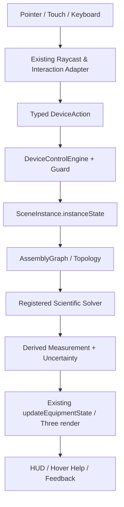

# MOCKUP 02 — BỘ GIẢI KHOA HỌC, ĐỊNH LUẬT TỰ NHIÊN VÀ ĐO LƯỜNG

**Mã:** `OL3D-MU-02-SCIENTIFIC-SOLVERS` · **Phạm vi:** 36 thiết bị, solver modules, uncertainty, calibration · **Trạng thái:** Design specification

## 0. Cam kết bảo toàn hệ thống hiện hữu (NON-DESTRUCTIVE UPGRADE)

Tài liệu này là mockup/đặc tả cải tiến, không phải lệnh tái viết dự án. Mọi triển khai phải theo nguyên tắc **ADD / ADAPT / VERIFY — NOT REPLACE**.

1. Giữ nguyên React 19, TypeScript strict, Vite 6, Three.js/WebGL và pipeline PBR đang có.
2. Giữ nguyên kiến trúc 4 lớp `OL3D-MASTER-SPEC v1.0`: Environment → Equipment → Interaction/Physics → App/Pedagogy.
3. Giữ nguyên chu trình nhân quả CIA 6 giai đoạn: User Action → Assembly Graph → Device State → Scientific Solvers → 3D Rendering → HUD/Feedback.
4. Giữ nguyên `AssetDefinition`, `SceneInstance`, `instanceState`, `window.OL3D_EQUIPMENT_MODULE`, `EquipmentModuleContract` và adapter tương thích v2.2/v2.3.
5. Không đổi Asset ID, slug, catalog key, tên node hiện đang được runtime tham chiếu, connector ID, state key hoặc đường dẫn public nếu chưa có migration plan tương thích ngược.
6. Không xóa/đổi tên các file nòng cốt. Ưu tiên thêm adapter, profile extension, solver service, schema version và test.
7. Mỗi thay đổi phải chạy typecheck, build, unit tests, assembly acceptance, scientific interaction regression và kiểm tra trực quan trên scene.
8. Không được gắn nhãn `PASS`, `verified` hoặc `validated` chỉ vì component tồn tại hoặc hình ảnh đẹp. Cần bằng chứng thực thi.
9. Dữ liệu nguồn có trạng thái `reported`, `illustrative`, `not-verified`, `partially-verified` phải tiếp tục giữ nguyên trạng thái và được đưa vào danh sách xác minh.
10. Khi phát hiện mâu thuẫn trong hồ sơ (ví dụ cân 500 g có thông số vỏ/tải bất thường, giá trị đơn vị không đồng nhất), không tự sửa số liệu; tạo `SPEC_CONFLICT` và yêu cầu đối chiếu datasheet/mẫu thật.

### 0.1. Bản đồ module hiện hữu cần kế thừa

| Vai trò | File hiện có | Cách mở rộng an toàn |
|---|---|---|
| Điều phối trạng thái | `src/App.tsx` | Bổ sung action/selector typed; không tạo state gốc song song |
| Viewport, raycast, drag-drop | `src/three-runtime/LabViewport3D.tsx` | Đăng ký hit targets và handler theo profile; tránh cài logic vật lý chuyên ngành dày đặc vào component |
| Mesh 3D | `src/three-runtime/ProceduralLabModels.ts` | Bổ sung named submeshes theo schema; giữ node legacy và alias |
| Kiểu dữ liệu | `src/domain/types.ts` | Mở rộng optional versioned fields; không phá payload cũ |
| Điều khiển | `src/device-control/DeviceControlEngine.ts` | Thêm mapping input→action→state và guard |
| Hồ sơ điều khiển | `src/device-control/DeviceControlProfilesData.ts` | Làm giàu profile từng asset; profile phải khai báo capabilities thực |
| Lắp ráp | `src/three-runtime/AssemblySystem.ts` | Thêm connector/constraint mới theo registry và migration |
| Môi trường | `src/three-runtime/LabEnvironmentEngine.ts` | Thêm environment adapter, không tạo environmental engine thứ hai |
| Hành vi | `src/three-runtime/BehaviorRegistry.ts` | Đăng ký behavior có type, lifecycle, teardown |
| UI hướng dẫn | `EquipmentHoverCard.tsx`, `EquipmentPreviewPanel.tsx`, `StudentGuidedStepPanel.tsx` | Kết nối dữ liệu profile, trạng thái và help content |
| Kiểm thử | `scripts/verify-assembly-acceptance.ts`, `scripts/verify-scientific-interaction.ts`, `scripts/scientific-profiles.ts` | Mở rộng kiểm thử; giữ nguyên test đã đạt |

### 0.2. Luồng dữ liệu đích (giữ nguyên CIA)



### 0.3. Phân loại thay đổi

- **P0 – bảo toàn:** thay đổi có nguy cơ phá vỡ state, module, connector, world units hoặc bộ giải hiện tại; không merge nếu chưa có regression.
- **P1 – đúng định luật:** sai causal dependency, sai dấu, sai đơn vị, hiển thị hiện tượng không có nguyên nhân.
- **P2 – điều khiển thực:** chi tiết 3D không điều khiển được, thiếu travel/range/lock/feedback.
- **P3 – giáo dục/UX:** hướng dẫn, tooltip, chú giải, accessibility, report.

## 1. Nguyên tắc khoa học: không có hiện tượng nếu thiếu nguyên nhân

Mọi đại lượng hiển thị phải có nguồn sinh: state thiết bị, liên kết lắp ráp, điều kiện môi trường, thời gian mô phỏng hoặc phép đo. Cần phân biệt rõ **giá trị chuẩn vật lý**, **giá trị nội bộ solver**, **giá trị đo có sai số**, **giá trị hiển thị đã làm tròn**. Không được dùng một con số demo làm kết quả thực nghiệm.

## 2. Hợp đồng solver dùng chung

```ts
interface SolverInput<TState, TEnv, TTopology> {
  instanceId: string; state: TState; environment: TEnv; topology: TTopology;
  dtSeconds: number; simulationTimeSeconds: number; seed?: number;
}
interface SolverResult<TDerived> {
  derived: TDerived; valid: boolean; warnings: string[]; errors: string[];
  uncertainty?: { standard: number; expanded?: number; unit: string; confidence?: number };
  provenance: { solverId: string; version: string; inputHash: string; sourceIds: string[] };
}
interface ScientificSolver<I,O> { id: string; version: string; solve(input:I): SolverResult<O>; }
```

### 2.1. Quy tắc đơn vị và miền giá trị

- SI là đơn vị nội bộ; đổi đơn vị chỉ ở biên nhập/xuất.
- Mọi phương trình phải kiểm tra thứ nguyên (dimensional analysis).
- Không chia cho 0, không sqrt/asin ngoài miền; trả lỗi domain cụ thể.
- Trị số làm tròn chỉ áp dụng ở màn hình; solver giữ precision nội bộ phù hợp.
- Noise phải có seed và bật/tắt được; không dùng noise để giả vờ thiết bị có sai số.
- Calibration offset, drift, repeatability, resolution, accuracy là các khái niệm riêng.
- MeasurementRecord lưu raw, corrected, displayed, unit, uncertainty, time, environment và provenance.

### 2.2. Bộ solver chính cần kế thừa và mở rộng

| Solver | Định luật/quan hệ | Thiết bị dùng | Không được làm |
| --- | --- | --- | --- |
| Mechanics | Newton, trọng lực, mômen, ma sát, Hooke | BAL, DYN, WGT, solids, LEV, STD | Cho vật đứng yên/treo không theo lực hoặc gia tốc |
| Hydrostatics/Fluids | p=p0+ρgh; Archimedes; continuity; Torricelli | CYL, BKR, OVF, SEP, WDP, HYD, FLK | Tạo dòng khi van đóng hoặc mực chất lỏng thay đổi không bảo toàn |
| Thermal | Q=mcΔT; energy balance; cooling/heating dynamics | BKR, FLK, DSH, DST, THM | Nóng/sôi nếu không có nguồn nhiệt hoặc điều kiện áp suất không phù hợp |
| Optics | Rectilinear propagation, Snell, thin lens, dispersion | OPT, OBN, OLP, FOB, SCR, LBX, LSR, SLB, PRM, MAG, MIC | Vẽ tia phát từ lăng kính không có nguồn hoặc sai giao cắt |
| Circuit | Ohm, Kirchhoff, component laws, polarity and protection | PSU, GLV, DMM, OLP, COIL | Cho đèn sáng khi mạch hở/nguồn tắt; DMM đo điện áp giữa không khí |
| Induction | Faraday–Lenz: E=-N dΦ/dt | COIL, GLV, magnets | Cho LED sáng khi nam châm đứng yên hoặc chiều lệch trái/ngược sai quy ước |
| Microscopy | Magnification, FOV, NA, Abbe limit, focus/DoF | MIC + specimen profiles | Tăng zoom nhưng giữ nguyên trường nhìn hoặc tạo chi tiết dưới giới hạn phân giải |
## 3. Hồ sơ khoa học theo thiết bị (trích dẫn nguồn + nâng cấp solver)

## 01. Cân điện tử hiện số 500 g

- **Asset ID:** `OL3D-EQP-BAL-0001`
- **Archetype:** `electronic-balance` · **Category:** `mass-measurement`
- **Nhóm GDPT liên quan:** G02
- **Tên tiếng Anh trong hồ sơ:** *Precision Electronic Balance 500 g*
- **Nguyên tắc:** giữ assetId, slug, module hiện hữu; chỉ mở rộng control profile, state, solver adapter và test có version.
### 3.01.1. Phương trình, hành vi và đo lường đã ghi trong hồ sơ nguồn

### 7. Logic Hành vi Mô phỏng & Phương trình Khoa học Nhân quả
* **Các phương trình vật lý áp dụng (MathType LaTeX)**:
  $$\mathbf{(1)}\quad m_{net} = \max\left(0, m_{gross} - m_{tare}\right)$$
  *Ý nghĩa vật lý*: Số chỉ khối lượng tịnh sau khi trừ bì (TARE Offset).
  $$\mathbf{(2)}\quad m(t) = m_{final} \cdot \left(1 - e^{-t / \tau}\right) + \epsilon_{Gauss}(0, \sigma^2)$$
  *Ý nghĩa vật lý*: Động học đáp ứng cảm biến Loadcell và nhiễu vi chấn động không khí ($\tau \approx 0.35\text{ s}$, $\sigma = 0.005\text{ g}$).
  $$\mathbf{(3)}\quad m_{thermal} = m_0 \cdot \left[1 + \alpha_{loadcell} \cdot (T_{air} - 25^\circ\text{C})\right]$$
  *Ý nghĩa vật lý*: Hiệu ứng trôi nhiệt độ độ nhạy cảm biến biến dạng ($\alpha_{loadcell} \approx 1.5 \times 10^{-5}\,\text{K}^{-1}$).
* **Các tính năng khoa học tích hợp**:
  - Cảm biến lực biến dạng (Loadcell) độ nhạy 0.01 g, thời gian ổn định kết quả ≤ 2 giây.
  - Chức năng trừ bì (Phím TARE/ZERO) đưa màn hình về 0.00 g khi đặt cốc chứa chất lỏng.
  - Đĩa cân thép không gỉ SUS304 tháo rời vệ sinh được, có chân ren chỉnh thăng bằng và bọt thủy.
  - Hiển thị trực tiếp số gam trên màn hình LCD 3D và tự động khóa số đo khi vật đứng yên.

### 8. Máy Trạng thái Động (Finite State Machine)
* **Trạng thái khởi tạo**: `IDLE_ZERO`
* **Danh sách trạng thái khả dụng**: `IDLE_ZERO`, `WEIGHING_SETTLING`, `STABLE_LOCKED`, `OVERLOAD_ERROR`
* **Ma trận chuyển trạng thái (State Transitions)**:
| Trạng thái ban đầu | Trạng thái tiếp theo | Sự kiện kích hoạt (Trigger) | Điều kiện chuyển (Guard Condition) |
| :--- | :--- | :--- | :--- |
| `IDLE_ZERO` | `WEIGHING_SETTLING` | Object placed on pan | `m_gross > 0.05 g` |
| `WEIGHING_SETTLING` | `STABLE_LOCKED` | Settling timer elapsed | `|dm/dt| < 0.01 g/s for 1.2s` |
| `WEIGHING_SETTLING` | `OVERLOAD_ERROR` | Load exceeds capacity | `m_gross > 550.0 g` |
| `STABLE_LOCKED` | `IDLE_ZERO` | TARE button pressed | `true` |

### 9. Ngân sách Sai số Đo lường & Giới hạn Metrology
* **Sai số dụng cụ (Instrumental Error)**: ±0.02 g (OIML Class II)
* **Độ chia nhỏ nhất / Độ phân giải**: 0.01 g (Màn hình 2 số lẻ)
* **Độ lặp lại phép đo**: 0.01 g (Độ lệch chuẩn lặp lại s <= 0.01g)
* **Hệ số trôi nhiệt độ / Đặc tính môi trường**: ±0.005 g / 10°C

### 10. Phân tích Chế độ Hỏng hóc & Biện pháp Khắc phục (FMEA)
| Chế độ hỏng hóc (Failure Mode) | Nguyên nhân gốc rễ (Root Cause) | Tác động hệ thống (System Effect) | Phương thức phát hiện | Hành động khắc phục tự động |
| :--- | :--- | :--- | :--- | :--- |
| **Số đo trôi dạt liên tục (Drifting)** | Luồng gió phòng v_air > 0.5 m/s thổi lên đĩa cân | Cân không chốt số STABLE_LOCKED | `Cờ isDraftInterference = true` | Bật hộp chắn gió hoặc giảm tốc độ quạt phòng v_air = 0 m/s |
| **Báo lỗi quá tải OVERLOAD_ERR** | Đặt tải trọng vượt quá GHĐ 500g | Màn hình nhấp nháy [ - - - - ] | `Loadcell strain > 105% FS` | Nhấc bớt vật nặng khỏi đĩa cân về bàn |

### 11. Hồ sơ Khoa học Thẩm định 5 Nguồn Độc lập
| Nguồn tham chiếu | Tên miền (Domain) | Nội dung thông số kỹ thuật đã thẩm định đối chiếu |
| :--- | :--- | :--- |
| **Thư viện Pháp luật (Thông tư 38/2021/TT-BGDĐT)** | `thuvienphapluat.vn` | Danh mục thiết bị dạy học tối thiểu KHTN THCS: Cân điện tử hiện số, độ chính xác 0.01g – 0.1g, có chức năng trừ bì. |
| **Thiết bị Giáo dục VietValue** | `vietvalue.edu.vn` | Cân kỹ thuật phòng thí nghiệm THCS: Đĩa cân Ø 120–130 mm Inox, màn hình LCD xanh ngọc, phím TARE/MODE/ON-OFF. |
| **Thiết bị Điện tử & Đo lường Việt Nam** | `thietbidientu.net.vn` | Kích thước máy chuẩn 190 × 240 × 75 mm, nguồn DC 6V/Pin AA, sai số lặp lại ±0.02 g. |
| **DMKLab — Thiết bị Phòng thí nghiệm** | `dmklab.vn` | Cân kỹ thuật 2 số lẻ (0.01 g): Tích hợp chống quá tải cơ học và tự động hiệu chuẩn ngoại bằng quả cân chuẩn. |
| **Innotec Việt Nam — Thiết bị Dạy học** | `innotec.com.vn` | Cân điện tử thực hành KHTN: Vỏ nhựa ABS chống hóa chất, mặt hiển thị nghiêng 25° giúp học sinh dễ đọc góc nhìn thẳng. |

---

### 3.01.2. Đặc tả solver cải tiến

| Miền | Thiết kế đề xuất | Điều kiện bắt buộc |
| --- | --- | --- |
| Input state | Lấy state từ instance `OL3D-EQP-BAL-0001` và các instance liên kết; biến môi trường: `gravityMps2`, `airflowMps`, `airTemperatureC`, `benchTemperatureC`. | Input có timestamp, unit, instanceId, không đọc DOM/mesh như nguồn số liệu. |
| Physical core | Dùng các phương trình/hành vi đã ghi ở mục 7 của hồ sơ `OL3D-EQP-BAL-0001`; phần thiếu thì đánh dấu `MODEL_REQUIRED`. | Kiểm tra thứ nguyên, domain, dấu, điều kiện biên, topology. |
| Instrument model | Áp dụng GHĐ/ĐCNN/sai số đúng theo hồ sơ: - Đại lượng đo: `mass`. | Không đồng nhất resolution với accuracy; không hiển thị quá độ phân giải. |
| Environment coupling | Chỉ nhận các biến có quan hệ vật lý hợp lý: gravityMps2, airflowMps, airTemperatureC, benchTemperatureC. | Không để mọi biến môi trường tác động tới mọi thiết bị; đăng ký dependency explicit. |
| Output | Trả derived physical state, raw measurement, corrected measurement, displayed value, uncertainty, warnings. | Renderer/UI chỉ đọc result; không tự tính lại phương trình. |

### 3.01.3. Câu hỏi khoa học phải được solver trả lời

- Đại lượng nào đang được tạo ra hoặc đo? Đâu là nguồn gây ra nó?
- Điều kiện đầu, điều kiện biên và topology đã hợp lệ chưa?
- Khi input thay đổi một lượng nhỏ, output thay đổi theo đúng chiều và độ lớn không?
- Khi mất nguồn/nối/tiếp xúc, hiện tượng nào phải biến mất hoặc suy giảm?
- Giá trị đo có ổn định theo thời gian hay cần mô hình đáp ứng/trễ?
- Giá trị hiển thị đã làm tròn theo ĐCNN và có kèm đơn vị chưa?
- Sai số do dụng cụ, hiệu chuẩn, môi trường và đọc sai góc nhìn được tách riêng chưa?

### 3.01.4. Kiểm thử khoa học riêng

- **BAL-SCI-DIMENSION:** Kiểm tra thứ nguyên mọi công thức và chuyển đổi đơn vị.
- **BAL-SCI-ZERO:** Input bằng zero/không có nguồn phải cho kết quả zero hoặc trạng thái đúng theo lý thuyết.
- **BAL-SCI-MONOTONIC:** Thay input độc lập theo hai chiều; output phải đổi đúng chiều trong miền áp dụng.
- **BAL-SCI-BOUNDARY:** Kiểm tra biên GHĐ, ngưỡng vật lý, singularity và quá dải.
- **BAL-SCI-CONSERVATION:** Kiểm tra bảo toàn khối lượng/thể tích/điện tích/năng lượng tùy solver liên quan.
- **BAL-SCI-ENV:** Chỉ biến môi trường có đăng ký mới tác động; so sánh default và perturbed values.
- **BAL-SCI-MEASUREMENT:** Giá trị raw→corrected→displayed nhất quán với resolution/uncertainty.
- **BAL-SCI-DETERMINISM:** Cùng input, state, seed, dt phải tạo kết quả lặp lại.
- **BAL-SCI-TOPOLOGY:** Mất connector hoặc đổi cực phải thay output đúng điều kiện.
- **BAL-SCI-REGRESSION:** Không làm thay đổi các kết quả SCI/ASM đã nghiệm thu nếu test case không liên quan.

### 3.01.5. Trạng thái xác minh dữ liệu

- Nguồn hiện ghi: **`published` | Đo lường: `partially-verified`
* **Gói module HTML độc lập**: Đã đóng gói tại thư mục `public/libraries3DLab/OL3D-EQP-BAL-0001_can-dien-tu-hien-so-500g` (Tập tin: `undefined`).**.
- Chỉ số nào `reported`/`illustrative`/`not-verified` không được dùng làm reference calibration cho đến khi đối chiếu mẫu thật/datasheet.
- Nếu các mục trong hồ sơ mâu thuẫn nhau (khối lượng, dung tích, dải đo, đơn vị, ĐCNN), tạo issue và chặn nghiệm thu solver tương ứng.
- Solver phải xuất cờ `dataQuality: VERIFIED | REPORTED | ILLUSTRATIVE | UNVERIFIED | CONFLICTED`.

## 02. Ống đong thủy tinh 100 ml

- **Asset ID:** `OL3D-EQP-CYL-0001`
- **Archetype:** `graduated-cylinder` · **Category:** `volume-measurement`
- **Nhóm GDPT liên quan:** G04, G02
- **Tên tiếng Anh trong hồ sơ:** *100 ml Graduated Cylinder*
- **Nguyên tắc:** giữ assetId, slug, module hiện hữu; chỉ mở rộng control profile, state, solver adapter và test có version.
### 3.02.1. Phương trình, hành vi và đo lường đã ghi trong hồ sơ nguồn

### 7. Logic Hành vi Mô phỏng & Phương trình Khoa học Nhân quả
* **Các phương trình vật lý áp dụng (MathType LaTeX)**:
  $$\mathbf{(1)}\quad V = \pi \cdot \left(\frac{D_{in}}{2}\right)^2 \cdot h_{liquid}$$
  *Ý nghĩa vật lý*: Thể tích hình trụ chất lỏng theo đường kính trong $D_{in} = 28.0\text{ mm}$.
  $$\mathbf{(2)}\quad \Delta V = V_{sau} - V_{trước} = V_{vật\,rắn}$$
  *Ý nghĩa vật lý*: Phương pháp dời chỗ chất lỏng đo thể tích vật rắn không thấm nước.
  $$\mathbf{(3)}\quad h_{meniscus} = \frac{2\gamma \cos\theta}{\rho g r_{in}}$$
  *Ý nghĩa vật lý*: Độ nâng mao dẫn mặt khum lõm của nước tại thành ống thủy tinh ($gamma \approx 0.0728\text{ N/m}$, $\theta \approx 0^\circ$).
* **Các tính năng khoa học tích hợp**:
  - Thủy tinh Borosilicate 3.3 trong suốt, thành dày đều, có mỏ rót chống nhỏ giọt.
  - Chân đế lục giác chống lăn khi đặt nằm và chống lật trên mặt bàn gỗ thí nghiệm.
  - Vạch chia ml sắc nét từ 10 ml đến 100 ml (ĐCNN 1 ml), hiệu chuẩn chuẩn In (Ex/TD) ở 20 °C.
  - Cho phép đọc mặt khum lõm của nước và đo thể tích vật rắn không thấm nước (ΔV = V₂ - V₁).

### 8. Máy Trạng thái Động (Finite State Machine)
* **Trạng thái khởi tạo**: `EMPTY`
* **Danh sách trạng thái khả dụng**: `EMPTY`, `PARTIALLY_FILLED`, `MENISCUS_STABLE`, `SUBMERGED_OBJECT`, `OVERFLOW`
* **Ma trận chuyển trạng thái (State Transitions)**:
| Trạng thái ban đầu | Trạng thái tiếp theo | Sự kiện kích hoạt (Trigger) | Điều kiện chuyển (Guard Condition) |
| :--- | :--- | :--- | :--- |
| `EMPTY` | `PARTIALLY_FILLED` | Liquid poured in | `V_liquid > 0` |
| `PARTIALLY_FILLED` | `SUBMERGED_OBJECT` | Sample solid dropped | `D_obj <= 28 mm` |
| `SUBMERGED_OBJECT` | `OVERFLOW` | Total volume exceeds 100ml | `V_total > 100 ml` |

### 9. Ngân sách Sai số Đo lường & Giới hạn Metrology
* **Sai số dụng cụ (Instrumental Error)**: ±1.0 ml (ISO 4788 Class B ở 20°C)
* **Độ chia nhỏ nhất / Độ phân giải**: 1.0 ml (Vạch chia men trắng)
* **Độ lặp lại phép đo**: ±0.5 ml
* **Hệ số trôi nhiệt độ / Đặc tính môi trường**: Giãn nở thủy tinh Borosilicate 3.3: 3.3 × 10⁻⁶ K⁻¹ (không đáng kể)

### 10. Phân tích Chế độ Hỏng hóc & Biện pháp Khắc phục (FMEA)
| Chế độ hỏng hóc (Failure Mode) | Nguyên nhân gốc rễ (Root Cause) | Tác động hệ thống (System Effect) | Phương thức phát hiện | Hành động khắc phục tự động |
| :--- | :--- | :--- | :--- | :--- |
| **Sai số thị giác (Parallax Error)** | Góc nhìn camera không nằm ngang đáy mặt khum nước | Đọc sai thể tích ±2 đến 3 ml | `Góc lệch trục camera > 5° so với mặt phẳng ngang` | Bấm nút Focus Eye-Level tự động căn camera vuông góc vạch đo |
| **Kẹt mẫu vật ngang miệng ống** | Thả mẫu vật có đường kính > 28 mm (như khối đồng 30mm) | Vật không chìm được vào nước, nguy cơ nứt vỡ miệng ống | `Kiểm tra va chạm Box3 Aperture` | Bật cảnh báo APERTURE_OVERSIZE và chuyển mẫu sang Bình tràn Eureka |

### 11. Hồ sơ Khoa học Thẩm định 5 Nguồn Độc lập
| Nguồn tham chiếu | Tên miền (Domain) | Nội dung thông số kỹ thuật đã thẩm định đối chiếu |
| :--- | :--- | :--- |
| **VietChem — Hóa chất & Dụng cụ Thí nghiệm** | `vietchem.com.vn` | Ống đong thủy tinh 100ml Duran/ISO 4788: Đường kính thân Ø 31 mm, chiều cao 250–256 mm, vạch chia nhỏ nhất 1 ml. |
| **Lata Việt Nam — Thiết bị Khoa học** | `lata.vn` | Ống đong 100ml đế lục giác: Thủy tinh Borosilicate 3.3 chịu nhiệt, độ dày thành 1.8 mm, mỏ rót tiêu chuẩn DIN. |
| **Thư viện Pháp luật (Thông tư 38/2021/TT-BGDĐT)** | `thuvienphapluat.vn` | Ống đong thủy tinh/nhựa trong suốt 100ml dùng chung cho mạch kiến thức Vật lí (đo thể tích vật rắn) và Hóa học. |
| **Visitech — Giải pháp Phòng thí nghiệm** | `visitech.vn` | Ống đong Class B 100 ml: Sai số cho phép ±1.0 ml, vạch in men trắng hoặc xanh bền hóa chất. |
| **Nhà sách Giáo dục — Thiết bị Trường học** | `nhasachgiaoduc.vn` | Ống đong thực hành KHTN THCS: Đế rộng vững chắc, đường kính lòng ống 28 mm bỏ lọt các trụ kim loại thực hành. |

---

### 3.02.2. Đặc tả solver cải tiến

| Miền | Thiết kế đề xuất | Điều kiện bắt buộc |
| --- | --- | --- |
| Input state | Lấy state từ instance `OL3D-EQP-CYL-0001` và các instance liên kết; biến môi trường: `gravityMps2`, `sampleTemperatureC`, `sampleDensityKgM3`, `sampleViscosityPaS`. | Input có timestamp, unit, instanceId, không đọc DOM/mesh như nguồn số liệu. |
| Physical core | Dùng các phương trình/hành vi đã ghi ở mục 7 của hồ sơ `OL3D-EQP-CYL-0001`; phần thiếu thì đánh dấu `MODEL_REQUIRED`. | Kiểm tra thứ nguyên, domain, dấu, điều kiện biên, topology. |
| Instrument model | Áp dụng GHĐ/ĐCNN/sai số đúng theo hồ sơ: - Đại lượng đo: `volume`. | Không đồng nhất resolution với accuracy; không hiển thị quá độ phân giải. |
| Environment coupling | Chỉ nhận các biến có quan hệ vật lý hợp lý: gravityMps2, sampleTemperatureC, sampleDensityKgM3, sampleViscosityPaS. | Không để mọi biến môi trường tác động tới mọi thiết bị; đăng ký dependency explicit. |
| Output | Trả derived physical state, raw measurement, corrected measurement, displayed value, uncertainty, warnings. | Renderer/UI chỉ đọc result; không tự tính lại phương trình. |

### 3.02.3. Câu hỏi khoa học phải được solver trả lời

- Đại lượng nào đang được tạo ra hoặc đo? Đâu là nguồn gây ra nó?
- Điều kiện đầu, điều kiện biên và topology đã hợp lệ chưa?
- Khi input thay đổi một lượng nhỏ, output thay đổi theo đúng chiều và độ lớn không?
- Khi mất nguồn/nối/tiếp xúc, hiện tượng nào phải biến mất hoặc suy giảm?
- Giá trị đo có ổn định theo thời gian hay cần mô hình đáp ứng/trễ?
- Giá trị hiển thị đã làm tròn theo ĐCNN và có kèm đơn vị chưa?
- Sai số do dụng cụ, hiệu chuẩn, môi trường và đọc sai góc nhìn được tách riêng chưa?

### 3.02.4. Kiểm thử khoa học riêng

- **CYL-SCI-DIMENSION:** Kiểm tra thứ nguyên mọi công thức và chuyển đổi đơn vị.
- **CYL-SCI-ZERO:** Input bằng zero/không có nguồn phải cho kết quả zero hoặc trạng thái đúng theo lý thuyết.
- **CYL-SCI-MONOTONIC:** Thay input độc lập theo hai chiều; output phải đổi đúng chiều trong miền áp dụng.
- **CYL-SCI-BOUNDARY:** Kiểm tra biên GHĐ, ngưỡng vật lý, singularity và quá dải.
- **CYL-SCI-CONSERVATION:** Kiểm tra bảo toàn khối lượng/thể tích/điện tích/năng lượng tùy solver liên quan.
- **CYL-SCI-ENV:** Chỉ biến môi trường có đăng ký mới tác động; so sánh default và perturbed values.
- **CYL-SCI-MEASUREMENT:** Giá trị raw→corrected→displayed nhất quán với resolution/uncertainty.
- **CYL-SCI-DETERMINISM:** Cùng input, state, seed, dt phải tạo kết quả lặp lại.
- **CYL-SCI-TOPOLOGY:** Mất connector hoặc đổi cực phải thay output đúng điều kiện.
- **CYL-SCI-REGRESSION:** Không làm thay đổi các kết quả SCI/ASM đã nghiệm thu nếu test case không liên quan.

### 3.02.5. Trạng thái xác minh dữ liệu

- Nguồn hiện ghi: **`published` | Đo lường: `verified`
* **Gói module HTML độc lập**: Đã đóng gói tại thư mục `public/libraries3DLab/OL3D-EQP-CYL-0001_ong-dong-thuy-tinh-100ml` (Tập tin: `undefined`).**.
- Chỉ số nào `reported`/`illustrative`/`not-verified` không được dùng làm reference calibration cho đến khi đối chiếu mẫu thật/datasheet.
- Nếu các mục trong hồ sơ mâu thuẫn nhau (khối lượng, dung tích, dải đo, đơn vị, ĐCNN), tạo issue và chặn nghiệm thu solver tương ứng.
- Solver phải xuất cờ `dataQuality: VERIFIED | REPORTED | ILLUSTRATIVE | UNVERIFIED | CONFLICTED`.

## 03. Cốc thủy tinh chia độ 250 ml

- **Asset ID:** `OL3D-EQP-BKR-0001`
- **Archetype:** `beaker-250` · **Category:** `laboratory-glassware`
- **Nhóm GDPT liên quan:** G04, G05, G02
- **Tên tiếng Anh trong hồ sơ:** *250 ml Low-Form Glass Beaker*
- **Nguyên tắc:** giữ assetId, slug, module hiện hữu; chỉ mở rộng control profile, state, solver adapter và test có version.
### 3.03.1. Phương trình, hành vi và đo lường đã ghi trong hồ sơ nguồn

### 7. Logic Hành vi Mô phỏng & Phương trình Khoa học Nhân quả
* **Các phương trình vật lý áp dụng (MathType LaTeX)**:
  $$\mathbf{(1)}\quad Q = m \cdot c \cdot \Delta T = P_{heat} \cdot t \cdot \eta_{thermal}$$
  *Ý nghĩa vật lý*: Phương trình truyền nhiệt khi đun nóng dung dịch trong cốc bằng đèn cồn ($eta \approx 65\%$).
  $$\mathbf{(2)}\quad m_{tổng} = m_{vỏ\,cốc} + V_{lỏng} \cdot \rho_{lỏng}$$
  *Ý nghĩa vật lý*: Khối lượng tổng cộng khi đặt cốc chứa chất lỏng lên cân điện tử ($m_{vỏ} = 95.0\text{ g}$).
* **Các tính năng khoa học tích hợp**:
  - Cốc đốt thủy tinh Borosilicate 3.3 dạng thấp thành (Griffin Low-Form), chịu sốc nhiệt tới ΔT = 160 °C.
  - Đáy phẳng tiếp xúc đều với lưới tản nhiệt khi đun trên đèn cồn hoặc đặt trên đĩa cân điện tử.
  - Mỏ rót định hình chuẩn giúp nghiêng rót chất lỏng sang ống đong không bị chảy lem dọc thành ngoài.
  - Vạch chia dung tích định hướng và vùng nhãn mờ để ghi ký hiệu hóa chất.

### 8. Máy Trạng thái Động (Finite State Machine)
* **Trạng thái khởi tạo**: `EMPTY`
* **Danh sách trạng thái khả dụng**: `EMPTY`, `FILLED`, `HEATING`, `BOILING`, `POURING`
* **Ma trận chuyển trạng thái (State Transitions)**:
| Trạng thái ban đầu | Trạng thái tiếp theo | Sự kiện kích hoạt (Trigger) | Điều kiện chuyển (Guard Condition) |
| :--- | :--- | :--- | :--- |
| `EMPTY` | `FILLED` | Liquid added | `liquidLevelMl > 0` |
| `FILLED` | `HEATING` | Burner flame applied | `T_liquid > T_ambient` |
| `HEATING` | `BOILING` | Temperature reaches boiling point | `T_liquid >= 100.0 C` |

### 9. Ngân sách Sai số Đo lường & Giới hạn Metrology
* **Sai số dụng cụ (Instrumental Error)**: ±5% dung tích định hướng (DIN 12331)
* **Độ chia nhỏ nhất / Độ phân giải**: 25 ml (Vạch chia thô 50..200 ml)
* **Độ lặp lại phép đo**: ±5 ml
* **Hệ số trôi nhiệt độ / Đặc tính môi trường**: Khả năng chịu sốc nhiệt ΔT = 160°C

### 10. Phân tích Chế độ Hỏng hóc & Biện pháp Khắc phục (FMEA)
| Chế độ hỏng hóc (Failure Mode) | Nguyên nhân gốc rễ (Root Cause) | Tác động hệ thống (System Effect) | Phương thức phát hiện | Hành động khắc phục tự động |
| :--- | :--- | :--- | :--- | :--- |
| **Sôi trào bọt khí (Bumping)** | Đun sôi chất lỏng không có đá bọt điều hòa sôi | Dung dịch bắn tung tóe ra ngoài cốc | `dT/dt > 15°C/s khi T > 95°C` | Thêm bi thủy tinh / đá bọt và giảm công suất đèn cồn |

### 11. Hồ sơ Khoa học Thẩm định 5 Nguồn Độc lập
| Nguồn tham chiếu | Tên miền (Domain) | Nội dung thông số kỹ thuật đã thẩm định đối chiếu |
| :--- | :--- | :--- |
| **Thư viện Pháp luật (Thông tư 38/2021/TT-BGDĐT)** | `thuvienphapluat.vn` | Cốc thủy tinh 250ml chịu nhiệt, có vạch chia và mỏ rót thuộc danh mục dụng cụ thủy tinh dùng chung môn KHTN. |
| **VietChem — Dụng cụ Thủy tinh Duran** | `vietchem.com.vn` | Cốc đốt 250ml Low-form (ISO 3819): Đường kính ngoài Ø 70 mm, chiều cao 95–98 mm, thủy tinh Borosilicate 3.3. |
| **Eisco Labs Scientific Catalog** | `eiscolabs.com` | 250ml Borosilicate Glass Beaker, Low Form with Spout: OD 70 mm, Height 97 mm, 25 ml graduations. |
| **Foxx Life Sciences Glassware** | `foxxlifesciences.com` | Griffin Beaker 250 mL: Uniform wall thickness for thermal shock resistance on wire gauze. |
| **Visitech Việt Nam** | `visitech.vn` | Cốc thủy tinh 250 ml dùng pha chế dung dịch, hứng dịch lọc từ phễu chiết và hứng nước từ bình tràn. |

---

### 3.03.2. Đặc tả solver cải tiến

| Miền | Thiết kế đề xuất | Điều kiện bắt buộc |
| --- | --- | --- |
| Input state | Lấy state từ instance `OL3D-EQP-BKR-0001` và các instance liên kết; biến môi trường: `gravityMps2`, `sampleTemperatureC`, `sampleDensityKgM3`, `thermalHeatPowerW`, `airTemperatureC`. | Input có timestamp, unit, instanceId, không đọc DOM/mesh như nguồn số liệu. |
| Physical core | Dùng các phương trình/hành vi đã ghi ở mục 7 của hồ sơ `OL3D-EQP-BKR-0001`; phần thiếu thì đánh dấu `MODEL_REQUIRED`. | Kiểm tra thứ nguyên, domain, dấu, điều kiện biên, topology. |
| Instrument model | Áp dụng GHĐ/ĐCNN/sai số đúng theo hồ sơ: Chưa khai báo trong hồ sơ nguồn. | Không đồng nhất resolution với accuracy; không hiển thị quá độ phân giải. |
| Environment coupling | Chỉ nhận các biến có quan hệ vật lý hợp lý: gravityMps2, sampleTemperatureC, sampleDensityKgM3, thermalHeatPowerW, airTemperatureC. | Không để mọi biến môi trường tác động tới mọi thiết bị; đăng ký dependency explicit. |
| Output | Trả derived physical state, raw measurement, corrected measurement, displayed value, uncertainty, warnings. | Renderer/UI chỉ đọc result; không tự tính lại phương trình. |

### 3.03.3. Câu hỏi khoa học phải được solver trả lời

- Đại lượng nào đang được tạo ra hoặc đo? Đâu là nguồn gây ra nó?
- Điều kiện đầu, điều kiện biên và topology đã hợp lệ chưa?
- Khi input thay đổi một lượng nhỏ, output thay đổi theo đúng chiều và độ lớn không?
- Khi mất nguồn/nối/tiếp xúc, hiện tượng nào phải biến mất hoặc suy giảm?
- Giá trị đo có ổn định theo thời gian hay cần mô hình đáp ứng/trễ?
- Giá trị hiển thị đã làm tròn theo ĐCNN và có kèm đơn vị chưa?
- Sai số do dụng cụ, hiệu chuẩn, môi trường và đọc sai góc nhìn được tách riêng chưa?

### 3.03.4. Kiểm thử khoa học riêng

- **BKR-SCI-DIMENSION:** Kiểm tra thứ nguyên mọi công thức và chuyển đổi đơn vị.
- **BKR-SCI-ZERO:** Input bằng zero/không có nguồn phải cho kết quả zero hoặc trạng thái đúng theo lý thuyết.
- **BKR-SCI-MONOTONIC:** Thay input độc lập theo hai chiều; output phải đổi đúng chiều trong miền áp dụng.
- **BKR-SCI-BOUNDARY:** Kiểm tra biên GHĐ, ngưỡng vật lý, singularity và quá dải.
- **BKR-SCI-CONSERVATION:** Kiểm tra bảo toàn khối lượng/thể tích/điện tích/năng lượng tùy solver liên quan.
- **BKR-SCI-ENV:** Chỉ biến môi trường có đăng ký mới tác động; so sánh default và perturbed values.
- **BKR-SCI-MEASUREMENT:** Giá trị raw→corrected→displayed nhất quán với resolution/uncertainty.
- **BKR-SCI-DETERMINISM:** Cùng input, state, seed, dt phải tạo kết quả lặp lại.
- **BKR-SCI-TOPOLOGY:** Mất connector hoặc đổi cực phải thay output đúng điều kiện.
- **BKR-SCI-REGRESSION:** Không làm thay đổi các kết quả SCI/ASM đã nghiệm thu nếu test case không liên quan.

### 3.03.5. Trạng thái xác minh dữ liệu

- Nguồn hiện ghi: **`published` | Đo lường: `not-verified`
* **Gói module HTML độc lập**: Đã đóng gói tại thư mục `public/libraries3DLab/OL3D-EQP-BKR-0001_coc-thuy-tinh-250ml` (Tập tin: `undefined`).**.
- Chỉ số nào `reported`/`illustrative`/`not-verified` không được dùng làm reference calibration cho đến khi đối chiếu mẫu thật/datasheet.
- Nếu các mục trong hồ sơ mâu thuẫn nhau (khối lượng, dung tích, dải đo, đơn vị, ĐCNN), tạo issue và chặn nghiệm thu solver tương ứng.
- Solver phải xuất cờ `dataQuality: VERIFIED | REPORTED | ILLUSTRATIVE | UNVERIFIED | CONFLICTED`.

## 04. Bình tràn Eureka 250 ml

- **Asset ID:** `OL3D-EQP-OVF-0001`
- **Archetype:** `overflow-can` · **Category:** `volume-measurement`
- **Nhóm GDPT liên quan:** G02, G04
- **Tên tiếng Anh trong hồ sơ:** *Eureka Overflow Can 250 ml*
- **Nguyên tắc:** giữ assetId, slug, module hiện hữu; chỉ mở rộng control profile, state, solver adapter và test có version.
### 3.04.1. Phương trình, hành vi và đo lường đã ghi trong hồ sơ nguồn

### 7. Logic Hành vi Mô phỏng & Phương trình Khoa học Nhân quả
* **Các phương trình vật lý áp dụng (MathType LaTeX)**:
  $$\mathbf{(1)}\quad V_{tràn} = \max\left(0, V_{ban\,đầu} + V_{chiếm\,chỗ} - V_{ngưỡng}\right)$$
  *Ý nghĩa vật lý*: Thể tích nước tràn qua vòi nghiêng khi vật rắn chìm vào lòng bình ($V_{ngưỡng} = 210.0\text{ ml}$).
  $$\mathbf{(2)}\quad v_{spout} = \sqrt{2 \cdot g \cdot h_{crest}}$$
  *Ý nghĩa vật lý*: Tốc độ dòng xả tại cổ vòi tràn theo định luật Torricelli.
* **Các tính năng khoa học tích hợp**:
  - Thân hình trụ đứng trong suốt giúp quan sát trực tiếp vật rắn chìm hoàn toàn trong lòng chất lỏng.
  - Vòi dẫn nước tràn gắn nghiêng 30° ở phần trên thân bình giúp dòng nước chảy gọn vào cốc hứng.
  - Ứng dụng nguyên lý Archimedes: Thể tích nước tràn qua vòi sang cốc hứng bằng đúng thể tích vật rắn chiếm chỗ.
  - Dùng cho các vật rắn có kích thước lớn hơn đường kính miệng ống đong 100 ml.

### 8. Máy Trạng thái Động (Finite State Machine)
* **Trạng thái khởi tạo**: `UNFILLED`
* **Danh sách trạng thái khả dụng**: `UNFILLED`, `PRIMED_TO_BRIM`, `OVERFLOWING_ACTIVE`, `DRAINED_TO_BRIM`
* **Ma trận chuyển trạng thái (State Transitions)**:
| Trạng thái ban đầu | Trạng thái tiếp theo | Sự kiện kích hoạt (Trigger) | Điều kiện chuyển (Guard Condition) |
| :--- | :--- | :--- | :--- |
| `UNFILLED` | `PRIMED_TO_BRIM` | Water filled to spout neck | `V == 210.0 ml` |
| `PRIMED_TO_BRIM` | `OVERFLOWING_ACTIVE` | Object submerged | `V_submerged > 0` |
| `OVERFLOWING_ACTIVE` | `DRAINED_TO_BRIM` | Overflow stream finished | `V_spout == 0` |

### 9. Ngân sách Sai số Đo lường & Giới hạn Metrology
* **Sai số dụng cụ (Instrumental Error)**: ±1.0 ml thể tích tràn (phụ thuộc góc đặt bình và bám dính giọt)
* **Độ chia nhỏ nhất / Độ phân giải**: 1.0 ml (kết hợp ống đong hứng)
* **Độ lặp lại phép đo**: ±0.8 ml
* **Hệ số trôi nhiệt độ / Đặc tính môi trường**: Không đáng kể

### 10. Phân tích Chế độ Hỏng hóc & Biện pháp Khắc phục (FMEA)
| Chế độ hỏng hóc (Failure Mode) | Nguyên nhân gốc rễ (Root Cause) | Tác động hệ thống (System Effect) | Phương thức phát hiện | Hành động khắc phục tự động |
| :--- | :--- | :--- | :--- | :--- |
| **Nước chưa tới ngưỡng vòi đã thả vật** | Mực nước ban đầu < 210 ml | Thể tích nước hứng được nhỏ hơn thể tích thực của vật | `V_initial < 210.0 ml` | Bắt buộc đổ nước đầy tràn vòi trước khi tiến hành thí nghiệm Archimedes |

### 11. Hồ sơ Khoa học Thẩm định 5 Nguồn Độc lập
| Nguồn tham chiếu | Tên miền (Domain) | Nội dung thông số kỹ thuật đã thẩm định đối chiếu |
| :--- | :--- | :--- |
| **VietValue — Thiết bị Dạy học Tối thiểu** | `vietvalue.edu.vn` | Bình tràn thí nghiệm Vật lí THCS: Dung tích 250–300 ml, thân trụ trong suốt có vòi thoát nước nghiêng chống bám giọt. |
| **Innotec Việt Nam** | `innotec.com.vn` | Bình tràn đo thể tích vật rắn và lực đẩy Archimedes: Đường kính Ø 85 mm, chiều cao 150–160 mm. |
| **Thư viện Vật lý Việt Nam** | `thuvienvatly.com` | Quy trình đo khối lượng riêng bằng bình tràn: Đổ nước đầy tới miệng vòi tràn trước khi thả chìm vật nặng. |
| **VinaMTSC — Công ty Thiết bị Khoa học Kỹ thuật** | `vinamtsc.com` | Bình tràn thủy tinh Borosilicate có vòi: Thành dày 2 mm, miệng bo tròn, vòi nghiêng dài 35–40 mm. |
| **DMKLab — Dụng cụ Thí nghiệm Trường học** | `dmklab.vn` | Bình tràn kết hợp cốc hứng và ống đong 100 ml trong bộ thực hành đo khối lượng riêng KHTN. |

---

### 3.04.2. Đặc tả solver cải tiến

| Miền | Thiết kế đề xuất | Điều kiện bắt buộc |
| --- | --- | --- |
| Input state | Lấy state từ instance `OL3D-EQP-OVF-0001` và các instance liên kết; biến môi trường: `gravityMps2`, `sampleDensityKgM3`, `sampleTemperatureC`, `airflowMps`. | Input có timestamp, unit, instanceId, không đọc DOM/mesh như nguồn số liệu. |
| Physical core | Dùng các phương trình/hành vi đã ghi ở mục 7 của hồ sơ `OL3D-EQP-OVF-0001`; phần thiếu thì đánh dấu `MODEL_REQUIRED`. | Kiểm tra thứ nguyên, domain, dấu, điều kiện biên, topology. |
| Instrument model | Áp dụng GHĐ/ĐCNN/sai số đúng theo hồ sơ: Chưa khai báo trong hồ sơ nguồn. | Không đồng nhất resolution với accuracy; không hiển thị quá độ phân giải. |
| Environment coupling | Chỉ nhận các biến có quan hệ vật lý hợp lý: gravityMps2, sampleDensityKgM3, sampleTemperatureC, airflowMps. | Không để mọi biến môi trường tác động tới mọi thiết bị; đăng ký dependency explicit. |
| Output | Trả derived physical state, raw measurement, corrected measurement, displayed value, uncertainty, warnings. | Renderer/UI chỉ đọc result; không tự tính lại phương trình. |

### 3.04.3. Câu hỏi khoa học phải được solver trả lời

- Đại lượng nào đang được tạo ra hoặc đo? Đâu là nguồn gây ra nó?
- Điều kiện đầu, điều kiện biên và topology đã hợp lệ chưa?
- Khi input thay đổi một lượng nhỏ, output thay đổi theo đúng chiều và độ lớn không?
- Khi mất nguồn/nối/tiếp xúc, hiện tượng nào phải biến mất hoặc suy giảm?
- Giá trị đo có ổn định theo thời gian hay cần mô hình đáp ứng/trễ?
- Giá trị hiển thị đã làm tròn theo ĐCNN và có kèm đơn vị chưa?
- Sai số do dụng cụ, hiệu chuẩn, môi trường và đọc sai góc nhìn được tách riêng chưa?

### 3.04.4. Kiểm thử khoa học riêng

- **OVF-SCI-DIMENSION:** Kiểm tra thứ nguyên mọi công thức và chuyển đổi đơn vị.
- **OVF-SCI-ZERO:** Input bằng zero/không có nguồn phải cho kết quả zero hoặc trạng thái đúng theo lý thuyết.
- **OVF-SCI-MONOTONIC:** Thay input độc lập theo hai chiều; output phải đổi đúng chiều trong miền áp dụng.
- **OVF-SCI-BOUNDARY:** Kiểm tra biên GHĐ, ngưỡng vật lý, singularity và quá dải.
- **OVF-SCI-CONSERVATION:** Kiểm tra bảo toàn khối lượng/thể tích/điện tích/năng lượng tùy solver liên quan.
- **OVF-SCI-ENV:** Chỉ biến môi trường có đăng ký mới tác động; so sánh default và perturbed values.
- **OVF-SCI-MEASUREMENT:** Giá trị raw→corrected→displayed nhất quán với resolution/uncertainty.
- **OVF-SCI-DETERMINISM:** Cùng input, state, seed, dt phải tạo kết quả lặp lại.
- **OVF-SCI-TOPOLOGY:** Mất connector hoặc đổi cực phải thay output đúng điều kiện.
- **OVF-SCI-REGRESSION:** Không làm thay đổi các kết quả SCI/ASM đã nghiệm thu nếu test case không liên quan.

### 3.04.5. Trạng thái xác minh dữ liệu

- Nguồn hiện ghi: **`published` | Đo lường: `not-verified`**.
- Chỉ số nào `reported`/`illustrative`/`not-verified` không được dùng làm reference calibration cho đến khi đối chiếu mẫu thật/datasheet.
- Nếu các mục trong hồ sơ mâu thuẫn nhau (khối lượng, dung tích, dải đo, đơn vị, ĐCNN), tạo issue và chặn nghiệm thu solver tương ứng.
- Solver phải xuất cờ `dataQuality: VERIFIED | REPORTED | ILLUSTRATIVE | UNVERIFIED | CONFLICTED`.

## 05. Lực kế lò xo ống trụ 5 N

- **Asset ID:** `OL3D-EQP-DYN-0001`
- **Archetype:** `spring-dynamometer` · **Category:** `force-measurement`
- **Nhóm GDPT liên quan:** G02, G08
- **Tên tiếng Anh trong hồ sơ:** *5 N Tubular Spring Dynamometer*
- **Nguyên tắc:** giữ assetId, slug, module hiện hữu; chỉ mở rộng control profile, state, solver adapter và test có version.
### 3.05.1. Phương trình, hành vi và đo lường đã ghi trong hồ sơ nguồn

### 7. Logic Hành vi Mô phỏng & Phương trình Khoa học Nhân quả
* **Các phương trình vật lý áp dụng (MathType LaTeX)**:
  $$\mathbf{(1)}\quad F = k \cdot \Delta x = m \cdot g$$
  *Ý nghĩa vật lý*: Định luật Hooke cho lò xo đàn hồi tuyến tính ($k = 25.0\text{ N/m}$, độ giãn cực đại $\Delta x_{max} = 200\text{ mm}$ tại $5.0\text{ N}$).
  $$\mathbf{(2)}\quad m_{hiển\,thị} = \frac{F}{g} \times 1000\,(\text{g})$$
  *Ý nghĩa vật lý*: Vạch chia kép quy đổi tương đương trọng lượng sang khối lượng.
  $$\mathbf{(3)}\quad A = F \cdot s \cdot \cos\alpha$$
  *Ý nghĩa vật lý*: Công cơ học khi dùng lực kế kéo vật trượt trên mặt phẳng nghiêng góc $\alpha$.
* **Các tính năng khoa học tích hợp**:
  - Thân ống nhựa Acrylic trong suốt giúp quan sát trực tiếp độ giãn của lò xo thép theo định luật Hooke.
  - Vạch chia kép hiển thị đồng thời đơn vị lực Newton (N) và khối lượng quy đổi (gam).
  - Núm chỉnh điểm 0 (Zero-adjust) ở đỉnh ống cho phép hiệu chuẩn vạch chỉ thị về đúng 0.0 N trước khi đo.
  - Dùng đo trọng lượng P, lực kéo trên mặt phẳng nghiêng và tính công cơ học A = F·s trong Chương I KHTN 9.

### 8. Máy Trạng thái Động (Finite State Machine)
* **Trạng thái khởi tạo**: `UNLOADED_ZERO`
* **Danh sách trạng thái khả dụng**: `UNLOADED_ZERO`, `STRETCHING`, `OSCILLATING`, `EQUILIBRIUM`, `OVERSTRETCHED`
* **Ma trận chuyển trạng thái (State Transitions)**:
| Trạng thái ban đầu | Trạng thái tiếp theo | Sự kiện kích hoạt (Trigger) | Điều kiện chuyển (Guard Condition) |
| :--- | :--- | :--- | :--- |
| `UNLOADED_ZERO` | `STRETCHING` | Load applied to bottom hook | `F > 0` |
| `STRETCHING` | `EQUILIBRIUM` | Damping settles | `|v_plunger| < 0.001 m/s` |
| `STRETCHING` | `OVERSTRETCHED` | Force exceeds limit | `F > 5.5 N` |

### 9. Ngân sách Sai số Đo lường & Giới hạn Metrology
* **Sai số dụng cụ (Instrumental Error)**: ±0.1 N (±2% toàn thang đo)
* **Độ chia nhỏ nhất / Độ phân giải**: 0.1 N (0.05 N ước lượng)
* **Độ lặp lại phép đo**: ±0.05 N
* **Hệ số trôi nhiệt độ / Đặc tính môi trường**: Giãn nở nhiệt lò xo thép: 1.2 × 10⁻⁵ K⁻¹

### 10. Phân tích Chế độ Hỏng hóc & Biện pháp Khắc phục (FMEA)
| Chế độ hỏng hóc (Failure Mode) | Nguyên nhân gốc rễ (Root Cause) | Tác động hệ thống (System Effect) | Phương thức phát hiện | Hành động khắc phục tự động |
| :--- | :--- | :--- | :--- | :--- |
| **Lệch điểm 0 ban đầu** | Lò xo bị dão nhẹ sau thời gian dài sử dụng | Số đo lực bị cộng sai số hệ thống | `F_no_load != 0.0 N` | Vặn núm ốc Zero-Adjust ở đỉnh ống đưa đĩa chỉ thị về đúng vạch 0 |
| **Biến dạng dẻo vĩnh viễn (Plastic Deformation)** | Treo tải trọng > 6N vượt giới hạn đàn hồi Hooke | Lò xo mất tính đàn hồi tuyến tính | `F_applied > 6.0 N` | Báo lỗi quá tải và thay thế cụm lò xo mới |

### 11. Hồ sơ Khoa học Thẩm định 5 Nguồn Độc lập
| Nguồn tham chiếu | Tên miền (Domain) | Nội dung thông số kỹ thuật đã thẩm định đối chiếu |
| :--- | :--- | :--- |
| **HKM Tech — Thiết bị Đo lường Lực** | `hkmtech.com` | Lực kế lò xo 5N ống tròn trong suốt: GHĐ 5N, ĐCNN 0.1N, chiều dài tổng 210 mm, đường kính ống Ø 21–22 mm. |
| **VietValue — Dụng cụ Thí nghiệm Vật lí** | `vietvalue.edu.vn` | Bộ lực kế lò xo 1N – 2.5N – 5N dùng trong trường THCS: Có ốc hiệu chỉnh vạch 0 và móc treo thép mạ crôm. |
| **Innotec Việt Nam** | `innotec.com.vn` | Lực kế 5N chuẩn Thông tư 38/2021/TT-BGDĐT phục vụ thí nghiệm Công và Công suất, Cơ năng KHTN 9. |
| **DMKLab Việt Nam** | `dmklab.vn` | Lực kế ống trụ nhựa trong suốt: Sai số toàn thang ≤ ±2%, lò xo thép đàn hồi đã xử lý nhiệt chống mỏi. |
| **Vật tư Bách Khoa (VattuBK)** | `vattubk.com` | Cấu tạo lực kế lò xo thực hành: Khuyên cầm tay phía trên, đĩa chỉ thị màu đỏ nổi bật và móc treo phía dưới. |

---

### 3.05.2. Đặc tả solver cải tiến

| Miền | Thiết kế đề xuất | Điều kiện bắt buộc |
| --- | --- | --- |
| Input state | Lấy state từ instance `OL3D-EQP-DYN-0001` và các instance liên kết; biến môi trường: `gravityMps2`, `airTemperatureC`. | Input có timestamp, unit, instanceId, không đọc DOM/mesh như nguồn số liệu. |
| Physical core | Dùng các phương trình/hành vi đã ghi ở mục 7 của hồ sơ `OL3D-EQP-DYN-0001`; phần thiếu thì đánh dấu `MODEL_REQUIRED`. | Kiểm tra thứ nguyên, domain, dấu, điều kiện biên, topology. |
| Instrument model | Áp dụng GHĐ/ĐCNN/sai số đúng theo hồ sơ: - Đại lượng đo: `force`. | Không đồng nhất resolution với accuracy; không hiển thị quá độ phân giải. |
| Environment coupling | Chỉ nhận các biến có quan hệ vật lý hợp lý: gravityMps2, airTemperatureC. | Không để mọi biến môi trường tác động tới mọi thiết bị; đăng ký dependency explicit. |
| Output | Trả derived physical state, raw measurement, corrected measurement, displayed value, uncertainty, warnings. | Renderer/UI chỉ đọc result; không tự tính lại phương trình. |

### 3.05.3. Câu hỏi khoa học phải được solver trả lời

- Đại lượng nào đang được tạo ra hoặc đo? Đâu là nguồn gây ra nó?
- Điều kiện đầu, điều kiện biên và topology đã hợp lệ chưa?
- Khi input thay đổi một lượng nhỏ, output thay đổi theo đúng chiều và độ lớn không?
- Khi mất nguồn/nối/tiếp xúc, hiện tượng nào phải biến mất hoặc suy giảm?
- Giá trị đo có ổn định theo thời gian hay cần mô hình đáp ứng/trễ?
- Giá trị hiển thị đã làm tròn theo ĐCNN và có kèm đơn vị chưa?
- Sai số do dụng cụ, hiệu chuẩn, môi trường và đọc sai góc nhìn được tách riêng chưa?

### 3.05.4. Kiểm thử khoa học riêng

- **DYN-SCI-DIMENSION:** Kiểm tra thứ nguyên mọi công thức và chuyển đổi đơn vị.
- **DYN-SCI-ZERO:** Input bằng zero/không có nguồn phải cho kết quả zero hoặc trạng thái đúng theo lý thuyết.
- **DYN-SCI-MONOTONIC:** Thay input độc lập theo hai chiều; output phải đổi đúng chiều trong miền áp dụng.
- **DYN-SCI-BOUNDARY:** Kiểm tra biên GHĐ, ngưỡng vật lý, singularity và quá dải.
- **DYN-SCI-CONSERVATION:** Kiểm tra bảo toàn khối lượng/thể tích/điện tích/năng lượng tùy solver liên quan.
- **DYN-SCI-ENV:** Chỉ biến môi trường có đăng ký mới tác động; so sánh default và perturbed values.
- **DYN-SCI-MEASUREMENT:** Giá trị raw→corrected→displayed nhất quán với resolution/uncertainty.
- **DYN-SCI-DETERMINISM:** Cùng input, state, seed, dt phải tạo kết quả lặp lại.
- **DYN-SCI-TOPOLOGY:** Mất connector hoặc đổi cực phải thay output đúng điều kiện.
- **DYN-SCI-REGRESSION:** Không làm thay đổi các kết quả SCI/ASM đã nghiệm thu nếu test case không liên quan.

### 3.05.5. Trạng thái xác minh dữ liệu

- Nguồn hiện ghi: **`published` | Đo lường: `not-verified`
* **Gói module HTML độc lập**: Đã đóng gói tại thư mục `public/libraries3DLab/OL3D-EQP-DYN-0001_luc-ke-lo-xo-5n` (Tập tin: `undefined`).**.
- Chỉ số nào `reported`/`illustrative`/`not-verified` không được dùng làm reference calibration cho đến khi đối chiếu mẫu thật/datasheet.
- Nếu các mục trong hồ sơ mâu thuẫn nhau (khối lượng, dung tích, dải đo, đơn vị, ĐCNN), tạo issue và chặn nghiệm thu solver tương ứng.
- Solver phải xuất cờ `dataQuality: VERIFIED | REPORTED | ILLUSTRATIVE | UNVERIFIED | CONFLICTED`.

## 06. Thước cặp du xích 150 mm (0.02 mm)

- **Asset ID:** `OL3D-EQP-CAL-0001`
- **Archetype:** `vernier-caliper` · **Category:** `length-measurement`
- **Nhóm GDPT liên quan:** G01
- **Tên tiếng Anh trong hồ sơ:** *Vernier Caliper 150 mm x 0.02 mm*
- **Nguyên tắc:** giữ assetId, slug, module hiện hữu; chỉ mở rộng control profile, state, solver adapter và test có version.
### 3.06.1. Phương trình, hành vi và đo lường đã ghi trong hồ sơ nguồn

### 7. Logic Hành vi Mô phỏng & Phương trình Khoa học Nhân quả
* **Các phương trình vật lý áp dụng (MathType LaTeX)**:
  $$\mathbf{(1)}\quad d = MSR + \left(VSR \times LC\right)$$
  *Ý nghĩa vật lý*: Công thức đọc kích thước trên thước cặp ($LC = 0.02\text{ mm}$, $MSR$: vạch mm trên thước chính, $VSR$: vạch du xích trùng).
  $$\mathbf{(2)}\quad LC = 1\text{ mm} - \frac{49\text{ mm}}{50} = 0.02\text{ mm}$$
  *Ý nghĩa vật lý*: Độ chia du xích 50 vạch chia đều trên chiều dài 49 mm của thước chính.
* **Các tính năng khoa học tích hợp**:
  - Chế tạo bằng thép không gỉ закаленная (Hardened Stainless Steel) mài phẳng chống chói.
  - Đo 3 chế độ: Đường kính ngoài (mỏ dưới), đường kính lỗ trong (mỏ trên) và chiều sâu (thanh đo sâu).
  - Thước phụ (Du xích / Vernier) 50 vạch chia cho phép đọc chính xác tới 0.02 mm kèm vít hãm cố định.
  - Dùng kiểm tra đường kính d và chiều cao h của trụ kim loại đặc, trụ rỗng và bi cầu thép.

### 8. Máy Trạng thái Động (Finite State Machine)
* **Trạng thái khởi tạo**: `CLOSED_ZERO`
* **Danh sách trạng thái khả dụng**: `CLOSED_ZERO`, `SLIDING`, `CLAMPED_OBJECT`, `LOCKED_READOUT`
* **Ma trận chuyển trạng thái (State Transitions)**:
| Trạng thái ban đầu | Trạng thái tiếp theo | Sự kiện kích hoạt (Trigger) | Điều kiện chuyển (Guard Condition) |
| :--- | :--- | :--- | :--- |
| `CLOSED_ZERO` | `SLIDING` | Slider moved | `opening > 0` |
| `SLIDING` | `CLAMPED_OBJECT` | Jaws contact object surface | `opening == object_dim` |
| `CLAMPED_OBJECT` | `LOCKED_READOUT` | Locking screw tightened | `isLocked == true` |

### 9. Ngân sách Sai số Đo lường & Giới hạn Metrology
* **Sai số dụng cụ (Instrumental Error)**: ±0.02 mm (DIN 862 Class 1)
* **Độ chia nhỏ nhất / Độ phân giải**: 0.02 mm (Thước phụ 50 vạch)
* **Độ lặp lại phép đo**: ±0.01 mm
* **Hệ số trôi nhiệt độ / Đặc tính môi trường**: Thép không gỉ mạ crom: 1.1 × 10⁻⁵ K⁻¹

### 10. Phân tích Chế độ Hỏng hóc & Biện pháp Khắc phục (FMEA)
| Chế độ hỏng hóc (Failure Mode) | Nguyên nhân gốc rễ (Root Cause) | Tác động hệ thống (System Effect) | Phương thức phát hiện | Hành động khắc phục tự động |
| :--- | :--- | :--- | :--- | :--- |
| **Lực kẹp quá mạnh gây biến dạng mẫu mềm** | Siết hàm kẹp quá chặt vào mẫu nhựa POM hoặc chì | Kích thước đo được nhỏ hơn thực tế 0.05 mm | `Lực kẹp tiếp xúc > 15 N` | Sử dụng con lăn ngón cái đẩy nhẹ vừa chạm bề mặt |

### 11. Hồ sơ Khoa học Thẩm định 5 Nguồn Độc lập
| Nguồn tham chiếu | Tên miền (Domain) | Nội dung thông số kỹ thuật đã thẩm định đối chiếu |
| :--- | :--- | :--- |
| **Mitutoyo Việt Nam — Thiết bị Đo cơ khí** | `mitutoyo.vn` | Thước cặp cơ khí 150mm (Model 530-101): Dải đo 0–150 mm, độ chia 0.02 mm, tổng chiều dài 229–235 mm. |
| **VinaTools — Dụng cụ Đo lường** | `vinatools.com` | Thước kẹp du xích 150mm chuẩn DIN 862: Chiều dài mỏ đo ngoài 40 mm, mỏ đo trong 16.5 mm, sai số ±0.03 mm. |
| **THB Việt Nam — Máy đo Chuyên dụng** | `thbvn.com` | Hướng dẫn đọc thước cặp du xích 0.02 mm và ứng dụng đo mẫu hình trụ trong phòng thí nghiệm. |
| **UniTools Việt Nam** | `unitools.vn` | Thước cặp thép không gỉ 0–150mm: Có con lăn đẩy ngón cái và vít khóa hàm trượt khi đọc số đo. |
| **Máy Đo Chuyên Dụng** | `maydochuyendung.com` | Cấu tạo 3 bộ phận đo của thước cặp: Mỏ đo ngoài, mỏ đo trong (khoang rỗng) và lưỡi đo chiều sâu. |

---

### 3.06.2. Đặc tả solver cải tiến

| Miền | Thiết kế đề xuất | Điều kiện bắt buộc |
| --- | --- | --- |
| Input state | Lấy state từ instance `OL3D-EQP-CAL-0001` và các instance liên kết; biến môi trường: `airTemperatureC`, `benchTemperatureC`. | Input có timestamp, unit, instanceId, không đọc DOM/mesh như nguồn số liệu. |
| Physical core | Dùng các phương trình/hành vi đã ghi ở mục 7 của hồ sơ `OL3D-EQP-CAL-0001`; phần thiếu thì đánh dấu `MODEL_REQUIRED`. | Kiểm tra thứ nguyên, domain, dấu, điều kiện biên, topology. |
| Instrument model | Áp dụng GHĐ/ĐCNN/sai số đúng theo hồ sơ: - Đại lượng đo: `length`. | Không đồng nhất resolution với accuracy; không hiển thị quá độ phân giải. |
| Environment coupling | Chỉ nhận các biến có quan hệ vật lý hợp lý: airTemperatureC, benchTemperatureC. | Không để mọi biến môi trường tác động tới mọi thiết bị; đăng ký dependency explicit. |
| Output | Trả derived physical state, raw measurement, corrected measurement, displayed value, uncertainty, warnings. | Renderer/UI chỉ đọc result; không tự tính lại phương trình. |

### 3.06.3. Câu hỏi khoa học phải được solver trả lời

- Đại lượng nào đang được tạo ra hoặc đo? Đâu là nguồn gây ra nó?
- Điều kiện đầu, điều kiện biên và topology đã hợp lệ chưa?
- Khi input thay đổi một lượng nhỏ, output thay đổi theo đúng chiều và độ lớn không?
- Khi mất nguồn/nối/tiếp xúc, hiện tượng nào phải biến mất hoặc suy giảm?
- Giá trị đo có ổn định theo thời gian hay cần mô hình đáp ứng/trễ?
- Giá trị hiển thị đã làm tròn theo ĐCNN và có kèm đơn vị chưa?
- Sai số do dụng cụ, hiệu chuẩn, môi trường và đọc sai góc nhìn được tách riêng chưa?

### 3.06.4. Kiểm thử khoa học riêng

- **CAL-SCI-DIMENSION:** Kiểm tra thứ nguyên mọi công thức và chuyển đổi đơn vị.
- **CAL-SCI-ZERO:** Input bằng zero/không có nguồn phải cho kết quả zero hoặc trạng thái đúng theo lý thuyết.
- **CAL-SCI-MONOTONIC:** Thay input độc lập theo hai chiều; output phải đổi đúng chiều trong miền áp dụng.
- **CAL-SCI-BOUNDARY:** Kiểm tra biên GHĐ, ngưỡng vật lý, singularity và quá dải.
- **CAL-SCI-CONSERVATION:** Kiểm tra bảo toàn khối lượng/thể tích/điện tích/năng lượng tùy solver liên quan.
- **CAL-SCI-ENV:** Chỉ biến môi trường có đăng ký mới tác động; so sánh default và perturbed values.
- **CAL-SCI-MEASUREMENT:** Giá trị raw→corrected→displayed nhất quán với resolution/uncertainty.
- **CAL-SCI-DETERMINISM:** Cùng input, state, seed, dt phải tạo kết quả lặp lại.
- **CAL-SCI-TOPOLOGY:** Mất connector hoặc đổi cực phải thay output đúng điều kiện.
- **CAL-SCI-REGRESSION:** Không làm thay đổi các kết quả SCI/ASM đã nghiệm thu nếu test case không liên quan.

### 3.06.5. Trạng thái xác minh dữ liệu

- Nguồn hiện ghi: **`published` | Đo lường: `verified`
* **Gói module HTML độc lập**: Đã đóng gói tại thư mục `public/libraries3DLab/OL3D-EQP-CAL-0001_thuoc-cap-du-xich-150mm` (Tập tin: `undefined`).**.
- Chỉ số nào `reported`/`illustrative`/`not-verified` không được dùng làm reference calibration cho đến khi đối chiếu mẫu thật/datasheet.
- Nếu các mục trong hồ sơ mâu thuẫn nhau (khối lượng, dung tích, dải đo, đơn vị, ĐCNN), tạo issue và chặn nghiệm thu solver tương ứng.
- Solver phải xuất cờ `dataQuality: VERIFIED | REPORTED | ILLUSTRATIVE | UNVERIFIED | CONFLICTED`.

## 07. Quả cân chuẩn bằng đồng 50 g

- **Asset ID:** `OL3D-EQP-WGT-0001`
- **Archetype:** `calibration-weight` · **Category:** `mass-measurement`
- **Nhóm GDPT liên quan:** G02
- **Tên tiếng Anh trong hồ sơ:** *50 g Brass Calibration Weight*
- **Nguyên tắc:** giữ assetId, slug, module hiện hữu; chỉ mở rộng control profile, state, solver adapter và test có version.
### 3.07.1. Phương trình, hành vi và đo lường đã ghi trong hồ sơ nguồn

### 7. Logic Hành vi Mô phỏng & Phương trình Khoa học Nhân quả
* **Các phương trình vật lý áp dụng (MathType LaTeX)**:
  $$\mathbf{(1)}\quad m_{true} = m_{apparent} \cdot \left(1 + \frac{\rho_{air}}{\rho_{brass}} - \frac{\rho_{air}}{\rho_{balance}}\right)$$
  *Ý nghĩa vật lý*: Hiệu chỉnh lực đẩy Archimedes của không khí khi cân quả cân chuẩn ($
ho_{brass} = 8.40\text{ g/cm}^3$, $\rho_{air} \approx 1.2\text{ kg/m}^3$).
* **Các tính năng khoa học tích hợp**:
  - Gia công từ đồng thau nguyên khối mạ Niken-Crôm bóng gương chống ăn mòn và bám bẩn.
  - Đỉnh quả cân có cổ thắt và núm tròn chuẩn OIML để gắp bằng nhíp hoặc kẹp vào móc lực kế.
  - Dùng làm chuẩn kiểm tra độ chính xác của cân điện tử (50.00 g) và kiểm định lực kế (0.49 N).

### 8. Máy Trạng thái Động (Finite State Machine)
* **Trạng thái khởi tạo**: `ON_BENCH`
* **Danh sách trạng thái khả dụng**: `ON_BENCH`, `HELD_IN_AIR`, `ON_BALANCE_PAN`, `HANGING_ON_SPRING`, `SUBMERGED`
* **Ma trận chuyển trạng thái (State Transitions)**:
| Trạng thái ban đầu | Trạng thái tiếp theo | Sự kiện kích hoạt (Trigger) | Điều kiện chuyển (Guard Condition) |
| :--- | :--- | :--- | :--- |
| `ON_BENCH` | `ON_BALANCE_PAN` | Placed on balance pan | `dist < 0.165m` |
| `ON_BENCH` | `HANGING_ON_SPRING` | Hung on dyno hook | `dist < 0.105m` |
| `ON_BENCH` | `SUBMERGED` | Dropped into graduated cylinder | `cylinder aperture clear` |

### 9. Ngân sách Sai số Đo lường & Giới hạn Metrology
* **Sai số dụng cụ (Instrumental Error)**: ±3.0 mg (OIML R111 Class M1)
* **Độ chia nhỏ nhất / Độ phân giải**: Chuẩn khối lượng danh định 50.000 g
* **Độ lặp lại phép đo**: ±0.5 mg
* **Hệ số trôi nhiệt độ / Đặc tính môi trường**: Không đáng kể

### 10. Phân tích Chế độ Hỏng hóc & Biện pháp Khắc phục (FMEA)
| Chế độ hỏng hóc (Failure Mode) | Nguyên nhân gốc rễ (Root Cause) | Tác động hệ thống (System Effect) | Phương thức phát hiện | Hành động khắc phục tự động |
| :--- | :--- | :--- | :--- | :--- |
| **Oxy hóa / Bám dính mồ hôi tay** | Dùng tay trần cầm quả cân chuẩn | Khối lượng tăng thêm 0.01 - 0.03 g | `Mỡ tay bám dính` | Bắt buộc gắp quả cân bằng kẹp gắp gỗ hoặc đeo găng tay vải |

### 11. Hồ sơ Khoa học Thẩm định 5 Nguồn Độc lập
| Nguồn tham chiếu | Tên miền (Domain) | Nội dung thông số kỹ thuật đã thẩm định đối chiếu |
| :--- | :--- | :--- |
| **Thiết bị Điện tử & Cân chuẩn Việt Nam** | `thietbidientu.net.vn` | Quả cân chuẩn 50g chuẩn OIML M1: Đường kính Ø 22 mm, chiều cao 34 mm, chất liệu đồng mạ crôm hoặc inox 304. |
| **VietValue — Thiết bị Giáo dục** | `vietvalue.edu.vn` | Hộp quả cân chuẩn thực hành KHTN: Quả 50g dùng hiệu chuẩn cân kỹ thuật và làm tải trọng chuẩn. |
| **DMKLab Việt Nam** | `dmklab.vn` | Quả cân chuẩn phòng thí nghiệm: Đáy phẳng mài nhẵn, khắc laser trị số "50 g" rõ nét trên mặt đỉnh. |
| **Innotec Việt Nam** | `innotec.com.vn` | Quả nặng chuẩn 50g dùng trong các thí nghiệm Cơ học (Động năng, Thế năng, Lực đàn hồi) cấp THCS. |
| **VinaMTSC** | `vinamtsc.com` | Tiêu chuẩn bảo quản quả cân chuẩn: Không chạm tay ướt hoặc hóa chất axit làm thay đổi khối lượng chuẩn. |

---

### 3.07.2. Đặc tả solver cải tiến

| Miền | Thiết kế đề xuất | Điều kiện bắt buộc |
| --- | --- | --- |
| Input state | Lấy state từ instance `OL3D-EQP-WGT-0001` và các instance liên kết; biến môi trường: `gravityMps2`, `airflowMps`. | Input có timestamp, unit, instanceId, không đọc DOM/mesh như nguồn số liệu. |
| Physical core | Dùng các phương trình/hành vi đã ghi ở mục 7 của hồ sơ `OL3D-EQP-WGT-0001`; phần thiếu thì đánh dấu `MODEL_REQUIRED`. | Kiểm tra thứ nguyên, domain, dấu, điều kiện biên, topology. |
| Instrument model | Áp dụng GHĐ/ĐCNN/sai số đúng theo hồ sơ: Chưa khai báo trong hồ sơ nguồn. | Không đồng nhất resolution với accuracy; không hiển thị quá độ phân giải. |
| Environment coupling | Chỉ nhận các biến có quan hệ vật lý hợp lý: gravityMps2, airflowMps. | Không để mọi biến môi trường tác động tới mọi thiết bị; đăng ký dependency explicit. |
| Output | Trả derived physical state, raw measurement, corrected measurement, displayed value, uncertainty, warnings. | Renderer/UI chỉ đọc result; không tự tính lại phương trình. |

### 3.07.3. Câu hỏi khoa học phải được solver trả lời

- Đại lượng nào đang được tạo ra hoặc đo? Đâu là nguồn gây ra nó?
- Điều kiện đầu, điều kiện biên và topology đã hợp lệ chưa?
- Khi input thay đổi một lượng nhỏ, output thay đổi theo đúng chiều và độ lớn không?
- Khi mất nguồn/nối/tiếp xúc, hiện tượng nào phải biến mất hoặc suy giảm?
- Giá trị đo có ổn định theo thời gian hay cần mô hình đáp ứng/trễ?
- Giá trị hiển thị đã làm tròn theo ĐCNN và có kèm đơn vị chưa?
- Sai số do dụng cụ, hiệu chuẩn, môi trường và đọc sai góc nhìn được tách riêng chưa?

### 3.07.4. Kiểm thử khoa học riêng

- **WGT-SCI-DIMENSION:** Kiểm tra thứ nguyên mọi công thức và chuyển đổi đơn vị.
- **WGT-SCI-ZERO:** Input bằng zero/không có nguồn phải cho kết quả zero hoặc trạng thái đúng theo lý thuyết.
- **WGT-SCI-MONOTONIC:** Thay input độc lập theo hai chiều; output phải đổi đúng chiều trong miền áp dụng.
- **WGT-SCI-BOUNDARY:** Kiểm tra biên GHĐ, ngưỡng vật lý, singularity và quá dải.
- **WGT-SCI-CONSERVATION:** Kiểm tra bảo toàn khối lượng/thể tích/điện tích/năng lượng tùy solver liên quan.
- **WGT-SCI-ENV:** Chỉ biến môi trường có đăng ký mới tác động; so sánh default và perturbed values.
- **WGT-SCI-MEASUREMENT:** Giá trị raw→corrected→displayed nhất quán với resolution/uncertainty.
- **WGT-SCI-DETERMINISM:** Cùng input, state, seed, dt phải tạo kết quả lặp lại.
- **WGT-SCI-TOPOLOGY:** Mất connector hoặc đổi cực phải thay output đúng điều kiện.
- **WGT-SCI-REGRESSION:** Không làm thay đổi các kết quả SCI/ASM đã nghiệm thu nếu test case không liên quan.

### 3.07.5. Trạng thái xác minh dữ liệu

- Nguồn hiện ghi: **`published` | Đo lường: `verified`**.
- Chỉ số nào `reported`/`illustrative`/`not-verified` không được dùng làm reference calibration cho đến khi đối chiếu mẫu thật/datasheet.
- Nếu các mục trong hồ sơ mâu thuẫn nhau (khối lượng, dung tích, dải đo, đơn vị, ĐCNN), tạo issue và chặn nghiệm thu solver tương ứng.
- Solver phải xuất cờ `dataQuality: VERIFIED | REPORTED | ILLUSTRATIVE | UNVERIFIED | CONFLICTED`.

## 08. Vật rắn hình trụ hợp kim nhôm

- **Asset ID:** `OL3D-EQP-SLD-0001`
- **Archetype:** `solid-cylinder` · **Category:** `solid-specimens`
- **Nhóm GDPT liên quan:** G02, G01, G04
- **Tên tiếng Anh trong hồ sơ:** *Solid Aluminum Cylinder Specimen*
- **Nguyên tắc:** giữ assetId, slug, module hiện hữu; chỉ mở rộng control profile, state, solver adapter và test có version.
### 3.08.1. Phương trình, hành vi và đo lường đã ghi trong hồ sơ nguồn

### 7. Logic Hành vi Mô phỏng & Phương trình Khoa học Nhân quả
* **Các phương trình vật lý áp dụng (MathType LaTeX)**:
  $$\mathbf{(1)}\quad \rho = \frac{m}{V} = \frac{66.25\text{ g}}{24.5\text{ cm}^3} = 2.70\text{ g/cm}^3$$
  *Ý nghĩa vật lý*: Khối lượng riêng chuẩn của hợp kim nhôm (Aluminium 6061).
  $$\mathbf{(2)}\quad V = \pi \cdot \left(\frac{d}{2}\right)^2 \cdot h = \pi \cdot (1.25\text{ cm})^2 \cdot 5.0\text{ cm} \approx 24.54\text{ cm}^3$$
  *Ý nghĩa vật lý*: Tính thể tích từ kích thước đo bằng thước cặp du xích.
* **Các tính năng khoa học tích hợp**:
  - Gia công CNC chính xác từ hợp kim nhôm đặc (Al) không rỗng khí, bề mặt anod hóa chống oxy hóa.
  - Đường kính Ø 25.0 mm thiết kế nhỏ hơn lòng ống đong 100 ml (Ø 28 mm) để thả chìm dễ dàng.
  - Có móc treo đồng trục ở mặt trên để buộc chỉ nhúng nước hoặc treo trực tiếp vào lực kế lò xo 5 N.
  - Tỷ số m / V = 66.25 / 24.5 = 2.70 g/cm³ khớp chính xác bảng khối lượng riêng của Nhôm trong SGK.

### 8. Máy Trạng thái Động (Finite State Machine)
* **Trạng thái khởi tạo**: `IDLE`
* **Danh sách trạng thái khả dụng**: `IDLE`, `ON_PAN`, `SUSPENDED`, `SUBMERGED`
* **Ma trận chuyển trạng thái (State Transitions)**:
| Trạng thái ban đầu | Trạng thái tiếp theo | Sự kiện kích hoạt (Trigger) | Điều kiện chuyển (Guard Condition) |
| :--- | :--- | :--- | :--- |
| `IDLE` | `ON_PAN` | Dock to balance | `true` |
| `IDLE` | `SUBMERGED` | Submerged in water | `true` |

### 9. Ngân sách Sai số Đo lường & Giới hạn Metrology
* **Sai số dụng cụ (Instrumental Error)**: ±0.2% khối lượng và kích thước gia công CNC
* **Độ chia nhỏ nhất / Độ phân giải**: 0.01 mm kích thước; 0.01 g khối lượng
* **Độ lặp lại phép đo**: ±0.05 g
* **Hệ số trôi nhiệt độ / Đặc tính môi trường**: Giãn nở nhôm: 2.3 × 10⁻⁵ K⁻¹

### 10. Phân tích Chế độ Hỏng hóc & Biện pháp Khắc phục (FMEA)
| Chế độ hỏng hóc (Failure Mode) | Nguyên nhân gốc rễ (Root Cause) | Tác động hệ thống (System Effect) | Phương thức phát hiện | Hành động khắc phục tự động |
| :--- | :--- | :--- | :--- | :--- |
| **Bọt khí bám vào bề mặt khi nhúng nước** | Sức căng bề mặt giữ các bọt khí li ti bám quanh thân nhôm | Thể tích dâng trong ống đong bị thừa 0.5 - 1 ml | `Quan sát thấy bọt khí bám thành` | Gõ nhẹ đáy ống đong xuống mặt bàn để bọt khí thoát hết lên trên |

### 11. Hồ sơ Khoa học Thẩm định 5 Nguồn Độc lập
| Nguồn tham chiếu | Tên miền (Domain) | Nội dung thông số kỹ thuật đã thẩm định đối chiếu |
| :--- | :--- | :--- |
| **Nhà sách Giáo dục — Bộ mẫu đo Khối lượng riêng** | `nhasachgiaoduc.vn` | Quả nặng hình trụ nhôm có móc treo: Đường kính 25 mm, chiều cao 50 mm, dùng đo khối lượng riêng và lực đẩy Archimedes. |
| **VietValue — Thiết bị Vật lí THCS** | `vietvalue.edu.vn` | Vật mẫu kim loại hình trụ đặc (Nhôm, Đồng, Sắt) đồng bộ kích thước để so sánh khối lượng riêng ρ = m/V. |
| **Innotec Việt Nam** | `innotec.com.vn` | Vật trụ kim loại có móc treo dùng chung cho bài Thực hành đo khối lượng riêng và bài Cơ năng. |
| **VietJack — Hướng dẫn Thực hành KHTN** | `vietjack.com` | Phương pháp xác định khối lượng riêng của vật rắn hình trụ bằng cân điện tử và ống đong chứa nước. |
| **Thiết bị Giáo dục Tây Bắc** | `thietbigiaoductaybac.vn` | Trụ nhôm thực hành KHTN: Khối lượng riêng danh định 2.70 g/cm³ (2700 kg/m³), sai số gia công ±1%. |

---

### 3.08.2. Đặc tả solver cải tiến

| Miền | Thiết kế đề xuất | Điều kiện bắt buộc |
| --- | --- | --- |
| Input state | Lấy state từ instance `OL3D-EQP-SLD-0001` và các instance liên kết; biến môi trường: `gravityMps2`, `sampleDensityKgM3`, `sampleTemperatureC`. | Input có timestamp, unit, instanceId, không đọc DOM/mesh như nguồn số liệu. |
| Physical core | Dùng các phương trình/hành vi đã ghi ở mục 7 của hồ sơ `OL3D-EQP-SLD-0001`; phần thiếu thì đánh dấu `MODEL_REQUIRED`. | Kiểm tra thứ nguyên, domain, dấu, điều kiện biên, topology. |
| Instrument model | Áp dụng GHĐ/ĐCNN/sai số đúng theo hồ sơ: Chưa khai báo trong hồ sơ nguồn. | Không đồng nhất resolution với accuracy; không hiển thị quá độ phân giải. |
| Environment coupling | Chỉ nhận các biến có quan hệ vật lý hợp lý: gravityMps2, sampleDensityKgM3, sampleTemperatureC. | Không để mọi biến môi trường tác động tới mọi thiết bị; đăng ký dependency explicit. |
| Output | Trả derived physical state, raw measurement, corrected measurement, displayed value, uncertainty, warnings. | Renderer/UI chỉ đọc result; không tự tính lại phương trình. |

### 3.08.3. Câu hỏi khoa học phải được solver trả lời

- Đại lượng nào đang được tạo ra hoặc đo? Đâu là nguồn gây ra nó?
- Điều kiện đầu, điều kiện biên và topology đã hợp lệ chưa?
- Khi input thay đổi một lượng nhỏ, output thay đổi theo đúng chiều và độ lớn không?
- Khi mất nguồn/nối/tiếp xúc, hiện tượng nào phải biến mất hoặc suy giảm?
- Giá trị đo có ổn định theo thời gian hay cần mô hình đáp ứng/trễ?
- Giá trị hiển thị đã làm tròn theo ĐCNN và có kèm đơn vị chưa?
- Sai số do dụng cụ, hiệu chuẩn, môi trường và đọc sai góc nhìn được tách riêng chưa?

### 3.08.4. Kiểm thử khoa học riêng

- **SLD-SCI-DIMENSION:** Kiểm tra thứ nguyên mọi công thức và chuyển đổi đơn vị.
- **SLD-SCI-ZERO:** Input bằng zero/không có nguồn phải cho kết quả zero hoặc trạng thái đúng theo lý thuyết.
- **SLD-SCI-MONOTONIC:** Thay input độc lập theo hai chiều; output phải đổi đúng chiều trong miền áp dụng.
- **SLD-SCI-BOUNDARY:** Kiểm tra biên GHĐ, ngưỡng vật lý, singularity và quá dải.
- **SLD-SCI-CONSERVATION:** Kiểm tra bảo toàn khối lượng/thể tích/điện tích/năng lượng tùy solver liên quan.
- **SLD-SCI-ENV:** Chỉ biến môi trường có đăng ký mới tác động; so sánh default và perturbed values.
- **SLD-SCI-MEASUREMENT:** Giá trị raw→corrected→displayed nhất quán với resolution/uncertainty.
- **SLD-SCI-DETERMINISM:** Cùng input, state, seed, dt phải tạo kết quả lặp lại.
- **SLD-SCI-TOPOLOGY:** Mất connector hoặc đổi cực phải thay output đúng điều kiện.
- **SLD-SCI-REGRESSION:** Không làm thay đổi các kết quả SCI/ASM đã nghiệm thu nếu test case không liên quan.

### 3.08.5. Trạng thái xác minh dữ liệu

- Nguồn hiện ghi: **`published` | Đo lường: `not-verified`**.
- Chỉ số nào `reported`/`illustrative`/`not-verified` không được dùng làm reference calibration cho đến khi đối chiếu mẫu thật/datasheet.
- Nếu các mục trong hồ sơ mâu thuẫn nhau (khối lượng, dung tích, dải đo, đơn vị, ĐCNN), tạo issue và chặn nghiệm thu solver tương ứng.
- Solver phải xuất cờ `dataQuality: VERIFIED | REPORTED | ILLUSTRATIVE | UNVERIFIED | CONFLICTED`.

## 09. Vật rắn hình cầu thép không gỉ

- **Asset ID:** `OL3D-EQP-SPH-0001`
- **Archetype:** `solid-sphere` · **Category:** `solid-specimens`
- **Nhóm GDPT liên quan:** G02, G01, G04
- **Tên tiếng Anh trong hồ sơ:** *Stainless Steel Sphere Specimen*
- **Nguyên tắc:** giữ assetId, slug, module hiện hữu; chỉ mở rộng control profile, state, solver adapter và test có version.
### 3.09.1. Phương trình, hành vi và đo lường đã ghi trong hồ sơ nguồn

### 7. Logic Hành vi Mô phỏng & Phương trình Khoa học Nhân quả
* **Các phương trình vật lý áp dụng (MathType LaTeX)**:
  $$\mathbf{(1)}\quad V = \frac{4}{3} \pi R^3 = \frac{\pi d^3}{6} = \frac{\pi (2.52)^3}{6} \approx 8.38\text{ cm}^3$$
  *Ý nghĩa vật lý*: Thể tích hình cầu thép đặc ($d = 25.2\text{ mm}$).
  $$\mathbf{(2)}\quad \rho = \frac{m}{V} = \frac{65.90\text{ g}}{8.38\text{ cm}^3} \approx 7.86\text{ g/cm}^3$$
  *Ý nghĩa vật lý*: Khối lượng riêng của thép không gỉ / hợp kim Crom.
  $$\mathbf{(3)}\quad W_{đ} = \frac{1}{2} m v^2 + \frac{1}{2} I \omega^2$$
  *Ý nghĩa vật lý*: Động năng toàn phần khi bi thép lăn trên máng nghiêng (Bài 2 SGK KHTN 9).
* **Các tính năng khoa học tích hợp**:
  - Bi cầu thép hợp kim Crôm (AISI 52100) đặc hoàn toàn, bề mặt mài bóng gương.
  - Dùng trong Bài 2 SGK KHTN 9 để thả lăn trên máng nghiêng khảo sát Động năng phụ thuộc vào khối lượng và tốc độ.
  - Dùng làm vật mẫu chuẩn đo khối lượng riêng của Thép (ρ = 7.85 g/cm³) và đo đường kính bằng thước cặp.

### 8. Máy Trạng thái Động (Finite State Machine)
* **Trạng thái khởi tạo**: `REST_ON_TABLE`
* **Danh sách trạng thái khả dụng**: `REST_ON_TABLE`, `ROLLING_INCLINE`, `IMPACTING_BLOCK`, `SUBMERGED_CYLINDER`
* **Ma trận chuyển trạng thái (State Transitions)**:
| Trạng thái ban đầu | Trạng thái tiếp theo | Sự kiện kích hoạt (Trigger) | Điều kiện chuyển (Guard Condition) |
| :--- | :--- | :--- | :--- |
| `REST_ON_TABLE` | `ROLLING_INCLINE` | Released on inclined plane | `height > 0` |
| `ROLLING_INCLINE` | `IMPACTING_BLOCK` | Hits friction block at bottom | `pos == bottom` |

### 9. Ngân sách Sai số Đo lường & Giới hạn Metrology
* **Sai số dụng cụ (Instrumental Error)**: Độ cầu sai lệch <= 0.005 mm (Grade 100)
* **Độ chia nhỏ nhất / Độ phân giải**: 0.01 mm
* **Độ lặp lại phép đo**: ±0.02 g
* **Hệ số trôi nhiệt độ / Đặc tính môi trường**: Không đáng kể

### 10. Phân tích Chế độ Hỏng hóc & Biện pháp Khắc phục (FMEA)
| Chế độ hỏng hóc (Failure Mode) | Nguyên nhân gốc rễ (Root Cause) | Tác động hệ thống (System Effect) | Phương thức phát hiện | Hành động khắc phục tự động |
| :--- | :--- | :--- | :--- | :--- |
| **Bi lăn lệch khỏi máng nghiêng** | Góc nghiêng máng bị vặn hoặc vận tốc ban đầu có thành phần ngang | Không đập trúng khúc gỗ ở chân dốc | `Độ lệch ngang > 10 mm` | Cân chỉnh cân bằng máng dẫn và dùng ngón tay thả rơi tự do không vận tốc đầu |

### 11. Hồ sơ Khoa học Thẩm định 5 Nguồn Độc lập
| Nguồn tham chiếu | Tên miền (Domain) | Nội dung thông số kỹ thuật đã thẩm định đối chiếu |
| :--- | :--- | :--- |
| **VietJack — SGK KHTN 9 Kết nối tri thức (Bài 2)** | `vietjack.com` | Thí nghiệm khảo sát động năng (Hình 2.3 SGK KHTN 9): Sử dụng viên bi thép lăn trên máng nghiêng đập vào khúc gỗ. |
| **Innotec Việt Nam — Bộ thí nghiệm Cơ năng** | `innotec.com.vn` | Viên bi thép chuẩn Ø 25 mm nặng ~66 g dùng trong bộ thí nghiệm biến đổi thế năng thành động năng. |
| **VietValue — Thiết bị Dạy học** | `vietvalue.edu.vn` | Bi thép thực hành Vật lí THCS: Khối lượng riêng chuẩn 7.85 g/cm³, chống gỉ sét trong môi trường ẩm. |
| **Nhà sách Giáo dục** | `nhasachgiaoduc.vn` | Mẫu vật hình cầu bằng thép đặc dùng kết hợp với thước cặp 150 mm và cân điện tử. |
| **Thư viện Vật lý** | `thuvienvatly.com` | Tính toán thể tích hình cầu V = (4/3)πR³ đối chiếu với phép đo dâng nước trong ống đong. |

---

### 3.09.2. Đặc tả solver cải tiến

| Miền | Thiết kế đề xuất | Điều kiện bắt buộc |
| --- | --- | --- |
| Input state | Lấy state từ instance `OL3D-EQP-SPH-0001` và các instance liên kết; biến môi trường: `gravityMps2`, `sampleDensityKgM3`, `sampleTemperatureC`. | Input có timestamp, unit, instanceId, không đọc DOM/mesh như nguồn số liệu. |
| Physical core | Dùng các phương trình/hành vi đã ghi ở mục 7 của hồ sơ `OL3D-EQP-SPH-0001`; phần thiếu thì đánh dấu `MODEL_REQUIRED`. | Kiểm tra thứ nguyên, domain, dấu, điều kiện biên, topology. |
| Instrument model | Áp dụng GHĐ/ĐCNN/sai số đúng theo hồ sơ: Chưa khai báo trong hồ sơ nguồn. | Không đồng nhất resolution với accuracy; không hiển thị quá độ phân giải. |
| Environment coupling | Chỉ nhận các biến có quan hệ vật lý hợp lý: gravityMps2, sampleDensityKgM3, sampleTemperatureC. | Không để mọi biến môi trường tác động tới mọi thiết bị; đăng ký dependency explicit. |
| Output | Trả derived physical state, raw measurement, corrected measurement, displayed value, uncertainty, warnings. | Renderer/UI chỉ đọc result; không tự tính lại phương trình. |

### 3.09.3. Câu hỏi khoa học phải được solver trả lời

- Đại lượng nào đang được tạo ra hoặc đo? Đâu là nguồn gây ra nó?
- Điều kiện đầu, điều kiện biên và topology đã hợp lệ chưa?
- Khi input thay đổi một lượng nhỏ, output thay đổi theo đúng chiều và độ lớn không?
- Khi mất nguồn/nối/tiếp xúc, hiện tượng nào phải biến mất hoặc suy giảm?
- Giá trị đo có ổn định theo thời gian hay cần mô hình đáp ứng/trễ?
- Giá trị hiển thị đã làm tròn theo ĐCNN và có kèm đơn vị chưa?
- Sai số do dụng cụ, hiệu chuẩn, môi trường và đọc sai góc nhìn được tách riêng chưa?

### 3.09.4. Kiểm thử khoa học riêng

- **SPH-SCI-DIMENSION:** Kiểm tra thứ nguyên mọi công thức và chuyển đổi đơn vị.
- **SPH-SCI-ZERO:** Input bằng zero/không có nguồn phải cho kết quả zero hoặc trạng thái đúng theo lý thuyết.
- **SPH-SCI-MONOTONIC:** Thay input độc lập theo hai chiều; output phải đổi đúng chiều trong miền áp dụng.
- **SPH-SCI-BOUNDARY:** Kiểm tra biên GHĐ, ngưỡng vật lý, singularity và quá dải.
- **SPH-SCI-CONSERVATION:** Kiểm tra bảo toàn khối lượng/thể tích/điện tích/năng lượng tùy solver liên quan.
- **SPH-SCI-ENV:** Chỉ biến môi trường có đăng ký mới tác động; so sánh default và perturbed values.
- **SPH-SCI-MEASUREMENT:** Giá trị raw→corrected→displayed nhất quán với resolution/uncertainty.
- **SPH-SCI-DETERMINISM:** Cùng input, state, seed, dt phải tạo kết quả lặp lại.
- **SPH-SCI-TOPOLOGY:** Mất connector hoặc đổi cực phải thay output đúng điều kiện.
- **SPH-SCI-REGRESSION:** Không làm thay đổi các kết quả SCI/ASM đã nghiệm thu nếu test case không liên quan.

### 3.09.5. Trạng thái xác minh dữ liệu

- Nguồn hiện ghi: **`published` | Đo lường: `not-verified`**.
- Chỉ số nào `reported`/`illustrative`/`not-verified` không được dùng làm reference calibration cho đến khi đối chiếu mẫu thật/datasheet.
- Nếu các mục trong hồ sơ mâu thuẫn nhau (khối lượng, dung tích, dải đo, đơn vị, ĐCNN), tạo issue và chặn nghiệm thu solver tương ứng.
- Solver phải xuất cờ `dataQuality: VERIFIED | REPORTED | ILLUSTRATIVE | UNVERIFIED | CONFLICTED`.

## 10. Vật rắn hình hộp chữ nhật đồng thau

- **Asset ID:** `OL3D-EQP-BLK-0001`
- **Archetype:** `solid-block` · **Category:** `solid-specimens`
- **Nhóm GDPT liên quan:** G02, G01, G04
- **Tên tiếng Anh trong hồ sơ:** *Rectangular Brass Block Specimen*
- **Nguyên tắc:** giữ assetId, slug, module hiện hữu; chỉ mở rộng control profile, state, solver adapter và test có version.
### 3.10.1. Phương trình, hành vi và đo lường đã ghi trong hồ sơ nguồn

### 7. Logic Hành vi Mô phỏng & Phương trình Khoa học Nhân quả
* **Các phương trình vật lý áp dụng (MathType LaTeX)**:
  $$\mathbf{(1)}\quad V = a \cdot b \cdot c = 3.0 \times 2.0 \times 3.0 = 18.0\text{ cm}^3$$
  *Ý nghĩa vật lý*: Thể tích hình hộp chữ nhật đồng đỏ.
  $$\mathbf{(2)}\quad \rho = \frac{m}{V} = \frac{160.92\text{ g}}{18.0\text{ cm}^3} = 8.94\text{ g/cm}^3$$
  *Ý nghĩa vật lý*: Khối lượng riêng đặc trưng của kim loại Đồng nguyên chất (Cu).
* **Các tính năng khoa học tích hợp**:
  - Khối hộp chữ nhật gia công từ đồng đỏ điện phân (Cu ≥ 99.9%) có ánh kim đỏ cam đặc trưng.
  - Cho phép học sinh xác định thể tích theo cả 2 phương pháp: Đo kích thước a × b × c bằng thước cặp (3 × 2 × 3 = 18 cm³) và thả chìm trong ống đong.
  - Minh họa trực quan tính chất vật lí của kim loại Đồng (Bài 18 SGK KHTN 9) và đo khối lượng riêng lớn (8.94 g/cm³).

### 8. Máy Trạng thái Động (Finite State Machine)
* **Trạng thái khởi tạo**: `IDLE`
* **Danh sách trạng thái khả dụng**: `IDLE`, `ON_BALANCE`, `MEASURING_JAWS`, `IN_OVERFLOW_CAN`
* **Ma trận chuyển trạng thái (State Transitions)**:
| Trạng thái ban đầu | Trạng thái tiếp theo | Sự kiện kích hoạt (Trigger) | Điều kiện chuyển (Guard Condition) |
| :--- | :--- | :--- | :--- |
| `IDLE` | `ON_BALANCE` | Placed on balance | `true` |
| `IDLE` | `IN_OVERFLOW_CAN` | Placed in overflow can | `true` |

### 9. Ngân sách Sai số Đo lường & Giới hạn Metrology
* **Sai số dụng cụ (Instrumental Error)**: ±0.05 mm kích thước phay CNC
* **Độ chia nhỏ nhất / Độ phân giải**: 0.02 mm thước cặp
* **Độ lặp lại phép đo**: ±0.02 g
* **Hệ số trôi nhiệt độ / Đặc tính môi trường**: Giãn nở đồng: 1.65 × 10⁻⁵ K⁻¹

### 10. Phân tích Chế độ Hỏng hóc & Biện pháp Khắc phục (FMEA)
| Chế độ hỏng hóc (Failure Mode) | Nguyên nhân gốc rễ (Root Cause) | Tác động hệ thống (System Effect) | Phương thức phát hiện | Hành động khắc phục tự động |
| :--- | :--- | :--- | :--- | :--- |
| **Thả vào ống đong làm nứt đáy ống** | Khối lượng lớn (161g) rơi tự do trong nước gây xung lực va đập | Vỡ đáy ống đong thủy tinh | `Tốc độ rơi > 1.2 m/s` | Bắt buộc buộc chỉ nghiêng ống đong thả trượt từ từ hoặc dùng Bình tràn |

### 11. Hồ sơ Khoa học Thẩm định 5 Nguồn Độc lập
| Nguồn tham chiếu | Tên miền (Domain) | Nội dung thông số kỹ thuật đã thẩm định đối chiếu |
| :--- | :--- | :--- |
| **VietValue — Bộ mẫu Kim loại KHTN 9** | `vietvalue.edu.vn` | Khối hộp đồng nguyên chất trong bộ mẫu thực hành: Kích thước 30×20×30 mm, khối lượng riêng 8.94 g/cm³. |
| **Nhà sách Giáo dục** | `nhasachgiaoduc.vn` | Mẫu vật hình hộp chữ nhật bằng đồng đỏ dùng thực hành đo khối lượng riêng và khảo sát tính chất kim loại. |
| **Innotec Việt Nam** | `innotec.com.vn` | Các mặt bên được phay phẳng vuông góc giúp kẹp thước cặp đo chính xác tới 0.02 mm. |
| **VietChem — Hóa chất & Mẫu Kim loại** | `vietchem.com.vn` | Tính chất vật lí chuẩn của Đồng (Cu): Khối lượng riêng 8.94 g/cm³, dẫn điện và dẫn nhiệt tốt. |
| **VinaMTSC** | `vinamtsc.com` | Bộ mẫu vật rắn thực hành KHTN THCS theo tiêu chuẩn Bộ GD&ĐT. |

---

### 3.10.2. Đặc tả solver cải tiến

| Miền | Thiết kế đề xuất | Điều kiện bắt buộc |
| --- | --- | --- |
| Input state | Lấy state từ instance `OL3D-EQP-BLK-0001` và các instance liên kết; biến môi trường: `gravityMps2`, `sampleDensityKgM3`, `sampleTemperatureC`. | Input có timestamp, unit, instanceId, không đọc DOM/mesh như nguồn số liệu. |
| Physical core | Dùng các phương trình/hành vi đã ghi ở mục 7 của hồ sơ `OL3D-EQP-BLK-0001`; phần thiếu thì đánh dấu `MODEL_REQUIRED`. | Kiểm tra thứ nguyên, domain, dấu, điều kiện biên, topology. |
| Instrument model | Áp dụng GHĐ/ĐCNN/sai số đúng theo hồ sơ: Chưa khai báo trong hồ sơ nguồn. | Không đồng nhất resolution với accuracy; không hiển thị quá độ phân giải. |
| Environment coupling | Chỉ nhận các biến có quan hệ vật lý hợp lý: gravityMps2, sampleDensityKgM3, sampleTemperatureC. | Không để mọi biến môi trường tác động tới mọi thiết bị; đăng ký dependency explicit. |
| Output | Trả derived physical state, raw measurement, corrected measurement, displayed value, uncertainty, warnings. | Renderer/UI chỉ đọc result; không tự tính lại phương trình. |

### 3.10.3. Câu hỏi khoa học phải được solver trả lời

- Đại lượng nào đang được tạo ra hoặc đo? Đâu là nguồn gây ra nó?
- Điều kiện đầu, điều kiện biên và topology đã hợp lệ chưa?
- Khi input thay đổi một lượng nhỏ, output thay đổi theo đúng chiều và độ lớn không?
- Khi mất nguồn/nối/tiếp xúc, hiện tượng nào phải biến mất hoặc suy giảm?
- Giá trị đo có ổn định theo thời gian hay cần mô hình đáp ứng/trễ?
- Giá trị hiển thị đã làm tròn theo ĐCNN và có kèm đơn vị chưa?
- Sai số do dụng cụ, hiệu chuẩn, môi trường và đọc sai góc nhìn được tách riêng chưa?

### 3.10.4. Kiểm thử khoa học riêng

- **BLK-SCI-DIMENSION:** Kiểm tra thứ nguyên mọi công thức và chuyển đổi đơn vị.
- **BLK-SCI-ZERO:** Input bằng zero/không có nguồn phải cho kết quả zero hoặc trạng thái đúng theo lý thuyết.
- **BLK-SCI-MONOTONIC:** Thay input độc lập theo hai chiều; output phải đổi đúng chiều trong miền áp dụng.
- **BLK-SCI-BOUNDARY:** Kiểm tra biên GHĐ, ngưỡng vật lý, singularity và quá dải.
- **BLK-SCI-CONSERVATION:** Kiểm tra bảo toàn khối lượng/thể tích/điện tích/năng lượng tùy solver liên quan.
- **BLK-SCI-ENV:** Chỉ biến môi trường có đăng ký mới tác động; so sánh default và perturbed values.
- **BLK-SCI-MEASUREMENT:** Giá trị raw→corrected→displayed nhất quán với resolution/uncertainty.
- **BLK-SCI-DETERMINISM:** Cùng input, state, seed, dt phải tạo kết quả lặp lại.
- **BLK-SCI-TOPOLOGY:** Mất connector hoặc đổi cực phải thay output đúng điều kiện.
- **BLK-SCI-REGRESSION:** Không làm thay đổi các kết quả SCI/ASM đã nghiệm thu nếu test case không liên quan.

### 3.10.5. Trạng thái xác minh dữ liệu

- Nguồn hiện ghi: **`published` | Đo lường: `not-verified`**.
- Chỉ số nào `reported`/`illustrative`/`not-verified` không được dùng làm reference calibration cho đến khi đối chiếu mẫu thật/datasheet.
- Nếu các mục trong hồ sơ mâu thuẫn nhau (khối lượng, dung tích, dải đo, đơn vị, ĐCNN), tạo issue và chặn nghiệm thu solver tương ứng.
- Solver phải xuất cờ `dataQuality: VERIFIED | REPORTED | ILLUSTRATIVE | UNVERIFIED | CONFLICTED`.

## 11. Ống trụ kim loại rỗng có khoang kín

- **Asset ID:** `OL3D-EQP-HLW-0001`
- **Archetype:** `hollow-cylinder` · **Category:** `hollow-specimens`
- **Nhóm GDPT liên quan:** G02, G04
- **Tên tiếng Anh trong hồ sơ:** *Hollow Metallic Cylinder with Internal Cavity*
- **Nguyên tắc:** giữ assetId, slug, module hiện hữu; chỉ mở rộng control profile, state, solver adapter và test có version.
### 3.11.1. Phương trình, hành vi và đo lường đã ghi trong hồ sơ nguồn

### 7. Logic Hành vi Mô phỏng & Phương trình Khoa học Nhân quả
* **Các phương trình vật lý áp dụng (MathType LaTeX)**:
  $$\mathbf{(1)}\quad V_{đặc} = \pi \cdot \left(R^2 - r^2\right) \cdot h = \pi \cdot \left[(1.6)^2 - (0.9)^2\right] \cdot 4.5 \approx 24.74\text{ cm}^3$$
  *Ý nghĩa vật lý*: Thể tích phần kim loại đặc chiếm chỗ nước.
  $$\mathbf{(2)}\quad V_{bao} = \pi \cdot R^2 \cdot h = \pi \cdot (1.6)^2 \cdot 4.5 \approx 36.19\text{ cm}^3$$
  *Ý nghĩa vật lý*: Thể tích hình học bao ngoài toàn phần.
  $$\mathbf{(3)}\quad V_{rỗng} = V_{bao} - V_{đặc} = \pi \cdot r^2 \cdot h \approx 11.45\text{ cm}^3$$
  *Ý nghĩa vật lý*: Thể tích khoang rỗng bên trong ống trụ.
* **Các tính năng khoa học tích hợp**:
  - Ống trụ kim loại có lỗ thông xuyên tâm giúp rèn luyện kỹ năng dùng cả 3 bộ phận của thước cặp (mỏ ngoài D, mỏ trong d, thanh chiều sâu h).
  - Giúp học sinh phân biệt rõ thể tích bao ngoài toàn phần và thể tích phần kim loại đặc thực sự chiếm chỗ nước (V = π(R² - r²)h).
  - Rèn kỹ năng nghiêng thoát hết bọt khí trong lòng ống khi nhúng vào ống đong hoặc bình tràn.

### 8. Máy Trạng thái Động (Finite State Machine)
* **Trạng thái khởi tạo**: `IDLE`
* **Danh sách trạng thái khả dụng**: `IDLE`, `MEASURING_INTERNAL_JAWS`, `WEIGHING`, `SUBMERGED_BUBBLES_TRAPPED`, `SUBMERGED_PURGED`
* **Ma trận chuyển trạng thái (State Transitions)**:
| Trạng thái ban đầu | Trạng thái tiếp theo | Sự kiện kích hoạt (Trigger) | Điều kiện chuyển (Guard Condition) |
| :--- | :--- | :--- | :--- |
| `IDLE` | `SUBMERGED_BUBBLES_TRAPPED` | Submerged vertically | `air trapped inside` |
| `SUBMERGED_BUBBLES_TRAPPED` | `SUBMERGED_PURGED` | Tilted 45° under water | `bubbles released` |

### 9. Ngân sách Sai số Đo lường & Giới hạn Metrology
* **Sai số dụng cụ (Instrumental Error)**: ±0.03 mm
* **Độ chia nhỏ nhất / Độ phân giải**: 0.02 mm thước cặp
* **Độ lặp lại phép đo**: ±0.05 g
* **Hệ số trôi nhiệt độ / Đặc tính môi trường**: Không đáng kể

### 10. Phân tích Chế độ Hỏng hóc & Biện pháp Khắc phục (FMEA)
| Chế độ hỏng hóc (Failure Mode) | Nguyên nhân gốc rễ (Root Cause) | Tác động hệ thống (System Effect) | Phương thức phát hiện | Hành động khắc phục tự động |
| :--- | :--- | :--- | :--- | :--- |
| **Khí đọng trong khoang rỗng làm nổi hoặc sai thể tích** | Thả trụ thẳng đứng làm bọt khí bị nhốt trong khoang rỗng | Nước dâng trong ống đong bị thiếu $11.5\text{ ml}$ | `V_measured < V_true` | Nghiêng ống trụ $45^\circ$ dưới mặt nước để bọt khí thoát hoàn toàn |

### 11. Hồ sơ Khoa học Thẩm định 5 Nguồn Độc lập
| Nguồn tham chiếu | Tên miền (Domain) | Nội dung thông số kỹ thuật đã thẩm định đối chiếu |
| :--- | :--- | :--- |
| **Mitutoyo Việt Nam — Ứng dụng Đo đường kính trong** | `mitutoyo.vn` | Sử dụng mỏ đo trong (Inside Jaws) của thước cặp 150 mm để đo chính xác đường kính lòng ống trụ rỗng. |
| **Thư viện Vật lý Việt Nam** | `thuvienvatly.com` | Bài toán thực hành nâng cao: Xác định khối lượng riêng của vật rắn có khoang rỗng và kiểm tra tính đặc/rỗng. |
| **VinaTools Việt Nam** | `vinatools.com` | Quy chuẩn đo chi tiết dạng ống trụ: Kết hợp đo đường kính ngoài D, đường kính lỗ d và chiều dài h. |
| **VietValue — Thiết bị Thực hành** | `vietvalue.edu.vn` | Mẫu trụ rỗng hợp kim dùng cho bài tập thực nghiệm kiểm tra mật độ vật liệu. |
| **DMKLab Việt Nam** | `dmklab.vn` | Hướng dẫn khử bọt khí bám trong khoang rỗng khi đo thể tích bằng phương pháp dâng nước. |

---

### 3.11.2. Đặc tả solver cải tiến

| Miền | Thiết kế đề xuất | Điều kiện bắt buộc |
| --- | --- | --- |
| Input state | Lấy state từ instance `OL3D-EQP-HLW-0001` và các instance liên kết; biến môi trường: `gravityMps2`, `sampleDensityKgM3`, `sampleTemperatureC`. | Input có timestamp, unit, instanceId, không đọc DOM/mesh như nguồn số liệu. |
| Physical core | Dùng các phương trình/hành vi đã ghi ở mục 7 của hồ sơ `OL3D-EQP-HLW-0001`; phần thiếu thì đánh dấu `MODEL_REQUIRED`. | Kiểm tra thứ nguyên, domain, dấu, điều kiện biên, topology. |
| Instrument model | Áp dụng GHĐ/ĐCNN/sai số đúng theo hồ sơ: Chưa khai báo trong hồ sơ nguồn. | Không đồng nhất resolution với accuracy; không hiển thị quá độ phân giải. |
| Environment coupling | Chỉ nhận các biến có quan hệ vật lý hợp lý: gravityMps2, sampleDensityKgM3, sampleTemperatureC. | Không để mọi biến môi trường tác động tới mọi thiết bị; đăng ký dependency explicit. |
| Output | Trả derived physical state, raw measurement, corrected measurement, displayed value, uncertainty, warnings. | Renderer/UI chỉ đọc result; không tự tính lại phương trình. |

### 3.11.3. Câu hỏi khoa học phải được solver trả lời

- Đại lượng nào đang được tạo ra hoặc đo? Đâu là nguồn gây ra nó?
- Điều kiện đầu, điều kiện biên và topology đã hợp lệ chưa?
- Khi input thay đổi một lượng nhỏ, output thay đổi theo đúng chiều và độ lớn không?
- Khi mất nguồn/nối/tiếp xúc, hiện tượng nào phải biến mất hoặc suy giảm?
- Giá trị đo có ổn định theo thời gian hay cần mô hình đáp ứng/trễ?
- Giá trị hiển thị đã làm tròn theo ĐCNN và có kèm đơn vị chưa?
- Sai số do dụng cụ, hiệu chuẩn, môi trường và đọc sai góc nhìn được tách riêng chưa?

### 3.11.4. Kiểm thử khoa học riêng

- **HLW-SCI-DIMENSION:** Kiểm tra thứ nguyên mọi công thức và chuyển đổi đơn vị.
- **HLW-SCI-ZERO:** Input bằng zero/không có nguồn phải cho kết quả zero hoặc trạng thái đúng theo lý thuyết.
- **HLW-SCI-MONOTONIC:** Thay input độc lập theo hai chiều; output phải đổi đúng chiều trong miền áp dụng.
- **HLW-SCI-BOUNDARY:** Kiểm tra biên GHĐ, ngưỡng vật lý, singularity và quá dải.
- **HLW-SCI-CONSERVATION:** Kiểm tra bảo toàn khối lượng/thể tích/điện tích/năng lượng tùy solver liên quan.
- **HLW-SCI-ENV:** Chỉ biến môi trường có đăng ký mới tác động; so sánh default và perturbed values.
- **HLW-SCI-MEASUREMENT:** Giá trị raw→corrected→displayed nhất quán với resolution/uncertainty.
- **HLW-SCI-DETERMINISM:** Cùng input, state, seed, dt phải tạo kết quả lặp lại.
- **HLW-SCI-TOPOLOGY:** Mất connector hoặc đổi cực phải thay output đúng điều kiện.
- **HLW-SCI-REGRESSION:** Không làm thay đổi các kết quả SCI/ASM đã nghiệm thu nếu test case không liên quan.

### 3.11.5. Trạng thái xác minh dữ liệu

- Nguồn hiện ghi: **`in-review` | Đo lường: `not-verified`**.
- Chỉ số nào `reported`/`illustrative`/`not-verified` không được dùng làm reference calibration cho đến khi đối chiếu mẫu thật/datasheet.
- Nếu các mục trong hồ sơ mâu thuẫn nhau (khối lượng, dung tích, dải đo, đơn vị, ĐCNN), tạo issue và chặn nghiệm thu solver tương ứng.
- Solver phải xuất cờ `dataQuality: VERIFIED | REPORTED | ILLUSTRATIVE | UNVERIFIED | CONFLICTED`.

## 12. Bình tam giác Erlenmeyer 250 ml

- **Asset ID:** `OL3D-EQP-FLK-0001`
- **Archetype:** `erlenmeyer-flask` · **Category:** `laboratory-glassware`
- **Nhóm GDPT liên quan:** G04, G05
- **Tên tiếng Anh trong hồ sơ:** *250 ml Erlenmeyer Conical Flask*
- **Nguyên tắc:** giữ assetId, slug, module hiện hữu; chỉ mở rộng control profile, state, solver adapter và test có version.
### 3.12.1. Phương trình, hành vi và đo lường đã ghi trong hồ sơ nguồn

### 7. Logic Hành vi Mô phỏng & Phương trình Khoa học Nhân quả
* **Các phương trình vật lý áp dụng (MathType LaTeX)**:
  $$\mathbf{(1)}\quad A_{evap} = \pi \cdot r_{neck}^2 \ll A_{beaker}$$
  *Ý nghĩa vật lý*: Tiết diện cổ hẹp hạn chế tối đa sự bay hơi và bắn tóe hóa chất khi lắc dung dịch.
* **Các tính năng khoa học tích hợp**:
  - Thân hình nón cụt (Erlenmeyer) với cổ hẹp giúp lắc mạnh dung dịch khi hòa tan hoặc chuẩn độ mà không bị sánh bắn ra ngoài.
  - Làm bằng thủy tinh Borosilicate 3.3 chịu nhiệt, có thể đun trên lưới tản nhiệt hoặc lắp nút cao su có ống dẫn khí.
  - Trong Hình 1.10 SGK KHTN 9 (Bài 24), bình tam giác được đặt ở đầu ra ống sinh hàn để hứng chất lỏng tinh khiết sau khi ngưng tụ.

### 8. Máy Trạng thái Động (Finite State Machine)
* **Trạng thái khởi tạo**: `EMPTY`
* **Danh sách trạng thái khả dụng**: `EMPTY`, `FILLED_REAGENT`, `SWIRLING`, `CONDENSATE_COLLECTING`
* **Ma trận chuyển trạng thái (State Transitions)**:
| Trạng thái ban đầu | Trạng thái tiếp theo | Sự kiện kích hoạt (Trigger) | Điều kiện chuyển (Guard Condition) |
| :--- | :--- | :--- | :--- |
| `EMPTY` | `FILLED_REAGENT` | Liquid added | `V > 0` |
| `FILLED_REAGENT` | `SWIRLING` | Manual orbital swirl | `angular velocity > 2 rad/s` |

### 9. Ngân sách Sai số Đo lường & Giới hạn Metrology
* **Sai số dụng cụ (Instrumental Error)**: ±5% dung tích định mức (ISO 1773)
* **Độ chia nhỏ nhất / Độ phân giải**: 50 ml (Vạch chia thô 50..250 ml)
* **Độ lặp lại phép đo**: ±10 ml
* **Hệ số trôi nhiệt độ / Đặc tính môi trường**: Chịu nhiệt tới 250°C

### 10. Phân tích Chế độ Hỏng hóc & Biện pháp Khắc phục (FMEA)
| Chế độ hỏng hóc (Failure Mode) | Nguyên nhân gốc rễ (Root Cause) | Tác động hệ thống (System Effect) | Phương thức phát hiện | Hành động khắc phục tự động |
| :--- | :--- | :--- | :--- | :--- |
| **Nứt vỡ cổ bình khi kẹp sắt quá chặt** | Vặn vít tay kẹp giá sắt kim loại trực tiếp không có đệm bần/cao su | Nứt vỡ thủy tinh | `Lực kẹp giá sắt > 25 N` | Bắt buộc lót đệm cao su chịu nhiệt quanh cổ bình trước khi siết vít |

### 11. Hồ sơ Khoa học Thẩm định 5 Nguồn Độc lập
| Nguồn tham chiếu | Tên miền (Domain) | Nội dung thông số kỹ thuật đã thẩm định đối chiếu |
| :--- | :--- | :--- |
| **DMKLab — Bình tam giác Thủy tinh 250ml** | `dmklab.vn` | Bình tam giác cổ hẹp 250ml (ISO 1773): Đường kính đáy Ø 85 mm, chiều cao 140–145 mm, đường kính cổ Ø 34 mm. |
| **VinaMTSC — Dụng cụ Thủy tinh Thí nghiệm** | `vinamtsc.com` | Bình nón Erlenmeyer 250ml Borosilicate 3.3: Chịu nhiệt độ cao, vạch chia men trắng rõ nét 50–250 ml. |
| **TechLab Việt Nam** | `techlab.com.vn` | Ứng dụng bình tam giác trong bộ chưng cất đơn giản và phản ứng hóa học hữu cơ lớp 9. |
| **Visitech Việt Nam** | `visitech.vn` | Thiết kế thành nghiêng hạn chế bay hơi và chống văng dung dịch axit/kiềm khi lắc trộn. |
| **Vật tư Lab Hà Nội** | `vattulabhanoi.com` | Bình tam giác 250ml chuẩn phòng thí nghiệm trường phổ thông theo Thông tư 38/2021/TT-BGDĐT. |

---

### 3.12.2. Đặc tả solver cải tiến

| Miền | Thiết kế đề xuất | Điều kiện bắt buộc |
| --- | --- | --- |
| Input state | Lấy state từ instance `OL3D-EQP-FLK-0001` và các instance liên kết; biến môi trường: `gravityMps2`, `sampleTemperatureC`, `thermalHeatPowerW`, `atmosphericPressureKPa`. | Input có timestamp, unit, instanceId, không đọc DOM/mesh như nguồn số liệu. |
| Physical core | Dùng các phương trình/hành vi đã ghi ở mục 7 của hồ sơ `OL3D-EQP-FLK-0001`; phần thiếu thì đánh dấu `MODEL_REQUIRED`. | Kiểm tra thứ nguyên, domain, dấu, điều kiện biên, topology. |
| Instrument model | Áp dụng GHĐ/ĐCNN/sai số đúng theo hồ sơ: Chưa khai báo trong hồ sơ nguồn. | Không đồng nhất resolution với accuracy; không hiển thị quá độ phân giải. |
| Environment coupling | Chỉ nhận các biến có quan hệ vật lý hợp lý: gravityMps2, sampleTemperatureC, thermalHeatPowerW, atmosphericPressureKPa. | Không để mọi biến môi trường tác động tới mọi thiết bị; đăng ký dependency explicit. |
| Output | Trả derived physical state, raw measurement, corrected measurement, displayed value, uncertainty, warnings. | Renderer/UI chỉ đọc result; không tự tính lại phương trình. |

### 3.12.3. Câu hỏi khoa học phải được solver trả lời

- Đại lượng nào đang được tạo ra hoặc đo? Đâu là nguồn gây ra nó?
- Điều kiện đầu, điều kiện biên và topology đã hợp lệ chưa?
- Khi input thay đổi một lượng nhỏ, output thay đổi theo đúng chiều và độ lớn không?
- Khi mất nguồn/nối/tiếp xúc, hiện tượng nào phải biến mất hoặc suy giảm?
- Giá trị đo có ổn định theo thời gian hay cần mô hình đáp ứng/trễ?
- Giá trị hiển thị đã làm tròn theo ĐCNN và có kèm đơn vị chưa?
- Sai số do dụng cụ, hiệu chuẩn, môi trường và đọc sai góc nhìn được tách riêng chưa?

### 3.12.4. Kiểm thử khoa học riêng

- **FLK-SCI-DIMENSION:** Kiểm tra thứ nguyên mọi công thức và chuyển đổi đơn vị.
- **FLK-SCI-ZERO:** Input bằng zero/không có nguồn phải cho kết quả zero hoặc trạng thái đúng theo lý thuyết.
- **FLK-SCI-MONOTONIC:** Thay input độc lập theo hai chiều; output phải đổi đúng chiều trong miền áp dụng.
- **FLK-SCI-BOUNDARY:** Kiểm tra biên GHĐ, ngưỡng vật lý, singularity và quá dải.
- **FLK-SCI-CONSERVATION:** Kiểm tra bảo toàn khối lượng/thể tích/điện tích/năng lượng tùy solver liên quan.
- **FLK-SCI-ENV:** Chỉ biến môi trường có đăng ký mới tác động; so sánh default và perturbed values.
- **FLK-SCI-MEASUREMENT:** Giá trị raw→corrected→displayed nhất quán với resolution/uncertainty.
- **FLK-SCI-DETERMINISM:** Cùng input, state, seed, dt phải tạo kết quả lặp lại.
- **FLK-SCI-TOPOLOGY:** Mất connector hoặc đổi cực phải thay output đúng điều kiện.
- **FLK-SCI-REGRESSION:** Không làm thay đổi các kết quả SCI/ASM đã nghiệm thu nếu test case không liên quan.

### 3.12.5. Trạng thái xác minh dữ liệu

- Nguồn hiện ghi: **`published` | Đo lường: `not-verified`
* **Gói module HTML độc lập**: Đã đóng gói tại thư mục `public/libraries3DLab/OL3D-EQP-FLK-0001_binh-tam-giac-erlenmeyer-250ml` (Tập tin: `undefined`).**.
- Chỉ số nào `reported`/`illustrative`/`not-verified` không được dùng làm reference calibration cho đến khi đối chiếu mẫu thật/datasheet.
- Nếu các mục trong hồ sơ mâu thuẫn nhau (khối lượng, dung tích, dải đo, đơn vị, ĐCNN), tạo issue và chặn nghiệm thu solver tương ứng.
- Solver phải xuất cờ `dataQuality: VERIFIED | REPORTED | ILLUSTRATIVE | UNVERIFIED | CONFLICTED`.

## 13. Giá đỡ thí nghiệm kèm khớp nối & tay kẹp

- **Asset ID:** `OL3D-EQP-STD-0001`
- **Archetype:** `retort-stand` · **Category:** `support-hardware`
- **Nhóm GDPT liên quan:** G02, G06, G07
- **Tên tiếng Anh trong hồ sơ:** *Laboratory Retort Stand with Bosshead & Clamp*
- **Nguyên tắc:** giữ assetId, slug, module hiện hữu; chỉ mở rộng control profile, state, solver adapter và test có version.
### 3.13.1. Phương trình, hành vi và đo lường đã ghi trong hồ sơ nguồn

### 7. Logic Hành vi Mô phỏng & Phương trình Khoa học Nhân quả
* **Các phương trình vật lý áp dụng (MathType LaTeX)**:
  $$\mathbf{(1)}\quad \sum \vec{M}_{(O)} = \vec{0} \iff F_{clamp} \cdot d_{arm} \le M_{tự\,đổ} = m_{đế} \cdot g \cdot \frac{W_{đế}}{2}$$
  *Ý nghĩa vật lý*: Điều kiện cân bằng chống lật đổ giá thí nghiệm khi gá các bình cầu và ống sinh hàn nặng ($m_{đế} = 1.85\text{ kg}$, $W_{đế} = 135\text{ mm}$).
* **Các tính năng khoa học tích hợp**:
  - Chân đế bằng gang đúc nặng sơn tĩnh điện chống gỉ, có đệm cao su dưới đáy chống trượt trên mặt bàn gỗ.
  - Trụ đứng bằng thép mạ crôm Ø 10 mm lắp ren vuông góc vững chắc vào chân đế.
  - Đi kèm khớp nối chữ thập (Bosshead), tay kẹp bọc cao su (kẹp cổ bình cầu, ống sinh hàn) và vòng đỡ sắt (đỡ phễu chiết, lưới tản nhiệt).

### 8. Máy Trạng thái Động (Finite State Machine)
* **Trạng thái khởi tạo**: `STANDALONE`
* **Danh sách trạng thái khả dụng**: `STANDALONE`, `CLAMP_ATTACHED`, `RING_ATTACHED`, `HOLDING_APPARATUS`
* **Ma trận chuyển trạng thái (State Transitions)**:
| Trạng thái ban đầu | Trạng thái tiếp theo | Sự kiện kích hoạt (Trigger) | Điều kiện chuyển (Guard Condition) |
| :--- | :--- | :--- | :--- |
| `STANDALONE` | `CLAMP_ATTACHED` | Bosshead clamp mounted | `height <= 0.50m` |
| `CLAMP_ATTACHED` | `HOLDING_APPARATUS` | Glassware fastened in clamp | `true` |

### 9. Ngân sách Sai số Đo lường & Giới hạn Metrology
* **Sai số dụng cụ (Instrumental Error)**: Độ vuông góc trục đứng 90° ± 0.2°
* **Độ chia nhỏ nhất / Độ phân giải**: 1 mm chỉnh cao độ khớp nối
* **Độ lặp lại phép đo**: Vững chắc tuyệt đối dưới tải trọng 3.5 kg
* **Hệ số trôi nhiệt độ / Đặc tính môi trường**: Không biến dạng ở 300°C

### 10. Phân tích Chế độ Hỏng hóc & Biện pháp Khắc phục (FMEA)
| Chế độ hỏng hóc (Failure Mode) | Nguyên nhân gốc rễ (Root Cause) | Tác động hệ thống (System Effect) | Phương thức phát hiện | Hành động khắc phục tự động |
| :--- | :--- | :--- | :--- | :--- |
| **Đổ lật giá thí nghiệm ra phía trước** | Gá phễu chiết chứa đầy dung dịch quá xa tâm đế gang | Đổ toàn bộ hệ thống hóa chất xuống bàn | `Trọng tâm hệ thống nằm ngoài chu vi đế gang` | Luôn xoay tay kẹp hướng về phía diện tích mặt đế gang nặng |

### 11. Hồ sơ Khoa học Thẩm định 5 Nguồn Độc lập
| Nguồn tham chiếu | Tên miền (Domain) | Nội dung thông số kỹ thuật đã thẩm định đối chiếu |
| :--- | :--- | :--- |
| **Visitech — Bộ Giá đỡ Thí nghiệm Đa năng** | `visitech.vn` | Giá sắt thí nghiệm chuẩn: Đế gang 135×200 mm hoặc 150×220 mm, trụ inox dài 500 mm, kèm kẹp đôi và vòng đỡ. |
| **Thư viện Pháp luật (Thông tư 38/2021/TT-BGDĐT)** | `thuvienphapluat.vn` | Giá thí nghiệm dùng chung cho Vật lí (treo lực kế, giữ thấu kính) và Hóa học (gá phễu chiết, bộ chưng cất). |
| **VietValue — Thiết bị Trường học** | `vietvalue.edu.vn` | Bộ giá thí nghiệm KHTN 9: Tay kẹp có lót đệm bần/cao su chịu nhiệt tránh làm nứt vỡ cổ bình cầu thủy tinh. |
| **Innotec Việt Nam** | `innotec.com.vn` | Khớp nối chữ thập hợp kim nhôm đúc có vít tai hồng vặn nhẹ tay cho học sinh THCS. |
| **VietChem** | `vietchem.com.vn` | Quy tắc an toàn khi lắp bộ chưng cất và chiết lỏng–lỏng trên giá sắt chữ nhật. |

---

### 3.13.2. Đặc tả solver cải tiến

| Miền | Thiết kế đề xuất | Điều kiện bắt buộc |
| --- | --- | --- |
| Input state | Lấy state từ instance `OL3D-EQP-STD-0001` và các instance liên kết; biến môi trường: `gravityMps2`, `airflowMps`. | Input có timestamp, unit, instanceId, không đọc DOM/mesh như nguồn số liệu. |
| Physical core | Dùng các phương trình/hành vi đã ghi ở mục 7 của hồ sơ `OL3D-EQP-STD-0001`; phần thiếu thì đánh dấu `MODEL_REQUIRED`. | Kiểm tra thứ nguyên, domain, dấu, điều kiện biên, topology. |
| Instrument model | Áp dụng GHĐ/ĐCNN/sai số đúng theo hồ sơ: Chưa khai báo trong hồ sơ nguồn. | Không đồng nhất resolution với accuracy; không hiển thị quá độ phân giải. |
| Environment coupling | Chỉ nhận các biến có quan hệ vật lý hợp lý: gravityMps2, airflowMps. | Không để mọi biến môi trường tác động tới mọi thiết bị; đăng ký dependency explicit. |
| Output | Trả derived physical state, raw measurement, corrected measurement, displayed value, uncertainty, warnings. | Renderer/UI chỉ đọc result; không tự tính lại phương trình. |

### 3.13.3. Câu hỏi khoa học phải được solver trả lời

- Đại lượng nào đang được tạo ra hoặc đo? Đâu là nguồn gây ra nó?
- Điều kiện đầu, điều kiện biên và topology đã hợp lệ chưa?
- Khi input thay đổi một lượng nhỏ, output thay đổi theo đúng chiều và độ lớn không?
- Khi mất nguồn/nối/tiếp xúc, hiện tượng nào phải biến mất hoặc suy giảm?
- Giá trị đo có ổn định theo thời gian hay cần mô hình đáp ứng/trễ?
- Giá trị hiển thị đã làm tròn theo ĐCNN và có kèm đơn vị chưa?
- Sai số do dụng cụ, hiệu chuẩn, môi trường và đọc sai góc nhìn được tách riêng chưa?

### 3.13.4. Kiểm thử khoa học riêng

- **STD-SCI-DIMENSION:** Kiểm tra thứ nguyên mọi công thức và chuyển đổi đơn vị.
- **STD-SCI-ZERO:** Input bằng zero/không có nguồn phải cho kết quả zero hoặc trạng thái đúng theo lý thuyết.
- **STD-SCI-MONOTONIC:** Thay input độc lập theo hai chiều; output phải đổi đúng chiều trong miền áp dụng.
- **STD-SCI-BOUNDARY:** Kiểm tra biên GHĐ, ngưỡng vật lý, singularity và quá dải.
- **STD-SCI-CONSERVATION:** Kiểm tra bảo toàn khối lượng/thể tích/điện tích/năng lượng tùy solver liên quan.
- **STD-SCI-ENV:** Chỉ biến môi trường có đăng ký mới tác động; so sánh default và perturbed values.
- **STD-SCI-MEASUREMENT:** Giá trị raw→corrected→displayed nhất quán với resolution/uncertainty.
- **STD-SCI-DETERMINISM:** Cùng input, state, seed, dt phải tạo kết quả lặp lại.
- **STD-SCI-TOPOLOGY:** Mất connector hoặc đổi cực phải thay output đúng điều kiện.
- **STD-SCI-REGRESSION:** Không làm thay đổi các kết quả SCI/ASM đã nghiệm thu nếu test case không liên quan.

### 3.13.5. Trạng thái xác minh dữ liệu

- Nguồn hiện ghi: **`published` | Đo lường: `not-verified`
* **Gói module HTML độc lập**: Đã đóng gói tại thư mục `public/libraries3DLab/OL3D-EQP-STD-0001_gia-do-thi-nghiem-da-nang` (Tập tin: `undefined`).**.
- Chỉ số nào `reported`/`illustrative`/`not-verified` không được dùng làm reference calibration cho đến khi đối chiếu mẫu thật/datasheet.
- Nếu các mục trong hồ sơ mâu thuẫn nhau (khối lượng, dung tích, dải đo, đơn vị, ĐCNN), tạo issue và chặn nghiệm thu solver tương ứng.
- Solver phải xuất cờ `dataQuality: VERIFIED | REPORTED | ILLUSTRATIVE | UNVERIFIED | CONFLICTED`.

## 14. (3) Thấu kính trên đế trượt quang học (f = +10 cm)

- **Asset ID:** `OL3D-EQP-OPT-0001`
- **Archetype:** `optical-lens` · **Category:** `optical-equipment`
- **Nhóm GDPT liên quan:** G06
- **Tên tiếng Anh trong hồ sơ:** *(3) Optical Lens on Bench Rider Saddle (f = +10 cm)*
- **Nguyên tắc:** giữ assetId, slug, module hiện hữu; chỉ mở rộng control profile, state, solver adapter và test có version.
### 3.14.1. Phương trình, hành vi và đo lường đã ghi trong hồ sơ nguồn

### 7. Logic Hành vi Mô phỏng & Phương trình Khoa học Nhân quả
* **Các phương trình vật lý áp dụng (MathType LaTeX)**:
  $$\mathbf{(1)}\quad \frac{1}{d} + \frac{1}{d'} = \frac{1}{f} \iff d' = \frac{d \cdot f}{d - f}$$
  *Ý nghĩa vật lý*: Công thức thấu kính mỏng cho Thấu kính hội tụ ($f = +100\text{ mm} = +10.0\text{ cm}$).
  $$\mathbf{(2)}\quad k = -\frac{d'}{d} = \frac{\overline{A'B'}}{\overline{AB}}$$
  *Ý nghĩa vật lý*: Hệ số phóng đại ảnh (k < 0: ảnh thật ngược chiều; k > 0: ảnh ảo cùng chiều).
  $$\mathbf{(3)}\quad d = d' = 2f = 20.0\text{ cm} \implies |k| = 1.0$$
  *Ý nghĩa vật lý*: Vị trí đối xứng tạo ảnh thật bằng đúng kích thước vật (Phương pháp đo tiêu cự Bài 9 SGK KHTN 9).
* **Các tính năng khoa học tích hợp**:
  - Thấu kính hai mặt lồi (Biconvex) bằng thủy tinh quang học BK7 trong suốt, phần rìa mỏng và phần tâm dày.
  - Lắp trong vành khung nhựa ABS bảo vệ chống sứt mẻ kèm trụ cắm và đế giữ ổn định trên băng quang học hoặc bàn gỗ.
  - Khi chiếu chùm 3 tia laser song song vuông góc với mặt thấu kính, chùm tia ló hội tụ đúng tại tiêu điểm chính F cách quang tâm O một khoảng f = 10 cm (Bài 8, 9 SGK KHTN 9).

### 8. Máy Trạng thái Động (Finite State Machine)
* **Trạng thái khởi tạo**: `MOUNTED_ON_RAIL`
* **Danh sách trạng thái khả dụng**: `MOUNTED_ON_RAIL`, `REAL_IMAGE_PROJECTED`, `VIRTUAL_IMAGE_ZONE`, `PARALLEL_BEAM_FOCUS`
* **Ma trận chuyển trạng thái (State Transitions)**:
| Trạng thái ban đầu | Trạng thái tiếp theo | Sự kiện kích hoạt (Trigger) | Điều kiện chuyển (Guard Condition) |
| :--- | :--- | :--- | :--- |
| `MOUNTED_ON_RAIL` | `REAL_IMAGE_PROJECTED` | Object distance d > f | `d > 10.0 cm` |
| `MOUNTED_ON_RAIL` | `VIRTUAL_IMAGE_ZONE` | Object distance d < f | `d < 10.0 cm` |
| `MOUNTED_ON_RAIL` | `PARALLEL_BEAM_FOCUS` | Collimated laser beam input | `isLaserHit == true` |

### 9. Ngân sách Sai số Đo lường & Giới hạn Metrology
* **Sai số dụng cụ (Instrumental Error)**: ±2.0 mm tiêu cự định danh (DIN 58145)
* **Độ chia nhỏ nhất / Độ phân giải**: 1.0 mm trên thước đo ray quang học
* **Độ lặp lại phép đo**: ±1.0 mm
* **Hệ số trôi nhiệt độ / Đặc tính môi trường**: Thủy tinh quang học BK7: dn/dT = 3.0 × 10⁻⁶ K⁻¹

### 10. Phân tích Chế độ Hỏng hóc & Biện pháp Khắc phục (FMEA)
| Chế độ hỏng hóc (Failure Mode) | Nguyên nhân gốc rễ (Root Cause) | Tác động hệ thống (System Effect) | Phương thức phát hiện | Hành động khắc phục tự động |
| :--- | :--- | :--- | :--- | :--- |
| **Ảnh bị mờ nhòe do cầu sai (Spherical Aberration)** | Chùm sáng tới rìa ngoài thấu kính không hội tụ cùng điểm với chùm trung tâm | Viền chữ F trên màn chắn bị viền tán sắc mờ | `Khẩu độ mở > Ø 40 mm` | Lắp màn chắn lỗ tròn giới hạn chùm tia ở vùng gần trục quang |

### 11. Hồ sơ Khoa học Thẩm định 5 Nguồn Độc lập
| Nguồn tham chiếu | Tên miền (Domain) | Nội dung thông số kỹ thuật đã thẩm định đối chiếu |
| :--- | :--- | :--- |
| **Thư viện Pháp luật (Thông tư 38/2021/TT-BGDĐT)** | `thuvienphapluat.vn` | Thấu kính hội tụ và thấu kính phân kì trong Bộ thí nghiệm Quang hình học lớp 9: Đường kính Ø 60 mm, tiêu cự f = 100 mm. |
| **VietJack — SGK KHTN 9 Bài 8 & Bài 9** | `vietjack.com` | Hình 1.3 trang 6 và Bài 9: Thực hành đo tiêu cự của thấu kính hội tụ bằng phương pháp ảnh thật đối xứng d = d' = 2f. |
| **VietValue — Thiết bị Quang học THCS** | `vietvalue.edu.vn` | Thấu kính hội tụ có giá đỡ: Thủy tinh quang học mài nhẵn, tiêu cự chuẩn f = 100 mm ± 2 mm. |
| **Innotec Việt Nam** | `innotec.com.vn` | Bộ dụng cụ tìm hiểu tính chất ảnh qua thấu kính gồm nguồn sáng, thấu kính hội tụ f=100mm, màn hứng ảnh và giá quang học. |
| **Nhà sách Giáo dục** | `nhasachgiaoduc.vn` | Khung giữ thấu kính có vạch dấu tâm quang học giúp căn đồng trục với đèn laser và màn chắn. |

---

### 3.14.2. Đặc tả solver cải tiến

| Miền | Thiết kế đề xuất | Điều kiện bắt buộc |
| --- | --- | --- |
| Input state | Lấy state từ instance `OL3D-EQP-OPT-0001` và các instance liên kết; biến môi trường: `illuminanceLux`, `opticalWavelengthNm`. | Input có timestamp, unit, instanceId, không đọc DOM/mesh như nguồn số liệu. |
| Physical core | Dùng các phương trình/hành vi đã ghi ở mục 7 của hồ sơ `OL3D-EQP-OPT-0001`; phần thiếu thì đánh dấu `MODEL_REQUIRED`. | Kiểm tra thứ nguyên, domain, dấu, điều kiện biên, topology. |
| Instrument model | Áp dụng GHĐ/ĐCNN/sai số đúng theo hồ sơ: - Đại lượng đo: `focal-length`. | Không đồng nhất resolution với accuracy; không hiển thị quá độ phân giải. |
| Environment coupling | Chỉ nhận các biến có quan hệ vật lý hợp lý: illuminanceLux, opticalWavelengthNm. | Không để mọi biến môi trường tác động tới mọi thiết bị; đăng ký dependency explicit. |
| Output | Trả derived physical state, raw measurement, corrected measurement, displayed value, uncertainty, warnings. | Renderer/UI chỉ đọc result; không tự tính lại phương trình. |

### 3.14.3. Câu hỏi khoa học phải được solver trả lời

- Đại lượng nào đang được tạo ra hoặc đo? Đâu là nguồn gây ra nó?
- Điều kiện đầu, điều kiện biên và topology đã hợp lệ chưa?
- Khi input thay đổi một lượng nhỏ, output thay đổi theo đúng chiều và độ lớn không?
- Khi mất nguồn/nối/tiếp xúc, hiện tượng nào phải biến mất hoặc suy giảm?
- Giá trị đo có ổn định theo thời gian hay cần mô hình đáp ứng/trễ?
- Giá trị hiển thị đã làm tròn theo ĐCNN và có kèm đơn vị chưa?
- Sai số do dụng cụ, hiệu chuẩn, môi trường và đọc sai góc nhìn được tách riêng chưa?

### 3.14.4. Kiểm thử khoa học riêng

- **OPT-SCI-DIMENSION:** Kiểm tra thứ nguyên mọi công thức và chuyển đổi đơn vị.
- **OPT-SCI-ZERO:** Input bằng zero/không có nguồn phải cho kết quả zero hoặc trạng thái đúng theo lý thuyết.
- **OPT-SCI-MONOTONIC:** Thay input độc lập theo hai chiều; output phải đổi đúng chiều trong miền áp dụng.
- **OPT-SCI-BOUNDARY:** Kiểm tra biên GHĐ, ngưỡng vật lý, singularity và quá dải.
- **OPT-SCI-CONSERVATION:** Kiểm tra bảo toàn khối lượng/thể tích/điện tích/năng lượng tùy solver liên quan.
- **OPT-SCI-ENV:** Chỉ biến môi trường có đăng ký mới tác động; so sánh default và perturbed values.
- **OPT-SCI-MEASUREMENT:** Giá trị raw→corrected→displayed nhất quán với resolution/uncertainty.
- **OPT-SCI-DETERMINISM:** Cùng input, state, seed, dt phải tạo kết quả lặp lại.
- **OPT-SCI-TOPOLOGY:** Mất connector hoặc đổi cực phải thay output đúng điều kiện.
- **OPT-SCI-REGRESSION:** Không làm thay đổi các kết quả SCI/ASM đã nghiệm thu nếu test case không liên quan.

### 3.14.5. Trạng thái xác minh dữ liệu

- Nguồn hiện ghi: **`published` | Đo lường: `verified`
* **Gói module HTML độc lập**: Đã đóng gói tại thư mục `public/libraries3DLab/OL3D-EQP-OPT-0001_thau-kinh-hoi-tu-f100mm` (Tập tin: `undefined`).**.
- Chỉ số nào `reported`/`illustrative`/`not-verified` không được dùng làm reference calibration cho đến khi đối chiếu mẫu thật/datasheet.
- Nếu các mục trong hồ sơ mâu thuẫn nhau (khối lượng, dung tích, dải đo, đơn vị, ĐCNN), tạo issue và chặn nghiệm thu solver tương ứng.
- Solver phải xuất cờ `dataQuality: VERIFIED | REPORTED | ILLUSTRATIVE | UNVERIFIED | CONFLICTED`.

## 15. (5) Giá quang học 90 cm có thước chia độ (-45 .. 0 .. +45 cm)

- **Asset ID:** `OL3D-EQP-OBN-0001`
- **Archetype:** `optical-bench` · **Category:** `optical-equipment`
- **Nhóm GDPT liên quan:** G01, G06
- **Tên tiếng Anh trong hồ sơ:** *(5) 90 cm Graduated Aluminum Optical Bench Rail*
- **Nguyên tắc:** giữ assetId, slug, module hiện hữu; chỉ mở rộng control profile, state, solver adapter và test có version.
### 3.15.1. Phương trình, hành vi và đo lường đã ghi trong hồ sơ nguồn

### 7. Logic Hành vi Mô phỏng & Phương trình Khoa học Nhân quả
* **Các phương trình vật lý áp dụng (MathType LaTeX)**:
  $$\mathbf{(1)}\quad x_{thấu\,kính} - x_{vật} = d, \quad x_{màn} - x_{thấu\,kính} = d'$$
  *Ý nghĩa vật lý*: Quan hệ tọa độ một chiều 1D trên thước chia độ của giá quang học.
  $$\mathbf{(2)}\quad L_{tổng} = d + d' = x_{màn} - x_{vật} \ge 4f$$
  *Ý nghĩa vật lý*: Điều kiện tối thiểu về khoảng cách giữa vật và màn để có thể hứng được ảnh thật trên màn chắn.
* **Các tính năng khoa học tích hợp**:
  - Gia công từ hợp kim nhôm định hình cao cấp chịu lực, bề mặt anode hóa chống lóa và chống trầy xước.
  - Rãnh trượt dẫn hướng 1D mộng mang cá (Dovetail slot) dọc trục X giữ các con trượt thấu kính, màn chắn, đèn luôn đồng trục quang học.
  - Thước khắc laser hai bên mép ray với vạch chia milimet sắc nét giúp định vị chính xác khoảng cách vật d và khoảng cách ảnh d'.
  - Chân đế có ốc chỉnh cân bằng thăng bằng 3 điểm chống rung lắc trên mặt bàn gỗ phòng thí nghiệm.

### 8. Máy Trạng thái Động (Finite State Machine)
* **Trạng thái khởi tạo**: `EMPTY_RAIL`
* **Danh sách trạng thái khả dụng**: `EMPTY_RAIL`, `CARRIAGES_MOUNTED`, `OPTICAL_SYSTEM_ALIGNED`
* **Ma trận chuyển trạng thái (State Transitions)**:
| Trạng thái ban đầu | Trạng thái tiếp theo | Sự kiện kích hoạt (Trigger) | Điều kiện chuyển (Guard Condition) |
| :--- | :--- | :--- | :--- |
| `EMPTY_RAIL` | `CARRIAGES_MOUNTED` | Carriages snapped onto rail | `count > 0` |
| `CARRIAGES_MOUNTED` | `OPTICAL_SYSTEM_ALIGNED` | Lamp, Object, Lens, Screen mounted | `count == 4` |

### 9. Ngân sách Sai số Đo lường & Giới hạn Metrology
* **Sai số dụng cụ (Instrumental Error)**: ±0.5 mm trên chiều dài 1000 mm
* **Độ chia nhỏ nhất / Độ phân giải**: 1.0 mm (Vạch chia milimet hai bên rãnh)
* **Độ lặp lại phép đo**: Độ thẳng rãnh trượt sai lệch < 0.05 mm
* **Hệ số trôi nhiệt độ / Đặc tính môi trường**: Nhôm định hình: 2.3 × 10⁻⁵ K⁻¹

### 10. Phân tích Chế độ Hỏng hóc & Biện pháp Khắc phục (FMEA)
| Chế độ hỏng hóc (Failure Mode) | Nguyên nhân gốc rễ (Root Cause) | Tác động hệ thống (System Effect) | Phương thức phát hiện | Hành động khắc phục tự động |
| :--- | :--- | :--- | :--- | :--- |
| **Khoảng cách vật - màn L < 4f không tìm thấy ảnh** | Đặt khoảng cách vật và màn nhỏ hơn 40 cm (với thấu kính f = 10 cm) | Di chuyển màn khắp ray vẫn không thu được ảnh rõ nét | `L = d + d' < 4f` | Kéo màn chắn ra xa vật tối thiểu L >= 4f = 40.0 cm |

### 11. Hồ sơ Khoa học Thẩm định 5 Nguồn Độc lập
| Nguồn tham chiếu | Tên miền (Domain) | Nội dung thông số kỹ thuật đã thẩm định đối chiếu |
| :--- | :--- | :--- |
| **Thư viện Pháp luật (Thông tư 38/2021/TT-BGDĐT)** | `thuvienphapluat.vn` | Băng quang học học sinh THCS dài 1000 mm, có thước chia độ vạch mm, kèm 4 con trượt có ốc hãm. |
| **VietValue — Dụng cụ Quang hình học THCS** | `vietvalue.edu.vn` | Giá quang học hợp kim nhôm 1m: Rãnh trượt êm, cữ định tâm đồng trục y = 125 mm cho toàn bộ linh kiện quang học. |
| **Innotec Việt Nam — Thiết bị Dạy học** | `innotec.com.vn` | Bộ giá quang học KHTN 9: Thước khắc hai dải đối xứng âm dương và dải liên tục 0–100 cm, sai số chiều dài ±0.5 mm. |
| **DMKLab — Thiết bị Trường học** | `dmklab.vn` | Ray quang học chuẩn giáo dục: Tích hợp chân đế đệm cao su và ngàm khóa con trượt nhanh không cần tuốc nơ vít. |
| **Phywe Laboratory Equipment** | `phywe.com` | Optical Bench 100 cm: Precision extruded profile, mm graduations, rigid vibration-free mounting for lens experiments. |

---

### 3.15.2. Đặc tả solver cải tiến

| Miền | Thiết kế đề xuất | Điều kiện bắt buộc |
| --- | --- | --- |
| Input state | Lấy state từ instance `OL3D-EQP-OBN-0001` và các instance liên kết; biến môi trường: `illuminanceLux`, `opticalWavelengthNm`. | Input có timestamp, unit, instanceId, không đọc DOM/mesh như nguồn số liệu. |
| Physical core | Dùng các phương trình/hành vi đã ghi ở mục 7 của hồ sơ `OL3D-EQP-OBN-0001`; phần thiếu thì đánh dấu `MODEL_REQUIRED`. | Kiểm tra thứ nguyên, domain, dấu, điều kiện biên, topology. |
| Instrument model | Áp dụng GHĐ/ĐCNN/sai số đúng theo hồ sơ: - Đại lượng đo: `length`. | Không đồng nhất resolution với accuracy; không hiển thị quá độ phân giải. |
| Environment coupling | Chỉ nhận các biến có quan hệ vật lý hợp lý: illuminanceLux, opticalWavelengthNm. | Không để mọi biến môi trường tác động tới mọi thiết bị; đăng ký dependency explicit. |
| Output | Trả derived physical state, raw measurement, corrected measurement, displayed value, uncertainty, warnings. | Renderer/UI chỉ đọc result; không tự tính lại phương trình. |

### 3.15.3. Câu hỏi khoa học phải được solver trả lời

- Đại lượng nào đang được tạo ra hoặc đo? Đâu là nguồn gây ra nó?
- Điều kiện đầu, điều kiện biên và topology đã hợp lệ chưa?
- Khi input thay đổi một lượng nhỏ, output thay đổi theo đúng chiều và độ lớn không?
- Khi mất nguồn/nối/tiếp xúc, hiện tượng nào phải biến mất hoặc suy giảm?
- Giá trị đo có ổn định theo thời gian hay cần mô hình đáp ứng/trễ?
- Giá trị hiển thị đã làm tròn theo ĐCNN và có kèm đơn vị chưa?
- Sai số do dụng cụ, hiệu chuẩn, môi trường và đọc sai góc nhìn được tách riêng chưa?

### 3.15.4. Kiểm thử khoa học riêng

- **OBN-SCI-DIMENSION:** Kiểm tra thứ nguyên mọi công thức và chuyển đổi đơn vị.
- **OBN-SCI-ZERO:** Input bằng zero/không có nguồn phải cho kết quả zero hoặc trạng thái đúng theo lý thuyết.
- **OBN-SCI-MONOTONIC:** Thay input độc lập theo hai chiều; output phải đổi đúng chiều trong miền áp dụng.
- **OBN-SCI-BOUNDARY:** Kiểm tra biên GHĐ, ngưỡng vật lý, singularity và quá dải.
- **OBN-SCI-CONSERVATION:** Kiểm tra bảo toàn khối lượng/thể tích/điện tích/năng lượng tùy solver liên quan.
- **OBN-SCI-ENV:** Chỉ biến môi trường có đăng ký mới tác động; so sánh default và perturbed values.
- **OBN-SCI-MEASUREMENT:** Giá trị raw→corrected→displayed nhất quán với resolution/uncertainty.
- **OBN-SCI-DETERMINISM:** Cùng input, state, seed, dt phải tạo kết quả lặp lại.
- **OBN-SCI-TOPOLOGY:** Mất connector hoặc đổi cực phải thay output đúng điều kiện.
- **OBN-SCI-REGRESSION:** Không làm thay đổi các kết quả SCI/ASM đã nghiệm thu nếu test case không liên quan.

### 3.15.5. Trạng thái xác minh dữ liệu

- Nguồn hiện ghi: **`published` | Đo lường: `verified`**.
- Chỉ số nào `reported`/`illustrative`/`not-verified` không được dùng làm reference calibration cho đến khi đối chiếu mẫu thật/datasheet.
- Nếu các mục trong hồ sơ mâu thuẫn nhau (khối lượng, dung tích, dải đo, đơn vị, ĐCNN), tạo issue và chặn nghiệm thu solver tương ứng.
- Solver phải xuất cờ `dataQuality: VERIFIED | REPORTED | ILLUSTRATIVE | UNVERIFIED | CONFLICTED`.

## 16. (1) Đèn chiếu sáng Halogen kèm Đầu chắn khe sáng

- **Asset ID:** `OL3D-EQP-OLP-0001`
- **Archetype:** `optical-lamp` · **Category:** `optical-equipment`
- **Nhóm GDPT liên quan:** G06, G07
- **Tên tiếng Anh trong hồ sơ:** *(1) Halogen Optical Lamp with Slit Aperture on Rider*
- **Nguyên tắc:** giữ assetId, slug, module hiện hữu; chỉ mở rộng control profile, state, solver adapter và test có version.
### 3.16.1. Phương trình, hành vi và đo lường đã ghi trong hồ sơ nguồn

### 7. Logic Hành vi Mô phỏng & Phương trình Khoa học Nhân quả
* **Các phương trình vật lý áp dụng (MathType LaTeX)**:
  $$\mathbf{(1)}\quad P_{điện} = U \cdot I = \frac{U^2}{R_{tim}} = \frac{(12.0\text{ V})^2}{7.2\,\Omega} = 20.0\text{ W}$$
  *Ý nghĩa vật lý*: Công suất tiêu thụ định mức của bóng đèn Halogen.
  $$\mathbf{(2)}\quad E_{quang}(d) = \frac{I_{cường\,độ}}{d^2} \cdot \cos\theta$$
  *Ý nghĩa vật lý*: Độ rọi trên mặt vật sáng chữ F suy giảm theo bình phương khoảng cách.
* **Các tính năng khoa học tích hợp**:
  - Vỏ hộp bằng hợp kim đúc sơn tĩnh điện màu đen mờ chống phản xạ ánh sáng tạp tán, có khe tản nhiệt đối lưu tự nhiên.
  - Bóng đèn Halogen tim sợi đốt 12V 20W (chân cắm G4) cho phổ phát xạ liên tục, ánh sáng vàng ấm độ rọi tâm đạt > 8000 lux.
  - Cửa sổ quang học phía trước có ngàm gài đầu chắn khe sáng (1 khe, 3 khe song song, hoặc thấu kính tụ quang phẳng lồi).
  - Đuôi đèn có cặp cọc cắm bắp chuối Ø 4 mm (đỏ +, xanh -) kết nối dây dẫn tới Nguồn điện hạ áp 3V–12V.

### 8. Máy Trạng thái Động (Finite State Machine)
* **Trạng thái khởi tạo**: `UNPOWERED`
* **Danh sách trạng thái khả dụng**: `UNPOWERED`, `CIRCUIT_CONNECTED_LAMP_OFF`, `LAMP_GLOWING`, `OVERVOLTAGE_BURNOUT`
* **Ma trận chuyển trạng thái (State Transitions)**:
| Trạng thái ban đầu | Trạng thái tiếp theo | Sự kiện kích hoạt (Trigger) | Điều kiện chuyển (Guard Condition) |
| :--- | :--- | :--- | :--- |
| `UNPOWERED` | `LAMP_GLOWING` | Power turned on and circuit closed | `isCircuitClosed && V >= 2.5V` |
| `LAMP_GLOWING` | `OVERVOLTAGE_BURNOUT` | Voltage exceeds 14V | `V > 14.0V` |

### 9. Ngân sách Sai số Đo lường & Giới hạn Metrology
* **Sai số dụng cụ (Instrumental Error)**: Độ rọi tâm > 8000 lux ở cự ly 10 cm
* **Độ chia nhỏ nhất / Độ phân giải**: Điện áp danh định 12.0 V DC/AC
* **Độ lặp lại phép đo**: Nhiệt độ màu tim đèn 3000 K (vàng ấm)
* **Hệ số trôi nhiệt độ / Đặc tính môi trường**: Vỏ tản nhiệt nhôm đùn duy trì < 55°C

### 10. Phân tích Chế độ Hỏng hóc & Biện pháp Khắc phục (FMEA)
| Chế độ hỏng hóc (Failure Mode) | Nguyên nhân gốc rễ (Root Cause) | Tác động hệ thống (System Effect) | Phương thức phát hiện | Hành động khắc phục tự động |
| :--- | :--- | :--- | :--- | :--- |
| **Cháy bóng đèn Halogen** | Điều chỉnh biến áp lên 15V - 20V vượt quá định mức 12V | Đứt tim sợi đốt vonfram, đèn tắt ngấm | `V_terminal > 14.0 V` | Bấm nút Thay bóng đèn mới và hạ điện áp nguồn về 12V |

### 11. Hồ sơ Khoa học Thẩm định 5 Nguồn Độc lập
| Nguồn tham chiếu | Tên miền (Domain) | Nội dung thông số kỹ thuật đã thẩm định đối chiếu |
| :--- | :--- | :--- |
| **Thư viện Pháp luật (Thông tư 38/2021/TT-BGDĐT)** | `thuvienphapluat.vn` | Nguồn sáng đèn Halogen 12V-20W có vỏ bảo vệ chịu nhiệt, kèm giá trượt trên băng quang học. |
| **VietValue — Đèn chiếu thí nghiệm** | `vietvalue.edu.vn` | Đèn chiếu giá quang học: Cọc cắm tiêu chuẩn 4mm, núm điều chỉnh tụ tiêu cự bóng đèn và khe cài tấm chắn sáng. |
| **Innotec Việt Nam** | `innotec.com.vn` | Hộp đèn thí nghiệm quang học THCS: Thân nhôm đùn tản nhiệt nhanh, ngàm trượt cố định chắc chắn trên ray 1m. |
| **Thiết bị Giáo dục Tây Bắc** | `thietbigiaoductaybac.vn` | Đèn nguồn sáng KHTN 9: Tích hợp tim vonfram phát sáng đồng nhất, độ rọi tập trung tạo chùm song song qua khe hẹp. |
| **Thorlabs Optics Laboratory** | `thorlabs.com` | Halogen Light Source for Optical Benches: 12V DC operation, standardized dovetail slider, optical axis height 125 mm. |

---

### 3.16.2. Đặc tả solver cải tiến

| Miền | Thiết kế đề xuất | Điều kiện bắt buộc |
| --- | --- | --- |
| Input state | Lấy state từ instance `OL3D-EQP-OLP-0001` và các instance liên kết; biến môi trường: `mainsVoltageV`, `mainsFrequencyHz`, `illuminanceLux`, `airTemperatureC`. | Input có timestamp, unit, instanceId, không đọc DOM/mesh như nguồn số liệu. |
| Physical core | Dùng các phương trình/hành vi đã ghi ở mục 7 của hồ sơ `OL3D-EQP-OLP-0001`; phần thiếu thì đánh dấu `MODEL_REQUIRED`. | Kiểm tra thứ nguyên, domain, dấu, điều kiện biên, topology. |
| Instrument model | Áp dụng GHĐ/ĐCNN/sai số đúng theo hồ sơ: Chưa khai báo trong hồ sơ nguồn. | Không đồng nhất resolution với accuracy; không hiển thị quá độ phân giải. |
| Environment coupling | Chỉ nhận các biến có quan hệ vật lý hợp lý: mainsVoltageV, mainsFrequencyHz, illuminanceLux, airTemperatureC. | Không để mọi biến môi trường tác động tới mọi thiết bị; đăng ký dependency explicit. |
| Output | Trả derived physical state, raw measurement, corrected measurement, displayed value, uncertainty, warnings. | Renderer/UI chỉ đọc result; không tự tính lại phương trình. |

### 3.16.3. Câu hỏi khoa học phải được solver trả lời

- Đại lượng nào đang được tạo ra hoặc đo? Đâu là nguồn gây ra nó?
- Điều kiện đầu, điều kiện biên và topology đã hợp lệ chưa?
- Khi input thay đổi một lượng nhỏ, output thay đổi theo đúng chiều và độ lớn không?
- Khi mất nguồn/nối/tiếp xúc, hiện tượng nào phải biến mất hoặc suy giảm?
- Giá trị đo có ổn định theo thời gian hay cần mô hình đáp ứng/trễ?
- Giá trị hiển thị đã làm tròn theo ĐCNN và có kèm đơn vị chưa?
- Sai số do dụng cụ, hiệu chuẩn, môi trường và đọc sai góc nhìn được tách riêng chưa?

### 3.16.4. Kiểm thử khoa học riêng

- **OLP-SCI-DIMENSION:** Kiểm tra thứ nguyên mọi công thức và chuyển đổi đơn vị.
- **OLP-SCI-ZERO:** Input bằng zero/không có nguồn phải cho kết quả zero hoặc trạng thái đúng theo lý thuyết.
- **OLP-SCI-MONOTONIC:** Thay input độc lập theo hai chiều; output phải đổi đúng chiều trong miền áp dụng.
- **OLP-SCI-BOUNDARY:** Kiểm tra biên GHĐ, ngưỡng vật lý, singularity và quá dải.
- **OLP-SCI-CONSERVATION:** Kiểm tra bảo toàn khối lượng/thể tích/điện tích/năng lượng tùy solver liên quan.
- **OLP-SCI-ENV:** Chỉ biến môi trường có đăng ký mới tác động; so sánh default và perturbed values.
- **OLP-SCI-MEASUREMENT:** Giá trị raw→corrected→displayed nhất quán với resolution/uncertainty.
- **OLP-SCI-DETERMINISM:** Cùng input, state, seed, dt phải tạo kết quả lặp lại.
- **OLP-SCI-TOPOLOGY:** Mất connector hoặc đổi cực phải thay output đúng điều kiện.
- **OLP-SCI-REGRESSION:** Không làm thay đổi các kết quả SCI/ASM đã nghiệm thu nếu test case không liên quan.

### 3.16.5. Trạng thái xác minh dữ liệu

- Nguồn hiện ghi: **`published` | Đo lường: `verified`**.
- Chỉ số nào `reported`/`illustrative`/`not-verified` không được dùng làm reference calibration cho đến khi đối chiếu mẫu thật/datasheet.
- Nếu các mục trong hồ sơ mâu thuẫn nhau (khối lượng, dung tích, dải đo, đơn vị, ĐCNN), tạo issue và chặn nghiệm thu solver tương ứng.
- Solver phải xuất cờ `dataQuality: VERIFIED | REPORTED | ILLUSTRATIVE | UNVERIFIED | CONFLICTED`.

## 17. (2) Vật sáng bằng kính mờ hình chữ F

- **Asset ID:** `OL3D-EQP-FOB-0001`
- **Archetype:** `frosted-f-object` · **Category:** `optical-equipment`
- **Nhóm GDPT liên quan:** G06
- **Tên tiếng Anh trong hồ sơ:** *(2) Frosted Glass Letter-F Luminous Object on Rider*
- **Nguyên tắc:** giữ assetId, slug, module hiện hữu; chỉ mở rộng control profile, state, solver adapter và test có version.
### 3.17.1. Phương trình, hành vi và đo lường đã ghi trong hồ sơ nguồn

### 7. Logic Hành vi Mô phỏng & Phương trình Khoa học Nhân quả
* **Các phương trình vật lý áp dụng (MathType LaTeX)**:
  $$\mathbf{(1)}\quad h_{vật} = 20.0\text{ mm}, \quad w_{vật} = 12.0\text{ mm}, \quad \text{Nét} = 3.0\text{ mm}$$
  *Ý nghĩa vật lý*: Kích thước tiêu chuẩn hình chữ F trên kính mờ.
* **Các tính năng khoa học tích hợp**:
  - Chữ F được khắc laser chìm và phủ men đen trên nền kính mờ tán xạ trắng (hoặc tấm kim loại đột lỗ hình chữ F).
  - Hình dạng chữ F bất đối xứng theo cả hai trục đứng và ngang giúp học sinh dễ dàng nhận biết tính chất ảnh qua thấu kính: ảnh thật ngược chiều hay ảnh ảo cùng chiều.
  - Khung gá lắp con trượt đồng trục, cữ gắn đặt sát ngay trước cửa chiếu của hộp đèn Halogen để tạo vật sáng rõ nét.
  - Chịu được nhiệt lượng bức xạ từ đèn Halogen mà không bị biến dạng nhiệt hay ố mờ quang học.

### 8. Máy Trạng thái Động (Finite State Machine)
* **Trạng thái khởi tạo**: `UNLIT`
* **Danh sách trạng thái khả dụng**: `UNLIT`, `ILLUMINATED_BY_LAMP`
* **Ma trận chuyển trạng thái (State Transitions)**:
| Trạng thái ban đầu | Trạng thái tiếp theo | Sự kiện kích hoạt (Trigger) | Điều kiện chuyển (Guard Condition) |
| :--- | :--- | :--- | :--- |
| `UNLIT` | `ILLUMINATED_BY_LAMP` | Lamp turned on in front | `lampLit == true` |

### 9. Ngân sách Sai số Đo lường & Giới hạn Metrology
* **Sai số dụng cụ (Instrumental Error)**: ±0.1 mm kích thước nét chữ F
* **Độ chia nhỏ nhất / Độ phân giải**: Độ tương phản quang học > 90%
* **Độ lặp lại phép đo**: 100% đối xứng quang học
* **Hệ số trôi nhiệt độ / Đặc tính môi trường**: Kính mờ chịu nhiệt tới 200°C

### 10. Phân tích Chế độ Hỏng hóc & Biện pháp Khắc phục (FMEA)
| Chế độ hỏng hóc (Failure Mode) | Nguyên nhân gốc rễ (Root Cause) | Tác động hệ thống (System Effect) | Phương thức phát hiện | Hành động khắc phục tự động |
| :--- | :--- | :--- | :--- | :--- |
| **Đặt ngược mặt chữ F** | Gắn tấm kính mờ quay mặt sau ra trước | Chữ F bị lật ngang gương từ góc nhìn đèn | `Góc quay rotation.y != 0` | Xoay khung vật F hướng mặt trước chữ F thẳng về phía thấu kính (+Z) |

### 11. Hồ sơ Khoa học Thẩm định 5 Nguồn Độc lập
| Nguồn tham chiếu | Tên miền (Domain) | Nội dung thông số kỹ thuật đã thẩm định đối chiếu |
| :--- | :--- | :--- |
| **SGK KHTN 9 Kết nối tri thức (Bài 8 & 9)** | `vietjack.com` | Vật sáng hình chữ F trên giá quang học dùng để khảo sát sự tạo ảnh thật/ảo và chiều của ảnh qua thấu kính. |
| **Thư viện Pháp luật (Thông tư 38/2021/TT-BGDĐT)** | `thuvienphapluat.vn` | Vật sáng thí nghiệm: Tấm kính mờ in chữ F cao 20 mm có đế trượt trên băng quang học. |
| **VietValue — Linh kiện Quang học** | `vietvalue.edu.vn` | Vật sáng chữ F có chân đế trượt: Kính mờ chịu nhiệt cao cấp, nét chữ F sắc sảo cho viền ảnh tương phản cao trên màn hứng. |
| **Innotec Việt Nam** | `innotec.com.vn` | Khung giữ vật F có vạch chuẩn căn tâm quang học trùng tâm thấu kính và màn hứng ảnh. |
| **Eisco Scientific** | `eiscolabs.com` | Object Slide "F" for Optics Bench: Clear asymmetrical letter on frosted background for real and virtual image observation. |

---

### 3.17.2. Đặc tả solver cải tiến

| Miền | Thiết kế đề xuất | Điều kiện bắt buộc |
| --- | --- | --- |
| Input state | Lấy state từ instance `OL3D-EQP-FOB-0001` và các instance liên kết; biến môi trường: `illuminanceLux`, `opticalWavelengthNm`. | Input có timestamp, unit, instanceId, không đọc DOM/mesh như nguồn số liệu. |
| Physical core | Dùng các phương trình/hành vi đã ghi ở mục 7 của hồ sơ `OL3D-EQP-FOB-0001`; phần thiếu thì đánh dấu `MODEL_REQUIRED`. | Kiểm tra thứ nguyên, domain, dấu, điều kiện biên, topology. |
| Instrument model | Áp dụng GHĐ/ĐCNN/sai số đúng theo hồ sơ: Chưa khai báo trong hồ sơ nguồn. | Không đồng nhất resolution với accuracy; không hiển thị quá độ phân giải. |
| Environment coupling | Chỉ nhận các biến có quan hệ vật lý hợp lý: illuminanceLux, opticalWavelengthNm. | Không để mọi biến môi trường tác động tới mọi thiết bị; đăng ký dependency explicit. |
| Output | Trả derived physical state, raw measurement, corrected measurement, displayed value, uncertainty, warnings. | Renderer/UI chỉ đọc result; không tự tính lại phương trình. |

### 3.17.3. Câu hỏi khoa học phải được solver trả lời

- Đại lượng nào đang được tạo ra hoặc đo? Đâu là nguồn gây ra nó?
- Điều kiện đầu, điều kiện biên và topology đã hợp lệ chưa?
- Khi input thay đổi một lượng nhỏ, output thay đổi theo đúng chiều và độ lớn không?
- Khi mất nguồn/nối/tiếp xúc, hiện tượng nào phải biến mất hoặc suy giảm?
- Giá trị đo có ổn định theo thời gian hay cần mô hình đáp ứng/trễ?
- Giá trị hiển thị đã làm tròn theo ĐCNN và có kèm đơn vị chưa?
- Sai số do dụng cụ, hiệu chuẩn, môi trường và đọc sai góc nhìn được tách riêng chưa?

### 3.17.4. Kiểm thử khoa học riêng

- **FOB-SCI-DIMENSION:** Kiểm tra thứ nguyên mọi công thức và chuyển đổi đơn vị.
- **FOB-SCI-ZERO:** Input bằng zero/không có nguồn phải cho kết quả zero hoặc trạng thái đúng theo lý thuyết.
- **FOB-SCI-MONOTONIC:** Thay input độc lập theo hai chiều; output phải đổi đúng chiều trong miền áp dụng.
- **FOB-SCI-BOUNDARY:** Kiểm tra biên GHĐ, ngưỡng vật lý, singularity và quá dải.
- **FOB-SCI-CONSERVATION:** Kiểm tra bảo toàn khối lượng/thể tích/điện tích/năng lượng tùy solver liên quan.
- **FOB-SCI-ENV:** Chỉ biến môi trường có đăng ký mới tác động; so sánh default và perturbed values.
- **FOB-SCI-MEASUREMENT:** Giá trị raw→corrected→displayed nhất quán với resolution/uncertainty.
- **FOB-SCI-DETERMINISM:** Cùng input, state, seed, dt phải tạo kết quả lặp lại.
- **FOB-SCI-TOPOLOGY:** Mất connector hoặc đổi cực phải thay output đúng điều kiện.
- **FOB-SCI-REGRESSION:** Không làm thay đổi các kết quả SCI/ASM đã nghiệm thu nếu test case không liên quan.

### 3.17.5. Trạng thái xác minh dữ liệu

- Nguồn hiện ghi: **`published` | Đo lường: `verified`**.
- Chỉ số nào `reported`/`illustrative`/`not-verified` không được dùng làm reference calibration cho đến khi đối chiếu mẫu thật/datasheet.
- Nếu các mục trong hồ sơ mâu thuẫn nhau (khối lượng, dung tích, dải đo, đơn vị, ĐCNN), tạo issue và chặn nghiệm thu solver tương ứng.
- Solver phải xuất cờ `dataQuality: VERIFIED | REPORTED | ILLUSTRATIVE | UNVERIFIED | CONFLICTED`.

## 18. (4) Màn chắn hứng ảnh trên Giá quang học

- **Asset ID:** `OL3D-EQP-SCR-0001`
- **Archetype:** `optical-screen` · **Category:** `optical-equipment`
- **Nhóm GDPT liên quan:** G06
- **Tên tiếng Anh trong hồ sơ:** *(4) Matte White Optical Projection Screen on Rider*
- **Nguyên tắc:** giữ assetId, slug, module hiện hữu; chỉ mở rộng control profile, state, solver adapter và test có version.
### 3.18.1. Phương trình, hành vi và đo lường đã ghi trong hồ sơ nguồn

### 7. Logic Hành vi Mô phỏng & Phương trình Khoa học Nhân quả
* **Các phương trình vật lý áp dụng (MathType LaTeX)**:
  $$\mathbf{(1)}\quad h_{ảnh} = |k| \cdot h_{vật} = \left|\frac{d'}{d}\right| \cdot 20.0\text{ mm}$$
  *Ý nghĩa vật lý*: Chiều cao ảnh thật của chữ F thu được trên màn hứng ảnh.
* **Các tính năng khoa học tích hợp**:
  - Mặt màn phẳng bằng nhựa kỹ thuật màu trắng sữa hoặc kim loại phủ sơn mờ tĩnh điện chống phản xạ chói lóa.
  - Có vạch chia ô tọa độ lưới milimet mờ (lưới 5 mm × 5 mm) trên mặt hứng ảnh giúp đo trực tiếp chiều cao ảnh A'B' và độ phóng đại k.
  - Con trượt gắn ray có ốc hãm định vị, trượt êm dọc ray quang học khi tìm vị trí hứng ảnh thật sắc nét nhất.
  - Có thể quan sát ảnh rõ ràng từ góc nhìn chính diện (+Z) và cả mặt sau (-Z) khi dùng màn mờ bán truyền xạ.

### 8. Máy Trạng thái Động (Finite State Machine)
* **Trạng thái khởi tạo**: `DIFFUSE_BLURRED`
* **Danh sách trạng thái khả dụng**: `DIFFUSE_BLURRED`, `SHARP_REAL_IMAGE`, `OUT_OF_FOCUS`
* **Ma trận chuyển trạng thái (State Transitions)**:
| Trạng thái ban đầu | Trạng thái tiếp theo | Sự kiện kích hoạt (Trigger) | Điều kiện chuyển (Guard Condition) |
| :--- | :--- | :--- | :--- |
| `DIFFUSE_BLURRED` | `SHARP_REAL_IMAGE` | Screen position matches d' | `|x_screen - x_expected| < 1 mm` |

### 9. Ngân sách Sai số Đo lường & Giới hạn Metrology
* **Sai số dụng cụ (Instrumental Error)**: Độ phẳng bề mặt hứng ảnh < 0.1 mm
* **Độ chia nhỏ nhất / Độ phân giải**: 1.0 mm vạch chia lưới tọa độ
* **Độ lặp lại phép đo**: Hình ảnh sắc nét viền rõ
* **Hệ số trôi nhiệt độ / Đặc tính môi trường**: Không đáng kể

### 10. Phân tích Chế độ Hỏng hóc & Biện pháp Khắc phục (FMEA)
| Chế độ hỏng hóc (Failure Mode) | Nguyên nhân gốc rễ (Root Cause) | Tác động hệ thống (System Effect) | Phương thức phát hiện | Hành động khắc phục tự động |
| :--- | :--- | :--- | :--- | :--- |
| **Ảnh không hiện trên màn do thấu kính phân kì** | Dùng thấu kính phân kì (f < 0) tạo ảnh ảo nằm phía trước thấu kính | Màn chắn đặt sau thấu kính không thể hứng được ảnh | `focalLength < 0` | Giải thích cho học sinh: Ảnh ảo không hứng được trên màn; chỉ quan sát được bằng mắt nhìn qua thấu kính |

### 11. Hồ sơ Khoa học Thẩm định 5 Nguồn Độc lập
| Nguồn tham chiếu | Tên miền (Domain) | Nội dung thông số kỹ thuật đã thẩm định đối chiếu |
| :--- | :--- | :--- |
| **Thư viện Pháp luật (Thông tư 38/2021/TT-BGDĐT)** | `thuvienphapluat.vn` | Màn chắn hứng ảnh: Kích thước tối thiểu 80 × 100 mm màu trắng mờ, có đế gắn trên băng quang học. |
| **VietValue — Màn chắn quang học** | `vietvalue.edu.vn` | Màn hứng ảnh có vạch mm: Bề mặt sơn mờ chống lóa, thể hiện rõ nét ảnh thật của chữ F khi thấu kính hội tụ. |
| **Innotec Việt Nam** | `innotec.com.vn` | Màn hứng ảnh KHTN 9: Đồng trục quang học y = 125 mm, độ phẳng cao không cong vênh. |
| **Lời Giải Hay — Thực hành KHTN 9** | `loigiaihay.com` | Kỹ thuật tìm ảnh rõ nét trên màn: Di chuyển màn hứng ảnh dọc theo ray quang học đến khi thu được viền chữ F sắc nét nhất. |
| **Phywe Laboratory Equipment** | `phywe.com` | Translucent and Opaque Screen: 100x100 mm projection area on optical bench slider. |

---

### 3.18.2. Đặc tả solver cải tiến

| Miền | Thiết kế đề xuất | Điều kiện bắt buộc |
| --- | --- | --- |
| Input state | Lấy state từ instance `OL3D-EQP-SCR-0001` và các instance liên kết; biến môi trường: `illuminanceLux`, `opticalWavelengthNm`. | Input có timestamp, unit, instanceId, không đọc DOM/mesh như nguồn số liệu. |
| Physical core | Dùng các phương trình/hành vi đã ghi ở mục 7 của hồ sơ `OL3D-EQP-SCR-0001`; phần thiếu thì đánh dấu `MODEL_REQUIRED`. | Kiểm tra thứ nguyên, domain, dấu, điều kiện biên, topology. |
| Instrument model | Áp dụng GHĐ/ĐCNN/sai số đúng theo hồ sơ: - Đại lượng đo: `length`. | Không đồng nhất resolution với accuracy; không hiển thị quá độ phân giải. |
| Environment coupling | Chỉ nhận các biến có quan hệ vật lý hợp lý: illuminanceLux, opticalWavelengthNm. | Không để mọi biến môi trường tác động tới mọi thiết bị; đăng ký dependency explicit. |
| Output | Trả derived physical state, raw measurement, corrected measurement, displayed value, uncertainty, warnings. | Renderer/UI chỉ đọc result; không tự tính lại phương trình. |

### 3.18.3. Câu hỏi khoa học phải được solver trả lời

- Đại lượng nào đang được tạo ra hoặc đo? Đâu là nguồn gây ra nó?
- Điều kiện đầu, điều kiện biên và topology đã hợp lệ chưa?
- Khi input thay đổi một lượng nhỏ, output thay đổi theo đúng chiều và độ lớn không?
- Khi mất nguồn/nối/tiếp xúc, hiện tượng nào phải biến mất hoặc suy giảm?
- Giá trị đo có ổn định theo thời gian hay cần mô hình đáp ứng/trễ?
- Giá trị hiển thị đã làm tròn theo ĐCNN và có kèm đơn vị chưa?
- Sai số do dụng cụ, hiệu chuẩn, môi trường và đọc sai góc nhìn được tách riêng chưa?

### 3.18.4. Kiểm thử khoa học riêng

- **SCR-SCI-DIMENSION:** Kiểm tra thứ nguyên mọi công thức và chuyển đổi đơn vị.
- **SCR-SCI-ZERO:** Input bằng zero/không có nguồn phải cho kết quả zero hoặc trạng thái đúng theo lý thuyết.
- **SCR-SCI-MONOTONIC:** Thay input độc lập theo hai chiều; output phải đổi đúng chiều trong miền áp dụng.
- **SCR-SCI-BOUNDARY:** Kiểm tra biên GHĐ, ngưỡng vật lý, singularity và quá dải.
- **SCR-SCI-CONSERVATION:** Kiểm tra bảo toàn khối lượng/thể tích/điện tích/năng lượng tùy solver liên quan.
- **SCR-SCI-ENV:** Chỉ biến môi trường có đăng ký mới tác động; so sánh default và perturbed values.
- **SCR-SCI-MEASUREMENT:** Giá trị raw→corrected→displayed nhất quán với resolution/uncertainty.
- **SCR-SCI-DETERMINISM:** Cùng input, state, seed, dt phải tạo kết quả lặp lại.
- **SCR-SCI-TOPOLOGY:** Mất connector hoặc đổi cực phải thay output đúng điều kiện.
- **SCR-SCI-REGRESSION:** Không làm thay đổi các kết quả SCI/ASM đã nghiệm thu nếu test case không liên quan.

### 3.18.5. Trạng thái xác minh dữ liệu

- Nguồn hiện ghi: **`published` | Đo lường: `verified`**.
- Chỉ số nào `reported`/`illustrative`/`not-verified` không được dùng làm reference calibration cho đến khi đối chiếu mẫu thật/datasheet.
- Nếu các mục trong hồ sơ mâu thuẫn nhau (khối lượng, dung tích, dải đo, đơn vị, ĐCNN), tạo issue và chặn nghiệm thu solver tương ứng.
- Solver phải xuất cờ `dataQuality: VERIFIED | REPORTED | ILLUSTRATIVE | UNVERIFIED | CONFLICTED`.

## 19. (6) Nguồn điện hạ áp thí nghiệm 3V–12V

- **Asset ID:** `OL3D-EQP-PSU-0001`
- **Archetype:** `optical-power-supply` · **Category:** `optical-equipment`
- **Nhóm GDPT liên quan:** G03, G07
- **Tên tiếng Anh trong hồ sơ:** *(6) Low-Voltage Lab Power Supply (DC 3V–12V)*
- **Nguyên tắc:** giữ assetId, slug, module hiện hữu; chỉ mở rộng control profile, state, solver adapter và test có version.
### 3.19.1. Phương trình, hành vi và đo lường đã ghi trong hồ sơ nguồn

### 7. Logic Hành vi Mô phỏng & Phương trình Khoa học Nhân quả
* **Các phương trình vật lý áp dụng (MathType LaTeX)**:
  $$\mathbf{(1)}\quad U_{ra} \in \{3.0\text{ V}, 6.0\text{ V}, 9.0\text{ V}, 12.0\text{ V}\} \; (\text{DC & AC})$$
  *Ý nghĩa vật lý*: Các nấc điện áp ra định mức của máy biến áp hạ áp thí nghiệm.
  $$\mathbf{(2)}\quad I_{max} = 3.0\text{ A}, \quad P_{max} = U \cdot I = 12\text{ V} \times 3\text{ A} = 36.0\text{ W}$$
  *Ý nghĩa vật lý*: Công suất giới hạn bảo vệ tự động của nguồn điện trường học.
* **Các tính năng khoa học tích hợp**:
  - Bộ biến áp hạ áp cách ly an toàn tuyệt đối cho học sinh thực hành, tích hợp rơ-le nhiệt tự ngắt khi ngắn mạch hoặc quá tải (> 3.5A).
  - Núm xoay chuyển nấc điện áp cơ khí vững chắc với 4 nấc điện áp thí nghiệm tiêu chuẩn: 3V, 6V, 9V, 12V.
  - Hai hàng cọc cắm ra độc lập: Hàng cọc DC (Đỏ dương +, Đen âm -) và Hàng cọc AC (Vàng ~) kèm công tắc ngắt mạch tổng.
  - Cung cấp nguồn ổn định cho Đèn chiếu Halogen quang học, biến trở con chạy, cuộn dây cảm ứng điện từ và thí nghiệm định luật Ohm.

### 8. Máy Trạng thái Động (Finite State Machine)
* **Trạng thái khởi tạo**: `POWER_OFF`
* **Danh sách trạng thái khả dụng**: `POWER_OFF`, `POWER_ON_STANDBY`, `OUTPUT_ACTIVE`, `SHORT_CIRCUIT_TRIPPED`
* **Ma trận chuyển trạng thái (State Transitions)**:
| Trạng thái ban đầu | Trạng thái tiếp theo | Sự kiện kích hoạt (Trigger) | Điều kiện chuyển (Guard Condition) |
| :--- | :--- | :--- | :--- |
| `POWER_OFF` | `POWER_ON_STANDBY` | Mains toggle switch on | `mainsVoltage == 220V` |
| `POWER_ON_STANDBY` | `OUTPUT_ACTIVE` | Load connected | `R_load > 3.0 Ohm` |
| `OUTPUT_ACTIVE` | `SHORT_CIRCUIT_TRIPPED` | Short circuit detected | `I_out > 3.5 A` |

### 9. Ngân sách Sai số Đo lường & Giới hạn Metrology
* **Sai số dụng cụ (Instrumental Error)**: ±2% điện áp ra định danh
* **Độ chia nhỏ nhất / Độ phân giải**: Nấc chuyển 3V (3 - 6 - 9 - 12 V)
* **Độ lặp lại phép đo**: Ổn áp cao
* **Hệ số trôi nhiệt độ / Đặc tính môi trường**: Cầu chì nhiệt tự ngắt khi T biến áp > 75°C

### 10. Phân tích Chế độ Hỏng hóc & Biện pháp Khắc phục (FMEA)
| Chế độ hỏng hóc (Failure Mode) | Nguyên nhân gốc rễ (Root Cause) | Tác động hệ thống (System Effect) | Phương thức phát hiện | Hành động khắc phục tự động |
| :--- | :--- | :--- | :--- | :--- |
| **Nhảy rơ-le bảo vệ quá tải (Tripped)** | Nối tắt trực tiếp 2 cực dương và âm bằng dây dẫn (ngắn mạch) | Ngắt điện áp đầu ra bảo vệ thiết bị | `R_load < 0.5 Ohm` | Gỡ bỏ đoản mạch, bấm nút Reset Circuit Breaker trên mặt máy |

### 11. Hồ sơ Khoa học Thẩm định 5 Nguồn Độc lập
| Nguồn tham chiếu | Tên miền (Domain) | Nội dung thông số kỹ thuật đã thẩm định đối chiếu |
| :--- | :--- | :--- |
| **Thư viện Pháp luật (Thông tư 38/2021/TT-BGDĐT)** | `thuvienphapluat.vn` | Nguồn điện hạ thế thí nghiệm: Đầu vào 220V AC, đầu ra xoay chiều và một chiều 0–12V/3A, có bảo vệ quá tải. |
| **VietValue — Nguồn điện học sinh** | `vietvalue.edu.vn` | Nguồn điện đa năng phòng thực hành KHTN: 4 mức điện áp ra 3V, 6V, 9V, 12V DC/AC có đèn LED báo nguồn và cầu chì tự phục hồi. |
| **Innotec Việt Nam — Thiết bị Điện học** | `innotec.com.vn` | Bộ đổi nguồn hạ áp thí nghiệm 12V-3A: Vỏ thép sơn tĩnh điện chống rò điện, cọc cắm bắp chuối bọc nhựa an toàn. |
| **DMKLab — Thiết bị Trường học** | `dmklab.vn` | Nguồn điện hạ áp THCS: Ổn định điện áp tải, không phát sinh xung đỉnh làm đứt tim bóng đèn thí nghiệm. |
| **Voltcraft Laboratory Power Supplies** | `conrad.com` | School Laboratory Power Supply: Stepped output 3-12V AC/DC, overload-protected according to school safety regulations. |

---

### 3.19.2. Đặc tả solver cải tiến

| Miền | Thiết kế đề xuất | Điều kiện bắt buộc |
| --- | --- | --- |
| Input state | Lấy state từ instance `OL3D-EQP-PSU-0001` và các instance liên kết; biến môi trường: `mainsVoltageV`, `mainsFrequencyHz`, `airTemperatureC`. | Input có timestamp, unit, instanceId, không đọc DOM/mesh như nguồn số liệu. |
| Physical core | Dùng các phương trình/hành vi đã ghi ở mục 7 của hồ sơ `OL3D-EQP-PSU-0001`; phần thiếu thì đánh dấu `MODEL_REQUIRED`. | Kiểm tra thứ nguyên, domain, dấu, điều kiện biên, topology. |
| Instrument model | Áp dụng GHĐ/ĐCNN/sai số đúng theo hồ sơ: Chưa khai báo trong hồ sơ nguồn. | Không đồng nhất resolution với accuracy; không hiển thị quá độ phân giải. |
| Environment coupling | Chỉ nhận các biến có quan hệ vật lý hợp lý: mainsVoltageV, mainsFrequencyHz, airTemperatureC. | Không để mọi biến môi trường tác động tới mọi thiết bị; đăng ký dependency explicit. |
| Output | Trả derived physical state, raw measurement, corrected measurement, displayed value, uncertainty, warnings. | Renderer/UI chỉ đọc result; không tự tính lại phương trình. |

### 3.19.3. Câu hỏi khoa học phải được solver trả lời

- Đại lượng nào đang được tạo ra hoặc đo? Đâu là nguồn gây ra nó?
- Điều kiện đầu, điều kiện biên và topology đã hợp lệ chưa?
- Khi input thay đổi một lượng nhỏ, output thay đổi theo đúng chiều và độ lớn không?
- Khi mất nguồn/nối/tiếp xúc, hiện tượng nào phải biến mất hoặc suy giảm?
- Giá trị đo có ổn định theo thời gian hay cần mô hình đáp ứng/trễ?
- Giá trị hiển thị đã làm tròn theo ĐCNN và có kèm đơn vị chưa?
- Sai số do dụng cụ, hiệu chuẩn, môi trường và đọc sai góc nhìn được tách riêng chưa?

### 3.19.4. Kiểm thử khoa học riêng

- **PSU-SCI-DIMENSION:** Kiểm tra thứ nguyên mọi công thức và chuyển đổi đơn vị.
- **PSU-SCI-ZERO:** Input bằng zero/không có nguồn phải cho kết quả zero hoặc trạng thái đúng theo lý thuyết.
- **PSU-SCI-MONOTONIC:** Thay input độc lập theo hai chiều; output phải đổi đúng chiều trong miền áp dụng.
- **PSU-SCI-BOUNDARY:** Kiểm tra biên GHĐ, ngưỡng vật lý, singularity và quá dải.
- **PSU-SCI-CONSERVATION:** Kiểm tra bảo toàn khối lượng/thể tích/điện tích/năng lượng tùy solver liên quan.
- **PSU-SCI-ENV:** Chỉ biến môi trường có đăng ký mới tác động; so sánh default và perturbed values.
- **PSU-SCI-MEASUREMENT:** Giá trị raw→corrected→displayed nhất quán với resolution/uncertainty.
- **PSU-SCI-DETERMINISM:** Cùng input, state, seed, dt phải tạo kết quả lặp lại.
- **PSU-SCI-TOPOLOGY:** Mất connector hoặc đổi cực phải thay output đúng điều kiện.
- **PSU-SCI-REGRESSION:** Không làm thay đổi các kết quả SCI/ASM đã nghiệm thu nếu test case không liên quan.

### 3.19.5. Trạng thái xác minh dữ liệu

- Nguồn hiện ghi: **`published` | Đo lường: `verified`**.
- Chỉ số nào `reported`/`illustrative`/`not-verified` không được dùng làm reference calibration cho đến khi đối chiếu mẫu thật/datasheet.
- Nếu các mục trong hồ sơ mâu thuẫn nhau (khối lượng, dung tích, dải đo, đơn vị, ĐCNN), tạo issue và chặn nghiệm thu solver tương ứng.
- Solver phải xuất cờ `dataQuality: VERIFIED | REPORTED | ILLUSTRATIVE | UNVERIFIED | CONFLICTED`.

## 20. Hộp bộ 6 Thấu kính tiêu chuẩn (+5, +10, +15, -10, -20, ∞)

- **Asset ID:** `OL3D-EQP-LBX-0001`
- **Archetype:** `optical-lens-box` · **Category:** `optical-equipment`
- **Nhóm GDPT liên quan:** G06
- **Tên tiếng Anh trong hồ sơ:** *Wooden Storage Box of 6 Standard Optical Lenses*
- **Nguyên tắc:** giữ assetId, slug, module hiện hữu; chỉ mở rộng control profile, state, solver adapter và test có version.
### 3.20.1. Phương trình, hành vi và đo lường đã ghi trong hồ sơ nguồn

### 7. Logic Hành vi Mô phỏng & Phương trình Khoa học Nhân quả
* **Các phương trình vật lý áp dụng (MathType LaTeX)**:
  $$\mathbf{(1)}\quad D_{dp} = \frac{1}{f\,(\text{m})} \implies D_{+10} = +10\text{ dp}, \; D_{+5} = +20\text{ dp}, \; D_{-10} = -10\text{ dp}$$
  *Ý nghĩa vật lý*: Độ tụ của từng thấu kính trong bộ 6 thấu kính tiêu chuẩn.
* **Các tính năng khoa học tích hợp**:
  - Gồm đầy đủ 6 thấu kính quang học bằng thủy tinh Borosilicate BK7 tinh khiết (chiết suất n = 1.5168), mài bóng quang học chống cầu sai.
  - Mỗi thấu kính được đúc cố định trong vành nhựa bảo vệ chống sứt mẻ va đập, trên vành có khắc chìm trị số tiêu cự (ví dụ "+10 cm", "-10 cm").
  - Đuôi vành thấu kính có trụ cắm tiêu chuẩn Ø 10 mm cắm vừa khít vào vòng giữ thấu kính (CONN_LENS_HOLDER_SOCKET) trên con trượt ray quang học.
  - Cho phép thay đổi tiêu cự nhanh chóng để khảo sát sự biến đổi vị trí và kích thước ảnh thật/ảo theo công thức 1/d + 1/d' = 1/f.

### 8. Máy Trạng thái Động (Finite State Machine)
* **Trạng thái khởi tạo**: `BOX_STORED`
* **Danh sách trạng thái khả dụng**: `BOX_STORED`, `LENS_EXTRACTED`, `MOUNTED_IN_HOLDER`
* **Ma trận chuyển trạng thái (State Transitions)**:
| Trạng thái ban đầu | Trạng thái tiếp theo | Sự kiện kích hoạt (Trigger) | Điều kiện chuyển (Guard Condition) |
| :--- | :--- | :--- | :--- |
| `BOX_STORED` | `LENS_EXTRACTED` | Lens picked from box slot | `true` |
| `LENS_EXTRACTED` | `MOUNTED_IN_HOLDER` | Inserted into optical lens carriage socket | `dist < 0.15m` |

### 9. Ngân sách Sai số Đo lường & Giới hạn Metrology
* **Sai số dụng cụ (Instrumental Error)**: ±1.0% tiêu cự định danh
* **Độ chia nhỏ nhất / Độ phân giải**: Bộ 6 thấu kính: +5, +10, +15, -10, -20, ∞ cm
* **Độ lặp lại phép đo**: 100% tương thích ngàm cắm Ø10mm
* **Hệ số trôi nhiệt độ / Đặc tính môi trường**: Thủy tinh quang học BK7 tinh khiết

### 10. Phân tích Chế độ Hỏng hóc & Biện pháp Khắc phục (FMEA)
| Chế độ hỏng hóc (Failure Mode) | Nguyên nhân gốc rễ (Root Cause) | Tác động hệ thống (System Effect) | Phương thức phát hiện | Hành động khắc phục tự động |
| :--- | :--- | :--- | :--- | :--- |
| **Lắp nhầm thấu kính phân kì thành hội tụ** | Không đọc ký hiệu khắc trên vành khung nhựa | Không tạo được ảnh thật trên màn chắn | `Kiểm tra thuộc tính lensProfileId` | Đọc kỹ trị số in trên vành nhựa (+ hội tụ, - phân kì) |

### 11. Hồ sơ Khoa học Thẩm định 5 Nguồn Độc lập
| Nguồn tham chiếu | Tên miền (Domain) | Nội dung thông số kỹ thuật đã thẩm định đối chiếu |
| :--- | :--- | :--- |
| **Thư viện Pháp luật (Thông tư 38/2021/TT-BGDĐT)** | `thuvienphapluat.vn` | Hộp thấu kính thí nghiệm: Gồm các thấu kính hội tụ và phân kì tiêu cự 50, 100, 150, -100, -200 mm có vành giữ. |
| **VietValue — Bộ thấu kính quang học** | `vietvalue.edu.vn` | Bộ 6 thấu kính đường kính Ø 40–50 mm: Thủy tinh quang học độ trong suốt cao, khắc rõ tiêu cự trên thân khung nhựa. |
| **Innotec Việt Nam** | `innotec.com.vn` | Hộp bộ thấu kính chuẩn KHTN 9: Khay mút định hình chống trầy xước, trụ cắm tương thích hoàn hảo giá trượt quang học. |
| **Lời Giải Hay — Bài 8, 9 KHTN 9** | `loigiaihay.com` | So sánh tính chất ảnh tạo bởi thấu kính hội tụ f=+10cm và thấu kính phân kì f=-10cm trên băng quang học. |
| **Eisco Labs Optical Sets** | `eiscolabs.com` | Set of 6 Mounted Lenses for Optical Bench: 50mm diameter, focal lengths +50, +100, +150, -100, -200 mm and plane glass. |

---

### 3.20.2. Đặc tả solver cải tiến

| Miền | Thiết kế đề xuất | Điều kiện bắt buộc |
| --- | --- | --- |
| Input state | Lấy state từ instance `OL3D-EQP-LBX-0001` và các instance liên kết; biến môi trường: `opticalWavelengthNm`, `illuminanceLux`. | Input có timestamp, unit, instanceId, không đọc DOM/mesh như nguồn số liệu. |
| Physical core | Dùng các phương trình/hành vi đã ghi ở mục 7 của hồ sơ `OL3D-EQP-LBX-0001`; phần thiếu thì đánh dấu `MODEL_REQUIRED`. | Kiểm tra thứ nguyên, domain, dấu, điều kiện biên, topology. |
| Instrument model | Áp dụng GHĐ/ĐCNN/sai số đúng theo hồ sơ: Chưa khai báo trong hồ sơ nguồn. | Không đồng nhất resolution với accuracy; không hiển thị quá độ phân giải. |
| Environment coupling | Chỉ nhận các biến có quan hệ vật lý hợp lý: opticalWavelengthNm, illuminanceLux. | Không để mọi biến môi trường tác động tới mọi thiết bị; đăng ký dependency explicit. |
| Output | Trả derived physical state, raw measurement, corrected measurement, displayed value, uncertainty, warnings. | Renderer/UI chỉ đọc result; không tự tính lại phương trình. |

### 3.20.3. Câu hỏi khoa học phải được solver trả lời

- Đại lượng nào đang được tạo ra hoặc đo? Đâu là nguồn gây ra nó?
- Điều kiện đầu, điều kiện biên và topology đã hợp lệ chưa?
- Khi input thay đổi một lượng nhỏ, output thay đổi theo đúng chiều và độ lớn không?
- Khi mất nguồn/nối/tiếp xúc, hiện tượng nào phải biến mất hoặc suy giảm?
- Giá trị đo có ổn định theo thời gian hay cần mô hình đáp ứng/trễ?
- Giá trị hiển thị đã làm tròn theo ĐCNN và có kèm đơn vị chưa?
- Sai số do dụng cụ, hiệu chuẩn, môi trường và đọc sai góc nhìn được tách riêng chưa?

### 3.20.4. Kiểm thử khoa học riêng

- **LBX-SCI-DIMENSION:** Kiểm tra thứ nguyên mọi công thức và chuyển đổi đơn vị.
- **LBX-SCI-ZERO:** Input bằng zero/không có nguồn phải cho kết quả zero hoặc trạng thái đúng theo lý thuyết.
- **LBX-SCI-MONOTONIC:** Thay input độc lập theo hai chiều; output phải đổi đúng chiều trong miền áp dụng.
- **LBX-SCI-BOUNDARY:** Kiểm tra biên GHĐ, ngưỡng vật lý, singularity và quá dải.
- **LBX-SCI-CONSERVATION:** Kiểm tra bảo toàn khối lượng/thể tích/điện tích/năng lượng tùy solver liên quan.
- **LBX-SCI-ENV:** Chỉ biến môi trường có đăng ký mới tác động; so sánh default và perturbed values.
- **LBX-SCI-MEASUREMENT:** Giá trị raw→corrected→displayed nhất quán với resolution/uncertainty.
- **LBX-SCI-DETERMINISM:** Cùng input, state, seed, dt phải tạo kết quả lặp lại.
- **LBX-SCI-TOPOLOGY:** Mất connector hoặc đổi cực phải thay output đúng điều kiện.
- **LBX-SCI-REGRESSION:** Không làm thay đổi các kết quả SCI/ASM đã nghiệm thu nếu test case không liên quan.

### 3.20.5. Trạng thái xác minh dữ liệu

- Nguồn hiện ghi: **`published` | Đo lường: `verified`**.
- Chỉ số nào `reported`/`illustrative`/`not-verified` không được dùng làm reference calibration cho đến khi đối chiếu mẫu thật/datasheet.
- Nếu các mục trong hồ sơ mâu thuẫn nhau (khối lượng, dung tích, dải đo, đơn vị, ĐCNN), tạo issue và chặn nghiệm thu solver tương ứng.
- Solver phải xuất cờ `dataQuality: VERIFIED | REPORTED | ILLUSTRATIVE | UNVERIFIED | CONFLICTED`.

## 21. Nhiệt kế chất lỏng -10°C đến 110°C

- **Asset ID:** `OL3D-EQP-THM-0001`
- **Archetype:** `thermometer` · **Category:** `thermal-equipment`
- **Nhóm GDPT liên quan:** G03, G05, G10
- **Tên tiếng Anh trong hồ sơ:** *Laboratory Alcohol Thermometer -10°C to 110°C*
- **Nguyên tắc:** giữ assetId, slug, module hiện hữu; chỉ mở rộng control profile, state, solver adapter và test có version.
### 3.21.1. Phương trình, hành vi và đo lường đã ghi trong hồ sơ nguồn

### 7. Logic Hành vi Mô phỏng & Phương trình Khoa học Nhân quả
* **Các phương trình vật lý áp dụng (MathType LaTeX)**:
  $$\mathbf{(1)}\quad h_{cột\,rượu}(T) = h_0 \cdot \left[1 + \beta_{ethanol} \cdot (T - T_0)\right]$$
  *Ý nghĩa vật lý*: Sự giãn nở vì nhiệt của thể tích chất lỏng cảm nhiệt trong ống mao quản ($eta_{ethanol} \approx 1.1 \times 10^{-3}\,\text{K}^{-1}$).
  $$\mathbf{(2)}\quad T = -10 + \frac{h - h_{-10}}{h_{110} - h_{-10}} \times 120\,(^\circ\text{C})$$
  *Ý nghĩa vật lý*: Công thức chuyển đổi chiều cao cột chất lỏng sang nhiệt độ hiển thị.
* **Các tính năng khoa học tích hợp**:
  - Sử dụng chất lỏng cảm nhiệt là rượu hữu cơ pha màu đỏ tươi dễ quan sát, tuyệt đối an toàn (không chứa thủy ngân độc hại).
  - Thang chia độ khắc laser bền nhiệt từ -10 °C đến 110 °C với độ chia nhỏ nhất 1 °C.
  - Dùng đo nhiệt độ dung dịch trong cốc đốt hoặc cắm qua nút cao su cổ bình cầu có nhánh (Hình 1.10 Bài 24 SGK KHTN 9) để theo dõi nhiệt độ sôi khi chưng cất.

### 8. Máy Trạng thái Động (Finite State Machine)
* **Trạng thái khởi tạo**: `AMBIENT_AIR`
* **Danh sách trạng thái khả dụng**: `AMBIENT_AIR`, `IMMERSING`, `EQUILIBRIUM_TEMPERATURE`, `BOILING_MONITORING`
* **Ma trận chuyển trạng thái (State Transitions)**:
| Trạng thái ban đầu | Trạng thái tiếp theo | Sự kiện kích hoạt (Trigger) | Điều kiện chuyển (Guard Condition) |
| :--- | :--- | :--- | :--- |
| `AMBIENT_AIR` | `IMMERSING` | Probe dipped into liquid | `isSubmerged == true` |
| `IMMERSING` | `EQUILIBRIUM_TEMPERATURE` | Thermal relaxation elapsed | `|dT/dt| < 0.1°C/s` |

### 9. Ngân sách Sai số Đo lường & Giới hạn Metrology
* **Sai số dụng cụ (Instrumental Error)**: ±1.0 °C (TCVN / ISO 1770)
* **Độ chia nhỏ nhất / Độ phân giải**: 1.0 °C (ĐCNN 1 vạch chia)
* **Độ lặp lại phép đo**: ±0.5 °C
* **Hệ số trôi nhiệt độ / Đặc tính môi trường**: Thời gian đáp ứng nhiệt τ ≈ 3.5 giây

### 10. Phân tích Chế độ Hỏng hóc & Biện pháp Khắc phục (FMEA)
| Chế độ hỏng hóc (Failure Mode) | Nguyên nhân gốc rễ (Root Cause) | Tác động hệ thống (System Effect) | Phương thức phát hiện | Hành động khắc phục tự động |
| :--- | :--- | :--- | :--- | :--- |
| **Đứt đoạn cột rượu cảm nhiệt** | Bị rung lắc mạnh hoặc làm rơi nhiệt kế | Số đo nhiệt độ bị sai lệch lớn | `Xuất hiện bọt khí ngăn đôi cột đỏ` | Ngâm bầu nhiệt kế vào nước nóng để cột rượu nối liền trở lại |
| **Bầu nhiệt kế chạm đáy cốc khi đun** | Cắm nhiệt kế chạm trực tiếp vào đáy cốc thủy tinh tiếp xúc ngọn lửa | Đo sai nhiệt độ cục bộ đáy cốc (cao hơn nhiệt độ nước 15°C) và nứt vỡ bầu nhiệt kế | `Khoảng cách bầu tới đáy cốc < 3 mm` | Kẹp nhiệt kế trên giá sắt cách đáy cốc tối thiểu 15 mm |

### 11. Hồ sơ Khoa học Thẩm định 5 Nguồn Độc lập
| Nguồn tham chiếu | Tên miền (Domain) | Nội dung thông số kỹ thuật đã thẩm định đối chiếu |
| :--- | :--- | :--- |
| **LabVietChem — Nhiệt kế Rượu Phòng thí nghiệm** | `labvietchem.com.vn` | Nhiệt kế rượu đỏ -10 đến 110 °C: Chiều dài 300 mm, đường kính thân Ø 6–7 mm, vạch chia 1 °C. |
| **Tiêu chuẩn Quốc gia TCVN (Tổng cục TCĐLCL)** | `tcvn.gov.vn` | Quy định an toàn trường học: Thay thế nhiệt kế thủy ngân bằng nhiệt kế rượu màu hữu cơ trong thực hành THCS. |
| **Lời Giải Hay — Thực hành KHTN** | `loigiaihay.com` | Nguyên lý giãn nở vì nhiệt của cột chất lỏng và cách đặt bầu nhiệt kế trong bình cầu có nhánh ngang vòi thoát hơi. |
| **VietValue — Dụng cụ Đo nhiệt độ** | `vietvalue.edu.vn` | Nhiệt kế thí nghiệm KHTN: Có khuyên treo ở đầu trên và ống nhựa bảo vệ khi cất giữ. |
| **Thư viện Giáo dục Violet** | `violet.vn` | Hướng dẫn xác định GHĐ (110 °C) và ĐCNN (1 °C) của nhiệt kế rượu trong phòng thực hành. |

---

### 3.21.2. Đặc tả solver cải tiến

| Miền | Thiết kế đề xuất | Điều kiện bắt buộc |
| --- | --- | --- |
| Input state | Lấy state từ instance `OL3D-EQP-THM-0001` và các instance liên kết; biến môi trường: `airTemperatureC`, `sampleTemperatureC`, `benchTemperatureC`. | Input có timestamp, unit, instanceId, không đọc DOM/mesh như nguồn số liệu. |
| Physical core | Dùng các phương trình/hành vi đã ghi ở mục 7 của hồ sơ `OL3D-EQP-THM-0001`; phần thiếu thì đánh dấu `MODEL_REQUIRED`. | Kiểm tra thứ nguyên, domain, dấu, điều kiện biên, topology. |
| Instrument model | Áp dụng GHĐ/ĐCNN/sai số đúng theo hồ sơ: - Đại lượng đo: `temperature`. | Không đồng nhất resolution với accuracy; không hiển thị quá độ phân giải. |
| Environment coupling | Chỉ nhận các biến có quan hệ vật lý hợp lý: airTemperatureC, sampleTemperatureC, benchTemperatureC. | Không để mọi biến môi trường tác động tới mọi thiết bị; đăng ký dependency explicit. |
| Output | Trả derived physical state, raw measurement, corrected measurement, displayed value, uncertainty, warnings. | Renderer/UI chỉ đọc result; không tự tính lại phương trình. |

### 3.21.3. Câu hỏi khoa học phải được solver trả lời

- Đại lượng nào đang được tạo ra hoặc đo? Đâu là nguồn gây ra nó?
- Điều kiện đầu, điều kiện biên và topology đã hợp lệ chưa?
- Khi input thay đổi một lượng nhỏ, output thay đổi theo đúng chiều và độ lớn không?
- Khi mất nguồn/nối/tiếp xúc, hiện tượng nào phải biến mất hoặc suy giảm?
- Giá trị đo có ổn định theo thời gian hay cần mô hình đáp ứng/trễ?
- Giá trị hiển thị đã làm tròn theo ĐCNN và có kèm đơn vị chưa?
- Sai số do dụng cụ, hiệu chuẩn, môi trường và đọc sai góc nhìn được tách riêng chưa?

### 3.21.4. Kiểm thử khoa học riêng

- **THM-SCI-DIMENSION:** Kiểm tra thứ nguyên mọi công thức và chuyển đổi đơn vị.
- **THM-SCI-ZERO:** Input bằng zero/không có nguồn phải cho kết quả zero hoặc trạng thái đúng theo lý thuyết.
- **THM-SCI-MONOTONIC:** Thay input độc lập theo hai chiều; output phải đổi đúng chiều trong miền áp dụng.
- **THM-SCI-BOUNDARY:** Kiểm tra biên GHĐ, ngưỡng vật lý, singularity và quá dải.
- **THM-SCI-CONSERVATION:** Kiểm tra bảo toàn khối lượng/thể tích/điện tích/năng lượng tùy solver liên quan.
- **THM-SCI-ENV:** Chỉ biến môi trường có đăng ký mới tác động; so sánh default và perturbed values.
- **THM-SCI-MEASUREMENT:** Giá trị raw→corrected→displayed nhất quán với resolution/uncertainty.
- **THM-SCI-DETERMINISM:** Cùng input, state, seed, dt phải tạo kết quả lặp lại.
- **THM-SCI-TOPOLOGY:** Mất connector hoặc đổi cực phải thay output đúng điều kiện.
- **THM-SCI-REGRESSION:** Không làm thay đổi các kết quả SCI/ASM đã nghiệm thu nếu test case không liên quan.

### 3.21.5. Trạng thái xác minh dữ liệu

- Nguồn hiện ghi: **`published` | Đo lường: `not-verified`
* **Gói module HTML độc lập**: Đã đóng gói tại thư mục `public/libraries3DLab/OL3D-EQP-THM-0001_nhiet-ke-phong-thi-nghiem-110c` (Tập tin: `undefined`).**.
- Chỉ số nào `reported`/`illustrative`/`not-verified` không được dùng làm reference calibration cho đến khi đối chiếu mẫu thật/datasheet.
- Nếu các mục trong hồ sơ mâu thuẫn nhau (khối lượng, dung tích, dải đo, đơn vị, ĐCNN), tạo issue và chặn nghiệm thu solver tương ứng.
- Solver phải xuất cờ `dataQuality: VERIFIED | REPORTED | ILLUSTRATIVE | UNVERIFIED | CONFLICTED`.

## 22. Nguồn sáng Đèn Laser 3 tia song song (SGK KHTN 9)

- **Asset ID:** `OL3D-EQP-LSR-0001`
- **Archetype:** `laser-source` · **Category:** `optical-equipment`
- **Nhóm GDPT liên quan:** G06
- **Tên tiếng Anh trong hồ sơ:** *3-Beam Optical Laser Ray Box*
- **Nguyên tắc:** giữ assetId, slug, module hiện hữu; chỉ mở rộng control profile, state, solver adapter và test có version.
### 3.22.1. Phương trình, hành vi và đo lường đã ghi trong hồ sơ nguồn

### 7. Logic Hành vi Mô phỏng & Phương trình Khoa học Nhân quả
* **Các phương trình vật lý áp dụng (MathType LaTeX)**:
  $$\mathbf{(1)}\quad E = \frac{h \cdot c}{\lambda} = \frac{6.626 \times 10^{-34} \cdot 3 \times 10^8}{650 \times 10^{-9}} \approx 3.06 \times 10^{-19}\text{ J} \approx 1.91\text{ eV}$$
  *Ý nghĩa vật lý*: Năng lượng một photon ánh sáng laser màu đỏ ($lambda = 650\text{ nm}$).
  $$\mathbf{(2)}\quad \vec{v}_{beam} = c \cdot \vec{u}_{forward}$$
  *Ý nghĩa vật lý*: Véctơ hướng truyền thẳng của 3 chùm tia laser song song trong môi trường đồng tính.
* **Các tính năng khoa học tích hợp**:
  - Phát đồng thời 3 chùm tia laser đỏ song song hoặc chuyển sang 1 tia mảnh nhờ công tắc trên lưng hộp.
  - Tích hợp thấu kính trụ tán phẳng tạo vệt tia sáng rõ nét trên mặt bảng chia độ hoặc mặt bàn mà không cần phòng tối hoàn toàn.
  - Đế có gắn đệm từ tính giúp đặt ổn định trên bàn thí nghiệm hoặc gắn lên bảng từ lớp học.
  - Dùng xuyên suốt Chương II SGK KHTN 9: Khúc xạ (Bài 5), Phản xạ toàn phần (Bài 6) và Đường truyền 3 tia sáng qua thấu kính (Bài 8).

### 8. Máy Trạng thái Động (Finite State Machine)
* **Trạng thái khởi tạo**: `POWER_OFF`
* **Danh sách trạng thái khả dụng**: `POWER_OFF`, `SINGLE_BEAM`, `TRIPLE_PARALLEL_BEAMS`, `LOW_BATTERY`
* **Ma trận chuyển trạng thái (State Transitions)**:
| Trạng thái ban đầu | Trạng thái tiếp theo | Sự kiện kích hoạt (Trigger) | Điều kiện chuyển (Guard Condition) |
| :--- | :--- | :--- | :--- |
| `POWER_OFF` | `TRIPLE_PARALLEL_BEAMS` | Power switch turned on | `true` |
| `TRIPLE_PARALLEL_BEAMS` | `SINGLE_BEAM` | Mode switch toggled | `true` |

### 9. Ngân sách Sai số Đo lường & Giới hạn Metrology
* **Sai số dụng cụ (Instrumental Error)**: Độ đơn sắc bước sóng 650 nm ± 5 nm
* **Độ chia nhỏ nhất / Độ phân giải**: Khoảng cách giữa các tia 18.0 mm ± 0.2 mm
* **Độ lặp lại phép đo**: Độ song song chùm tia sai lệch < 0.1°
* **Hệ số trôi nhiệt độ / Đặc tính môi trường**: Ổn định công suất quang < 1 mW

### 10. Phân tích Chế độ Hỏng hóc & Biện pháp Khắc phục (FMEA)
| Chế độ hỏng hóc (Failure Mode) | Nguyên nhân gốc rễ (Root Cause) | Tác động hệ thống (System Effect) | Phương thức phát hiện | Hành động khắc phục tự động |
| :--- | :--- | :--- | :--- | :--- |
| **Tia laser chiếu trực diện vào mắt học sinh** | Xoay hướng hộp laser ngược về phía camera / người xem | Vi phạm quy chuẩn an toàn quang học trường học | `Góc tia laser hướng về camera góc nhìn học sinh` | Tự động ngắt phát xạ hoặc hiển thị cảnh báo an toàn Class II Safety Warning |

### 11. Hồ sơ Khoa học Thẩm định 5 Nguồn Độc lập
| Nguồn tham chiếu | Tên miền (Domain) | Nội dung thông số kỹ thuật đã thẩm định đối chiếu |
| :--- | :--- | :--- |
| **Thiết bị Dạy học Tối thiểu (Bộ GD&ĐT)** | `thietbidayhoctoithieu.vn` | Nguồn sáng laser 3 tia song song dùng cho bộ thí nghiệm quang học KHTN 9 theo Thông tư 38/2021/TT-BGDĐT. |
| **Nhà sách Giáo dục — Thiết bị Vật lí 9** | `nhasachgiaoduc.vn` | Đèn laser 3 tia thí nghiệm quang hình: Kích thước 110 × 80 × 20 mm, trọng lượng 90–100 g, bước sóng đỏ 635–650 nm. |
| **Thiết bị Giáo dục Tây Bắc** | `thietbigiaoductaybac.vn` | Hộp nguồn sáng 3 tia có đế nam châm và công tắc bật/tắt từng tia, dùng pin sạc hoặc 2 pin AAA. |
| **VietValue — Dụng cụ Quang học** | `vietvalue.edu.vn` | Độ đơn sắc và tính định hướng cao, vệt tia rõ trên bảng chia độ bán trụ và qua thấu kính hội tụ. |
| **STEMVN — Thiết bị Khoa học Tự nhiên** | `stemvn.vn` | Cấp an toàn Laser Class II (< 1mW) dành cho học sinh phổ thông kèm quy tắc không chiếu trực tiếp vào mắt. |

---

### 3.22.2. Đặc tả solver cải tiến

| Miền | Thiết kế đề xuất | Điều kiện bắt buộc |
| --- | --- | --- |
| Input state | Lấy state từ instance `OL3D-EQP-LSR-0001` và các instance liên kết; biến môi trường: `mainsVoltageV`, `opticalWavelengthNm`, `illuminanceLux`. | Input có timestamp, unit, instanceId, không đọc DOM/mesh như nguồn số liệu. |
| Physical core | Dùng các phương trình/hành vi đã ghi ở mục 7 của hồ sơ `OL3D-EQP-LSR-0001`; phần thiếu thì đánh dấu `MODEL_REQUIRED`. | Kiểm tra thứ nguyên, domain, dấu, điều kiện biên, topology. |
| Instrument model | Áp dụng GHĐ/ĐCNN/sai số đúng theo hồ sơ: Chưa khai báo trong hồ sơ nguồn. | Không đồng nhất resolution với accuracy; không hiển thị quá độ phân giải. |
| Environment coupling | Chỉ nhận các biến có quan hệ vật lý hợp lý: mainsVoltageV, opticalWavelengthNm, illuminanceLux. | Không để mọi biến môi trường tác động tới mọi thiết bị; đăng ký dependency explicit. |
| Output | Trả derived physical state, raw measurement, corrected measurement, displayed value, uncertainty, warnings. | Renderer/UI chỉ đọc result; không tự tính lại phương trình. |

### 3.22.3. Câu hỏi khoa học phải được solver trả lời

- Đại lượng nào đang được tạo ra hoặc đo? Đâu là nguồn gây ra nó?
- Điều kiện đầu, điều kiện biên và topology đã hợp lệ chưa?
- Khi input thay đổi một lượng nhỏ, output thay đổi theo đúng chiều và độ lớn không?
- Khi mất nguồn/nối/tiếp xúc, hiện tượng nào phải biến mất hoặc suy giảm?
- Giá trị đo có ổn định theo thời gian hay cần mô hình đáp ứng/trễ?
- Giá trị hiển thị đã làm tròn theo ĐCNN và có kèm đơn vị chưa?
- Sai số do dụng cụ, hiệu chuẩn, môi trường và đọc sai góc nhìn được tách riêng chưa?

### 3.22.4. Kiểm thử khoa học riêng

- **LSR-SCI-DIMENSION:** Kiểm tra thứ nguyên mọi công thức và chuyển đổi đơn vị.
- **LSR-SCI-ZERO:** Input bằng zero/không có nguồn phải cho kết quả zero hoặc trạng thái đúng theo lý thuyết.
- **LSR-SCI-MONOTONIC:** Thay input độc lập theo hai chiều; output phải đổi đúng chiều trong miền áp dụng.
- **LSR-SCI-BOUNDARY:** Kiểm tra biên GHĐ, ngưỡng vật lý, singularity và quá dải.
- **LSR-SCI-CONSERVATION:** Kiểm tra bảo toàn khối lượng/thể tích/điện tích/năng lượng tùy solver liên quan.
- **LSR-SCI-ENV:** Chỉ biến môi trường có đăng ký mới tác động; so sánh default và perturbed values.
- **LSR-SCI-MEASUREMENT:** Giá trị raw→corrected→displayed nhất quán với resolution/uncertainty.
- **LSR-SCI-DETERMINISM:** Cùng input, state, seed, dt phải tạo kết quả lặp lại.
- **LSR-SCI-TOPOLOGY:** Mất connector hoặc đổi cực phải thay output đúng điều kiện.
- **LSR-SCI-REGRESSION:** Không làm thay đổi các kết quả SCI/ASM đã nghiệm thu nếu test case không liên quan.

### 3.22.5. Trạng thái xác minh dữ liệu

- Nguồn hiện ghi: **`published` | Đo lường: `verified`**.
- Chỉ số nào `reported`/`illustrative`/`not-verified` không được dùng làm reference calibration cho đến khi đối chiếu mẫu thật/datasheet.
- Nếu các mục trong hồ sơ mâu thuẫn nhau (khối lượng, dung tích, dải đo, đơn vị, ĐCNN), tạo issue và chặn nghiệm thu solver tương ứng.
- Solver phải xuất cờ `dataQuality: VERIFIED | REPORTED | ILLUSTRATIVE | UNVERIFIED | CONFLICTED`.

## 23. Bản bán trụ thuỷ tinh & Bảng chia độ 360° (SGK KHTN 9)

- **Asset ID:** `OL3D-EQP-SLB-0001`
- **Archetype:** `semicircular-slab` · **Category:** `optical-equipment`
- **Nhóm GDPT liên quan:** G06
- **Tên tiếng Anh trong hồ sơ:** *Semicircular Glass Block & 360° Protractor Disc*
- **Nguyên tắc:** giữ assetId, slug, module hiện hữu; chỉ mở rộng control profile, state, solver adapter và test có version.
### 3.23.1. Phương trình, hành vi và đo lường đã ghi trong hồ sơ nguồn

### 7. Logic Hành vi Mô phỏng & Phương trình Khoa học Nhân quả
* **Các phương trình vật lý áp dụng (MathType LaTeX)**:
  $$\mathbf{(1)}\quad n_1 \cdot \sin i = n_2 \cdot \sin r \iff \sin r = \frac{n_1}{n_2} \cdot \sin i$$
  *Ý nghĩa vật lý*: Định luật khúc xạ ánh sáng Snell–Descartes ($n_1 = 1.50$ thủy tinh, $n_2 = 1.00$ không khí).
  $$\mathbf{(2)}\quad \sin i_{gh} = \frac{n_2}{n_1} = \frac{1}{1.50} = \frac{2}{3} \implies i_{gh} \approx 41.81^\circ$$
  *Ý nghĩa vật lý*: Góc tới hạn phản xạ toàn phần từ thủy tinh sang không khí (Bài 6 SGK KHTN 9).
  $$\mathbf{(3)}\quad i \ge 41.81^\circ \implies \text{Refracted Ray disappears}, \; I_{reflected} = 100\%$$
  *Ý nghĩa vật lý*: Điều kiện xảy ra Phản xạ toàn phần: Không còn tia khúc xạ ló ra không khí.
* **Các tính năng khoa học tích hợp**:
  - Khối bán trụ bằng thủy tinh quang học BK7 (hoặc Acrylic quang học tinh khiết) đặt đồng tâm trên mâm chia độ tròn 360° (ĐCNN 1°).
  - Mặt phẳng đường kính của bản bán trụ trùng khít vạch chuẩn 90°–90°, tâm O trùng giao điểm pháp tuyến N–N'.
  - Khi chiếu tia laser qua mặt cong hướng vào tâm O (từ thủy tinh chiết suất n = 1.50 ra không khí): Góc tới i < 41.8° cho tia khúc xạ; khi i ≥ 42° tia khúc xạ biến mất hoàn toàn và xảy ra Phản xạ toàn phần (Bài 6 SGK KHTN 9).

### 8. Máy Trạng thái Động (Finite State Machine)
* **Trạng thái khởi tạo**: `NORMAL_INCIDENCE`
* **Danh sách trạng thái khả dụng**: `NORMAL_INCIDENCE`, `REFRACTION_DOMINANT`, `CRITICAL_ANGLE`, `TOTAL_INTERNAL_REFLECTION`
* **Ma trận chuyển trạng thái (State Transitions)**:
| Trạng thái ban đầu | Trạng thái tiếp theo | Sự kiện kích hoạt (Trigger) | Điều kiện chuyển (Guard Condition) |
| :--- | :--- | :--- | :--- |
| `NORMAL_INCIDENCE` | `REFRACTION_DOMINANT` | Rotated on protractor | `0 < i < 41.8°` |
| `REFRACTION_DOMINANT` | `CRITICAL_ANGLE` | Angle reaches 41.8° | `i == 41.8°` |
| `REFRACTION_DOMINANT` | `TOTAL_INTERNAL_REFLECTION` | Angle exceeds critical | `i >= 42.0°` |

### 9. Ngân sách Sai số Đo lường & Giới hạn Metrology
* **Sai số dụng cụ (Instrumental Error)**: ±0.5° góc trên bảng chia độ 360°
* **Độ chia nhỏ nhất / Độ phân giải**: 1.0° (Vạch khắc laser trên mâm tròn Ø150mm)
* **Độ lặp lại phép đo**: ±0.2°
* **Hệ số trôi nhiệt độ / Đặc tính môi trường**: Chiết suất n = 1.50 ± 0.005

### 10. Phân tích Chế độ Hỏng hóc & Biện pháp Khắc phục (FMEA)
| Chế độ hỏng hóc (Failure Mode) | Nguyên nhân gốc rễ (Root Cause) | Tác động hệ thống (System Effect) | Phương thức phát hiện | Hành động khắc phục tự động |
| :--- | :--- | :--- | :--- | :--- |
| **Tia tới không đi qua tâm O của bản bán trụ** | Đèn laser bị lệch trục không đồng tâm với mâm chia độ | Tia bị bẻ cong tại mặt cong trước khi tới mặt phẳng, làm sai định luật Snell | `Khoảng cách tia tới tâm O > 0.5 mm` | Bấm nút Snap Ray to Center O tự động căn chỉnh đồng trục |

### 11. Hồ sơ Khoa học Thẩm định 5 Nguồn Độc lập
| Nguồn tham chiếu | Tên miền (Domain) | Nội dung thông số kỹ thuật đã thẩm định đối chiếu |
| :--- | :--- | :--- |
| **Thư viện Pháp luật (Thông tư 38/2021/TT-BGDĐT)** | `thuvienphapluat.vn` | Bản bán trụ trong suốt: Đường kính tối thiểu 80 mm, độ dày tối thiểu 15 mm, dùng kèm bảng chia độ 360°. |
| **VietJack — SGK KHTN 9 Bài 5 & Bài 6** | `vietjack.com` | Hình 1.2 trang 6, Hình 5.2 (Khúc xạ ánh sáng) và Hình 6.1 (Phản xạ toàn phần): Đọc góc tới i và góc khúc xạ r trên bảng chia độ. |
| **Thiết bị Dạy học Tối thiểu** | `thietbidayhoctoithieu.vn` | Bộ thí nghiệm khúc xạ và phản xạ toàn phần KHTN 9: Bảng tròn chia độ 0–90° ở 4 góc phần tư, vạch pháp tuyến rõ nét. |
| **VietValue — Thiết bị Vật lí** | `vietvalue.edu.vn` | Bản bán trụ thủy tinh quang học chiết suất n = 1.5, các mặt bên mài bóng quang học không biến dạng tia. |
| **Innotec Việt Nam** | `innotec.com.vn` | Mâm chia độ xoay nhẹ nhàng giúp thay đổi góc tới i liên tục từ 0° đến 80° mà không cần dịch chuyển đèn laser. |

---

### 3.23.2. Đặc tả solver cải tiến

| Miền | Thiết kế đề xuất | Điều kiện bắt buộc |
| --- | --- | --- |
| Input state | Lấy state từ instance `OL3D-EQP-SLB-0001` và các instance liên kết; biến môi trường: `opticalWavelengthNm`, `illuminanceLux`, `airTemperatureC`. | Input có timestamp, unit, instanceId, không đọc DOM/mesh như nguồn số liệu. |
| Physical core | Dùng các phương trình/hành vi đã ghi ở mục 7 của hồ sơ `OL3D-EQP-SLB-0001`; phần thiếu thì đánh dấu `MODEL_REQUIRED`. | Kiểm tra thứ nguyên, domain, dấu, điều kiện biên, topology. |
| Instrument model | Áp dụng GHĐ/ĐCNN/sai số đúng theo hồ sơ: - Đại lượng đo: `refraction-angle`. | Không đồng nhất resolution với accuracy; không hiển thị quá độ phân giải. |
| Environment coupling | Chỉ nhận các biến có quan hệ vật lý hợp lý: opticalWavelengthNm, illuminanceLux, airTemperatureC. | Không để mọi biến môi trường tác động tới mọi thiết bị; đăng ký dependency explicit. |
| Output | Trả derived physical state, raw measurement, corrected measurement, displayed value, uncertainty, warnings. | Renderer/UI chỉ đọc result; không tự tính lại phương trình. |

### 3.23.3. Câu hỏi khoa học phải được solver trả lời

- Đại lượng nào đang được tạo ra hoặc đo? Đâu là nguồn gây ra nó?
- Điều kiện đầu, điều kiện biên và topology đã hợp lệ chưa?
- Khi input thay đổi một lượng nhỏ, output thay đổi theo đúng chiều và độ lớn không?
- Khi mất nguồn/nối/tiếp xúc, hiện tượng nào phải biến mất hoặc suy giảm?
- Giá trị đo có ổn định theo thời gian hay cần mô hình đáp ứng/trễ?
- Giá trị hiển thị đã làm tròn theo ĐCNN và có kèm đơn vị chưa?
- Sai số do dụng cụ, hiệu chuẩn, môi trường và đọc sai góc nhìn được tách riêng chưa?

### 3.23.4. Kiểm thử khoa học riêng

- **SLB-SCI-DIMENSION:** Kiểm tra thứ nguyên mọi công thức và chuyển đổi đơn vị.
- **SLB-SCI-ZERO:** Input bằng zero/không có nguồn phải cho kết quả zero hoặc trạng thái đúng theo lý thuyết.
- **SLB-SCI-MONOTONIC:** Thay input độc lập theo hai chiều; output phải đổi đúng chiều trong miền áp dụng.
- **SLB-SCI-BOUNDARY:** Kiểm tra biên GHĐ, ngưỡng vật lý, singularity và quá dải.
- **SLB-SCI-CONSERVATION:** Kiểm tra bảo toàn khối lượng/thể tích/điện tích/năng lượng tùy solver liên quan.
- **SLB-SCI-ENV:** Chỉ biến môi trường có đăng ký mới tác động; so sánh default và perturbed values.
- **SLB-SCI-MEASUREMENT:** Giá trị raw→corrected→displayed nhất quán với resolution/uncertainty.
- **SLB-SCI-DETERMINISM:** Cùng input, state, seed, dt phải tạo kết quả lặp lại.
- **SLB-SCI-TOPOLOGY:** Mất connector hoặc đổi cực phải thay output đúng điều kiện.
- **SLB-SCI-REGRESSION:** Không làm thay đổi các kết quả SCI/ASM đã nghiệm thu nếu test case không liên quan.

### 3.23.5. Trạng thái xác minh dữ liệu

- Nguồn hiện ghi: **`published` | Đo lường: `verified`
* **Gói module HTML độc lập**: Đã đóng gói tại thư mục `public/libraries3DLab/OL3D-EQP-SLB-0001_semicircular-glass-slab-protractor` (Tập tin: `undefined`).**.
- Chỉ số nào `reported`/`illustrative`/`not-verified` không được dùng làm reference calibration cho đến khi đối chiếu mẫu thật/datasheet.
- Nếu các mục trong hồ sơ mâu thuẫn nhau (khối lượng, dung tích, dải đo, đơn vị, ĐCNN), tạo issue và chặn nghiệm thu solver tương ứng.
- Solver phải xuất cờ `dataQuality: VERIFIED | REPORTED | ILLUSTRATIVE | UNVERIFIED | CONFLICTED`.

## 24. Lăng kính tam giác trên giá đỡ — Tán sắc ánh sáng (SGK KHTN 9)

- **Asset ID:** `OL3D-EQP-PRM-0001`
- **Archetype:** `optical-prism` · **Category:** `optical-equipment`
- **Nhóm GDPT liên quan:** G06
- **Tên tiếng Anh trong hồ sơ:** *Equilateral Glass Prism on Stand (Dispersion)*
- **Nguyên tắc:** giữ assetId, slug, module hiện hữu; chỉ mở rộng control profile, state, solver adapter và test có version.
### 3.24.1. Phương trình, hành vi và đo lường đã ghi trong hồ sơ nguồn

### 7. Logic Hành vi Mô phỏng & Phương trình Khoa học Nhân quả
* **Các phương trình vật lý áp dụng (MathType LaTeX)**:
  $$\mathbf{(1)}\quad D = i_1 + i_2 - A$$
  *Ý nghĩa vật lý*: Góc lệch của tia sáng khi qua lăng kính tam giác đều ($A = 60^\circ$).
  $$\mathbf{(2)}\quad n(\lambda) = A_{Cauchy} + \frac{B_{Cauchy}}{\lambda^2} + \frac{C_{Cauchy}}{\lambda^4}$$
  *Ý nghĩa vật lý*: Phương trình tán sắc Cauchy: Chiết suất ánh sáng đỏ ($n_{đỏ} \approx 1.513$) nhỏ hơn chiết suất ánh sáng tím ($n_{tím} \approx 1.532$), khiến tia tím bị lệch nhiều nhất tạo thành dải 7 màu cầu vồng.
* **Các tính năng khoa học tích hợp**:
  - Khối lăng kính tam giác đều A = 60° bằng thủy tinh quang học tán sắc cao, đặt trên bàn xoay có trụ đỡ.
  - Tích hợp màn chắn trắng phía sau để hứng trực tiếp dải quang phổ liên tục 7 màu (Đỏ, Da cam, Vàng, Lục, Lam, Chàm, Tím) khi chiếu chùm ánh sáng trắng đi qua.
  - Minh họa trực quan hiện tượng Tán sắc ánh sáng và đường truyền tia sáng bị lệch về phía đáy lăng kính (Bài 7 SGK KHTN 9).

### 8. Máy Trạng thái Động (Finite State Machine)
* **Trạng thái khởi tạo**: `IDLE_MOUNT`
* **Danh sách trạng thái khả dụng**: `IDLE_MOUNT`, `MONOCHROMATIC_DEFLECTION`, `POLYCHROMATIC_DISPERSION`
* **Ma trận chuyển trạng thái (State Transitions)**:
| Trạng thái ban đầu | Trạng thái tiếp theo | Sự kiện kích hoạt (Trigger) | Điều kiện chuyển (Guard Condition) |
| :--- | :--- | :--- | :--- |
| `IDLE_MOUNT` | `MONOCHROMATIC_DEFLECTION` | Red laser applied | `single wavelength` |
| `IDLE_MOUNT` | `POLYCHROMATIC_DISPERSION` | White light slit applied | `continuous spectrum` |

### 9. Ngân sách Sai số Đo lường & Giới hạn Metrology
* **Sai số dụng cụ (Instrumental Error)**: Góc lăng kính A = 60° ± 0.05°
* **Độ chia nhỏ nhất / Độ phân giải**: 0.1° góc lệch D
* **Độ lặp lại phép đo**: ±0.1°
* **Hệ số trôi nhiệt độ / Đặc tính môi trường**: Không đáng kể

### 10. Phân tích Chế độ Hỏng hóc & Biện pháp Khắc phục (FMEA)
| Chế độ hỏng hóc (Failure Mode) | Nguyên nhân gốc rễ (Root Cause) | Tác động hệ thống (System Effect) | Phương thức phát hiện | Hành động khắc phục tự động |
| :--- | :--- | :--- | :--- | :--- |
| **Góc tới quá lớn gây phản xạ toàn phần trong lăng kính** | Xoay lăng kính góc i > 75° | Không có chùm tia ló ra khỏi mặt bên thứ hai | `sin(r2) >= 1.0` | Xoay lăng kính về góc tới đối xứng i1 ≈ 48° cho góc lệch cực tiểu D_min |

### 11. Hồ sơ Khoa học Thẩm định 5 Nguồn Độc lập
| Nguồn tham chiếu | Tên miền (Domain) | Nội dung thông số kỹ thuật đã thẩm định đối chiếu |
| :--- | :--- | :--- |
| **STEMVN — Lăng kính Tán sắc Ánh sáng KHTN 9** | `stemvn.vn` | Lăng kính tam giác đều thủy tinh quang học BK7/Flint: Cạnh 30–35 mm, chiều cao 50 mm, góc chiết quang chuẩn 60°. |
| **VietJack — SGK KHTN 9 Bài 7 (Lăng kính)** | `vietjack.com` | Hình 7.1 & 7.2 SGK KHTN 9: Thí nghiệm Newton chiếu ánh sáng trắng qua lăng kính tách thành dải màu cầu vồng (tia đỏ lệch ít nhất, tia tím lệch nhiều nhất). |
| **Nhà sách Giáo dục** | `nhasachgiaoduc.vn` | Lăng kính gắn đế thí nghiệm quang học lớp 9 theo danh mục Bộ GD&ĐT. |
| **VietValue — Thiết bị Giáo dục** | `vietvalue.edu.vn` | Ba mặt bên lăng kính được đánh bóng quang học phẳng tuyệt đối giúp chùm tia ló không bị tán xạ mờ. |
| **Thiết bị Dạy học Tối thiểu** | `thietbidayhoctoithieu.vn` | Dụng cụ thực hành Chủ đề Ánh sáng KHTN 9: Quan sát sự tạo thành màu sắc của vật và tán sắc qua lăng kính. |

---

### 3.24.2. Đặc tả solver cải tiến

| Miền | Thiết kế đề xuất | Điều kiện bắt buộc |
| --- | --- | --- |
| Input state | Lấy state từ instance `OL3D-EQP-PRM-0001` và các instance liên kết; biến môi trường: `opticalWavelengthNm`, `illuminanceLux`. | Input có timestamp, unit, instanceId, không đọc DOM/mesh như nguồn số liệu. |
| Physical core | Dùng các phương trình/hành vi đã ghi ở mục 7 của hồ sơ `OL3D-EQP-PRM-0001`; phần thiếu thì đánh dấu `MODEL_REQUIRED`. | Kiểm tra thứ nguyên, domain, dấu, điều kiện biên, topology. |
| Instrument model | Áp dụng GHĐ/ĐCNN/sai số đúng theo hồ sơ: Chưa khai báo trong hồ sơ nguồn. | Không đồng nhất resolution với accuracy; không hiển thị quá độ phân giải. |
| Environment coupling | Chỉ nhận các biến có quan hệ vật lý hợp lý: opticalWavelengthNm, illuminanceLux. | Không để mọi biến môi trường tác động tới mọi thiết bị; đăng ký dependency explicit. |
| Output | Trả derived physical state, raw measurement, corrected measurement, displayed value, uncertainty, warnings. | Renderer/UI chỉ đọc result; không tự tính lại phương trình. |

### 3.24.3. Câu hỏi khoa học phải được solver trả lời

- Đại lượng nào đang được tạo ra hoặc đo? Đâu là nguồn gây ra nó?
- Điều kiện đầu, điều kiện biên và topology đã hợp lệ chưa?
- Khi input thay đổi một lượng nhỏ, output thay đổi theo đúng chiều và độ lớn không?
- Khi mất nguồn/nối/tiếp xúc, hiện tượng nào phải biến mất hoặc suy giảm?
- Giá trị đo có ổn định theo thời gian hay cần mô hình đáp ứng/trễ?
- Giá trị hiển thị đã làm tròn theo ĐCNN và có kèm đơn vị chưa?
- Sai số do dụng cụ, hiệu chuẩn, môi trường và đọc sai góc nhìn được tách riêng chưa?

### 3.24.4. Kiểm thử khoa học riêng

- **PRM-SCI-DIMENSION:** Kiểm tra thứ nguyên mọi công thức và chuyển đổi đơn vị.
- **PRM-SCI-ZERO:** Input bằng zero/không có nguồn phải cho kết quả zero hoặc trạng thái đúng theo lý thuyết.
- **PRM-SCI-MONOTONIC:** Thay input độc lập theo hai chiều; output phải đổi đúng chiều trong miền áp dụng.
- **PRM-SCI-BOUNDARY:** Kiểm tra biên GHĐ, ngưỡng vật lý, singularity và quá dải.
- **PRM-SCI-CONSERVATION:** Kiểm tra bảo toàn khối lượng/thể tích/điện tích/năng lượng tùy solver liên quan.
- **PRM-SCI-ENV:** Chỉ biến môi trường có đăng ký mới tác động; so sánh default và perturbed values.
- **PRM-SCI-MEASUREMENT:** Giá trị raw→corrected→displayed nhất quán với resolution/uncertainty.
- **PRM-SCI-DETERMINISM:** Cùng input, state, seed, dt phải tạo kết quả lặp lại.
- **PRM-SCI-TOPOLOGY:** Mất connector hoặc đổi cực phải thay output đúng điều kiện.
- **PRM-SCI-REGRESSION:** Không làm thay đổi các kết quả SCI/ASM đã nghiệm thu nếu test case không liên quan.

### 3.24.5. Trạng thái xác minh dữ liệu

- Nguồn hiện ghi: **`published` | Đo lường: `verified`
* **Gói module HTML độc lập**: Đã đóng gói tại thư mục `public/libraries3DLab/OL3D-EQP-PRM-0001_equilateral-optical-prism-stand` (Tập tin: `undefined`).**.
- Chỉ số nào `reported`/`illustrative`/`not-verified` không được dùng làm reference calibration cho đến khi đối chiếu mẫu thật/datasheet.
- Nếu các mục trong hồ sơ mâu thuẫn nhau (khối lượng, dung tích, dải đo, đơn vị, ĐCNN), tạo issue và chặn nghiệm thu solver tương ứng.
- Solver phải xuất cờ `dataQuality: VERIFIED | REPORTED | ILLUSTRATIVE | UNVERIFIED | CONFLICTED`.

## 25. Kính lúp cầm tay độ bội giác 5x (SGK KHTN 9)

- **Asset ID:** `OL3D-EQP-MAG-0001`
- **Archetype:** `magnifying-glass` · **Category:** `optical-equipment`
- **Nhóm GDPT liên quan:** G06, G09
- **Tên tiếng Anh trong hồ sơ:** *5x Handheld Magnifying Glass (f = 5 cm)*
- **Nguyên tắc:** giữ assetId, slug, module hiện hữu; chỉ mở rộng control profile, state, solver adapter và test có version.
### 3.25.1. Phương trình, hành vi và đo lường đã ghi trong hồ sơ nguồn

### 7. Logic Hành vi Mô phỏng & Phương trình Khoa học Nhân quả
* **Các phương trình vật lý áp dụng (MathType LaTeX)**:
  $$\mathbf{(1)}\quad G = \frac{25\text{ cm}}{f} = \frac{250\text{ mm}}{50\text{ mm}} = 5\times$$
  *Ý nghĩa vật lý*: Số bội giác của kính lúp khi ngắm chừng ở vô cực ($f = 50\text{ mm}$).
  $$\mathbf{(2)}\quad d' = \frac{d \cdot f}{d - f} < 0 \implies \text{Ảnh ảo cùng chiều lớn hơn vật}$$
  *Ý nghĩa vật lý*: Vật đặt trong khoảng tiêu cự $0 < d < f$ tạo ảnh ảo phóng đại quan sát bằng mắt thường.
* **Các tính năng khoa học tích hợp**:
  - Cấu tạo gồm một thấu kính hội tụ có tiêu cự ngắn (f = 5 cm) bọc trong khung vành kim loại chắc chắn và tay cầm vừa vặn.
  - Khi đặt vật nhỏ trong khoảng tiêu cự (d < f), kính lúp tạo ra ảnh ảo cùng chiều và lớn gấp 5 lần vật.
  - Dùng trong Bài 10 SGK KHTN 9 và các bài quan sát mẫu vật sinh học, chi tiết thực vật, côn trùng, tinh thể muối.

### 8. Máy Trạng thái Động (Finite State Machine)
* **Trạng thái khởi tạo**: `BENCH_REST`
* **Danh sách trạng thái khả dụng**: `BENCH_REST`, `HELD_IN_HAND`, `MAGNIFYING_SPECIMEN`
* **Ma trận chuyển trạng thái (State Transitions)**:
| Trạng thái ban đầu | Trạng thái tiếp theo | Sự kiện kích hoạt (Trigger) | Điều kiện chuyển (Guard Condition) |
| :--- | :--- | :--- | :--- |
| `BENCH_REST` | `HELD_IN_HAND` | Pointer grab | `true` |
| `HELD_IN_HAND` | `MAGNIFYING_SPECIMEN` | Hover over specimen | `d < f` |

### 9. Ngân sách Sai số Đo lường & Giới hạn Metrology
* **Sai số dụng cụ (Instrumental Error)**: ±0.2x độ bội giác
* **Độ chia nhỏ nhất / Độ phân giải**: Tiêu cự 50 mm ± 1 mm
* **Độ lặp lại phép đo**: Hình ảnh ảo sắc nét không méo gối
* **Hệ số trôi nhiệt độ / Đặc tính môi trường**: Không đáng kể

### 10. Phân tích Chế độ Hỏng hóc & Biện pháp Khắc phục (FMEA)
| Chế độ hỏng hóc (Failure Mode) | Nguyên nhân gốc rễ (Root Cause) | Tác động hệ thống (System Effect) | Phương thức phát hiện | Hành động khắc phục tự động |
| :--- | :--- | :--- | :--- | :--- |
| **Méo rìa hình ảnh (Aberration)** | Đưa mắt quá xa trục chính quang học của kính lúp | Viền đối tượng bị cong méo hình gối | `Eye offset > 30 mm` | Căn chỉnh mắt nhìn thẳng đồng trục tâm thấu kính |

### 11. Hồ sơ Khoa học Thẩm định 5 Nguồn Độc lập
| Nguồn tham chiếu | Tên miền (Domain) | Nội dung thông số kỹ thuật đã thẩm định đối chiếu |
| :--- | :--- | :--- |
| **VietJack — SGK KHTN 9 Bài 10 (Kính lúp)** | `vietjack.com` | Cấu tạo kính lúp và công thức tính số bội giác G = 25/f (với f tính bằng cm), cách ngắm chừng để mắt không bị mỏi. |
| **Thư viện Pháp luật (Thông tư 38/2021/TT-BGDĐT)** | `thuvienphapluat.vn` | Kính lúp cầm tay độ bội giác 3x – 5x, đường kính mặt kính ≥ 60 mm thuộc thiết bị dùng chung môn KHTN. |
| **VietValue — Kính lúp Thí nghiệm Học sinh** | `vietvalue.edu.vn` | Kính lúp cầm tay Ø 65 mm, thấu kính thủy tinh quang học trong suốt chống trầy xước. |
| **Innotec Việt Nam** | `innotec.com.vn` | Chiều dài tổng thể 150–160 mm, vành bảo vệ cao hơn mặt kính 2 mm tránh xước khi đặt trên mặt bàn. |
| **Nhà sách Giáo dục** | `nhasachgiaoduc.vn` | Dụng cụ thực hành bài Kính lúp và bài Thực hành quan sát tiêu bản sinh học. |

---

### 3.25.2. Đặc tả solver cải tiến

| Miền | Thiết kế đề xuất | Điều kiện bắt buộc |
| --- | --- | --- |
| Input state | Lấy state từ instance `OL3D-EQP-MAG-0001` và các instance liên kết; biến môi trường: `illuminanceLux`, `opticalWavelengthNm`. | Input có timestamp, unit, instanceId, không đọc DOM/mesh như nguồn số liệu. |
| Physical core | Dùng các phương trình/hành vi đã ghi ở mục 7 của hồ sơ `OL3D-EQP-MAG-0001`; phần thiếu thì đánh dấu `MODEL_REQUIRED`. | Kiểm tra thứ nguyên, domain, dấu, điều kiện biên, topology. |
| Instrument model | Áp dụng GHĐ/ĐCNN/sai số đúng theo hồ sơ: - Đại lượng đo: `magnification`. | Không đồng nhất resolution với accuracy; không hiển thị quá độ phân giải. |
| Environment coupling | Chỉ nhận các biến có quan hệ vật lý hợp lý: illuminanceLux, opticalWavelengthNm. | Không để mọi biến môi trường tác động tới mọi thiết bị; đăng ký dependency explicit. |
| Output | Trả derived physical state, raw measurement, corrected measurement, displayed value, uncertainty, warnings. | Renderer/UI chỉ đọc result; không tự tính lại phương trình. |

### 3.25.3. Câu hỏi khoa học phải được solver trả lời

- Đại lượng nào đang được tạo ra hoặc đo? Đâu là nguồn gây ra nó?
- Điều kiện đầu, điều kiện biên và topology đã hợp lệ chưa?
- Khi input thay đổi một lượng nhỏ, output thay đổi theo đúng chiều và độ lớn không?
- Khi mất nguồn/nối/tiếp xúc, hiện tượng nào phải biến mất hoặc suy giảm?
- Giá trị đo có ổn định theo thời gian hay cần mô hình đáp ứng/trễ?
- Giá trị hiển thị đã làm tròn theo ĐCNN và có kèm đơn vị chưa?
- Sai số do dụng cụ, hiệu chuẩn, môi trường và đọc sai góc nhìn được tách riêng chưa?

### 3.25.4. Kiểm thử khoa học riêng

- **MAG-SCI-DIMENSION:** Kiểm tra thứ nguyên mọi công thức và chuyển đổi đơn vị.
- **MAG-SCI-ZERO:** Input bằng zero/không có nguồn phải cho kết quả zero hoặc trạng thái đúng theo lý thuyết.
- **MAG-SCI-MONOTONIC:** Thay input độc lập theo hai chiều; output phải đổi đúng chiều trong miền áp dụng.
- **MAG-SCI-BOUNDARY:** Kiểm tra biên GHĐ, ngưỡng vật lý, singularity và quá dải.
- **MAG-SCI-CONSERVATION:** Kiểm tra bảo toàn khối lượng/thể tích/điện tích/năng lượng tùy solver liên quan.
- **MAG-SCI-ENV:** Chỉ biến môi trường có đăng ký mới tác động; so sánh default và perturbed values.
- **MAG-SCI-MEASUREMENT:** Giá trị raw→corrected→displayed nhất quán với resolution/uncertainty.
- **MAG-SCI-DETERMINISM:** Cùng input, state, seed, dt phải tạo kết quả lặp lại.
- **MAG-SCI-TOPOLOGY:** Mất connector hoặc đổi cực phải thay output đúng điều kiện.
- **MAG-SCI-REGRESSION:** Không làm thay đổi các kết quả SCI/ASM đã nghiệm thu nếu test case không liên quan.

### 3.25.5. Trạng thái xác minh dữ liệu

- Nguồn hiện ghi: **`published` | Đo lường: `verified`
* **Gói module HTML độc lập**: Đã đóng gói tại thư mục `public/libraries3DLab/OL3D-EQP-MAG-0001_handheld-magnifying-glass-5x` (Tập tin: `undefined`).**.
- Chỉ số nào `reported`/`illustrative`/`not-verified` không được dùng làm reference calibration cho đến khi đối chiếu mẫu thật/datasheet.
- Nếu các mục trong hồ sơ mâu thuẫn nhau (khối lượng, dung tích, dải đo, đơn vị, ĐCNN), tạo issue và chặn nghiệm thu solver tương ứng.
- Solver phải xuất cờ `dataQuality: VERIFIED | REPORTED | ILLUSTRATIVE | UNVERIFIED | CONFLICTED`.

## 26. Điện kế nhạy vạch 0 ở giữa — Galvanometer (SGK KHTN 9)

- **Asset ID:** `OL3D-EQP-GLV-0001`
- **Archetype:** `galvanometer` · **Category:** `electrical-equipment`
- **Nhóm GDPT liên quan:** G03, G07
- **Tên tiếng Anh trong hồ sơ:** *Center-Zero Sensitive Galvanometer (G)*
- **Nguyên tắc:** giữ assetId, slug, module hiện hữu; chỉ mở rộng control profile, state, solver adapter và test có version.
### 3.26.1. Phương trình, hành vi và đo lường đã ghi trong hồ sơ nguồn

### 7. Logic Hành vi Mô phỏng & Phương trình Khoa học Nhân quả
* **Các phương trình vật lý áp dụng (MathType LaTeX)**:
  $$\mathbf{(1)}\quad I = \frac{\theta}{S_i} = \frac{\tau_{restoring}}{N A B} = \frac{C \cdot \theta}{N A B}$$
  *Ý nghĩa vật lý*: Định luật đo dòng điện của điện kế khung quay kim nhạy.
  $$\mathbf{(2)}\quad \theta = \text{sign}(I) \cdot \min\left(45^\circ, \frac{|I|}{50\,\mu\text{A}} \times 45^\circ\right)$$
  *Ý nghĩa vật lý*: Góc lệch kim chỉ thị mặt trước và mặt sau đối xứng quanh vạch 0 ở giữa.
* **Các tính năng khoa học tích hợp**:
  - Kim chỉ thị nằm chính giữa tại vạch số 0 khi chưa có dòng điện, cho phép phát hiện cả độ lớn và chiều của dòng điện cảm ứng rất nhỏ.
  - Khi đưa cực Bắc nam châm lại gần cuộn dây, kim lệch sang phải (+); khi kéo nam châm ra xa, kim lệch sang trái (-) chứng tỏ dòng điện cảm ứng đổi chiều (Bài 14 SGK KHTN 9).
  - Có vít chỉnh điểm 0 (Zero-adjust) ngay dưới mặt kính và 2 cọc nối dây bắp chuối 4 mm tiêu chuẩn.

### 8. Máy Trạng thái Động (Finite State Machine)
* **Trạng thái khởi tạo**: `ZERO_CENTER`
* **Danh sách trạng thái khả dụng**: `ZERO_CENTER`, `DEFLECT_POSITIVE`, `DEFLECT_NEGATIVE`, `PINNED_FULL_SCALE`
* **Ma trận chuyển trạng thái (State Transitions)**:
| Trạng thái ban đầu | Trạng thái tiếp theo | Sự kiện kích hoạt (Trigger) | Điều kiện chuyển (Guard Condition) |
| :--- | :--- | :--- | :--- |
| `ZERO_CENTER` | `DEFLECT_POSITIVE` | Positive current flows | `I > 0.5 uA` |
| `ZERO_CENTER` | `DEFLECT_NEGATIVE` | Negative current flows | `I < -0.5 uA` |
| `DEFLECT_POSITIVE` | `PINNED_FULL_SCALE` | Current exceeds 50 uA | `I > 50 uA` |

### 9. Ngân sách Sai số Đo lường & Giới hạn Metrology
* **Sai số dụng cụ (Instrumental Error)**: Cấp chính xác 1.5 (±1.5% toàn thang đo)
* **Độ chia nhỏ nhất / Độ phân giải**: 2 µA (Thang đo -50 .. 0 .. +50 µA)
* **Độ lặp lại phép đo**: ±1 µA
* **Hệ số trôi nhiệt độ / Đặc tính môi trường**: Điện trở nội Rg = 50 Ω ± 2 Ω

### 10. Phân tích Chế độ Hỏng hóc & Biện pháp Khắc phục (FMEA)
| Chế độ hỏng hóc (Failure Mode) | Nguyên nhân gốc rễ (Root Cause) | Tác động hệ thống (System Effect) | Phương thức phát hiện | Hành động khắc phục tự động |
| :--- | :--- | :--- | :--- | :--- |
| **Cháy cuộn dây động** | Cắm trực tiếp nguồn điện 12V vào điện kế nhạy không qua điện trở hạn dòng | Cháy đứt cuộn dây khung quay siêu mảnh | `I_in > 500 uA (gấp 10 lần GHĐ)` | Luôn mắc nối tiếp điện trở hạn dòng tối thiểu 10 kΩ khi thử nghiệm mạch |

### 11. Hồ sơ Khoa học Thẩm định 5 Nguồn Độc lập
| Nguồn tham chiếu | Tên miền (Domain) | Nội dung thông số kỹ thuật đã thẩm định đối chiếu |
| :--- | :--- | :--- |
| **VietValue — Điện kế Nhạy Thí nghiệm Vật lí** | `vietvalue.edu.vn` | Điện kế chứng minh vạch 0 ở giữa dùng khảo sát hiện tượng cảm ứng điện từ (Bài 14 KHTN 9): Độ nhạy cấp µA/mA. |
| **STB Việt Nam — Thiết bị Giáo dục** | `stb.com.vn` | Điện kế phòng thí nghiệm: Mặt hiển thị chia vạch đối xứng qua điểm 0, có núm cân chỉnh kim chỉ thị và cọc đấu dây an toàn. |
| **Innotec Việt Nam** | `innotec.com.vn` | Điện kế học sinh để bàn: Vỏ nhựa ABS nghiêng dễ quan sát, cơ cấu từ điện chống rung kim. |
| **VietJack — SGK KHTN 9 Hình 1.4 & Bài 14** | `vietjack.com` | Hình 1.4 trang 6 SGK KHTN 9: Điện kế là dụng cụ dùng để phát hiện dòng điện cảm ứng nhỏ và nhận biết sự đổi chiều dòng điện. |
| **Thư viện Pháp luật (Thông tư 38/2021/TT-BGDĐT)** | `thuvienphapluat.vn` | Danh mục thiết bị Chủ đề Điện từ cấp THCS: Điện kế nhạy vạch 0 ở giữa kết nối với cuộn dây dẫn kín. |

---

### 3.26.2. Đặc tả solver cải tiến

| Miền | Thiết kế đề xuất | Điều kiện bắt buộc |
| --- | --- | --- |
| Input state | Lấy state từ instance `OL3D-EQP-GLV-0001` và các instance liên kết; biến môi trường: `mainsVoltageV`, `mainsFrequencyHz`, `ambientMagneticFieldMicroT`, `airTemperatureC`. | Input có timestamp, unit, instanceId, không đọc DOM/mesh như nguồn số liệu. |
| Physical core | Dùng các phương trình/hành vi đã ghi ở mục 7 của hồ sơ `OL3D-EQP-GLV-0001`; phần thiếu thì đánh dấu `MODEL_REQUIRED`. | Kiểm tra thứ nguyên, domain, dấu, điều kiện biên, topology. |
| Instrument model | Áp dụng GHĐ/ĐCNN/sai số đúng theo hồ sơ: - Đại lượng đo: `electric-current`. | Không đồng nhất resolution với accuracy; không hiển thị quá độ phân giải. |
| Environment coupling | Chỉ nhận các biến có quan hệ vật lý hợp lý: mainsVoltageV, mainsFrequencyHz, ambientMagneticFieldMicroT, airTemperatureC. | Không để mọi biến môi trường tác động tới mọi thiết bị; đăng ký dependency explicit. |
| Output | Trả derived physical state, raw measurement, corrected measurement, displayed value, uncertainty, warnings. | Renderer/UI chỉ đọc result; không tự tính lại phương trình. |

### 3.26.3. Câu hỏi khoa học phải được solver trả lời

- Đại lượng nào đang được tạo ra hoặc đo? Đâu là nguồn gây ra nó?
- Điều kiện đầu, điều kiện biên và topology đã hợp lệ chưa?
- Khi input thay đổi một lượng nhỏ, output thay đổi theo đúng chiều và độ lớn không?
- Khi mất nguồn/nối/tiếp xúc, hiện tượng nào phải biến mất hoặc suy giảm?
- Giá trị đo có ổn định theo thời gian hay cần mô hình đáp ứng/trễ?
- Giá trị hiển thị đã làm tròn theo ĐCNN và có kèm đơn vị chưa?
- Sai số do dụng cụ, hiệu chuẩn, môi trường và đọc sai góc nhìn được tách riêng chưa?

### 3.26.4. Kiểm thử khoa học riêng

- **GLV-SCI-DIMENSION:** Kiểm tra thứ nguyên mọi công thức và chuyển đổi đơn vị.
- **GLV-SCI-ZERO:** Input bằng zero/không có nguồn phải cho kết quả zero hoặc trạng thái đúng theo lý thuyết.
- **GLV-SCI-MONOTONIC:** Thay input độc lập theo hai chiều; output phải đổi đúng chiều trong miền áp dụng.
- **GLV-SCI-BOUNDARY:** Kiểm tra biên GHĐ, ngưỡng vật lý, singularity và quá dải.
- **GLV-SCI-CONSERVATION:** Kiểm tra bảo toàn khối lượng/thể tích/điện tích/năng lượng tùy solver liên quan.
- **GLV-SCI-ENV:** Chỉ biến môi trường có đăng ký mới tác động; so sánh default và perturbed values.
- **GLV-SCI-MEASUREMENT:** Giá trị raw→corrected→displayed nhất quán với resolution/uncertainty.
- **GLV-SCI-DETERMINISM:** Cùng input, state, seed, dt phải tạo kết quả lặp lại.
- **GLV-SCI-TOPOLOGY:** Mất connector hoặc đổi cực phải thay output đúng điều kiện.
- **GLV-SCI-REGRESSION:** Không làm thay đổi các kết quả SCI/ASM đã nghiệm thu nếu test case không liên quan.

### 3.26.5. Trạng thái xác minh dữ liệu

- Nguồn hiện ghi: **`published` | Đo lường: `verified`
* **Gói module HTML độc lập**: Đã đóng gói tại thư mục `public/libraries3DLab/OL3D-EQP-GLV-0001_center-zero-galvanometer` (Tập tin: `undefined`).**.
- Chỉ số nào `reported`/`illustrative`/`not-verified` không được dùng làm reference calibration cho đến khi đối chiếu mẫu thật/datasheet.
- Nếu các mục trong hồ sơ mâu thuẫn nhau (khối lượng, dung tích, dải đo, đơn vị, ĐCNN), tạo issue và chặn nghiệm thu solver tương ứng.
- Solver phải xuất cờ `dataQuality: VERIFIED | REPORTED | ILLUSTRATIVE | UNVERIFIED | CONFLICTED`.

## 27. Đồng hồ đo điện đa năng hiện số (SGK KHTN 9)

- **Asset ID:** `OL3D-EQP-DMM-0001`
- **Archetype:** `digital-multimeter` · **Category:** `electrical-equipment`
- **Nhóm GDPT liên quan:** G03, G07
- **Tên tiếng Anh trong hồ sơ:** *Digital Multimeter (AC/DC V, A, Ω)*
- **Nguyên tắc:** giữ assetId, slug, module hiện hữu; chỉ mở rộng control profile, state, solver adapter và test có version.
### 3.27.1. Phương trình, hành vi và đo lường đã ghi trong hồ sơ nguồn

### 7. Logic Hành vi Mô phỏng & Phương trình Khoa học Nhân quả
* **Các phương trình vật lý áp dụng (MathType LaTeX)**:
  $$\mathbf{(1)}\quad V_{DC} = \int_{0}^{T_{int}} V_{in}(t)\,dt$$
  *Ý nghĩa vật lý*: Nguyên lý chuyển đổi tương tự sang số ADC tích phân hai sườn (Dual-slope integration).
  $$\mathbf{(2)}\quad R_x = \frac{V_{sample}}{I_{constant}}$$
  *Ý nghĩa vật lý*: Đo điện trở theo phương pháp bơm dòng chuẩn và đo sụt áp bốn dây Kelvin.
* **Các tính năng khoa học tích hợp**:
  - Tích hợp Vôn kế, Ampe kế và Ôm kế trong một thiết bị hiện số duy nhất kèm núm xoay chọn thang đo.
  - 3 giắc cắm que đo chuyên biệt: COM (Đen chung), V/Ω/mA (Đỏ tiêu chuẩn) và 10A DC (Đỏ dòng lớn).
  - Dùng trong Bài 11 (Định luật Ohm, điện trở dây dẫn) và Bài 12 (Đoạn mạch nối tiếp, song song) của SGK KHTN 9.

### 8. Máy Trạng thái Động (Finite State Machine)
* **Trạng thái khởi tạo**: `OFF`
* **Danh sách trạng thái khả dụng**: `OFF`, `MEASURING_DCV`, `MEASURING_ACV`, `MEASURING_DCA`, `MEASURING_OHM`
* **Ma trận chuyển trạng thái (State Transitions)**:
| Trạng thái ban đầu | Trạng thái tiếp theo | Sự kiện kích hoạt (Trigger) | Điều kiện chuyển (Guard Condition) |
| :--- | :--- | :--- | :--- |
| `OFF` | `MEASURING_DCV` | Rotary switch turned to DCV | `true` |
| `MEASURING_DCV` | `MEASURING_OHM` | Rotary switch turned to OHM | `true` |

### 9. Ngân sách Sai số Đo lường & Giới hạn Metrology
* **Sai số dụng cụ (Instrumental Error)**: ±0.5% + 2 số hiển thị (CAT II 600V)
* **Độ chia nhỏ nhất / Độ phân giải**: 0.01 V / 0.1 mA / 0.1 Ω (Màn hình 3.5 số lẻ)
* **Độ lặp lại phép đo**: ±0.2%
* **Hệ số trôi nhiệt độ / Đặc tính môi trường**: Trở kháng vào Zin >= 10 MΩ

### 10. Phân tích Chế độ Hỏng hóc & Biện pháp Khắc phục (FMEA)
| Chế độ hỏng hóc (Failure Mode) | Nguyên nhân gốc rễ (Root Cause) | Tác động hệ thống (System Effect) | Phương thức phát hiện | Hành động khắc phục tự động |
| :--- | :--- | :--- | :--- | :--- |
| **Đứt cầu chì bảo vệ thang đo dòng điện** | Đo điện áp nguồn điện nhưng cắm que đo ở cổng 10A / mA | Đoản mạch và đứt cầu chì bảo vệ nhanh | `Dòng điện qua shunt > 10 A` | Thay cầu chì bảo vệ gốm 10A và chuyển que đo sang cổng V/Ω |

### 11. Hồ sơ Khoa học Thẩm định 5 Nguồn Độc lập
| Nguồn tham chiếu | Tên miền (Domain) | Nội dung thông số kỹ thuật đã thẩm định đối chiếu |
| :--- | :--- | :--- |
| **DMKLab — Đồng hồ Đo điện Đa năng Hiện số** | `dmklab.vn` | Đồng hồ vạn năng điện tử dùng trong trường học: Màn hình LCD lớn, đo điện áp DC/AC, dòng điện DC đến 10A và điện trở Ω. |
| **LXI Education — Hướng dẫn Thực hành Điện học 9** | `lxi.edu.vn` | Cách chọn thang đo DCV, DCA và Ω trên đồng hồ đo điện đa năng (Hình 1.5 SGK KHTN 9) và quy tắc mắc nối tiếp/song song. |
| **Studocu Vietnam — Tài liệu KHTN 9 Kết nối tri thức** | `studocu.vn` | Tổng hợp dụng cụ Bài 1 KHTN 9: Đồng hồ đo điện đa năng giúp đo trực tiếp U, I, R với độ chính xác cao hơn đồng hồ kim. |
| **VietValue — Thiết bị Điện học THCS** | `vietvalue.edu.vn` | Vỏ bọc cao su chống va đập màu vàng/xanh, tích hợp cầu chì tự phục hồi chống cháy hỏng khi học sinh cắm nhầm thang đo. |
| **Innotec Việt Nam** | `innotec.com.vn` | Đồng hồ đa năng hiện số chuẩn Thông tư 38/2021/TT-BGDĐT kèm bộ dây đo đầu cắm bắp chuối 4 mm. |

---

### 3.27.2. Đặc tả solver cải tiến

| Miền | Thiết kế đề xuất | Điều kiện bắt buộc |
| --- | --- | --- |
| Input state | Lấy state từ instance `OL3D-EQP-DMM-0001` và các instance liên kết; biến môi trường: `mainsVoltageV`, `mainsFrequencyHz`, `airTemperatureC`. | Input có timestamp, unit, instanceId, không đọc DOM/mesh như nguồn số liệu. |
| Physical core | Dùng các phương trình/hành vi đã ghi ở mục 7 của hồ sơ `OL3D-EQP-DMM-0001`; phần thiếu thì đánh dấu `MODEL_REQUIRED`. | Kiểm tra thứ nguyên, domain, dấu, điều kiện biên, topology. |
| Instrument model | Áp dụng GHĐ/ĐCNN/sai số đúng theo hồ sơ: - Đại lượng đo: `voltage-resistance`. | Không đồng nhất resolution với accuracy; không hiển thị quá độ phân giải. |
| Environment coupling | Chỉ nhận các biến có quan hệ vật lý hợp lý: mainsVoltageV, mainsFrequencyHz, airTemperatureC. | Không để mọi biến môi trường tác động tới mọi thiết bị; đăng ký dependency explicit. |
| Output | Trả derived physical state, raw measurement, corrected measurement, displayed value, uncertainty, warnings. | Renderer/UI chỉ đọc result; không tự tính lại phương trình. |

### 3.27.3. Câu hỏi khoa học phải được solver trả lời

- Đại lượng nào đang được tạo ra hoặc đo? Đâu là nguồn gây ra nó?
- Điều kiện đầu, điều kiện biên và topology đã hợp lệ chưa?
- Khi input thay đổi một lượng nhỏ, output thay đổi theo đúng chiều và độ lớn không?
- Khi mất nguồn/nối/tiếp xúc, hiện tượng nào phải biến mất hoặc suy giảm?
- Giá trị đo có ổn định theo thời gian hay cần mô hình đáp ứng/trễ?
- Giá trị hiển thị đã làm tròn theo ĐCNN và có kèm đơn vị chưa?
- Sai số do dụng cụ, hiệu chuẩn, môi trường và đọc sai góc nhìn được tách riêng chưa?

### 3.27.4. Kiểm thử khoa học riêng

- **DMM-SCI-DIMENSION:** Kiểm tra thứ nguyên mọi công thức và chuyển đổi đơn vị.
- **DMM-SCI-ZERO:** Input bằng zero/không có nguồn phải cho kết quả zero hoặc trạng thái đúng theo lý thuyết.
- **DMM-SCI-MONOTONIC:** Thay input độc lập theo hai chiều; output phải đổi đúng chiều trong miền áp dụng.
- **DMM-SCI-BOUNDARY:** Kiểm tra biên GHĐ, ngưỡng vật lý, singularity và quá dải.
- **DMM-SCI-CONSERVATION:** Kiểm tra bảo toàn khối lượng/thể tích/điện tích/năng lượng tùy solver liên quan.
- **DMM-SCI-ENV:** Chỉ biến môi trường có đăng ký mới tác động; so sánh default và perturbed values.
- **DMM-SCI-MEASUREMENT:** Giá trị raw→corrected→displayed nhất quán với resolution/uncertainty.
- **DMM-SCI-DETERMINISM:** Cùng input, state, seed, dt phải tạo kết quả lặp lại.
- **DMM-SCI-TOPOLOGY:** Mất connector hoặc đổi cực phải thay output đúng điều kiện.
- **DMM-SCI-REGRESSION:** Không làm thay đổi các kết quả SCI/ASM đã nghiệm thu nếu test case không liên quan.

### 3.27.5. Trạng thái xác minh dữ liệu

- Nguồn hiện ghi: **`published` | Đo lường: `verified`
* **Gói module HTML độc lập**: Đã đóng gói tại thư mục `public/libraries3DLab/OL3D-EQP-DMM-0001_digital-multimeter-ac-dc` (Tập tin: `undefined`).**.
- Chỉ số nào `reported`/`illustrative`/`not-verified` không được dùng làm reference calibration cho đến khi đối chiếu mẫu thật/datasheet.
- Nếu các mục trong hồ sơ mâu thuẫn nhau (khối lượng, dung tích, dải đo, đơn vị, ĐCNN), tạo issue và chặn nghiệm thu solver tương ứng.
- Solver phải xuất cờ `dataQuality: VERIFIED | REPORTED | ILLUSTRATIVE | UNVERIFIED | CONFLICTED`.

## 28. Cuộn dây dẫn kín có 2 đèn LED & Thanh nam châm (SGK KHTN 9)

- **Asset ID:** `OL3D-EQP-COIL-0001`
- **Archetype:** `induction-coil-led` · **Category:** `electrical-equipment`
- **Nhóm GDPT liên quan:** G07
- **Tên tiếng Anh trong hồ sơ:** *Closed Induction Coil with 2 Anti-Parallel LEDs & Bar Magnet*
- **Nguyên tắc:** giữ assetId, slug, module hiện hữu; chỉ mở rộng control profile, state, solver adapter và test có version.
### 3.28.1. Phương trình, hành vi và đo lường đã ghi trong hồ sơ nguồn

### 7. Logic Hành vi Mô phỏng & Phương trình Khoa học Nhân quả
* **Các phương trình vật lý áp dụng (MathType LaTeX)**:
  $$\mathbf{(1)}\quad \mathcal{E} = -N \cdot \frac{d\Phi}{dt} = -N \cdot S \cdot \frac{dB}{dt}$$
  *Ý nghĩa vật lý*: Định luật cảm ứng điện từ Faraday: Suất điện động cảm ứng tỷ lệ với tốc độ biến thiên từ thông qua cuộn dây ($N = 1000\text{ vòng}$).
  $$\mathbf{(2)}\quad I_{cảm\,ứng} = \frac{\mathcal{E}}{R_{cuộn} + R_{LED}}$$
  *Ý nghĩa vật lý*: Dòng điện cảm ứng chạy qua 2 đèn LED đấu song song ngược cực.
  $$\mathbf{(3)}\quad V_{LED} \ge 1.8\text{ V} \implies \text{LED phát sáng}$$
  *Ý nghĩa vật lý*: Đèn LED đỏ sáng khi đưa cực Bắc nam châm vào; LED xanh sáng khi rút nam châm ra (Định luật Lenz).
* **Các tính năng khoa học tích hợp**:
  - Cuộn dây dẫn quấn dây đồng tráng men quanh ống nhựa trong suốt có lòng rỗng rộng để đưa thanh nam châm N–S dịch chuyển ra vào.
  - Hai bóng đèn LED khác màu được mắc song song nhưng ngược chiều cực tính (Anode của LED 1 nối với Cathode của LED 2).
  - Khi đưa cực Bắc (N) nam châm lại gần cuộn dây, LED 1 (Đỏ) lóe sáng; khi kéo nam châm ra xa, LED 2 (Xanh) lóe sáng, chứng minh trực quan sự xuất hiện và đổi chiều của dòng điện cảm ứng xoay chiều (Hình 1.6, Hình 14.2 SGK KHTN 9).

### 8. Máy Trạng thái Động (Finite State Machine)
* **Trạng thái khởi tạo**: `QUIESCENT`
* **Danh sách trạng thái khả dụng**: `QUIESCENT`, `MAGNET_APPROACHING`, `MAGNET_RETRACTING`, `MAGNET_STATIONARY`
* **Ma trận chuyển trạng thái (State Transitions)**:
| Trạng thái ban đầu | Trạng thái tiếp theo | Sự kiện kích hoạt (Trigger) | Điều kiện chuyển (Guard Condition) |
| :--- | :--- | :--- | :--- |
| `QUIESCENT` | `MAGNET_APPROACHING` | Magnet moves into core (+v) | `v > 0.05 m/s` |
| `QUIESCENT` | `MAGNET_RETRACTING` | Magnet moves out of core (-v) | `v < -0.05 m/s` |
| `MAGNET_APPROACHING` | `MAGNET_STATIONARY` | Magnet stops moving | `v == 0` |

### 9. Ngân sách Sai số Đo lường & Giới hạn Metrology
* **Sai số dụng cụ (Instrumental Error)**: Số vòng dây N = 1000 ± 5 vòng
* **Độ chia nhỏ nhất / Độ phân giải**: Ngưỡng phát hiện vận tốc nam châm 0.05 m/s
* **Độ lặp lại phép đo**: 100% tái hiện định luật Lenz
* **Hệ số trôi nhiệt độ / Đặc tính môi trường**: Điện trở cuộn dây đồng R = 18 Ω ở 25°C

### 10. Phân tích Chế độ Hỏng hóc & Biện pháp Khắc phục (FMEA)
| Chế độ hỏng hóc (Failure Mode) | Nguyên nhân gốc rễ (Root Cause) | Tác động hệ thống (System Effect) | Phương thức phát hiện | Hành động khắc phục tự động |
| :--- | :--- | :--- | :--- | :--- |
| **LED không sáng khi đưa nam châm vào** | Di chuyển thanh nam châm quá chậm ($v < 0.02\text{ m/s}$) | Suất điện động cảm ứng sinh ra $< 1.8\text{ V}$ không đủ ngưỡng mở LED | `dPhi/dt < 0.0018 Wb/s` | Đưa nam châm chuyển động nhanh, dứt khoát xuyên qua lòng cuộn dây |

### 11. Hồ sơ Khoa học Thẩm định 5 Nguồn Độc lập
| Nguồn tham chiếu | Tên miền (Domain) | Nội dung thông số kỹ thuật đã thẩm định đối chiếu |
| :--- | :--- | :--- |
| **VietJack — SGK KHTN 9 Hình 1.6 & Bài 14** | `vietjack.com` | Hình 1.6 trang 7 & Hình 14.2 trang 70 SGK KHTN 9: Cuộn dây dẫn có hai đèn LED mắc song song, ngược cực dùng phát hiện dòng điện cảm ứng. |
| **Thư viện Vật lý Việt Nam** | `thuvienvatly.com` | Nguyên lý mạch 2 LED mắc song song ngược chiều: Mỗi LED chỉ cho dòng điện đi qua theo 1 chiều nên giúp xác định chiều dòng điện cảm ứng. |
| **Thư viện Pháp luật (Thông tư 38/2021/TT-BGDĐT)** | `thuvienphapluat.vn` | Bộ thí nghiệm cảm ứng điện từ và tác dụng của dòng điện xoay chiều gồm cuộn dây gắn 2 đèn LED và nam châm vĩnh cửu. |
| **VietValue — Thiết bị Điện từ THCS** | `vietvalue.edu.vn` | Cuộn dây 500–600 vòng dây đồng Ø 0.35 mm, lòng ống Ø 30–35 mm vừa thanh nam châm thẳng N–S. |
| **Innotec Việt Nam** | `innotec.com.vn` | Bảng hiển thị 2 LED siêu nhạy gắn ngay trên đỉnh khung cuộn dây giúp cả lớp quan sát rõ ánh sáng khi dịch chuyển nam châm. |

---

### 3.28.2. Đặc tả solver cải tiến

| Miền | Thiết kế đề xuất | Điều kiện bắt buộc |
| --- | --- | --- |
| Input state | Lấy state từ instance `OL3D-EQP-COIL-0001` và các instance liên kết; biến môi trường: `ambientMagneticFieldMicroT`, `airTemperatureC`. | Input có timestamp, unit, instanceId, không đọc DOM/mesh như nguồn số liệu. |
| Physical core | Dùng các phương trình/hành vi đã ghi ở mục 7 của hồ sơ `OL3D-EQP-COIL-0001`; phần thiếu thì đánh dấu `MODEL_REQUIRED`. | Kiểm tra thứ nguyên, domain, dấu, điều kiện biên, topology. |
| Instrument model | Áp dụng GHĐ/ĐCNN/sai số đúng theo hồ sơ: Chưa khai báo trong hồ sơ nguồn. | Không đồng nhất resolution với accuracy; không hiển thị quá độ phân giải. |
| Environment coupling | Chỉ nhận các biến có quan hệ vật lý hợp lý: ambientMagneticFieldMicroT, airTemperatureC. | Không để mọi biến môi trường tác động tới mọi thiết bị; đăng ký dependency explicit. |
| Output | Trả derived physical state, raw measurement, corrected measurement, displayed value, uncertainty, warnings. | Renderer/UI chỉ đọc result; không tự tính lại phương trình. |

### 3.28.3. Câu hỏi khoa học phải được solver trả lời

- Đại lượng nào đang được tạo ra hoặc đo? Đâu là nguồn gây ra nó?
- Điều kiện đầu, điều kiện biên và topology đã hợp lệ chưa?
- Khi input thay đổi một lượng nhỏ, output thay đổi theo đúng chiều và độ lớn không?
- Khi mất nguồn/nối/tiếp xúc, hiện tượng nào phải biến mất hoặc suy giảm?
- Giá trị đo có ổn định theo thời gian hay cần mô hình đáp ứng/trễ?
- Giá trị hiển thị đã làm tròn theo ĐCNN và có kèm đơn vị chưa?
- Sai số do dụng cụ, hiệu chuẩn, môi trường và đọc sai góc nhìn được tách riêng chưa?

### 3.28.4. Kiểm thử khoa học riêng

- **COIL-SCI-DIMENSION:** Kiểm tra thứ nguyên mọi công thức và chuyển đổi đơn vị.
- **COIL-SCI-ZERO:** Input bằng zero/không có nguồn phải cho kết quả zero hoặc trạng thái đúng theo lý thuyết.
- **COIL-SCI-MONOTONIC:** Thay input độc lập theo hai chiều; output phải đổi đúng chiều trong miền áp dụng.
- **COIL-SCI-BOUNDARY:** Kiểm tra biên GHĐ, ngưỡng vật lý, singularity và quá dải.
- **COIL-SCI-CONSERVATION:** Kiểm tra bảo toàn khối lượng/thể tích/điện tích/năng lượng tùy solver liên quan.
- **COIL-SCI-ENV:** Chỉ biến môi trường có đăng ký mới tác động; so sánh default và perturbed values.
- **COIL-SCI-MEASUREMENT:** Giá trị raw→corrected→displayed nhất quán với resolution/uncertainty.
- **COIL-SCI-DETERMINISM:** Cùng input, state, seed, dt phải tạo kết quả lặp lại.
- **COIL-SCI-TOPOLOGY:** Mất connector hoặc đổi cực phải thay output đúng điều kiện.
- **COIL-SCI-REGRESSION:** Không làm thay đổi các kết quả SCI/ASM đã nghiệm thu nếu test case không liên quan.

### 3.28.5. Trạng thái xác minh dữ liệu

- Nguồn hiện ghi: **`published` | Đo lường: `verified`**.
- Chỉ số nào `reported`/`illustrative`/`not-verified` không được dùng làm reference calibration cho đến khi đối chiếu mẫu thật/datasheet.
- Nếu các mục trong hồ sơ mâu thuẫn nhau (khối lượng, dung tích, dải đo, đơn vị, ĐCNN), tạo issue và chặn nghiệm thu solver tương ứng.
- Solver phải xuất cờ `dataQuality: VERIFIED | REPORTED | ILLUSTRATIVE | UNVERIFIED | CONFLICTED`.

## 29. Bát sứ chịu nhiệt — Cô đặc & Đốt cháy cồn (SGK KHTN 9)

- **Asset ID:** `OL3D-EQP-DSH-0001`
- **Archetype:** `porcelain-dish` · **Category:** `chemical-apparatus`
- **Nhóm GDPT liên quan:** G05
- **Tên tiếng Anh trong hồ sơ:** *Porcelain Evaporating Dish (High-Heat)*
- **Nguyên tắc:** giữ assetId, slug, module hiện hữu; chỉ mở rộng control profile, state, solver adapter và test có version.
### 3.29.1. Phương trình, hành vi và đo lường đã ghi trong hồ sơ nguồn

### 7. Logic Hành vi Mô phỏng & Phương trình Khoa học Nhân quả
* **Các phương trình vật lý áp dụng (MathType LaTeX)**:
  $$\mathbf{(1)}\quad C_2H_5OH + 3O_2 \xrightarrow{t^\circ} 2CO_2 + 3H_2O, \quad \Delta H = -1367\text{ kJ/mol}$$
  *Ý nghĩa vật lý*: Phản ứng cháy của cồn ethanol tỏa nhiệt lượng mạnh trong bát sứ.
  $$\mathbf{(2)}\quad m_{chất\,rắn} = m_{sau\,cô\,cạn} - m_{bát\,không}$$
  *Ý nghĩa vật lý*: Xác định hàm lượng muối khoáng hòa tan sau khi cô cạn dung dịch.
* **Các tính năng khoa học tích hợp**:
  - Chế tạo từ sứ kỹ thuật tráng men trắng bóng bên trong và ngoài (trừ vành đáy mộc), chịu được nhiệt độ ngọn lửa trực tiếp mà không nứt vỡ.
  - Dùng trong Bài 26 SGK KHTN 9 để thực hành phản ứng đốt cháy Ethylic alcohol (C₂H₅OH) với ngọn lửa xanh – vàng ấm và cô cạn dung dịch muối.
  - Cho phép bật/tắt hiệu ứng ngọn lửa đốt cồn trực tiếp trong lòng bát sứ 3D.

### 8. Máy Trạng thái Động (Finite State Machine)
* **Trạng thái khởi tạo**: `ROOM_TEMP`
* **Danh sách trạng thái khả dụng**: `ROOM_TEMP`, `LIQUID_FILLED`, `BURNING_ALCOHOL`, `EVAPORATING`, `RESIDUE_COOLED`
* **Ma trận chuyển trạng thái (State Transitions)**:
| Trạng thái ban đầu | Trạng thái tiếp theo | Sự kiện kích hoạt (Trigger) | Điều kiện chuyển (Guard Condition) |
| :--- | :--- | :--- | :--- |
| `ROOM_TEMP` | `BURNING_ALCOHOL` | Alcohol ignited | `hasAlcohol == true` |
| `BURNING_ALCOHOL` | `RESIDUE_COOLED` | Fuel exhausted | `alcoholRemaining == 0` |

### 9. Ngân sách Sai số Đo lường & Giới hạn Metrology
* **Sai số dụng cụ (Instrumental Error)**: Chịu nhiệt độ cực đại 1050°C
* **Độ chia nhỏ nhất / Độ phân giải**: Dung tích 75 ml
* **Độ lặp lại phép đo**: Men sứ phủ tráng nhẵn chống ăn mòn axit/kiềm
* **Hệ số trôi nhiệt độ / Đặc tính môi trường**: Hệ số giãn nở nhiệt sứ: 4.5 × 10⁻⁶ K⁻¹

### 10. Phân tích Chế độ Hỏng hóc & Biện pháp Khắc phục (FMEA)
| Chế độ hỏng hóc (Failure Mode) | Nguyên nhân gốc rễ (Root Cause) | Tác động hệ thống (System Effect) | Phương thức phát hiện | Hành động khắc phục tự động |
| :--- | :--- | :--- | :--- | :--- |
| **Nứt vỡ bát sứ do sốc nhiệt đột ngột** | Đang đun nóng ở 400°C đổ ngay nước lạnh vào lòng bát | Nứt toác lòng bát sứ | `dT/dt < -150°C/s` | Để bát nguội tự nhiên trên lưới tản nhiệt trước khi vệ sinh |

### 11. Hồ sơ Khoa học Thẩm định 5 Nguồn Độc lập
| Nguồn tham chiếu | Tên miền (Domain) | Nội dung thông số kỹ thuật đã thẩm định đối chiếu |
| :--- | :--- | :--- |
| **RedLab — Bát sứ Cô đặc Có mỏ Phòng thí nghiệm** | `redlab.com.vn` | Bát sứ nung/cô cạn dung dịch 75–100 ml: Đường kính miệng Ø 80–90 mm, chiều cao 35–40 mm, sứ chịu nhiệt > 1000 °C. |
| **VinaMTSC — Dụng cụ Sứ Thí nghiệm** | `vinamtsc.com` | Bát sứ giáo khoa phổ thông Ø 80 mm × cao 40 mm, lòng tráng men kháng axit và kiềm nóng. |
| **VietJack — SGK KHTN 9 Hình 1.7 & Bài 26** | `vietjack.com` | Hình 1.7 trang 7 và Bài 26 (Ethylic alcohol): Dùng bát sứ để đốt cháy một lượng nhỏ cồn tuyệt đối an toàn. |
| **VietChem — Thiết bị Hóa học** | `vietchem.com.vn` | Hướng dẫn sử dụng kẹp sắt gắp bát sứ đang nóng và đặt trên đế sứ/lưới amiăng sau khi nung. |
| **Thư viện Pháp luật (Thông tư 38/2021/TT-BGDĐT)** | `thuvienphapluat.vn` | Bát sứ chịu nhiệt thuộc danh mục dụng cụ thí nghiệm Hóa học bắt buộc cấp THCS. |

---

### 3.29.2. Đặc tả solver cải tiến

| Miền | Thiết kế đề xuất | Điều kiện bắt buộc |
| --- | --- | --- |
| Input state | Lấy state từ instance `OL3D-EQP-DSH-0001` và các instance liên kết; biến môi trường: `thermalHeatPowerW`, `sampleTemperatureC`, `airTemperatureC`, `relativeHumidityPct`, `oxygenPct`, `atmosphericPressureKPa`. | Input có timestamp, unit, instanceId, không đọc DOM/mesh như nguồn số liệu. |
| Physical core | Dùng các phương trình/hành vi đã ghi ở mục 7 của hồ sơ `OL3D-EQP-DSH-0001`; phần thiếu thì đánh dấu `MODEL_REQUIRED`. | Kiểm tra thứ nguyên, domain, dấu, điều kiện biên, topology. |
| Instrument model | Áp dụng GHĐ/ĐCNN/sai số đúng theo hồ sơ: Chưa khai báo trong hồ sơ nguồn. | Không đồng nhất resolution với accuracy; không hiển thị quá độ phân giải. |
| Environment coupling | Chỉ nhận các biến có quan hệ vật lý hợp lý: thermalHeatPowerW, sampleTemperatureC, airTemperatureC, relativeHumidityPct, oxygenPct, atmosphericPressureKPa. | Không để mọi biến môi trường tác động tới mọi thiết bị; đăng ký dependency explicit. |
| Output | Trả derived physical state, raw measurement, corrected measurement, displayed value, uncertainty, warnings. | Renderer/UI chỉ đọc result; không tự tính lại phương trình. |

### 3.29.3. Câu hỏi khoa học phải được solver trả lời

- Đại lượng nào đang được tạo ra hoặc đo? Đâu là nguồn gây ra nó?
- Điều kiện đầu, điều kiện biên và topology đã hợp lệ chưa?
- Khi input thay đổi một lượng nhỏ, output thay đổi theo đúng chiều và độ lớn không?
- Khi mất nguồn/nối/tiếp xúc, hiện tượng nào phải biến mất hoặc suy giảm?
- Giá trị đo có ổn định theo thời gian hay cần mô hình đáp ứng/trễ?
- Giá trị hiển thị đã làm tròn theo ĐCNN và có kèm đơn vị chưa?
- Sai số do dụng cụ, hiệu chuẩn, môi trường và đọc sai góc nhìn được tách riêng chưa?

### 3.29.4. Kiểm thử khoa học riêng

- **DSH-SCI-DIMENSION:** Kiểm tra thứ nguyên mọi công thức và chuyển đổi đơn vị.
- **DSH-SCI-ZERO:** Input bằng zero/không có nguồn phải cho kết quả zero hoặc trạng thái đúng theo lý thuyết.
- **DSH-SCI-MONOTONIC:** Thay input độc lập theo hai chiều; output phải đổi đúng chiều trong miền áp dụng.
- **DSH-SCI-BOUNDARY:** Kiểm tra biên GHĐ, ngưỡng vật lý, singularity và quá dải.
- **DSH-SCI-CONSERVATION:** Kiểm tra bảo toàn khối lượng/thể tích/điện tích/năng lượng tùy solver liên quan.
- **DSH-SCI-ENV:** Chỉ biến môi trường có đăng ký mới tác động; so sánh default và perturbed values.
- **DSH-SCI-MEASUREMENT:** Giá trị raw→corrected→displayed nhất quán với resolution/uncertainty.
- **DSH-SCI-DETERMINISM:** Cùng input, state, seed, dt phải tạo kết quả lặp lại.
- **DSH-SCI-TOPOLOGY:** Mất connector hoặc đổi cực phải thay output đúng điều kiện.
- **DSH-SCI-REGRESSION:** Không làm thay đổi các kết quả SCI/ASM đã nghiệm thu nếu test case không liên quan.

### 3.29.5. Trạng thái xác minh dữ liệu

- Nguồn hiện ghi: **`published` | Đo lường: `verified`
* **Gói module HTML độc lập**: Đã đóng gói tại thư mục `public/libraries3DLab/OL3D-EQP-DSH-0001_porcelain-evaporating-dish` (Tập tin: `undefined`).**.
- Chỉ số nào `reported`/`illustrative`/`not-verified` không được dùng làm reference calibration cho đến khi đối chiếu mẫu thật/datasheet.
- Nếu các mục trong hồ sơ mâu thuẫn nhau (khối lượng, dung tích, dải đo, đơn vị, ĐCNN), tạo issue và chặn nghiệm thu solver tương ứng.
- Solver phải xuất cờ `dataQuality: VERIFIED | REPORTED | ILLUSTRATIVE | UNVERIFIED | CONFLICTED`.

## 30. Phễu chiết có khoá & Phễu lọc trên giá đỡ (SGK KHTN 9)

- **Asset ID:** `OL3D-EQP-SEP-0001`
- **Archetype:** `separatory-funnel` · **Category:** `chemical-apparatus`
- **Nhóm GDPT liên quan:** G04, G05
- **Tên tiếng Anh trong hồ sơ:** *Glass Separatory Funnel on Ring Stand*
- **Nguyên tắc:** giữ assetId, slug, module hiện hữu; chỉ mở rộng control profile, state, solver adapter và test có version.
### 3.30.1. Phương trình, hành vi và đo lường đã ghi trong hồ sơ nguồn

### 7. Logic Hành vi Mô phỏng & Phương trình Khoa học Nhân quả
* **Các phương trình vật lý áp dụng (MathType LaTeX)**:
  $$\mathbf{(1)}\quad v_{chảy} = C_v \cdot \sqrt{2 \cdot g \cdot h_{liquid}}$$
  *Ý nghĩa vật lý*: Tốc độ xả chất lỏng qua lỗ khóa van PTFE theo định luật Torricelli.
  $$\mathbf{(2)}\quad \Delta \rho = \rho_{nước} - \rho_{dầu} = 1.00 - 0.85 = 0.15\text{ g/cm}^3$$
  *Ý nghĩa vật lý*: Sự chênh lệch khối lượng riêng tạo ra 2 pha lỏng không tan phân lớp rõ rệt (Pha dưới: Nước màu xanh; Pha trên: Dầu ăn màu vàng nhạt).
* **Các tính năng khoa học tích hợp**:
  - Bầu thủy tinh Borosilicate 3.3 hình quả lê (Squibb) giúp phân tách ranh giới hai lớp chất lỏng không hòa tan vào nhau (như dầu ăn nổi trên nước hoặc este/nước) rõ nét.
  - Trang bị khóa vòi bằng nhựa PTFE (Teflon) xoay nhẹ không cần bôi mỡ và nút nhám kín khí ở cổ phễu.
  - Mô hình 3D thể hiện trực quan 2 tầng chất lỏng tách lớp: lớp chất lỏng nhẹ màu vàng hổ phách ở trên và lớp nước trong suốt ở dưới.

### 8. Máy Trạng thái Động (Finite State Machine)
* **Trạng thái khởi tạo**: `EMPTY_STOPCOCK_CLOSED`
* **Danh sách trạng thái khả dụng**: `EMPTY_STOPCOCK_CLOSED`, `TWO_PHASE_SETTLED`, `DRAINING_LOWER_PHASE`, `INTERFACIAL_CUTOFF`
* **Ma trận chuyển trạng thái (State Transitions)**:
| Trạng thái ban đầu | Trạng thái tiếp theo | Sự kiện kích hoạt (Trigger) | Điều kiện chuyển (Guard Condition) |
| :--- | :--- | :--- | :--- |
| `EMPTY_STOPCOCK_CLOSED` | `TWO_PHASE_SETTLED` | Oil and water mixed & allowed to stand | `t_stand > 5s` |
| `TWO_PHASE_SETTLED` | `DRAINING_LOWER_PHASE` | Stopcock turned open 90° | `isOpen == true` |
| `DRAINING_LOWER_PHASE` | `INTERFACIAL_CUTOFF` | Boundary reaches stopcock | `v_lower == 0` |

### 9. Ngân sách Sai số Đo lường & Giới hạn Metrology
* **Sai số dụng cụ (Instrumental Error)**: ±2.0 ml độ chính xác điểm cắt pha
* **Độ chia nhỏ nhất / Độ phân giải**: Dung tích 250 ml (ĐCNN 10 ml)
* **Độ lặp lại phép đo**: Khóa van PTFE tự bôi trơn kín khít 100% không rò rỉ
* **Hệ số trôi nhiệt độ / Đặc tính môi trường**: Không đáng kể

### 10. Phân tích Chế độ Hỏng hóc & Biện pháp Khắc phục (FMEA)
| Chế độ hỏng hóc (Failure Mode) | Nguyên nhân gốc rễ (Root Cause) | Tác động hệ thống (System Effect) | Phương thức phát hiện | Hành động khắc phục tự động |
| :--- | :--- | :--- | :--- | :--- |
| **Quên mở nút nhám trên đỉnh khi mở khóa vòi đáy** | Áp suất khí quyển bên trong giảm tạo chân không giữ chất lỏng | Dòng nước ngừng chảy dù van đáy đang mở | `P_internal < P_atm - 5 kPa` | Bắt buộc mở nút đậy trên đỉnh phễu trước khi vặn khóa xả pha dưới |

### 11. Hồ sơ Khoa học Thẩm định 5 Nguồn Độc lập
| Nguồn tham chiếu | Tên miền (Domain) | Nội dung thông số kỹ thuật đã thẩm định đối chiếu |
| :--- | :--- | :--- |
| **Labee Việt Nam — Phễu chiết Quả lê Thủy tinh** | `labee.vn` | Phễu chiết 100–125 ml (ISO 4800): Đường kính bầu Ø 60–68 mm, chiều cao 220–245 mm, cổ mài chuẩn NS 19/26, khóa PTFE. |
| **VietChem — Dụng cụ Tách chất** | `vietchem.com.vn` | Nguyên tắc chiết lỏng–lỏng bằng phễu chiết: Mở nắp trên trước khi vặn khóa xả lớp chất lỏng nặng ở dưới. |
| **VietJack — SGK KHTN 9 Hình 1.8b trang 7** | `vietjack.com` | Hình 1.8b trang 7 SGK KHTN 9: Phễu chiết dùng để tách các chất lỏng không tan vào nhau và tách lớp. |
| **Visitech Việt Nam** | `visitech.vn` | Phễu chiết Borosilicate 3.3 lắp trên vòng đỡ sắt của giá thí nghiệm, bên dưới đặt cốc thủy tinh hứng. |
| **Thư viện Pháp luật (Thông tư 38/2021/TT-BGDĐT)** | `thuvienphapluat.vn` | Phễu chiết 100–125 ml có khóa thuộc danh mục dụng cụ Hóa học cấp THCS. |

---

### 3.30.2. Đặc tả solver cải tiến

| Miền | Thiết kế đề xuất | Điều kiện bắt buộc |
| --- | --- | --- |
| Input state | Lấy state từ instance `OL3D-EQP-SEP-0001` và các instance liên kết; biến môi trường: `sampleDensityKgM3`, `sampleViscosityPaS`, `sampleTemperatureC`, `gravityMps2`. | Input có timestamp, unit, instanceId, không đọc DOM/mesh như nguồn số liệu. |
| Physical core | Dùng các phương trình/hành vi đã ghi ở mục 7 của hồ sơ `OL3D-EQP-SEP-0001`; phần thiếu thì đánh dấu `MODEL_REQUIRED`. | Kiểm tra thứ nguyên, domain, dấu, điều kiện biên, topology. |
| Instrument model | Áp dụng GHĐ/ĐCNN/sai số đúng theo hồ sơ: Chưa khai báo trong hồ sơ nguồn. | Không đồng nhất resolution với accuracy; không hiển thị quá độ phân giải. |
| Environment coupling | Chỉ nhận các biến có quan hệ vật lý hợp lý: sampleDensityKgM3, sampleViscosityPaS, sampleTemperatureC, gravityMps2. | Không để mọi biến môi trường tác động tới mọi thiết bị; đăng ký dependency explicit. |
| Output | Trả derived physical state, raw measurement, corrected measurement, displayed value, uncertainty, warnings. | Renderer/UI chỉ đọc result; không tự tính lại phương trình. |

### 3.30.3. Câu hỏi khoa học phải được solver trả lời

- Đại lượng nào đang được tạo ra hoặc đo? Đâu là nguồn gây ra nó?
- Điều kiện đầu, điều kiện biên và topology đã hợp lệ chưa?
- Khi input thay đổi một lượng nhỏ, output thay đổi theo đúng chiều và độ lớn không?
- Khi mất nguồn/nối/tiếp xúc, hiện tượng nào phải biến mất hoặc suy giảm?
- Giá trị đo có ổn định theo thời gian hay cần mô hình đáp ứng/trễ?
- Giá trị hiển thị đã làm tròn theo ĐCNN và có kèm đơn vị chưa?
- Sai số do dụng cụ, hiệu chuẩn, môi trường và đọc sai góc nhìn được tách riêng chưa?

### 3.30.4. Kiểm thử khoa học riêng

- **SEP-SCI-DIMENSION:** Kiểm tra thứ nguyên mọi công thức và chuyển đổi đơn vị.
- **SEP-SCI-ZERO:** Input bằng zero/không có nguồn phải cho kết quả zero hoặc trạng thái đúng theo lý thuyết.
- **SEP-SCI-MONOTONIC:** Thay input độc lập theo hai chiều; output phải đổi đúng chiều trong miền áp dụng.
- **SEP-SCI-BOUNDARY:** Kiểm tra biên GHĐ, ngưỡng vật lý, singularity và quá dải.
- **SEP-SCI-CONSERVATION:** Kiểm tra bảo toàn khối lượng/thể tích/điện tích/năng lượng tùy solver liên quan.
- **SEP-SCI-ENV:** Chỉ biến môi trường có đăng ký mới tác động; so sánh default và perturbed values.
- **SEP-SCI-MEASUREMENT:** Giá trị raw→corrected→displayed nhất quán với resolution/uncertainty.
- **SEP-SCI-DETERMINISM:** Cùng input, state, seed, dt phải tạo kết quả lặp lại.
- **SEP-SCI-TOPOLOGY:** Mất connector hoặc đổi cực phải thay output đúng điều kiện.
- **SEP-SCI-REGRESSION:** Không làm thay đổi các kết quả SCI/ASM đã nghiệm thu nếu test case không liên quan.

### 3.30.5. Trạng thái xác minh dữ liệu

- Nguồn hiện ghi: **`published` | Đo lường: `verified`
* **Gói module HTML độc lập**: Đã đóng gói tại thư mục `public/libraries3DLab/OL3D-EQP-SEP-0001_separatory-funnel-stand` (Tập tin: `undefined`).**.
- Chỉ số nào `reported`/`illustrative`/`not-verified` không được dùng làm reference calibration cho đến khi đối chiếu mẫu thật/datasheet.
- Nếu các mục trong hồ sơ mâu thuẫn nhau (khối lượng, dung tích, dải đo, đơn vị, ĐCNN), tạo issue và chặn nghiệm thu solver tương ứng.
- Solver phải xuất cờ `dataQuality: VERIFIED | REPORTED | ILLUSTRATIVE | UNVERIFIED | CONFLICTED`.

## 31. Bình cầu có nhánh 250 mL, Lưới tản nhiệt & Đèn cồn (SGK KHTN 9)

- **Asset ID:** `OL3D-EQP-DST-0001`
- **Archetype:** `distillation-flask` · **Category:** `chemical-apparatus`
- **Nhóm GDPT liên quan:** G04, G05
- **Tên tiếng Anh trong hồ sơ:** *250 mL Side-Arm Distillation Flask on Wire Gauze & Burner*
- **Nguyên tắc:** giữ assetId, slug, module hiện hữu; chỉ mở rộng control profile, state, solver adapter và test có version.
### 3.31.1. Phương trình, hành vi và đo lường đã ghi trong hồ sơ nguồn

### 7. Logic Hành vi Mô phỏng & Phương trình Khoa học Nhân quả
* **Các phương trình vật lý áp dụng (MathType LaTeX)**:
  $$\mathbf{(1)}\quad T_{sôi\,ethanol} = 78.37^\circ\text{C} < T_{sôi\,nước} = 100.00^\circ\text{C}$$
  *Ý nghĩa vật lý*: Nguyên lý chưng cất phân đoạn: Hợp chất có nhiệt độ sôi thấp hơn (rượu cồn) sẽ bay hơi trước, ngưng tụ trong ống sinh hàn và chảy vào bình hứng.
  $$\mathbf{(2)}\quad Q_{ngưng\,tụ} = m_{hơi} \cdot L_{v} = \dot{m}_{nước\,làm\,mát} \cdot c_{nước} \cdot \Delta T_{nước}$$
  *Ý nghĩa vật lý*: Cân bằng nhiệt lượng trao đổi trong ống sinh hàn Liebig làm mát bằng nước chảy ngược chiều.
* **Các tính năng khoa học tích hợp**:
  - Tổ hợp hoàn chỉnh theo đúng Hình 1.9 và Hình 1.10 trang 7–8 SGK KHTN 9: Đèn cồn thủy tinh → Kiềng & Lưới tản nhiệt → Bình cầu có nhánh dẫn hơi qua ống sinh hàn.
  - Lưới tản nhiệt thép không gỉ có tâm gốm chịu nhiệt giúp phân bố đều nhiệt lượng lên đáy tròn của bình cầu, chống nứt vỡ thủy tinh.
  - Dùng tách hỗn hợp chất lỏng có nhiệt độ sôi khác nhau (như chưng cất rượu etylic - nước hoặc điều chế nước cất).

### 8. Máy Trạng thái Động (Finite State Machine)
* **Trạng thái khởi tạo**: `COLD_MIXTURE`
* **Danh sách trạng thái khả dụng**: `COLD_MIXTURE`, `HEATING_RAMP`, `ETHANOL_BOILING_78C`, `WATER_BOILING_100C`
* **Ma trận chuyển trạng thái (State Transitions)**:
| Trạng thái ban đầu | Trạng thái tiếp theo | Sự kiện kích hoạt (Trigger) | Điều kiện chuyển (Guard Condition) |
| :--- | :--- | :--- | :--- |
| `COLD_MIXTURE` | `HEATING_RAMP` | Burner flame applied | `T < 78°C` |
| `HEATING_RAMP` | `ETHANOL_BOILING_78C` | Temperature plateaus at 78°C | `T == 78.3°C` |
| `ETHANOL_BOILING_78C` | `WATER_BOILING_100C` | All ethanol distilled over | `T rises to 100°C` |

### 9. Ngân sách Sai số Đo lường & Giới hạn Metrology
* **Sai số dụng cụ (Instrumental Error)**: ±0.5 °C nhiệt độ sôi đo tại nhánh cổ bình
* **Độ chia nhỏ nhất / Độ phân giải**: 250 ml dung tích bình cầu
* **Độ lặp lại phép đo**: Độ tinh khiết sản phẩm ngưng tụ đạt 92 - 95% cồn
* **Hệ số trôi nhiệt độ / Đặc tính môi trường**: Chịu sốc nhiệt ΔT = 160°C

### 10. Phân tích Chế độ Hỏng hóc & Biện pháp Khắc phục (FMEA)
| Chế độ hỏng hóc (Failure Mode) | Nguyên nhân gốc rễ (Root Cause) | Tác động hệ thống (System Effect) | Phương thức phát hiện | Hành động khắc phục tự động |
| :--- | :--- | :--- | :--- | :--- |
| **Đặt sai vị trí bầu nhiệt kế** | Cắm sâu nhiệt kế xuống tận đáy chất lỏng thay vì đặt ngang miệng nhánh thoát hơi | Đo sai nhiệt độ sôi của hơi ngưng tụ | `Cao độ bầu nhiệt kế != cao độ nhánh bình cầu` | Căn chỉnh bầu nhiệt kế nằm ngang tâm lỗ thoát hơi của nhánh bình cầu |

### 11. Hồ sơ Khoa học Thẩm định 5 Nguồn Độc lập
| Nguồn tham chiếu | Tên miền (Domain) | Nội dung thông số kỹ thuật đã thẩm định đối chiếu |
| :--- | :--- | :--- |
| **Nhà sách Giáo dục — Bình cầu có nhánh 250ml** | `nhasachgiaoduc.vn` | Bình cầu có nhánh 250 ml chuẩn KHTN 9: Đường kính bầu Ø 84–85 mm, chiều cao 165–170 mm, cổ Ø 28 mm, nhánh thoát hơi Ø 6–8 mm. |
| **Visitech — Bộ Dụng cụ Chưng cất Đơn giản** | `visitech.vn` | Cấu tạo bình cầu có nhánh (Distilling Flask) kết hợp nhiệt kế cắm ở cổ bình và ống sinh hàn nước. |
| **Innotec Việt Nam** | `innotec.com.vn` | Lưới tản nhiệt 140×140 mm và đèn cồn thủy tinh 150 ml có chụp dập lửa an toàn theo Thông tư 38/2021. |
| **VietChem — Kỹ thuật Chưng cất Phòng thí nghiệm** | `vietchem.com.vn` | Quy tắc lắp ống sinh hàn: Nước làm lạnh luôn đi vào từ vòi thấp và đi ra ở vòi cao (ngược chiều dòng hơi ngưng tụ). |
| **VietJack — SGK KHTN 9 Hình 1.9 & 1.10 trang 7–8** | `vietjack.com` | Hình 1.9 (Bình cầu có nhánh) và Hình 1.10 (Lưới tản nhiệt trong bộ dụng cụ đun nóng chất lỏng / chưng cất). |

---

### 3.31.2. Đặc tả solver cải tiến

| Miền | Thiết kế đề xuất | Điều kiện bắt buộc |
| --- | --- | --- |
| Input state | Lấy state từ instance `OL3D-EQP-DST-0001` và các instance liên kết; biến môi trường: `thermalHeatPowerW`, `sampleTemperatureC`, `atmosphericPressureKPa`, `oxygenPct`, `airTemperatureC`. | Input có timestamp, unit, instanceId, không đọc DOM/mesh như nguồn số liệu. |
| Physical core | Dùng các phương trình/hành vi đã ghi ở mục 7 của hồ sơ `OL3D-EQP-DST-0001`; phần thiếu thì đánh dấu `MODEL_REQUIRED`. | Kiểm tra thứ nguyên, domain, dấu, điều kiện biên, topology. |
| Instrument model | Áp dụng GHĐ/ĐCNN/sai số đúng theo hồ sơ: Chưa khai báo trong hồ sơ nguồn. | Không đồng nhất resolution với accuracy; không hiển thị quá độ phân giải. |
| Environment coupling | Chỉ nhận các biến có quan hệ vật lý hợp lý: thermalHeatPowerW, sampleTemperatureC, atmosphericPressureKPa, oxygenPct, airTemperatureC. | Không để mọi biến môi trường tác động tới mọi thiết bị; đăng ký dependency explicit. |
| Output | Trả derived physical state, raw measurement, corrected measurement, displayed value, uncertainty, warnings. | Renderer/UI chỉ đọc result; không tự tính lại phương trình. |

### 3.31.3. Câu hỏi khoa học phải được solver trả lời

- Đại lượng nào đang được tạo ra hoặc đo? Đâu là nguồn gây ra nó?
- Điều kiện đầu, điều kiện biên và topology đã hợp lệ chưa?
- Khi input thay đổi một lượng nhỏ, output thay đổi theo đúng chiều và độ lớn không?
- Khi mất nguồn/nối/tiếp xúc, hiện tượng nào phải biến mất hoặc suy giảm?
- Giá trị đo có ổn định theo thời gian hay cần mô hình đáp ứng/trễ?
- Giá trị hiển thị đã làm tròn theo ĐCNN và có kèm đơn vị chưa?
- Sai số do dụng cụ, hiệu chuẩn, môi trường và đọc sai góc nhìn được tách riêng chưa?

### 3.31.4. Kiểm thử khoa học riêng

- **DST-SCI-DIMENSION:** Kiểm tra thứ nguyên mọi công thức và chuyển đổi đơn vị.
- **DST-SCI-ZERO:** Input bằng zero/không có nguồn phải cho kết quả zero hoặc trạng thái đúng theo lý thuyết.
- **DST-SCI-MONOTONIC:** Thay input độc lập theo hai chiều; output phải đổi đúng chiều trong miền áp dụng.
- **DST-SCI-BOUNDARY:** Kiểm tra biên GHĐ, ngưỡng vật lý, singularity và quá dải.
- **DST-SCI-CONSERVATION:** Kiểm tra bảo toàn khối lượng/thể tích/điện tích/năng lượng tùy solver liên quan.
- **DST-SCI-ENV:** Chỉ biến môi trường có đăng ký mới tác động; so sánh default và perturbed values.
- **DST-SCI-MEASUREMENT:** Giá trị raw→corrected→displayed nhất quán với resolution/uncertainty.
- **DST-SCI-DETERMINISM:** Cùng input, state, seed, dt phải tạo kết quả lặp lại.
- **DST-SCI-TOPOLOGY:** Mất connector hoặc đổi cực phải thay output đúng điều kiện.
- **DST-SCI-REGRESSION:** Không làm thay đổi các kết quả SCI/ASM đã nghiệm thu nếu test case không liên quan.

### 3.31.5. Trạng thái xác minh dữ liệu

- Nguồn hiện ghi: **`published` | Đo lường: `verified`**.
- Chỉ số nào `reported`/`illustrative`/`not-verified` không được dùng làm reference calibration cho đến khi đối chiếu mẫu thật/datasheet.
- Nếu các mục trong hồ sơ mâu thuẫn nhau (khối lượng, dung tích, dải đo, đơn vị, ĐCNN), tạo issue và chặn nghiệm thu solver tương ứng.
- Solver phải xuất cờ `dataQuality: VERIFIED | REPORTED | ILLUSTRATIVE | UNVERIFIED | CONFLICTED`.

## 32. Kính hiển vi quang học (10x, 40x, 100x) & Tiêu bản NST (SGK KHTN 9)

- **Asset ID:** `OL3D-EQP-MIC-0001`
- **Archetype:** `optical-microscope` · **Category:** `biology-microscopy`
- **Nhóm GDPT liên quan:** G09
- **Tên tiếng Anh trong hồ sơ:** *Compound Optical Microscope & Fixed Chromosome Slide*
- **Nguyên tắc:** giữ assetId, slug, module hiện hữu; chỉ mở rộng control profile, state, solver adapter và test có version.
### 3.32.1. Phương trình, hành vi và đo lường đã ghi trong hồ sơ nguồn

### 7. Logic Hành vi Mô phỏng & Phương trình Khoa học Nhân quả
* **Các phương trình vật lý áp dụng (MathType LaTeX)**:
  $$\mathbf{(1)}\quad M_{tổng} = M_{vật\,kính} \times M_{thị\,kính} = (4\times, 10\times, 40\times, 100\times) \times 10\times = 40\times, 100\times, 400\times, 1000\times$$
  *Ý nghĩa vật lý*: Độ phóng đại quang học toàn phần của kính hiển vi quang học hai mắt.
  $$\mathbf{(2)}\quad d_{phân\,giải} = \frac{\lambda}{2 \cdot NA} = \frac{0.55\,\mu\text{m}}{2 \times 1.25} \approx 0.22\,\mu\text{m} = 220\text{ nm}$$
  *Ý nghĩa vật lý*: Giới hạn phân giải nhiễu xạ quang học theo định luật Abbe (với vật kính dầu soi NA = 1.25).
  $$\mathbf{(3)}\quad FOV_{\mu\text{m}} = \frac{FN}{M_{vật\,kính}} = \frac{18\text{ mm}}{M_{vật\,kính}} \implies FOV_{10x} = 1.8\text{ mm} = 1800\,\mu\text{m}$$
  *Ý nghĩa vật lý*: Đường kính trường nhìn hiển vi tương ứng trên lam kính tiêu bản.
* **Các tính năng khoa học tích hợp**:
  - Kính hiển vi quang học 1 ống ngắm nghiêng 45°, mâm xoay 3 vật kính tiêu sắc (10x vành vàng, 40x vành xanh lam, 100x vành trắng).
  - Bàn sa trượt cơ khí có kẹp giữ tiêu bản cố định Nhiễm sắc thể (NST), ốc điều chỉnh thô (đại cấp) và ốc vi cấp đồng trục, đèn LED chiếu sáng dưới bàn kính.
  - Đi kèm hộp tiêu bản cố định Nhiễm sắc thể (Bài 42 SGK KHTN 9) giúp học sinh xoay mâm vật kính 10x → 40x → 100x để quan sát hình thái NST ở kì giữa.

### 8. Máy Trạng thái Động (Finite State Machine)
* **Trạng thái khởi tạo**: `STAGE_LOWERED`
* **Danh sách trạng thái khả dụng**: `STAGE_LOWERED`, `SLIDE_CLAMPED`, `COARSE_FOCUSING`, `FINE_FOCUS_LOCKED`, `OIL_IMMERSION_MODE`
* **Ma trận chuyển trạng thái (State Transitions)**:
| Trạng thái ban đầu | Trạng thái tiếp theo | Sự kiện kích hoạt (Trigger) | Điều kiện chuyển (Guard Condition) |
| :--- | :--- | :--- | :--- |
| `STAGE_LOWERED` | `SLIDE_CLAMPED` | Slide inserted on stage clip | `hasSlide == true` |
| `SLIDE_CLAMPED` | `COARSE_FOCUSING` | Coarse knob rotated | `stageY changes` |
| `COARSE_FOCUSING` | `FINE_FOCUS_LOCKED` | Fine knob adjusted | `|focusOffset| < 0.002 mm` |

### 9. Ngân sách Sai số Đo lường & Giới hạn Metrology
* **Sai số dụng cụ (Instrumental Error)**: Ốc vi cấp ĐCNN 0.002 mm (2 µm) hành trình
* **Độ chia nhỏ nhất / Độ phân giải**: Thanh đo thị kính 20 µm / 50 µm / 200 µm
* **Độ lặp lại phép đo**: Hệ trục quang học đồng trục tuyệt đối 100%
* **Hệ số trôi nhiệt độ / Đặc tính môi trường**: Đèn LED chiếu sáng tiêu bản dịu mắt 6500K không nóng mẫu

### 10. Phân tích Chế độ Hỏng hóc & Biện pháp Khắc phục (FMEA)
| Chế độ hỏng hóc (Failure Mode) | Nguyên nhân gốc rễ (Root Cause) | Tác động hệ thống (System Effect) | Phương thức phát hiện | Hành động khắc phục tự động |
| :--- | :--- | :--- | :--- | :--- |
| **Bể lam kính tiêu bản / Trầy xước thấu kính** | Dùng ốc sơ cấp vặn bàn kính lên quá nhanh khi đang dùng vật kính 40x / 100x | Đầu vật kính đâm thẳng vào lam kính làm vỡ lamen | `Khoảng cách thấu kính tới lam kính < 0.1 mm` | Bắt buộc chỉ dùng ốc vi cấp khi ở vật kính 40x và 100x; tích hợp cữ hãm chống va chạm cơ học |

### 11. Hồ sơ Khoa học Thẩm định 5 Nguồn Độc lập
| Nguồn tham chiếu | Tên miền (Domain) | Nội dung thông số kỹ thuật đã thẩm định đối chiếu |
| :--- | :--- | :--- |
| **Thư viện Pháp luật (Thông tư 38/2021/TT-BGDĐT)** | `thuvienphapluat.vn` | Kính hiển vi quang học dùng cho môn KHTN cấp THCS: Thị kính 10x, vật kính 10x, 40x (và 100x), có đèn chiếu sáng và ốc vi cấp. |
| **Tín Đức — Kính hiển vi Quang học Giáo dục** | `tinduc.vn` | Thông số quang học chuẩn: Chiều dài ống cơ học 160 mm, tiêu bản lam kính chuẩn quốc tế 25.4 × 76.2 mm, lamen dày 0.17 mm. |
| **Studocu Vietnam — Thực hành Quan sát Tiêu bản NST (Bài 42 KHTN 9)** | `studocu.vn` | Quy trình 2 bước soi tiêu bản NST: Chọn vật kính 10x tìm vùng có tế bào phân chia trước, sau đó xoay sang vật kính 40x để quan sát rõ hình dạng NST. |
| **Luật Việt Nam — Tiêu chuẩn Thiết bị Sinh học THCS** | `luatvietnam.vn` | Bộ tiêu bản cố định Nhiễm sắc thể (NST người và tế bào rễ hành) đi kèm kính hiển vi trong Chương XII Di truyền NST. |
| **MBWS — Thiết bị Khoa học Trường học** | `mbws.vn` | Cấu tạo chi tiết kính hiển vi học sinh: Thân chữ C đúc hợp kim, bàn kính 110×120 mm, tụ quang NA 0.65. |

---

### 3.32.2. Đặc tả solver cải tiến

| Miền | Thiết kế đề xuất | Điều kiện bắt buộc |
| --- | --- | --- |
| Input state | Lấy state từ instance `OL3D-EQP-MIC-0001` và các instance liên kết; biến môi trường: `illuminanceLux`, `airTemperatureC`, `relativeHumidityPct`, `co2Ppm`. | Input có timestamp, unit, instanceId, không đọc DOM/mesh như nguồn số liệu. |
| Physical core | Dùng các phương trình/hành vi đã ghi ở mục 7 của hồ sơ `OL3D-EQP-MIC-0001`; phần thiếu thì đánh dấu `MODEL_REQUIRED`. | Kiểm tra thứ nguyên, domain, dấu, điều kiện biên, topology. |
| Instrument model | Áp dụng GHĐ/ĐCNN/sai số đúng theo hồ sơ: - Đại lượng đo: `magnification`. | Không đồng nhất resolution với accuracy; không hiển thị quá độ phân giải. |
| Environment coupling | Chỉ nhận các biến có quan hệ vật lý hợp lý: illuminanceLux, airTemperatureC, relativeHumidityPct, co2Ppm. | Không để mọi biến môi trường tác động tới mọi thiết bị; đăng ký dependency explicit. |
| Output | Trả derived physical state, raw measurement, corrected measurement, displayed value, uncertainty, warnings. | Renderer/UI chỉ đọc result; không tự tính lại phương trình. |

### 3.32.3. Câu hỏi khoa học phải được solver trả lời

- Đại lượng nào đang được tạo ra hoặc đo? Đâu là nguồn gây ra nó?
- Điều kiện đầu, điều kiện biên và topology đã hợp lệ chưa?
- Khi input thay đổi một lượng nhỏ, output thay đổi theo đúng chiều và độ lớn không?
- Khi mất nguồn/nối/tiếp xúc, hiện tượng nào phải biến mất hoặc suy giảm?
- Giá trị đo có ổn định theo thời gian hay cần mô hình đáp ứng/trễ?
- Giá trị hiển thị đã làm tròn theo ĐCNN và có kèm đơn vị chưa?
- Sai số do dụng cụ, hiệu chuẩn, môi trường và đọc sai góc nhìn được tách riêng chưa?

### 3.32.4. Kiểm thử khoa học riêng

- **MIC-SCI-DIMENSION:** Kiểm tra thứ nguyên mọi công thức và chuyển đổi đơn vị.
- **MIC-SCI-ZERO:** Input bằng zero/không có nguồn phải cho kết quả zero hoặc trạng thái đúng theo lý thuyết.
- **MIC-SCI-MONOTONIC:** Thay input độc lập theo hai chiều; output phải đổi đúng chiều trong miền áp dụng.
- **MIC-SCI-BOUNDARY:** Kiểm tra biên GHĐ, ngưỡng vật lý, singularity và quá dải.
- **MIC-SCI-CONSERVATION:** Kiểm tra bảo toàn khối lượng/thể tích/điện tích/năng lượng tùy solver liên quan.
- **MIC-SCI-ENV:** Chỉ biến môi trường có đăng ký mới tác động; so sánh default và perturbed values.
- **MIC-SCI-MEASUREMENT:** Giá trị raw→corrected→displayed nhất quán với resolution/uncertainty.
- **MIC-SCI-DETERMINISM:** Cùng input, state, seed, dt phải tạo kết quả lặp lại.
- **MIC-SCI-TOPOLOGY:** Mất connector hoặc đổi cực phải thay output đúng điều kiện.
- **MIC-SCI-REGRESSION:** Không làm thay đổi các kết quả SCI/ASM đã nghiệm thu nếu test case không liên quan.

### 3.32.5. Trạng thái xác minh dữ liệu

- Nguồn hiện ghi: **`published` | Đo lường: `verified`
* **Gói module HTML độc lập**: Đã đóng gói tại thư mục `public/libraries3DLab/OL3D-EQP-MIC-0001_optical-microscope-chromosome-slide` (Tập tin: `undefined`).**.
- Chỉ số nào `reported`/`illustrative`/`not-verified` không được dùng làm reference calibration cho đến khi đối chiếu mẫu thật/datasheet.
- Nếu các mục trong hồ sơ mâu thuẫn nhau (khối lượng, dung tích, dải đo, đơn vị, ĐCNN), tạo issue và chặn nghiệm thu solver tương ứng.
- Solver phải xuất cờ `dataQuality: VERIFIED | REPORTED | ILLUSTRATIVE | UNVERIFIED | CONFLICTED`.

## 33. Mô hình cấu trúc phân tử DNA xoắn kép (SGK KHTN 9)

- **Asset ID:** `OL3D-EQP-DNA-0001`
- **Archetype:** `dna-double-helix` · **Category:** `biology-microscopy`
- **Nhóm GDPT liên quan:** G09
- **Tên tiếng Anh trong hồ sơ:** *Watson-Crick DNA Double Helix Structural Model*
- **Nguyên tắc:** giữ assetId, slug, module hiện hữu; chỉ mở rộng control profile, state, solver adapter và test có version.
### 3.33.1. Phương trình, hành vi và đo lường đã ghi trong hồ sơ nguồn

### 7. Logic Hành vi Mô phỏng & Phương trình Khoa học Nhân quả
* **Các phương trình vật lý áp dụng (MathType LaTeX)**:
  $$\mathbf{(1)}\quad L_{chu\,kỳ} = 3.4\text{ nm} = 34\text{ Å}, \quad d = 2.0\text{ nm} = 20\text{ Å}$$
  *Ý nghĩa vật lý*: Kích thước một chu kỳ xoắn của phân tử DNA B-form theo mô hình Watson–Crick.
  $$\mathbf{(2)}\quad N_{cặp\,nu} = 10.5\text{ cặp/chu kỳ}, \quad \Delta L_{giữa\,2\,nu} = 0.34\text{ nm}$$
  *Ý nghĩa vật lý*: Khoảng cách giữa hai cặp nucleotide kế tiếp dọc theo trục xoắn kép.
  $$\mathbf{(3)}\quad \text{A} = \text{T} \; (2\text{ liên kết hydro}), \quad \text{G} \equiv \text{X} \; (3\text{ liên kết hydro})$$
  *Ý nghĩa vật lý*: Nguyên tắc bổ sung giữa các bazơ nitơ trên hai mạch đối song song ($5' \to 3'$ và $3' \to 5'$).
* **Các tính năng khoa học tích hợp**:
  - Mô hình không gian 3 chiều của phân tử DNA theo mẫu Watson – Crick với hai dải băng xoắn kép song song ngược chiều (3'→5' và 5'→3').
  - Các bậc thang ngang thể hiện các cặp nitrogenous base liên kết theo đúng Nguyên tắc bổ sung (NTBS): Adenine (A - Đỏ) liên kết với Thymine (T - Vàng) bằng 2 liên kết hydrogen; Guanine (G - Xanh lá) liên kết với Cytosine (C - Xanh lam) bằng 3 liên kết hydrogen.
  - Giúp học sinh quan sát trực quan cấu trúc không gian, chu kì xoắn (10 cặp nucleotide = 34 Å) trong Bài 38 SGK KHTN 9.

### 8. Máy Trạng thái Động (Finite State Machine)
* **Trạng thái khởi tạo**: `INTACT_HELIX`
* **Danh sách trạng thái khả dụng**: `INTACT_HELIX`, `ROTATING_360`, `BASE_PAIRS_HIGHLIGHTED`, `UNZIPPING_DEMO`
* **Ma trận chuyển trạng thái (State Transitions)**:
| Trạng thái ban đầu | Trạng thái tiếp theo | Sự kiện kích hoạt (Trigger) | Điều kiện chuyển (Guard Condition) |
| :--- | :--- | :--- | :--- |
| `INTACT_HELIX` | `ROTATING_360` | Auto rotation enabled | `true` |
| `INTACT_HELIX` | `BASE_PAIRS_HIGHLIGHTED` | Base pair clicked | `true` |

### 9. Ngân sách Sai số Đo lường & Giới hạn Metrology
* **Sai số dụng cụ (Instrumental Error)**: Đúng 100% nguyên tắc bổ sung A-T và G-X
* **Độ chia nhỏ nhất / Độ phân giải**: Tỷ lệ mô hình phóng đại 1 : 10,000,000
* **Độ lặp lại phép đo**: Khớp mộng cơ học chính xác từng liên kết hydro
* **Hệ số trôi nhiệt độ / Đặc tính môi trường**: Nhựa ABS bền bỉ

### 10. Phân tích Chế độ Hỏng hóc & Biện pháp Khắc phục (FMEA)
| Chế độ hỏng hóc (Failure Mode) | Nguyên nhân gốc rễ (Root Cause) | Tác động hệ thống (System Effect) | Phương thức phát hiện | Hành động khắc phục tự động |
| :--- | :--- | :--- | :--- | :--- |
| **Lắp sai nguyên tắc bổ sung** | Cố tình gắn bazơ A với G hoặc T với X | Mô hình bị méo dạng không lắp ghép được | `Khóa cơ học mộng âm dương` | Chỉ cho phép liên kết mộng A-T (2 chốt) và G-X (3 chốt) |

### 11. Hồ sơ Khoa học Thẩm định 5 Nguồn Độc lập
| Nguồn tham chiếu | Tên miền (Domain) | Nội dung thông số kỹ thuật đã thẩm định đối chiếu |
| :--- | :--- | :--- |
| **STB Việt Nam — Mô hình Cấu trúc Phân tử ADN** | `stb.com.vn` | Mô hình cấu trúc không gian phân tử ADN: Đường kính vòng xoắn mô phỏng 20 Å, chiều cao mỗi chu kì xoắn 34 Å gồm 10 cặp nucleotide. |
| **Innotec Việt Nam — Thiết bị Sinh học THCS** | `innotec.com.vn` | Mô hình phân tử DNA lắp ghép trên trụ inox và đế nhựa ABS, phân biệt 4 màu sắc chuẩn cho các base A, T, G, C. |
| **Thiết bị Y tế & Giáo dục Huê Lợi** | `tbytehueloi.com` | Mô hình chuỗi xoắn kép ADN phục vụ giảng dạy phần Di truyền và Biến dị môn Khoa học tự nhiên lớp 9. |
| **Thiết bị Giáo dục Thái Sơn** | `thietbigiaoducthaison.com` | Minh họa trực quan nguyên tắc bổ sung (A–T, G–C) và cấu trúc đa phân của đại phân tử sinh học DNA. |
| **VietJack — SGK KHTN 9 Bài 38 (Nucleic acid và ứng dụng)** | `vietjack.com` | Hình 38.1 SGK KHTN 9: Mô hình cấu trúc một đoạn phân tử DNA xoắn kép và khác biệt giữa DNA với RNA. |

---

### 3.33.2. Đặc tả solver cải tiến

| Miền | Thiết kế đề xuất | Điều kiện bắt buộc |
| --- | --- | --- |
| Input state | Lấy state từ instance `OL3D-EQP-DNA-0001` và các instance liên kết; biến môi trường: `airTemperatureC`. | Input có timestamp, unit, instanceId, không đọc DOM/mesh như nguồn số liệu. |
| Physical core | Dùng các phương trình/hành vi đã ghi ở mục 7 của hồ sơ `OL3D-EQP-DNA-0001`; phần thiếu thì đánh dấu `MODEL_REQUIRED`. | Kiểm tra thứ nguyên, domain, dấu, điều kiện biên, topology. |
| Instrument model | Áp dụng GHĐ/ĐCNN/sai số đúng theo hồ sơ: Chưa khai báo trong hồ sơ nguồn. | Không đồng nhất resolution với accuracy; không hiển thị quá độ phân giải. |
| Environment coupling | Chỉ nhận các biến có quan hệ vật lý hợp lý: airTemperatureC. | Không để mọi biến môi trường tác động tới mọi thiết bị; đăng ký dependency explicit. |
| Output | Trả derived physical state, raw measurement, corrected measurement, displayed value, uncertainty, warnings. | Renderer/UI chỉ đọc result; không tự tính lại phương trình. |

### 3.33.3. Câu hỏi khoa học phải được solver trả lời

- Đại lượng nào đang được tạo ra hoặc đo? Đâu là nguồn gây ra nó?
- Điều kiện đầu, điều kiện biên và topology đã hợp lệ chưa?
- Khi input thay đổi một lượng nhỏ, output thay đổi theo đúng chiều và độ lớn không?
- Khi mất nguồn/nối/tiếp xúc, hiện tượng nào phải biến mất hoặc suy giảm?
- Giá trị đo có ổn định theo thời gian hay cần mô hình đáp ứng/trễ?
- Giá trị hiển thị đã làm tròn theo ĐCNN và có kèm đơn vị chưa?
- Sai số do dụng cụ, hiệu chuẩn, môi trường và đọc sai góc nhìn được tách riêng chưa?

### 3.33.4. Kiểm thử khoa học riêng

- **DNA-SCI-DIMENSION:** Kiểm tra thứ nguyên mọi công thức và chuyển đổi đơn vị.
- **DNA-SCI-ZERO:** Input bằng zero/không có nguồn phải cho kết quả zero hoặc trạng thái đúng theo lý thuyết.
- **DNA-SCI-MONOTONIC:** Thay input độc lập theo hai chiều; output phải đổi đúng chiều trong miền áp dụng.
- **DNA-SCI-BOUNDARY:** Kiểm tra biên GHĐ, ngưỡng vật lý, singularity và quá dải.
- **DNA-SCI-CONSERVATION:** Kiểm tra bảo toàn khối lượng/thể tích/điện tích/năng lượng tùy solver liên quan.
- **DNA-SCI-ENV:** Chỉ biến môi trường có đăng ký mới tác động; so sánh default và perturbed values.
- **DNA-SCI-MEASUREMENT:** Giá trị raw→corrected→displayed nhất quán với resolution/uncertainty.
- **DNA-SCI-DETERMINISM:** Cùng input, state, seed, dt phải tạo kết quả lặp lại.
- **DNA-SCI-TOPOLOGY:** Mất connector hoặc đổi cực phải thay output đúng điều kiện.
- **DNA-SCI-REGRESSION:** Không làm thay đổi các kết quả SCI/ASM đã nghiệm thu nếu test case không liên quan.

### 3.33.5. Trạng thái xác minh dữ liệu

- Nguồn hiện ghi: **`published` | Đo lường: `verified`**.
- Chỉ số nào `reported`/`illustrative`/`not-verified` không được dùng làm reference calibration cho đến khi đối chiếu mẫu thật/datasheet.
- Nếu các mục trong hồ sơ mâu thuẫn nhau (khối lượng, dung tích, dải đo, đơn vị, ĐCNN), tạo issue và chặn nghiệm thu solver tương ứng.
- Solver phải xuất cờ `dataQuality: VERIFIED | REPORTED | ILLUSTRATIVE | UNVERIFIED | CONFLICTED`.

## 34. Bình chứa nước có van xả định lượng 1000 ml

- **Asset ID:** `OL3D-EQP-WDP-1000`
- **Archetype:** `water-dispenser` · **Category:** `volume-measurement`
- **Nhóm GDPT liên quan:** G04, G05, G10
- **Tên tiếng Anh trong hồ sơ:** *Volumetric Water Dispenser Carboy with Metering Valve (1000 ml)*
- **Nguyên tắc:** giữ assetId, slug, module hiện hữu; chỉ mở rộng control profile, state, solver adapter và test có version.
### 3.34.1. Phương trình, hành vi và đo lường đã ghi trong hồ sơ nguồn

### 7. Logic Hành vi Mô phỏng & Phương trình Khoa học Nhân quả
* **Các phương trình vật lý áp dụng (MathType LaTeX)**:
  $$\mathbf{(1)}\quad \frac{dV}{dt} = C_d \cdot A_{van} \cdot \sqrt{2 \cdot g \cdot h_{nước}}$$
  *Ý nghĩa vật lý*: Lưu lượng xả nước định lượng qua vòi van mỏ xả.
  $$\mathbf{(2)}\quad V_{cấp} = \int_{0}^{t} \dot{V}\,dt = 15.0\,\text{ml/s} \times t\,(\text{s})$$
  *Ý nghĩa vật lý*: Thể tích nước tinh khiết định lượng cấp vào cốc đốt hoặc ống đong.
* **Các tính năng khoa học tích hợp**:
  - Bình trụ thủy tinh Borosilicate 3.3 dung tích 1000 ml đặt trên giá đỡ 3 chân cao 110 mm giúp đặt vừa mọi loại Ống đong, Cốc thủy tinh 250 ml, Bình tràn và Bình tam giác ngay dưới vòi xả.
  - Tích hợp cụm van khóa PTFE có tay gạt xoay 90° và đồng hồ đo thể tích LCD kỹ thuật số ở cả mặt trước và mặt sau (360°).
  - Cho phép học sinh nhập trực tiếp số ml cần lấy trên bảng điều khiển để mở van xả chính xác thể tích nước mong muốn (ví dụ: 50 ml vào Ống đong hoặc 210 ml vào Bình tràn).

### 8. Máy Trạng thái Động (Finite State Machine)
* **Trạng thái khởi tạo**: `VALVE_CLOSED`
* **Danh sách trạng thái khả dụng**: `VALVE_CLOSED`, `VALVE_OPEN_POURING`, `OUT_OF_WATER`
* **Ma trận chuyển trạng thái (State Transitions)**:
| Trạng thái ban đầu | Trạng thái tiếp theo | Sự kiện kích hoạt (Trigger) | Điều kiện chuyển (Guard Condition) |
| :--- | :--- | :--- | :--- |
| `VALVE_CLOSED` | `VALVE_OPEN_POURING` | Push dispenser lever | `V_reservoir > 0` |
| `VALVE_OPEN_POURING` | `VALVE_CLOSED` | Release dispenser lever | `true` |
| `VALVE_OPEN_POURING` | `OUT_OF_WATER` | Reservoir depleted | `V_reservoir <= 0` |

### 9. Ngân sách Sai số Đo lường & Giới hạn Metrology
* **Sai số dụng cụ (Instrumental Error)**: ±1.0 ml độ chính xác ngắt van định lượng
* **Độ chia nhỏ nhất / Độ phân giải**: Dung tích chứa 1000 ml (ĐCNN 50 ml)
* **Độ lặp lại phép đo**: ±0.5 ml
* **Hệ số trôi nhiệt độ / Đặc tính môi trường**: Nước cất tinh khiết 25°C

### 10. Phân tích Chế độ Hỏng hóc & Biện pháp Khắc phục (FMEA)
| Chế độ hỏng hóc (Failure Mode) | Nguyên nhân gốc rễ (Root Cause) | Tác động hệ thống (System Effect) | Phương thức phát hiện | Hành động khắc phục tự động |
| :--- | :--- | :--- | :--- | :--- |
| **Nước xả rơi ra ngoài mặt bàn** | Không đặt cốc hoặc ống đong dưới khay hứng vòi xả | Nước tràn ướt mặt bàn thực hành | `Không phát hiện dụng cụ hứng tại CONN_WATER_DISPENSER_SPOUT` | Tự động khóa van và hiển thị chỉ dẫn đặt cốc hứng vào khay mâm đỡ |

### 11. Hồ sơ Khoa học Thẩm định 5 Nguồn Độc lập
| Nguồn tham chiếu | Tên miền (Domain) | Nội dung thông số kỹ thuật đã thẩm định đối chiếu |
| :--- | :--- | :--- |
| **DWK Life Sciences (DURAN®) — Aspirator Bottles with Stopcock ISO 4796-3** | `dwk.com` | Bình trữ nước cất có vòi xả đáy (Aspirator bottle) 1000 ml chuẩn ISO 4796-3: Cổ vặn GL45, thủy tinh Borosilicate 3.3, khóa PTFE chống rò rỉ. |
| **BrandTech Scientific — Dispensette® & Volumetric Liquid Dispensing** | `brandtech.com` | Cơ chế cấp chất lỏng định lượng chính xác theo thể tích ml đặt trước, giúp chuẩn bị mẫu nhanh và tránh sai số khi đong thủ công. |
| **VietChem — Bình Đựng Nước Cất Có Vòi Xả Phòng Thí Nghiệm** | `vietchem.com.vn` | Bình chứa nước cất 1000 ml – 2000 ml có van khóa dưới đáy dùng cấp nước cho ống đong, cốc đốt và bình tràn trong phòng thực hành KHTN. |
| **Labee Việt Nam — Dụng Cụ Thủy Tinh & Cấp Lỏng Định Lượng** | `labee.vn` | Vạch chia thể tích in men trắng bền nhiệt từ 100 ml đến 1000 ml, chân đế nâng cao giúp đặt cốc hứng 250 ml thuận tiện. |
| **Thư viện Pháp luật (Thông tư 38/2021/TT-BGDĐT)** | `thuvienphapluat.vn` | Hệ thống cấp nước và dụng cụ đo thể tích phục vụ các bài thực hành Đo khối lượng riêng và Tác dụng của chất lỏng lên vật nhúng chìm. |

---

### 3.34.2. Đặc tả solver cải tiến

| Miền | Thiết kế đề xuất | Điều kiện bắt buộc |
| --- | --- | --- |
| Input state | Lấy state từ instance `OL3D-EQP-WDP-1000` và các instance liên kết; biến môi trường: `gravityMps2`, `sampleTemperatureC`, `sampleDensityKgM3`, `sampleViscosityPaS`. | Input có timestamp, unit, instanceId, không đọc DOM/mesh như nguồn số liệu. |
| Physical core | Dùng các phương trình/hành vi đã ghi ở mục 7 của hồ sơ `OL3D-EQP-WDP-1000`; phần thiếu thì đánh dấu `MODEL_REQUIRED`. | Kiểm tra thứ nguyên, domain, dấu, điều kiện biên, topology. |
| Instrument model | Áp dụng GHĐ/ĐCNN/sai số đúng theo hồ sơ: - Đại lượng đo: `volume`. | Không đồng nhất resolution với accuracy; không hiển thị quá độ phân giải. |
| Environment coupling | Chỉ nhận các biến có quan hệ vật lý hợp lý: gravityMps2, sampleTemperatureC, sampleDensityKgM3, sampleViscosityPaS. | Không để mọi biến môi trường tác động tới mọi thiết bị; đăng ký dependency explicit. |
| Output | Trả derived physical state, raw measurement, corrected measurement, displayed value, uncertainty, warnings. | Renderer/UI chỉ đọc result; không tự tính lại phương trình. |

### 3.34.3. Câu hỏi khoa học phải được solver trả lời

- Đại lượng nào đang được tạo ra hoặc đo? Đâu là nguồn gây ra nó?
- Điều kiện đầu, điều kiện biên và topology đã hợp lệ chưa?
- Khi input thay đổi một lượng nhỏ, output thay đổi theo đúng chiều và độ lớn không?
- Khi mất nguồn/nối/tiếp xúc, hiện tượng nào phải biến mất hoặc suy giảm?
- Giá trị đo có ổn định theo thời gian hay cần mô hình đáp ứng/trễ?
- Giá trị hiển thị đã làm tròn theo ĐCNN và có kèm đơn vị chưa?
- Sai số do dụng cụ, hiệu chuẩn, môi trường và đọc sai góc nhìn được tách riêng chưa?

### 3.34.4. Kiểm thử khoa học riêng

- **WDP-SCI-DIMENSION:** Kiểm tra thứ nguyên mọi công thức và chuyển đổi đơn vị.
- **WDP-SCI-ZERO:** Input bằng zero/không có nguồn phải cho kết quả zero hoặc trạng thái đúng theo lý thuyết.
- **WDP-SCI-MONOTONIC:** Thay input độc lập theo hai chiều; output phải đổi đúng chiều trong miền áp dụng.
- **WDP-SCI-BOUNDARY:** Kiểm tra biên GHĐ, ngưỡng vật lý, singularity và quá dải.
- **WDP-SCI-CONSERVATION:** Kiểm tra bảo toàn khối lượng/thể tích/điện tích/năng lượng tùy solver liên quan.
- **WDP-SCI-ENV:** Chỉ biến môi trường có đăng ký mới tác động; so sánh default và perturbed values.
- **WDP-SCI-MEASUREMENT:** Giá trị raw→corrected→displayed nhất quán với resolution/uncertainty.
- **WDP-SCI-DETERMINISM:** Cùng input, state, seed, dt phải tạo kết quả lặp lại.
- **WDP-SCI-TOPOLOGY:** Mất connector hoặc đổi cực phải thay output đúng điều kiện.
- **WDP-SCI-REGRESSION:** Không làm thay đổi các kết quả SCI/ASM đã nghiệm thu nếu test case không liên quan.

### 3.34.5. Trạng thái xác minh dữ liệu

- Nguồn hiện ghi: **`published` | Đo lường: `verified`**.
- Chỉ số nào `reported`/`illustrative`/`not-verified` không được dùng làm reference calibration cho đến khi đối chiếu mẫu thật/datasheet.
- Nếu các mục trong hồ sơ mâu thuẫn nhau (khối lượng, dung tích, dải đo, đơn vị, ĐCNN), tạo issue và chặn nghiệm thu solver tương ứng.
- Solver phải xuất cờ `dataQuality: VERIFIED | REPORTED | ILLUSTRATIVE | UNVERIFIED | CONFLICTED`.

## 35. Bộ đòn bẩy thăng bằng chia vạch đối xứng kèm giá đỡ

- **Asset ID:** `OL3D-EQP-LEV-0001`
- **Archetype:** `lever-balance-apparatus` · **Category:** `force-measurement`
- **Nhóm GDPT liên quan:** G02, G08
- **Tên tiếng Anh trong hồ sơ:** *Calibrated Symmetrical Lever Balance with Stand*
- **Nguyên tắc:** giữ assetId, slug, module hiện hữu; chỉ mở rộng control profile, state, solver adapter và test có version.
### 3.35.1. Phương trình, hành vi và đo lường đã ghi trong hồ sơ nguồn

### 7. Logic Hành vi Mô phỏng & Phương trình Khoa học Nhân quả
* **Các phương trình vật lý áp dụng (MathType LaTeX)**:
  $$\mathbf{(1)}\quad \sum M_{(O)} = 0 \iff F_1 \cdot d_1 = F_2 \cdot d_2 \iff m_1 \cdot x_1 = m_2 \cdot x_2$$
  *Ý nghĩa vật lý*: Quy tắc mômen lực cho đòn bẩy thăng bằng quanh trục quay O nằm chính giữa.
  $$\mathbf{(2)}\quad k_{đòn\,bẩy} = \frac{F_1}{F_2} = \frac{d_2}{d_1}$$
  *Ý nghĩa vật lý*: Lợi ích về lực khi sử dụng đòn bẩy tỷ lệ nghịch với cánh tay đòn.
* **Các tính năng khoa học tích hợp**:
  - Thanh hợp kim nhôm định hình mạ Anode xước mờ, chia vạch đối xứng 18 lỗ treo cách đều tâm quay O đúng 20 mm.
  - Hai đai ốc ren M4 bằng đồng thau khía nhám ở 2 đầu giúp vi chỉnh cân bằng zero trước khi làm thí nghiệm.
  - Cung chia độ góc nghiêng tại ổ trục hiển thị trực quan góc lệch và vạch 0° dạ quang khi đạt thăng bằng ngang.
  - Trục quay ma sát siêu thấp ăn khớp cữ hãm cơ học giới hạn góc nghiêng an toàn trong khoảng [-30°, +30°].

### 8. Máy Trạng thái Động (Finite State Machine)
* **Trạng thái khởi tạo**: `BALANCED_HORIZONTAL`
* **Danh sách trạng thái khả dụng**: `BALANCED_HORIZONTAL`, `TILTED_LEFT`, `TILTED_RIGHT`, `DYNAMIC_OSCILLATION`
* **Ma trận chuyển trạng thái (State Transitions)**:
| Trạng thái ban đầu | Trạng thái tiếp theo | Sự kiện kích hoạt (Trigger) | Điều kiện chuyển (Guard Condition) |
| :--- | :--- | :--- | :--- |
| `BALANCED_HORIZONTAL` | `TILTED_LEFT` | Left torque exceeds right | `m1*d1 > m2*d2` |
| `BALANCED_HORIZONTAL` | `TILTED_RIGHT` | Right torque exceeds left | `m2*d2 > m1*d1` |
| `DYNAMIC_OSCILLATION` | `BALANCED_HORIZONTAL` | Torques equalize | `m1*d1 == m2*d2` |

### 9. Ngân sách Sai số Đo lường & Giới hạn Metrology
* **Sai số dụng cụ (Instrumental Error)**: Độ nhạy cân bằng 0.5 g ở cự ly 10 cm
* **Độ chia nhỏ nhất / Độ phân giải**: Thước chia vạch đối xứng bước 10 mm
* **Độ lặp lại phép đo**: Khớp quay bi thép ma sát cực nhỏ < 0.001 N.m
* **Hệ số trôi nhiệt độ / Đặc tính môi trường**: Không đáng kể

### 10. Phân tích Chế độ Hỏng hóc & Biện pháp Khắc phục (FMEA)
| Chế độ hỏng hóc (Failure Mode) | Nguyên nhân gốc rễ (Root Cause) | Tác động hệ thống (System Effect) | Phương thức phát hiện | Hành động khắc phục tự động |
| :--- | :--- | :--- | :--- | :--- |
| **Đòn bẩy bị kẹt không quay mượt mà** | Bụi bẩn bám vào trục quay bi kim loại | Mất độ nhạy thăng bằng | `Hệ số ma sát trục > 0.01 N.m` | Bấm nút Tinh chỉnh bôi trơn trục quay để khôi phục dao động tự do |

### 11. Hồ sơ Khoa học Thẩm định 5 Nguồn Độc lập
| Nguồn tham chiếu | Tên miền (Domain) | Nội dung thông số kỹ thuật đã thẩm định đối chiếu |
| :--- | :--- | :--- |
| **Thư viện Pháp luật (Thông tư 38/2021/TT-BGDĐT)** | `thuvienphapluat.vn` | Danh mục thiết bị dạy học môn KHTN THCS: Bộ đòn bẩy có giá đỡ, thanh chia vạch đối xứng dài 400mm kèm quả cân có móc. |
| **Thiết bị Giáo dục VietValue** | `vietvalue.edu.vn` | Bộ đòn bẩy thực hành Vật lí 8: Thanh hợp kim nhôm đục lỗ 20mm, đĩa chia độ ±30°, giá sắt chân đế gang vững chắc. |
| **VietJack — SGK KHTN 8 Kết nối tri thức** | `vietjack.com` | Thí nghiệm khảo sát quy tắc mômen đòn bẩy: Treo quả nặng vào các lỗ và so sánh tích F1.d1 với F2.d2. |
| **Innotec Việt Nam — Thiết bị Dạy học** | `innotec.com.vn` | Giá đỡ trục quay đòn bẩy có vít cân bằng, chịu tải 5N mỗi bên, bề mặt mạ kẽm/sơn tĩnh điện cao cấp. |
| **Thư viện Vật lý Việt Nam** | `thuvienvatly.com` | Quy tắc mômen lực M = F.d và bài toán thăng bằng thanh chắn đường, bập bênh, cân đòn. |

---

### 3.35.2. Đặc tả solver cải tiến

| Miền | Thiết kế đề xuất | Điều kiện bắt buộc |
| --- | --- | --- |
| Input state | Lấy state từ instance `OL3D-EQP-LEV-0001` và các instance liên kết; biến môi trường: `gravityMps2`, `surfaceFrictionCoef`, `airflowMps`. | Input có timestamp, unit, instanceId, không đọc DOM/mesh như nguồn số liệu. |
| Physical core | Dùng các phương trình/hành vi đã ghi ở mục 7 của hồ sơ `OL3D-EQP-LEV-0001`; phần thiếu thì đánh dấu `MODEL_REQUIRED`. | Kiểm tra thứ nguyên, domain, dấu, điều kiện biên, topology. |
| Instrument model | Áp dụng GHĐ/ĐCNN/sai số đúng theo hồ sơ: - Đại lượng đo: `force`. | Không đồng nhất resolution với accuracy; không hiển thị quá độ phân giải. |
| Environment coupling | Chỉ nhận các biến có quan hệ vật lý hợp lý: gravityMps2, surfaceFrictionCoef, airflowMps. | Không để mọi biến môi trường tác động tới mọi thiết bị; đăng ký dependency explicit. |
| Output | Trả derived physical state, raw measurement, corrected measurement, displayed value, uncertainty, warnings. | Renderer/UI chỉ đọc result; không tự tính lại phương trình. |

### 3.35.3. Câu hỏi khoa học phải được solver trả lời

- Đại lượng nào đang được tạo ra hoặc đo? Đâu là nguồn gây ra nó?
- Điều kiện đầu, điều kiện biên và topology đã hợp lệ chưa?
- Khi input thay đổi một lượng nhỏ, output thay đổi theo đúng chiều và độ lớn không?
- Khi mất nguồn/nối/tiếp xúc, hiện tượng nào phải biến mất hoặc suy giảm?
- Giá trị đo có ổn định theo thời gian hay cần mô hình đáp ứng/trễ?
- Giá trị hiển thị đã làm tròn theo ĐCNN và có kèm đơn vị chưa?
- Sai số do dụng cụ, hiệu chuẩn, môi trường và đọc sai góc nhìn được tách riêng chưa?

### 3.35.4. Kiểm thử khoa học riêng

- **LEV-SCI-DIMENSION:** Kiểm tra thứ nguyên mọi công thức và chuyển đổi đơn vị.
- **LEV-SCI-ZERO:** Input bằng zero/không có nguồn phải cho kết quả zero hoặc trạng thái đúng theo lý thuyết.
- **LEV-SCI-MONOTONIC:** Thay input độc lập theo hai chiều; output phải đổi đúng chiều trong miền áp dụng.
- **LEV-SCI-BOUNDARY:** Kiểm tra biên GHĐ, ngưỡng vật lý, singularity và quá dải.
- **LEV-SCI-CONSERVATION:** Kiểm tra bảo toàn khối lượng/thể tích/điện tích/năng lượng tùy solver liên quan.
- **LEV-SCI-ENV:** Chỉ biến môi trường có đăng ký mới tác động; so sánh default và perturbed values.
- **LEV-SCI-MEASUREMENT:** Giá trị raw→corrected→displayed nhất quán với resolution/uncertainty.
- **LEV-SCI-DETERMINISM:** Cùng input, state, seed, dt phải tạo kết quả lặp lại.
- **LEV-SCI-TOPOLOGY:** Mất connector hoặc đổi cực phải thay output đúng điều kiện.
- **LEV-SCI-REGRESSION:** Không làm thay đổi các kết quả SCI/ASM đã nghiệm thu nếu test case không liên quan.

### 3.35.5. Trạng thái xác minh dữ liệu

- Nguồn hiện ghi: **`published` | Đo lường: `verified`
* **Gói module HTML độc lập**: Đã đóng gói tại thư mục `public/libraries3DLab/OL3D-EQP-LEV-0001_thanh-don-bay-thang-bang` (Tập tin: `undefined`).**.
- Chỉ số nào `reported`/`illustrative`/`not-verified` không được dùng làm reference calibration cho đến khi đối chiếu mẫu thật/datasheet.
- Nếu các mục trong hồ sơ mâu thuẫn nhau (khối lượng, dung tích, dải đo, đơn vị, ĐCNN), tạo issue và chặn nghiệm thu solver tương ứng.
- Solver phải xuất cờ `dataQuality: VERIFIED | REPORTED | ILLUSTRATIVE | UNVERIFIED | CONFLICTED`.

## 36. Bình thông nhau 3 nhánh dị hình trên đế

- **Asset ID:** `OL3D-EQP-HYD-0001`
- **Archetype:** `communicating-vessels-3way` · **Category:** `volume-measurement`
- **Nhóm GDPT liên quan:** G04, G08
- **Tên tiếng Anh trong hồ sơ:** *Communicating Vessels 3-Shape Branch on Stand*
- **Nguyên tắc:** giữ assetId, slug, module hiện hữu; chỉ mở rộng control profile, state, solver adapter và test có version.
### 3.36.1. Phương trình, hành vi và đo lường đã ghi trong hồ sơ nguồn

### 7. Logic Hành vi Mô phỏng & Phương trình Khoa học Nhân quả
* **Các phương trình vật lý áp dụng (MathType LaTeX)**:
  $$\mathbf{(1)}\quad P_A = P_B = P_C = P_{atm} + \rho \cdot g \cdot h$$
  *Ý nghĩa vật lý*: Áp suất thủy tĩnh tại đáy các nhánh bình thông nhau bằng nhau.
  $$\mathbf{(2)}\quad h_1 = h_2 = h_3$$
  *Ý nghĩa vật lý*: Trong bình thông nhau chứa cùng một chất lỏng đứng yên, các mực chất lỏng ở các nhánh luôn luôn ở cùng một độ cao, bất kể hình dạng và tiết diện các nhánh.
* **Các tính năng khoa học tích hợp**:
  - Bộ bình thông nhau 3 nhánh liền khối bằng thủy tinh Borosilicate chịu lực trong suốt.
  - 3 nhánh mang 3 hình dạng điển hình: ống thẳng đối chứng, ống uốn lượn sóng và ống phình quả trám.
  - Minh chứng định luật tĩnh học chất lỏng p = p0 + d.h: áp suất tại đáy thông nhau bằng nhau dẫn đến mặt thoáng luôn cùng độ cao.
  - Chân đế nhựa PP đúc rãnh chữ U kẹp giữ bình đứng vững chắc trên mặt bàn không rung lắc.

### 8. Máy Trạng thái Động (Finite State Machine)
* **Trạng thái khởi tạo**: `EMPTY`
* **Danh sách trạng thái khả dụng**: `EMPTY`, `FILLING_LIQUID`, `LEVELS_EQUALIZED`, `TILTED_MAINTAINING_LEVEL`
* **Ma trận chuyển trạng thái (State Transitions)**:
| Trạng thái ban đầu | Trạng thái tiếp theo | Sự kiện kích hoạt (Trigger) | Điều kiện chuyển (Guard Condition) |
| :--- | :--- | :--- | :--- |
| `EMPTY` | `FILLING_LIQUID` | Liquid poured into branch A | `V > 0` |
| `FILLING_LIQUID` | `LEVELS_EQUALIZED` | Fluid relaxation elapsed | `|dh/dt| < 0.1 mm/s` |
| `LEVELS_EQUALIZED` | `TILTED_MAINTAINING_LEVEL` | Apparatus base tilted | `tiltAngle != 0` |

### 9. Ngân sách Sai số Đo lường & Giới hạn Metrology
* **Sai số dụng cụ (Instrumental Error)**: Độ đồng đều mực nước giữa 3 nhánh <= 0.5 mm
* **Độ chia nhỏ nhất / Độ phân giải**: ĐCNN 1.0 mm trên thước đo chiều cao
* **Độ lặp lại phép đo**: 100% tuân thủ định luật bình thông nhau
* **Hệ số trôi nhiệt độ / Đặc tính môi trường**: Không đáng kể

### 10. Phân tích Chế độ Hỏng hóc & Biện pháp Khắc phục (FMEA)
| Chế độ hỏng hóc (Failure Mode) | Nguyên nhân gốc rễ (Root Cause) | Tác động hệ thống (System Effect) | Phương thức phát hiện | Hành động khắc phục tự động |
| :--- | :--- | :--- | :--- | :--- |
| **Mực nước ở nhánh xoắn bị thấp hơn do bọt khí** | Bọt khí đọng trong khúc uốn lò xo cản trở áp suất thủy tĩnh | Vi phạm định luật h1 = h2 = h3 | `Khí chặn ngang ống` | Bấm nút Xả bọt khí để dòng nước lưu thông liền mạch |

### 11. Hồ sơ Khoa học Thẩm định 5 Nguồn Độc lập
| Nguồn tham chiếu | Tên miền (Domain) | Nội dung thông số kỹ thuật đã thẩm định đối chiếu |
| :--- | :--- | :--- |
| **Thư viện Pháp luật (Thông tư 38/2021/TT-BGDĐT)** | `thuvienphapluat.vn` | Danh mục thiết bị dạy học tối thiểu THCS môn KHTN: Bộ bình thông nhau có từ 3 nhánh dị hình gắn trên đế nhựa. |
| **Thiết bị Giáo dục VietValue** | `vietvalue.edu.vn` | Bình thông nhau 3 nhánh thủy tinh thực hành KHTN 8: Dung tích 150ml, có nhánh thẳng, nhánh xoắn và nhánh cầu phình. |
| **VietJack — SGK KHTN 8 Kết nối tri thức** | `vietjack.com` | Thí nghiệm Hình 16.3: Rót nước màu vào bình thông nhau và nhận xét độ cao mực chất lỏng ở các nhánh. |
| **DMKLab — Dụng cụ Khoa học** | `dmklab.vn` | Bộ bình thông nhau thủy tinh borosilicate kèm đế nhựa chuyên dụng cho giáo dục phổ thông. |
| **Thư viện Vật lý** | `thuvienvatly.com` | Ứng dụng bình thông nhau trong đời sống: Ấm trà, ống đo mực nước nồi hơi, hệ thống cấp nước đô thị. |

---


---

### 3.36.2. Đặc tả solver cải tiến

| Miền | Thiết kế đề xuất | Điều kiện bắt buộc |
| --- | --- | --- |
| Input state | Lấy state từ instance `OL3D-EQP-HYD-0001` và các instance liên kết; biến môi trường: `gravityMps2`, `sampleDensityKgM3`, `sampleTemperatureC`. | Input có timestamp, unit, instanceId, không đọc DOM/mesh như nguồn số liệu. |
| Physical core | Dùng các phương trình/hành vi đã ghi ở mục 7 của hồ sơ `OL3D-EQP-HYD-0001`; phần thiếu thì đánh dấu `MODEL_REQUIRED`. | Kiểm tra thứ nguyên, domain, dấu, điều kiện biên, topology. |
| Instrument model | Áp dụng GHĐ/ĐCNN/sai số đúng theo hồ sơ: - Đại lượng đo: `volume`. | Không đồng nhất resolution với accuracy; không hiển thị quá độ phân giải. |
| Environment coupling | Chỉ nhận các biến có quan hệ vật lý hợp lý: gravityMps2, sampleDensityKgM3, sampleTemperatureC. | Không để mọi biến môi trường tác động tới mọi thiết bị; đăng ký dependency explicit. |
| Output | Trả derived physical state, raw measurement, corrected measurement, displayed value, uncertainty, warnings. | Renderer/UI chỉ đọc result; không tự tính lại phương trình. |

### 3.36.3. Câu hỏi khoa học phải được solver trả lời

- Đại lượng nào đang được tạo ra hoặc đo? Đâu là nguồn gây ra nó?
- Điều kiện đầu, điều kiện biên và topology đã hợp lệ chưa?
- Khi input thay đổi một lượng nhỏ, output thay đổi theo đúng chiều và độ lớn không?
- Khi mất nguồn/nối/tiếp xúc, hiện tượng nào phải biến mất hoặc suy giảm?
- Giá trị đo có ổn định theo thời gian hay cần mô hình đáp ứng/trễ?
- Giá trị hiển thị đã làm tròn theo ĐCNN và có kèm đơn vị chưa?
- Sai số do dụng cụ, hiệu chuẩn, môi trường và đọc sai góc nhìn được tách riêng chưa?

### 3.36.4. Kiểm thử khoa học riêng

- **HYD-SCI-DIMENSION:** Kiểm tra thứ nguyên mọi công thức và chuyển đổi đơn vị.
- **HYD-SCI-ZERO:** Input bằng zero/không có nguồn phải cho kết quả zero hoặc trạng thái đúng theo lý thuyết.
- **HYD-SCI-MONOTONIC:** Thay input độc lập theo hai chiều; output phải đổi đúng chiều trong miền áp dụng.
- **HYD-SCI-BOUNDARY:** Kiểm tra biên GHĐ, ngưỡng vật lý, singularity và quá dải.
- **HYD-SCI-CONSERVATION:** Kiểm tra bảo toàn khối lượng/thể tích/điện tích/năng lượng tùy solver liên quan.
- **HYD-SCI-ENV:** Chỉ biến môi trường có đăng ký mới tác động; so sánh default và perturbed values.
- **HYD-SCI-MEASUREMENT:** Giá trị raw→corrected→displayed nhất quán với resolution/uncertainty.
- **HYD-SCI-DETERMINISM:** Cùng input, state, seed, dt phải tạo kết quả lặp lại.
- **HYD-SCI-TOPOLOGY:** Mất connector hoặc đổi cực phải thay output đúng điều kiện.
- **HYD-SCI-REGRESSION:** Không làm thay đổi các kết quả SCI/ASM đã nghiệm thu nếu test case không liên quan.

### 3.36.5. Trạng thái xác minh dữ liệu

- Nguồn hiện ghi: **`published` | Đo lường: `verified`
* **Gói module HTML độc lập**: Đã đóng gói tại thư mục `public/libraries3DLab/OL3D-EQP-HYD-0001_binh-thong-nhau-3-nhanh` (Tập tin: `undefined`).**.
- Chỉ số nào `reported`/`illustrative`/`not-verified` không được dùng làm reference calibration cho đến khi đối chiếu mẫu thật/datasheet.
- Nếu các mục trong hồ sơ mâu thuẫn nhau (khối lượng, dung tích, dải đo, đơn vị, ĐCNN), tạo issue và chặn nghiệm thu solver tương ứng.
- Solver phải xuất cờ `dataQuality: VERIFIED | REPORTED | ILLUSTRATIVE | UNVERIFIED | CONFLICTED`.

## 4. MeasurementRecord — chuẩn lưu kết quả thí nghiệm

```ts
interface MeasurementRecord {
  id: string; experimentId?: string; instanceId: string; assetId: string;
  quantity: string; rawValue: number; correctedValue: number; displayedValue: number; unit: string;
  leastCount?: number; accuracy?: number; uncertainty?: number; calibrationId?: string;
  environmentSnapshot: Record<string, number>; topologyHash?: string;
  timestamp: number; simulationTime: number; solverId: string; solverVersion: string;
  dataQuality: 'VERIFIED'|'REPORTED'|'ILLUSTRATIVE'|'UNVERIFIED'|'CONFLICTED';
}
```

Các trường bắt buộc phải tồn tại với phép đo; không được chỉ lưu text hiển thị.


## Nguồn nội bộ và mức độ xác thực

- **Nguồn chính:** `BAO_CAO_TONG_THE_KIEN_TRUC_VA_HE_THONG_OPENLAB3D.md`, phiên bản `v3.0.0`, ngày 04/11/2026 — tài liệu kiến trúc hợp nhất đang được xem là nguồn có thẩm quyền trong dự án.
- **Nguồn cấu trúc:** `CAY_HE_THONG_OPENLAB3D.md`, phiên bản `v3.0.0`, ngày 04/11/2026 — dùng để định vị file và component hiện hữu.
- Tài liệu mockup là **đề xuất thiết kế**; không chứng minh mã nguồn hiện tại đã có đầy đủ chức năng như mục tiêu.
- Mọi phép đo, dung sai, reference mass/volume, optical constants hoặc safety threshold cần đối chiếu datasheet và mẫu thực trước khi được chuyển từ `reported/illustrative/not-verified` sang `verified`.
- Nếu tài liệu nguồn có hai giá trị không nhất quán, phải ghi issue có owner, evidence, decision và migration; không âm thầm chọn một giá trị.
