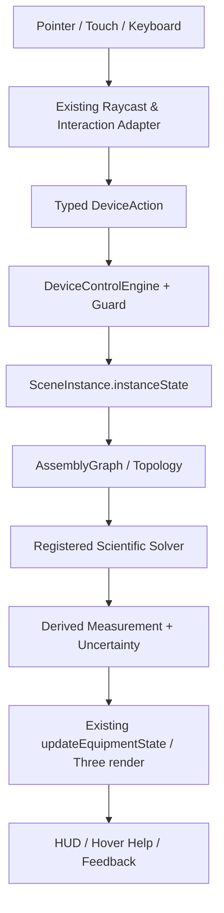
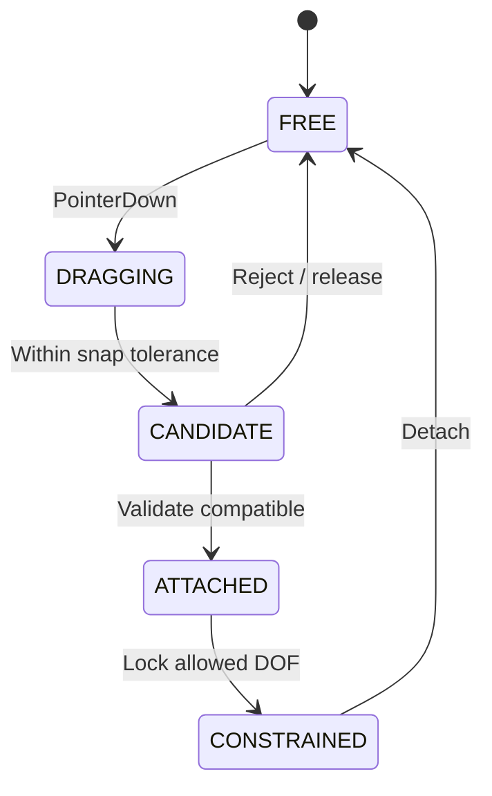

# MOCKUP 03 — GHÉP NỐI THIẾT BỊ, TOPOLOGY VÀ QUY TRÌNH THÍ NGHIỆM LIÊN THÔNG

**Mã:** `OL3D-MU-03-ASSEMBLY-WORKFLOWS` · **Trạng thái:** Design specification, kế thừa AssemblySystem hiện tại

## 0. Cam kết bảo toàn hệ thống hiện hữu (NON-DESTRUCTIVE UPGRADE)

Tài liệu này là mockup/đặc tả cải tiến, không phải lệnh tái viết dự án. Mọi triển khai phải theo nguyên tắc **ADD / ADAPT / VERIFY — NOT REPLACE**.

1. Giữ nguyên React 19, TypeScript strict, Vite 6, Three.js/WebGL và pipeline PBR đang có.
2. Giữ nguyên kiến trúc 4 lớp `OL3D-MASTER-SPEC v1.0`: Environment → Equipment → Interaction/Physics → App/Pedagogy.
3. Giữ nguyên chu trình nhân quả CIA 6 giai đoạn: User Action → Assembly Graph → Device State → Scientific Solvers → 3D Rendering → HUD/Feedback.
4. Giữ nguyên `AssetDefinition`, `SceneInstance`, `instanceState`, `window.OL3D_EQUIPMENT_MODULE`, `EquipmentModuleContract` và adapter tương thích v2.2/v2.3.
5. Không đổi Asset ID, slug, catalog key, tên node hiện đang được runtime tham chiếu, connector ID, state key hoặc đường dẫn public nếu chưa có migration plan tương thích ngược.
6. Không xóa/đổi tên các file nòng cốt. Ưu tiên thêm adapter, profile extension, solver service, schema version và test.
7. Mỗi thay đổi phải chạy typecheck, build, unit tests, assembly acceptance, scientific interaction regression và kiểm tra trực quan trên scene.
8. Không được gắn nhãn `PASS`, `verified` hoặc `validated` chỉ vì component tồn tại hoặc hình ảnh đẹp. Cần bằng chứng thực thi.
9. Dữ liệu nguồn có trạng thái `reported`, `illustrative`, `not-verified`, `partially-verified` phải tiếp tục giữ nguyên trạng thái và được đưa vào danh sách xác minh.
10. Khi phát hiện mâu thuẫn trong hồ sơ (ví dụ cân 500 g có thông số vỏ/tải bất thường, giá trị đơn vị không đồng nhất), không tự sửa số liệu; tạo `SPEC_CONFLICT` và yêu cầu đối chiếu datasheet/mẫu thật.

### 0.1. Bản đồ module hiện hữu cần kế thừa

| Vai trò | File hiện có | Cách mở rộng an toàn |
|---|---|---|
| Điều phối trạng thái | `src/App.tsx` | Bổ sung action/selector typed; không tạo state gốc song song |
| Viewport, raycast, drag-drop | `src/three-runtime/LabViewport3D.tsx` | Đăng ký hit targets và handler theo profile; tránh cài logic vật lý chuyên ngành dày đặc vào component |
| Mesh 3D | `src/three-runtime/ProceduralLabModels.ts` | Bổ sung named submeshes theo schema; giữ node legacy và alias |
| Kiểu dữ liệu | `src/domain/types.ts` | Mở rộng optional versioned fields; không phá payload cũ |
| Điều khiển | `src/device-control/DeviceControlEngine.ts` | Thêm mapping input→action→state và guard |
| Hồ sơ điều khiển | `src/device-control/DeviceControlProfilesData.ts` | Làm giàu profile từng asset; profile phải khai báo capabilities thực |
| Lắp ráp | `src/three-runtime/AssemblySystem.ts` | Thêm connector/constraint mới theo registry và migration |
| Môi trường | `src/three-runtime/LabEnvironmentEngine.ts` | Thêm environment adapter, không tạo environmental engine thứ hai |
| Hành vi | `src/three-runtime/BehaviorRegistry.ts` | Đăng ký behavior có type, lifecycle, teardown |
| UI hướng dẫn | `EquipmentHoverCard.tsx`, `EquipmentPreviewPanel.tsx`, `StudentGuidedStepPanel.tsx` | Kết nối dữ liệu profile, trạng thái và help content |
| Kiểm thử | `scripts/verify-assembly-acceptance.ts`, `scripts/verify-scientific-interaction.ts`, `scripts/scientific-profiles.ts` | Mở rộng kiểm thử; giữ nguyên test đã đạt |

### 0.2. Luồng dữ liệu đích (giữ nguyên CIA)



### 0.3. Phân loại thay đổi

- **P0 – bảo toàn:** thay đổi có nguy cơ phá vỡ state, module, connector, world units hoặc bộ giải hiện tại; không merge nếu chưa có regression.
- **P1 – đúng định luật:** sai causal dependency, sai dấu, sai đơn vị, hiển thị hiện tượng không có nguyên nhân.
- **P2 – điều khiển thực:** chi tiết 3D không điều khiển được, thiếu travel/range/lock/feedback.
- **P3 – giáo dục/UX:** hướng dẫn, tooltip, chú giải, accessibility, report.

## 1. Mục tiêu

Thiết bị trong phòng lab không hoạt động đơn lẻ. Bộ mockup này định nghĩa cách các thiết bị cùng tạo thành hệ thí nghiệm: cắm nguồn–đèn–tia–thấu kính–màn; đặt vật–cân; rót nước–hứng–đo; treo vật–lực kế–nhúng chất lỏng; đun–truyền nhiệt–đo nhiệt; nam châm–cuộn dây–điện kế/LED. Việc kết nối phải được xử lý qua `AssemblyGraph`, connector registry, DOF constraints và solver, không dùng khoảng cách gần đơn thuần làm quan hệ đã nối.

## 2. Các connector đã có trong hồ sơ và nguyên tắc mở rộng

### 2.1. 9 loại connector nền tảng

| Kind | Ý nghĩa | Ví dụ |
| --- | --- | --- |
| mechanical_support | Mặt đỡ chịu tải | Đĩa cân, bàn, kệ |
| mechanical_clamp | Ngàm kẹp | Mỏ kẹp thước cặp, tay kẹp giá |
| mechanical_hook | Móc treo lực | Móc lực kế |
| mechanical_rail | Ray dẫn hướng | Giá quang học |
| optical_carrier | Đế trượt phần tử quang | Đèn/giá lens trên ray |
| optical_socket | Socket giữ lens | Vòng giữ thấu kính |
| electrical_terminal | Cọc điện phân cực | Nguồn DC, đèn |
| fluid_spout | Vòi rót/xả | Bình tràn, bình cấp nước |
| fluid_receptacle | Miệng nhận | Ống đong, cốc, bình |

### 2.2. Connector registry gốc cần giữ nguyên và kiểm tra lại runtime

Registry nguồn gồm 15 connector: `CONN_BALANCE_PAN`, `CONN_CYLINDER_APERTURE`, `CONN_BEAKER_RIM`, `CONN_OVERFLOW_CAN_APERTURE`, `CONN_OVERFLOW_CAN_SPOUT`, `CONN_WATER_DISPENSER_SPOUT`, `CONN_SPRING_DYNO_HOOK`, `CONN_VERNIER_CALIPER_JAWS`, `CONN_OPTICAL_BENCH_RAIL`, `CONN_PSU_DC_OUT_POS`, `CONN_PSU_DC_OUT_NEG`, `CONN_LAMP_DC_IN_POS`, `CONN_LAMP_DC_IN_NEG`, `CONN_OPTICAL_LAMP_CARRIAGE`, `CONN_LENS_HOLDER_SOCKET`.

**Không xóa hoặc đổi ID hiện tại.** Mở rộng registry chỉ khi đã đối chiếu mesh, localCoordinateM, normal, snap tolerance, occupancy, DOF, aperture và partner rules. Khi thay đổi cần alias/migration và regression test.

### 2.3. Chu trình lắp ráp



Guard phải kiểm tra: connector kind/partner, giới tính (nếu có), polarity, vector normal, vị trí, tolerance, aperture, slot occupancy, max load, DOF, trạng thái thiết bị, trạng thái môi trường và safety interlock.

## 3. Các workflow thực nghiệm cấp hệ thống

### WF-01 — Cân và xác định khối lượng

- **Thiết bị tham gia:** BAL + WGT/SLD/SPH/BLK/HLW + BKR/CYL/FLK.
- **Quy trình:** Đặt cân trên bàn → kiểm tra cân bằng/zero → đặt vật hoặc bình chứa → chờ ổn định → đọc gross → TARE nếu cần → thêm mẫu → đọc net.
- **Luật/solver:** m_total = m_container + Σm_objects + m_liquid; `tareOffset` phải được lưu thành state riêng.
- **Lỗi và chặn:** Vượt GHĐ, cân lệch, gió, vật chưa ổn định.
- **Dữ liệu cần lưu:** trạng thái từng instance, graph topology, timestamp mô phỏng, input actions, solver output và `MeasurementRecord` liên quan.

### WF-02 — Đo thể tích bằng ống đong

- **Thiết bị tham gia:** CYL + WDP + solid samples + BAL.
- **Quy trình:** Đổ lượng ban đầu → đọc đáy meniscus ngang tầm mắt → thả vật phù hợp khẩu độ → chờ chất lỏng ổn định → đọc V2 → ΔV=V2−V1.
- **Luật/solver:** ΔV bằng thể tích phần vật chìm; yêu cầu vật không thấm và không phản ứng/hoà tan.
- **Lỗi và chặn:** Vật vượt miệng, bọt khí, tràn, thị sai.
- **Dữ liệu cần lưu:** trạng thái từng instance, graph topology, timestamp mô phỏng, input actions, solver output và `MeasurementRecord` liên quan.

### WF-03 — Đo thể tích bằng bình tràn

- **Thiết bị tham gia:** OVF + BKR/CYL + sample solids.
- **Quy trình:** Nạp nước tới ngưỡng vòi → chờ ngừng tràn → đặt bình hứng → thả chìm vật → thu hết nước tràn → đo thể tích hứng.
- **Luật/solver:** V_displaced = V_overflow khi vật chìm hoàn toàn và không mất giọt.
- **Lỗi và chặn:** Chưa primed, cốc hứng lệch, giọt bám, vật nổi.
- **Dữ liệu cần lưu:** trạng thái từng instance, graph topology, timestamp mô phỏng, input actions, solver output và `MeasurementRecord` liên quan.

### WF-04 — Đo lực trọng lượng

- **Thiết bị tham gia:** STD + DYN + WGT/solid objects.
- **Quy trình:** Cố định giá → kiểm tra zero lực kế → móc vật → chờ dao động tắt → đọc P.
- **Luật/solver:** P=m·g; lò xo Δx=P/k trong miền Hooke.
- **Lỗi và chặn:** Treo lệch trục, vượt GHĐ, ma sát kẹp.
- **Dữ liệu cần lưu:** trạng thái từng instance, graph topology, timestamp mô phỏng, input actions, solver output và `MeasurementRecord` liên quan.

### WF-05 — Định luật đòn bẩy

- **Thiết bị tham gia:** LEV + WGT + support.
- **Quy trình:** Căn zero beam → đặt điểm tựa → gắn các quả cân tại khoảng cách → thả tự do → đo góc cân bằng.
- **Luật/solver:** Στ_O=0; lực vuông góc và cánh tay đòn phải đúng hình học.
- **Lỗi và chặn:** Quả cân lệch, khoảng cách đo sai, trục ma sát lớn.
- **Dữ liệu cần lưu:** trạng thái từng instance, graph topology, timestamp mô phỏng, input actions, solver output và `MeasurementRecord` liên quan.

### WF-06 — Thí nghiệm ảnh qua thấu kính

- **Thiết bị tham gia:** OLP + PSU + OBN + FOB + OPT/LBX + SCR.
- **Quy trình:** Lắp ray → nối nguồn đúng cực → bật nguồn → chọn lens → đặt vật → căn trục → đặt màn → điều chỉnh d và d’ → lấy ảnh rõ.
- **Luật/solver:** 1/f=1/d+1/d’; phóng đại m=−d’/d trong xấp xỉ thấu kính mỏng.
- **Lỗi và chặn:** Mạch hở, lens lệch trục, màn sai vị trí, vật d≤f không có ảnh thật trên màn.
- **Dữ liệu cần lưu:** trạng thái từng instance, graph topology, timestamp mô phỏng, input actions, solver output và `MeasurementRecord` liên quan.

### WF-07 — Khúc xạ ánh sáng qua bản bán trụ

- **Thiết bị tham gia:** LSR + SLB.
- **Quy trình:** Đặt bản bán trụ lên tâm thước → bật nguồn laser → căn tia vào tâm → xoay góc tới → đọc góc i và r.
- **Luật/solver:** n1 sin i=n2 sin r; xác định pháp tuyến thật tại điểm tới.
- **Lỗi và chặn:** Tia không đi qua tâm, dùng nhầm mặt cong, sai zero.
- **Dữ liệu cần lưu:** trạng thái từng instance, graph topology, timestamp mô phỏng, input actions, solver output và `MeasurementRecord` liên quan.

### WF-08 — Tán sắc qua lăng kính

- **Thiết bị tham gia:** OLP/LSR + PRM + SCR.
- **Quy trình:** Bật nguồn trắng → đặt prism cắt chùm → căn góc tới → quan sát dải màu ló → đưa màn nhận phổ.
- **Luật/solver:** n phụ thuộc λ; đỏ lệch ít hơn tím trong vật liệu có tán sắc thường.
- **Lỗi và chặn:** Nguồn đơn sắc không tạo phổ liên tục; lăng kính không tự phát sáng.
- **Dữ liệu cần lưu:** trạng thái từng instance, graph topology, timestamp mô phỏng, input actions, solver output và `MeasurementRecord` liên quan.

### WF-09 — Mạch nguồn và đồng hồ vạn năng

- **Thiết bị tham gia:** PSU + DMM + loads/cables.
- **Quy trình:** Tắt nguồn → dựng mạch → chọn đúng cổng/thang đo → kiểm tra dây → bật nguồn → đo U song song hoặc I nối tiếp → ngắt nguồn sau đo.
- **Luật/solver:** Ohm và Kirchhoff; tính đến tải, nội trở, giới hạn dòng, polarity.
- **Lỗi và chặn:** Sai socket, đo Ω khi mạch có điện, short circuit, dây không cắm thật.
- **Dữ liệu cần lưu:** trạng thái từng instance, graph topology, timestamp mô phỏng, input actions, solver output và `MeasurementRecord` liên quan.

### WF-10 — Cảm ứng điện từ

- **Thiết bị tham gia:** COIL + magnet + GLV/LED.
- **Quy trình:** Nối cuộn với indicator → kéo nam châm vào/rút ra với tốc độ điều chỉnh → đảo cực → so sánh chiều lệch.
- **Luật/solver:** E=−N dΦ/dt; đứng yên thì dΦ/dt=0 và không có EMF cảm ứng.
- **Lỗi và chặn:** Nam châm không chuyển động, lệch trục, indicator chưa nối.
- **Dữ liệu cần lưu:** trạng thái từng instance, graph topology, timestamp mô phỏng, input actions, solver output và `MeasurementRecord` liên quan.

### WF-11 — Đun nóng và theo dõi nhiệt độ

- **Thiết bị tham gia:** DSH/BKR/FLK/DST + heat source + THM.
- **Quy trình:** Đặt bình/dish đúng giá → nạp mẫu → đặt nhiệt kế đúng vị trí → cấp nguồn nhiệt → theo dõi T(t) → ngắt nguồn và theo dõi nguội.
- **Luật/solver:** Q=mcΔT; cân bằng năng lượng gồm công suất hữu ích và thất thoát; sôi phụ thuộc áp suất.
- **Lỗi và chặn:** Không có nguồn nhiệt, nhiệt kế chạm đáy, đun cạn, áp suất/thoát hơi.
- **Dữ liệu cần lưu:** trạng thái từng instance, graph topology, timestamp mô phỏng, input actions, solver output và `MeasurementRecord` liên quan.

### WF-12 — Chiết tách hai lớp chất lỏng

- **Thiết bị tham gia:** SEP + beaker.
- **Quy trình:** Đổ hỗn hợp hai pha → chờ phân lớp → định vị van → mở từ từ → thu pha dưới → đóng van trước mặt phân cách.
- **Luật/solver:** Phân lớp theo mật độ/tính trộn lẫn; lưu lượng phụ thuộc van, cột áp, độ nhớt.
- **Lỗi và chặn:** Mở van quá nhanh, thu nhầm lớp, mất pha.
- **Dữ liệu cần lưu:** trạng thái từng instance, graph topology, timestamp mô phỏng, input actions, solver output và `MeasurementRecord` liên quan.

### WF-13 — Bình thông nhau

- **Thiết bị tham gia:** HYD + WDP/beaker.
- **Quy trình:** Giữ thiết bị thăng bằng → rót chất lỏng vào nhánh → chờ cân bằng → so sánh mực ở ba nhánh.
- **Luật/solver:** Cùng chất lỏng, thông nhau, nghỉ, áp suất khí trên mặt thoáng như nhau → cao độ mặt thoáng bằng nhau.
- **Lỗi và chặn:** Bọt khí, nhánh tắc, chất lỏng khác nhau, gia tốc không chuẩn.
- **Dữ liệu cần lưu:** trạng thái từng instance, graph topology, timestamp mô phỏng, input actions, solver output và `MeasurementRecord` liên quan.

### WF-14 — Quan sát kính hiển vi

- **Thiết bị tham gia:** MIC + slide/specimen + illuminator.
- **Quy trình:** Chuẩn bị tiêu bản → kẹp lam → bật sáng → chọn vật kính thấp → tìm mẫu → chỉnh thô → chỉnh tinh → chuyển vật kính cao → chỉnh vi cấp.
- **Luật/solver:** Magnification = objective × eyepiece; FOV tỉ lệ nghịch với objective; phân giải chịu giới hạn NA/λ.
- **Lỗi và chặn:** Dùng coarse focus ở vật kính cao gây va chạm; oil lens thiếu dầu; zoom UI không thay độ phân giải.
- **Dữ liệu cần lưu:** trạng thái từng instance, graph topology, timestamp mô phỏng, input actions, solver output và `MeasurementRecord` liên quan.

### WF-15 — Khám phá mô hình DNA

- **Thiết bị tham gia:** DNA.
- **Quy trình:** Xoay mô hình → bật chú thích → tách cặp base theo cơ cấu → lắp đúng bổ sung → quan sát hai mạch.
- **Luật/solver:** A–T và G–C; mô hình cấu trúc, không phải mô phỏng động lực học phân tử.
- **Lỗi và chặn:** Ghép sai cặp, nhầm kích thước mô hình với kích thước phân tử thật.
- **Dữ liệu cần lưu:** trạng thái từng instance, graph topology, timestamp mô phỏng, input actions, solver output và `MeasurementRecord` liên quan.

## 4. Ma trận liên thông chi tiết theo 36 thiết bị

## 01. Cân điện tử hiện số 500 g

- **Asset ID:** `OL3D-EQP-BAL-0001`
- **Archetype:** `electronic-balance` · **Category:** `mass-measurement`
- **Nhóm GDPT liên quan:** G02
- **Tên tiếng Anh trong hồ sơ:** *Precision Electronic Balance 500 g*
- **Nguyên tắc:** giữ assetId, slug, module hiện hữu; chỉ mở rộng control profile, state, solver adapter và test có version.
### 4.01.1. Kết nối và quan hệ lắp ráp trong hồ sơ

### 5. Cổng Ghép nối Động học & Quan hệ Lắp ráp
* Thiết bị độc lập không chứa cổng gắn riêng, tương tác thông qua đặt tựa lên đĩa cân, móc treo lực kế hoặc thả chìm vào bình chứa.

### 4.01.2. Quy tắc tương tác liên thiết bị

- **Đầu vào topology:** nhận thông tin instance/connector từ `AssemblyGraph`; không suy luận kết nối chỉ từ khoảng cách nếu cần cắm/kẹp thật.
- **Thiết bị tương tác tiềm năng:** dựa theo danh mục hồ sơ, các liên kết đã nêu trong registry; không tự thêm partner không tương thích.
- **Biến môi trường phụ thuộc:** `gravityMps2`, `airflowMps`, `airTemperatureC`, `benchTemperatureC`.
- **Quy tắc detach:** khi rút/kéo khỏi thiết bị nhận, graph edge phải bị xóa; downstream solver phải được tính lại ở tick kế tiếp.
- **Quy tắc occupancy:** tuân thủ maxOccupancy; thiết bị mới chiếm slot phải reject/replace theo chính sách khai báo, không tạo object chồng lấn.

### 4.01.3. Kiểm thử tích hợp

- **BAL-ASM-PAIR:** Thử từng cặp connector hợp lệ và không hợp lệ; ghi rõ partner/guard.
- **BAL-ASM-SNAP:** Kiểm tra dung sai snap, hướng normal và khóa DOF.
- **BAL-ASM-OCCUPANCY:** Kiểm tra slot đơn, slot nhiều và detach/replace.
- **BAL-ASM-TOPOLOGY:** Thay đổi graph phải cập nhật solver; tháo liên kết thì hiện tượng dừng/đổi theo luật.
- **BAL-ASM-INSTANCE:** Hai bản sao cùng asset không chia sẻ connector state.
- **BAL-ASM-CANCEL:** pointercancel không để edge mồ côi.
- **BAL-ASM-ENV:** Điều kiện môi trường ảnh hưởng chỉ khi có physical coupling.
- **BAL-ASM-REGRESSION:** ASM-01..ASM-24 và SCI-01..SCI-24 được giữ hoặc bổ sung test liên quan.

## 02. Ống đong thủy tinh 100 ml

- **Asset ID:** `OL3D-EQP-CYL-0001`
- **Archetype:** `graduated-cylinder` · **Category:** `volume-measurement`
- **Nhóm GDPT liên quan:** G04, G02
- **Tên tiếng Anh trong hồ sơ:** *100 ml Graduated Cylinder*
- **Nguyên tắc:** giữ assetId, slug, module hiện hữu; chỉ mở rộng control profile, state, solver adapter và test có version.
### 4.02.1. Kết nối và quan hệ lắp ráp trong hồ sơ

### 5. Cổng Ghép nối Động học & Quan hệ Lắp ráp
* Thiết bị độc lập không chứa cổng gắn riêng, tương tác thông qua đặt tựa lên đĩa cân, móc treo lực kế hoặc thả chìm vào bình chứa.

### 4.02.2. Quy tắc tương tác liên thiết bị

- **Đầu vào topology:** nhận thông tin instance/connector từ `AssemblyGraph`; không suy luận kết nối chỉ từ khoảng cách nếu cần cắm/kẹp thật.
- **Thiết bị tương tác tiềm năng:** dựa theo danh mục hồ sơ, các liên kết đã nêu trong registry; không tự thêm partner không tương thích.
- **Biến môi trường phụ thuộc:** `gravityMps2`, `sampleTemperatureC`, `sampleDensityKgM3`, `sampleViscosityPaS`.
- **Quy tắc detach:** khi rút/kéo khỏi thiết bị nhận, graph edge phải bị xóa; downstream solver phải được tính lại ở tick kế tiếp.
- **Quy tắc occupancy:** tuân thủ maxOccupancy; thiết bị mới chiếm slot phải reject/replace theo chính sách khai báo, không tạo object chồng lấn.

### 4.02.3. Kiểm thử tích hợp

- **CYL-ASM-PAIR:** Thử từng cặp connector hợp lệ và không hợp lệ; ghi rõ partner/guard.
- **CYL-ASM-SNAP:** Kiểm tra dung sai snap, hướng normal và khóa DOF.
- **CYL-ASM-OCCUPANCY:** Kiểm tra slot đơn, slot nhiều và detach/replace.
- **CYL-ASM-TOPOLOGY:** Thay đổi graph phải cập nhật solver; tháo liên kết thì hiện tượng dừng/đổi theo luật.
- **CYL-ASM-INSTANCE:** Hai bản sao cùng asset không chia sẻ connector state.
- **CYL-ASM-CANCEL:** pointercancel không để edge mồ côi.
- **CYL-ASM-ENV:** Điều kiện môi trường ảnh hưởng chỉ khi có physical coupling.
- **CYL-ASM-REGRESSION:** ASM-01..ASM-24 và SCI-01..SCI-24 được giữ hoặc bổ sung test liên quan.

## 03. Cốc thủy tinh chia độ 250 ml

- **Asset ID:** `OL3D-EQP-BKR-0001`
- **Archetype:** `beaker-250` · **Category:** `laboratory-glassware`
- **Nhóm GDPT liên quan:** G04, G05, G02
- **Tên tiếng Anh trong hồ sơ:** *250 ml Low-Form Glass Beaker*
- **Nguyên tắc:** giữ assetId, slug, module hiện hữu; chỉ mở rộng control profile, state, solver adapter và test có version.
### 4.03.1. Kết nối và quan hệ lắp ráp trong hồ sơ

### 5. Cổng Ghép nối Động học & Quan hệ Lắp ráp
* Thiết bị độc lập không chứa cổng gắn riêng, tương tác thông qua đặt tựa lên đĩa cân, móc treo lực kế hoặc thả chìm vào bình chứa.

### 4.03.2. Quy tắc tương tác liên thiết bị

- **Đầu vào topology:** nhận thông tin instance/connector từ `AssemblyGraph`; không suy luận kết nối chỉ từ khoảng cách nếu cần cắm/kẹp thật.
- **Thiết bị tương tác tiềm năng:** dựa theo danh mục hồ sơ, các liên kết đã nêu trong registry; không tự thêm partner không tương thích.
- **Biến môi trường phụ thuộc:** `gravityMps2`, `sampleTemperatureC`, `sampleDensityKgM3`, `thermalHeatPowerW`, `airTemperatureC`.
- **Quy tắc detach:** khi rút/kéo khỏi thiết bị nhận, graph edge phải bị xóa; downstream solver phải được tính lại ở tick kế tiếp.
- **Quy tắc occupancy:** tuân thủ maxOccupancy; thiết bị mới chiếm slot phải reject/replace theo chính sách khai báo, không tạo object chồng lấn.

### 4.03.3. Kiểm thử tích hợp

- **BKR-ASM-PAIR:** Thử từng cặp connector hợp lệ và không hợp lệ; ghi rõ partner/guard.
- **BKR-ASM-SNAP:** Kiểm tra dung sai snap, hướng normal và khóa DOF.
- **BKR-ASM-OCCUPANCY:** Kiểm tra slot đơn, slot nhiều và detach/replace.
- **BKR-ASM-TOPOLOGY:** Thay đổi graph phải cập nhật solver; tháo liên kết thì hiện tượng dừng/đổi theo luật.
- **BKR-ASM-INSTANCE:** Hai bản sao cùng asset không chia sẻ connector state.
- **BKR-ASM-CANCEL:** pointercancel không để edge mồ côi.
- **BKR-ASM-ENV:** Điều kiện môi trường ảnh hưởng chỉ khi có physical coupling.
- **BKR-ASM-REGRESSION:** ASM-01..ASM-24 và SCI-01..SCI-24 được giữ hoặc bổ sung test liên quan.

## 04. Bình tràn Eureka 250 ml

- **Asset ID:** `OL3D-EQP-OVF-0001`
- **Archetype:** `overflow-can` · **Category:** `volume-measurement`
- **Nhóm GDPT liên quan:** G02, G04
- **Tên tiếng Anh trong hồ sơ:** *Eureka Overflow Can 250 ml*
- **Nguyên tắc:** giữ assetId, slug, module hiện hữu; chỉ mở rộng control profile, state, solver adapter và test có version.
### 4.04.1. Kết nối và quan hệ lắp ráp trong hồ sơ

### 5. Cổng Ghép nối Động học & Quan hệ Lắp ráp
* Thiết bị độc lập không chứa cổng gắn riêng, tương tác thông qua đặt tựa lên đĩa cân, móc treo lực kế hoặc thả chìm vào bình chứa.

### 4.04.2. Quy tắc tương tác liên thiết bị

- **Đầu vào topology:** nhận thông tin instance/connector từ `AssemblyGraph`; không suy luận kết nối chỉ từ khoảng cách nếu cần cắm/kẹp thật.
- **Thiết bị tương tác tiềm năng:** dựa theo danh mục hồ sơ, các liên kết đã nêu trong registry; không tự thêm partner không tương thích.
- **Biến môi trường phụ thuộc:** `gravityMps2`, `sampleDensityKgM3`, `sampleTemperatureC`, `airflowMps`.
- **Quy tắc detach:** khi rút/kéo khỏi thiết bị nhận, graph edge phải bị xóa; downstream solver phải được tính lại ở tick kế tiếp.
- **Quy tắc occupancy:** tuân thủ maxOccupancy; thiết bị mới chiếm slot phải reject/replace theo chính sách khai báo, không tạo object chồng lấn.

### 4.04.3. Kiểm thử tích hợp

- **OVF-ASM-PAIR:** Thử từng cặp connector hợp lệ và không hợp lệ; ghi rõ partner/guard.
- **OVF-ASM-SNAP:** Kiểm tra dung sai snap, hướng normal và khóa DOF.
- **OVF-ASM-OCCUPANCY:** Kiểm tra slot đơn, slot nhiều và detach/replace.
- **OVF-ASM-TOPOLOGY:** Thay đổi graph phải cập nhật solver; tháo liên kết thì hiện tượng dừng/đổi theo luật.
- **OVF-ASM-INSTANCE:** Hai bản sao cùng asset không chia sẻ connector state.
- **OVF-ASM-CANCEL:** pointercancel không để edge mồ côi.
- **OVF-ASM-ENV:** Điều kiện môi trường ảnh hưởng chỉ khi có physical coupling.
- **OVF-ASM-REGRESSION:** ASM-01..ASM-24 và SCI-01..SCI-24 được giữ hoặc bổ sung test liên quan.

## 05. Lực kế lò xo ống trụ 5 N

- **Asset ID:** `OL3D-EQP-DYN-0001`
- **Archetype:** `spring-dynamometer` · **Category:** `force-measurement`
- **Nhóm GDPT liên quan:** G02, G08
- **Tên tiếng Anh trong hồ sơ:** *5 N Tubular Spring Dynamometer*
- **Nguyên tắc:** giữ assetId, slug, module hiện hữu; chỉ mở rộng control profile, state, solver adapter và test có version.
### 4.05.1. Kết nối và quan hệ lắp ráp trong hồ sơ

### 5. Cổng Ghép nối Động học & Quan hệ Lắp ráp
* Thiết bị độc lập không chứa cổng gắn riêng, tương tác thông qua đặt tựa lên đĩa cân, móc treo lực kế hoặc thả chìm vào bình chứa.

### 4.05.2. Quy tắc tương tác liên thiết bị

- **Đầu vào topology:** nhận thông tin instance/connector từ `AssemblyGraph`; không suy luận kết nối chỉ từ khoảng cách nếu cần cắm/kẹp thật.
- **Thiết bị tương tác tiềm năng:** dựa theo danh mục hồ sơ, các liên kết đã nêu trong registry; không tự thêm partner không tương thích.
- **Biến môi trường phụ thuộc:** `gravityMps2`, `airTemperatureC`.
- **Quy tắc detach:** khi rút/kéo khỏi thiết bị nhận, graph edge phải bị xóa; downstream solver phải được tính lại ở tick kế tiếp.
- **Quy tắc occupancy:** tuân thủ maxOccupancy; thiết bị mới chiếm slot phải reject/replace theo chính sách khai báo, không tạo object chồng lấn.

### 4.05.3. Kiểm thử tích hợp

- **DYN-ASM-PAIR:** Thử từng cặp connector hợp lệ và không hợp lệ; ghi rõ partner/guard.
- **DYN-ASM-SNAP:** Kiểm tra dung sai snap, hướng normal và khóa DOF.
- **DYN-ASM-OCCUPANCY:** Kiểm tra slot đơn, slot nhiều và detach/replace.
- **DYN-ASM-TOPOLOGY:** Thay đổi graph phải cập nhật solver; tháo liên kết thì hiện tượng dừng/đổi theo luật.
- **DYN-ASM-INSTANCE:** Hai bản sao cùng asset không chia sẻ connector state.
- **DYN-ASM-CANCEL:** pointercancel không để edge mồ côi.
- **DYN-ASM-ENV:** Điều kiện môi trường ảnh hưởng chỉ khi có physical coupling.
- **DYN-ASM-REGRESSION:** ASM-01..ASM-24 và SCI-01..SCI-24 được giữ hoặc bổ sung test liên quan.

## 06. Thước cặp du xích 150 mm (0.02 mm)

- **Asset ID:** `OL3D-EQP-CAL-0001`
- **Archetype:** `vernier-caliper` · **Category:** `length-measurement`
- **Nhóm GDPT liên quan:** G01
- **Tên tiếng Anh trong hồ sơ:** *Vernier Caliper 150 mm x 0.02 mm*
- **Nguyên tắc:** giữ assetId, slug, module hiện hữu; chỉ mở rộng control profile, state, solver adapter và test có version.
### 4.06.1. Kết nối và quan hệ lắp ráp trong hồ sơ

### 5. Cổng Ghép nối Động học & Quan hệ Lắp ráp
* Thiết bị độc lập không chứa cổng gắn riêng, tương tác thông qua đặt tựa lên đĩa cân, móc treo lực kế hoặc thả chìm vào bình chứa.

### 4.06.2. Quy tắc tương tác liên thiết bị

- **Đầu vào topology:** nhận thông tin instance/connector từ `AssemblyGraph`; không suy luận kết nối chỉ từ khoảng cách nếu cần cắm/kẹp thật.
- **Thiết bị tương tác tiềm năng:** dựa theo danh mục hồ sơ, các liên kết đã nêu trong registry; không tự thêm partner không tương thích.
- **Biến môi trường phụ thuộc:** `airTemperatureC`, `benchTemperatureC`.
- **Quy tắc detach:** khi rút/kéo khỏi thiết bị nhận, graph edge phải bị xóa; downstream solver phải được tính lại ở tick kế tiếp.
- **Quy tắc occupancy:** tuân thủ maxOccupancy; thiết bị mới chiếm slot phải reject/replace theo chính sách khai báo, không tạo object chồng lấn.

### 4.06.3. Kiểm thử tích hợp

- **CAL-ASM-PAIR:** Thử từng cặp connector hợp lệ và không hợp lệ; ghi rõ partner/guard.
- **CAL-ASM-SNAP:** Kiểm tra dung sai snap, hướng normal và khóa DOF.
- **CAL-ASM-OCCUPANCY:** Kiểm tra slot đơn, slot nhiều và detach/replace.
- **CAL-ASM-TOPOLOGY:** Thay đổi graph phải cập nhật solver; tháo liên kết thì hiện tượng dừng/đổi theo luật.
- **CAL-ASM-INSTANCE:** Hai bản sao cùng asset không chia sẻ connector state.
- **CAL-ASM-CANCEL:** pointercancel không để edge mồ côi.
- **CAL-ASM-ENV:** Điều kiện môi trường ảnh hưởng chỉ khi có physical coupling.
- **CAL-ASM-REGRESSION:** ASM-01..ASM-24 và SCI-01..SCI-24 được giữ hoặc bổ sung test liên quan.

## 07. Quả cân chuẩn bằng đồng 50 g

- **Asset ID:** `OL3D-EQP-WGT-0001`
- **Archetype:** `calibration-weight` · **Category:** `mass-measurement`
- **Nhóm GDPT liên quan:** G02
- **Tên tiếng Anh trong hồ sơ:** *50 g Brass Calibration Weight*
- **Nguyên tắc:** giữ assetId, slug, module hiện hữu; chỉ mở rộng control profile, state, solver adapter và test có version.
### 4.07.1. Kết nối và quan hệ lắp ráp trong hồ sơ

### 5. Cổng Ghép nối Động học & Quan hệ Lắp ráp
* Thiết bị độc lập không chứa cổng gắn riêng, tương tác thông qua đặt tựa lên đĩa cân, móc treo lực kế hoặc thả chìm vào bình chứa.

### 4.07.2. Quy tắc tương tác liên thiết bị

- **Đầu vào topology:** nhận thông tin instance/connector từ `AssemblyGraph`; không suy luận kết nối chỉ từ khoảng cách nếu cần cắm/kẹp thật.
- **Thiết bị tương tác tiềm năng:** dựa theo danh mục hồ sơ, các liên kết đã nêu trong registry; không tự thêm partner không tương thích.
- **Biến môi trường phụ thuộc:** `gravityMps2`, `airflowMps`.
- **Quy tắc detach:** khi rút/kéo khỏi thiết bị nhận, graph edge phải bị xóa; downstream solver phải được tính lại ở tick kế tiếp.
- **Quy tắc occupancy:** tuân thủ maxOccupancy; thiết bị mới chiếm slot phải reject/replace theo chính sách khai báo, không tạo object chồng lấn.

### 4.07.3. Kiểm thử tích hợp

- **WGT-ASM-PAIR:** Thử từng cặp connector hợp lệ và không hợp lệ; ghi rõ partner/guard.
- **WGT-ASM-SNAP:** Kiểm tra dung sai snap, hướng normal và khóa DOF.
- **WGT-ASM-OCCUPANCY:** Kiểm tra slot đơn, slot nhiều và detach/replace.
- **WGT-ASM-TOPOLOGY:** Thay đổi graph phải cập nhật solver; tháo liên kết thì hiện tượng dừng/đổi theo luật.
- **WGT-ASM-INSTANCE:** Hai bản sao cùng asset không chia sẻ connector state.
- **WGT-ASM-CANCEL:** pointercancel không để edge mồ côi.
- **WGT-ASM-ENV:** Điều kiện môi trường ảnh hưởng chỉ khi có physical coupling.
- **WGT-ASM-REGRESSION:** ASM-01..ASM-24 và SCI-01..SCI-24 được giữ hoặc bổ sung test liên quan.

## 08. Vật rắn hình trụ hợp kim nhôm

- **Asset ID:** `OL3D-EQP-SLD-0001`
- **Archetype:** `solid-cylinder` · **Category:** `solid-specimens`
- **Nhóm GDPT liên quan:** G02, G01, G04
- **Tên tiếng Anh trong hồ sơ:** *Solid Aluminum Cylinder Specimen*
- **Nguyên tắc:** giữ assetId, slug, module hiện hữu; chỉ mở rộng control profile, state, solver adapter và test có version.
### 4.08.1. Kết nối và quan hệ lắp ráp trong hồ sơ

### 5. Cổng Ghép nối Động học & Quan hệ Lắp ráp
* Thiết bị độc lập không chứa cổng gắn riêng, tương tác thông qua đặt tựa lên đĩa cân, móc treo lực kế hoặc thả chìm vào bình chứa.

### 4.08.2. Quy tắc tương tác liên thiết bị

- **Đầu vào topology:** nhận thông tin instance/connector từ `AssemblyGraph`; không suy luận kết nối chỉ từ khoảng cách nếu cần cắm/kẹp thật.
- **Thiết bị tương tác tiềm năng:** dựa theo danh mục hồ sơ, các liên kết đã nêu trong registry; không tự thêm partner không tương thích.
- **Biến môi trường phụ thuộc:** `gravityMps2`, `sampleDensityKgM3`, `sampleTemperatureC`.
- **Quy tắc detach:** khi rút/kéo khỏi thiết bị nhận, graph edge phải bị xóa; downstream solver phải được tính lại ở tick kế tiếp.
- **Quy tắc occupancy:** tuân thủ maxOccupancy; thiết bị mới chiếm slot phải reject/replace theo chính sách khai báo, không tạo object chồng lấn.

### 4.08.3. Kiểm thử tích hợp

- **SLD-ASM-PAIR:** Thử từng cặp connector hợp lệ và không hợp lệ; ghi rõ partner/guard.
- **SLD-ASM-SNAP:** Kiểm tra dung sai snap, hướng normal và khóa DOF.
- **SLD-ASM-OCCUPANCY:** Kiểm tra slot đơn, slot nhiều và detach/replace.
- **SLD-ASM-TOPOLOGY:** Thay đổi graph phải cập nhật solver; tháo liên kết thì hiện tượng dừng/đổi theo luật.
- **SLD-ASM-INSTANCE:** Hai bản sao cùng asset không chia sẻ connector state.
- **SLD-ASM-CANCEL:** pointercancel không để edge mồ côi.
- **SLD-ASM-ENV:** Điều kiện môi trường ảnh hưởng chỉ khi có physical coupling.
- **SLD-ASM-REGRESSION:** ASM-01..ASM-24 và SCI-01..SCI-24 được giữ hoặc bổ sung test liên quan.

## 09. Vật rắn hình cầu thép không gỉ

- **Asset ID:** `OL3D-EQP-SPH-0001`
- **Archetype:** `solid-sphere` · **Category:** `solid-specimens`
- **Nhóm GDPT liên quan:** G02, G01, G04
- **Tên tiếng Anh trong hồ sơ:** *Stainless Steel Sphere Specimen*
- **Nguyên tắc:** giữ assetId, slug, module hiện hữu; chỉ mở rộng control profile, state, solver adapter và test có version.
### 4.09.1. Kết nối và quan hệ lắp ráp trong hồ sơ

### 5. Cổng Ghép nối Động học & Quan hệ Lắp ráp
* Thiết bị độc lập không chứa cổng gắn riêng, tương tác thông qua đặt tựa lên đĩa cân, móc treo lực kế hoặc thả chìm vào bình chứa.

### 4.09.2. Quy tắc tương tác liên thiết bị

- **Đầu vào topology:** nhận thông tin instance/connector từ `AssemblyGraph`; không suy luận kết nối chỉ từ khoảng cách nếu cần cắm/kẹp thật.
- **Thiết bị tương tác tiềm năng:** dựa theo danh mục hồ sơ, các liên kết đã nêu trong registry; không tự thêm partner không tương thích.
- **Biến môi trường phụ thuộc:** `gravityMps2`, `sampleDensityKgM3`, `sampleTemperatureC`.
- **Quy tắc detach:** khi rút/kéo khỏi thiết bị nhận, graph edge phải bị xóa; downstream solver phải được tính lại ở tick kế tiếp.
- **Quy tắc occupancy:** tuân thủ maxOccupancy; thiết bị mới chiếm slot phải reject/replace theo chính sách khai báo, không tạo object chồng lấn.

### 4.09.3. Kiểm thử tích hợp

- **SPH-ASM-PAIR:** Thử từng cặp connector hợp lệ và không hợp lệ; ghi rõ partner/guard.
- **SPH-ASM-SNAP:** Kiểm tra dung sai snap, hướng normal và khóa DOF.
- **SPH-ASM-OCCUPANCY:** Kiểm tra slot đơn, slot nhiều và detach/replace.
- **SPH-ASM-TOPOLOGY:** Thay đổi graph phải cập nhật solver; tháo liên kết thì hiện tượng dừng/đổi theo luật.
- **SPH-ASM-INSTANCE:** Hai bản sao cùng asset không chia sẻ connector state.
- **SPH-ASM-CANCEL:** pointercancel không để edge mồ côi.
- **SPH-ASM-ENV:** Điều kiện môi trường ảnh hưởng chỉ khi có physical coupling.
- **SPH-ASM-REGRESSION:** ASM-01..ASM-24 và SCI-01..SCI-24 được giữ hoặc bổ sung test liên quan.

## 10. Vật rắn hình hộp chữ nhật đồng thau

- **Asset ID:** `OL3D-EQP-BLK-0001`
- **Archetype:** `solid-block` · **Category:** `solid-specimens`
- **Nhóm GDPT liên quan:** G02, G01, G04
- **Tên tiếng Anh trong hồ sơ:** *Rectangular Brass Block Specimen*
- **Nguyên tắc:** giữ assetId, slug, module hiện hữu; chỉ mở rộng control profile, state, solver adapter và test có version.
### 4.10.1. Kết nối và quan hệ lắp ráp trong hồ sơ

### 5. Cổng Ghép nối Động học & Quan hệ Lắp ráp
* Thiết bị độc lập không chứa cổng gắn riêng, tương tác thông qua đặt tựa lên đĩa cân, móc treo lực kế hoặc thả chìm vào bình chứa.

### 4.10.2. Quy tắc tương tác liên thiết bị

- **Đầu vào topology:** nhận thông tin instance/connector từ `AssemblyGraph`; không suy luận kết nối chỉ từ khoảng cách nếu cần cắm/kẹp thật.
- **Thiết bị tương tác tiềm năng:** dựa theo danh mục hồ sơ, các liên kết đã nêu trong registry; không tự thêm partner không tương thích.
- **Biến môi trường phụ thuộc:** `gravityMps2`, `sampleDensityKgM3`, `sampleTemperatureC`.
- **Quy tắc detach:** khi rút/kéo khỏi thiết bị nhận, graph edge phải bị xóa; downstream solver phải được tính lại ở tick kế tiếp.
- **Quy tắc occupancy:** tuân thủ maxOccupancy; thiết bị mới chiếm slot phải reject/replace theo chính sách khai báo, không tạo object chồng lấn.

### 4.10.3. Kiểm thử tích hợp

- **BLK-ASM-PAIR:** Thử từng cặp connector hợp lệ và không hợp lệ; ghi rõ partner/guard.
- **BLK-ASM-SNAP:** Kiểm tra dung sai snap, hướng normal và khóa DOF.
- **BLK-ASM-OCCUPANCY:** Kiểm tra slot đơn, slot nhiều và detach/replace.
- **BLK-ASM-TOPOLOGY:** Thay đổi graph phải cập nhật solver; tháo liên kết thì hiện tượng dừng/đổi theo luật.
- **BLK-ASM-INSTANCE:** Hai bản sao cùng asset không chia sẻ connector state.
- **BLK-ASM-CANCEL:** pointercancel không để edge mồ côi.
- **BLK-ASM-ENV:** Điều kiện môi trường ảnh hưởng chỉ khi có physical coupling.
- **BLK-ASM-REGRESSION:** ASM-01..ASM-24 và SCI-01..SCI-24 được giữ hoặc bổ sung test liên quan.

## 11. Ống trụ kim loại rỗng có khoang kín

- **Asset ID:** `OL3D-EQP-HLW-0001`
- **Archetype:** `hollow-cylinder` · **Category:** `hollow-specimens`
- **Nhóm GDPT liên quan:** G02, G04
- **Tên tiếng Anh trong hồ sơ:** *Hollow Metallic Cylinder with Internal Cavity*
- **Nguyên tắc:** giữ assetId, slug, module hiện hữu; chỉ mở rộng control profile, state, solver adapter và test có version.
### 4.11.1. Kết nối và quan hệ lắp ráp trong hồ sơ

### 5. Cổng Ghép nối Động học & Quan hệ Lắp ráp
* Thiết bị độc lập không chứa cổng gắn riêng, tương tác thông qua đặt tựa lên đĩa cân, móc treo lực kế hoặc thả chìm vào bình chứa.

### 4.11.2. Quy tắc tương tác liên thiết bị

- **Đầu vào topology:** nhận thông tin instance/connector từ `AssemblyGraph`; không suy luận kết nối chỉ từ khoảng cách nếu cần cắm/kẹp thật.
- **Thiết bị tương tác tiềm năng:** dựa theo danh mục hồ sơ, các liên kết đã nêu trong registry; không tự thêm partner không tương thích.
- **Biến môi trường phụ thuộc:** `gravityMps2`, `sampleDensityKgM3`, `sampleTemperatureC`.
- **Quy tắc detach:** khi rút/kéo khỏi thiết bị nhận, graph edge phải bị xóa; downstream solver phải được tính lại ở tick kế tiếp.
- **Quy tắc occupancy:** tuân thủ maxOccupancy; thiết bị mới chiếm slot phải reject/replace theo chính sách khai báo, không tạo object chồng lấn.

### 4.11.3. Kiểm thử tích hợp

- **HLW-ASM-PAIR:** Thử từng cặp connector hợp lệ và không hợp lệ; ghi rõ partner/guard.
- **HLW-ASM-SNAP:** Kiểm tra dung sai snap, hướng normal và khóa DOF.
- **HLW-ASM-OCCUPANCY:** Kiểm tra slot đơn, slot nhiều và detach/replace.
- **HLW-ASM-TOPOLOGY:** Thay đổi graph phải cập nhật solver; tháo liên kết thì hiện tượng dừng/đổi theo luật.
- **HLW-ASM-INSTANCE:** Hai bản sao cùng asset không chia sẻ connector state.
- **HLW-ASM-CANCEL:** pointercancel không để edge mồ côi.
- **HLW-ASM-ENV:** Điều kiện môi trường ảnh hưởng chỉ khi có physical coupling.
- **HLW-ASM-REGRESSION:** ASM-01..ASM-24 và SCI-01..SCI-24 được giữ hoặc bổ sung test liên quan.

## 12. Bình tam giác Erlenmeyer 250 ml

- **Asset ID:** `OL3D-EQP-FLK-0001`
- **Archetype:** `erlenmeyer-flask` · **Category:** `laboratory-glassware`
- **Nhóm GDPT liên quan:** G04, G05
- **Tên tiếng Anh trong hồ sơ:** *250 ml Erlenmeyer Conical Flask*
- **Nguyên tắc:** giữ assetId, slug, module hiện hữu; chỉ mở rộng control profile, state, solver adapter và test có version.
### 4.12.1. Kết nối và quan hệ lắp ráp trong hồ sơ

### 5. Cổng Ghép nối Động học & Quan hệ Lắp ráp
* Thiết bị độc lập không chứa cổng gắn riêng, tương tác thông qua đặt tựa lên đĩa cân, móc treo lực kế hoặc thả chìm vào bình chứa.

### 4.12.2. Quy tắc tương tác liên thiết bị

- **Đầu vào topology:** nhận thông tin instance/connector từ `AssemblyGraph`; không suy luận kết nối chỉ từ khoảng cách nếu cần cắm/kẹp thật.
- **Thiết bị tương tác tiềm năng:** dựa theo danh mục hồ sơ, các liên kết đã nêu trong registry; không tự thêm partner không tương thích.
- **Biến môi trường phụ thuộc:** `gravityMps2`, `sampleTemperatureC`, `thermalHeatPowerW`, `atmosphericPressureKPa`.
- **Quy tắc detach:** khi rút/kéo khỏi thiết bị nhận, graph edge phải bị xóa; downstream solver phải được tính lại ở tick kế tiếp.
- **Quy tắc occupancy:** tuân thủ maxOccupancy; thiết bị mới chiếm slot phải reject/replace theo chính sách khai báo, không tạo object chồng lấn.

### 4.12.3. Kiểm thử tích hợp

- **FLK-ASM-PAIR:** Thử từng cặp connector hợp lệ và không hợp lệ; ghi rõ partner/guard.
- **FLK-ASM-SNAP:** Kiểm tra dung sai snap, hướng normal và khóa DOF.
- **FLK-ASM-OCCUPANCY:** Kiểm tra slot đơn, slot nhiều và detach/replace.
- **FLK-ASM-TOPOLOGY:** Thay đổi graph phải cập nhật solver; tháo liên kết thì hiện tượng dừng/đổi theo luật.
- **FLK-ASM-INSTANCE:** Hai bản sao cùng asset không chia sẻ connector state.
- **FLK-ASM-CANCEL:** pointercancel không để edge mồ côi.
- **FLK-ASM-ENV:** Điều kiện môi trường ảnh hưởng chỉ khi có physical coupling.
- **FLK-ASM-REGRESSION:** ASM-01..ASM-24 và SCI-01..SCI-24 được giữ hoặc bổ sung test liên quan.

## 13. Giá đỡ thí nghiệm kèm khớp nối & tay kẹp

- **Asset ID:** `OL3D-EQP-STD-0001`
- **Archetype:** `retort-stand` · **Category:** `support-hardware`
- **Nhóm GDPT liên quan:** G02, G06, G07
- **Tên tiếng Anh trong hồ sơ:** *Laboratory Retort Stand with Bosshead & Clamp*
- **Nguyên tắc:** giữ assetId, slug, module hiện hữu; chỉ mở rộng control profile, state, solver adapter và test có version.
### 4.13.1. Kết nối và quan hệ lắp ráp trong hồ sơ

### 5. Cổng Ghép nối Động học & Quan hệ Lắp ráp
* Thiết bị độc lập không chứa cổng gắn riêng, tương tác thông qua đặt tựa lên đĩa cân, móc treo lực kế hoặc thả chìm vào bình chứa.

### 4.13.2. Quy tắc tương tác liên thiết bị

- **Đầu vào topology:** nhận thông tin instance/connector từ `AssemblyGraph`; không suy luận kết nối chỉ từ khoảng cách nếu cần cắm/kẹp thật.
- **Thiết bị tương tác tiềm năng:** dựa theo danh mục hồ sơ, các liên kết đã nêu trong registry; không tự thêm partner không tương thích.
- **Biến môi trường phụ thuộc:** `gravityMps2`, `airflowMps`.
- **Quy tắc detach:** khi rút/kéo khỏi thiết bị nhận, graph edge phải bị xóa; downstream solver phải được tính lại ở tick kế tiếp.
- **Quy tắc occupancy:** tuân thủ maxOccupancy; thiết bị mới chiếm slot phải reject/replace theo chính sách khai báo, không tạo object chồng lấn.

### 4.13.3. Kiểm thử tích hợp

- **STD-ASM-PAIR:** Thử từng cặp connector hợp lệ và không hợp lệ; ghi rõ partner/guard.
- **STD-ASM-SNAP:** Kiểm tra dung sai snap, hướng normal và khóa DOF.
- **STD-ASM-OCCUPANCY:** Kiểm tra slot đơn, slot nhiều và detach/replace.
- **STD-ASM-TOPOLOGY:** Thay đổi graph phải cập nhật solver; tháo liên kết thì hiện tượng dừng/đổi theo luật.
- **STD-ASM-INSTANCE:** Hai bản sao cùng asset không chia sẻ connector state.
- **STD-ASM-CANCEL:** pointercancel không để edge mồ côi.
- **STD-ASM-ENV:** Điều kiện môi trường ảnh hưởng chỉ khi có physical coupling.
- **STD-ASM-REGRESSION:** ASM-01..ASM-24 và SCI-01..SCI-24 được giữ hoặc bổ sung test liên quan.

## 14. (3) Thấu kính trên đế trượt quang học (f = +10 cm)

- **Asset ID:** `OL3D-EQP-OPT-0001`
- **Archetype:** `optical-lens` · **Category:** `optical-equipment`
- **Nhóm GDPT liên quan:** G06
- **Tên tiếng Anh trong hồ sơ:** *(3) Optical Lens on Bench Rider Saddle (f = +10 cm)*
- **Nguyên tắc:** giữ assetId, slug, module hiện hữu; chỉ mở rộng control profile, state, solver adapter và test có version.
### 4.14.1. Kết nối và quan hệ lắp ráp trong hồ sơ

### 5. Cổng Ghép nối Động học & Quan hệ Lắp ráp
* Thiết bị độc lập không chứa cổng gắn riêng, tương tác thông qua đặt tựa lên đĩa cân, móc treo lực kế hoặc thả chìm vào bình chứa.

### 4.14.2. Quy tắc tương tác liên thiết bị

- **Đầu vào topology:** nhận thông tin instance/connector từ `AssemblyGraph`; không suy luận kết nối chỉ từ khoảng cách nếu cần cắm/kẹp thật.
- **Thiết bị tương tác tiềm năng:** dựa theo danh mục hồ sơ, các liên kết đã nêu trong registry; không tự thêm partner không tương thích.
- **Biến môi trường phụ thuộc:** `illuminanceLux`, `opticalWavelengthNm`.
- **Quy tắc detach:** khi rút/kéo khỏi thiết bị nhận, graph edge phải bị xóa; downstream solver phải được tính lại ở tick kế tiếp.
- **Quy tắc occupancy:** tuân thủ maxOccupancy; thiết bị mới chiếm slot phải reject/replace theo chính sách khai báo, không tạo object chồng lấn.

### 4.14.3. Kiểm thử tích hợp

- **OPT-ASM-PAIR:** Thử từng cặp connector hợp lệ và không hợp lệ; ghi rõ partner/guard.
- **OPT-ASM-SNAP:** Kiểm tra dung sai snap, hướng normal và khóa DOF.
- **OPT-ASM-OCCUPANCY:** Kiểm tra slot đơn, slot nhiều và detach/replace.
- **OPT-ASM-TOPOLOGY:** Thay đổi graph phải cập nhật solver; tháo liên kết thì hiện tượng dừng/đổi theo luật.
- **OPT-ASM-INSTANCE:** Hai bản sao cùng asset không chia sẻ connector state.
- **OPT-ASM-CANCEL:** pointercancel không để edge mồ côi.
- **OPT-ASM-ENV:** Điều kiện môi trường ảnh hưởng chỉ khi có physical coupling.
- **OPT-ASM-REGRESSION:** ASM-01..ASM-24 và SCI-01..SCI-24 được giữ hoặc bổ sung test liên quan.

## 15. (5) Giá quang học 90 cm có thước chia độ (-45 .. 0 .. +45 cm)

- **Asset ID:** `OL3D-EQP-OBN-0001`
- **Archetype:** `optical-bench` · **Category:** `optical-equipment`
- **Nhóm GDPT liên quan:** G01, G06
- **Tên tiếng Anh trong hồ sơ:** *(5) 90 cm Graduated Aluminum Optical Bench Rail*
- **Nguyên tắc:** giữ assetId, slug, module hiện hữu; chỉ mở rộng control profile, state, solver adapter và test có version.
### 4.15.1. Kết nối và quan hệ lắp ráp trong hồ sơ

### 5. Cổng Ghép nối Động học & Quan hệ Lắp ráp
* Thiết bị độc lập không chứa cổng gắn riêng, tương tác thông qua đặt tựa lên đĩa cân, móc treo lực kế hoặc thả chìm vào bình chứa.

### 4.15.2. Quy tắc tương tác liên thiết bị

- **Đầu vào topology:** nhận thông tin instance/connector từ `AssemblyGraph`; không suy luận kết nối chỉ từ khoảng cách nếu cần cắm/kẹp thật.
- **Thiết bị tương tác tiềm năng:** dựa theo danh mục hồ sơ, các liên kết đã nêu trong registry; không tự thêm partner không tương thích.
- **Biến môi trường phụ thuộc:** `illuminanceLux`, `opticalWavelengthNm`.
- **Quy tắc detach:** khi rút/kéo khỏi thiết bị nhận, graph edge phải bị xóa; downstream solver phải được tính lại ở tick kế tiếp.
- **Quy tắc occupancy:** tuân thủ maxOccupancy; thiết bị mới chiếm slot phải reject/replace theo chính sách khai báo, không tạo object chồng lấn.

### 4.15.3. Kiểm thử tích hợp

- **OBN-ASM-PAIR:** Thử từng cặp connector hợp lệ và không hợp lệ; ghi rõ partner/guard.
- **OBN-ASM-SNAP:** Kiểm tra dung sai snap, hướng normal và khóa DOF.
- **OBN-ASM-OCCUPANCY:** Kiểm tra slot đơn, slot nhiều và detach/replace.
- **OBN-ASM-TOPOLOGY:** Thay đổi graph phải cập nhật solver; tháo liên kết thì hiện tượng dừng/đổi theo luật.
- **OBN-ASM-INSTANCE:** Hai bản sao cùng asset không chia sẻ connector state.
- **OBN-ASM-CANCEL:** pointercancel không để edge mồ côi.
- **OBN-ASM-ENV:** Điều kiện môi trường ảnh hưởng chỉ khi có physical coupling.
- **OBN-ASM-REGRESSION:** ASM-01..ASM-24 và SCI-01..SCI-24 được giữ hoặc bổ sung test liên quan.

## 16. (1) Đèn chiếu sáng Halogen kèm Đầu chắn khe sáng

- **Asset ID:** `OL3D-EQP-OLP-0001`
- **Archetype:** `optical-lamp` · **Category:** `optical-equipment`
- **Nhóm GDPT liên quan:** G06, G07
- **Tên tiếng Anh trong hồ sơ:** *(1) Halogen Optical Lamp with Slit Aperture on Rider*
- **Nguyên tắc:** giữ assetId, slug, module hiện hữu; chỉ mở rộng control profile, state, solver adapter và test có version.
### 4.16.1. Kết nối và quan hệ lắp ráp trong hồ sơ

### 5. Cổng Ghép nối Động học & Quan hệ Lắp ráp
* Thiết bị độc lập không chứa cổng gắn riêng, tương tác thông qua đặt tựa lên đĩa cân, móc treo lực kế hoặc thả chìm vào bình chứa.

### 4.16.2. Quy tắc tương tác liên thiết bị

- **Đầu vào topology:** nhận thông tin instance/connector từ `AssemblyGraph`; không suy luận kết nối chỉ từ khoảng cách nếu cần cắm/kẹp thật.
- **Thiết bị tương tác tiềm năng:** dựa theo danh mục hồ sơ, các liên kết đã nêu trong registry; không tự thêm partner không tương thích.
- **Biến môi trường phụ thuộc:** `mainsVoltageV`, `mainsFrequencyHz`, `illuminanceLux`, `airTemperatureC`.
- **Quy tắc detach:** khi rút/kéo khỏi thiết bị nhận, graph edge phải bị xóa; downstream solver phải được tính lại ở tick kế tiếp.
- **Quy tắc occupancy:** tuân thủ maxOccupancy; thiết bị mới chiếm slot phải reject/replace theo chính sách khai báo, không tạo object chồng lấn.

### 4.16.3. Kiểm thử tích hợp

- **OLP-ASM-PAIR:** Thử từng cặp connector hợp lệ và không hợp lệ; ghi rõ partner/guard.
- **OLP-ASM-SNAP:** Kiểm tra dung sai snap, hướng normal và khóa DOF.
- **OLP-ASM-OCCUPANCY:** Kiểm tra slot đơn, slot nhiều và detach/replace.
- **OLP-ASM-TOPOLOGY:** Thay đổi graph phải cập nhật solver; tháo liên kết thì hiện tượng dừng/đổi theo luật.
- **OLP-ASM-INSTANCE:** Hai bản sao cùng asset không chia sẻ connector state.
- **OLP-ASM-CANCEL:** pointercancel không để edge mồ côi.
- **OLP-ASM-ENV:** Điều kiện môi trường ảnh hưởng chỉ khi có physical coupling.
- **OLP-ASM-REGRESSION:** ASM-01..ASM-24 và SCI-01..SCI-24 được giữ hoặc bổ sung test liên quan.

## 17. (2) Vật sáng bằng kính mờ hình chữ F

- **Asset ID:** `OL3D-EQP-FOB-0001`
- **Archetype:** `frosted-f-object` · **Category:** `optical-equipment`
- **Nhóm GDPT liên quan:** G06
- **Tên tiếng Anh trong hồ sơ:** *(2) Frosted Glass Letter-F Luminous Object on Rider*
- **Nguyên tắc:** giữ assetId, slug, module hiện hữu; chỉ mở rộng control profile, state, solver adapter và test có version.
### 4.17.1. Kết nối và quan hệ lắp ráp trong hồ sơ

### 5. Cổng Ghép nối Động học & Quan hệ Lắp ráp
* Thiết bị độc lập không chứa cổng gắn riêng, tương tác thông qua đặt tựa lên đĩa cân, móc treo lực kế hoặc thả chìm vào bình chứa.

### 4.17.2. Quy tắc tương tác liên thiết bị

- **Đầu vào topology:** nhận thông tin instance/connector từ `AssemblyGraph`; không suy luận kết nối chỉ từ khoảng cách nếu cần cắm/kẹp thật.
- **Thiết bị tương tác tiềm năng:** dựa theo danh mục hồ sơ, các liên kết đã nêu trong registry; không tự thêm partner không tương thích.
- **Biến môi trường phụ thuộc:** `illuminanceLux`, `opticalWavelengthNm`.
- **Quy tắc detach:** khi rút/kéo khỏi thiết bị nhận, graph edge phải bị xóa; downstream solver phải được tính lại ở tick kế tiếp.
- **Quy tắc occupancy:** tuân thủ maxOccupancy; thiết bị mới chiếm slot phải reject/replace theo chính sách khai báo, không tạo object chồng lấn.

### 4.17.3. Kiểm thử tích hợp

- **FOB-ASM-PAIR:** Thử từng cặp connector hợp lệ và không hợp lệ; ghi rõ partner/guard.
- **FOB-ASM-SNAP:** Kiểm tra dung sai snap, hướng normal và khóa DOF.
- **FOB-ASM-OCCUPANCY:** Kiểm tra slot đơn, slot nhiều và detach/replace.
- **FOB-ASM-TOPOLOGY:** Thay đổi graph phải cập nhật solver; tháo liên kết thì hiện tượng dừng/đổi theo luật.
- **FOB-ASM-INSTANCE:** Hai bản sao cùng asset không chia sẻ connector state.
- **FOB-ASM-CANCEL:** pointercancel không để edge mồ côi.
- **FOB-ASM-ENV:** Điều kiện môi trường ảnh hưởng chỉ khi có physical coupling.
- **FOB-ASM-REGRESSION:** ASM-01..ASM-24 và SCI-01..SCI-24 được giữ hoặc bổ sung test liên quan.

## 18. (4) Màn chắn hứng ảnh trên Giá quang học

- **Asset ID:** `OL3D-EQP-SCR-0001`
- **Archetype:** `optical-screen` · **Category:** `optical-equipment`
- **Nhóm GDPT liên quan:** G06
- **Tên tiếng Anh trong hồ sơ:** *(4) Matte White Optical Projection Screen on Rider*
- **Nguyên tắc:** giữ assetId, slug, module hiện hữu; chỉ mở rộng control profile, state, solver adapter và test có version.
### 4.18.1. Kết nối và quan hệ lắp ráp trong hồ sơ

### 5. Cổng Ghép nối Động học & Quan hệ Lắp ráp
* Thiết bị độc lập không chứa cổng gắn riêng, tương tác thông qua đặt tựa lên đĩa cân, móc treo lực kế hoặc thả chìm vào bình chứa.

### 4.18.2. Quy tắc tương tác liên thiết bị

- **Đầu vào topology:** nhận thông tin instance/connector từ `AssemblyGraph`; không suy luận kết nối chỉ từ khoảng cách nếu cần cắm/kẹp thật.
- **Thiết bị tương tác tiềm năng:** dựa theo danh mục hồ sơ, các liên kết đã nêu trong registry; không tự thêm partner không tương thích.
- **Biến môi trường phụ thuộc:** `illuminanceLux`, `opticalWavelengthNm`.
- **Quy tắc detach:** khi rút/kéo khỏi thiết bị nhận, graph edge phải bị xóa; downstream solver phải được tính lại ở tick kế tiếp.
- **Quy tắc occupancy:** tuân thủ maxOccupancy; thiết bị mới chiếm slot phải reject/replace theo chính sách khai báo, không tạo object chồng lấn.

### 4.18.3. Kiểm thử tích hợp

- **SCR-ASM-PAIR:** Thử từng cặp connector hợp lệ và không hợp lệ; ghi rõ partner/guard.
- **SCR-ASM-SNAP:** Kiểm tra dung sai snap, hướng normal và khóa DOF.
- **SCR-ASM-OCCUPANCY:** Kiểm tra slot đơn, slot nhiều và detach/replace.
- **SCR-ASM-TOPOLOGY:** Thay đổi graph phải cập nhật solver; tháo liên kết thì hiện tượng dừng/đổi theo luật.
- **SCR-ASM-INSTANCE:** Hai bản sao cùng asset không chia sẻ connector state.
- **SCR-ASM-CANCEL:** pointercancel không để edge mồ côi.
- **SCR-ASM-ENV:** Điều kiện môi trường ảnh hưởng chỉ khi có physical coupling.
- **SCR-ASM-REGRESSION:** ASM-01..ASM-24 và SCI-01..SCI-24 được giữ hoặc bổ sung test liên quan.

## 19. (6) Nguồn điện hạ áp thí nghiệm 3V–12V

- **Asset ID:** `OL3D-EQP-PSU-0001`
- **Archetype:** `optical-power-supply` · **Category:** `optical-equipment`
- **Nhóm GDPT liên quan:** G03, G07
- **Tên tiếng Anh trong hồ sơ:** *(6) Low-Voltage Lab Power Supply (DC 3V–12V)*
- **Nguyên tắc:** giữ assetId, slug, module hiện hữu; chỉ mở rộng control profile, state, solver adapter và test có version.
### 4.19.1. Kết nối và quan hệ lắp ráp trong hồ sơ

### 5. Cổng Ghép nối Động học & Quan hệ Lắp ráp
* Thiết bị độc lập không chứa cổng gắn riêng, tương tác thông qua đặt tựa lên đĩa cân, móc treo lực kế hoặc thả chìm vào bình chứa.

### 4.19.2. Quy tắc tương tác liên thiết bị

- **Đầu vào topology:** nhận thông tin instance/connector từ `AssemblyGraph`; không suy luận kết nối chỉ từ khoảng cách nếu cần cắm/kẹp thật.
- **Thiết bị tương tác tiềm năng:** dựa theo danh mục hồ sơ, các liên kết đã nêu trong registry; không tự thêm partner không tương thích.
- **Biến môi trường phụ thuộc:** `mainsVoltageV`, `mainsFrequencyHz`, `airTemperatureC`.
- **Quy tắc detach:** khi rút/kéo khỏi thiết bị nhận, graph edge phải bị xóa; downstream solver phải được tính lại ở tick kế tiếp.
- **Quy tắc occupancy:** tuân thủ maxOccupancy; thiết bị mới chiếm slot phải reject/replace theo chính sách khai báo, không tạo object chồng lấn.

### 4.19.3. Kiểm thử tích hợp

- **PSU-ASM-PAIR:** Thử từng cặp connector hợp lệ và không hợp lệ; ghi rõ partner/guard.
- **PSU-ASM-SNAP:** Kiểm tra dung sai snap, hướng normal và khóa DOF.
- **PSU-ASM-OCCUPANCY:** Kiểm tra slot đơn, slot nhiều và detach/replace.
- **PSU-ASM-TOPOLOGY:** Thay đổi graph phải cập nhật solver; tháo liên kết thì hiện tượng dừng/đổi theo luật.
- **PSU-ASM-INSTANCE:** Hai bản sao cùng asset không chia sẻ connector state.
- **PSU-ASM-CANCEL:** pointercancel không để edge mồ côi.
- **PSU-ASM-ENV:** Điều kiện môi trường ảnh hưởng chỉ khi có physical coupling.
- **PSU-ASM-REGRESSION:** ASM-01..ASM-24 và SCI-01..SCI-24 được giữ hoặc bổ sung test liên quan.

## 20. Hộp bộ 6 Thấu kính tiêu chuẩn (+5, +10, +15, -10, -20, ∞)

- **Asset ID:** `OL3D-EQP-LBX-0001`
- **Archetype:** `optical-lens-box` · **Category:** `optical-equipment`
- **Nhóm GDPT liên quan:** G06
- **Tên tiếng Anh trong hồ sơ:** *Wooden Storage Box of 6 Standard Optical Lenses*
- **Nguyên tắc:** giữ assetId, slug, module hiện hữu; chỉ mở rộng control profile, state, solver adapter và test có version.
### 4.20.1. Kết nối và quan hệ lắp ráp trong hồ sơ

### 5. Cổng Ghép nối Động học & Quan hệ Lắp ráp
* Thiết bị độc lập không chứa cổng gắn riêng, tương tác thông qua đặt tựa lên đĩa cân, móc treo lực kế hoặc thả chìm vào bình chứa.

### 4.20.2. Quy tắc tương tác liên thiết bị

- **Đầu vào topology:** nhận thông tin instance/connector từ `AssemblyGraph`; không suy luận kết nối chỉ từ khoảng cách nếu cần cắm/kẹp thật.
- **Thiết bị tương tác tiềm năng:** dựa theo danh mục hồ sơ, các liên kết đã nêu trong registry; không tự thêm partner không tương thích.
- **Biến môi trường phụ thuộc:** `opticalWavelengthNm`, `illuminanceLux`.
- **Quy tắc detach:** khi rút/kéo khỏi thiết bị nhận, graph edge phải bị xóa; downstream solver phải được tính lại ở tick kế tiếp.
- **Quy tắc occupancy:** tuân thủ maxOccupancy; thiết bị mới chiếm slot phải reject/replace theo chính sách khai báo, không tạo object chồng lấn.

### 4.20.3. Kiểm thử tích hợp

- **LBX-ASM-PAIR:** Thử từng cặp connector hợp lệ và không hợp lệ; ghi rõ partner/guard.
- **LBX-ASM-SNAP:** Kiểm tra dung sai snap, hướng normal và khóa DOF.
- **LBX-ASM-OCCUPANCY:** Kiểm tra slot đơn, slot nhiều và detach/replace.
- **LBX-ASM-TOPOLOGY:** Thay đổi graph phải cập nhật solver; tháo liên kết thì hiện tượng dừng/đổi theo luật.
- **LBX-ASM-INSTANCE:** Hai bản sao cùng asset không chia sẻ connector state.
- **LBX-ASM-CANCEL:** pointercancel không để edge mồ côi.
- **LBX-ASM-ENV:** Điều kiện môi trường ảnh hưởng chỉ khi có physical coupling.
- **LBX-ASM-REGRESSION:** ASM-01..ASM-24 và SCI-01..SCI-24 được giữ hoặc bổ sung test liên quan.

## 21. Nhiệt kế chất lỏng -10°C đến 110°C

- **Asset ID:** `OL3D-EQP-THM-0001`
- **Archetype:** `thermometer` · **Category:** `thermal-equipment`
- **Nhóm GDPT liên quan:** G03, G05, G10
- **Tên tiếng Anh trong hồ sơ:** *Laboratory Alcohol Thermometer -10°C to 110°C*
- **Nguyên tắc:** giữ assetId, slug, module hiện hữu; chỉ mở rộng control profile, state, solver adapter và test có version.
### 4.21.1. Kết nối và quan hệ lắp ráp trong hồ sơ

### 5. Cổng Ghép nối Động học & Quan hệ Lắp ráp
* Thiết bị độc lập không chứa cổng gắn riêng, tương tác thông qua đặt tựa lên đĩa cân, móc treo lực kế hoặc thả chìm vào bình chứa.

### 4.21.2. Quy tắc tương tác liên thiết bị

- **Đầu vào topology:** nhận thông tin instance/connector từ `AssemblyGraph`; không suy luận kết nối chỉ từ khoảng cách nếu cần cắm/kẹp thật.
- **Thiết bị tương tác tiềm năng:** dựa theo danh mục hồ sơ, các liên kết đã nêu trong registry; không tự thêm partner không tương thích.
- **Biến môi trường phụ thuộc:** `airTemperatureC`, `sampleTemperatureC`, `benchTemperatureC`.
- **Quy tắc detach:** khi rút/kéo khỏi thiết bị nhận, graph edge phải bị xóa; downstream solver phải được tính lại ở tick kế tiếp.
- **Quy tắc occupancy:** tuân thủ maxOccupancy; thiết bị mới chiếm slot phải reject/replace theo chính sách khai báo, không tạo object chồng lấn.

### 4.21.3. Kiểm thử tích hợp

- **THM-ASM-PAIR:** Thử từng cặp connector hợp lệ và không hợp lệ; ghi rõ partner/guard.
- **THM-ASM-SNAP:** Kiểm tra dung sai snap, hướng normal và khóa DOF.
- **THM-ASM-OCCUPANCY:** Kiểm tra slot đơn, slot nhiều và detach/replace.
- **THM-ASM-TOPOLOGY:** Thay đổi graph phải cập nhật solver; tháo liên kết thì hiện tượng dừng/đổi theo luật.
- **THM-ASM-INSTANCE:** Hai bản sao cùng asset không chia sẻ connector state.
- **THM-ASM-CANCEL:** pointercancel không để edge mồ côi.
- **THM-ASM-ENV:** Điều kiện môi trường ảnh hưởng chỉ khi có physical coupling.
- **THM-ASM-REGRESSION:** ASM-01..ASM-24 và SCI-01..SCI-24 được giữ hoặc bổ sung test liên quan.

## 22. Nguồn sáng Đèn Laser 3 tia song song (SGK KHTN 9)

- **Asset ID:** `OL3D-EQP-LSR-0001`
- **Archetype:** `laser-source` · **Category:** `optical-equipment`
- **Nhóm GDPT liên quan:** G06
- **Tên tiếng Anh trong hồ sơ:** *3-Beam Optical Laser Ray Box*
- **Nguyên tắc:** giữ assetId, slug, module hiện hữu; chỉ mở rộng control profile, state, solver adapter và test có version.
### 4.22.1. Kết nối và quan hệ lắp ráp trong hồ sơ

### 5. Cổng Ghép nối Động học & Quan hệ Lắp ráp
* Thiết bị độc lập không chứa cổng gắn riêng, tương tác thông qua đặt tựa lên đĩa cân, móc treo lực kế hoặc thả chìm vào bình chứa.

### 4.22.2. Quy tắc tương tác liên thiết bị

- **Đầu vào topology:** nhận thông tin instance/connector từ `AssemblyGraph`; không suy luận kết nối chỉ từ khoảng cách nếu cần cắm/kẹp thật.
- **Thiết bị tương tác tiềm năng:** dựa theo danh mục hồ sơ, các liên kết đã nêu trong registry; không tự thêm partner không tương thích.
- **Biến môi trường phụ thuộc:** `mainsVoltageV`, `opticalWavelengthNm`, `illuminanceLux`.
- **Quy tắc detach:** khi rút/kéo khỏi thiết bị nhận, graph edge phải bị xóa; downstream solver phải được tính lại ở tick kế tiếp.
- **Quy tắc occupancy:** tuân thủ maxOccupancy; thiết bị mới chiếm slot phải reject/replace theo chính sách khai báo, không tạo object chồng lấn.

### 4.22.3. Kiểm thử tích hợp

- **LSR-ASM-PAIR:** Thử từng cặp connector hợp lệ và không hợp lệ; ghi rõ partner/guard.
- **LSR-ASM-SNAP:** Kiểm tra dung sai snap, hướng normal và khóa DOF.
- **LSR-ASM-OCCUPANCY:** Kiểm tra slot đơn, slot nhiều và detach/replace.
- **LSR-ASM-TOPOLOGY:** Thay đổi graph phải cập nhật solver; tháo liên kết thì hiện tượng dừng/đổi theo luật.
- **LSR-ASM-INSTANCE:** Hai bản sao cùng asset không chia sẻ connector state.
- **LSR-ASM-CANCEL:** pointercancel không để edge mồ côi.
- **LSR-ASM-ENV:** Điều kiện môi trường ảnh hưởng chỉ khi có physical coupling.
- **LSR-ASM-REGRESSION:** ASM-01..ASM-24 và SCI-01..SCI-24 được giữ hoặc bổ sung test liên quan.

## 23. Bản bán trụ thuỷ tinh & Bảng chia độ 360° (SGK KHTN 9)

- **Asset ID:** `OL3D-EQP-SLB-0001`
- **Archetype:** `semicircular-slab` · **Category:** `optical-equipment`
- **Nhóm GDPT liên quan:** G06
- **Tên tiếng Anh trong hồ sơ:** *Semicircular Glass Block & 360° Protractor Disc*
- **Nguyên tắc:** giữ assetId, slug, module hiện hữu; chỉ mở rộng control profile, state, solver adapter và test có version.
### 4.23.1. Kết nối và quan hệ lắp ráp trong hồ sơ

### 5. Cổng Ghép nối Động học & Quan hệ Lắp ráp
* Thiết bị độc lập không chứa cổng gắn riêng, tương tác thông qua đặt tựa lên đĩa cân, móc treo lực kế hoặc thả chìm vào bình chứa.

### 4.23.2. Quy tắc tương tác liên thiết bị

- **Đầu vào topology:** nhận thông tin instance/connector từ `AssemblyGraph`; không suy luận kết nối chỉ từ khoảng cách nếu cần cắm/kẹp thật.
- **Thiết bị tương tác tiềm năng:** dựa theo danh mục hồ sơ, các liên kết đã nêu trong registry; không tự thêm partner không tương thích.
- **Biến môi trường phụ thuộc:** `opticalWavelengthNm`, `illuminanceLux`, `airTemperatureC`.
- **Quy tắc detach:** khi rút/kéo khỏi thiết bị nhận, graph edge phải bị xóa; downstream solver phải được tính lại ở tick kế tiếp.
- **Quy tắc occupancy:** tuân thủ maxOccupancy; thiết bị mới chiếm slot phải reject/replace theo chính sách khai báo, không tạo object chồng lấn.

### 4.23.3. Kiểm thử tích hợp

- **SLB-ASM-PAIR:** Thử từng cặp connector hợp lệ và không hợp lệ; ghi rõ partner/guard.
- **SLB-ASM-SNAP:** Kiểm tra dung sai snap, hướng normal và khóa DOF.
- **SLB-ASM-OCCUPANCY:** Kiểm tra slot đơn, slot nhiều và detach/replace.
- **SLB-ASM-TOPOLOGY:** Thay đổi graph phải cập nhật solver; tháo liên kết thì hiện tượng dừng/đổi theo luật.
- **SLB-ASM-INSTANCE:** Hai bản sao cùng asset không chia sẻ connector state.
- **SLB-ASM-CANCEL:** pointercancel không để edge mồ côi.
- **SLB-ASM-ENV:** Điều kiện môi trường ảnh hưởng chỉ khi có physical coupling.
- **SLB-ASM-REGRESSION:** ASM-01..ASM-24 và SCI-01..SCI-24 được giữ hoặc bổ sung test liên quan.

## 24. Lăng kính tam giác trên giá đỡ — Tán sắc ánh sáng (SGK KHTN 9)

- **Asset ID:** `OL3D-EQP-PRM-0001`
- **Archetype:** `optical-prism` · **Category:** `optical-equipment`
- **Nhóm GDPT liên quan:** G06
- **Tên tiếng Anh trong hồ sơ:** *Equilateral Glass Prism on Stand (Dispersion)*
- **Nguyên tắc:** giữ assetId, slug, module hiện hữu; chỉ mở rộng control profile, state, solver adapter và test có version.
### 4.24.1. Kết nối và quan hệ lắp ráp trong hồ sơ

### 5. Cổng Ghép nối Động học & Quan hệ Lắp ráp
* Thiết bị độc lập không chứa cổng gắn riêng, tương tác thông qua đặt tựa lên đĩa cân, móc treo lực kế hoặc thả chìm vào bình chứa.

### 4.24.2. Quy tắc tương tác liên thiết bị

- **Đầu vào topology:** nhận thông tin instance/connector từ `AssemblyGraph`; không suy luận kết nối chỉ từ khoảng cách nếu cần cắm/kẹp thật.
- **Thiết bị tương tác tiềm năng:** dựa theo danh mục hồ sơ, các liên kết đã nêu trong registry; không tự thêm partner không tương thích.
- **Biến môi trường phụ thuộc:** `opticalWavelengthNm`, `illuminanceLux`.
- **Quy tắc detach:** khi rút/kéo khỏi thiết bị nhận, graph edge phải bị xóa; downstream solver phải được tính lại ở tick kế tiếp.
- **Quy tắc occupancy:** tuân thủ maxOccupancy; thiết bị mới chiếm slot phải reject/replace theo chính sách khai báo, không tạo object chồng lấn.

### 4.24.3. Kiểm thử tích hợp

- **PRM-ASM-PAIR:** Thử từng cặp connector hợp lệ và không hợp lệ; ghi rõ partner/guard.
- **PRM-ASM-SNAP:** Kiểm tra dung sai snap, hướng normal và khóa DOF.
- **PRM-ASM-OCCUPANCY:** Kiểm tra slot đơn, slot nhiều và detach/replace.
- **PRM-ASM-TOPOLOGY:** Thay đổi graph phải cập nhật solver; tháo liên kết thì hiện tượng dừng/đổi theo luật.
- **PRM-ASM-INSTANCE:** Hai bản sao cùng asset không chia sẻ connector state.
- **PRM-ASM-CANCEL:** pointercancel không để edge mồ côi.
- **PRM-ASM-ENV:** Điều kiện môi trường ảnh hưởng chỉ khi có physical coupling.
- **PRM-ASM-REGRESSION:** ASM-01..ASM-24 và SCI-01..SCI-24 được giữ hoặc bổ sung test liên quan.

## 25. Kính lúp cầm tay độ bội giác 5x (SGK KHTN 9)

- **Asset ID:** `OL3D-EQP-MAG-0001`
- **Archetype:** `magnifying-glass` · **Category:** `optical-equipment`
- **Nhóm GDPT liên quan:** G06, G09
- **Tên tiếng Anh trong hồ sơ:** *5x Handheld Magnifying Glass (f = 5 cm)*
- **Nguyên tắc:** giữ assetId, slug, module hiện hữu; chỉ mở rộng control profile, state, solver adapter và test có version.
### 4.25.1. Kết nối và quan hệ lắp ráp trong hồ sơ

### 5. Cổng Ghép nối Động học & Quan hệ Lắp ráp
* Thiết bị độc lập không chứa cổng gắn riêng, tương tác thông qua đặt tựa lên đĩa cân, móc treo lực kế hoặc thả chìm vào bình chứa.

### 4.25.2. Quy tắc tương tác liên thiết bị

- **Đầu vào topology:** nhận thông tin instance/connector từ `AssemblyGraph`; không suy luận kết nối chỉ từ khoảng cách nếu cần cắm/kẹp thật.
- **Thiết bị tương tác tiềm năng:** dựa theo danh mục hồ sơ, các liên kết đã nêu trong registry; không tự thêm partner không tương thích.
- **Biến môi trường phụ thuộc:** `illuminanceLux`, `opticalWavelengthNm`.
- **Quy tắc detach:** khi rút/kéo khỏi thiết bị nhận, graph edge phải bị xóa; downstream solver phải được tính lại ở tick kế tiếp.
- **Quy tắc occupancy:** tuân thủ maxOccupancy; thiết bị mới chiếm slot phải reject/replace theo chính sách khai báo, không tạo object chồng lấn.

### 4.25.3. Kiểm thử tích hợp

- **MAG-ASM-PAIR:** Thử từng cặp connector hợp lệ và không hợp lệ; ghi rõ partner/guard.
- **MAG-ASM-SNAP:** Kiểm tra dung sai snap, hướng normal và khóa DOF.
- **MAG-ASM-OCCUPANCY:** Kiểm tra slot đơn, slot nhiều và detach/replace.
- **MAG-ASM-TOPOLOGY:** Thay đổi graph phải cập nhật solver; tháo liên kết thì hiện tượng dừng/đổi theo luật.
- **MAG-ASM-INSTANCE:** Hai bản sao cùng asset không chia sẻ connector state.
- **MAG-ASM-CANCEL:** pointercancel không để edge mồ côi.
- **MAG-ASM-ENV:** Điều kiện môi trường ảnh hưởng chỉ khi có physical coupling.
- **MAG-ASM-REGRESSION:** ASM-01..ASM-24 và SCI-01..SCI-24 được giữ hoặc bổ sung test liên quan.

## 26. Điện kế nhạy vạch 0 ở giữa — Galvanometer (SGK KHTN 9)

- **Asset ID:** `OL3D-EQP-GLV-0001`
- **Archetype:** `galvanometer` · **Category:** `electrical-equipment`
- **Nhóm GDPT liên quan:** G03, G07
- **Tên tiếng Anh trong hồ sơ:** *Center-Zero Sensitive Galvanometer (G)*
- **Nguyên tắc:** giữ assetId, slug, module hiện hữu; chỉ mở rộng control profile, state, solver adapter và test có version.
### 4.26.1. Kết nối và quan hệ lắp ráp trong hồ sơ

### 5. Cổng Ghép nối Động học & Quan hệ Lắp ráp
* Thiết bị độc lập không chứa cổng gắn riêng, tương tác thông qua đặt tựa lên đĩa cân, móc treo lực kế hoặc thả chìm vào bình chứa.

### 4.26.2. Quy tắc tương tác liên thiết bị

- **Đầu vào topology:** nhận thông tin instance/connector từ `AssemblyGraph`; không suy luận kết nối chỉ từ khoảng cách nếu cần cắm/kẹp thật.
- **Thiết bị tương tác tiềm năng:** dựa theo danh mục hồ sơ, các liên kết đã nêu trong registry; không tự thêm partner không tương thích.
- **Biến môi trường phụ thuộc:** `mainsVoltageV`, `mainsFrequencyHz`, `ambientMagneticFieldMicroT`, `airTemperatureC`.
- **Quy tắc detach:** khi rút/kéo khỏi thiết bị nhận, graph edge phải bị xóa; downstream solver phải được tính lại ở tick kế tiếp.
- **Quy tắc occupancy:** tuân thủ maxOccupancy; thiết bị mới chiếm slot phải reject/replace theo chính sách khai báo, không tạo object chồng lấn.

### 4.26.3. Kiểm thử tích hợp

- **GLV-ASM-PAIR:** Thử từng cặp connector hợp lệ và không hợp lệ; ghi rõ partner/guard.
- **GLV-ASM-SNAP:** Kiểm tra dung sai snap, hướng normal và khóa DOF.
- **GLV-ASM-OCCUPANCY:** Kiểm tra slot đơn, slot nhiều và detach/replace.
- **GLV-ASM-TOPOLOGY:** Thay đổi graph phải cập nhật solver; tháo liên kết thì hiện tượng dừng/đổi theo luật.
- **GLV-ASM-INSTANCE:** Hai bản sao cùng asset không chia sẻ connector state.
- **GLV-ASM-CANCEL:** pointercancel không để edge mồ côi.
- **GLV-ASM-ENV:** Điều kiện môi trường ảnh hưởng chỉ khi có physical coupling.
- **GLV-ASM-REGRESSION:** ASM-01..ASM-24 và SCI-01..SCI-24 được giữ hoặc bổ sung test liên quan.

## 27. Đồng hồ đo điện đa năng hiện số (SGK KHTN 9)

- **Asset ID:** `OL3D-EQP-DMM-0001`
- **Archetype:** `digital-multimeter` · **Category:** `electrical-equipment`
- **Nhóm GDPT liên quan:** G03, G07
- **Tên tiếng Anh trong hồ sơ:** *Digital Multimeter (AC/DC V, A, Ω)*
- **Nguyên tắc:** giữ assetId, slug, module hiện hữu; chỉ mở rộng control profile, state, solver adapter và test có version.
### 4.27.1. Kết nối và quan hệ lắp ráp trong hồ sơ

### 5. Cổng Ghép nối Động học & Quan hệ Lắp ráp
* Thiết bị độc lập không chứa cổng gắn riêng, tương tác thông qua đặt tựa lên đĩa cân, móc treo lực kế hoặc thả chìm vào bình chứa.

### 4.27.2. Quy tắc tương tác liên thiết bị

- **Đầu vào topology:** nhận thông tin instance/connector từ `AssemblyGraph`; không suy luận kết nối chỉ từ khoảng cách nếu cần cắm/kẹp thật.
- **Thiết bị tương tác tiềm năng:** dựa theo danh mục hồ sơ, các liên kết đã nêu trong registry; không tự thêm partner không tương thích.
- **Biến môi trường phụ thuộc:** `mainsVoltageV`, `mainsFrequencyHz`, `airTemperatureC`.
- **Quy tắc detach:** khi rút/kéo khỏi thiết bị nhận, graph edge phải bị xóa; downstream solver phải được tính lại ở tick kế tiếp.
- **Quy tắc occupancy:** tuân thủ maxOccupancy; thiết bị mới chiếm slot phải reject/replace theo chính sách khai báo, không tạo object chồng lấn.

### 4.27.3. Kiểm thử tích hợp

- **DMM-ASM-PAIR:** Thử từng cặp connector hợp lệ và không hợp lệ; ghi rõ partner/guard.
- **DMM-ASM-SNAP:** Kiểm tra dung sai snap, hướng normal và khóa DOF.
- **DMM-ASM-OCCUPANCY:** Kiểm tra slot đơn, slot nhiều và detach/replace.
- **DMM-ASM-TOPOLOGY:** Thay đổi graph phải cập nhật solver; tháo liên kết thì hiện tượng dừng/đổi theo luật.
- **DMM-ASM-INSTANCE:** Hai bản sao cùng asset không chia sẻ connector state.
- **DMM-ASM-CANCEL:** pointercancel không để edge mồ côi.
- **DMM-ASM-ENV:** Điều kiện môi trường ảnh hưởng chỉ khi có physical coupling.
- **DMM-ASM-REGRESSION:** ASM-01..ASM-24 và SCI-01..SCI-24 được giữ hoặc bổ sung test liên quan.

## 28. Cuộn dây dẫn kín có 2 đèn LED & Thanh nam châm (SGK KHTN 9)

- **Asset ID:** `OL3D-EQP-COIL-0001`
- **Archetype:** `induction-coil-led` · **Category:** `electrical-equipment`
- **Nhóm GDPT liên quan:** G07
- **Tên tiếng Anh trong hồ sơ:** *Closed Induction Coil with 2 Anti-Parallel LEDs & Bar Magnet*
- **Nguyên tắc:** giữ assetId, slug, module hiện hữu; chỉ mở rộng control profile, state, solver adapter và test có version.
### 4.28.1. Kết nối và quan hệ lắp ráp trong hồ sơ

### 5. Cổng Ghép nối Động học & Quan hệ Lắp ráp
* Thiết bị độc lập không chứa cổng gắn riêng, tương tác thông qua đặt tựa lên đĩa cân, móc treo lực kế hoặc thả chìm vào bình chứa.

### 4.28.2. Quy tắc tương tác liên thiết bị

- **Đầu vào topology:** nhận thông tin instance/connector từ `AssemblyGraph`; không suy luận kết nối chỉ từ khoảng cách nếu cần cắm/kẹp thật.
- **Thiết bị tương tác tiềm năng:** dựa theo danh mục hồ sơ, các liên kết đã nêu trong registry; không tự thêm partner không tương thích.
- **Biến môi trường phụ thuộc:** `ambientMagneticFieldMicroT`, `airTemperatureC`.
- **Quy tắc detach:** khi rút/kéo khỏi thiết bị nhận, graph edge phải bị xóa; downstream solver phải được tính lại ở tick kế tiếp.
- **Quy tắc occupancy:** tuân thủ maxOccupancy; thiết bị mới chiếm slot phải reject/replace theo chính sách khai báo, không tạo object chồng lấn.

### 4.28.3. Kiểm thử tích hợp

- **COIL-ASM-PAIR:** Thử từng cặp connector hợp lệ và không hợp lệ; ghi rõ partner/guard.
- **COIL-ASM-SNAP:** Kiểm tra dung sai snap, hướng normal và khóa DOF.
- **COIL-ASM-OCCUPANCY:** Kiểm tra slot đơn, slot nhiều và detach/replace.
- **COIL-ASM-TOPOLOGY:** Thay đổi graph phải cập nhật solver; tháo liên kết thì hiện tượng dừng/đổi theo luật.
- **COIL-ASM-INSTANCE:** Hai bản sao cùng asset không chia sẻ connector state.
- **COIL-ASM-CANCEL:** pointercancel không để edge mồ côi.
- **COIL-ASM-ENV:** Điều kiện môi trường ảnh hưởng chỉ khi có physical coupling.
- **COIL-ASM-REGRESSION:** ASM-01..ASM-24 và SCI-01..SCI-24 được giữ hoặc bổ sung test liên quan.

## 29. Bát sứ chịu nhiệt — Cô đặc & Đốt cháy cồn (SGK KHTN 9)

- **Asset ID:** `OL3D-EQP-DSH-0001`
- **Archetype:** `porcelain-dish` · **Category:** `chemical-apparatus`
- **Nhóm GDPT liên quan:** G05
- **Tên tiếng Anh trong hồ sơ:** *Porcelain Evaporating Dish (High-Heat)*
- **Nguyên tắc:** giữ assetId, slug, module hiện hữu; chỉ mở rộng control profile, state, solver adapter và test có version.
### 4.29.1. Kết nối và quan hệ lắp ráp trong hồ sơ

### 5. Cổng Ghép nối Động học & Quan hệ Lắp ráp
* Thiết bị độc lập không chứa cổng gắn riêng, tương tác thông qua đặt tựa lên đĩa cân, móc treo lực kế hoặc thả chìm vào bình chứa.

### 4.29.2. Quy tắc tương tác liên thiết bị

- **Đầu vào topology:** nhận thông tin instance/connector từ `AssemblyGraph`; không suy luận kết nối chỉ từ khoảng cách nếu cần cắm/kẹp thật.
- **Thiết bị tương tác tiềm năng:** dựa theo danh mục hồ sơ, các liên kết đã nêu trong registry; không tự thêm partner không tương thích.
- **Biến môi trường phụ thuộc:** `thermalHeatPowerW`, `sampleTemperatureC`, `airTemperatureC`, `relativeHumidityPct`, `oxygenPct`, `atmosphericPressureKPa`.
- **Quy tắc detach:** khi rút/kéo khỏi thiết bị nhận, graph edge phải bị xóa; downstream solver phải được tính lại ở tick kế tiếp.
- **Quy tắc occupancy:** tuân thủ maxOccupancy; thiết bị mới chiếm slot phải reject/replace theo chính sách khai báo, không tạo object chồng lấn.

### 4.29.3. Kiểm thử tích hợp

- **DSH-ASM-PAIR:** Thử từng cặp connector hợp lệ và không hợp lệ; ghi rõ partner/guard.
- **DSH-ASM-SNAP:** Kiểm tra dung sai snap, hướng normal và khóa DOF.
- **DSH-ASM-OCCUPANCY:** Kiểm tra slot đơn, slot nhiều và detach/replace.
- **DSH-ASM-TOPOLOGY:** Thay đổi graph phải cập nhật solver; tháo liên kết thì hiện tượng dừng/đổi theo luật.
- **DSH-ASM-INSTANCE:** Hai bản sao cùng asset không chia sẻ connector state.
- **DSH-ASM-CANCEL:** pointercancel không để edge mồ côi.
- **DSH-ASM-ENV:** Điều kiện môi trường ảnh hưởng chỉ khi có physical coupling.
- **DSH-ASM-REGRESSION:** ASM-01..ASM-24 và SCI-01..SCI-24 được giữ hoặc bổ sung test liên quan.

## 30. Phễu chiết có khoá & Phễu lọc trên giá đỡ (SGK KHTN 9)

- **Asset ID:** `OL3D-EQP-SEP-0001`
- **Archetype:** `separatory-funnel` · **Category:** `chemical-apparatus`
- **Nhóm GDPT liên quan:** G04, G05
- **Tên tiếng Anh trong hồ sơ:** *Glass Separatory Funnel on Ring Stand*
- **Nguyên tắc:** giữ assetId, slug, module hiện hữu; chỉ mở rộng control profile, state, solver adapter và test có version.
### 4.30.1. Kết nối và quan hệ lắp ráp trong hồ sơ

### 5. Cổng Ghép nối Động học & Quan hệ Lắp ráp
* Thiết bị độc lập không chứa cổng gắn riêng, tương tác thông qua đặt tựa lên đĩa cân, móc treo lực kế hoặc thả chìm vào bình chứa.

### 4.30.2. Quy tắc tương tác liên thiết bị

- **Đầu vào topology:** nhận thông tin instance/connector từ `AssemblyGraph`; không suy luận kết nối chỉ từ khoảng cách nếu cần cắm/kẹp thật.
- **Thiết bị tương tác tiềm năng:** dựa theo danh mục hồ sơ, các liên kết đã nêu trong registry; không tự thêm partner không tương thích.
- **Biến môi trường phụ thuộc:** `sampleDensityKgM3`, `sampleViscosityPaS`, `sampleTemperatureC`, `gravityMps2`.
- **Quy tắc detach:** khi rút/kéo khỏi thiết bị nhận, graph edge phải bị xóa; downstream solver phải được tính lại ở tick kế tiếp.
- **Quy tắc occupancy:** tuân thủ maxOccupancy; thiết bị mới chiếm slot phải reject/replace theo chính sách khai báo, không tạo object chồng lấn.

### 4.30.3. Kiểm thử tích hợp

- **SEP-ASM-PAIR:** Thử từng cặp connector hợp lệ và không hợp lệ; ghi rõ partner/guard.
- **SEP-ASM-SNAP:** Kiểm tra dung sai snap, hướng normal và khóa DOF.
- **SEP-ASM-OCCUPANCY:** Kiểm tra slot đơn, slot nhiều và detach/replace.
- **SEP-ASM-TOPOLOGY:** Thay đổi graph phải cập nhật solver; tháo liên kết thì hiện tượng dừng/đổi theo luật.
- **SEP-ASM-INSTANCE:** Hai bản sao cùng asset không chia sẻ connector state.
- **SEP-ASM-CANCEL:** pointercancel không để edge mồ côi.
- **SEP-ASM-ENV:** Điều kiện môi trường ảnh hưởng chỉ khi có physical coupling.
- **SEP-ASM-REGRESSION:** ASM-01..ASM-24 và SCI-01..SCI-24 được giữ hoặc bổ sung test liên quan.

## 31. Bình cầu có nhánh 250 mL, Lưới tản nhiệt & Đèn cồn (SGK KHTN 9)

- **Asset ID:** `OL3D-EQP-DST-0001`
- **Archetype:** `distillation-flask` · **Category:** `chemical-apparatus`
- **Nhóm GDPT liên quan:** G04, G05
- **Tên tiếng Anh trong hồ sơ:** *250 mL Side-Arm Distillation Flask on Wire Gauze & Burner*
- **Nguyên tắc:** giữ assetId, slug, module hiện hữu; chỉ mở rộng control profile, state, solver adapter và test có version.
### 4.31.1. Kết nối và quan hệ lắp ráp trong hồ sơ

### 5. Cổng Ghép nối Động học & Quan hệ Lắp ráp
* Thiết bị độc lập không chứa cổng gắn riêng, tương tác thông qua đặt tựa lên đĩa cân, móc treo lực kế hoặc thả chìm vào bình chứa.

### 4.31.2. Quy tắc tương tác liên thiết bị

- **Đầu vào topology:** nhận thông tin instance/connector từ `AssemblyGraph`; không suy luận kết nối chỉ từ khoảng cách nếu cần cắm/kẹp thật.
- **Thiết bị tương tác tiềm năng:** dựa theo danh mục hồ sơ, các liên kết đã nêu trong registry; không tự thêm partner không tương thích.
- **Biến môi trường phụ thuộc:** `thermalHeatPowerW`, `sampleTemperatureC`, `atmosphericPressureKPa`, `oxygenPct`, `airTemperatureC`.
- **Quy tắc detach:** khi rút/kéo khỏi thiết bị nhận, graph edge phải bị xóa; downstream solver phải được tính lại ở tick kế tiếp.
- **Quy tắc occupancy:** tuân thủ maxOccupancy; thiết bị mới chiếm slot phải reject/replace theo chính sách khai báo, không tạo object chồng lấn.

### 4.31.3. Kiểm thử tích hợp

- **DST-ASM-PAIR:** Thử từng cặp connector hợp lệ và không hợp lệ; ghi rõ partner/guard.
- **DST-ASM-SNAP:** Kiểm tra dung sai snap, hướng normal và khóa DOF.
- **DST-ASM-OCCUPANCY:** Kiểm tra slot đơn, slot nhiều và detach/replace.
- **DST-ASM-TOPOLOGY:** Thay đổi graph phải cập nhật solver; tháo liên kết thì hiện tượng dừng/đổi theo luật.
- **DST-ASM-INSTANCE:** Hai bản sao cùng asset không chia sẻ connector state.
- **DST-ASM-CANCEL:** pointercancel không để edge mồ côi.
- **DST-ASM-ENV:** Điều kiện môi trường ảnh hưởng chỉ khi có physical coupling.
- **DST-ASM-REGRESSION:** ASM-01..ASM-24 và SCI-01..SCI-24 được giữ hoặc bổ sung test liên quan.

## 32. Kính hiển vi quang học (10x, 40x, 100x) & Tiêu bản NST (SGK KHTN 9)

- **Asset ID:** `OL3D-EQP-MIC-0001`
- **Archetype:** `optical-microscope` · **Category:** `biology-microscopy`
- **Nhóm GDPT liên quan:** G09
- **Tên tiếng Anh trong hồ sơ:** *Compound Optical Microscope & Fixed Chromosome Slide*
- **Nguyên tắc:** giữ assetId, slug, module hiện hữu; chỉ mở rộng control profile, state, solver adapter và test có version.
### 4.32.1. Kết nối và quan hệ lắp ráp trong hồ sơ

### 5. Cổng Ghép nối Động học & Quan hệ Lắp ráp
* Thiết bị độc lập không chứa cổng gắn riêng, tương tác thông qua đặt tựa lên đĩa cân, móc treo lực kế hoặc thả chìm vào bình chứa.

### 4.32.2. Quy tắc tương tác liên thiết bị

- **Đầu vào topology:** nhận thông tin instance/connector từ `AssemblyGraph`; không suy luận kết nối chỉ từ khoảng cách nếu cần cắm/kẹp thật.
- **Thiết bị tương tác tiềm năng:** dựa theo danh mục hồ sơ, các liên kết đã nêu trong registry; không tự thêm partner không tương thích.
- **Biến môi trường phụ thuộc:** `illuminanceLux`, `airTemperatureC`, `relativeHumidityPct`, `co2Ppm`.
- **Quy tắc detach:** khi rút/kéo khỏi thiết bị nhận, graph edge phải bị xóa; downstream solver phải được tính lại ở tick kế tiếp.
- **Quy tắc occupancy:** tuân thủ maxOccupancy; thiết bị mới chiếm slot phải reject/replace theo chính sách khai báo, không tạo object chồng lấn.

### 4.32.3. Kiểm thử tích hợp

- **MIC-ASM-PAIR:** Thử từng cặp connector hợp lệ và không hợp lệ; ghi rõ partner/guard.
- **MIC-ASM-SNAP:** Kiểm tra dung sai snap, hướng normal và khóa DOF.
- **MIC-ASM-OCCUPANCY:** Kiểm tra slot đơn, slot nhiều và detach/replace.
- **MIC-ASM-TOPOLOGY:** Thay đổi graph phải cập nhật solver; tháo liên kết thì hiện tượng dừng/đổi theo luật.
- **MIC-ASM-INSTANCE:** Hai bản sao cùng asset không chia sẻ connector state.
- **MIC-ASM-CANCEL:** pointercancel không để edge mồ côi.
- **MIC-ASM-ENV:** Điều kiện môi trường ảnh hưởng chỉ khi có physical coupling.
- **MIC-ASM-REGRESSION:** ASM-01..ASM-24 và SCI-01..SCI-24 được giữ hoặc bổ sung test liên quan.

## 33. Mô hình cấu trúc phân tử DNA xoắn kép (SGK KHTN 9)

- **Asset ID:** `OL3D-EQP-DNA-0001`
- **Archetype:** `dna-double-helix` · **Category:** `biology-microscopy`
- **Nhóm GDPT liên quan:** G09
- **Tên tiếng Anh trong hồ sơ:** *Watson-Crick DNA Double Helix Structural Model*
- **Nguyên tắc:** giữ assetId, slug, module hiện hữu; chỉ mở rộng control profile, state, solver adapter và test có version.
### 4.33.1. Kết nối và quan hệ lắp ráp trong hồ sơ

### 5. Cổng Ghép nối Động học & Quan hệ Lắp ráp
* Thiết bị độc lập không chứa cổng gắn riêng, tương tác thông qua đặt tựa lên đĩa cân, móc treo lực kế hoặc thả chìm vào bình chứa.

### 4.33.2. Quy tắc tương tác liên thiết bị

- **Đầu vào topology:** nhận thông tin instance/connector từ `AssemblyGraph`; không suy luận kết nối chỉ từ khoảng cách nếu cần cắm/kẹp thật.
- **Thiết bị tương tác tiềm năng:** dựa theo danh mục hồ sơ, các liên kết đã nêu trong registry; không tự thêm partner không tương thích.
- **Biến môi trường phụ thuộc:** `airTemperatureC`.
- **Quy tắc detach:** khi rút/kéo khỏi thiết bị nhận, graph edge phải bị xóa; downstream solver phải được tính lại ở tick kế tiếp.
- **Quy tắc occupancy:** tuân thủ maxOccupancy; thiết bị mới chiếm slot phải reject/replace theo chính sách khai báo, không tạo object chồng lấn.

### 4.33.3. Kiểm thử tích hợp

- **DNA-ASM-PAIR:** Thử từng cặp connector hợp lệ và không hợp lệ; ghi rõ partner/guard.
- **DNA-ASM-SNAP:** Kiểm tra dung sai snap, hướng normal và khóa DOF.
- **DNA-ASM-OCCUPANCY:** Kiểm tra slot đơn, slot nhiều và detach/replace.
- **DNA-ASM-TOPOLOGY:** Thay đổi graph phải cập nhật solver; tháo liên kết thì hiện tượng dừng/đổi theo luật.
- **DNA-ASM-INSTANCE:** Hai bản sao cùng asset không chia sẻ connector state.
- **DNA-ASM-CANCEL:** pointercancel không để edge mồ côi.
- **DNA-ASM-ENV:** Điều kiện môi trường ảnh hưởng chỉ khi có physical coupling.
- **DNA-ASM-REGRESSION:** ASM-01..ASM-24 và SCI-01..SCI-24 được giữ hoặc bổ sung test liên quan.

## 34. Bình chứa nước có van xả định lượng 1000 ml

- **Asset ID:** `OL3D-EQP-WDP-1000`
- **Archetype:** `water-dispenser` · **Category:** `volume-measurement`
- **Nhóm GDPT liên quan:** G04, G05, G10
- **Tên tiếng Anh trong hồ sơ:** *Volumetric Water Dispenser Carboy with Metering Valve (1000 ml)*
- **Nguyên tắc:** giữ assetId, slug, module hiện hữu; chỉ mở rộng control profile, state, solver adapter và test có version.
### 4.34.1. Kết nối và quan hệ lắp ráp trong hồ sơ

### 5. Cổng Ghép nối Động học & Quan hệ Lắp ráp
* Thiết bị độc lập không chứa cổng gắn riêng, tương tác thông qua đặt tựa lên đĩa cân, móc treo lực kế hoặc thả chìm vào bình chứa.

### 4.34.2. Quy tắc tương tác liên thiết bị

- **Đầu vào topology:** nhận thông tin instance/connector từ `AssemblyGraph`; không suy luận kết nối chỉ từ khoảng cách nếu cần cắm/kẹp thật.
- **Thiết bị tương tác tiềm năng:** dựa theo danh mục hồ sơ, các liên kết đã nêu trong registry; không tự thêm partner không tương thích.
- **Biến môi trường phụ thuộc:** `gravityMps2`, `sampleTemperatureC`, `sampleDensityKgM3`, `sampleViscosityPaS`.
- **Quy tắc detach:** khi rút/kéo khỏi thiết bị nhận, graph edge phải bị xóa; downstream solver phải được tính lại ở tick kế tiếp.
- **Quy tắc occupancy:** tuân thủ maxOccupancy; thiết bị mới chiếm slot phải reject/replace theo chính sách khai báo, không tạo object chồng lấn.

### 4.34.3. Kiểm thử tích hợp

- **WDP-ASM-PAIR:** Thử từng cặp connector hợp lệ và không hợp lệ; ghi rõ partner/guard.
- **WDP-ASM-SNAP:** Kiểm tra dung sai snap, hướng normal và khóa DOF.
- **WDP-ASM-OCCUPANCY:** Kiểm tra slot đơn, slot nhiều và detach/replace.
- **WDP-ASM-TOPOLOGY:** Thay đổi graph phải cập nhật solver; tháo liên kết thì hiện tượng dừng/đổi theo luật.
- **WDP-ASM-INSTANCE:** Hai bản sao cùng asset không chia sẻ connector state.
- **WDP-ASM-CANCEL:** pointercancel không để edge mồ côi.
- **WDP-ASM-ENV:** Điều kiện môi trường ảnh hưởng chỉ khi có physical coupling.
- **WDP-ASM-REGRESSION:** ASM-01..ASM-24 và SCI-01..SCI-24 được giữ hoặc bổ sung test liên quan.

## 35. Bộ đòn bẩy thăng bằng chia vạch đối xứng kèm giá đỡ

- **Asset ID:** `OL3D-EQP-LEV-0001`
- **Archetype:** `lever-balance-apparatus` · **Category:** `force-measurement`
- **Nhóm GDPT liên quan:** G02, G08
- **Tên tiếng Anh trong hồ sơ:** *Calibrated Symmetrical Lever Balance with Stand*
- **Nguyên tắc:** giữ assetId, slug, module hiện hữu; chỉ mở rộng control profile, state, solver adapter và test có version.
### 4.35.1. Kết nối và quan hệ lắp ráp trong hồ sơ

### 5. Cổng Ghép nối Động học & Quan hệ Lắp ráp
* Thiết bị độc lập không chứa cổng gắn riêng, tương tác thông qua đặt tựa lên đĩa cân, móc treo lực kế hoặc thả chìm vào bình chứa.

### 4.35.2. Quy tắc tương tác liên thiết bị

- **Đầu vào topology:** nhận thông tin instance/connector từ `AssemblyGraph`; không suy luận kết nối chỉ từ khoảng cách nếu cần cắm/kẹp thật.
- **Thiết bị tương tác tiềm năng:** dựa theo danh mục hồ sơ, các liên kết đã nêu trong registry; không tự thêm partner không tương thích.
- **Biến môi trường phụ thuộc:** `gravityMps2`, `surfaceFrictionCoef`, `airflowMps`.
- **Quy tắc detach:** khi rút/kéo khỏi thiết bị nhận, graph edge phải bị xóa; downstream solver phải được tính lại ở tick kế tiếp.
- **Quy tắc occupancy:** tuân thủ maxOccupancy; thiết bị mới chiếm slot phải reject/replace theo chính sách khai báo, không tạo object chồng lấn.

### 4.35.3. Kiểm thử tích hợp

- **LEV-ASM-PAIR:** Thử từng cặp connector hợp lệ và không hợp lệ; ghi rõ partner/guard.
- **LEV-ASM-SNAP:** Kiểm tra dung sai snap, hướng normal và khóa DOF.
- **LEV-ASM-OCCUPANCY:** Kiểm tra slot đơn, slot nhiều và detach/replace.
- **LEV-ASM-TOPOLOGY:** Thay đổi graph phải cập nhật solver; tháo liên kết thì hiện tượng dừng/đổi theo luật.
- **LEV-ASM-INSTANCE:** Hai bản sao cùng asset không chia sẻ connector state.
- **LEV-ASM-CANCEL:** pointercancel không để edge mồ côi.
- **LEV-ASM-ENV:** Điều kiện môi trường ảnh hưởng chỉ khi có physical coupling.
- **LEV-ASM-REGRESSION:** ASM-01..ASM-24 và SCI-01..SCI-24 được giữ hoặc bổ sung test liên quan.

## 36. Bình thông nhau 3 nhánh dị hình trên đế

- **Asset ID:** `OL3D-EQP-HYD-0001`
- **Archetype:** `communicating-vessels-3way` · **Category:** `volume-measurement`
- **Nhóm GDPT liên quan:** G04, G08
- **Tên tiếng Anh trong hồ sơ:** *Communicating Vessels 3-Shape Branch on Stand*
- **Nguyên tắc:** giữ assetId, slug, module hiện hữu; chỉ mở rộng control profile, state, solver adapter và test có version.
### 4.36.1. Kết nối và quan hệ lắp ráp trong hồ sơ

### 5. Cổng Ghép nối Động học & Quan hệ Lắp ráp
* Thiết bị độc lập không chứa cổng gắn riêng, tương tác thông qua đặt tựa lên đĩa cân, móc treo lực kế hoặc thả chìm vào bình chứa.

### 4.36.2. Quy tắc tương tác liên thiết bị

- **Đầu vào topology:** nhận thông tin instance/connector từ `AssemblyGraph`; không suy luận kết nối chỉ từ khoảng cách nếu cần cắm/kẹp thật.
- **Thiết bị tương tác tiềm năng:** dựa theo danh mục hồ sơ, các liên kết đã nêu trong registry; không tự thêm partner không tương thích.
- **Biến môi trường phụ thuộc:** `gravityMps2`, `sampleDensityKgM3`, `sampleTemperatureC`.
- **Quy tắc detach:** khi rút/kéo khỏi thiết bị nhận, graph edge phải bị xóa; downstream solver phải được tính lại ở tick kế tiếp.
- **Quy tắc occupancy:** tuân thủ maxOccupancy; thiết bị mới chiếm slot phải reject/replace theo chính sách khai báo, không tạo object chồng lấn.

### 4.36.3. Kiểm thử tích hợp

- **HYD-ASM-PAIR:** Thử từng cặp connector hợp lệ và không hợp lệ; ghi rõ partner/guard.
- **HYD-ASM-SNAP:** Kiểm tra dung sai snap, hướng normal và khóa DOF.
- **HYD-ASM-OCCUPANCY:** Kiểm tra slot đơn, slot nhiều và detach/replace.
- **HYD-ASM-TOPOLOGY:** Thay đổi graph phải cập nhật solver; tháo liên kết thì hiện tượng dừng/đổi theo luật.
- **HYD-ASM-INSTANCE:** Hai bản sao cùng asset không chia sẻ connector state.
- **HYD-ASM-CANCEL:** pointercancel không để edge mồ côi.
- **HYD-ASM-ENV:** Điều kiện môi trường ảnh hưởng chỉ khi có physical coupling.
- **HYD-ASM-REGRESSION:** ASM-01..ASM-24 và SCI-01..SCI-24 được giữ hoặc bổ sung test liên quan.

## 5. Quy tắc kiến trúc cho AssemblyGraph

- Mỗi edge có `fromInstanceId`, `fromConnectorId`, `toInstanceId`, `toConnectorId`, `createdAt`, `constraintId`, `validationEvidence`.
- `AssemblyGraph` là nguồn sự thật của topology; render không tạo quan hệ vật lý.
- Mọi connection phải có `validateAssembly()` trước `attach()`; `detach()` phải idempotent.
- Solver đăng ký lắng nghe topology change; không tạo event loop lặp lại (connect→solver→connect).
- Snap tolerance cần kiểm định theo kích thước thiết bị; không dùng một bán kính lớn chung cho tất cả.
- DOF phải mô tả trục còn tự do và trục đã khóa. Ray quang học cho phép X; móc treo khóa vị trí khi attach; cọc điện phải tuân polarity.
- Nếu connector có giới hạn tải, dòng, điện áp, nhiệt, áp suất hoặc lưu lượng phải kiểm tra giới hạn trước khi commit.

## 6. Kịch bản kiểm thử toàn hệ thống nâng cấp

### REG-WF-01 — Cân và xác định khối lượng

**Arrange:** BAL + WGT/SLD/SPH/BLK/HLW + BKR/CYL/FLK.  
**Act:** Đặt cân trên bàn → kiểm tra cân bằng/zero → đặt vật hoặc bình chứa → chờ ổn định → đọc gross → TARE nếu cần → thêm mẫu → đọc net.  
**Assert:** m_total = m_container + Σm_objects + m_liquid; `tareOffset` phải được lưu thành state riêng.  
**Negative test:** Vượt GHĐ, cân lệch, gió, vật chưa ổn định.  
**Evidence:** scene capture, graph snapshot, solver trace, measurement record.

### REG-WF-02 — Đo thể tích bằng ống đong

**Arrange:** CYL + WDP + solid samples + BAL.  
**Act:** Đổ lượng ban đầu → đọc đáy meniscus ngang tầm mắt → thả vật phù hợp khẩu độ → chờ chất lỏng ổn định → đọc V2 → ΔV=V2−V1.  
**Assert:** ΔV bằng thể tích phần vật chìm; yêu cầu vật không thấm và không phản ứng/hoà tan.  
**Negative test:** Vật vượt miệng, bọt khí, tràn, thị sai.  
**Evidence:** scene capture, graph snapshot, solver trace, measurement record.

### REG-WF-03 — Đo thể tích bằng bình tràn

**Arrange:** OVF + BKR/CYL + sample solids.  
**Act:** Nạp nước tới ngưỡng vòi → chờ ngừng tràn → đặt bình hứng → thả chìm vật → thu hết nước tràn → đo thể tích hứng.  
**Assert:** V_displaced = V_overflow khi vật chìm hoàn toàn và không mất giọt.  
**Negative test:** Chưa primed, cốc hứng lệch, giọt bám, vật nổi.  
**Evidence:** scene capture, graph snapshot, solver trace, measurement record.

### REG-WF-04 — Đo lực trọng lượng

**Arrange:** STD + DYN + WGT/solid objects.  
**Act:** Cố định giá → kiểm tra zero lực kế → móc vật → chờ dao động tắt → đọc P.  
**Assert:** P=m·g; lò xo Δx=P/k trong miền Hooke.  
**Negative test:** Treo lệch trục, vượt GHĐ, ma sát kẹp.  
**Evidence:** scene capture, graph snapshot, solver trace, measurement record.

### REG-WF-05 — Định luật đòn bẩy

**Arrange:** LEV + WGT + support.  
**Act:** Căn zero beam → đặt điểm tựa → gắn các quả cân tại khoảng cách → thả tự do → đo góc cân bằng.  
**Assert:** Στ_O=0; lực vuông góc và cánh tay đòn phải đúng hình học.  
**Negative test:** Quả cân lệch, khoảng cách đo sai, trục ma sát lớn.  
**Evidence:** scene capture, graph snapshot, solver trace, measurement record.

### REG-WF-06 — Thí nghiệm ảnh qua thấu kính

**Arrange:** OLP + PSU + OBN + FOB + OPT/LBX + SCR.  
**Act:** Lắp ray → nối nguồn đúng cực → bật nguồn → chọn lens → đặt vật → căn trục → đặt màn → điều chỉnh d và d’ → lấy ảnh rõ.  
**Assert:** 1/f=1/d+1/d’; phóng đại m=−d’/d trong xấp xỉ thấu kính mỏng.  
**Negative test:** Mạch hở, lens lệch trục, màn sai vị trí, vật d≤f không có ảnh thật trên màn.  
**Evidence:** scene capture, graph snapshot, solver trace, measurement record.

### REG-WF-07 — Khúc xạ ánh sáng qua bản bán trụ

**Arrange:** LSR + SLB.  
**Act:** Đặt bản bán trụ lên tâm thước → bật nguồn laser → căn tia vào tâm → xoay góc tới → đọc góc i và r.  
**Assert:** n1 sin i=n2 sin r; xác định pháp tuyến thật tại điểm tới.  
**Negative test:** Tia không đi qua tâm, dùng nhầm mặt cong, sai zero.  
**Evidence:** scene capture, graph snapshot, solver trace, measurement record.

### REG-WF-08 — Tán sắc qua lăng kính

**Arrange:** OLP/LSR + PRM + SCR.  
**Act:** Bật nguồn trắng → đặt prism cắt chùm → căn góc tới → quan sát dải màu ló → đưa màn nhận phổ.  
**Assert:** n phụ thuộc λ; đỏ lệch ít hơn tím trong vật liệu có tán sắc thường.  
**Negative test:** Nguồn đơn sắc không tạo phổ liên tục; lăng kính không tự phát sáng.  
**Evidence:** scene capture, graph snapshot, solver trace, measurement record.

### REG-WF-09 — Mạch nguồn và đồng hồ vạn năng

**Arrange:** PSU + DMM + loads/cables.  
**Act:** Tắt nguồn → dựng mạch → chọn đúng cổng/thang đo → kiểm tra dây → bật nguồn → đo U song song hoặc I nối tiếp → ngắt nguồn sau đo.  
**Assert:** Ohm và Kirchhoff; tính đến tải, nội trở, giới hạn dòng, polarity.  
**Negative test:** Sai socket, đo Ω khi mạch có điện, short circuit, dây không cắm thật.  
**Evidence:** scene capture, graph snapshot, solver trace, measurement record.

### REG-WF-10 — Cảm ứng điện từ

**Arrange:** COIL + magnet + GLV/LED.  
**Act:** Nối cuộn với indicator → kéo nam châm vào/rút ra với tốc độ điều chỉnh → đảo cực → so sánh chiều lệch.  
**Assert:** E=−N dΦ/dt; đứng yên thì dΦ/dt=0 và không có EMF cảm ứng.  
**Negative test:** Nam châm không chuyển động, lệch trục, indicator chưa nối.  
**Evidence:** scene capture, graph snapshot, solver trace, measurement record.

### REG-WF-11 — Đun nóng và theo dõi nhiệt độ

**Arrange:** DSH/BKR/FLK/DST + heat source + THM.  
**Act:** Đặt bình/dish đúng giá → nạp mẫu → đặt nhiệt kế đúng vị trí → cấp nguồn nhiệt → theo dõi T(t) → ngắt nguồn và theo dõi nguội.  
**Assert:** Q=mcΔT; cân bằng năng lượng gồm công suất hữu ích và thất thoát; sôi phụ thuộc áp suất.  
**Negative test:** Không có nguồn nhiệt, nhiệt kế chạm đáy, đun cạn, áp suất/thoát hơi.  
**Evidence:** scene capture, graph snapshot, solver trace, measurement record.

### REG-WF-12 — Chiết tách hai lớp chất lỏng

**Arrange:** SEP + beaker.  
**Act:** Đổ hỗn hợp hai pha → chờ phân lớp → định vị van → mở từ từ → thu pha dưới → đóng van trước mặt phân cách.  
**Assert:** Phân lớp theo mật độ/tính trộn lẫn; lưu lượng phụ thuộc van, cột áp, độ nhớt.  
**Negative test:** Mở van quá nhanh, thu nhầm lớp, mất pha.  
**Evidence:** scene capture, graph snapshot, solver trace, measurement record.

### REG-WF-13 — Bình thông nhau

**Arrange:** HYD + WDP/beaker.  
**Act:** Giữ thiết bị thăng bằng → rót chất lỏng vào nhánh → chờ cân bằng → so sánh mực ở ba nhánh.  
**Assert:** Cùng chất lỏng, thông nhau, nghỉ, áp suất khí trên mặt thoáng như nhau → cao độ mặt thoáng bằng nhau.  
**Negative test:** Bọt khí, nhánh tắc, chất lỏng khác nhau, gia tốc không chuẩn.  
**Evidence:** scene capture, graph snapshot, solver trace, measurement record.

### REG-WF-14 — Quan sát kính hiển vi

**Arrange:** MIC + slide/specimen + illuminator.  
**Act:** Chuẩn bị tiêu bản → kẹp lam → bật sáng → chọn vật kính thấp → tìm mẫu → chỉnh thô → chỉnh tinh → chuyển vật kính cao → chỉnh vi cấp.  
**Assert:** Magnification = objective × eyepiece; FOV tỉ lệ nghịch với objective; phân giải chịu giới hạn NA/λ.  
**Negative test:** Dùng coarse focus ở vật kính cao gây va chạm; oil lens thiếu dầu; zoom UI không thay độ phân giải.  
**Evidence:** scene capture, graph snapshot, solver trace, measurement record.

### REG-WF-15 — Khám phá mô hình DNA

**Arrange:** DNA.  
**Act:** Xoay mô hình → bật chú thích → tách cặp base theo cơ cấu → lắp đúng bổ sung → quan sát hai mạch.  
**Assert:** A–T và G–C; mô hình cấu trúc, không phải mô phỏng động lực học phân tử.  
**Negative test:** Ghép sai cặp, nhầm kích thước mô hình với kích thước phân tử thật.  
**Evidence:** scene capture, graph snapshot, solver trace, measurement record.


## Nguồn nội bộ và mức độ xác thực

- **Nguồn chính:** `BAO_CAO_TONG_THE_KIEN_TRUC_VA_HE_THONG_OPENLAB3D.md`, phiên bản `v3.0.0`, ngày 04/11/2026 — tài liệu kiến trúc hợp nhất đang được xem là nguồn có thẩm quyền trong dự án.
- **Nguồn cấu trúc:** `CAY_HE_THONG_OPENLAB3D.md`, phiên bản `v3.0.0`, ngày 04/11/2026 — dùng để định vị file và component hiện hữu.
- Tài liệu mockup là **đề xuất thiết kế**; không chứng minh mã nguồn hiện tại đã có đầy đủ chức năng như mục tiêu.
- Mọi phép đo, dung sai, reference mass/volume, optical constants hoặc safety threshold cần đối chiếu datasheet và mẫu thực trước khi được chuyển từ `reported/illustrative/not-verified` sang `verified`.
- Nếu tài liệu nguồn có hai giá trị không nhất quán, phải ghi issue có owner, evidence, decision và migration; không âm thầm chọn một giá trị.


# PHẦN BỔ SUNG A — WORKFLOW ENGINEERING SHEETS CHI TIẾT

Phần này diễn giải từng workflow thành các bước có precondition, hành động, state transition, solver, kết quả quan sát và lỗi. Đây là đặc tả cho adapter của `AssemblySystem` và các scientific solver hiện có; không thay thế chúng.

## WF-01 — Phiếu kỹ thuật vận hành: Cân khối lượng

| Bước | Hành động người học | Điều kiện trước (Precondition) | State / topology | Solver / luật | Phản hồi quan sát | Lỗi phải xử lý |
|---:|---|---|---|---|---|---|
| 1 | Kiểm tra vị trí và trạng thái cân | Cân nằm trên bề mặt đỡ hợp lệ; không bị va chạm; nguồn và trạng thái sẵn sàng đúng cấu hình. | BAL.state=READY; zero status được ghi nhận. | Mass solver + load-cell response + filtering/tare model. | Đồng bộ mesh, HUD, số đo và event log theo state authoritative. | Không tự động đặt zero nếu quy trình thiết bị không hỗ trợ. |
| 2 | Kiểm tra điểm zero | Nhấn ZERO hoặc dùng nút zero thực tế nếu model có; không đặt tải lên đĩa trong thao tác zero. | zeroOffsetG được lưu có timestamp; zero status=VALID. | Mass solver + load-cell response + filtering/tare model. | Đồng bộ mesh, HUD, số đo và event log theo state authoritative. | Nếu tải đang có trên đĩa, yêu cầu tháo tải hoặc dùng TARE đúng chức năng. |
| 3 | Đặt mẫu lên đĩa | Kéo vật đến vùng pan; kiểm tra contact, support, ổn định và tổng tải. | Assembly edge sample→pan; raw load thay đổi theo tổng khối lượng. | Mass solver + load-cell response + filtering/tare model. | Đồng bộ mesh, HUD, số đo và event log theo state authoritative. | Vật ngoài GHĐ, đặt lệch gây mất ổn định hoặc vật không được hỗ trợ thì từ chối. |
| 4 | Chờ ổn định | Solver mô phỏng settling/draft/noise theo thiết lập; không chốt ngay lập tức. | state=SETTLING→STABLE; filtered reading cập nhật. | Mass solver + load-cell response + filtering/tare model. | Đồng bộ mesh, HUD, số đo và event log theo state authoritative. | Nếu airflow, rung hoặc dao động chưa đạt điều kiện thì không hiện STABLE. |
| 5 | Trừ bì | Đặt bình rỗng trước, nhấn TARE; giữ bình trên pan. | tareOffsetG=grossAtTare; display=0.00 g theo resolution cấu hình. | Mass solver + load-cell response + filtering/tare model. | Đồng bộ mesh, HUD, số đo và event log theo state authoritative. | Tare không xóa khối lượng vật lý; chỉ thay offset đo. |
| 6 | Thêm mẫu vào bình | Thêm vật/chất lỏng đúng đơn vị; mass composition được cộng. | gross mass tăng; net mass= gross−tareOffset. | Mass solver + load-cell response + filtering/tare model. | Đồng bộ mesh, HUD, số đo và event log theo state authoritative. | Không cho khối lượng âm hoặc cộng hai lần cùng instance. |
| 7 | Ghi số đo | Ghi raw, corrected, displayed, unit, uncertainty, environment snapshot. | MeasurementRecord được tạo. | Mass solver + load-cell response + filtering/tare model. | Đồng bộ mesh, HUD, số đo và event log theo state authoritative. | Không gắn nhãn verified nếu reference mass chưa xác minh. |

### Dữ liệu bằng chứng tối thiểu cho WF-01

- Ảnh chụp scene trước và sau bước quan trọng; camera pose và instance transforms phải được lưu để tái hiện.
- Snapshot `AssemblyGraph` trước/sau; mọi connector edge phải có owner, partner, connector ID và constraint.
- Action log có `actionId`, `instanceId`, `partId`, input value, timestamp, simulation time và guard result.
- Solver trace chứa input vector, environment snapshot, solver version, output và residual/uncertainty phù hợp.
- MeasurementRecord chứa raw/corrected/displayed values, unit, least count, uncertainty và dataQuality.
- Negative test chứng minh guard từ chối thao tác sai, không làm hỏng state hay để lại edge mồ côi.

## WF-02 — Phiếu kỹ thuật vận hành: Đo thể tích bằng ống đong

| Bước | Hành động người học | Điều kiện trước (Precondition) | State / topology | Solver / luật | Phản hồi quan sát | Lỗi phải xử lý |
|---:|---|---|---|---|---|---|
| 1 | Kiểm tra ống đong | Đặt đứng trên mặt phẳng; kiểm tra dung tích, vạch chia và hiệu chuẩn. | CYL.state=READY; verticality được đo. | Volume conservation + submerged-volume geometry + meniscus/parallax model. | Đồng bộ mesh, HUD, số đo và event log theo state authoritative. | Ống nghiêng thì cảnh báo đọc sai meniscus. |
| 2 | Rót thể tích ban đầu | Rót từ WDP/BKR qua fluid_spout vào miệng receptacle. | Volume nguồn giảm, CYL.liquidVolume tăng cùng lượng chuyển. | Volume conservation + submerged-volume geometry + meniscus/parallax model. | Đồng bộ mesh, HUD, số đo và event log theo state authoritative. | Không được có dòng chảy khi van/nguồn chưa mở hoặc thiếu topology. |
| 3 | Ổn định mặt chất lỏng | Chờ sóng và dao động giảm. | liquidSurface và meniscus ổn định. | Volume conservation + submerged-volume geometry + meniscus/parallax model. | Đồng bộ mesh, HUD, số đo và event log theo state authoritative. | Không cho đọc ngay khi dòng đang chảy/dao động. |
| 4 | Đọc V1 ngang tầm mắt | Đưa eye marker về đúng cao độ; đọc đáy meniscus cho chất lỏng trong, theo quy ước chất lỏng. | readingV1 được ghi cùng eyeLevel và readingMethod. | Volume conservation + submerged-volume geometry + meniscus/parallax model. | Đồng bộ mesh, HUD, số đo và event log theo state authoritative. | Sai eyeLevel tạo parallax error; không sửa ngầm số đo. |
| 5 | Thả vật rắn | Chọn vật tương thích khẩu độ, không phản ứng/hoà tan và chìm phù hợp. | V_liquid displaced theo submerged volume; V2 cập nhật. | Volume conservation + submerged-volume geometry + meniscus/parallax model. | Đồng bộ mesh, HUD, số đo và event log theo state authoritative. | Vật quá lớn, nổi, hút nước hoặc phản ứng hóa học phải có nhánh xử lý riêng. |
| 6 | Chờ chất lỏng ổn định | Dừng chuyển động và chờ meniscus dừng. | V2 stable; volume reading được phép. | Volume conservation + submerged-volume geometry + meniscus/parallax model. | Đồng bộ mesh, HUD, số đo và event log theo state authoritative. | Nếu tràn miệng thì ghi spill loss, không bảo toàn giả. |
| 7 | Tính thể tích vật | ΔV=V2−V1; ghi trạng thái ngập một phần/toàn phần. | MeasurementRecord volume có đơn vị mL/cm³ và uncertainty. | Volume conservation + submerged-volume geometry + meniscus/parallax model. | Đồng bộ mesh, HUD, số đo và event log theo state authoritative. | Chỉ kết luận thể tích toàn vật khi vật chìm hoàn toàn và điều kiện phù hợp. |

### Dữ liệu bằng chứng tối thiểu cho WF-02

- Ảnh chụp scene trước và sau bước quan trọng; camera pose và instance transforms phải được lưu để tái hiện.
- Snapshot `AssemblyGraph` trước/sau; mọi connector edge phải có owner, partner, connector ID và constraint.
- Action log có `actionId`, `instanceId`, `partId`, input value, timestamp, simulation time và guard result.
- Solver trace chứa input vector, environment snapshot, solver version, output và residual/uncertainty phù hợp.
- MeasurementRecord chứa raw/corrected/displayed values, unit, least count, uncertainty và dataQuality.
- Negative test chứng minh guard từ chối thao tác sai, không làm hỏng state hay để lại edge mồ côi.

## WF-03 — Phiếu kỹ thuật vận hành: Đo thể tích bằng bình tràn

| Bước | Hành động người học | Điều kiện trước (Precondition) | State / topology | Solver / luật | Phản hồi quan sát | Lỗi phải xử lý |
|---:|---|---|---|---|---|---|
| 1 | Đặt bình và cân bằng | Đặt OVF ổn định; kiểm tra vòi tràn và bình hứng ở đúng vị trí. | OVF.state=READY; receiver alignment valid. | Archimedes/displacement + overflow collection + liquid ledger. | Đồng bộ mesh, HUD, số đo và event log theo state authoritative. | Bình nghiêng hoặc bình hứng lệch vòi thì không bắt đầu. |
| 2 | Nạp nước đến miệng tràn | Cấp nước từ WDP; đợi dòng tràn dừng. | Mực nước đạt cao độ tràn; outflow sau khi ổn định về zero. | Archimedes/displacement + overflow collection + liquid ledger. | Đồng bộ mesh, HUD, số đo và event log theo state authoritative. | Không coi trạng thái đầy khi còn chảy hoặc bọt khí. |
| 3 | Đặt bình hứng | Gắn BKR/CYL dưới vòi; kiểm tra không rò hoặc mất giọt. | fluid connector attached; receiver tare/initial volume ghi lại. | Archimedes/displacement + overflow collection + liquid ledger. | Đồng bộ mesh, HUD, số đo và event log theo state authoritative. | Sai vị trí thì không cho ghi nhận lượng tràn. |
| 4 | Thả vật | Thả vật theo phương thẳng, kiểm tra vật chìm và không chạm thành. | Displaced volume tạo ra overflow tương ứng. | Archimedes/displacement + overflow collection + liquid ledger. | Đồng bộ mesh, HUD, số đo và event log theo state authoritative. | Vật nổi, chạm thành hoặc chưa chìm hết phải tính đúng phần chìm. |
| 5 | Thu toàn bộ nước tràn | Theo dõi dòng chảy đến hết; hạn chế giọt bám ngoài. | Receiver volume tăng bằng captured overflow volume. | Archimedes/displacement + overflow collection + liquid ledger. | Đồng bộ mesh, HUD, số đo và event log theo state authoritative. | Nếu thất thoát, ghi collection efficiency; không áp đặt volume thu bằng displaced. |
| 6 | Đọc thể tích | Chờ dòng và meniscus ổn định; đọc theo vạch. | V_overflow được đo với uncertainty. | Archimedes/displacement + overflow collection + liquid ledger. | Đồng bộ mesh, HUD, số đo và event log theo state authoritative. | Không đọc khi meniscus dao động hoặc receiver quá tải. |
| 7 | Đối chiếu kết quả | So sánh volume vật chìm với lượng tràn thu được. | Sai lệch báo theo uncertainty budget. | Archimedes/displacement + overflow collection + liquid ledger. | Đồng bộ mesh, HUD, số đo và event log theo state authoritative. | Không tuyên bố chính xác tuyệt đối nếu có sai số thu gom. |

### Dữ liệu bằng chứng tối thiểu cho WF-03

- Ảnh chụp scene trước và sau bước quan trọng; camera pose và instance transforms phải được lưu để tái hiện.
- Snapshot `AssemblyGraph` trước/sau; mọi connector edge phải có owner, partner, connector ID và constraint.
- Action log có `actionId`, `instanceId`, `partId`, input value, timestamp, simulation time và guard result.
- Solver trace chứa input vector, environment snapshot, solver version, output và residual/uncertainty phù hợp.
- MeasurementRecord chứa raw/corrected/displayed values, unit, least count, uncertainty và dataQuality.
- Negative test chứng minh guard từ chối thao tác sai, không làm hỏng state hay để lại edge mồ côi.

## WF-04 — Phiếu kỹ thuật vận hành: Đo trọng lượng bằng lực kế

| Bước | Hành động người học | Điều kiện trước (Precondition) | State / topology | Solver / luật | Phản hồi quan sát | Lỗi phải xử lý |
|---:|---|---|---|---|---|---|
| 1 | Cố định giá | Đặt STD trên bề mặt; mở/khoá khớp theo thiết kế. | Support stable; hook axis thẳng đứng. | Newton weight relation P=m·g + Hooke spring model + damping. | Đồng bộ mesh, HUD, số đo và event log theo state authoritative. | Giá không vững thì khóa thí nghiệm. |
| 2 | Kiểm tra zero | Tháo tải; đặt lực kế đúng phương đo; kiểm tra kim/vạch zero. | zeroOffsetN được lưu. | Newton weight relation P=m·g + Hooke spring model + damping. | Đồng bộ mesh, HUD, số đo và event log theo state authoritative. | Sai zero phải báo lỗi zero, không tự hiệu chỉnh nếu không được yêu cầu. |
| 3 | Móc vật | Gắn sample vào hook connector tương thích. | Suspended mass link được tạo; force solver nhận m và g. | Newton weight relation P=m·g + Hooke spring model + damping. | Đồng bộ mesh, HUD, số đo và event log theo state authoritative. | Móc lệch, vật không tương thích, vượt tải thì từ chối. |
| 4 | Chờ dao động tắt | Lò xo và tải dao động tắt dần theo damping. | spring extension và pointer angle hội tụ. | Newton weight relation P=m·g + Hooke spring model + damping. | Đồng bộ mesh, HUD, số đo và event log theo state authoritative. | Không khóa số đo khi đang dao động. |
| 5 | Tính lực | P=m·g trong trường trọng lực đã chọn; F=kΔx trong miền Hooke. | Pointer/display cập nhật theo hiệu chuẩn. | Newton weight relation P=m·g + Hooke spring model + damping. | Đồng bộ mesh, HUD, số đo và event log theo state authoritative. | Không extrapolate vượt miền đàn hồi tuyến tính. |
| 6 | Thử thay g | Thay gravityMps2 trong profile môi trường. | Trọng lượng đổi, khối lượng không đổi. | Newton weight relation P=m·g + Hooke spring model + damping. | Đồng bộ mesh, HUD, số đo và event log theo state authoritative. | Không đổi số đo khối lượng chỉ vì g thay đổi. |
| 7 | Tháo tải | Nhấc vật; lò xo hồi vị và kim trở zero có damping. | Assembly edge bị gỡ; state trở về unloaded. | Newton weight relation P=m·g + Hooke spring model + damping. | Đồng bộ mesh, HUD, số đo và event log theo state authoritative. | Không để edge mồ côi hoặc spring biến dạng sau detach. |

### Dữ liệu bằng chứng tối thiểu cho WF-04

- Ảnh chụp scene trước và sau bước quan trọng; camera pose và instance transforms phải được lưu để tái hiện.
- Snapshot `AssemblyGraph` trước/sau; mọi connector edge phải có owner, partner, connector ID và constraint.
- Action log có `actionId`, `instanceId`, `partId`, input value, timestamp, simulation time và guard result.
- Solver trace chứa input vector, environment snapshot, solver version, output và residual/uncertainty phù hợp.
- MeasurementRecord chứa raw/corrected/displayed values, unit, least count, uncertainty và dataQuality.
- Negative test chứng minh guard từ chối thao tác sai, không làm hỏng state hay để lại edge mồ côi.

## WF-05 — Phiếu kỹ thuật vận hành: Định luật đòn bẩy

| Bước | Hành động người học | Điều kiện trước (Precondition) | State / topology | Solver / luật | Phản hồi quan sát | Lỗi phải xử lý |
|---:|---|---|---|---|---|---|
| 1 | Đặt điểm tựa | Đặt LEV và support; xác nhận vị trí fulcrum. | Pivot position và friction state được khởi tạo. | Torque vector τ=r×F + rotational dynamics + static/dynamic friction. | Đồng bộ mesh, HUD, số đo và event log theo state authoritative. | Không thay điểm tựa khi beam bị khóa tải nếu thiết kế không cho. |
| 2 | Căn zero thanh đòn | Không tải; chỉnh beam nằm ngang hoặc ghi zero error. | theta0/zero offset được lưu. | Torque vector τ=r×F + rotational dynamics + static/dynamic friction. | Đồng bộ mesh, HUD, số đo và event log theo state authoritative. | Nếu beam lệch không thể coi là cân bằng ban đầu. |
| 3 | Đặt tải thứ nhất | Đặt WGT tại vị trí xác định d1; đo cánh tay đòn vuông góc. | Torque τ1=r1×F1. | Torque vector τ=r×F + rotational dynamics + static/dynamic friction. | Đồng bộ mesh, HUD, số đo và event log theo state authoritative. | Dùng khoảng cách dọc beam nếu lực vuông góc; nếu không phải dùng moment arm. |
| 4 | Đặt tải thứ hai | Đặt tải đối diện hoặc cùng phía theo nhiệm vụ. | τnet được tính vector quanh fulcrum. | Torque vector τ=r×F + rotational dynamics + static/dynamic friction. | Đồng bộ mesh, HUD, số đo và event log theo state authoritative. | Quả cân ngoài vị trí / không được dock thì không nhập vào solver. |
| 5 | Thả beam | Giải phương trình moment và động lực quay, có friction/damping phù hợp. | theta(t) hội tụ tới equilibrium hoặc dao động. | Torque vector τ=r×F + rotational dynamics + static/dynamic friction. | Đồng bộ mesh, HUD, số đo và event log theo state authoritative. | Không snap về ngang bằng nếu moment net khác zero. |
| 6 | Đo cánh tay đòn | Dùng thước/mốc đo từ trục quay đến đường tác dụng lực. | MeasurementRecord cho d và F. | Torque vector τ=r×F + rotational dynamics + static/dynamic friction. | Đồng bộ mesh, HUD, số đo và event log theo state authoritative. | Không dùng tâm vật thay đường tác dụng lực nếu hình học không trùng. |
| 7 | Đánh giá cân bằng | Στ=0 trong tolerance; so sánh mô-men hai phía. | Hiển thị sai số và điều kiện cân bằng. | Torque vector τ=r×F + rotational dynamics + static/dynamic friction. | Đồng bộ mesh, HUD, số đo và event log theo state authoritative. | Nếu friction giữ beam đứng khi τnet≠0 phải giải thích metastable/static friction. |

### Dữ liệu bằng chứng tối thiểu cho WF-05

- Ảnh chụp scene trước và sau bước quan trọng; camera pose và instance transforms phải được lưu để tái hiện.
- Snapshot `AssemblyGraph` trước/sau; mọi connector edge phải có owner, partner, connector ID và constraint.
- Action log có `actionId`, `instanceId`, `partId`, input value, timestamp, simulation time và guard result.
- Solver trace chứa input vector, environment snapshot, solver version, output và residual/uncertainty phù hợp.
- MeasurementRecord chứa raw/corrected/displayed values, unit, least count, uncertainty và dataQuality.
- Negative test chứng minh guard từ chối thao tác sai, không làm hỏng state hay để lại edge mồ côi.

## WF-06 — Phiếu kỹ thuật vận hành: Ảnh qua thấu kính

| Bước | Hành động người học | Điều kiện trước (Precondition) | State / topology | Solver / luật | Phản hồi quan sát | Lỗi phải xử lý |
|---:|---|---|---|---|---|---|
| 1 | Lắp ray | Đặt OBN đúng mặt bàn; gắn OLP, FOB, lens carrier và SCR lên ray. | Assembly graph có các node theo thứ tự quang học. | Thin-lens equation + ray intersections + focal-plane/sharpness model. | Đồng bộ mesh, HUD, số đo và event log theo state authoritative. | Sai chiều/không cùng trục thì không tạo ảnh chuẩn. |
| 2 | Cấp nguồn đèn | Nối PSU đúng cực và đúng cổng; bật PSU và lamp. | Circuit solver xác nhận mạch kín; source intensity khác zero. | Thin-lens equation + ray intersections + focal-plane/sharpness model. | Đồng bộ mesh, HUD, số đo và event log theo state authoritative. | Nguồn tắt/mạch hở thì không có vật sáng. |
| 3 | Chọn thấu kính | Lấy profile LBX/OPT; đặt vào holder. | f, refractive profile và lens orientation gắn với instance. | Thin-lens equation + ray intersections + focal-plane/sharpness model. | Đồng bộ mesh, HUD, số đo và event log theo state authoritative. | Không dùng một tiêu cự cho mọi lens; bảo toàn ID của lens profile. |
| 4 | Đặt vật | Đặt FOB tại vị trí d; căn vật vuông góc trục. | Object plane position và height được cập nhật. | Thin-lens equation + ray intersections + focal-plane/sharpness model. | Đồng bộ mesh, HUD, số đo và event log theo state authoritative. | Nếu d≤f với lens hội tụ thì ảnh thật không hứng được trên màn. |
| 5 | Đặt màn và dò ảnh | Di chuyển SCR dọc ray để tìm plane of sharp image. | Ray solver/hình học thấu kính tính d′ và vị trí ảnh. | Thin-lens equation + ray intersections + focal-plane/sharpness model. | Đồng bộ mesh, HUD, số đo và event log theo state authoritative. | Nếu màn không tại image plane thì ảnh nhòe; không tự nhảy màn vào đúng chỗ. |
| 6 | Đo ảnh | Đọc chiều cao ảnh và vật; xác định chiều đảo. | m=−d′/d và 1/f=1/d+1/d′ trong thin lens approximation. | Thin-lens equation + ray intersections + focal-plane/sharpness model. | Đồng bộ mesh, HUD, số đo và event log theo state authoritative. | Kiểm tra unit m/cm; gần d=f cần xử lý singularity. |
| 7 | Thay f hoặc d | Thay lens/di chuyển vật; màn phải được dò lại. | d′ và m tính lại theo dữ liệu mới. | Thin-lens equation + ray intersections + focal-plane/sharpness model. | Đồng bộ mesh, HUD, số đo và event log theo state authoritative. | Không cache stale focal length khi đổi thấu kính. |

### Dữ liệu bằng chứng tối thiểu cho WF-06

- Ảnh chụp scene trước và sau bước quan trọng; camera pose và instance transforms phải được lưu để tái hiện.
- Snapshot `AssemblyGraph` trước/sau; mọi connector edge phải có owner, partner, connector ID và constraint.
- Action log có `actionId`, `instanceId`, `partId`, input value, timestamp, simulation time và guard result.
- Solver trace chứa input vector, environment snapshot, solver version, output và residual/uncertainty phù hợp.
- MeasurementRecord chứa raw/corrected/displayed values, unit, least count, uncertainty và dataQuality.
- Negative test chứng minh guard từ chối thao tác sai, không làm hỏng state hay để lại edge mồ côi.

## WF-07 — Phiếu kỹ thuật vận hành: Khúc xạ qua bản bán trụ

| Bước | Hành động người học | Điều kiện trước (Precondition) | State / topology | Solver / luật | Phản hồi quan sát | Lỗi phải xử lý |
|---:|---|---|---|---|---|---|
| 1 | Định vị bản bán trụ | Đặt tâm cong trùng tâm thước chia độ; mặt cong và mặt phẳng đúng hướng. | Geometry transform và origin được xác nhận. | Snell law + surface normal + total internal reflection guard. | Đồng bộ mesh, HUD, số đo và event log theo state authoritative. | Lệch tâm thì góc đo không có giá trị chuẩn. |
| 2 | Bật laser | Kiểm tra nguồn, công tắc và hướng tia an toàn. | OpticalSourceField phát từ aperture. | Snell law + surface normal + total internal reflection guard. | Đồng bộ mesh, HUD, số đo và event log theo state authoritative. | Không phát tia khi laser tắt hoặc chưa có nguồn. |
| 3 | Căn tia qua tâm | Điều chỉnh laser để tia qua đúng tâm O. | Ray origin/direction ghi lại; tia đi qua mặt phân cách dự kiến. | Snell law + surface normal + total internal reflection guard. | Đồng bộ mesh, HUD, số đo và event log theo state authoritative. | Tia không qua tâm gây nhầm góc tới trên mặt cong. |
| 4 | Thay góc tới | Xoay nguồn hoặc mẫu theo đúng trục thước. | Vector pháp tuyến và i cập nhật. | Snell law + surface normal + total internal reflection guard. | Đồng bộ mesh, HUD, số đo và event log theo state authoritative. | Không đo góc với mặt thay vì pháp tuyến. |
| 5 | Tính góc khúc xạ | Áp dụng n1 sin i=n2 sin r; kiểm tra miền toán học. | r, ray path và potential total internal reflection được cập nhật. | Snell law + surface normal + total internal reflection guard. | Đồng bộ mesh, HUD, số đo và event log theo state authoritative. | Khi sin r>1 phải báo total internal reflection, không trả NaN. |
| 6 | Đọc và ghi số | Hiển thị góc i/r và wavelength/material profile. | MeasurementRecord angular measurement. | Snell law + surface normal + total internal reflection guard. | Đồng bộ mesh, HUD, số đo và event log theo state authoritative. | Đơn vị độ/radian phải được chuyển đổi rõ. |
| 7 | Đổi môi trường/vật liệu | Thay n1/n2 hoặc wavelength theo profile. | Góc khúc xạ đổi do n(λ), không do UI scale. | Snell law + surface normal + total internal reflection guard. | Đồng bộ mesh, HUD, số đo và event log theo state authoritative. | Không dùng một n cố định cho mọi vật liệu/mọi màu. |

### Dữ liệu bằng chứng tối thiểu cho WF-07

- Ảnh chụp scene trước và sau bước quan trọng; camera pose và instance transforms phải được lưu để tái hiện.
- Snapshot `AssemblyGraph` trước/sau; mọi connector edge phải có owner, partner, connector ID và constraint.
- Action log có `actionId`, `instanceId`, `partId`, input value, timestamp, simulation time và guard result.
- Solver trace chứa input vector, environment snapshot, solver version, output và residual/uncertainty phù hợp.
- MeasurementRecord chứa raw/corrected/displayed values, unit, least count, uncertainty và dataQuality.
- Negative test chứng minh guard từ chối thao tác sai, không làm hỏng state hay để lại edge mồ côi.

## WF-08 — Phiếu kỹ thuật vận hành: Tán sắc qua lăng kính

| Bước | Hành động người học | Điều kiện trước (Precondition) | State / topology | Solver / luật | Phản hồi quan sát | Lỗi phải xử lý |
|---:|---|---|---|---|---|---|
| 1 | Chọn nguồn | Chọn nguồn trắng hoặc đơn sắc; kiểm tra spectrum profile. | Source spectrum được gắn với OpticalSourceField. | Wavelength-dependent refractive index n(λ) + multi-ray spectrum. | Đồng bộ mesh, HUD, số đo và event log theo state authoritative. | Laser đơn sắc không thể tạo phổ liên tục. |
| 2 | Đặt lăng kính | Đặt PRM cắt chùm sáng, căn mặt tới và mặt ló. | Prism material/dispersion profile gắn với instance. | Wavelength-dependent refractive index n(λ) + multi-ray spectrum. | Đồng bộ mesh, HUD, số đo và event log theo state authoritative. | Không cho prism tự phát sáng. |
| 3 | Căn góc tới | Xoay prism/nguồn quanh tâm đã xác định. | Incident angle cập nhật. | Wavelength-dependent refractive index n(λ) + multi-ray spectrum. | Đồng bộ mesh, HUD, số đo và event log theo state authoritative. | Không thay đổi orientation mà bỏ qua ray intersection. |
| 4 | Giải tán sắc | Tính n(λ) và khúc xạ trên hai mặt. | Mỗi wavelength component tạo hướng ló riêng. | Wavelength-dependent refractive index n(λ) + multi-ray spectrum. | Đồng bộ mesh, HUD, số đo và event log theo state authoritative. | Nếu material không có dispersion data, gắn nhãn approximation. |
| 5 | Đặt màn | Đặt SCR ở vị trí chặn phổ. | Spectrum footprint xuất hiện theo rays thực. | Wavelength-dependent refractive index n(λ) + multi-ray spectrum. | Đồng bộ mesh, HUD, số đo và event log theo state authoritative. | Không hiển thị phổ nếu tia không giao màn. |
| 6 | Quan sát phổ | Đo góc lệch/màu/vị trí thành phần. | Spectrum range và intensity theo source. | Wavelength-dependent refractive index n(λ) + multi-ray spectrum. | Đồng bộ mesh, HUD, số đo và event log theo state authoritative. | Không thay đổi độ sáng từng màu tùy ý ngoài energy model. |
| 7 | Đổi nguồn/vật liệu | Chuyển source trắng sang đơn sắc hoặc thay prism material. | Phổ biến mất/thu hẹp/đổi độ tán sắc tương ứng. | Wavelength-dependent refractive index n(λ) + multi-ray spectrum. | Đồng bộ mesh, HUD, số đo và event log theo state authoritative. | Bảo toàn dependency từ source → prism → screen. |

### Dữ liệu bằng chứng tối thiểu cho WF-08

- Ảnh chụp scene trước và sau bước quan trọng; camera pose và instance transforms phải được lưu để tái hiện.
- Snapshot `AssemblyGraph` trước/sau; mọi connector edge phải có owner, partner, connector ID và constraint.
- Action log có `actionId`, `instanceId`, `partId`, input value, timestamp, simulation time và guard result.
- Solver trace chứa input vector, environment snapshot, solver version, output và residual/uncertainty phù hợp.
- MeasurementRecord chứa raw/corrected/displayed values, unit, least count, uncertainty và dataQuality.
- Negative test chứng minh guard từ chối thao tác sai, không làm hỏng state hay để lại edge mồ côi.

## WF-09 — Phiếu kỹ thuật vận hành: Mạch điện và DMM

| Bước | Hành động người học | Điều kiện trước (Precondition) | State / topology | Solver / luật | Phản hồi quan sát | Lỗi phải xử lý |
|---:|---|---|---|---|---|---|
| 1 | Tắt nguồn trước khi lắp | Đưa PSU về off; kiểm tra output disabled. | Circuit topology có thể chỉnh an toàn. | Ohm/Kirchhoff circuit solve + instrument loading/internal resistance. | Đồng bộ mesh, HUD, số đo và event log theo state authoritative. | Không cho đấu dây trong trạng thái live nếu workflow không mô phỏng thao tác có điện. |
| 2 | Nối mạch | Cắm dây vào terminal phù hợp, đúng polarity và tải. | AssemblyGraph tạo electrical edges. | Ohm/Kirchhoff circuit solve + instrument loading/internal resistance. | Đồng bộ mesh, HUD, số đo và event log theo state authoritative. | Dây không cắm đủ sâu/đúng cổng thì mạch vẫn hở. |
| 3 | Cấu hình DMM | Chọn function, range và jack COM/V/Ω/A phù hợp. | DMM state có mode/range/socket. | Ohm/Kirchhoff circuit solve + instrument loading/internal resistance. | Đồng bộ mesh, HUD, số đo và event log theo state authoritative. | Sai jack/thang phải trả lỗi hoặc fuse state, không đo số giả. |
| 4 | Bật nguồn | Chọn điện áp/giới hạn dòng; đóng công tắc. | Circuit solver xác định topology và dòng/áp. | Ohm/Kirchhoff circuit solve + instrument loading/internal resistance. | Đồng bộ mesh, HUD, số đo và event log theo state authoritative. | Short/overcurrent kích hoạt protection; output ngắt. |
| 5 | Đặt que đo điện áp | Kết nối probes song song hai điểm cần đo. | DMM đo potential difference. | Ohm/Kirchhoff circuit solve + instrument loading/internal resistance. | Đồng bộ mesh, HUD, số đo và event log theo state authoritative. | Probe hở hoặc cùng node cho giá trị tương ứng; không tự hiển thị danh định PSU. |
| 6 | Đo dòng điện | Ngắt nguồn, chuyển jack A, chèn DMM nối tiếp rồi cấp lại. | Circuit topology có DMM internal resistance. | Ohm/Kirchhoff circuit solve + instrument loading/internal resistance. | Đồng bộ mesh, HUD, số đo và event log theo state authoritative. | Không đặt ammeter song song nguồn; guard cảnh báo nguy cơ short. |
| 7 | Ngắt và ghi kết quả | Tắt nguồn, tháo probes; ghi raw/overrange. | MeasurementRecord gắn topology hash. | Ohm/Kirchhoff circuit solve + instrument loading/internal resistance. | Đồng bộ mesh, HUD, số đo và event log theo state authoritative. | Không đo Ω/continuity trên mạch đang cấp điện. |

### Dữ liệu bằng chứng tối thiểu cho WF-09

- Ảnh chụp scene trước và sau bước quan trọng; camera pose và instance transforms phải được lưu để tái hiện.
- Snapshot `AssemblyGraph` trước/sau; mọi connector edge phải có owner, partner, connector ID và constraint.
- Action log có `actionId`, `instanceId`, `partId`, input value, timestamp, simulation time và guard result.
- Solver trace chứa input vector, environment snapshot, solver version, output và residual/uncertainty phù hợp.
- MeasurementRecord chứa raw/corrected/displayed values, unit, least count, uncertainty và dataQuality.
- Negative test chứng minh guard từ chối thao tác sai, không làm hỏng state hay để lại edge mồ côi.

## WF-10 — Phiếu kỹ thuật vận hành: Cảm ứng điện từ

| Bước | Hành động người học | Điều kiện trước (Precondition) | State / topology | Solver / luật | Phản hồi quan sát | Lỗi phải xử lý |
|---:|---|---|---|---|---|---|
| 1 | Nối indicator | Nối hai đầu coil với GLV hoặc LED theo đúng topology. | Coil circuit closed; indicator type/resistance lưu. | Faraday-Lenz induction E=−N·dΦ/dt + coil/indicator circuit. | Đồng bộ mesh, HUD, số đo và event log theo state authoritative. | Mạch hở thì không có dòng cảm ứng chạy qua indicator. |
| 2 | Đặt nam châm | Định vị magnet ngoài coil; xác định trục và cực. | Magnetic field baseline được tính. | Faraday-Lenz induction E=−N·dΦ/dt + coil/indicator circuit. | Đồng bộ mesh, HUD, số đo và event log theo state authoritative. | Nam châm đứng yên không tạo emf cảm ứng. |
| 3 | Đưa vào coil | Di chuyển theo trục với vận tốc có dấu. | Flux Φ(t) thay đổi; dΦ/dt được tính. | Faraday-Lenz induction E=−N·dΦ/dt + coil/indicator circuit. | Đồng bộ mesh, HUD, số đo và event log theo state authoritative. | Không dùng vị trí đơn thuần thay derivative/time. |
| 4 | Quan sát chiều lệch | GLV lệch theo sign của emf; LED phụ thuộc cực tính và ngưỡng. | Indicator response cập nhật tức thời. | Faraday-Lenz induction E=−N·dΦ/dt + coil/indicator circuit. | Đồng bộ mesh, HUD, số đo và event log theo state authoritative. | LED không tự sáng khi emf dưới ngưỡng/đấu ngược. |
| 5 | Dừng nam châm | Giữ magnet đứng yên bên trong coil. | dΦ/dt→0; induced emf→0. | Faraday-Lenz induction E=−N·dΦ/dt + coil/indicator circuit. | Đồng bộ mesh, HUD, số đo và event log theo state authoritative. | Không duy trì output cảm ứng khi không có biến thiên. |
| 6 | Rút hoặc đảo cực | Rút nam châm hoặc lật cực/đảo hướng chuyển động. | Dấu của dΦ/dt thay đổi; GLV đảo chiều. | Faraday-Lenz induction E=−N·dΦ/dt + coil/indicator circuit. | Đồng bộ mesh, HUD, số đo và event log theo state authoritative. | Giữ đúng quy ước cực/chiều chuyển động. |
| 7 | So sánh tốc độ | Thay vận tốc chuyển động. | |emf| thay theo tốc độ biến thiên flux. | Faraday-Lenz induction E=−N·dΦ/dt + coil/indicator circuit. | Đồng bộ mesh, HUD, số đo và event log theo state authoritative. | Không thay số vòng dây hoặc B nếu chỉ thay vận tốc. |

### Dữ liệu bằng chứng tối thiểu cho WF-10

- Ảnh chụp scene trước và sau bước quan trọng; camera pose và instance transforms phải được lưu để tái hiện.
- Snapshot `AssemblyGraph` trước/sau; mọi connector edge phải có owner, partner, connector ID và constraint.
- Action log có `actionId`, `instanceId`, `partId`, input value, timestamp, simulation time và guard result.
- Solver trace chứa input vector, environment snapshot, solver version, output và residual/uncertainty phù hợp.
- MeasurementRecord chứa raw/corrected/displayed values, unit, least count, uncertainty và dataQuality.
- Negative test chứng minh guard từ chối thao tác sai, không làm hỏng state hay để lại edge mồ côi.

## WF-11 — Phiếu kỹ thuật vận hành: Gia nhiệt và theo dõi nhiệt độ

| Bước | Hành động người học | Điều kiện trước (Precondition) | State / topology | Solver / luật | Phản hồi quan sát | Lỗi phải xử lý |
|---:|---|---|---|---|---|---|
| 1 | Chuẩn bị mẫu và dụng cụ | Chọn khối lượng, vật liệu, dung tích và vị trí cảm biến. | Thermal mass và initial temperature được khởi tạo. | Thermal energy balance Q_in−Q_loss + specific heat/phase model if available. | Đồng bộ mesh, HUD, số đo và event log theo state authoritative. | Không lấy giá trị nhiệt dung/mass mặc định nếu chưa gắn mẫu. |
| 2 | Đặt nguồn nhiệt | Bật nguồn theo thiết bị, kiểm tra liên động và khoảng cách. | ThermalField chỉ được sinh khi source active. | Thermal energy balance Q_in−Q_loss + specific heat/phase model if available. | Đồng bộ mesh, HUD, số đo và event log theo state authoritative. | Không có nguồn thì không được tăng T. |
| 3 | Đặt nhiệt kế | Đầu đo tiếp xúc đúng vị trí mẫu, không chạm đáy nếu cần đo bulk liquid. | Probe transfer model và lag được áp dụng. | Thermal energy balance Q_in−Q_loss + specific heat/phase model if available. | Đồng bộ mesh, HUD, số đo và event log theo state authoritative. | Đầu đo sai vị trí sẽ phản ánh local temperature, không đại diện mẫu. |
| 4 | Gia nhiệt theo thời gian | Solver cập nhật energy input, thermal mass, losses. | T(t) tăng theo net heat flow; energy ledger được ghi. | Thermal energy balance Q_in−Q_loss + specific heat/phase model if available. | Đồng bộ mesh, HUD, số đo và event log theo state authoritative. | Không vượt dt stable; xử lý evaporation/boiling nếu model bật. |
| 5 | Theo dõi pha | Xác định heating curve, boiling/evaporation khi mô hình hỗ trợ. | Latent heat/phase state được cập nhật nếu có dữ liệu. | Thermal energy balance Q_in−Q_loss + specific heat/phase model if available. | Đồng bộ mesh, HUD, số đo và event log theo state authoritative. | Không vẽ sôi giả chỉ do nhiệt độ vượt một con số nếu áp suất/material chưa khai báo. |
| 6 | Ngắt nguồn | Tắt burner/heater. | Q_in=0; cooling tiếp tục theo môi trường. | Thermal energy balance Q_in−Q_loss + specific heat/phase model if available. | Đồng bộ mesh, HUD, số đo và event log theo state authoritative. | T không tụt tức thời về nhiệt độ phòng. |
| 7 | Ghi và so sánh | Ghi T-time, mass, power, environment snapshot. | MeasurementRecord/time series. | Thermal energy balance Q_in−Q_loss + specific heat/phase model if available. | Đồng bộ mesh, HUD, số đo và event log theo state authoritative. | Cân bằng năng lượng phải có residual và sai số được công bố. |

### Dữ liệu bằng chứng tối thiểu cho WF-11

- Ảnh chụp scene trước và sau bước quan trọng; camera pose và instance transforms phải được lưu để tái hiện.
- Snapshot `AssemblyGraph` trước/sau; mọi connector edge phải có owner, partner, connector ID và constraint.
- Action log có `actionId`, `instanceId`, `partId`, input value, timestamp, simulation time và guard result.
- Solver trace chứa input vector, environment snapshot, solver version, output và residual/uncertainty phù hợp.
- MeasurementRecord chứa raw/corrected/displayed values, unit, least count, uncertainty và dataQuality.
- Negative test chứng minh guard từ chối thao tác sai, không làm hỏng state hay để lại edge mồ côi.

## WF-12 — Phiếu kỹ thuật vận hành: Chiết tách hai pha

| Bước | Hành động người học | Điều kiện trước (Precondition) | State / topology | Solver / luật | Phản hồi quan sát | Lỗi phải xử lý |
|---:|---|---|---|---|---|---|
| 1 | Nạp hỗn hợp | Đổ hai pha lỏng tương thích vào SEP. | Layer order xác định theo density và miscibility profile. | Hydrostatic head + valve/flow relation + phase/mass balance. | Đồng bộ mesh, HUD, số đo và event log theo state authoritative. | Không tự phân lớp hai chất tan hoàn toàn hoặc cùng density. |
| 2 | Chờ phân lớp | Theo dõi settling/coalescence nếu model hỗ trợ. | Interface height ổn định theo thời gian. | Hydrostatic head + valve/flow relation + phase/mass balance. | Đồng bộ mesh, HUD, số đo và event log theo state authoritative. | Không dùng instant split mặc định nếu cần thời gian lắng. |
| 3 | Đặt bình hứng | Đặt beaker dưới spout, kiểm tra alignment. | fluid_receptacle connected. | Hydrostatic head + valve/flow relation + phase/mass balance. | Đồng bộ mesh, HUD, số đo và event log theo state authoritative. | Không có bình hứng thì cảnh báo spill. |
| 4 | Mở van từ từ | Xoay valve opening; lưu lượng phụ thuộc geometry/head/viscosity. | FlowRate và liquid volumes thay đổi theo dt. | Hydrostatic head + valve/flow relation + phase/mass balance. | Đồng bộ mesh, HUD, số đo và event log theo state authoritative. | Không chuyển pha xuyên qua nhau hoặc tạo thể tích. |
| 5 | Thu pha dưới | Theo dõi interface tiến gần outlet. | Receiver nhận đúng pha đang chảy. | Hydrostatic head + valve/flow relation + phase/mass balance. | Đồng bộ mesh, HUD, số đo và event log theo state authoritative. | Dừng hoặc điều chỉnh khi interface gần van. |
| 6 | Đóng van | Đóng van trước khi pha trên đi qua nếu workflow yêu cầu. | Outflow→0; nguồn còn lại bảo toàn. | Hydrostatic head + valve/flow relation + phase/mass balance. | Đồng bộ mesh, HUD, số đo và event log theo state authoritative. | Có leakage nếu profile van cho phép, không mặc định zero leak. |
| 7 | Đo hiệu suất tách | So sánh thể tích/khối lượng input/output và phần lưu. | Mass balance/volume balance trong uncertainty. | Hydrostatic head + valve/flow relation + phase/mass balance. | Đồng bộ mesh, HUD, số đo và event log theo state authoritative. | Ghi nhận thất thoát thực nghiệm thay vì che sai số. |

### Dữ liệu bằng chứng tối thiểu cho WF-12

- Ảnh chụp scene trước và sau bước quan trọng; camera pose và instance transforms phải được lưu để tái hiện.
- Snapshot `AssemblyGraph` trước/sau; mọi connector edge phải có owner, partner, connector ID và constraint.
- Action log có `actionId`, `instanceId`, `partId`, input value, timestamp, simulation time và guard result.
- Solver trace chứa input vector, environment snapshot, solver version, output và residual/uncertainty phù hợp.
- MeasurementRecord chứa raw/corrected/displayed values, unit, least count, uncertainty và dataQuality.
- Negative test chứng minh guard từ chối thao tác sai, không làm hỏng state hay để lại edge mồ côi.

## WF-13 — Phiếu kỹ thuật vận hành: Bình thông nhau

| Bước | Hành động người học | Điều kiện trước (Precondition) | State / topology | Solver / luật | Phản hồi quan sát | Lỗi phải xử lý |
|---:|---|---|---|---|---|---|
| 1 | Đặt thiết bị | Đặt HYD trên bề mặt phẳng; kiểm tra orientation. | Geometry/level reference set. | Hydrostatic pressure equilibrium in connected vessels. | Đồng bộ mesh, HUD, số đo và event log theo state authoritative. | Không chạy nếu nhánh nghiêng/đầu hở không đúng điều kiện. |
| 2 | Kiểm tra thông ống | Đảm bảo các nhánh có liên thông, không tắc/khí kẹt. | Fluid topology continuous. | Hydrostatic pressure equilibrium in connected vessels. | Đồng bộ mesh, HUD, số đo và event log theo state authoritative. | Bọt khí/tắc ống làm áp suất không truyền bình thường. |
| 3 | Rót chất lỏng | Đổ cùng chất lỏng vào một nhánh. | Volume and hydrostatic head update. | Hydrostatic pressure equilibrium in connected vessels. | Đồng bộ mesh, HUD, số đo và event log theo state authoritative. | Không dùng cùng rule với chất lỏng khác density/miscible layers. |
| 4 | Chờ cân bằng | Giải thủy tĩnh/dao động mực nước. | Mực tự do hội tụ khi điều kiện đúng. | Hydrostatic pressure equilibrium in connected vessels. | Đồng bộ mesh, HUD, số đo và event log theo state authoritative. | Không snap mặt thoáng về cùng cao độ trước khi solver cân bằng. |
| 5 | Đo độ cao | Đọc từng nhánh theo datum chung. | h1,h2,h3 đo từ cùng reference. | Hydrostatic pressure equilibrium in connected vessels. | Đồng bộ mesh, HUD, số đo và event log theo state authoritative. | Không so sánh từ các đáy khác nhau mà không quy đổi. |
| 6 | Thay điều kiện | Nghiêng hệ/đóng nhánh/đổi chất lỏng nếu bài tập hỗ trợ. | Trạng thái thay đổi theo điều kiện mới. | Hydrostatic pressure equilibrium in connected vessels. | Đồng bộ mesh, HUD, số đo và event log theo state authoritative. | Định luật cơ bản giả định chất lỏng nghỉ, đồng nhất, thông nhau, áp suất mặt thoáng tương đương. |
| 7 | Khôi phục | Đưa về ngang, xả/rót theo quy trình. | Scene và liquid state reset sạch. | Hydrostatic pressure equilibrium in connected vessels. | Đồng bộ mesh, HUD, số đo và event log theo state authoritative. | Không để residual volume hoặc graph edge mồ côi. |

### Dữ liệu bằng chứng tối thiểu cho WF-13

- Ảnh chụp scene trước và sau bước quan trọng; camera pose và instance transforms phải được lưu để tái hiện.
- Snapshot `AssemblyGraph` trước/sau; mọi connector edge phải có owner, partner, connector ID và constraint.
- Action log có `actionId`, `instanceId`, `partId`, input value, timestamp, simulation time và guard result.
- Solver trace chứa input vector, environment snapshot, solver version, output và residual/uncertainty phù hợp.
- MeasurementRecord chứa raw/corrected/displayed values, unit, least count, uncertainty và dataQuality.
- Negative test chứng minh guard từ chối thao tác sai, không làm hỏng state hay để lại edge mồ côi.

## WF-14 — Phiếu kỹ thuật vận hành: Quan sát kính hiển vi

| Bước | Hành động người học | Điều kiện trước (Precondition) | State / topology | Solver / luật | Phản hồi quan sát | Lỗi phải xử lý |
|---:|---|---|---|---|---|---|
| 1 | Chuẩn bị tiêu bản | Chọn lam/mẫu; chuẩn bị, nhuộm và đậy lamen đúng loại. | Specimen profile được load; thickness/cover glass metadata lưu. | Objective×eyepiece magnification + FOV/NA/DoF + focus/illumination model. | Đồng bộ mesh, HUD, số đo và event log theo state authoritative. | Không dùng ảnh chung sai mẫu hoặc giả tạo cấu trúc chưa có. |
| 2 | Kẹp lam lên bàn | Đặt lam vào stage clips; chọn vùng quan sát. | Stage coordinates cập nhật; image center map cập nhật. | Objective×eyepiece magnification + FOV/NA/DoF + focus/illumination model. | Đồng bộ mesh, HUD, số đo và event log theo state authoritative. | Không cho lam xuyên stage hoặc bị rơi khi clip nhả. |
| 3 | Bật illumination | Bật đèn; chỉnh cường độ, condenser/diaphragm. | Illumination field qua sample; contrast/brightness thay đổi. | Objective×eyepiece magnification + FOV/NA/DoF + focus/illumination model. | Đồng bộ mesh, HUD, số đo và event log theo state authoritative. | Không có nguồn sáng thì trường nhìn tối. |
| 4 | Bắt đầu vật kính thấp | Chọn objective thấp nhất phù hợp. | M_total, FOV, NA, working distance theo profile. | Objective×eyepiece magnification + FOV/NA/DoF + focus/illumination model. | Đồng bộ mesh, HUD, số đo và event log theo state authoritative. | Không chỉ scale ảnh; phải cắt trường nhìn/đổi calibration. |
| 5 | Tìm mẫu và chỉnh thô | Di chuyển stage; coarse focus trong giới hạn an toàn. | Specimen position và defocus cập nhật. | Objective×eyepiece magnification + FOV/NA/DoF + focus/illumination model. | Đồng bộ mesh, HUD, số đo và event log theo state authoritative. | Coarse focus bị giới hạn khi objective cao để tránh crash. |
| 6 | Chỉnh tinh | Fine focus theo bước nhỏ; image blur biến đổi theo defocus. | Focus quality/DoF cập nhật. | Objective×eyepiece magnification + FOV/NA/DoF + focus/illumination model. | Đồng bộ mesh, HUD, số đo và event log theo state authoritative. | Focus blur phải liên tục và phụ thuộc objective/NA. |
| 7 | Chuyển vật kính cao | Xoay nosepiece, kiểm tra clearance và yêu cầu oil. | M_total/FOV/resolution/working distance cập nhật. | Objective×eyepiece magnification + FOV/NA/DoF + focus/illumination model. | Đồng bộ mesh, HUD, số đo và event log theo state authoritative. | 100× oil chỉ hợp lệ nếu objective oil và dầu immersion đã có. |
| 8 | Đo/ghi ảnh | Hiệu chuẩn ocular scale; gắn annotations và capture. | Specimen scale bar, image, measurement record. | Objective×eyepiece magnification + FOV/NA/DoF + focus/illumination model. | Đồng bộ mesh, HUD, số đo và event log theo state authoritative. | Không suy ra kích thước thực chỉ bằng zoom hiển thị. |

### Dữ liệu bằng chứng tối thiểu cho WF-14

- Ảnh chụp scene trước và sau bước quan trọng; camera pose và instance transforms phải được lưu để tái hiện.
- Snapshot `AssemblyGraph` trước/sau; mọi connector edge phải có owner, partner, connector ID và constraint.
- Action log có `actionId`, `instanceId`, `partId`, input value, timestamp, simulation time và guard result.
- Solver trace chứa input vector, environment snapshot, solver version, output và residual/uncertainty phù hợp.
- MeasurementRecord chứa raw/corrected/displayed values, unit, least count, uncertainty và dataQuality.
- Negative test chứng minh guard từ chối thao tác sai, không làm hỏng state hay để lại edge mồ côi.

## WF-15 — Phiếu kỹ thuật vận hành: Mô hình DNA

| Bước | Hành động người học | Điều kiện trước (Precondition) | State / topology | Solver / luật | Phản hồi quan sát | Lỗi phải xử lý |
|---:|---|---|---|---|---|---|
| 1 | Chọn chế độ khám phá | Chọn cấu trúc/hình thành; bật chú thích. | Mode=inspect/build; molecular model state. | Base-pair complementarity constraints; structural model, not molecular dynamics. | Đồng bộ mesh, HUD, số đo và event log theo state authoritative. | Phân biệt mô hình trực quan với mô phỏng phân tử tính toán. |
| 2 | Xoay mô hình | Xoay toàn mô hình bằng orbit/drag. | Camera/object transform thay đổi, không thay chemistry. | Base-pair complementarity constraints; structural model, not molecular dynamics. | Đồng bộ mesh, HUD, số đo và event log theo state authoritative. | Không làm sai topology khi chỉ xoay quan sát. |
| 3 | Tách base pair | Chọn cặp base và thao tác tách theo cơ cấu giáo dục. | Base pair state chuyển bonded→separated. | Base-pair complementarity constraints; structural model, not molecular dynamics. | Đồng bộ mesh, HUD, số đo và event log theo state authoritative. | Không cho xóa node hoặc tạo kết nối không hợp lệ. |
| 4 | Ghép base bổ sung | Chọn cặp A-T hoặc G-C. | Complementarity validator kiểm tra cặp. | Base-pair complementarity constraints; structural model, not molecular dynamics. | Đồng bộ mesh, HUD, số đo và event log theo state authoritative. | Sai cặp bị từ chối và giải thích quy tắc. |
| 5 | Kiểm tra hai mạch | Quan sát hai backbone và chiều định hướng nếu mô hình biểu diễn. | Labels/structure state đồng bộ. | Base-pair complementarity constraints; structural model, not molecular dynamics. | Đồng bộ mesh, HUD, số đo và event log theo state authoritative. | Không thêm chi tiết hóa sinh không có trong model. |
| 6 | Khôi phục cấu trúc | Ghép lại các cặp; khôi phục baseline. | Model returns to canonical topology. | Base-pair complementarity constraints; structural model, not molecular dynamics. | Đồng bộ mesh, HUD, số đo và event log theo state authoritative. | Không còn bond mồ côi hoặc node duplicated. |
| 7 | Đánh giá | Yêu cầu học sinh ghép đúng và giải thích. | Score evidence ghi action sequence. | Base-pair complementarity constraints; structural model, not molecular dynamics. | Đồng bộ mesh, HUD, số đo và event log theo state authoritative. | Chấm dựa trên hành động/kiến thức, không chấm thao tác xoay camera. |

### Dữ liệu bằng chứng tối thiểu cho WF-15

- Ảnh chụp scene trước và sau bước quan trọng; camera pose và instance transforms phải được lưu để tái hiện.
- Snapshot `AssemblyGraph` trước/sau; mọi connector edge phải có owner, partner, connector ID và constraint.
- Action log có `actionId`, `instanceId`, `partId`, input value, timestamp, simulation time và guard result.
- Solver trace chứa input vector, environment snapshot, solver version, output và residual/uncertainty phù hợp.
- MeasurementRecord chứa raw/corrected/displayed values, unit, least count, uncertainty và dataQuality.
- Negative test chứng minh guard từ chối thao tác sai, không làm hỏng state hay để lại edge mồ côi.

# PHẦN BỔ SUNG B — KIỂM THỬ LIÊN THIẾT BỊ VÀ CÁC TÌNH HUỐNG TỪ CHỐI

Mọi phép ghép phải đi qua registry và kiểm tra topology. Các cặp dưới đây là quan hệ nghiệp vụ dự kiến dựa trên chức năng trong hồ sơ; chỉ coi là hợp lệ khi connector và module runtime thực sự khai báo tương thích.

| Prefix | Thiết bị | Đối tác dự kiến | Quy tắc nối / tương tác cần kiểm thử |
|---|---|---|---|
| BAL | Cân điện tử | WGT/SLD/SPH/BLK/HLW/CYL/BKR/FLK | Đặt mẫu hoặc bình lên pan; tổng mass có cả tare và liquid; quá tải bị từ chối. |
| CYL | Ống đong | WDP/BKR/OVF/SLD/SPH/BLK/HLW | Rót, nhận vật chìm, meniscus và volume conservation; aperture guard. |
| BKR | Cốc chia độ | WDP/CYL/OVF/FLK/SEP | Chứa/rót/nhận chất lỏng; kiểm tra dung tích, vị trí vòi và khối lượng. |
| OVF | Bình tràn Eureka | BKR/CYL/SLD/SPH/BLK/HLW | Spout và receiver alignment; displaced volume chỉ khi vật chiếm chỗ trong bình. |
| DYN | Lực kế | STD/WGT/SLD/SPH/BLK/HLW | Hook load, axial alignment, gravity, spring range và damping. |
| CAL | Thước cặp | SLD/SPH/BLK/HLW/WGT | Jaw contact và khoảng mở; không đo xuyên hoặc kẹp ngoài hành trình. |
| WGT | Quả cân | BAL/DYN/LEV/CAL | Đặt, treo, tạo torque hoặc kẹp; reference mass chỉ dùng theo provenance. |
| SLD | Vật trụ nhôm | BAL/DYN/CYL/OVF/CAL/LEV | Khối lượng, thể tích, kích thước, lực nổi theo phần chìm. |
| SPH | Vật cầu thép | BAL/DYN/CYL/OVF/CAL/LEV | Tương tác tương tự vật rắn; đảm bảo hình cầu và đường kính thực. |
| BLK | Vật hộp đồng | BAL/DYN/CYL/OVF/CAL/LEV | Contact theo mặt phẳng; mô phỏng orientation ảnh hưởng thể tích chiếm chỗ không thay đổi. |
| HLW | Ống kim loại rỗng | BAL/DYN/CYL/OVF/CAL | Phân biệt thể tích vật liệu và thể tích khoang; không tự coi khoang kín là rỗng thông nước. |
| FLK | Bình tam giác | BAL/WDP/BKR/THM/DSH/STD | Chứa/rót/đun; khối lượng vỏ + chất lỏng; nhiệt truyền và giới hạn nhiệt. |
| STD | Giá đỡ | DYN/SEP/FLK/THM/OBN/OLP/SLB | Kẹp theo socket/rod, tải trọng và DOF; không snap vào bề mặt không tương thích. |
| OPT | Thấu kính gắn trượt | OBN/OLP/FOB/SCR/LBX | Optical carrier, tiêu cự, trục và focal plane; không đổi asset identity. |
| OBN | Giá quang học | OPT/OLP/FOB/SCR | Ray alignment, carriage travel, scale origin; khóa DOF đúng trục ray. |
| OLP | Đèn Halogen | PSU/OBN/FOB/OPT/SCR | Electrical terminal và optical source; không có nguồn/mạch kín thì không phát sáng. |
| FOB | Vật chữ F | OLP/OBN/OPT/SCR | Object plane; ảnh thật/ảo phụ thuộc lens và khoảng cách. |
| SCR | Màn chắn | OBN/OPT/OLP/FOB | Chặn tia tại đúng vị trí; chỉ ảnh thật hội tụ mới nét trên screen. |
| PSU | Nguồn điện | OLP/DMM/GLV/COIL | Cọc điện cực tính, voltage/current limits, short protection. |
| LBX | Hộp thấu kính | OPT/OBN | Lấy lens profile đúng f; khay chứa và holder không gán nhầm thông số. |
| THM | Nhiệt kế | FLK/BKR/DSH/DST | Đầu đo vào mẫu đúng vị trí; response lag và immersion depth. |
| LSR | Laser 3 tia | SLB/PRM/SCR/OBN | Beam alignment, wavelength, ray origin, eye safety interlock. |
| SLB | Bản bán trụ | LSR/OPT | Optical center, normal, angle plate và Snell solver. |
| PRM | Lăng kính | OLP/LSR/SCR/OBN | Material dispersion; chỉ có phổ khi có broadband source. |
| MAG | Kính lúp | FOB/SLD/biological sample | Khoảng cách vật và ảnh ảo; không mô phỏng bằng phóng đại UI đơn thuần. |
| GLV | Điện kế | COIL/PSU/electrical cables | Sign và magnitude current; zero center; coil induction transient. |
| DMM | Đồng hồ vạn năng | PSU/loads/cables/COIL | Jack/mode/range; voltmeter parallel, ammeter series, ohmmeter de-energized. |
| COIL | Cuộn dây + LED | magnet/GLV/DMM | Flux change theo magnet velocity; LED polarity/resistance/threshold. |
| DSH | Bát sứ | heat source/THM/STD | Thermal mass, support, heat field và cooling. |
| SEP | Phễu chiết/lọc | BKR/FLK/STD | Fluid receptacle, valve, phase/interface và gravity orientation. |
| DST | Bình cầu chưng cất | heat source/THM/STD/receiver | Heat input, vapour path, condensation only when cold surface and path exist. |
| MIC | Kính hiển vi | slides/specimens/light source | Slide stage, illumination, objective, focus, FOV, NA, calibration. |
| DNA | Mô hình DNA | base-pair components/labels | Structural assembly; complementary base constraints; not molecule dynamics. |
| WDP | Bình cấp nước | BKR/CYL/OVF/FLK/SEP | Valve and fluid flow; receiver capacity and volume balance. |
| LEV | Đòn bẩy | WGT/STD/solid samples | Fulcrum, positions, torque and friction/damping. |
| HYD | Bình thông nhau | WDP/BKR/colored liquid | Fluid topology, same liquid, hydrostatic equilibrium and bubble handling. |

## Các test từ chối bắt buộc theo nhóm kết nối

| ID | Thao tác sai | Guard | Kết quả bắt buộc |
|---|---|---|---|
| MECH-NEG-01 | Cố gắng gắn vật lên mặt không phải support | Connector kind mismatch | Không tạo edge; vật giữ vị trí an toàn; thông báo tên cổng phù hợp. |
| MECH-NEG-02 | Gắn quá tải lên hook/clamp | maxLoad exceeded | Ngăn attach hoặc phát cảnh báo có hành vi fail-safe theo thiết bị. |
| MECH-NEG-03 | Đưa vật vượt aperture vào bình/ống | aperture/diameter violation | Từ chối với mã lỗi cụ thể; không xuyên mesh. |
| ELEC-NEG-01 | Cắm sai polarity | polarity mismatch | Mạch không đóng; thiết bị không hoạt động hoặc protection theo profile. |
| ELEC-NEG-02 | Để circuit open rồi yêu cầu đèn sáng | topology open | Không có current/light; giải thích điểm hở. |
| ELEC-NEG-03 | Tạo short circuit | R_total below safe limit | Ngắt output; lưu trip reason; cần reset sau khi loại short. |
| OPT-NEG-01 | Đặt lens lệch trục | optical axis mismatch | Không tự căn lens; ray không qua aperture thực. |
| OPT-NEG-02 | Prism không có incident ray nhưng yêu cầu spectrum | no optical source/intersection | Không tạo phổ; hiển thị nguyên nhân không có tia tới. |
| FLUID-NEG-01 | Rót khi receiver không ở dưới vòi | receiver not aligned | Không tự teleport receiver; mô phỏng spill nếu mode cho phép. |
| FLUID-NEG-02 | Receiver vượt capacity | capacity exceeded | Flow dừng hoặc tràn theo geometry; mass/volume ledger giữ đúng. |
| THERM-NEG-01 | Hiển thị tăng nhiệt khi heater off | no thermal input | Không tăng T do UI; chỉ ambient exchange nếu model active. |
| MIC-NEG-01 | Đưa objective vào lam vượt working distance | collision/clearance violated | Hard stop, warning; tránh phá tiêu bản. |
| MIC-NEG-02 | 100× oil khi không có immersion oil | oil requirement unmet | Chặn/giảm chất lượng quang theo profile; hướng dẫn thao tác. |
| BIO-NEG-01 | Ghép cặp DNA sai | complementarity constraint failed | Từ chối bond; giải thích A–T/G–C. |
| ENV-NEG-01 | Thay môi trường ảnh hưởng thiết bị không subscribe | missing dependency | Chỉ UI môi trường đổi; device state không đổi. |

## Mẫu event trace cho mỗi edge

```ts
interface AssemblyInteractionTrace {
  traceId: string; actionId: string; actorId?: string; experimentId?: string;
  sourceInstanceId: string; targetInstanceId: string;
  sourceConnectorId: string; targetConnectorId: string;
  phase: "candidate" | "validated" | "attached" | "constrained" | "detached" | "rejected";
  guardResults: Array<{ guardId: string; passed: boolean; reasonCode?: string }>;
  transformBefore: Matrix4Snapshot; transformAfter: Matrix4Snapshot;
  topologyHashBefore: string; topologyHashAfter: string;
  solverIdsTriggered: string[]; outputRefs: string[];
  simulationTime: number; wallTimestamp: number;
}
```

Không được lưu mỗi `isConnected=true`; phải lưu đủ edge identity và guard evidence để giải thích tại sao hai thiết bị được xem là đã nối.

## Hồ sơ tương tác assembly theo instance: cách suy luận an toàn cho từng thiết bị

### ASSET-BAL — Cân điện tử

- **Đối tác cần kiểm tra:** WGT/SLD/SPH/BLK/HLW/CYL/BKR/FLK.
- **Quy tắc:** Đặt mẫu hoặc bình lên pan; tổng mass có cả tare và liquid; quá tải bị từ chối.
- **Đăng ký:** chỉ dùng connector ID đã tồn tại trong registry nếu đúng loại và đúng vị trí. Nếu thiếu cổng tương ứng, ghi `CONNECTOR_GAP` và đề xuất adapter/extension có migration; không tự ghép bằng khoảng cách gần.
- **Kiểm thử dương:** thao tác đúng tạo đúng một edge, lock DOF và gọi đúng solver; detach trả lại freedom và giải phóng occupancy.
- **Kiểm thử âm:** cặp không tương thích, sai cực, sai hướng, quá tolerance, slot bận, vượt tải hoặc sai trạng thái phải bị từ chối với reason code.
- **Kiểm thử persistence:** save/load giữ nguyên instance identity, connector endpoints, local transforms và measurement links.

### ASSET-CYL — Ống đong

- **Đối tác cần kiểm tra:** WDP/BKR/OVF/SLD/SPH/BLK/HLW.
- **Quy tắc:** Rót, nhận vật chìm, meniscus và volume conservation; aperture guard.
- **Đăng ký:** chỉ dùng connector ID đã tồn tại trong registry nếu đúng loại và đúng vị trí. Nếu thiếu cổng tương ứng, ghi `CONNECTOR_GAP` và đề xuất adapter/extension có migration; không tự ghép bằng khoảng cách gần.
- **Kiểm thử dương:** thao tác đúng tạo đúng một edge, lock DOF và gọi đúng solver; detach trả lại freedom và giải phóng occupancy.
- **Kiểm thử âm:** cặp không tương thích, sai cực, sai hướng, quá tolerance, slot bận, vượt tải hoặc sai trạng thái phải bị từ chối với reason code.
- **Kiểm thử persistence:** save/load giữ nguyên instance identity, connector endpoints, local transforms và measurement links.

### ASSET-BKR — Cốc chia độ

- **Đối tác cần kiểm tra:** WDP/CYL/OVF/FLK/SEP.
- **Quy tắc:** Chứa/rót/nhận chất lỏng; kiểm tra dung tích, vị trí vòi và khối lượng.
- **Đăng ký:** chỉ dùng connector ID đã tồn tại trong registry nếu đúng loại và đúng vị trí. Nếu thiếu cổng tương ứng, ghi `CONNECTOR_GAP` và đề xuất adapter/extension có migration; không tự ghép bằng khoảng cách gần.
- **Kiểm thử dương:** thao tác đúng tạo đúng một edge, lock DOF và gọi đúng solver; detach trả lại freedom và giải phóng occupancy.
- **Kiểm thử âm:** cặp không tương thích, sai cực, sai hướng, quá tolerance, slot bận, vượt tải hoặc sai trạng thái phải bị từ chối với reason code.
- **Kiểm thử persistence:** save/load giữ nguyên instance identity, connector endpoints, local transforms và measurement links.

### ASSET-OVF — Bình tràn Eureka

- **Đối tác cần kiểm tra:** BKR/CYL/SLD/SPH/BLK/HLW.
- **Quy tắc:** Spout và receiver alignment; displaced volume chỉ khi vật chiếm chỗ trong bình.
- **Đăng ký:** chỉ dùng connector ID đã tồn tại trong registry nếu đúng loại và đúng vị trí. Nếu thiếu cổng tương ứng, ghi `CONNECTOR_GAP` và đề xuất adapter/extension có migration; không tự ghép bằng khoảng cách gần.
- **Kiểm thử dương:** thao tác đúng tạo đúng một edge, lock DOF và gọi đúng solver; detach trả lại freedom và giải phóng occupancy.
- **Kiểm thử âm:** cặp không tương thích, sai cực, sai hướng, quá tolerance, slot bận, vượt tải hoặc sai trạng thái phải bị từ chối với reason code.
- **Kiểm thử persistence:** save/load giữ nguyên instance identity, connector endpoints, local transforms và measurement links.

### ASSET-DYN — Lực kế

- **Đối tác cần kiểm tra:** STD/WGT/SLD/SPH/BLK/HLW.
- **Quy tắc:** Hook load, axial alignment, gravity, spring range và damping.
- **Đăng ký:** chỉ dùng connector ID đã tồn tại trong registry nếu đúng loại và đúng vị trí. Nếu thiếu cổng tương ứng, ghi `CONNECTOR_GAP` và đề xuất adapter/extension có migration; không tự ghép bằng khoảng cách gần.
- **Kiểm thử dương:** thao tác đúng tạo đúng một edge, lock DOF và gọi đúng solver; detach trả lại freedom và giải phóng occupancy.
- **Kiểm thử âm:** cặp không tương thích, sai cực, sai hướng, quá tolerance, slot bận, vượt tải hoặc sai trạng thái phải bị từ chối với reason code.
- **Kiểm thử persistence:** save/load giữ nguyên instance identity, connector endpoints, local transforms và measurement links.

### ASSET-CAL — Thước cặp

- **Đối tác cần kiểm tra:** SLD/SPH/BLK/HLW/WGT.
- **Quy tắc:** Jaw contact và khoảng mở; không đo xuyên hoặc kẹp ngoài hành trình.
- **Đăng ký:** chỉ dùng connector ID đã tồn tại trong registry nếu đúng loại và đúng vị trí. Nếu thiếu cổng tương ứng, ghi `CONNECTOR_GAP` và đề xuất adapter/extension có migration; không tự ghép bằng khoảng cách gần.
- **Kiểm thử dương:** thao tác đúng tạo đúng một edge, lock DOF và gọi đúng solver; detach trả lại freedom và giải phóng occupancy.
- **Kiểm thử âm:** cặp không tương thích, sai cực, sai hướng, quá tolerance, slot bận, vượt tải hoặc sai trạng thái phải bị từ chối với reason code.
- **Kiểm thử persistence:** save/load giữ nguyên instance identity, connector endpoints, local transforms và measurement links.

### ASSET-WGT — Quả cân

- **Đối tác cần kiểm tra:** BAL/DYN/LEV/CAL.
- **Quy tắc:** Đặt, treo, tạo torque hoặc kẹp; reference mass chỉ dùng theo provenance.
- **Đăng ký:** chỉ dùng connector ID đã tồn tại trong registry nếu đúng loại và đúng vị trí. Nếu thiếu cổng tương ứng, ghi `CONNECTOR_GAP` và đề xuất adapter/extension có migration; không tự ghép bằng khoảng cách gần.
- **Kiểm thử dương:** thao tác đúng tạo đúng một edge, lock DOF và gọi đúng solver; detach trả lại freedom và giải phóng occupancy.
- **Kiểm thử âm:** cặp không tương thích, sai cực, sai hướng, quá tolerance, slot bận, vượt tải hoặc sai trạng thái phải bị từ chối với reason code.
- **Kiểm thử persistence:** save/load giữ nguyên instance identity, connector endpoints, local transforms và measurement links.

### ASSET-SLD — Vật trụ nhôm

- **Đối tác cần kiểm tra:** BAL/DYN/CYL/OVF/CAL/LEV.
- **Quy tắc:** Khối lượng, thể tích, kích thước, lực nổi theo phần chìm.
- **Đăng ký:** chỉ dùng connector ID đã tồn tại trong registry nếu đúng loại và đúng vị trí. Nếu thiếu cổng tương ứng, ghi `CONNECTOR_GAP` và đề xuất adapter/extension có migration; không tự ghép bằng khoảng cách gần.
- **Kiểm thử dương:** thao tác đúng tạo đúng một edge, lock DOF và gọi đúng solver; detach trả lại freedom và giải phóng occupancy.
- **Kiểm thử âm:** cặp không tương thích, sai cực, sai hướng, quá tolerance, slot bận, vượt tải hoặc sai trạng thái phải bị từ chối với reason code.
- **Kiểm thử persistence:** save/load giữ nguyên instance identity, connector endpoints, local transforms và measurement links.

### ASSET-SPH — Vật cầu thép

- **Đối tác cần kiểm tra:** BAL/DYN/CYL/OVF/CAL/LEV.
- **Quy tắc:** Tương tác tương tự vật rắn; đảm bảo hình cầu và đường kính thực.
- **Đăng ký:** chỉ dùng connector ID đã tồn tại trong registry nếu đúng loại và đúng vị trí. Nếu thiếu cổng tương ứng, ghi `CONNECTOR_GAP` và đề xuất adapter/extension có migration; không tự ghép bằng khoảng cách gần.
- **Kiểm thử dương:** thao tác đúng tạo đúng một edge, lock DOF và gọi đúng solver; detach trả lại freedom và giải phóng occupancy.
- **Kiểm thử âm:** cặp không tương thích, sai cực, sai hướng, quá tolerance, slot bận, vượt tải hoặc sai trạng thái phải bị từ chối với reason code.
- **Kiểm thử persistence:** save/load giữ nguyên instance identity, connector endpoints, local transforms và measurement links.

### ASSET-BLK — Vật hộp đồng

- **Đối tác cần kiểm tra:** BAL/DYN/CYL/OVF/CAL/LEV.
- **Quy tắc:** Contact theo mặt phẳng; mô phỏng orientation ảnh hưởng thể tích chiếm chỗ không thay đổi.
- **Đăng ký:** chỉ dùng connector ID đã tồn tại trong registry nếu đúng loại và đúng vị trí. Nếu thiếu cổng tương ứng, ghi `CONNECTOR_GAP` và đề xuất adapter/extension có migration; không tự ghép bằng khoảng cách gần.
- **Kiểm thử dương:** thao tác đúng tạo đúng một edge, lock DOF và gọi đúng solver; detach trả lại freedom và giải phóng occupancy.
- **Kiểm thử âm:** cặp không tương thích, sai cực, sai hướng, quá tolerance, slot bận, vượt tải hoặc sai trạng thái phải bị từ chối với reason code.
- **Kiểm thử persistence:** save/load giữ nguyên instance identity, connector endpoints, local transforms và measurement links.

### ASSET-HLW — Ống kim loại rỗng

- **Đối tác cần kiểm tra:** BAL/DYN/CYL/OVF/CAL.
- **Quy tắc:** Phân biệt thể tích vật liệu và thể tích khoang; không tự coi khoang kín là rỗng thông nước.
- **Đăng ký:** chỉ dùng connector ID đã tồn tại trong registry nếu đúng loại và đúng vị trí. Nếu thiếu cổng tương ứng, ghi `CONNECTOR_GAP` và đề xuất adapter/extension có migration; không tự ghép bằng khoảng cách gần.
- **Kiểm thử dương:** thao tác đúng tạo đúng một edge, lock DOF và gọi đúng solver; detach trả lại freedom và giải phóng occupancy.
- **Kiểm thử âm:** cặp không tương thích, sai cực, sai hướng, quá tolerance, slot bận, vượt tải hoặc sai trạng thái phải bị từ chối với reason code.
- **Kiểm thử persistence:** save/load giữ nguyên instance identity, connector endpoints, local transforms và measurement links.

### ASSET-FLK — Bình tam giác

- **Đối tác cần kiểm tra:** BAL/WDP/BKR/THM/DSH/STD.
- **Quy tắc:** Chứa/rót/đun; khối lượng vỏ + chất lỏng; nhiệt truyền và giới hạn nhiệt.
- **Đăng ký:** chỉ dùng connector ID đã tồn tại trong registry nếu đúng loại và đúng vị trí. Nếu thiếu cổng tương ứng, ghi `CONNECTOR_GAP` và đề xuất adapter/extension có migration; không tự ghép bằng khoảng cách gần.
- **Kiểm thử dương:** thao tác đúng tạo đúng một edge, lock DOF và gọi đúng solver; detach trả lại freedom và giải phóng occupancy.
- **Kiểm thử âm:** cặp không tương thích, sai cực, sai hướng, quá tolerance, slot bận, vượt tải hoặc sai trạng thái phải bị từ chối với reason code.
- **Kiểm thử persistence:** save/load giữ nguyên instance identity, connector endpoints, local transforms và measurement links.

### ASSET-STD — Giá đỡ

- **Đối tác cần kiểm tra:** DYN/SEP/FLK/THM/OBN/OLP/SLB.
- **Quy tắc:** Kẹp theo socket/rod, tải trọng và DOF; không snap vào bề mặt không tương thích.
- **Đăng ký:** chỉ dùng connector ID đã tồn tại trong registry nếu đúng loại và đúng vị trí. Nếu thiếu cổng tương ứng, ghi `CONNECTOR_GAP` và đề xuất adapter/extension có migration; không tự ghép bằng khoảng cách gần.
- **Kiểm thử dương:** thao tác đúng tạo đúng một edge, lock DOF và gọi đúng solver; detach trả lại freedom và giải phóng occupancy.
- **Kiểm thử âm:** cặp không tương thích, sai cực, sai hướng, quá tolerance, slot bận, vượt tải hoặc sai trạng thái phải bị từ chối với reason code.
- **Kiểm thử persistence:** save/load giữ nguyên instance identity, connector endpoints, local transforms và measurement links.

### ASSET-OPT — Thấu kính gắn trượt

- **Đối tác cần kiểm tra:** OBN/OLP/FOB/SCR/LBX.
- **Quy tắc:** Optical carrier, tiêu cự, trục và focal plane; không đổi asset identity.
- **Đăng ký:** chỉ dùng connector ID đã tồn tại trong registry nếu đúng loại và đúng vị trí. Nếu thiếu cổng tương ứng, ghi `CONNECTOR_GAP` và đề xuất adapter/extension có migration; không tự ghép bằng khoảng cách gần.
- **Kiểm thử dương:** thao tác đúng tạo đúng một edge, lock DOF và gọi đúng solver; detach trả lại freedom và giải phóng occupancy.
- **Kiểm thử âm:** cặp không tương thích, sai cực, sai hướng, quá tolerance, slot bận, vượt tải hoặc sai trạng thái phải bị từ chối với reason code.
- **Kiểm thử persistence:** save/load giữ nguyên instance identity, connector endpoints, local transforms và measurement links.

### ASSET-OBN — Giá quang học

- **Đối tác cần kiểm tra:** OPT/OLP/FOB/SCR.
- **Quy tắc:** Ray alignment, carriage travel, scale origin; khóa DOF đúng trục ray.
- **Đăng ký:** chỉ dùng connector ID đã tồn tại trong registry nếu đúng loại và đúng vị trí. Nếu thiếu cổng tương ứng, ghi `CONNECTOR_GAP` và đề xuất adapter/extension có migration; không tự ghép bằng khoảng cách gần.
- **Kiểm thử dương:** thao tác đúng tạo đúng một edge, lock DOF và gọi đúng solver; detach trả lại freedom và giải phóng occupancy.
- **Kiểm thử âm:** cặp không tương thích, sai cực, sai hướng, quá tolerance, slot bận, vượt tải hoặc sai trạng thái phải bị từ chối với reason code.
- **Kiểm thử persistence:** save/load giữ nguyên instance identity, connector endpoints, local transforms và measurement links.

### ASSET-OLP — Đèn Halogen

- **Đối tác cần kiểm tra:** PSU/OBN/FOB/OPT/SCR.
- **Quy tắc:** Electrical terminal và optical source; không có nguồn/mạch kín thì không phát sáng.
- **Đăng ký:** chỉ dùng connector ID đã tồn tại trong registry nếu đúng loại và đúng vị trí. Nếu thiếu cổng tương ứng, ghi `CONNECTOR_GAP` và đề xuất adapter/extension có migration; không tự ghép bằng khoảng cách gần.
- **Kiểm thử dương:** thao tác đúng tạo đúng một edge, lock DOF và gọi đúng solver; detach trả lại freedom và giải phóng occupancy.
- **Kiểm thử âm:** cặp không tương thích, sai cực, sai hướng, quá tolerance, slot bận, vượt tải hoặc sai trạng thái phải bị từ chối với reason code.
- **Kiểm thử persistence:** save/load giữ nguyên instance identity, connector endpoints, local transforms và measurement links.

### ASSET-FOB — Vật chữ F

- **Đối tác cần kiểm tra:** OLP/OBN/OPT/SCR.
- **Quy tắc:** Object plane; ảnh thật/ảo phụ thuộc lens và khoảng cách.
- **Đăng ký:** chỉ dùng connector ID đã tồn tại trong registry nếu đúng loại và đúng vị trí. Nếu thiếu cổng tương ứng, ghi `CONNECTOR_GAP` và đề xuất adapter/extension có migration; không tự ghép bằng khoảng cách gần.
- **Kiểm thử dương:** thao tác đúng tạo đúng một edge, lock DOF và gọi đúng solver; detach trả lại freedom và giải phóng occupancy.
- **Kiểm thử âm:** cặp không tương thích, sai cực, sai hướng, quá tolerance, slot bận, vượt tải hoặc sai trạng thái phải bị từ chối với reason code.
- **Kiểm thử persistence:** save/load giữ nguyên instance identity, connector endpoints, local transforms và measurement links.

### ASSET-SCR — Màn chắn

- **Đối tác cần kiểm tra:** OBN/OPT/OLP/FOB.
- **Quy tắc:** Chặn tia tại đúng vị trí; chỉ ảnh thật hội tụ mới nét trên screen.
- **Đăng ký:** chỉ dùng connector ID đã tồn tại trong registry nếu đúng loại và đúng vị trí. Nếu thiếu cổng tương ứng, ghi `CONNECTOR_GAP` và đề xuất adapter/extension có migration; không tự ghép bằng khoảng cách gần.
- **Kiểm thử dương:** thao tác đúng tạo đúng một edge, lock DOF và gọi đúng solver; detach trả lại freedom và giải phóng occupancy.
- **Kiểm thử âm:** cặp không tương thích, sai cực, sai hướng, quá tolerance, slot bận, vượt tải hoặc sai trạng thái phải bị từ chối với reason code.
- **Kiểm thử persistence:** save/load giữ nguyên instance identity, connector endpoints, local transforms và measurement links.

### ASSET-PSU — Nguồn điện

- **Đối tác cần kiểm tra:** OLP/DMM/GLV/COIL.
- **Quy tắc:** Cọc điện cực tính, voltage/current limits, short protection.
- **Đăng ký:** chỉ dùng connector ID đã tồn tại trong registry nếu đúng loại và đúng vị trí. Nếu thiếu cổng tương ứng, ghi `CONNECTOR_GAP` và đề xuất adapter/extension có migration; không tự ghép bằng khoảng cách gần.
- **Kiểm thử dương:** thao tác đúng tạo đúng một edge, lock DOF và gọi đúng solver; detach trả lại freedom và giải phóng occupancy.
- **Kiểm thử âm:** cặp không tương thích, sai cực, sai hướng, quá tolerance, slot bận, vượt tải hoặc sai trạng thái phải bị từ chối với reason code.
- **Kiểm thử persistence:** save/load giữ nguyên instance identity, connector endpoints, local transforms và measurement links.

### ASSET-LBX — Hộp thấu kính

- **Đối tác cần kiểm tra:** OPT/OBN.
- **Quy tắc:** Lấy lens profile đúng f; khay chứa và holder không gán nhầm thông số.
- **Đăng ký:** chỉ dùng connector ID đã tồn tại trong registry nếu đúng loại và đúng vị trí. Nếu thiếu cổng tương ứng, ghi `CONNECTOR_GAP` và đề xuất adapter/extension có migration; không tự ghép bằng khoảng cách gần.
- **Kiểm thử dương:** thao tác đúng tạo đúng một edge, lock DOF và gọi đúng solver; detach trả lại freedom và giải phóng occupancy.
- **Kiểm thử âm:** cặp không tương thích, sai cực, sai hướng, quá tolerance, slot bận, vượt tải hoặc sai trạng thái phải bị từ chối với reason code.
- **Kiểm thử persistence:** save/load giữ nguyên instance identity, connector endpoints, local transforms và measurement links.

### ASSET-THM — Nhiệt kế

- **Đối tác cần kiểm tra:** FLK/BKR/DSH/DST.
- **Quy tắc:** Đầu đo vào mẫu đúng vị trí; response lag và immersion depth.
- **Đăng ký:** chỉ dùng connector ID đã tồn tại trong registry nếu đúng loại và đúng vị trí. Nếu thiếu cổng tương ứng, ghi `CONNECTOR_GAP` và đề xuất adapter/extension có migration; không tự ghép bằng khoảng cách gần.
- **Kiểm thử dương:** thao tác đúng tạo đúng một edge, lock DOF và gọi đúng solver; detach trả lại freedom và giải phóng occupancy.
- **Kiểm thử âm:** cặp không tương thích, sai cực, sai hướng, quá tolerance, slot bận, vượt tải hoặc sai trạng thái phải bị từ chối với reason code.
- **Kiểm thử persistence:** save/load giữ nguyên instance identity, connector endpoints, local transforms và measurement links.

### ASSET-LSR — Laser 3 tia

- **Đối tác cần kiểm tra:** SLB/PRM/SCR/OBN.
- **Quy tắc:** Beam alignment, wavelength, ray origin, eye safety interlock.
- **Đăng ký:** chỉ dùng connector ID đã tồn tại trong registry nếu đúng loại và đúng vị trí. Nếu thiếu cổng tương ứng, ghi `CONNECTOR_GAP` và đề xuất adapter/extension có migration; không tự ghép bằng khoảng cách gần.
- **Kiểm thử dương:** thao tác đúng tạo đúng một edge, lock DOF và gọi đúng solver; detach trả lại freedom và giải phóng occupancy.
- **Kiểm thử âm:** cặp không tương thích, sai cực, sai hướng, quá tolerance, slot bận, vượt tải hoặc sai trạng thái phải bị từ chối với reason code.
- **Kiểm thử persistence:** save/load giữ nguyên instance identity, connector endpoints, local transforms và measurement links.

### ASSET-SLB — Bản bán trụ

- **Đối tác cần kiểm tra:** LSR/OPT.
- **Quy tắc:** Optical center, normal, angle plate và Snell solver.
- **Đăng ký:** chỉ dùng connector ID đã tồn tại trong registry nếu đúng loại và đúng vị trí. Nếu thiếu cổng tương ứng, ghi `CONNECTOR_GAP` và đề xuất adapter/extension có migration; không tự ghép bằng khoảng cách gần.
- **Kiểm thử dương:** thao tác đúng tạo đúng một edge, lock DOF và gọi đúng solver; detach trả lại freedom và giải phóng occupancy.
- **Kiểm thử âm:** cặp không tương thích, sai cực, sai hướng, quá tolerance, slot bận, vượt tải hoặc sai trạng thái phải bị từ chối với reason code.
- **Kiểm thử persistence:** save/load giữ nguyên instance identity, connector endpoints, local transforms và measurement links.

### ASSET-PRM — Lăng kính

- **Đối tác cần kiểm tra:** OLP/LSR/SCR/OBN.
- **Quy tắc:** Material dispersion; chỉ có phổ khi có broadband source.
- **Đăng ký:** chỉ dùng connector ID đã tồn tại trong registry nếu đúng loại và đúng vị trí. Nếu thiếu cổng tương ứng, ghi `CONNECTOR_GAP` và đề xuất adapter/extension có migration; không tự ghép bằng khoảng cách gần.
- **Kiểm thử dương:** thao tác đúng tạo đúng một edge, lock DOF và gọi đúng solver; detach trả lại freedom và giải phóng occupancy.
- **Kiểm thử âm:** cặp không tương thích, sai cực, sai hướng, quá tolerance, slot bận, vượt tải hoặc sai trạng thái phải bị từ chối với reason code.
- **Kiểm thử persistence:** save/load giữ nguyên instance identity, connector endpoints, local transforms và measurement links.

### ASSET-MAG — Kính lúp

- **Đối tác cần kiểm tra:** FOB/SLD/biological sample.
- **Quy tắc:** Khoảng cách vật và ảnh ảo; không mô phỏng bằng phóng đại UI đơn thuần.
- **Đăng ký:** chỉ dùng connector ID đã tồn tại trong registry nếu đúng loại và đúng vị trí. Nếu thiếu cổng tương ứng, ghi `CONNECTOR_GAP` và đề xuất adapter/extension có migration; không tự ghép bằng khoảng cách gần.
- **Kiểm thử dương:** thao tác đúng tạo đúng một edge, lock DOF và gọi đúng solver; detach trả lại freedom và giải phóng occupancy.
- **Kiểm thử âm:** cặp không tương thích, sai cực, sai hướng, quá tolerance, slot bận, vượt tải hoặc sai trạng thái phải bị từ chối với reason code.
- **Kiểm thử persistence:** save/load giữ nguyên instance identity, connector endpoints, local transforms và measurement links.

### ASSET-GLV — Điện kế

- **Đối tác cần kiểm tra:** COIL/PSU/electrical cables.
- **Quy tắc:** Sign và magnitude current; zero center; coil induction transient.
- **Đăng ký:** chỉ dùng connector ID đã tồn tại trong registry nếu đúng loại và đúng vị trí. Nếu thiếu cổng tương ứng, ghi `CONNECTOR_GAP` và đề xuất adapter/extension có migration; không tự ghép bằng khoảng cách gần.
- **Kiểm thử dương:** thao tác đúng tạo đúng một edge, lock DOF và gọi đúng solver; detach trả lại freedom và giải phóng occupancy.
- **Kiểm thử âm:** cặp không tương thích, sai cực, sai hướng, quá tolerance, slot bận, vượt tải hoặc sai trạng thái phải bị từ chối với reason code.
- **Kiểm thử persistence:** save/load giữ nguyên instance identity, connector endpoints, local transforms và measurement links.

### ASSET-DMM — Đồng hồ vạn năng

- **Đối tác cần kiểm tra:** PSU/loads/cables/COIL.
- **Quy tắc:** Jack/mode/range; voltmeter parallel, ammeter series, ohmmeter de-energized.
- **Đăng ký:** chỉ dùng connector ID đã tồn tại trong registry nếu đúng loại và đúng vị trí. Nếu thiếu cổng tương ứng, ghi `CONNECTOR_GAP` và đề xuất adapter/extension có migration; không tự ghép bằng khoảng cách gần.
- **Kiểm thử dương:** thao tác đúng tạo đúng một edge, lock DOF và gọi đúng solver; detach trả lại freedom và giải phóng occupancy.
- **Kiểm thử âm:** cặp không tương thích, sai cực, sai hướng, quá tolerance, slot bận, vượt tải hoặc sai trạng thái phải bị từ chối với reason code.
- **Kiểm thử persistence:** save/load giữ nguyên instance identity, connector endpoints, local transforms và measurement links.

### ASSET-COIL — Cuộn dây + LED

- **Đối tác cần kiểm tra:** magnet/GLV/DMM.
- **Quy tắc:** Flux change theo magnet velocity; LED polarity/resistance/threshold.
- **Đăng ký:** chỉ dùng connector ID đã tồn tại trong registry nếu đúng loại và đúng vị trí. Nếu thiếu cổng tương ứng, ghi `CONNECTOR_GAP` và đề xuất adapter/extension có migration; không tự ghép bằng khoảng cách gần.
- **Kiểm thử dương:** thao tác đúng tạo đúng một edge, lock DOF và gọi đúng solver; detach trả lại freedom và giải phóng occupancy.
- **Kiểm thử âm:** cặp không tương thích, sai cực, sai hướng, quá tolerance, slot bận, vượt tải hoặc sai trạng thái phải bị từ chối với reason code.
- **Kiểm thử persistence:** save/load giữ nguyên instance identity, connector endpoints, local transforms và measurement links.

### ASSET-DSH — Bát sứ

- **Đối tác cần kiểm tra:** heat source/THM/STD.
- **Quy tắc:** Thermal mass, support, heat field và cooling.
- **Đăng ký:** chỉ dùng connector ID đã tồn tại trong registry nếu đúng loại và đúng vị trí. Nếu thiếu cổng tương ứng, ghi `CONNECTOR_GAP` và đề xuất adapter/extension có migration; không tự ghép bằng khoảng cách gần.
- **Kiểm thử dương:** thao tác đúng tạo đúng một edge, lock DOF và gọi đúng solver; detach trả lại freedom và giải phóng occupancy.
- **Kiểm thử âm:** cặp không tương thích, sai cực, sai hướng, quá tolerance, slot bận, vượt tải hoặc sai trạng thái phải bị từ chối với reason code.
- **Kiểm thử persistence:** save/load giữ nguyên instance identity, connector endpoints, local transforms và measurement links.

### ASSET-SEP — Phễu chiết/lọc

- **Đối tác cần kiểm tra:** BKR/FLK/STD.
- **Quy tắc:** Fluid receptacle, valve, phase/interface và gravity orientation.
- **Đăng ký:** chỉ dùng connector ID đã tồn tại trong registry nếu đúng loại và đúng vị trí. Nếu thiếu cổng tương ứng, ghi `CONNECTOR_GAP` và đề xuất adapter/extension có migration; không tự ghép bằng khoảng cách gần.
- **Kiểm thử dương:** thao tác đúng tạo đúng một edge, lock DOF và gọi đúng solver; detach trả lại freedom và giải phóng occupancy.
- **Kiểm thử âm:** cặp không tương thích, sai cực, sai hướng, quá tolerance, slot bận, vượt tải hoặc sai trạng thái phải bị từ chối với reason code.
- **Kiểm thử persistence:** save/load giữ nguyên instance identity, connector endpoints, local transforms và measurement links.

### ASSET-DST — Bình cầu chưng cất

- **Đối tác cần kiểm tra:** heat source/THM/STD/receiver.
- **Quy tắc:** Heat input, vapour path, condensation only when cold surface and path exist.
- **Đăng ký:** chỉ dùng connector ID đã tồn tại trong registry nếu đúng loại và đúng vị trí. Nếu thiếu cổng tương ứng, ghi `CONNECTOR_GAP` và đề xuất adapter/extension có migration; không tự ghép bằng khoảng cách gần.
- **Kiểm thử dương:** thao tác đúng tạo đúng một edge, lock DOF và gọi đúng solver; detach trả lại freedom và giải phóng occupancy.
- **Kiểm thử âm:** cặp không tương thích, sai cực, sai hướng, quá tolerance, slot bận, vượt tải hoặc sai trạng thái phải bị từ chối với reason code.
- **Kiểm thử persistence:** save/load giữ nguyên instance identity, connector endpoints, local transforms và measurement links.

### ASSET-MIC — Kính hiển vi

- **Đối tác cần kiểm tra:** slides/specimens/light source.
- **Quy tắc:** Slide stage, illumination, objective, focus, FOV, NA, calibration.
- **Đăng ký:** chỉ dùng connector ID đã tồn tại trong registry nếu đúng loại và đúng vị trí. Nếu thiếu cổng tương ứng, ghi `CONNECTOR_GAP` và đề xuất adapter/extension có migration; không tự ghép bằng khoảng cách gần.
- **Kiểm thử dương:** thao tác đúng tạo đúng một edge, lock DOF và gọi đúng solver; detach trả lại freedom và giải phóng occupancy.
- **Kiểm thử âm:** cặp không tương thích, sai cực, sai hướng, quá tolerance, slot bận, vượt tải hoặc sai trạng thái phải bị từ chối với reason code.
- **Kiểm thử persistence:** save/load giữ nguyên instance identity, connector endpoints, local transforms và measurement links.

### ASSET-DNA — Mô hình DNA

- **Đối tác cần kiểm tra:** base-pair components/labels.
- **Quy tắc:** Structural assembly; complementary base constraints; not molecule dynamics.
- **Đăng ký:** chỉ dùng connector ID đã tồn tại trong registry nếu đúng loại và đúng vị trí. Nếu thiếu cổng tương ứng, ghi `CONNECTOR_GAP` và đề xuất adapter/extension có migration; không tự ghép bằng khoảng cách gần.
- **Kiểm thử dương:** thao tác đúng tạo đúng một edge, lock DOF và gọi đúng solver; detach trả lại freedom và giải phóng occupancy.
- **Kiểm thử âm:** cặp không tương thích, sai cực, sai hướng, quá tolerance, slot bận, vượt tải hoặc sai trạng thái phải bị từ chối với reason code.
- **Kiểm thử persistence:** save/load giữ nguyên instance identity, connector endpoints, local transforms và measurement links.

### ASSET-WDP — Bình cấp nước

- **Đối tác cần kiểm tra:** BKR/CYL/OVF/FLK/SEP.
- **Quy tắc:** Valve and fluid flow; receiver capacity and volume balance.
- **Đăng ký:** chỉ dùng connector ID đã tồn tại trong registry nếu đúng loại và đúng vị trí. Nếu thiếu cổng tương ứng, ghi `CONNECTOR_GAP` và đề xuất adapter/extension có migration; không tự ghép bằng khoảng cách gần.
- **Kiểm thử dương:** thao tác đúng tạo đúng một edge, lock DOF và gọi đúng solver; detach trả lại freedom và giải phóng occupancy.
- **Kiểm thử âm:** cặp không tương thích, sai cực, sai hướng, quá tolerance, slot bận, vượt tải hoặc sai trạng thái phải bị từ chối với reason code.
- **Kiểm thử persistence:** save/load giữ nguyên instance identity, connector endpoints, local transforms và measurement links.

### ASSET-LEV — Đòn bẩy

- **Đối tác cần kiểm tra:** WGT/STD/solid samples.
- **Quy tắc:** Fulcrum, positions, torque and friction/damping.
- **Đăng ký:** chỉ dùng connector ID đã tồn tại trong registry nếu đúng loại và đúng vị trí. Nếu thiếu cổng tương ứng, ghi `CONNECTOR_GAP` và đề xuất adapter/extension có migration; không tự ghép bằng khoảng cách gần.
- **Kiểm thử dương:** thao tác đúng tạo đúng một edge, lock DOF và gọi đúng solver; detach trả lại freedom và giải phóng occupancy.
- **Kiểm thử âm:** cặp không tương thích, sai cực, sai hướng, quá tolerance, slot bận, vượt tải hoặc sai trạng thái phải bị từ chối với reason code.
- **Kiểm thử persistence:** save/load giữ nguyên instance identity, connector endpoints, local transforms và measurement links.

### ASSET-HYD — Bình thông nhau

- **Đối tác cần kiểm tra:** WDP/BKR/colored liquid.
- **Quy tắc:** Fluid topology, same liquid, hydrostatic equilibrium and bubble handling.
- **Đăng ký:** chỉ dùng connector ID đã tồn tại trong registry nếu đúng loại và đúng vị trí. Nếu thiếu cổng tương ứng, ghi `CONNECTOR_GAP` và đề xuất adapter/extension có migration; không tự ghép bằng khoảng cách gần.
- **Kiểm thử dương:** thao tác đúng tạo đúng một edge, lock DOF và gọi đúng solver; detach trả lại freedom và giải phóng occupancy.
- **Kiểm thử âm:** cặp không tương thích, sai cực, sai hướng, quá tolerance, slot bận, vượt tải hoặc sai trạng thái phải bị từ chối với reason code.
- **Kiểm thử persistence:** save/load giữ nguyên instance identity, connector endpoints, local transforms và measurement links.

