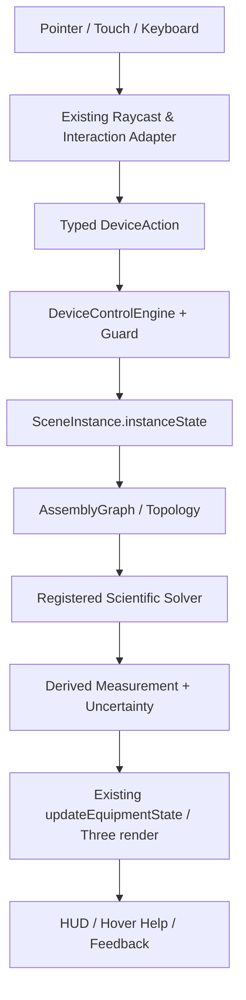

# MOCKUP 04 — GIAO DIỆN ĐIỀU KHIỂN, HƯỚNG DẪN THÍ NGHIỆM VÀ HỆ THỐNG KIỂM ĐỊNH

**Mã:** `OL3D-MU-04-UX-GUIDANCE-QUALITY` · **Trạng thái:** Design specification; kế thừa UI hiện hữu

## 0. Cam kết bảo toàn hệ thống hiện hữu (NON-DESTRUCTIVE UPGRADE)

Tài liệu này là mockup/đặc tả cải tiến, không phải lệnh tái viết dự án. Mọi triển khai phải theo nguyên tắc **ADD / ADAPT / VERIFY — NOT REPLACE**.

1. Giữ nguyên React 19, TypeScript strict, Vite 6, Three.js/WebGL và pipeline PBR đang có.
2. Giữ nguyên kiến trúc 4 lớp `OL3D-MASTER-SPEC v1.0`: Environment → Equipment → Interaction/Physics → App/Pedagogy.
3. Giữ nguyên chu trình nhân quả CIA 6 giai đoạn: User Action → Assembly Graph → Device State → Scientific Solvers → 3D Rendering → HUD/Feedback.
4. Giữ nguyên `AssetDefinition`, `SceneInstance`, `instanceState`, `window.OL3D_EQUIPMENT_MODULE`, `EquipmentModuleContract` và adapter tương thích v2.2/v2.3.
5. Không đổi Asset ID, slug, catalog key, tên node hiện đang được runtime tham chiếu, connector ID, state key hoặc đường dẫn public nếu chưa có migration plan tương thích ngược.
6. Không xóa/đổi tên các file nòng cốt. Ưu tiên thêm adapter, profile extension, solver service, schema version và test.
7. Mỗi thay đổi phải chạy typecheck, build, unit tests, assembly acceptance, scientific interaction regression và kiểm tra trực quan trên scene.
8. Không được gắn nhãn `PASS`, `verified` hoặc `validated` chỉ vì component tồn tại hoặc hình ảnh đẹp. Cần bằng chứng thực thi.
9. Dữ liệu nguồn có trạng thái `reported`, `illustrative`, `not-verified`, `partially-verified` phải tiếp tục giữ nguyên trạng thái và được đưa vào danh sách xác minh.
10. Khi phát hiện mâu thuẫn trong hồ sơ (ví dụ cân 500 g có thông số vỏ/tải bất thường, giá trị đơn vị không đồng nhất), không tự sửa số liệu; tạo `SPEC_CONFLICT` và yêu cầu đối chiếu datasheet/mẫu thật.

### 0.1. Bản đồ module hiện hữu cần kế thừa

| Vai trò | File hiện có | Cách mở rộng an toàn |
|---|---|---|
| Điều phối trạng thái | `src/App.tsx` | Bổ sung action/selector typed; không tạo state gốc song song |
| Viewport, raycast, drag-drop | `src/three-runtime/LabViewport3D.tsx` | Đăng ký hit targets và handler theo profile; tránh cài logic vật lý chuyên ngành dày đặc vào component |
| Mesh 3D | `src/three-runtime/ProceduralLabModels.ts` | Bổ sung named submeshes theo schema; giữ node legacy và alias |
| Kiểu dữ liệu | `src/domain/types.ts` | Mở rộng optional versioned fields; không phá payload cũ |
| Điều khiển | `src/device-control/DeviceControlEngine.ts` | Thêm mapping input→action→state và guard |
| Hồ sơ điều khiển | `src/device-control/DeviceControlProfilesData.ts` | Làm giàu profile từng asset; profile phải khai báo capabilities thực |
| Lắp ráp | `src/three-runtime/AssemblySystem.ts` | Thêm connector/constraint mới theo registry và migration |
| Môi trường | `src/three-runtime/LabEnvironmentEngine.ts` | Thêm environment adapter, không tạo environmental engine thứ hai |
| Hành vi | `src/three-runtime/BehaviorRegistry.ts` | Đăng ký behavior có type, lifecycle, teardown |
| UI hướng dẫn | `EquipmentHoverCard.tsx`, `EquipmentPreviewPanel.tsx`, `StudentGuidedStepPanel.tsx` | Kết nối dữ liệu profile, trạng thái và help content |
| Kiểm thử | `scripts/verify-assembly-acceptance.ts`, `scripts/verify-scientific-interaction.ts`, `scripts/scientific-profiles.ts` | Mở rộng kiểm thử; giữ nguyên test đã đạt |

### 0.2. Luồng dữ liệu đích (giữ nguyên CIA)



### 0.3. Phân loại thay đổi

- **P0 – bảo toàn:** thay đổi có nguy cơ phá vỡ state, module, connector, world units hoặc bộ giải hiện tại; không merge nếu chưa có regression.
- **P1 – đúng định luật:** sai causal dependency, sai dấu, sai đơn vị, hiển thị hiện tượng không có nguyên nhân.
- **P2 – điều khiển thực:** chi tiết 3D không điều khiển được, thiếu travel/range/lock/feedback.
- **P3 – giáo dục/UX:** hướng dẫn, tooltip, chú giải, accessibility, report.

## 1. Mục tiêu UX

Giao diện cần cho người học thấy được: đang chọn thiết bị nào, chi tiết nào đang được thao tác, thiết bị đang ở trạng thái gì, cần làm gì tiếp theo và vì sao thao tác bị từ chối. Không biến UI thành bảng điều khiển kỹ thuật lấn át mô hình 3D. Học sinh cần nhận hướng dẫn đúng ngữ cảnh; giáo viên/kỹ thuật viên được phép xem thêm dữ liệu chuyên sâu.

## 2. Mockup bố cục giao diện tổng thể

```text
┌────────────────────────────────────────────────────────────────────────────┐
│ TOP BAR: Bài thực hành | Thời gian mô phỏng | Môi trường | Undo | Help      │
├────────────────┬──────────────────────────────────────┬────────────────────┤
│ THƯ VIỆN        │                                      │ INSPECTOR          │
│ - nhóm G01-G10  │          VIEWPORT 3D                 │ Thiết bị đang chọn │
│ - search/filter │    thiết bị / bàn / môi trường       │ - trạng thái       │
│ - hover card    │                                      │ - controls         │
│ - ảnh thật      │    part hover/focus overlay           │ - measurements     │
│ - quick add     │                                      │ - connections       │
├────────────────┴──────────────────────────────────────┴────────────────────┤
│ BOTTOM: Quy trình | Kết quả đo | Nhật ký hành động | Cảnh báo | Báo cáo     │
└────────────────────────────────────────────────────────────────────────────┘
```

## 3. Hộp hướng dẫn Glassmorphism cho thư viện và chi tiết mesh

### 3.1. Nội dung bắt buộc của EquipmentHoverCard

| Khối | Nội dung | Điều kiện hiển thị |
| --- | --- | --- |
| Header | Tên thiết bị, assetId rút gọn, icon nhóm | Hover/focus item thư viện |
| Hero image | Ảnh thực hoặc thumbnail đã được catalog liên kết | Có asset ảnh hợp lệ; fallback SVG chỉ khi ảnh lỗi |
| Short purpose | Chức năng, môn/lớp áp dụng | Luôn có nếu dossier có dữ liệu |
| Key specs | GHĐ, ĐCNN, kích thước, khối lượng/dung tích có trạng thái dữ liệu | Chỉ show field có dữ liệu; kèm tag verified/reported/illustrative |
| Controls preview | Các thao tác chính: xoay, trượt, bật, rót, kẹp… | Theo DeviceControlProfile |
| Safety | Cảnh báo thao tác sai/giới hạn | Chỉ show khi safety rule liên quan |
| CTA | Thêm vào bàn / xem chi tiết / hướng dẫn | Theo mode và quyền user |

### 3.2. Hành vi hộp nổi

- Hover vào item → delay ngắn có thể cấu hình, hiện card cạnh item; pointer chuyển từ item sang card không làm card biến mất.
- Focus bằng bàn phím → card hiển thị như hover; `Esc` đóng; focus không bị mất.
- Touch → tap mở preview card; tap lần hai hoặc nút đóng để ẩn.
- Card tự đảo vị trí nếu gần mép màn hình; không bị cắt bởi `overflow`/stacking context.
- Card có nền kính mờ thực, nền alpha + backdrop blur; chữ đủ tương phản; không gây giảm FPS viewport.
- Dữ liệu ảnh/mô tả lấy từ một catalog source; không hardcode bản sao rải rác trong UI.

## 4. Inspector điều khiển từng bộ phận

Khi chọn thiết bị: hiển thị tổng quan. Khi chọn part: đổi Inspector sang chi tiết bộ phận, hiển thị loại input, range, đơn vị, hướng dẫn, state hiện tại, guard và hiệu ứng. UI control phải là một giao diện khác cho cùng action mà thao tác 3D phát ra; không tạo state song song.

| Tab | Nội dung | Dùng cho |
| --- | --- | --- |
| Overview | Ảnh, tên, mục đích, trạng thái, dữ liệu kỹ thuật | Mọi thiết bị |
| Parts | Cây node, chọn part, trạng thái hit target | Thiết bị nhiều chi tiết |
| Controls | Núm, slider, switch, valve, button, range, units | Điều khiển chi tiết |
| Science | Công thức, biến đầu vào, kết quả solver, uncertainty | Giáo viên/kỹ thuật |
| Connections | Graph, connector, partner, DOF, trạng thái link | Thiết bị lắp ghép |
| Environment | Các biến môi trường đang tác động và hệ số coupling | Thiết bị environment-aware |
| Diagnostics | Warnings, errors, event timeline, FMEA links | Kiểm định/sửa lỗi |
| Help | Hướng dẫn thao tác và bài học | Học sinh |

## 5. Hướng dẫn thích ứng theo trạng thái (Adaptive Coach)

Coach không chỉ hiện tooltip tĩnh. Nó đọc state và topology để đưa ra bước kế tiếp. Ví dụ: nếu đèn quang học chưa sáng vì chưa nối đủ hai dây, coach chỉ đúng hai terminal còn thiếu; nếu ống đong chưa có meniscus ổn định, coach yêu cầu chờ; nếu kính hiển vi đang dùng 40× mà tiêu bản chưa tìm được, coach hướng dẫn chuyển xuống 10×/4× trước khi tìm mẫu.

### 5.1. Mẫu dữ liệu hướng dẫn

```ts
interface HelpRule {
  id: string; assetId?: string; partId?: string; priority: number;
  when: { stateIs?: string[]; predicates?: string[]; missingConnectors?: string[]; errors?: string[] };
  message: { title: string; body: string; imageRef?: string; actionLabel?: string };
  suggestedAction?: { type: string; payload?: unknown };
  evidenceRuleId?: string;
}
```

## 6. Nhật ký sự kiện và chẩn đoán

- Mỗi thao tác ghi `eventId`, `timestamp`, `simulationTime`, `userAction`, `instanceId`, `partId`, `beforeStateHash`, `afterStateHash`, `guardResult`, `solverResultId`.
- Log tách `INFO`, `WARN`, `ERROR`, `SAFETY_BLOCK`, `SCIENCE_INVALID`, `DATA_UNVERIFIED`.
- Khi bị từ chối phải hiển thị nguyên nhân cụ thể và gợi ý an toàn, không chỉ ghi “không thể thao tác”.
- Có bộ lọc theo thiết bị, nhóm G, experimentId, instanceId, testId.
- Dữ liệu log không chứa token, thông tin cá nhân không cần thiết hoặc dữ liệu nhạy cảm.

## 7. Ma trận UI/coach/diagnostic cho từng thiết bị

## 01. Cân điện tử hiện số 500 g

- **Asset ID:** `OL3D-EQP-BAL-0001`
- **Archetype:** `electronic-balance` · **Category:** `mass-measurement`
- **Nhóm GDPT liên quan:** G02
- **Tên tiếng Anh trong hồ sơ:** *Precision Electronic Balance 500 g*
- **Nguyên tắc:** giữ assetId, slug, module hiện hữu; chỉ mở rộng control profile, state, solver adapter và test có version.
### 7.01.1. Các trường hiển thị lấy từ hồ sơ nguồn

### 4. Cấu trúc Cây Node 3D & Phối công thức Vật liệu PBR
* **Các sub-mesh node con**: `body`, `scale_display`, `tare_button_3d`, `weighing_pan`, `pan_plate`, `measurement_anchor`
* **Các lớp vật liệu Three.js sử dụng**: `MeshPhysicalMaterial`, `MeshStandardMaterial`, `MeshBasicMaterial`
* **Kỹ thuật đồ họa nổi bật**: ExtrudeGeometry with Bevel; Torus Chamfered Edge Reflectors; State Sync via userData; Optical Ray Tracing & Refraction
* **Bảng chi tiết các mesh thành phần & shader**:
| Tên Mesh Part | Lớp Geometry Three.js | Lớp Vật liệu PBR & Thông số | Render Order | Chức năng kỹ thuật trong mô hình |
| :--- | :--- | :--- | :---: | :--- |
| `body` | `ExtrudeGeometry (Bevel)` | MeshPhysicalMaterial (White ABS, roughness 0.25) | 1 | Thân vỏ OHAUS Scout chống hóa chất |
| `weighing_pan` | `CylinderGeometry + Torus` | MeshPhysicalMaterial (SUS304 Inox, metalness 0.94) | 2 | Mâm cân Inox lún 2.2mm khi chịu lực |
| `scale_display` | `PlaneGeometry (Offset)` | MeshBasicMaterial (CanvasTexture LED) | 3 | Màn hình LCD 7 đoạn nghiêng 20° |

### 6. Trạng thái Động & Bộ Điều khiển Tương tác
* **Các năng lực tương tác hỗ trợ**: `selectable`, `translatable`, `rotatable`, `showDimensions`, `weighObject`, `readScale`
* **Thuộc tính đo lường / Khoa học**:
  - Khối lượng chuẩn ($m_{ref}$): **1450 g** (Trạng thái: `reported`)
* **Thông số metrology thiết bị đo**:
  - Đại lượng đo: `mass`
  - Giới hạn đo (GHĐ): **0 g** đến **500 g**
  - Độ chia nhỏ nhất (ĐCNN): **0.01 g**
  - Hỗ trợ hiệu chỉnh điểm 0 / Trừ bì: **Có (Tare supported)**

### 8. Máy Trạng thái Động (Finite State Machine)
* **Trạng thái khởi tạo**: `IDLE_ZERO`
* **Danh sách trạng thái khả dụng**: `IDLE_ZERO`, `WEIGHING_SETTLING`, `STABLE_LOCKED`, `OVERLOAD_ERROR`
* **Ma trận chuyển trạng thái (State Transitions)**:
| Trạng thái ban đầu | Trạng thái tiếp theo | Sự kiện kích hoạt (Trigger) | Điều kiện chuyển (Guard Condition) |
| :--- | :--- | :--- | :--- |
| `IDLE_ZERO` | `WEIGHING_SETTLING` | Object placed on pan | `m_gross > 0.05 g` |
| `WEIGHING_SETTLING` | `STABLE_LOCKED` | Settling timer elapsed | `|dm/dt| < 0.01 g/s for 1.2s` |
| `WEIGHING_SETTLING` | `OVERLOAD_ERROR` | Load exceeds capacity | `m_gross > 550.0 g` |
| `STABLE_LOCKED` | `IDLE_ZERO` | TARE button pressed | `true` |

### 10. Phân tích Chế độ Hỏng hóc & Biện pháp Khắc phục (FMEA)
| Chế độ hỏng hóc (Failure Mode) | Nguyên nhân gốc rễ (Root Cause) | Tác động hệ thống (System Effect) | Phương thức phát hiện | Hành động khắc phục tự động |
| :--- | :--- | :--- | :--- | :--- |
| **Số đo trôi dạt liên tục (Drifting)** | Luồng gió phòng v_air > 0.5 m/s thổi lên đĩa cân | Cân không chốt số STABLE_LOCKED | `Cờ isDraftInterference = true` | Bật hộp chắn gió hoặc giảm tốc độ quạt phòng v_air = 0 m/s |
| **Báo lỗi quá tải OVERLOAD_ERR** | Đặt tải trọng vượt quá GHĐ 500g | Màn hình nhấp nháy [ - - - - ] | `Loadcell strain > 105% FS` | Nhấc bớt vật nặng khỏi đĩa cân về bàn |

### 7.01.2. Inspector/tooltip cụ thể

| Khu vực | Nội dung phải hiển thị | Nguồn state/profile |
| --- | --- | --- |
| Tên & ID | Cân điện tử hiện số 500 g / `OL3D-EQP-BAL-0001` | Catalog + dossier |
| Ảnh | Ảnh thực tế đúng asset; fallback đúng model SVG nếu thiếu | library-index + preview controller |
| Controls | weighing_pan: Đặt/nhấc vật; tare_button_3d: Nhấn TARE/ZERO; scale_display: Đọc màn hình; power/mode controls: Bật/tắt/chọn đơn vị nếu mặt máy có; leveling feet / bubble: Điều chỉnh cân bằng | DeviceControlProfile |
| State | `IDLE_ZERO`, `WEIGHING_SETTLING`, `STABLE_LOCKED`, `OVERLOAD_ERROR` * **Ma trận chuyển trạng thái (State Transitions)**: \| Trạng thái ban đầu \| Trạng thái tiếp theo \| Sự kiện kích hoạt (Trigger) \| Điều kiện chuyển (Guard Condition) \| \| :--- \| :--- \| :--- \| :--- \| \| `IDLE_ZERO` \| `WEIGHING_SETTLING` \| Object placed on pan \| `m_gross > 0.05 g` \| \| `WEIGHING_SETTLING` \| `STABLE_LOCKED` \| Settling timer elapsed \| `\|dm/dt\| < 0.01 g/s for 1.2s` \| \| `WEIGHING_SETTLING` \| `OVERLOAD_ERROR` \| Load exceeds capacity \| `m_gross > 550.0 g` \| \| `STABLE_LOCKED` \| `IDLE_ZERO` \| TARE button pressed \| `true` \| | SceneInstance.instanceState / FSM |
| Environment | gravityMps2, airflowMps, airTemperatureC, benchTemperatureC | LabEnvironmentEngine dependency map |
| Diagnostics | FMEA source row + live guard/error code | Behavior/solver result |

### 7.01.3. Gợi ý thích ứng phải có

- **Khi thiết bị ở trạng thái khởi tạo:** Nêu bước kiểm tra/chuẩn bị đầu tiên trước khi đo.
- **Khi người học chọn part:** Hiển thị tên part, chức năng, hướng thao tác, range và đơn vị nếu có.
- **Khi thao tác sai guard:** Nêu điều kiện chưa thỏa, part/connector nào liên quan và cách sửa.
- **Khi phép đo đang ổn định:** Giải thích cần chờ/giữ yên; không chốt số trước khi đạt điều kiện.
- **Khi vượt dải hoặc lỗi an toàn:** Cảnh báo rõ trạng thái, chặn hành động gây nguy hiểm và hướng dẫn phục hồi.
- **Khi dữ liệu chưa xác minh:** Hiển thị tag “Thông số tham khảo/chờ xác minh”; không nói như con số chuẩn.

### 7.01.4. Kiểm thử UX và thông tin

- **BAL-UX-HOVER:** Hover từng item thư viện hiển thị card có ảnh và thông tin đúng asset.
- **BAL-UX-FOCUS:** Tab/Enter/Escape truy cập và đóng card/inspector.
- **BAL-UX-TOUCH:** Tap mở/đóng; vùng chạm không bị quá nhỏ.
- **BAL-UX-PART:** Click từng bộ phận hiển thị đúng hướng dẫn, không nhầm node.
- **BAL-UX-STATE:** Nội dung card/inspector cập nhật theo state, không stale.
- **BAL-UX-ERROR:** Guard reject hiển thị mã và nguyên nhân tiếng Việt dễ hiểu.
- **BAL-UX-DATA-QUALITY:** Reported/illustrative/unverified được gắn nhãn.
- **BAL-UX-LAYOUT:** Card không bị cắt, che thao tác quan trọng hoặc tràn ngoài viewport.
- **BAL-UX-PERF:** Hover card không tạo texture/timer mới liên tục.
- **BAL-UX-REGRESSION:** Các panel hiện hữu không bị mất chức năng hoặc đổi layout ngoài ý muốn.

## 02. Ống đong thủy tinh 100 ml

- **Asset ID:** `OL3D-EQP-CYL-0001`
- **Archetype:** `graduated-cylinder` · **Category:** `volume-measurement`
- **Nhóm GDPT liên quan:** G04, G02
- **Tên tiếng Anh trong hồ sơ:** *100 ml Graduated Cylinder*
- **Nguyên tắc:** giữ assetId, slug, module hiện hữu; chỉ mở rộng control profile, state, solver adapter và test có version.
### 7.02.1. Các trường hiển thị lấy từ hồ sơ nguồn

### 4. Cấu trúc Cây Node 3D & Phối công thức Vật liệu PBR
* **Các sub-mesh node con**: `body`, `pouring_lip`, `scale_marks`, `liquid_surface`, `liquid_body`
* **Các lớp vật liệu Three.js sử dụng**: `MeshStandardMaterial`, `MeshBasicMaterial`
* **Kỹ thuật đồ họa nổi bật**: CanvasTexture Dynamic Readout; Torus Chamfered Edge Reflectors; Dynamic Liquid Level & Meniscus
* **Bảng chi tiết các mesh thành phần & shader**:
| Tên Mesh Part | Lớp Geometry Three.js | Lớp Vật liệu PBR & Thông số | Render Order | Chức năng kỹ thuật trong mô hình |
| :--- | :--- | :--- | :---: | :--- |
| `body` | `CylinderGeometry (Hollow)` | MeshPhysicalMaterial (Borosilicate, transmission 0.88) | 4 | Thân trụ thành dày 1.8mm kèm mỏ rót |
| `scale_marks` | `CylinderGeometry` | MeshBasicMaterial (CanvasTexture) | 5 | Vạch chia 10..100 ml nổi chống z-fighting |
| `liquid_surface` | `CylinderGeometry + Ring` | MeshPhysicalMaterial (Water, IOR 1.333) | 2 | Cột nước động kèm vành mặt khum mao dẫn |

### 6. Trạng thái Động & Bộ Điều khiển Tương tác
* **Các năng lực tương tác hỗ trợ**: `selectable`, `translatable`, `rotatable`, `showDimensions`, `readScale`, `displacementVolume`
* **Thuộc tính đo lường / Khoa học**:
  - Khối lượng chuẩn ($m_{ref}$): **138.5 g** (Trạng thái: `reported`)
  - Dung tích định mức ($V_{max}$): **100 ml**
* **Thông số metrology thiết bị đo**:
  - Đại lượng đo: `volume`
  - Giới hạn đo (GHĐ): **10 ml** đến **100 ml**
  - Độ chia nhỏ nhất (ĐCNN): **1 ml**

### 8. Máy Trạng thái Động (Finite State Machine)
* **Trạng thái khởi tạo**: `EMPTY`
* **Danh sách trạng thái khả dụng**: `EMPTY`, `PARTIALLY_FILLED`, `MENISCUS_STABLE`, `SUBMERGED_OBJECT`, `OVERFLOW`
* **Ma trận chuyển trạng thái (State Transitions)**:
| Trạng thái ban đầu | Trạng thái tiếp theo | Sự kiện kích hoạt (Trigger) | Điều kiện chuyển (Guard Condition) |
| :--- | :--- | :--- | :--- |
| `EMPTY` | `PARTIALLY_FILLED` | Liquid poured in | `V_liquid > 0` |
| `PARTIALLY_FILLED` | `SUBMERGED_OBJECT` | Sample solid dropped | `D_obj <= 28 mm` |
| `SUBMERGED_OBJECT` | `OVERFLOW` | Total volume exceeds 100ml | `V_total > 100 ml` |

### 10. Phân tích Chế độ Hỏng hóc & Biện pháp Khắc phục (FMEA)
| Chế độ hỏng hóc (Failure Mode) | Nguyên nhân gốc rễ (Root Cause) | Tác động hệ thống (System Effect) | Phương thức phát hiện | Hành động khắc phục tự động |
| :--- | :--- | :--- | :--- | :--- |
| **Sai số thị giác (Parallax Error)** | Góc nhìn camera không nằm ngang đáy mặt khum nước | Đọc sai thể tích ±2 đến 3 ml | `Góc lệch trục camera > 5° so với mặt phẳng ngang` | Bấm nút Focus Eye-Level tự động căn camera vuông góc vạch đo |
| **Kẹt mẫu vật ngang miệng ống** | Thả mẫu vật có đường kính > 28 mm (như khối đồng 30mm) | Vật không chìm được vào nước, nguy cơ nứt vỡ miệng ống | `Kiểm tra va chạm Box3 Aperture` | Bật cảnh báo APERTURE_OVERSIZE và chuyển mẫu sang Bình tràn Eureka |

### 7.02.2. Inspector/tooltip cụ thể

| Khu vực | Nội dung phải hiển thị | Nguồn state/profile |
| --- | --- | --- |
| Tên & ID | Ống đong thủy tinh 100 ml / `OL3D-EQP-CYL-0001` | Catalog + dossier |
| Ảnh | Ảnh thực tế đúng asset; fallback đúng model SVG nếu thiếu | library-index + preview controller |
| Controls | body / rim: Cầm, đặt, xoay; liquid_surface: Rót vào/ra; scale_marks: Đọc vạch ngang tầm mắt; aperture: Thả vật rắn | DeviceControlProfile |
| State | `EMPTY`, `PARTIALLY_FILLED`, `MENISCUS_STABLE`, `SUBMERGED_OBJECT`, `OVERFLOW` * **Ma trận chuyển trạng thái (State Transitions)**: \| Trạng thái ban đầu \| Trạng thái tiếp theo \| Sự kiện kích hoạt (Trigger) \| Điều kiện chuyển (Guard Condition) \| \| :--- \| :--- \| :--- \| :--- \| \| `EMPTY` \| `PARTIALLY_FILLED` \| Liquid poured in \| `V_liquid > 0` \| \| `PARTIALLY_FILLED` \| `SUBMERGED_OBJECT` \| Sample solid dropped \| `D_obj <= 28 mm` \| \| `SUBMERGED_OBJECT` \| `OVERFLOW` \| Total volume exceeds 100ml \| `V_total > 100 ml` \| | SceneInstance.instanceState / FSM |
| Environment | gravityMps2, sampleTemperatureC, sampleDensityKgM3, sampleViscosityPaS | LabEnvironmentEngine dependency map |
| Diagnostics | FMEA source row + live guard/error code | Behavior/solver result |

### 7.02.3. Gợi ý thích ứng phải có

- **Khi thiết bị ở trạng thái khởi tạo:** Nêu bước kiểm tra/chuẩn bị đầu tiên trước khi đo.
- **Khi người học chọn part:** Hiển thị tên part, chức năng, hướng thao tác, range và đơn vị nếu có.
- **Khi thao tác sai guard:** Nêu điều kiện chưa thỏa, part/connector nào liên quan và cách sửa.
- **Khi phép đo đang ổn định:** Giải thích cần chờ/giữ yên; không chốt số trước khi đạt điều kiện.
- **Khi vượt dải hoặc lỗi an toàn:** Cảnh báo rõ trạng thái, chặn hành động gây nguy hiểm và hướng dẫn phục hồi.
- **Khi dữ liệu chưa xác minh:** Hiển thị tag “Thông số tham khảo/chờ xác minh”; không nói như con số chuẩn.

### 7.02.4. Kiểm thử UX và thông tin

- **CYL-UX-HOVER:** Hover từng item thư viện hiển thị card có ảnh và thông tin đúng asset.
- **CYL-UX-FOCUS:** Tab/Enter/Escape truy cập và đóng card/inspector.
- **CYL-UX-TOUCH:** Tap mở/đóng; vùng chạm không bị quá nhỏ.
- **CYL-UX-PART:** Click từng bộ phận hiển thị đúng hướng dẫn, không nhầm node.
- **CYL-UX-STATE:** Nội dung card/inspector cập nhật theo state, không stale.
- **CYL-UX-ERROR:** Guard reject hiển thị mã và nguyên nhân tiếng Việt dễ hiểu.
- **CYL-UX-DATA-QUALITY:** Reported/illustrative/unverified được gắn nhãn.
- **CYL-UX-LAYOUT:** Card không bị cắt, che thao tác quan trọng hoặc tràn ngoài viewport.
- **CYL-UX-PERF:** Hover card không tạo texture/timer mới liên tục.
- **CYL-UX-REGRESSION:** Các panel hiện hữu không bị mất chức năng hoặc đổi layout ngoài ý muốn.

## 03. Cốc thủy tinh chia độ 250 ml

- **Asset ID:** `OL3D-EQP-BKR-0001`
- **Archetype:** `beaker-250` · **Category:** `laboratory-glassware`
- **Nhóm GDPT liên quan:** G04, G05, G02
- **Tên tiếng Anh trong hồ sơ:** *250 ml Low-Form Glass Beaker*
- **Nguyên tắc:** giữ assetId, slug, module hiện hữu; chỉ mở rộng control profile, state, solver adapter và test có version.
### 7.03.1. Các trường hiển thị lấy từ hồ sơ nguồn

### 4. Cấu trúc Cây Node 3D & Phối công thức Vật liệu PBR
* **Các sub-mesh node con**: `body`, `pouring_lip`, `scale_marks`, `liquid_surface`, `liquid_body`
* **Các lớp vật liệu Three.js sử dụng**: `MeshBasicMaterial`
* **Kỹ thuật đồ họa nổi bật**: CanvasTexture Dynamic Readout; Torus Chamfered Edge Reflectors; Dynamic Liquid Level & Meniscus
* **Bảng chi tiết các mesh thành phần & shader**:
| Tên Mesh Part | Lớp Geometry Three.js | Lớp Vật liệu PBR & Thông số | Render Order | Chức năng kỹ thuật trong mô hình |
| :--- | :--- | :--- | :---: | :--- |
| `body` | `CylinderGeometry (Low form)` | MeshPhysicalMaterial (Borosilicate, IOR 1.48) | 4 | Cốc Griffin Low-form đường kính 70mm |
| `pouring_lip` | `ShapeGeometry Extrude` | MeshPhysicalMaterial (Glass) | 4 | Mỏ rót vát góc chống tràn chất lỏng |

### 6. Trạng thái Động & Bộ Điều khiển Tương tác
* **Các năng lực tương tác hỗ trợ**: `selectable`, `translatable`, `rotatable`, `showDimensions`, `readScale`
* **Thuộc tính đo lường / Khoa học**:
  - Khối lượng chuẩn ($m_{ref}$): **96 g** (Trạng thái: `illustrative`)
  - Dung tích định mức ($V_{max}$): **250 ml**

### 8. Máy Trạng thái Động (Finite State Machine)
* **Trạng thái khởi tạo**: `EMPTY`
* **Danh sách trạng thái khả dụng**: `EMPTY`, `FILLED`, `HEATING`, `BOILING`, `POURING`
* **Ma trận chuyển trạng thái (State Transitions)**:
| Trạng thái ban đầu | Trạng thái tiếp theo | Sự kiện kích hoạt (Trigger) | Điều kiện chuyển (Guard Condition) |
| :--- | :--- | :--- | :--- |
| `EMPTY` | `FILLED` | Liquid added | `liquidLevelMl > 0` |
| `FILLED` | `HEATING` | Burner flame applied | `T_liquid > T_ambient` |
| `HEATING` | `BOILING` | Temperature reaches boiling point | `T_liquid >= 100.0 C` |

### 10. Phân tích Chế độ Hỏng hóc & Biện pháp Khắc phục (FMEA)
| Chế độ hỏng hóc (Failure Mode) | Nguyên nhân gốc rễ (Root Cause) | Tác động hệ thống (System Effect) | Phương thức phát hiện | Hành động khắc phục tự động |
| :--- | :--- | :--- | :--- | :--- |
| **Sôi trào bọt khí (Bumping)** | Đun sôi chất lỏng không có đá bọt điều hòa sôi | Dung dịch bắn tung tóe ra ngoài cốc | `dT/dt > 15°C/s khi T > 95°C` | Thêm bi thủy tinh / đá bọt và giảm công suất đèn cồn |

### 7.03.2. Inspector/tooltip cụ thể

| Khu vực | Nội dung phải hiển thị | Nguồn state/profile |
| --- | --- | --- |
| Tên & ID | Cốc thủy tinh chia độ 250 ml / `OL3D-EQP-BKR-0001` | Catalog + dossier |
| Ảnh | Ảnh thực tế đúng asset; fallback đúng model SVG nếu thiếu | library-index + preview controller |
| Controls | body/base: Cầm, đặt, xoay; liquid_surface: Rót/nhận dung dịch; pouring_lip: Nghiêng để rót; scale_marks: Đọc thể tích gần đúng | DeviceControlProfile |
| State | `EMPTY`, `FILLED`, `HEATING`, `BOILING`, `POURING` * **Ma trận chuyển trạng thái (State Transitions)**: \| Trạng thái ban đầu \| Trạng thái tiếp theo \| Sự kiện kích hoạt (Trigger) \| Điều kiện chuyển (Guard Condition) \| \| :--- \| :--- \| :--- \| :--- \| \| `EMPTY` \| `FILLED` \| Liquid added \| `liquidLevelMl > 0` \| \| `FILLED` \| `HEATING` \| Burner flame applied \| `T_liquid > T_ambient` \| \| `HEATING` \| `BOILING` \| Temperature reaches boiling point \| `T_liquid >= 100.0 C` \| | SceneInstance.instanceState / FSM |
| Environment | gravityMps2, sampleTemperatureC, sampleDensityKgM3, thermalHeatPowerW, airTemperatureC | LabEnvironmentEngine dependency map |
| Diagnostics | FMEA source row + live guard/error code | Behavior/solver result |

### 7.03.3. Gợi ý thích ứng phải có

- **Khi thiết bị ở trạng thái khởi tạo:** Nêu bước kiểm tra/chuẩn bị đầu tiên trước khi đo.
- **Khi người học chọn part:** Hiển thị tên part, chức năng, hướng thao tác, range và đơn vị nếu có.
- **Khi thao tác sai guard:** Nêu điều kiện chưa thỏa, part/connector nào liên quan và cách sửa.
- **Khi phép đo đang ổn định:** Giải thích cần chờ/giữ yên; không chốt số trước khi đạt điều kiện.
- **Khi vượt dải hoặc lỗi an toàn:** Cảnh báo rõ trạng thái, chặn hành động gây nguy hiểm và hướng dẫn phục hồi.
- **Khi dữ liệu chưa xác minh:** Hiển thị tag “Thông số tham khảo/chờ xác minh”; không nói như con số chuẩn.

### 7.03.4. Kiểm thử UX và thông tin

- **BKR-UX-HOVER:** Hover từng item thư viện hiển thị card có ảnh và thông tin đúng asset.
- **BKR-UX-FOCUS:** Tab/Enter/Escape truy cập và đóng card/inspector.
- **BKR-UX-TOUCH:** Tap mở/đóng; vùng chạm không bị quá nhỏ.
- **BKR-UX-PART:** Click từng bộ phận hiển thị đúng hướng dẫn, không nhầm node.
- **BKR-UX-STATE:** Nội dung card/inspector cập nhật theo state, không stale.
- **BKR-UX-ERROR:** Guard reject hiển thị mã và nguyên nhân tiếng Việt dễ hiểu.
- **BKR-UX-DATA-QUALITY:** Reported/illustrative/unverified được gắn nhãn.
- **BKR-UX-LAYOUT:** Card không bị cắt, che thao tác quan trọng hoặc tràn ngoài viewport.
- **BKR-UX-PERF:** Hover card không tạo texture/timer mới liên tục.
- **BKR-UX-REGRESSION:** Các panel hiện hữu không bị mất chức năng hoặc đổi layout ngoài ý muốn.

## 04. Bình tràn Eureka 250 ml

- **Asset ID:** `OL3D-EQP-OVF-0001`
- **Archetype:** `overflow-can` · **Category:** `volume-measurement`
- **Nhóm GDPT liên quan:** G02, G04
- **Tên tiếng Anh trong hồ sơ:** *Eureka Overflow Can 250 ml*
- **Nguyên tắc:** giữ assetId, slug, module hiện hữu; chỉ mở rộng control profile, state, solver adapter và test có version.
### 7.04.1. Các trường hiển thị lấy từ hồ sơ nguồn

### 4. Cấu trúc Cây Node 3D & Phối công thức Vật liệu PBR
* **Các sub-mesh node con**: `body`, `scale_marks`, `spout_water`, `liquid_surface`, `liquid_body`, `spout_stream`, `stream_outer`, `stream_core`, `measurement_anchor`
* **Các lớp vật liệu Three.js sử dụng**: `MeshStandardMaterial`, `MeshBasicMaterial`
* **Kỹ thuật đồ họa nổi bật**: CanvasTexture Dynamic Readout; Torus Chamfered Edge Reflectors; Dynamic Liquid Level & Meniscus
* **Bảng chi tiết các mesh thành phần & shader**:
| Tên Mesh Part | Lớp Geometry Three.js | Lớp Vật liệu PBR & Thông số | Render Order | Chức năng kỹ thuật trong mô hình |
| :--- | :--- | :--- | :---: | :--- |
| `body` | `CylinderGeometry` | MeshPhysicalMaterial (Transparent Acrylic) | 4 | Bình trụ trong suốt đường kính 85mm |
| `spout_water` | `CylinderGeometry (Tilted 30°)` | MeshPhysicalMaterial (Water stream) | 3 | Dòng nước trong lòng vòi nghiêng xả ra ngoài |

### 6. Trạng thái Động & Bộ Điều khiển Tương tác
* **Các năng lực tương tác hỗ trợ**: `selectable`, `translatable`, `rotatable`, `showDimensions`, `displacementVolume`
* **Thuộc tính đo lường / Khoa học**:
  - Khối lượng chuẩn ($m_{ref}$): **112 g** (Trạng thái: `illustrative`)
  - Dung tích định mức ($V_{max}$): **250 ml**

### 8. Máy Trạng thái Động (Finite State Machine)
* **Trạng thái khởi tạo**: `UNFILLED`
* **Danh sách trạng thái khả dụng**: `UNFILLED`, `PRIMED_TO_BRIM`, `OVERFLOWING_ACTIVE`, `DRAINED_TO_BRIM`
* **Ma trận chuyển trạng thái (State Transitions)**:
| Trạng thái ban đầu | Trạng thái tiếp theo | Sự kiện kích hoạt (Trigger) | Điều kiện chuyển (Guard Condition) |
| :--- | :--- | :--- | :--- |
| `UNFILLED` | `PRIMED_TO_BRIM` | Water filled to spout neck | `V == 210.0 ml` |
| `PRIMED_TO_BRIM` | `OVERFLOWING_ACTIVE` | Object submerged | `V_submerged > 0` |
| `OVERFLOWING_ACTIVE` | `DRAINED_TO_BRIM` | Overflow stream finished | `V_spout == 0` |

### 10. Phân tích Chế độ Hỏng hóc & Biện pháp Khắc phục (FMEA)
| Chế độ hỏng hóc (Failure Mode) | Nguyên nhân gốc rễ (Root Cause) | Tác động hệ thống (System Effect) | Phương thức phát hiện | Hành động khắc phục tự động |
| :--- | :--- | :--- | :--- | :--- |
| **Nước chưa tới ngưỡng vòi đã thả vật** | Mực nước ban đầu < 210 ml | Thể tích nước hứng được nhỏ hơn thể tích thực của vật | `V_initial < 210.0 ml` | Bắt buộc đổ nước đầy tràn vòi trước khi tiến hành thí nghiệm Archimedes |

### 7.04.2. Inspector/tooltip cụ thể

| Khu vực | Nội dung phải hiển thị | Nguồn state/profile |
| --- | --- | --- |
| Tên & ID | Bình tràn Eureka 250 ml / `OL3D-EQP-OVF-0001` | Catalog + dossier |
| Ảnh | Ảnh thực tế đúng asset; fallback đúng model SVG nếu thiếu | library-index + preview controller |
| Controls | body: Đặt, căn hướng; liquid_surface: Nạp đến miệng vòi; spout_water / spout_stream: Xả nước tràn; measurement_anchor: Định vị cốc hứng | DeviceControlProfile |
| State | `UNFILLED`, `PRIMED_TO_BRIM`, `OVERFLOWING_ACTIVE`, `DRAINED_TO_BRIM` * **Ma trận chuyển trạng thái (State Transitions)**: \| Trạng thái ban đầu \| Trạng thái tiếp theo \| Sự kiện kích hoạt (Trigger) \| Điều kiện chuyển (Guard Condition) \| \| :--- \| :--- \| :--- \| :--- \| \| `UNFILLED` \| `PRIMED_TO_BRIM` \| Water filled to spout neck \| `V == 210.0 ml` \| \| `PRIMED_TO_BRIM` \| `OVERFLOWING_ACTIVE` \| Object submerged \| `V_submerged > 0` \| \| `OVERFLOWING_ACTIVE` \| `DRAINED_TO_BRIM` \| Overflow stream finished \| `V_spout == 0` \| | SceneInstance.instanceState / FSM |
| Environment | gravityMps2, sampleDensityKgM3, sampleTemperatureC, airflowMps | LabEnvironmentEngine dependency map |
| Diagnostics | FMEA source row + live guard/error code | Behavior/solver result |

### 7.04.3. Gợi ý thích ứng phải có

- **Khi thiết bị ở trạng thái khởi tạo:** Nêu bước kiểm tra/chuẩn bị đầu tiên trước khi đo.
- **Khi người học chọn part:** Hiển thị tên part, chức năng, hướng thao tác, range và đơn vị nếu có.
- **Khi thao tác sai guard:** Nêu điều kiện chưa thỏa, part/connector nào liên quan và cách sửa.
- **Khi phép đo đang ổn định:** Giải thích cần chờ/giữ yên; không chốt số trước khi đạt điều kiện.
- **Khi vượt dải hoặc lỗi an toàn:** Cảnh báo rõ trạng thái, chặn hành động gây nguy hiểm và hướng dẫn phục hồi.
- **Khi dữ liệu chưa xác minh:** Hiển thị tag “Thông số tham khảo/chờ xác minh”; không nói như con số chuẩn.

### 7.04.4. Kiểm thử UX và thông tin

- **OVF-UX-HOVER:** Hover từng item thư viện hiển thị card có ảnh và thông tin đúng asset.
- **OVF-UX-FOCUS:** Tab/Enter/Escape truy cập và đóng card/inspector.
- **OVF-UX-TOUCH:** Tap mở/đóng; vùng chạm không bị quá nhỏ.
- **OVF-UX-PART:** Click từng bộ phận hiển thị đúng hướng dẫn, không nhầm node.
- **OVF-UX-STATE:** Nội dung card/inspector cập nhật theo state, không stale.
- **OVF-UX-ERROR:** Guard reject hiển thị mã và nguyên nhân tiếng Việt dễ hiểu.
- **OVF-UX-DATA-QUALITY:** Reported/illustrative/unverified được gắn nhãn.
- **OVF-UX-LAYOUT:** Card không bị cắt, che thao tác quan trọng hoặc tràn ngoài viewport.
- **OVF-UX-PERF:** Hover card không tạo texture/timer mới liên tục.
- **OVF-UX-REGRESSION:** Các panel hiện hữu không bị mất chức năng hoặc đổi layout ngoài ý muốn.

## 05. Lực kế lò xo ống trụ 5 N

- **Asset ID:** `OL3D-EQP-DYN-0001`
- **Archetype:** `spring-dynamometer` · **Category:** `force-measurement`
- **Nhóm GDPT liên quan:** G02, G08
- **Tên tiếng Anh trong hồ sơ:** *5 N Tubular Spring Dynamometer*
- **Nguyên tắc:** giữ assetId, slug, module hiện hữu; chỉ mở rộng control profile, state, solver adapter và test có version.
### 7.05.1. Các trường hiển thị lấy từ hồ sơ nguồn

### 4. Cấu trúc Cây Node 3D & Phối công thức Vật liệu PBR
* **Các sub-mesh node con**: `body`, `scale_marks`, `scale_marks_cross`, `spring_coil`, `plunger`
* **Các lớp vật liệu Three.js sử dụng**: `MeshStandardMaterial`, `MeshBasicMaterial`
* **Kỹ thuật đồ họa nổi bật**: CanvasTexture Dynamic Readout; Torus Chamfered Edge Reflectors
* **Bảng chi tiết các mesh thành phần & shader**:
| Tên Mesh Part | Lớp Geometry Three.js | Lớp Vật liệu PBR & Thông số | Render Order | Chức năng kỹ thuật trong mô hình |
| :--- | :--- | :--- | :---: | :--- |
| `body` | `CylinderGeometry (Clear Acrylic)` | MeshPhysicalMaterial (Acrylic, IOR 1.49) | 3 | Vỏ ống trụ bảo vệ trong suốt nhìn rõ lò xo |
| `spring_coil` | `TubeGeometry (Helix Curve)` | MeshPhysicalMaterial (Spring Steel, metalness 0.95) | 4 | Lò xo xoắn ốc co giãn thực tế theo tải trọng |
| `plunger` | `Cylinder + Torus Hook` | MeshStandardMaterial (Red Indicator) | 4 | Trục kéo kèm đĩa chỉ thị đỏ và móc treo đáy |

### 6. Trạng thái Động & Bộ Điều khiển Tương tác
* **Các năng lực tương tác hỗ trợ**: `selectable`, `translatable`, `rotatable`, `showDimensions`, `measureForce`, `readScale`
* **Thuộc tính đo lường / Khoa học**:
  - Khối lượng chuẩn ($m_{ref}$): **65 g** (Trạng thái: `illustrative`)
* **Thông số metrology thiết bị đo**:
  - Đại lượng đo: `force`
  - Giới hạn đo (GHĐ): **0 N** đến **5 N**
  - Độ chia nhỏ nhất (ĐCNN): **0.1 N**
  - Hỗ trợ hiệu chỉnh điểm 0 / Trừ bì: **Có (Tare supported)**

### 8. Máy Trạng thái Động (Finite State Machine)
* **Trạng thái khởi tạo**: `UNLOADED_ZERO`
* **Danh sách trạng thái khả dụng**: `UNLOADED_ZERO`, `STRETCHING`, `OSCILLATING`, `EQUILIBRIUM`, `OVERSTRETCHED`
* **Ma trận chuyển trạng thái (State Transitions)**:
| Trạng thái ban đầu | Trạng thái tiếp theo | Sự kiện kích hoạt (Trigger) | Điều kiện chuyển (Guard Condition) |
| :--- | :--- | :--- | :--- |
| `UNLOADED_ZERO` | `STRETCHING` | Load applied to bottom hook | `F > 0` |
| `STRETCHING` | `EQUILIBRIUM` | Damping settles | `|v_plunger| < 0.001 m/s` |
| `STRETCHING` | `OVERSTRETCHED` | Force exceeds limit | `F > 5.5 N` |

### 10. Phân tích Chế độ Hỏng hóc & Biện pháp Khắc phục (FMEA)
| Chế độ hỏng hóc (Failure Mode) | Nguyên nhân gốc rễ (Root Cause) | Tác động hệ thống (System Effect) | Phương thức phát hiện | Hành động khắc phục tự động |
| :--- | :--- | :--- | :--- | :--- |
| **Lệch điểm 0 ban đầu** | Lò xo bị dão nhẹ sau thời gian dài sử dụng | Số đo lực bị cộng sai số hệ thống | `F_no_load != 0.0 N` | Vặn núm ốc Zero-Adjust ở đỉnh ống đưa đĩa chỉ thị về đúng vạch 0 |
| **Biến dạng dẻo vĩnh viễn (Plastic Deformation)** | Treo tải trọng > 6N vượt giới hạn đàn hồi Hooke | Lò xo mất tính đàn hồi tuyến tính | `F_applied > 6.0 N` | Báo lỗi quá tải và thay thế cụm lò xo mới |

### 7.05.2. Inspector/tooltip cụ thể

| Khu vực | Nội dung phải hiển thị | Nguồn state/profile |
| --- | --- | --- |
| Tên & ID | Lực kế lò xo ống trụ 5 N / `OL3D-EQP-DYN-0001` | Catalog + dossier |
| Ảnh | Ảnh thực tế đúng asset; fallback đúng model SVG nếu thiếu | library-index + preview controller |
| Controls | upper_hook/body: Treo vào giá đỡ; lower_hook: Móc vật; spring: Co giãn; scale/indicator: Đọc lực | DeviceControlProfile |
| State | `UNLOADED_ZERO`, `STRETCHING`, `OSCILLATING`, `EQUILIBRIUM`, `OVERSTRETCHED` * **Ma trận chuyển trạng thái (State Transitions)**: \| Trạng thái ban đầu \| Trạng thái tiếp theo \| Sự kiện kích hoạt (Trigger) \| Điều kiện chuyển (Guard Condition) \| \| :--- \| :--- \| :--- \| :--- \| \| `UNLOADED_ZERO` \| `STRETCHING` \| Load applied to bottom hook \| `F > 0` \| \| `STRETCHING` \| `EQUILIBRIUM` \| Damping settles \| `\|v_plunger\| < 0.001 m/s` \| \| `STRETCHING` \| `OVERSTRETCHED` \| Force exceeds limit \| `F > 5.5 N` \| | SceneInstance.instanceState / FSM |
| Environment | gravityMps2, airTemperatureC | LabEnvironmentEngine dependency map |
| Diagnostics | FMEA source row + live guard/error code | Behavior/solver result |

### 7.05.3. Gợi ý thích ứng phải có

- **Khi thiết bị ở trạng thái khởi tạo:** Nêu bước kiểm tra/chuẩn bị đầu tiên trước khi đo.
- **Khi người học chọn part:** Hiển thị tên part, chức năng, hướng thao tác, range và đơn vị nếu có.
- **Khi thao tác sai guard:** Nêu điều kiện chưa thỏa, part/connector nào liên quan và cách sửa.
- **Khi phép đo đang ổn định:** Giải thích cần chờ/giữ yên; không chốt số trước khi đạt điều kiện.
- **Khi vượt dải hoặc lỗi an toàn:** Cảnh báo rõ trạng thái, chặn hành động gây nguy hiểm và hướng dẫn phục hồi.
- **Khi dữ liệu chưa xác minh:** Hiển thị tag “Thông số tham khảo/chờ xác minh”; không nói như con số chuẩn.

### 7.05.4. Kiểm thử UX và thông tin

- **DYN-UX-HOVER:** Hover từng item thư viện hiển thị card có ảnh và thông tin đúng asset.
- **DYN-UX-FOCUS:** Tab/Enter/Escape truy cập và đóng card/inspector.
- **DYN-UX-TOUCH:** Tap mở/đóng; vùng chạm không bị quá nhỏ.
- **DYN-UX-PART:** Click từng bộ phận hiển thị đúng hướng dẫn, không nhầm node.
- **DYN-UX-STATE:** Nội dung card/inspector cập nhật theo state, không stale.
- **DYN-UX-ERROR:** Guard reject hiển thị mã và nguyên nhân tiếng Việt dễ hiểu.
- **DYN-UX-DATA-QUALITY:** Reported/illustrative/unverified được gắn nhãn.
- **DYN-UX-LAYOUT:** Card không bị cắt, che thao tác quan trọng hoặc tràn ngoài viewport.
- **DYN-UX-PERF:** Hover card không tạo texture/timer mới liên tục.
- **DYN-UX-REGRESSION:** Các panel hiện hữu không bị mất chức năng hoặc đổi layout ngoài ý muốn.

## 06. Thước cặp du xích 150 mm (0.02 mm)

- **Asset ID:** `OL3D-EQP-CAL-0001`
- **Archetype:** `vernier-caliper` · **Category:** `length-measurement`
- **Nhóm GDPT liên quan:** G01
- **Tên tiếng Anh trong hồ sơ:** *Vernier Caliper 150 mm x 0.02 mm*
- **Nguyên tắc:** giữ assetId, slug, module hiện hữu; chỉ mở rộng control profile, state, solver adapter và test có version.
### 7.06.1. Các trường hiển thị lấy từ hồ sơ nguồn

### 4. Cấu trúc Cây Node 3D & Phối công thức Vật liệu PBR
* **Các sub-mesh node con**: `body`, `scale_marks`, `plunger`, `scale_display`, `scale_display_front`, `scale_display_rear`, `depth_rod`, `jaw_measure_guide`
* **Các lớp vật liệu Three.js sử dụng**: `MeshStandardMaterial`, `MeshBasicMaterial`
* **Kỹ thuật đồ họa nổi bật**: CanvasTexture Dynamic Readout; State Sync via userData
* **Bảng chi tiết các mesh thành phần & shader**:
| Tên Mesh Part | Lớp Geometry Three.js | Lớp Vật liệu PBR & Thông số | Render Order | Chức năng kỹ thuật trong mô hình |
| :--- | :--- | :--- | :---: | :--- |
| `body` | `BoxGeometry + Bevel Shape` | MeshPhysicalMaterial (Brushed Steel, metalness 0.92) | 1 | Thân thước chính dài 235mm kèm mỏ kẹp cố định |
| `plunger` | `ShapeGeometry Extrude` | MeshPhysicalMaterial (Hardened Stainless Steel) | 2 | Khối hàm trượt du xích di động dọc trục X |
| `scale_display` | `PlaneGeometry` | MeshBasicMaterial (CanvasTexture) | 3 | Bảng hiển thị số đo LCD hỗ trợ học sinh đọc nhanh |

### 6. Trạng thái Động & Bộ Điều khiển Tương tác
* **Các năng lực tương tác hỗ trợ**: `selectable`, `translatable`, `rotatable`, `showDimensions`, `caliperMeasure`, `readScale`
* **Thuộc tính đo lường / Khoa học**:
  - Khối lượng chuẩn ($m_{ref}$): **162 g** (Trạng thái: `measured`)
* **Thông số metrology thiết bị đo**:
  - Đại lượng đo: `length`
  - Giới hạn đo (GHĐ): **0 mm** đến **150 mm**
  - Độ chia nhỏ nhất (ĐCNN): **0.02 mm**

### 8. Máy Trạng thái Động (Finite State Machine)
* **Trạng thái khởi tạo**: `CLOSED_ZERO`
* **Danh sách trạng thái khả dụng**: `CLOSED_ZERO`, `SLIDING`, `CLAMPED_OBJECT`, `LOCKED_READOUT`
* **Ma trận chuyển trạng thái (State Transitions)**:
| Trạng thái ban đầu | Trạng thái tiếp theo | Sự kiện kích hoạt (Trigger) | Điều kiện chuyển (Guard Condition) |
| :--- | :--- | :--- | :--- |
| `CLOSED_ZERO` | `SLIDING` | Slider moved | `opening > 0` |
| `SLIDING` | `CLAMPED_OBJECT` | Jaws contact object surface | `opening == object_dim` |
| `CLAMPED_OBJECT` | `LOCKED_READOUT` | Locking screw tightened | `isLocked == true` |

### 10. Phân tích Chế độ Hỏng hóc & Biện pháp Khắc phục (FMEA)
| Chế độ hỏng hóc (Failure Mode) | Nguyên nhân gốc rễ (Root Cause) | Tác động hệ thống (System Effect) | Phương thức phát hiện | Hành động khắc phục tự động |
| :--- | :--- | :--- | :--- | :--- |
| **Lực kẹp quá mạnh gây biến dạng mẫu mềm** | Siết hàm kẹp quá chặt vào mẫu nhựa POM hoặc chì | Kích thước đo được nhỏ hơn thực tế 0.05 mm | `Lực kẹp tiếp xúc > 15 N` | Sử dụng con lăn ngón cái đẩy nhẹ vừa chạm bề mặt |

### 7.06.2. Inspector/tooltip cụ thể

| Khu vực | Nội dung phải hiển thị | Nguồn state/profile |
| --- | --- | --- |
| Tên & ID | Thước cặp du xích 150 mm (0.02 mm) / `OL3D-EQP-CAL-0001` | Catalog + dossier |
| Ảnh | Ảnh thực tế đúng asset; fallback đúng model SVG nếu thiếu | library-index + preview controller |
| Controls | fixed_jaw: Tựa một mặt vật; moving_jaw/plunger: Trượt hàm đo; vernier_scale: Đọc du xích; lock screw: Khóa/nhả nếu node tồn tại | DeviceControlProfile |
| State | `CLOSED_ZERO`, `SLIDING`, `CLAMPED_OBJECT`, `LOCKED_READOUT` * **Ma trận chuyển trạng thái (State Transitions)**: \| Trạng thái ban đầu \| Trạng thái tiếp theo \| Sự kiện kích hoạt (Trigger) \| Điều kiện chuyển (Guard Condition) \| \| :--- \| :--- \| :--- \| :--- \| \| `CLOSED_ZERO` \| `SLIDING` \| Slider moved \| `opening > 0` \| \| `SLIDING` \| `CLAMPED_OBJECT` \| Jaws contact object surface \| `opening == object_dim` \| \| `CLAMPED_OBJECT` \| `LOCKED_READOUT` \| Locking screw tightened \| `isLocked == true` \| | SceneInstance.instanceState / FSM |
| Environment | airTemperatureC, benchTemperatureC | LabEnvironmentEngine dependency map |
| Diagnostics | FMEA source row + live guard/error code | Behavior/solver result |

### 7.06.3. Gợi ý thích ứng phải có

- **Khi thiết bị ở trạng thái khởi tạo:** Nêu bước kiểm tra/chuẩn bị đầu tiên trước khi đo.
- **Khi người học chọn part:** Hiển thị tên part, chức năng, hướng thao tác, range và đơn vị nếu có.
- **Khi thao tác sai guard:** Nêu điều kiện chưa thỏa, part/connector nào liên quan và cách sửa.
- **Khi phép đo đang ổn định:** Giải thích cần chờ/giữ yên; không chốt số trước khi đạt điều kiện.
- **Khi vượt dải hoặc lỗi an toàn:** Cảnh báo rõ trạng thái, chặn hành động gây nguy hiểm và hướng dẫn phục hồi.
- **Khi dữ liệu chưa xác minh:** Hiển thị tag “Thông số tham khảo/chờ xác minh”; không nói như con số chuẩn.

### 7.06.4. Kiểm thử UX và thông tin

- **CAL-UX-HOVER:** Hover từng item thư viện hiển thị card có ảnh và thông tin đúng asset.
- **CAL-UX-FOCUS:** Tab/Enter/Escape truy cập và đóng card/inspector.
- **CAL-UX-TOUCH:** Tap mở/đóng; vùng chạm không bị quá nhỏ.
- **CAL-UX-PART:** Click từng bộ phận hiển thị đúng hướng dẫn, không nhầm node.
- **CAL-UX-STATE:** Nội dung card/inspector cập nhật theo state, không stale.
- **CAL-UX-ERROR:** Guard reject hiển thị mã và nguyên nhân tiếng Việt dễ hiểu.
- **CAL-UX-DATA-QUALITY:** Reported/illustrative/unverified được gắn nhãn.
- **CAL-UX-LAYOUT:** Card không bị cắt, che thao tác quan trọng hoặc tràn ngoài viewport.
- **CAL-UX-PERF:** Hover card không tạo texture/timer mới liên tục.
- **CAL-UX-REGRESSION:** Các panel hiện hữu không bị mất chức năng hoặc đổi layout ngoài ý muốn.

## 07. Quả cân chuẩn bằng đồng 50 g

- **Asset ID:** `OL3D-EQP-WGT-0001`
- **Archetype:** `calibration-weight` · **Category:** `mass-measurement`
- **Nhóm GDPT liên quan:** G02
- **Tên tiếng Anh trong hồ sơ:** *50 g Brass Calibration Weight*
- **Nguyên tắc:** giữ assetId, slug, module hiện hữu; chỉ mở rộng control profile, state, solver adapter và test có version.
### 7.07.1. Các trường hiển thị lấy từ hồ sơ nguồn

### 4. Cấu trúc Cây Node 3D & Phối công thức Vật liệu PBR
* **Các sub-mesh node con**: `body`, `handle`
* **Các lớp vật liệu Three.js sử dụng**: `MeshPhysicalMaterial`
* **Kỹ thuật đồ họa nổi bật**: Torus Chamfered Edge Reflectors
* **Bảng chi tiết các mesh thành phần & shader**:
| Tên Mesh Part | Lớp Geometry Three.js | Lớp Vật liệu PBR & Thông số | Render Order | Chức năng kỹ thuật trong mô hình |
| :--- | :--- | :--- | :---: | :--- |
| `body` | `CylinderGeometry + Torus bevel` | MeshPhysicalMaterial (Polished Brass, metalness 0.94) | 1 | Thân quả cân đồng thau mạ niken bóng gương |
| `handle` | `Cylinder + Sphere` | MeshPhysicalMaterial (Brass) | 1 | Núm cầm thắt eo chuẩn OIML gắp bằng nhíp |

### 6. Trạng thái Động & Bộ Điều khiển Tương tác
* **Các năng lực tương tác hỗ trợ**: `selectable`, `translatable`, `rotatable`, `showDimensions`
* **Thuộc tính đo lường / Khoa học**:
  - Khối lượng chuẩn ($m_{ref}$): **50 g** (Trạng thái: `verified`)
  - Thể tích chuẩn ($V_{ref}$): **5.95 cm³**

### 8. Máy Trạng thái Động (Finite State Machine)
* **Trạng thái khởi tạo**: `ON_BENCH`
* **Danh sách trạng thái khả dụng**: `ON_BENCH`, `HELD_IN_AIR`, `ON_BALANCE_PAN`, `HANGING_ON_SPRING`, `SUBMERGED`
* **Ma trận chuyển trạng thái (State Transitions)**:
| Trạng thái ban đầu | Trạng thái tiếp theo | Sự kiện kích hoạt (Trigger) | Điều kiện chuyển (Guard Condition) |
| :--- | :--- | :--- | :--- |
| `ON_BENCH` | `ON_BALANCE_PAN` | Placed on balance pan | `dist < 0.165m` |
| `ON_BENCH` | `HANGING_ON_SPRING` | Hung on dyno hook | `dist < 0.105m` |
| `ON_BENCH` | `SUBMERGED` | Dropped into graduated cylinder | `cylinder aperture clear` |

### 10. Phân tích Chế độ Hỏng hóc & Biện pháp Khắc phục (FMEA)
| Chế độ hỏng hóc (Failure Mode) | Nguyên nhân gốc rễ (Root Cause) | Tác động hệ thống (System Effect) | Phương thức phát hiện | Hành động khắc phục tự động |
| :--- | :--- | :--- | :--- | :--- |
| **Oxy hóa / Bám dính mồ hôi tay** | Dùng tay trần cầm quả cân chuẩn | Khối lượng tăng thêm 0.01 - 0.03 g | `Mỡ tay bám dính` | Bắt buộc gắp quả cân bằng kẹp gắp gỗ hoặc đeo găng tay vải |

### 7.07.2. Inspector/tooltip cụ thể

| Khu vực | Nội dung phải hiển thị | Nguồn state/profile |
| --- | --- | --- |
| Tên & ID | Quả cân chuẩn bằng đồng 50 g / `OL3D-EQP-WGT-0001` | Catalog + dossier |
| Ảnh | Ảnh thực tế đúng asset; fallback đúng model SVG nếu thiếu | library-index + preview controller |
| Controls | body: Cầm và đặt; handle/hook: Móc vào lực kế; weighing placement: Đặt lên cân | DeviceControlProfile |
| State | `ON_BENCH`, `HELD_IN_AIR`, `ON_BALANCE_PAN`, `HANGING_ON_SPRING`, `SUBMERGED` * **Ma trận chuyển trạng thái (State Transitions)**: \| Trạng thái ban đầu \| Trạng thái tiếp theo \| Sự kiện kích hoạt (Trigger) \| Điều kiện chuyển (Guard Condition) \| \| :--- \| :--- \| :--- \| :--- \| \| `ON_BENCH` \| `ON_BALANCE_PAN` \| Placed on balance pan \| `dist < 0.165m` \| \| `ON_BENCH` \| `HANGING_ON_SPRING` \| Hung on dyno hook \| `dist < 0.105m` \| \| `ON_BENCH` \| `SUBMERGED` \| Dropped into graduated cylinder \| `cylinder aperture clear` \| | SceneInstance.instanceState / FSM |
| Environment | gravityMps2, airflowMps | LabEnvironmentEngine dependency map |
| Diagnostics | FMEA source row + live guard/error code | Behavior/solver result |

### 7.07.3. Gợi ý thích ứng phải có

- **Khi thiết bị ở trạng thái khởi tạo:** Nêu bước kiểm tra/chuẩn bị đầu tiên trước khi đo.
- **Khi người học chọn part:** Hiển thị tên part, chức năng, hướng thao tác, range và đơn vị nếu có.
- **Khi thao tác sai guard:** Nêu điều kiện chưa thỏa, part/connector nào liên quan và cách sửa.
- **Khi phép đo đang ổn định:** Giải thích cần chờ/giữ yên; không chốt số trước khi đạt điều kiện.
- **Khi vượt dải hoặc lỗi an toàn:** Cảnh báo rõ trạng thái, chặn hành động gây nguy hiểm và hướng dẫn phục hồi.
- **Khi dữ liệu chưa xác minh:** Hiển thị tag “Thông số tham khảo/chờ xác minh”; không nói như con số chuẩn.

### 7.07.4. Kiểm thử UX và thông tin

- **WGT-UX-HOVER:** Hover từng item thư viện hiển thị card có ảnh và thông tin đúng asset.
- **WGT-UX-FOCUS:** Tab/Enter/Escape truy cập và đóng card/inspector.
- **WGT-UX-TOUCH:** Tap mở/đóng; vùng chạm không bị quá nhỏ.
- **WGT-UX-PART:** Click từng bộ phận hiển thị đúng hướng dẫn, không nhầm node.
- **WGT-UX-STATE:** Nội dung card/inspector cập nhật theo state, không stale.
- **WGT-UX-ERROR:** Guard reject hiển thị mã và nguyên nhân tiếng Việt dễ hiểu.
- **WGT-UX-DATA-QUALITY:** Reported/illustrative/unverified được gắn nhãn.
- **WGT-UX-LAYOUT:** Card không bị cắt, che thao tác quan trọng hoặc tràn ngoài viewport.
- **WGT-UX-PERF:** Hover card không tạo texture/timer mới liên tục.
- **WGT-UX-REGRESSION:** Các panel hiện hữu không bị mất chức năng hoặc đổi layout ngoài ý muốn.

## 08. Vật rắn hình trụ hợp kim nhôm

- **Asset ID:** `OL3D-EQP-SLD-0001`
- **Archetype:** `solid-cylinder` · **Category:** `solid-specimens`
- **Nhóm GDPT liên quan:** G02, G01, G04
- **Tên tiếng Anh trong hồ sơ:** *Solid Aluminum Cylinder Specimen*
- **Nguyên tắc:** giữ assetId, slug, module hiện hữu; chỉ mở rộng control profile, state, solver adapter và test có version.
### 7.08.1. Các trường hiển thị lấy từ hồ sơ nguồn

### 4. Cấu trúc Cây Node 3D & Phối công thức Vật liệu PBR
* **Các sub-mesh node con**: `body`, `handle`
* **Các lớp vật liệu Three.js sử dụng**: `MeshPhysicalMaterial`
* **Kỹ thuật đồ họa nổi bật**: Torus Chamfered Edge Reflectors
* **Bảng chi tiết các mesh thành phần & shader**:
| Tên Mesh Part | Lớp Geometry Three.js | Lớp Vật liệu PBR & Thông số | Render Order | Chức năng kỹ thuật trong mô hình |
| :--- | :--- | :--- | :---: | :--- |
| `body` | `CylinderGeometry + Bevel Torus` | MeshPhysicalMaterial (Anodized Aluminium, metalness 0.90) | 1 | Trụ nhôm đặc tiện CNC chính xác Ø25x50mm |
| `handle` | `TorusGeometry` | MeshPhysicalMaterial (Stainless Steel) | 1 | Khuyên móc tròn đồng trục để treo vào lực kế |

### 6. Trạng thái Động & Bộ Điều khiển Tương tác
* **Các năng lực tương tác hỗ trợ**: `selectable`, `translatable`, `rotatable`, `showDimensions`
* **Thuộc tính đo lường / Khoa học**:
  - Khối lượng chuẩn ($m_{ref}$): **66.25 g** (Trạng thái: `illustrative`)
  - Thể tích chuẩn ($V_{ref}$): **24.54 cm³**

### 8. Máy Trạng thái Động (Finite State Machine)
* **Trạng thái khởi tạo**: `IDLE`
* **Danh sách trạng thái khả dụng**: `IDLE`, `ON_PAN`, `SUSPENDED`, `SUBMERGED`
* **Ma trận chuyển trạng thái (State Transitions)**:
| Trạng thái ban đầu | Trạng thái tiếp theo | Sự kiện kích hoạt (Trigger) | Điều kiện chuyển (Guard Condition) |
| :--- | :--- | :--- | :--- |
| `IDLE` | `ON_PAN` | Dock to balance | `true` |
| `IDLE` | `SUBMERGED` | Submerged in water | `true` |

### 10. Phân tích Chế độ Hỏng hóc & Biện pháp Khắc phục (FMEA)
| Chế độ hỏng hóc (Failure Mode) | Nguyên nhân gốc rễ (Root Cause) | Tác động hệ thống (System Effect) | Phương thức phát hiện | Hành động khắc phục tự động |
| :--- | :--- | :--- | :--- | :--- |
| **Bọt khí bám vào bề mặt khi nhúng nước** | Sức căng bề mặt giữ các bọt khí li ti bám quanh thân nhôm | Thể tích dâng trong ống đong bị thừa 0.5 - 1 ml | `Quan sát thấy bọt khí bám thành` | Gõ nhẹ đáy ống đong xuống mặt bàn để bọt khí thoát hết lên trên |

### 7.08.2. Inspector/tooltip cụ thể

| Khu vực | Nội dung phải hiển thị | Nguồn state/profile |
| --- | --- | --- |
| Tên & ID | Vật rắn hình trụ hợp kim nhôm / `OL3D-EQP-SLD-0001` | Catalog + dossier |
| Ảnh | Ảnh thực tế đúng asset; fallback đúng model SVG nếu thiếu | library-index + preview controller |
| Controls | body: Cầm/xoay; measurement faces: Đặt thước cặp/đo kích thước; submerge: Thả vào chất lỏng; hook/handle: Treo vào lực kế nếu có | DeviceControlProfile |
| State | `IDLE`, `ON_PAN`, `SUSPENDED`, `SUBMERGED` * **Ma trận chuyển trạng thái (State Transitions)**: \| Trạng thái ban đầu \| Trạng thái tiếp theo \| Sự kiện kích hoạt (Trigger) \| Điều kiện chuyển (Guard Condition) \| \| :--- \| :--- \| :--- \| :--- \| \| `IDLE` \| `ON_PAN` \| Dock to balance \| `true` \| \| `IDLE` \| `SUBMERGED` \| Submerged in water \| `true` \| | SceneInstance.instanceState / FSM |
| Environment | gravityMps2, sampleDensityKgM3, sampleTemperatureC | LabEnvironmentEngine dependency map |
| Diagnostics | FMEA source row + live guard/error code | Behavior/solver result |

### 7.08.3. Gợi ý thích ứng phải có

- **Khi thiết bị ở trạng thái khởi tạo:** Nêu bước kiểm tra/chuẩn bị đầu tiên trước khi đo.
- **Khi người học chọn part:** Hiển thị tên part, chức năng, hướng thao tác, range và đơn vị nếu có.
- **Khi thao tác sai guard:** Nêu điều kiện chưa thỏa, part/connector nào liên quan và cách sửa.
- **Khi phép đo đang ổn định:** Giải thích cần chờ/giữ yên; không chốt số trước khi đạt điều kiện.
- **Khi vượt dải hoặc lỗi an toàn:** Cảnh báo rõ trạng thái, chặn hành động gây nguy hiểm và hướng dẫn phục hồi.
- **Khi dữ liệu chưa xác minh:** Hiển thị tag “Thông số tham khảo/chờ xác minh”; không nói như con số chuẩn.

### 7.08.4. Kiểm thử UX và thông tin

- **SLD-UX-HOVER:** Hover từng item thư viện hiển thị card có ảnh và thông tin đúng asset.
- **SLD-UX-FOCUS:** Tab/Enter/Escape truy cập và đóng card/inspector.
- **SLD-UX-TOUCH:** Tap mở/đóng; vùng chạm không bị quá nhỏ.
- **SLD-UX-PART:** Click từng bộ phận hiển thị đúng hướng dẫn, không nhầm node.
- **SLD-UX-STATE:** Nội dung card/inspector cập nhật theo state, không stale.
- **SLD-UX-ERROR:** Guard reject hiển thị mã và nguyên nhân tiếng Việt dễ hiểu.
- **SLD-UX-DATA-QUALITY:** Reported/illustrative/unverified được gắn nhãn.
- **SLD-UX-LAYOUT:** Card không bị cắt, che thao tác quan trọng hoặc tràn ngoài viewport.
- **SLD-UX-PERF:** Hover card không tạo texture/timer mới liên tục.
- **SLD-UX-REGRESSION:** Các panel hiện hữu không bị mất chức năng hoặc đổi layout ngoài ý muốn.

## 09. Vật rắn hình cầu thép không gỉ

- **Asset ID:** `OL3D-EQP-SPH-0001`
- **Archetype:** `solid-sphere` · **Category:** `solid-specimens`
- **Nhóm GDPT liên quan:** G02, G01, G04
- **Tên tiếng Anh trong hồ sơ:** *Stainless Steel Sphere Specimen*
- **Nguyên tắc:** giữ assetId, slug, module hiện hữu; chỉ mở rộng control profile, state, solver adapter và test có version.
### 7.09.1. Các trường hiển thị lấy từ hồ sơ nguồn

### 4. Cấu trúc Cây Node 3D & Phối công thức Vật liệu PBR
* **Các sub-mesh node con**: `body`
* **Các lớp vật liệu Three.js sử dụng**: `MeshStandardMaterial`
* **Kỹ thuật đồ họa nổi bật**: Torus Chamfered Edge Reflectors
* **Bảng chi tiết các mesh thành phần & shader**:
| Tên Mesh Part | Lớp Geometry Three.js | Lớp Vật liệu PBR & Thông số | Render Order | Chức năng kỹ thuật trong mô hình |
| :--- | :--- | :--- | :---: | :--- |
| `body` | `SphereGeometry (Segments 64x64)` | MeshPhysicalMaterial (Chrome Steel, metalness 0.96, roughness 0.06) | 1 | Bi cầu thép đặc mài bóng gương phản chiếu môi trường |

### 6. Trạng thái Động & Bộ Điều khiển Tương tác
* **Các năng lực tương tác hỗ trợ**: `selectable`, `translatable`, `rotatable`, `showDimensions`
* **Thuộc tính đo lường / Khoa học**:
  - Khối lượng chuẩn ($m_{ref}$): **90.5 g** (Trạng thái: `illustrative`)
  - Thể tích chuẩn ($V_{ref}$): **11.49 cm³**

### 8. Máy Trạng thái Động (Finite State Machine)
* **Trạng thái khởi tạo**: `REST_ON_TABLE`
* **Danh sách trạng thái khả dụng**: `REST_ON_TABLE`, `ROLLING_INCLINE`, `IMPACTING_BLOCK`, `SUBMERGED_CYLINDER`
* **Ma trận chuyển trạng thái (State Transitions)**:
| Trạng thái ban đầu | Trạng thái tiếp theo | Sự kiện kích hoạt (Trigger) | Điều kiện chuyển (Guard Condition) |
| :--- | :--- | :--- | :--- |
| `REST_ON_TABLE` | `ROLLING_INCLINE` | Released on inclined plane | `height > 0` |
| `ROLLING_INCLINE` | `IMPACTING_BLOCK` | Hits friction block at bottom | `pos == bottom` |

### 10. Phân tích Chế độ Hỏng hóc & Biện pháp Khắc phục (FMEA)
| Chế độ hỏng hóc (Failure Mode) | Nguyên nhân gốc rễ (Root Cause) | Tác động hệ thống (System Effect) | Phương thức phát hiện | Hành động khắc phục tự động |
| :--- | :--- | :--- | :--- | :--- |
| **Bi lăn lệch khỏi máng nghiêng** | Góc nghiêng máng bị vặn hoặc vận tốc ban đầu có thành phần ngang | Không đập trúng khúc gỗ ở chân dốc | `Độ lệch ngang > 10 mm` | Cân chỉnh cân bằng máng dẫn và dùng ngón tay thả rơi tự do không vận tốc đầu |

### 7.09.2. Inspector/tooltip cụ thể

| Khu vực | Nội dung phải hiển thị | Nguồn state/profile |
| --- | --- | --- |
| Tên & ID | Vật rắn hình cầu thép không gỉ / `OL3D-EQP-SPH-0001` | Catalog + dossier |
| Ảnh | Ảnh thực tế đúng asset; fallback đúng model SVG nếu thiếu | library-index + preview controller |
| Controls | body: Cầm/lăn/đặt; diameter contact: Đo đường kính; submerge: Thả vào ống đong/bình tràn | DeviceControlProfile |
| State | `REST_ON_TABLE`, `ROLLING_INCLINE`, `IMPACTING_BLOCK`, `SUBMERGED_CYLINDER` * **Ma trận chuyển trạng thái (State Transitions)**: \| Trạng thái ban đầu \| Trạng thái tiếp theo \| Sự kiện kích hoạt (Trigger) \| Điều kiện chuyển (Guard Condition) \| \| :--- \| :--- \| :--- \| :--- \| \| `REST_ON_TABLE` \| `ROLLING_INCLINE` \| Released on inclined plane \| `height > 0` \| \| `ROLLING_INCLINE` \| `IMPACTING_BLOCK` \| Hits friction block at bottom \| `pos == bottom` \| | SceneInstance.instanceState / FSM |
| Environment | gravityMps2, sampleDensityKgM3, sampleTemperatureC | LabEnvironmentEngine dependency map |
| Diagnostics | FMEA source row + live guard/error code | Behavior/solver result |

### 7.09.3. Gợi ý thích ứng phải có

- **Khi thiết bị ở trạng thái khởi tạo:** Nêu bước kiểm tra/chuẩn bị đầu tiên trước khi đo.
- **Khi người học chọn part:** Hiển thị tên part, chức năng, hướng thao tác, range và đơn vị nếu có.
- **Khi thao tác sai guard:** Nêu điều kiện chưa thỏa, part/connector nào liên quan và cách sửa.
- **Khi phép đo đang ổn định:** Giải thích cần chờ/giữ yên; không chốt số trước khi đạt điều kiện.
- **Khi vượt dải hoặc lỗi an toàn:** Cảnh báo rõ trạng thái, chặn hành động gây nguy hiểm và hướng dẫn phục hồi.
- **Khi dữ liệu chưa xác minh:** Hiển thị tag “Thông số tham khảo/chờ xác minh”; không nói như con số chuẩn.

### 7.09.4. Kiểm thử UX và thông tin

- **SPH-UX-HOVER:** Hover từng item thư viện hiển thị card có ảnh và thông tin đúng asset.
- **SPH-UX-FOCUS:** Tab/Enter/Escape truy cập và đóng card/inspector.
- **SPH-UX-TOUCH:** Tap mở/đóng; vùng chạm không bị quá nhỏ.
- **SPH-UX-PART:** Click từng bộ phận hiển thị đúng hướng dẫn, không nhầm node.
- **SPH-UX-STATE:** Nội dung card/inspector cập nhật theo state, không stale.
- **SPH-UX-ERROR:** Guard reject hiển thị mã và nguyên nhân tiếng Việt dễ hiểu.
- **SPH-UX-DATA-QUALITY:** Reported/illustrative/unverified được gắn nhãn.
- **SPH-UX-LAYOUT:** Card không bị cắt, che thao tác quan trọng hoặc tràn ngoài viewport.
- **SPH-UX-PERF:** Hover card không tạo texture/timer mới liên tục.
- **SPH-UX-REGRESSION:** Các panel hiện hữu không bị mất chức năng hoặc đổi layout ngoài ý muốn.

## 10. Vật rắn hình hộp chữ nhật đồng thau

- **Asset ID:** `OL3D-EQP-BLK-0001`
- **Archetype:** `solid-block` · **Category:** `solid-specimens`
- **Nhóm GDPT liên quan:** G02, G01, G04
- **Tên tiếng Anh trong hồ sơ:** *Rectangular Brass Block Specimen*
- **Nguyên tắc:** giữ assetId, slug, module hiện hữu; chỉ mở rộng control profile, state, solver adapter và test có version.
### 7.10.1. Các trường hiển thị lấy từ hồ sơ nguồn

### 4. Cấu trúc Cây Node 3D & Phối công thức Vật liệu PBR
* **Các sub-mesh node con**: `body`
* **Các lớp vật liệu Three.js sử dụng**: `MeshStandardMaterial`
* **Kỹ thuật đồ họa nổi bật**: ExtrudeGeometry with Bevel
* **Bảng chi tiết các mesh thành phần & shader**:
| Tên Mesh Part | Lớp Geometry Three.js | Lớp Vật liệu PBR & Thông số | Render Order | Chức năng kỹ thuật trong mô hình |
| :--- | :--- | :--- | :---: | :--- |
| `body` | `BoxGeometry (Bevel)` | MeshPhysicalMaterial (Pure Copper, color 0xd97706, metalness 0.95) | 1 | Khối hộp chữ nhật góc vát 0.5mm ánh kim cam đỏ |

### 6. Trạng thái Động & Bộ Điều khiển Tương tác
* **Các năng lực tương tác hỗ trợ**: `selectable`, `translatable`, `rotatable`, `showDimensions`
* **Thuộc tính đo lường / Khoa học**:
  - Khối lượng chuẩn ($m_{ref}$): **127.5 g** (Trạng thái: `illustrative`)
  - Thể tích chuẩn ($V_{ref}$): **15 cm³**

### 8. Máy Trạng thái Động (Finite State Machine)
* **Trạng thái khởi tạo**: `IDLE`
* **Danh sách trạng thái khả dụng**: `IDLE`, `ON_BALANCE`, `MEASURING_JAWS`, `IN_OVERFLOW_CAN`
* **Ma trận chuyển trạng thái (State Transitions)**:
| Trạng thái ban đầu | Trạng thái tiếp theo | Sự kiện kích hoạt (Trigger) | Điều kiện chuyển (Guard Condition) |
| :--- | :--- | :--- | :--- |
| `IDLE` | `ON_BALANCE` | Placed on balance | `true` |
| `IDLE` | `IN_OVERFLOW_CAN` | Placed in overflow can | `true` |

### 10. Phân tích Chế độ Hỏng hóc & Biện pháp Khắc phục (FMEA)
| Chế độ hỏng hóc (Failure Mode) | Nguyên nhân gốc rễ (Root Cause) | Tác động hệ thống (System Effect) | Phương thức phát hiện | Hành động khắc phục tự động |
| :--- | :--- | :--- | :--- | :--- |
| **Thả vào ống đong làm nứt đáy ống** | Khối lượng lớn (161g) rơi tự do trong nước gây xung lực va đập | Vỡ đáy ống đong thủy tinh | `Tốc độ rơi > 1.2 m/s` | Bắt buộc buộc chỉ nghiêng ống đong thả trượt từ từ hoặc dùng Bình tràn |

### 7.10.2. Inspector/tooltip cụ thể

| Khu vực | Nội dung phải hiển thị | Nguồn state/profile |
| --- | --- | --- |
| Tên & ID | Vật rắn hình hộp chữ nhật đồng thau / `OL3D-EQP-BLK-0001` | Catalog + dossier |
| Ảnh | Ảnh thực tế đúng asset; fallback đúng model SVG nếu thiếu | library-index + preview controller |
| Controls | body: Cầm/xoay/đặt; faces: Đo dài-rộng-cao; submerge: Thả chìm | DeviceControlProfile |
| State | `IDLE`, `ON_BALANCE`, `MEASURING_JAWS`, `IN_OVERFLOW_CAN` * **Ma trận chuyển trạng thái (State Transitions)**: \| Trạng thái ban đầu \| Trạng thái tiếp theo \| Sự kiện kích hoạt (Trigger) \| Điều kiện chuyển (Guard Condition) \| \| :--- \| :--- \| :--- \| :--- \| \| `IDLE` \| `ON_BALANCE` \| Placed on balance \| `true` \| \| `IDLE` \| `IN_OVERFLOW_CAN` \| Placed in overflow can \| `true` \| | SceneInstance.instanceState / FSM |
| Environment | gravityMps2, sampleDensityKgM3, sampleTemperatureC | LabEnvironmentEngine dependency map |
| Diagnostics | FMEA source row + live guard/error code | Behavior/solver result |

### 7.10.3. Gợi ý thích ứng phải có

- **Khi thiết bị ở trạng thái khởi tạo:** Nêu bước kiểm tra/chuẩn bị đầu tiên trước khi đo.
- **Khi người học chọn part:** Hiển thị tên part, chức năng, hướng thao tác, range và đơn vị nếu có.
- **Khi thao tác sai guard:** Nêu điều kiện chưa thỏa, part/connector nào liên quan và cách sửa.
- **Khi phép đo đang ổn định:** Giải thích cần chờ/giữ yên; không chốt số trước khi đạt điều kiện.
- **Khi vượt dải hoặc lỗi an toàn:** Cảnh báo rõ trạng thái, chặn hành động gây nguy hiểm và hướng dẫn phục hồi.
- **Khi dữ liệu chưa xác minh:** Hiển thị tag “Thông số tham khảo/chờ xác minh”; không nói như con số chuẩn.

### 7.10.4. Kiểm thử UX và thông tin

- **BLK-UX-HOVER:** Hover từng item thư viện hiển thị card có ảnh và thông tin đúng asset.
- **BLK-UX-FOCUS:** Tab/Enter/Escape truy cập và đóng card/inspector.
- **BLK-UX-TOUCH:** Tap mở/đóng; vùng chạm không bị quá nhỏ.
- **BLK-UX-PART:** Click từng bộ phận hiển thị đúng hướng dẫn, không nhầm node.
- **BLK-UX-STATE:** Nội dung card/inspector cập nhật theo state, không stale.
- **BLK-UX-ERROR:** Guard reject hiển thị mã và nguyên nhân tiếng Việt dễ hiểu.
- **BLK-UX-DATA-QUALITY:** Reported/illustrative/unverified được gắn nhãn.
- **BLK-UX-LAYOUT:** Card không bị cắt, che thao tác quan trọng hoặc tràn ngoài viewport.
- **BLK-UX-PERF:** Hover card không tạo texture/timer mới liên tục.
- **BLK-UX-REGRESSION:** Các panel hiện hữu không bị mất chức năng hoặc đổi layout ngoài ý muốn.

## 11. Ống trụ kim loại rỗng có khoang kín

- **Asset ID:** `OL3D-EQP-HLW-0001`
- **Archetype:** `hollow-cylinder` · **Category:** `hollow-specimens`
- **Nhóm GDPT liên quan:** G02, G04
- **Tên tiếng Anh trong hồ sơ:** *Hollow Metallic Cylinder with Internal Cavity*
- **Nguyên tắc:** giữ assetId, slug, module hiện hữu; chỉ mở rộng control profile, state, solver adapter và test có version.
### 7.11.1. Các trường hiển thị lấy từ hồ sơ nguồn

### 4. Cấu trúc Cây Node 3D & Phối công thức Vật liệu PBR
* **Các sub-mesh node con**: `body`
* **Các lớp vật liệu Three.js sử dụng**: `MeshStandardMaterial`
* **Kỹ thuật đồ họa nổi bật**: Mesh tiêu chuẩn PBR bo cạnh
* **Bảng chi tiết các mesh thành phần & shader**:
| Tên Mesh Part | Lớp Geometry Three.js | Lớp Vật liệu PBR & Thông số | Render Order | Chức năng kỹ thuật trong mô hình |
| :--- | :--- | :--- | :---: | :--- |
| `body` | `CylinderGeometry (Hollow Path)` | MeshPhysicalMaterial (Alloy Steel, metalness 0.90) | 1 | Ống trụ rỗng hai đầu hở xuyên tâm |

### 6. Trạng thái Động & Bộ Điều khiển Tương tác
* **Các năng lực tương tác hỗ trợ**: `selectable`, `translatable`, `rotatable`, `showDimensions`
* **Thuộc tính đo lường / Khoa học**:
  - Khối lượng chuẩn ($m_{ref}$): **148 g** (Trạng thái: `illustrative`)
  - Thể tích chuẩn ($V_{ref}$): **55.98 cm³**

### 8. Máy Trạng thái Động (Finite State Machine)
* **Trạng thái khởi tạo**: `IDLE`
* **Danh sách trạng thái khả dụng**: `IDLE`, `MEASURING_INTERNAL_JAWS`, `WEIGHING`, `SUBMERGED_BUBBLES_TRAPPED`, `SUBMERGED_PURGED`
* **Ma trận chuyển trạng thái (State Transitions)**:
| Trạng thái ban đầu | Trạng thái tiếp theo | Sự kiện kích hoạt (Trigger) | Điều kiện chuyển (Guard Condition) |
| :--- | :--- | :--- | :--- |
| `IDLE` | `SUBMERGED_BUBBLES_TRAPPED` | Submerged vertically | `air trapped inside` |
| `SUBMERGED_BUBBLES_TRAPPED` | `SUBMERGED_PURGED` | Tilted 45° under water | `bubbles released` |

### 10. Phân tích Chế độ Hỏng hóc & Biện pháp Khắc phục (FMEA)
| Chế độ hỏng hóc (Failure Mode) | Nguyên nhân gốc rễ (Root Cause) | Tác động hệ thống (System Effect) | Phương thức phát hiện | Hành động khắc phục tự động |
| :--- | :--- | :--- | :--- | :--- |
| **Khí đọng trong khoang rỗng làm nổi hoặc sai thể tích** | Thả trụ thẳng đứng làm bọt khí bị nhốt trong khoang rỗng | Nước dâng trong ống đong bị thiếu $11.5\text{ ml}$ | `V_measured < V_true` | Nghiêng ống trụ $45^\circ$ dưới mặt nước để bọt khí thoát hoàn toàn |

### 7.11.2. Inspector/tooltip cụ thể

| Khu vực | Nội dung phải hiển thị | Nguồn state/profile |
| --- | --- | --- |
| Tên & ID | Ống trụ kim loại rỗng có khoang kín / `OL3D-EQP-HLW-0001` | Catalog + dossier |
| Ảnh | Ảnh thực tế đúng asset; fallback đúng model SVG nếu thiếu | library-index + preview controller |
| Controls | body: Cầm/xoay/đặt; opening/seal: Kiểm tra tình trạng khoang; measurement faces: Đo ngoài/so sánh khối lượng riêng; submerge: Nhúng vào chất lỏng | DeviceControlProfile |
| State | `IDLE`, `MEASURING_INTERNAL_JAWS`, `WEIGHING`, `SUBMERGED_BUBBLES_TRAPPED`, `SUBMERGED_PURGED` * **Ma trận chuyển trạng thái (State Transitions)**: \| Trạng thái ban đầu \| Trạng thái tiếp theo \| Sự kiện kích hoạt (Trigger) \| Điều kiện chuyển (Guard Condition) \| \| :--- \| :--- \| :--- \| :--- \| \| `IDLE` \| `SUBMERGED_BUBBLES_TRAPPED` \| Submerged vertically \| `air trapped inside` \| \| `SUBMERGED_BUBBLES_TRAPPED` \| `SUBMERGED_PURGED` \| Tilted 45° under water \| `bubbles released` \| | SceneInstance.instanceState / FSM |
| Environment | gravityMps2, sampleDensityKgM3, sampleTemperatureC | LabEnvironmentEngine dependency map |
| Diagnostics | FMEA source row + live guard/error code | Behavior/solver result |

### 7.11.3. Gợi ý thích ứng phải có

- **Khi thiết bị ở trạng thái khởi tạo:** Nêu bước kiểm tra/chuẩn bị đầu tiên trước khi đo.
- **Khi người học chọn part:** Hiển thị tên part, chức năng, hướng thao tác, range và đơn vị nếu có.
- **Khi thao tác sai guard:** Nêu điều kiện chưa thỏa, part/connector nào liên quan và cách sửa.
- **Khi phép đo đang ổn định:** Giải thích cần chờ/giữ yên; không chốt số trước khi đạt điều kiện.
- **Khi vượt dải hoặc lỗi an toàn:** Cảnh báo rõ trạng thái, chặn hành động gây nguy hiểm và hướng dẫn phục hồi.
- **Khi dữ liệu chưa xác minh:** Hiển thị tag “Thông số tham khảo/chờ xác minh”; không nói như con số chuẩn.

### 7.11.4. Kiểm thử UX và thông tin

- **HLW-UX-HOVER:** Hover từng item thư viện hiển thị card có ảnh và thông tin đúng asset.
- **HLW-UX-FOCUS:** Tab/Enter/Escape truy cập và đóng card/inspector.
- **HLW-UX-TOUCH:** Tap mở/đóng; vùng chạm không bị quá nhỏ.
- **HLW-UX-PART:** Click từng bộ phận hiển thị đúng hướng dẫn, không nhầm node.
- **HLW-UX-STATE:** Nội dung card/inspector cập nhật theo state, không stale.
- **HLW-UX-ERROR:** Guard reject hiển thị mã và nguyên nhân tiếng Việt dễ hiểu.
- **HLW-UX-DATA-QUALITY:** Reported/illustrative/unverified được gắn nhãn.
- **HLW-UX-LAYOUT:** Card không bị cắt, che thao tác quan trọng hoặc tràn ngoài viewport.
- **HLW-UX-PERF:** Hover card không tạo texture/timer mới liên tục.
- **HLW-UX-REGRESSION:** Các panel hiện hữu không bị mất chức năng hoặc đổi layout ngoài ý muốn.

## 12. Bình tam giác Erlenmeyer 250 ml

- **Asset ID:** `OL3D-EQP-FLK-0001`
- **Archetype:** `erlenmeyer-flask` · **Category:** `laboratory-glassware`
- **Nhóm GDPT liên quan:** G04, G05
- **Tên tiếng Anh trong hồ sơ:** *250 ml Erlenmeyer Conical Flask*
- **Nguyên tắc:** giữ assetId, slug, module hiện hữu; chỉ mở rộng control profile, state, solver adapter và test có version.
### 7.12.1. Các trường hiển thị lấy từ hồ sơ nguồn

### 4. Cấu trúc Cây Node 3D & Phối công thức Vật liệu PBR
* **Các sub-mesh node con**: `body`, `pouring_lip`, `liquid_surface`, `liquid_body`
* **Các lớp vật liệu Three.js sử dụng**: `MeshStandardMaterial`
* **Kỹ thuật đồ họa nổi bật**: Torus Chamfered Edge Reflectors; Dynamic Liquid Level & Meniscus
* **Bảng chi tiết các mesh thành phần & shader**:
| Tên Mesh Part | Lớp Geometry Three.js | Lớp Vật liệu PBR & Thông số | Render Order | Chức năng kỹ thuật trong mô hình |
| :--- | :--- | :--- | :---: | :--- |
| `body` | `LatheGeometry (Cone shape)` | MeshPhysicalMaterial (Borosilicate, transmission 0.88) | 4 | Bình nón Erlenmeyer cổ hẹp Ø34mm đáy rộng Ø85mm |
| `liquid_surface` | `CylinderGeometry (Cone adapted)` | MeshPhysicalMaterial (Liquid, opacity 0.7) | 2 | Khối dung dịch hình nón cụt |

### 6. Trạng thái Động & Bộ Điều khiển Tương tác
* **Các năng lực tương tác hỗ trợ**: `selectable`, `translatable`, `rotatable`, `showDimensions`
* **Thuộc tính đo lường / Khoa học**:
  - Khối lượng chuẩn ($m_{ref}$): **105 g** (Trạng thái: `reported`)
  - Dung tích định mức ($V_{max}$): **250 ml**

### 8. Máy Trạng thái Động (Finite State Machine)
* **Trạng thái khởi tạo**: `EMPTY`
* **Danh sách trạng thái khả dụng**: `EMPTY`, `FILLED_REAGENT`, `SWIRLING`, `CONDENSATE_COLLECTING`
* **Ma trận chuyển trạng thái (State Transitions)**:
| Trạng thái ban đầu | Trạng thái tiếp theo | Sự kiện kích hoạt (Trigger) | Điều kiện chuyển (Guard Condition) |
| :--- | :--- | :--- | :--- |
| `EMPTY` | `FILLED_REAGENT` | Liquid added | `V > 0` |
| `FILLED_REAGENT` | `SWIRLING` | Manual orbital swirl | `angular velocity > 2 rad/s` |

### 10. Phân tích Chế độ Hỏng hóc & Biện pháp Khắc phục (FMEA)
| Chế độ hỏng hóc (Failure Mode) | Nguyên nhân gốc rễ (Root Cause) | Tác động hệ thống (System Effect) | Phương thức phát hiện | Hành động khắc phục tự động |
| :--- | :--- | :--- | :--- | :--- |
| **Nứt vỡ cổ bình khi kẹp sắt quá chặt** | Vặn vít tay kẹp giá sắt kim loại trực tiếp không có đệm bần/cao su | Nứt vỡ thủy tinh | `Lực kẹp giá sắt > 25 N` | Bắt buộc lót đệm cao su chịu nhiệt quanh cổ bình trước khi siết vít |

### 7.12.2. Inspector/tooltip cụ thể

| Khu vực | Nội dung phải hiển thị | Nguồn state/profile |
| --- | --- | --- |
| Tên & ID | Bình tam giác Erlenmeyer 250 ml / `OL3D-EQP-FLK-0001` | Catalog + dossier |
| Ảnh | Ảnh thực tế đúng asset; fallback đúng model SVG nếu thiếu | library-index + preview controller |
| Controls | neck/opening: Rót/đậy nút nếu hồ sơ có; body: Lắc/trộn; liquid_surface: Nạp/rót; base: Đặt lên cân/giá | DeviceControlProfile |
| State | `EMPTY`, `FILLED_REAGENT`, `SWIRLING`, `CONDENSATE_COLLECTING` * **Ma trận chuyển trạng thái (State Transitions)**: \| Trạng thái ban đầu \| Trạng thái tiếp theo \| Sự kiện kích hoạt (Trigger) \| Điều kiện chuyển (Guard Condition) \| \| :--- \| :--- \| :--- \| :--- \| \| `EMPTY` \| `FILLED_REAGENT` \| Liquid added \| `V > 0` \| \| `FILLED_REAGENT` \| `SWIRLING` \| Manual orbital swirl \| `angular velocity > 2 rad/s` \| | SceneInstance.instanceState / FSM |
| Environment | gravityMps2, sampleTemperatureC, thermalHeatPowerW, atmosphericPressureKPa | LabEnvironmentEngine dependency map |
| Diagnostics | FMEA source row + live guard/error code | Behavior/solver result |

### 7.12.3. Gợi ý thích ứng phải có

- **Khi thiết bị ở trạng thái khởi tạo:** Nêu bước kiểm tra/chuẩn bị đầu tiên trước khi đo.
- **Khi người học chọn part:** Hiển thị tên part, chức năng, hướng thao tác, range và đơn vị nếu có.
- **Khi thao tác sai guard:** Nêu điều kiện chưa thỏa, part/connector nào liên quan và cách sửa.
- **Khi phép đo đang ổn định:** Giải thích cần chờ/giữ yên; không chốt số trước khi đạt điều kiện.
- **Khi vượt dải hoặc lỗi an toàn:** Cảnh báo rõ trạng thái, chặn hành động gây nguy hiểm và hướng dẫn phục hồi.
- **Khi dữ liệu chưa xác minh:** Hiển thị tag “Thông số tham khảo/chờ xác minh”; không nói như con số chuẩn.

### 7.12.4. Kiểm thử UX và thông tin

- **FLK-UX-HOVER:** Hover từng item thư viện hiển thị card có ảnh và thông tin đúng asset.
- **FLK-UX-FOCUS:** Tab/Enter/Escape truy cập và đóng card/inspector.
- **FLK-UX-TOUCH:** Tap mở/đóng; vùng chạm không bị quá nhỏ.
- **FLK-UX-PART:** Click từng bộ phận hiển thị đúng hướng dẫn, không nhầm node.
- **FLK-UX-STATE:** Nội dung card/inspector cập nhật theo state, không stale.
- **FLK-UX-ERROR:** Guard reject hiển thị mã và nguyên nhân tiếng Việt dễ hiểu.
- **FLK-UX-DATA-QUALITY:** Reported/illustrative/unverified được gắn nhãn.
- **FLK-UX-LAYOUT:** Card không bị cắt, che thao tác quan trọng hoặc tràn ngoài viewport.
- **FLK-UX-PERF:** Hover card không tạo texture/timer mới liên tục.
- **FLK-UX-REGRESSION:** Các panel hiện hữu không bị mất chức năng hoặc đổi layout ngoài ý muốn.

## 13. Giá đỡ thí nghiệm kèm khớp nối & tay kẹp

- **Asset ID:** `OL3D-EQP-STD-0001`
- **Archetype:** `retort-stand` · **Category:** `support-hardware`
- **Nhóm GDPT liên quan:** G02, G06, G07
- **Tên tiếng Anh trong hồ sơ:** *Laboratory Retort Stand with Bosshead & Clamp*
- **Nguyên tắc:** giữ assetId, slug, module hiện hữu; chỉ mở rộng control profile, state, solver adapter và test có version.
### 7.13.1. Các trường hiển thị lấy từ hồ sơ nguồn

### 4. Cấu trúc Cây Node 3D & Phối công thức Vật liệu PBR
* **Các sub-mesh node con**: `body`, `handle`, `measurement_anchor`
* **Các lớp vật liệu Three.js sử dụng**: `MeshStandardMaterial`
* **Kỹ thuật đồ họa nổi bật**: Torus Chamfered Edge Reflectors
* **Bảng chi tiết các mesh thành phần & shader**:
| Tên Mesh Part | Lớp Geometry Three.js | Lớp Vật liệu PBR & Thông số | Render Order | Chức năng kỹ thuật trong mô hình |
| :--- | :--- | :--- | :---: | :--- |
| `body` | `BoxGeometry + Cylinder` | MeshStandardMaterial (Cast Iron, color 0x1e293b, roughness 0.7) | 1 | Chân đế gang đúc nặng 1.85kg kèm trụ inox Ø10x500mm |
| `handle` | `Box + Torus Screw` | MeshStandardMaterial (Aluminium Bosshead) | 2 | Khớp nối chữ thập và tay kẹp bọc cao su chịu nhiệt |

### 6. Trạng thái Động & Bộ Điều khiển Tương tác
* **Các năng lực tương tác hỗ trợ**: `selectable`, `translatable`, `rotatable`, `showDimensions`
* **Thuộc tính đo lường / Khoa học**:
  - Khối lượng chuẩn ($m_{ref}$): **1850 g** (Trạng thái: `reported`)

### 8. Máy Trạng thái Động (Finite State Machine)
* **Trạng thái khởi tạo**: `STANDALONE`
* **Danh sách trạng thái khả dụng**: `STANDALONE`, `CLAMP_ATTACHED`, `RING_ATTACHED`, `HOLDING_APPARATUS`
* **Ma trận chuyển trạng thái (State Transitions)**:
| Trạng thái ban đầu | Trạng thái tiếp theo | Sự kiện kích hoạt (Trigger) | Điều kiện chuyển (Guard Condition) |
| :--- | :--- | :--- | :--- |
| `STANDALONE` | `CLAMP_ATTACHED` | Bosshead clamp mounted | `height <= 0.50m` |
| `CLAMP_ATTACHED` | `HOLDING_APPARATUS` | Glassware fastened in clamp | `true` |

### 10. Phân tích Chế độ Hỏng hóc & Biện pháp Khắc phục (FMEA)
| Chế độ hỏng hóc (Failure Mode) | Nguyên nhân gốc rễ (Root Cause) | Tác động hệ thống (System Effect) | Phương thức phát hiện | Hành động khắc phục tự động |
| :--- | :--- | :--- | :--- | :--- |
| **Đổ lật giá thí nghiệm ra phía trước** | Gá phễu chiết chứa đầy dung dịch quá xa tâm đế gang | Đổ toàn bộ hệ thống hóa chất xuống bàn | `Trọng tâm hệ thống nằm ngoài chu vi đế gang` | Luôn xoay tay kẹp hướng về phía diện tích mặt đế gang nặng |

### 7.13.2. Inspector/tooltip cụ thể

| Khu vực | Nội dung phải hiển thị | Nguồn state/profile |
| --- | --- | --- |
| Tên & ID | Giá đỡ thí nghiệm kèm khớp nối & tay kẹp / `OL3D-EQP-STD-0001` | Catalog + dossier |
| Ảnh | Ảnh thực tế đúng asset; fallback đúng model SVG nếu thiếu | library-index + preview controller |
| Controls | base: Đặt và ổn định; rod: Lắp/tháo thanh đứng; clamp: Nới/siết; holder: Căn chỉnh góc/độ cao | DeviceControlProfile |
| State | `STANDALONE`, `CLAMP_ATTACHED`, `RING_ATTACHED`, `HOLDING_APPARATUS` * **Ma trận chuyển trạng thái (State Transitions)**: \| Trạng thái ban đầu \| Trạng thái tiếp theo \| Sự kiện kích hoạt (Trigger) \| Điều kiện chuyển (Guard Condition) \| \| :--- \| :--- \| :--- \| :--- \| \| `STANDALONE` \| `CLAMP_ATTACHED` \| Bosshead clamp mounted \| `height <= 0.50m` \| \| `CLAMP_ATTACHED` \| `HOLDING_APPARATUS` \| Glassware fastened in clamp \| `true` \| | SceneInstance.instanceState / FSM |
| Environment | gravityMps2, airflowMps | LabEnvironmentEngine dependency map |
| Diagnostics | FMEA source row + live guard/error code | Behavior/solver result |

### 7.13.3. Gợi ý thích ứng phải có

- **Khi thiết bị ở trạng thái khởi tạo:** Nêu bước kiểm tra/chuẩn bị đầu tiên trước khi đo.
- **Khi người học chọn part:** Hiển thị tên part, chức năng, hướng thao tác, range và đơn vị nếu có.
- **Khi thao tác sai guard:** Nêu điều kiện chưa thỏa, part/connector nào liên quan và cách sửa.
- **Khi phép đo đang ổn định:** Giải thích cần chờ/giữ yên; không chốt số trước khi đạt điều kiện.
- **Khi vượt dải hoặc lỗi an toàn:** Cảnh báo rõ trạng thái, chặn hành động gây nguy hiểm và hướng dẫn phục hồi.
- **Khi dữ liệu chưa xác minh:** Hiển thị tag “Thông số tham khảo/chờ xác minh”; không nói như con số chuẩn.

### 7.13.4. Kiểm thử UX và thông tin

- **STD-UX-HOVER:** Hover từng item thư viện hiển thị card có ảnh và thông tin đúng asset.
- **STD-UX-FOCUS:** Tab/Enter/Escape truy cập và đóng card/inspector.
- **STD-UX-TOUCH:** Tap mở/đóng; vùng chạm không bị quá nhỏ.
- **STD-UX-PART:** Click từng bộ phận hiển thị đúng hướng dẫn, không nhầm node.
- **STD-UX-STATE:** Nội dung card/inspector cập nhật theo state, không stale.
- **STD-UX-ERROR:** Guard reject hiển thị mã và nguyên nhân tiếng Việt dễ hiểu.
- **STD-UX-DATA-QUALITY:** Reported/illustrative/unverified được gắn nhãn.
- **STD-UX-LAYOUT:** Card không bị cắt, che thao tác quan trọng hoặc tràn ngoài viewport.
- **STD-UX-PERF:** Hover card không tạo texture/timer mới liên tục.
- **STD-UX-REGRESSION:** Các panel hiện hữu không bị mất chức năng hoặc đổi layout ngoài ý muốn.

## 14. (3) Thấu kính trên đế trượt quang học (f = +10 cm)

- **Asset ID:** `OL3D-EQP-OPT-0001`
- **Archetype:** `optical-lens` · **Category:** `optical-equipment`
- **Nhóm GDPT liên quan:** G06
- **Tên tiếng Anh trong hồ sơ:** *(3) Optical Lens on Bench Rider Saddle (f = +10 cm)*
- **Nguyên tắc:** giữ assetId, slug, module hiện hữu; chỉ mở rộng control profile, state, solver adapter và test có version.
### 7.14.1. Các trường hiển thị lấy từ hồ sơ nguồn

### 4. Cấu trúc Cây Node 3D & Phối công thức Vật liệu PBR
* **Các sub-mesh node con**: `body`, `scale_display`, `scale_display_rear`, `lens_element`, `measurement_anchor`
* **Các lớp vật liệu Three.js sử dụng**: `MeshStandardMaterial`, `MeshBasicMaterial`
* **Kỹ thuật đồ họa nổi bật**: CanvasTexture Dynamic Readout; Torus Chamfered Edge Reflectors; State Sync via userData
* **Bảng chi tiết các mesh thành phần & shader**:
| Tên Mesh Part | Lớp Geometry Three.js | Lớp Vật liệu PBR & Thông số | Render Order | Chức năng kỹ thuật trong mô hình |
| :--- | :--- | :--- | :---: | :--- |
| `body` | `Box + Cylinder Carriage` | MeshStandardMaterial (Black Anodized ABS) | 2 | Con trượt gá ray quang học và vành giữ Ø60mm |
| `lens_element` | `Sphere intersection (Biconvex)` | MeshPhysicalMaterial (BK7 Glass, IOR 1.5168, transmission 0.95) | 4 | Thấu kính thủy tinh 2 mặt lồi mài bóng quang học |
| `scale_display` | `PlaneGeometry` | MeshBasicMaterial (CanvasTexture) | 3 | Màn hình số HUD hiển thị tọa độ ray X và trị số f |

### 6. Trạng thái Động & Bộ Điều khiển Tương tác
* **Các năng lực tương tác hỗ trợ**: `selectable`, `translatable`, `rotatable`, `showDimensions`, `opticalFocus`
* **Thuộc tính đo lường / Khoa học**:
  - Khối lượng chuẩn ($m_{ref}$): **135 g** (Trạng thái: `verified`)
  - Tiêu cự định danh ($f$): **100 mm**
* **Thông số metrology thiết bị đo**:
  - Đại lượng đo: `focal-length`
  - Giới hạn đo (GHĐ): **-200 mm** đến **150 mm**
  - Độ chia nhỏ nhất (ĐCNN): **1 mm**

### 8. Máy Trạng thái Động (Finite State Machine)
* **Trạng thái khởi tạo**: `MOUNTED_ON_RAIL`
* **Danh sách trạng thái khả dụng**: `MOUNTED_ON_RAIL`, `REAL_IMAGE_PROJECTED`, `VIRTUAL_IMAGE_ZONE`, `PARALLEL_BEAM_FOCUS`
* **Ma trận chuyển trạng thái (State Transitions)**:
| Trạng thái ban đầu | Trạng thái tiếp theo | Sự kiện kích hoạt (Trigger) | Điều kiện chuyển (Guard Condition) |
| :--- | :--- | :--- | :--- |
| `MOUNTED_ON_RAIL` | `REAL_IMAGE_PROJECTED` | Object distance d > f | `d > 10.0 cm` |
| `MOUNTED_ON_RAIL` | `VIRTUAL_IMAGE_ZONE` | Object distance d < f | `d < 10.0 cm` |
| `MOUNTED_ON_RAIL` | `PARALLEL_BEAM_FOCUS` | Collimated laser beam input | `isLaserHit == true` |

### 10. Phân tích Chế độ Hỏng hóc & Biện pháp Khắc phục (FMEA)
| Chế độ hỏng hóc (Failure Mode) | Nguyên nhân gốc rễ (Root Cause) | Tác động hệ thống (System Effect) | Phương thức phát hiện | Hành động khắc phục tự động |
| :--- | :--- | :--- | :--- | :--- |
| **Ảnh bị mờ nhòe do cầu sai (Spherical Aberration)** | Chùm sáng tới rìa ngoài thấu kính không hội tụ cùng điểm với chùm trung tâm | Viền chữ F trên màn chắn bị viền tán sắc mờ | `Khẩu độ mở > Ø 40 mm` | Lắp màn chắn lỗ tròn giới hạn chùm tia ở vùng gần trục quang |

### 7.14.2. Inspector/tooltip cụ thể

| Khu vực | Nội dung phải hiển thị | Nguồn state/profile |
| --- | --- | --- |
| Tên & ID | (3) Thấu kính trên đế trượt quang học (f = +10 cm) / `OL3D-EQP-OPT-0001` | Catalog + dossier |
| Ảnh | Ảnh thực tế đúng asset; fallback đúng model SVG nếu thiếu | library-index + preview controller |
| Controls | lens_element: Thay/lắp thấu kính; carrier: Trượt trên ray; lens_profile: Chọn tiêu cự; optical_axis: Căn quang trục | DeviceControlProfile |
| State | `MOUNTED_ON_RAIL`, `REAL_IMAGE_PROJECTED`, `VIRTUAL_IMAGE_ZONE`, `PARALLEL_BEAM_FOCUS` * **Ma trận chuyển trạng thái (State Transitions)**: \| Trạng thái ban đầu \| Trạng thái tiếp theo \| Sự kiện kích hoạt (Trigger) \| Điều kiện chuyển (Guard Condition) \| \| :--- \| :--- \| :--- \| :--- \| \| `MOUNTED_ON_RAIL` \| `REAL_IMAGE_PROJECTED` \| Object distance d > f \| `d > 10.0 cm` \| \| `MOUNTED_ON_RAIL` \| `VIRTUAL_IMAGE_ZONE` \| Object distance d < f \| `d < 10.0 cm` \| \| `MOUNTED_ON_RAIL` \| `PARALLEL_BEAM_FOCUS` \| Collimated laser beam input \| `isLaserHit == true` \| | SceneInstance.instanceState / FSM |
| Environment | illuminanceLux, opticalWavelengthNm | LabEnvironmentEngine dependency map |
| Diagnostics | FMEA source row + live guard/error code | Behavior/solver result |

### 7.14.3. Gợi ý thích ứng phải có

- **Khi thiết bị ở trạng thái khởi tạo:** Nêu bước kiểm tra/chuẩn bị đầu tiên trước khi đo.
- **Khi người học chọn part:** Hiển thị tên part, chức năng, hướng thao tác, range và đơn vị nếu có.
- **Khi thao tác sai guard:** Nêu điều kiện chưa thỏa, part/connector nào liên quan và cách sửa.
- **Khi phép đo đang ổn định:** Giải thích cần chờ/giữ yên; không chốt số trước khi đạt điều kiện.
- **Khi vượt dải hoặc lỗi an toàn:** Cảnh báo rõ trạng thái, chặn hành động gây nguy hiểm và hướng dẫn phục hồi.
- **Khi dữ liệu chưa xác minh:** Hiển thị tag “Thông số tham khảo/chờ xác minh”; không nói như con số chuẩn.

### 7.14.4. Kiểm thử UX và thông tin

- **OPT-UX-HOVER:** Hover từng item thư viện hiển thị card có ảnh và thông tin đúng asset.
- **OPT-UX-FOCUS:** Tab/Enter/Escape truy cập và đóng card/inspector.
- **OPT-UX-TOUCH:** Tap mở/đóng; vùng chạm không bị quá nhỏ.
- **OPT-UX-PART:** Click từng bộ phận hiển thị đúng hướng dẫn, không nhầm node.
- **OPT-UX-STATE:** Nội dung card/inspector cập nhật theo state, không stale.
- **OPT-UX-ERROR:** Guard reject hiển thị mã và nguyên nhân tiếng Việt dễ hiểu.
- **OPT-UX-DATA-QUALITY:** Reported/illustrative/unverified được gắn nhãn.
- **OPT-UX-LAYOUT:** Card không bị cắt, che thao tác quan trọng hoặc tràn ngoài viewport.
- **OPT-UX-PERF:** Hover card không tạo texture/timer mới liên tục.
- **OPT-UX-REGRESSION:** Các panel hiện hữu không bị mất chức năng hoặc đổi layout ngoài ý muốn.

## 15. (5) Giá quang học 90 cm có thước chia độ (-45 .. 0 .. +45 cm)

- **Asset ID:** `OL3D-EQP-OBN-0001`
- **Archetype:** `optical-bench` · **Category:** `optical-equipment`
- **Nhóm GDPT liên quan:** G01, G06
- **Tên tiếng Anh trong hồ sơ:** *(5) 90 cm Graduated Aluminum Optical Bench Rail*
- **Nguyên tắc:** giữ assetId, slug, module hiện hữu; chỉ mở rộng control profile, state, solver adapter và test có version.
### 7.15.1. Các trường hiển thị lấy từ hồ sơ nguồn

### 4. Cấu trúc Cây Node 3D & Phối công thức Vật liệu PBR
* **Các sub-mesh node con**: `body`, `optical_axis_line`, `measurement_anchor`
* **Các lớp vật liệu Three.js sử dụng**: `MeshStandardMaterial`, `MeshBasicMaterial`
* **Kỹ thuật đồ họa nổi bật**: Mesh tiêu chuẩn PBR bo cạnh
* **Bảng chi tiết các mesh thành phần & shader**:
| Tên Mesh Part | Lớp Geometry Three.js | Lớp Vật liệu PBR & Thông số | Render Order | Chức năng kỹ thuật trong mô hình |
| :--- | :--- | :--- | :---: | :--- |
| `body` | `BoxGeometry with Dovetail slot` | MeshStandardMaterial (Anodized Aluminium, color 0x334155) | 1 | Ray nhôm 1m có rãnh mộng mang cá và thước chia mm |
| `optical_axis_line` | `LineBasicMaterial` | LineBasicMaterial (Red/Cyan guide) | 5 | Đường trục quang học ảo đồng quy cao độ y = 125mm |

### 6. Trạng thái Động & Bộ Điều khiển Tương tác
* **Các năng lực tương tác hỗ trợ**: `selectable`, `translatable`, `rotatable`, `readScale`
* **Thuộc tính đo lường / Khoa học**:
  - Khối lượng chuẩn ($m_{ref}$): **920 g** (Trạng thái: `verified`)
* **Thông số metrology thiết bị đo**:
  - Đại lượng đo: `length`
  - Giới hạn đo (GHĐ): **-450 mm** đến **450 mm**
  - Độ chia nhỏ nhất (ĐCNN): **1 mm**

### 8. Máy Trạng thái Động (Finite State Machine)
* **Trạng thái khởi tạo**: `EMPTY_RAIL`
* **Danh sách trạng thái khả dụng**: `EMPTY_RAIL`, `CARRIAGES_MOUNTED`, `OPTICAL_SYSTEM_ALIGNED`
* **Ma trận chuyển trạng thái (State Transitions)**:
| Trạng thái ban đầu | Trạng thái tiếp theo | Sự kiện kích hoạt (Trigger) | Điều kiện chuyển (Guard Condition) |
| :--- | :--- | :--- | :--- |
| `EMPTY_RAIL` | `CARRIAGES_MOUNTED` | Carriages snapped onto rail | `count > 0` |
| `CARRIAGES_MOUNTED` | `OPTICAL_SYSTEM_ALIGNED` | Lamp, Object, Lens, Screen mounted | `count == 4` |

### 10. Phân tích Chế độ Hỏng hóc & Biện pháp Khắc phục (FMEA)
| Chế độ hỏng hóc (Failure Mode) | Nguyên nhân gốc rễ (Root Cause) | Tác động hệ thống (System Effect) | Phương thức phát hiện | Hành động khắc phục tự động |
| :--- | :--- | :--- | :--- | :--- |
| **Khoảng cách vật - màn L < 4f không tìm thấy ảnh** | Đặt khoảng cách vật và màn nhỏ hơn 40 cm (với thấu kính f = 10 cm) | Di chuyển màn khắp ray vẫn không thu được ảnh rõ nét | `L = d + d' < 4f` | Kéo màn chắn ra xa vật tối thiểu L >= 4f = 40.0 cm |

### 7.15.2. Inspector/tooltip cụ thể

| Khu vực | Nội dung phải hiển thị | Nguồn state/profile |
| --- | --- | --- |
| Tên & ID | (5) Giá quang học 90 cm có thước chia độ (-45 .. 0 .. +45 cm) / `OL3D-EQP-OBN-0001` | Catalog + dossier |
| Ảnh | Ảnh thực tế đúng asset; fallback đúng model SVG nếu thiếu | library-index + preview controller |
| Controls | rail: Làm chuẩn trục quang học; carriage: Trượt dọc ray; scale_marks: Đọc tọa độ; end_stop: Giới hạn hành trình | DeviceControlProfile |
| State | `EMPTY_RAIL`, `CARRIAGES_MOUNTED`, `OPTICAL_SYSTEM_ALIGNED` * **Ma trận chuyển trạng thái (State Transitions)**: \| Trạng thái ban đầu \| Trạng thái tiếp theo \| Sự kiện kích hoạt (Trigger) \| Điều kiện chuyển (Guard Condition) \| \| :--- \| :--- \| :--- \| :--- \| \| `EMPTY_RAIL` \| `CARRIAGES_MOUNTED` \| Carriages snapped onto rail \| `count > 0` \| \| `CARRIAGES_MOUNTED` \| `OPTICAL_SYSTEM_ALIGNED` \| Lamp, Object, Lens, Screen mounted \| `count == 4` \| | SceneInstance.instanceState / FSM |
| Environment | illuminanceLux, opticalWavelengthNm | LabEnvironmentEngine dependency map |
| Diagnostics | FMEA source row + live guard/error code | Behavior/solver result |

### 7.15.3. Gợi ý thích ứng phải có

- **Khi thiết bị ở trạng thái khởi tạo:** Nêu bước kiểm tra/chuẩn bị đầu tiên trước khi đo.
- **Khi người học chọn part:** Hiển thị tên part, chức năng, hướng thao tác, range và đơn vị nếu có.
- **Khi thao tác sai guard:** Nêu điều kiện chưa thỏa, part/connector nào liên quan và cách sửa.
- **Khi phép đo đang ổn định:** Giải thích cần chờ/giữ yên; không chốt số trước khi đạt điều kiện.
- **Khi vượt dải hoặc lỗi an toàn:** Cảnh báo rõ trạng thái, chặn hành động gây nguy hiểm và hướng dẫn phục hồi.
- **Khi dữ liệu chưa xác minh:** Hiển thị tag “Thông số tham khảo/chờ xác minh”; không nói như con số chuẩn.

### 7.15.4. Kiểm thử UX và thông tin

- **OBN-UX-HOVER:** Hover từng item thư viện hiển thị card có ảnh và thông tin đúng asset.
- **OBN-UX-FOCUS:** Tab/Enter/Escape truy cập và đóng card/inspector.
- **OBN-UX-TOUCH:** Tap mở/đóng; vùng chạm không bị quá nhỏ.
- **OBN-UX-PART:** Click từng bộ phận hiển thị đúng hướng dẫn, không nhầm node.
- **OBN-UX-STATE:** Nội dung card/inspector cập nhật theo state, không stale.
- **OBN-UX-ERROR:** Guard reject hiển thị mã và nguyên nhân tiếng Việt dễ hiểu.
- **OBN-UX-DATA-QUALITY:** Reported/illustrative/unverified được gắn nhãn.
- **OBN-UX-LAYOUT:** Card không bị cắt, che thao tác quan trọng hoặc tràn ngoài viewport.
- **OBN-UX-PERF:** Hover card không tạo texture/timer mới liên tục.
- **OBN-UX-REGRESSION:** Các panel hiện hữu không bị mất chức năng hoặc đổi layout ngoài ý muốn.

## 16. (1) Đèn chiếu sáng Halogen kèm Đầu chắn khe sáng

- **Asset ID:** `OL3D-EQP-OLP-0001`
- **Archetype:** `optical-lamp` · **Category:** `optical-equipment`
- **Nhóm GDPT liên quan:** G06, G07
- **Tên tiếng Anh trong hồ sơ:** *(1) Halogen Optical Lamp with Slit Aperture on Rider*
- **Nguyên tắc:** giữ assetId, slug, module hiện hữu; chỉ mở rộng control profile, state, solver adapter và test có version.
### 7.16.1. Các trường hiển thị lấy từ hồ sơ nguồn

### 4. Cấu trúc Cây Node 3D & Phối công thức Vật liệu PBR
* **Các sub-mesh node con**: `body`, `power_cord_socket`, `terminal_pos`, `terminal_neg`, `terminal_pos_hitbox`, `terminal_neg_hitbox`, `beam_mode_knob`, `knob_hitbox_3d`, `scale_display`, `lamp_point_light`, `measurement_anchor`
* **Các lớp vật liệu Three.js sử dụng**: `MeshStandardMaterial`, `MeshBasicMaterial`
* **Kỹ thuật đồ họa nổi bật**: CanvasTexture Dynamic Readout; State Sync via userData; Optical Ray Tracing & Refraction; Electrical Terminal / Wiring
* **Bảng chi tiết các mesh thành phần & shader**:
| Tên Mesh Part | Lớp Geometry Three.js | Lớp Vật liệu PBR & Thông số | Render Order | Chức năng kỹ thuật trong mô hình |
| :--- | :--- | :--- | :---: | :--- |
| `body` | `BoxGeometry + Cooling fins` | MeshStandardMaterial (Black Anodized Aluminium) | 1 | Hộp đèn tản nhiệt có khe cài tấm chắn sáng |
| `lamp_point_light` | `PointLight` | PointLight (Color 0xffedd5, decay 2) | 6 | Nguồn sáng điểm phát xạ ánh sáng thực tế trong cảnh 3D |

### 6. Trạng thái Động & Bộ Điều khiển Tương tác
* **Các năng lực tương tác hỗ trợ**: `selectable`, `translatable`, `rotatable`, `opticalFocus`
* **Thuộc tính đo lường / Khoa học**:
  - Khối lượng chuẩn ($m_{ref}$): **240 g** (Trạng thái: `verified`)

### 8. Máy Trạng thái Động (Finite State Machine)
* **Trạng thái khởi tạo**: `UNPOWERED`
* **Danh sách trạng thái khả dụng**: `UNPOWERED`, `CIRCUIT_CONNECTED_LAMP_OFF`, `LAMP_GLOWING`, `OVERVOLTAGE_BURNOUT`
* **Ma trận chuyển trạng thái (State Transitions)**:
| Trạng thái ban đầu | Trạng thái tiếp theo | Sự kiện kích hoạt (Trigger) | Điều kiện chuyển (Guard Condition) |
| :--- | :--- | :--- | :--- |
| `UNPOWERED` | `LAMP_GLOWING` | Power turned on and circuit closed | `isCircuitClosed && V >= 2.5V` |
| `LAMP_GLOWING` | `OVERVOLTAGE_BURNOUT` | Voltage exceeds 14V | `V > 14.0V` |

### 10. Phân tích Chế độ Hỏng hóc & Biện pháp Khắc phục (FMEA)
| Chế độ hỏng hóc (Failure Mode) | Nguyên nhân gốc rễ (Root Cause) | Tác động hệ thống (System Effect) | Phương thức phát hiện | Hành động khắc phục tự động |
| :--- | :--- | :--- | :--- | :--- |
| **Cháy bóng đèn Halogen** | Điều chỉnh biến áp lên 15V - 20V vượt quá định mức 12V | Đứt tim sợi đốt vonfram, đèn tắt ngấm | `V_terminal > 14.0 V` | Bấm nút Thay bóng đèn mới và hạ điện áp nguồn về 12V |

### 7.16.2. Inspector/tooltip cụ thể

| Khu vực | Nội dung phải hiển thị | Nguồn state/profile |
| --- | --- | --- |
| Tên & ID | (1) Đèn chiếu sáng Halogen kèm Đầu chắn khe sáng / `OL3D-EQP-OLP-0001` | Catalog + dossier |
| Ảnh | Ảnh thực tế đúng asset; fallback đúng model SVG nếu thiếu | library-index + preview controller |
| Controls | power terminals: Cắm dây nguồn; power switch: Bật/tắt; slit selector: Chọn 1/2/3 tia/chùm nếu có; aperture: Định hướng nguồn sáng | DeviceControlProfile |
| State | `UNPOWERED`, `CIRCUIT_CONNECTED_LAMP_OFF`, `LAMP_GLOWING`, `OVERVOLTAGE_BURNOUT` * **Ma trận chuyển trạng thái (State Transitions)**: \| Trạng thái ban đầu \| Trạng thái tiếp theo \| Sự kiện kích hoạt (Trigger) \| Điều kiện chuyển (Guard Condition) \| \| :--- \| :--- \| :--- \| :--- \| \| `UNPOWERED` \| `LAMP_GLOWING` \| Power turned on and circuit closed \| `isCircuitClosed && V >= 2.5V` \| \| `LAMP_GLOWING` \| `OVERVOLTAGE_BURNOUT` \| Voltage exceeds 14V \| `V > 14.0V` \| | SceneInstance.instanceState / FSM |
| Environment | mainsVoltageV, mainsFrequencyHz, illuminanceLux, airTemperatureC | LabEnvironmentEngine dependency map |
| Diagnostics | FMEA source row + live guard/error code | Behavior/solver result |

### 7.16.3. Gợi ý thích ứng phải có

- **Khi thiết bị ở trạng thái khởi tạo:** Nêu bước kiểm tra/chuẩn bị đầu tiên trước khi đo.
- **Khi người học chọn part:** Hiển thị tên part, chức năng, hướng thao tác, range và đơn vị nếu có.
- **Khi thao tác sai guard:** Nêu điều kiện chưa thỏa, part/connector nào liên quan và cách sửa.
- **Khi phép đo đang ổn định:** Giải thích cần chờ/giữ yên; không chốt số trước khi đạt điều kiện.
- **Khi vượt dải hoặc lỗi an toàn:** Cảnh báo rõ trạng thái, chặn hành động gây nguy hiểm và hướng dẫn phục hồi.
- **Khi dữ liệu chưa xác minh:** Hiển thị tag “Thông số tham khảo/chờ xác minh”; không nói như con số chuẩn.

### 7.16.4. Kiểm thử UX và thông tin

- **OLP-UX-HOVER:** Hover từng item thư viện hiển thị card có ảnh và thông tin đúng asset.
- **OLP-UX-FOCUS:** Tab/Enter/Escape truy cập và đóng card/inspector.
- **OLP-UX-TOUCH:** Tap mở/đóng; vùng chạm không bị quá nhỏ.
- **OLP-UX-PART:** Click từng bộ phận hiển thị đúng hướng dẫn, không nhầm node.
- **OLP-UX-STATE:** Nội dung card/inspector cập nhật theo state, không stale.
- **OLP-UX-ERROR:** Guard reject hiển thị mã và nguyên nhân tiếng Việt dễ hiểu.
- **OLP-UX-DATA-QUALITY:** Reported/illustrative/unverified được gắn nhãn.
- **OLP-UX-LAYOUT:** Card không bị cắt, che thao tác quan trọng hoặc tràn ngoài viewport.
- **OLP-UX-PERF:** Hover card không tạo texture/timer mới liên tục.
- **OLP-UX-REGRESSION:** Các panel hiện hữu không bị mất chức năng hoặc đổi layout ngoài ý muốn.

## 17. (2) Vật sáng bằng kính mờ hình chữ F

- **Asset ID:** `OL3D-EQP-FOB-0001`
- **Archetype:** `frosted-f-object` · **Category:** `optical-equipment`
- **Nhóm GDPT liên quan:** G06
- **Tên tiếng Anh trong hồ sơ:** *(2) Frosted Glass Letter-F Luminous Object on Rider*
- **Nguyên tắc:** giữ assetId, slug, module hiện hữu; chỉ mở rộng control profile, state, solver adapter và test có version.
### 7.17.1. Các trường hiển thị lấy từ hồ sơ nguồn

### 4. Cấu trúc Cây Node 3D & Phối công thức Vật liệu PBR
* **Các sub-mesh node con**: `body`, `scale_display`, `scale_display_rear`, `measurement_anchor`
* **Các lớp vật liệu Three.js sử dụng**: `MeshStandardMaterial`, `MeshBasicMaterial`
* **Kỹ thuật đồ họa nổi bật**: CanvasTexture Dynamic Readout; State Sync via userData
* **Bảng chi tiết các mesh thành phần & shader**:
| Tên Mesh Part | Lớp Geometry Three.js | Lớp Vật liệu PBR & Thông số | Render Order | Chức năng kỹ thuật trong mô hình |
| :--- | :--- | :--- | :---: | :--- |
| `body` | `Box Frame Slider` | MeshStandardMaterial (Black ABS) | 2 | Khung gắn ray quang học cữ đồng tâm y = 125mm |
| `scale_display` | `PlaneGeometry` | MeshBasicMaterial (Frosted F Texture) | 4 | Tấm kính mờ tán xạ in chữ F đen sắc nét |

### 6. Trạng thái Động & Bộ Điều khiển Tương tác
* **Các năng lực tương tác hỗ trợ**: `selectable`, `translatable`, `rotatable`, `opticalFocus`
* **Thuộc tính đo lường / Khoa học**:
  - Khối lượng chuẩn ($m_{ref}$): **110 g** (Trạng thái: `verified`)

### 8. Máy Trạng thái Động (Finite State Machine)
* **Trạng thái khởi tạo**: `UNLIT`
* **Danh sách trạng thái khả dụng**: `UNLIT`, `ILLUMINATED_BY_LAMP`
* **Ma trận chuyển trạng thái (State Transitions)**:
| Trạng thái ban đầu | Trạng thái tiếp theo | Sự kiện kích hoạt (Trigger) | Điều kiện chuyển (Guard Condition) |
| :--- | :--- | :--- | :--- |
| `UNLIT` | `ILLUMINATED_BY_LAMP` | Lamp turned on in front | `lampLit == true` |

### 10. Phân tích Chế độ Hỏng hóc & Biện pháp Khắc phục (FMEA)
| Chế độ hỏng hóc (Failure Mode) | Nguyên nhân gốc rễ (Root Cause) | Tác động hệ thống (System Effect) | Phương thức phát hiện | Hành động khắc phục tự động |
| :--- | :--- | :--- | :--- | :--- |
| **Đặt ngược mặt chữ F** | Gắn tấm kính mờ quay mặt sau ra trước | Chữ F bị lật ngang gương từ góc nhìn đèn | `Góc quay rotation.y != 0` | Xoay khung vật F hướng mặt trước chữ F thẳng về phía thấu kính (+Z) |

### 7.17.2. Inspector/tooltip cụ thể

| Khu vực | Nội dung phải hiển thị | Nguồn state/profile |
| --- | --- | --- |
| Tên & ID | (2) Vật sáng bằng kính mờ hình chữ F / `OL3D-EQP-FOB-0001` | Catalog + dossier |
| Ảnh | Ảnh thực tế đúng asset; fallback đúng model SVG nếu thiếu | library-index + preview controller |
| Controls | object plate F: Đặt trên ray; orientation: Xoay/đảo hướng; position carrier: Trượt dọc ray; surface: Nhận chiếu sáng | DeviceControlProfile |
| State | `UNLIT`, `ILLUMINATED_BY_LAMP` * **Ma trận chuyển trạng thái (State Transitions)**: \| Trạng thái ban đầu \| Trạng thái tiếp theo \| Sự kiện kích hoạt (Trigger) \| Điều kiện chuyển (Guard Condition) \| \| :--- \| :--- \| :--- \| :--- \| \| `UNLIT` \| `ILLUMINATED_BY_LAMP` \| Lamp turned on in front \| `lampLit == true` \| | SceneInstance.instanceState / FSM |
| Environment | illuminanceLux, opticalWavelengthNm | LabEnvironmentEngine dependency map |
| Diagnostics | FMEA source row + live guard/error code | Behavior/solver result |

### 7.17.3. Gợi ý thích ứng phải có

- **Khi thiết bị ở trạng thái khởi tạo:** Nêu bước kiểm tra/chuẩn bị đầu tiên trước khi đo.
- **Khi người học chọn part:** Hiển thị tên part, chức năng, hướng thao tác, range và đơn vị nếu có.
- **Khi thao tác sai guard:** Nêu điều kiện chưa thỏa, part/connector nào liên quan và cách sửa.
- **Khi phép đo đang ổn định:** Giải thích cần chờ/giữ yên; không chốt số trước khi đạt điều kiện.
- **Khi vượt dải hoặc lỗi an toàn:** Cảnh báo rõ trạng thái, chặn hành động gây nguy hiểm và hướng dẫn phục hồi.
- **Khi dữ liệu chưa xác minh:** Hiển thị tag “Thông số tham khảo/chờ xác minh”; không nói như con số chuẩn.

### 7.17.4. Kiểm thử UX và thông tin

- **FOB-UX-HOVER:** Hover từng item thư viện hiển thị card có ảnh và thông tin đúng asset.
- **FOB-UX-FOCUS:** Tab/Enter/Escape truy cập và đóng card/inspector.
- **FOB-UX-TOUCH:** Tap mở/đóng; vùng chạm không bị quá nhỏ.
- **FOB-UX-PART:** Click từng bộ phận hiển thị đúng hướng dẫn, không nhầm node.
- **FOB-UX-STATE:** Nội dung card/inspector cập nhật theo state, không stale.
- **FOB-UX-ERROR:** Guard reject hiển thị mã và nguyên nhân tiếng Việt dễ hiểu.
- **FOB-UX-DATA-QUALITY:** Reported/illustrative/unverified được gắn nhãn.
- **FOB-UX-LAYOUT:** Card không bị cắt, che thao tác quan trọng hoặc tràn ngoài viewport.
- **FOB-UX-PERF:** Hover card không tạo texture/timer mới liên tục.
- **FOB-UX-REGRESSION:** Các panel hiện hữu không bị mất chức năng hoặc đổi layout ngoài ý muốn.

## 18. (4) Màn chắn hứng ảnh trên Giá quang học

- **Asset ID:** `OL3D-EQP-SCR-0001`
- **Archetype:** `optical-screen` · **Category:** `optical-equipment`
- **Nhóm GDPT liên quan:** G06
- **Tên tiếng Anh trong hồ sơ:** *(4) Matte White Optical Projection Screen on Rider*
- **Nguyên tắc:** giữ assetId, slug, module hiện hữu; chỉ mở rộng control profile, state, solver adapter và test có version.
### 7.18.1. Các trường hiển thị lấy từ hồ sơ nguồn

### 4. Cấu trúc Cây Node 3D & Phối công thức Vật liệu PBR
* **Các sub-mesh node con**: `body`, `scale_display`, `scale_display_rear`, `measurement_anchor`
* **Các lớp vật liệu Three.js sử dụng**: `MeshStandardMaterial`, `MeshBasicMaterial`
* **Kỹ thuật đồ họa nổi bật**: CanvasTexture Dynamic Readout; State Sync via userData; Optical Ray Tracing & Refraction
* **Bảng chi tiết các mesh thành phần & shader**:
| Tên Mesh Part | Lớp Geometry Three.js | Lớp Vật liệu PBR & Thông số | Render Order | Chức năng kỹ thuật trong mô hình |
| :--- | :--- | :--- | :---: | :--- |
| `body` | `Box Slider` | MeshStandardMaterial (Black ABS) | 2 | Chân trượt có ốc hãm trên ray quang học |
| `scale_display` | `PlaneGeometry` | MeshBasicMaterial (White Matte Screen Texture) | 4 | Màn chắn trắng mờ hứng ảnh chữ F ngược chiều |

### 6. Trạng thái Động & Bộ Điều khiển Tương tác
* **Các năng lực tương tác hỗ trợ**: `selectable`, `translatable`, `rotatable`, `opticalFocus`
* **Thuộc tính đo lường / Khoa học**:
  - Khối lượng chuẩn ($m_{ref}$): **125 g** (Trạng thái: `verified`)
* **Thông số metrology thiết bị đo**:
  - Đại lượng đo: `length`
  - Giới hạn đo (GHĐ): **0 mm** đến **450 mm**
  - Độ chia nhỏ nhất (ĐCNN): **1 mm**

### 8. Máy Trạng thái Động (Finite State Machine)
* **Trạng thái khởi tạo**: `DIFFUSE_BLURRED`
* **Danh sách trạng thái khả dụng**: `DIFFUSE_BLURRED`, `SHARP_REAL_IMAGE`, `OUT_OF_FOCUS`
* **Ma trận chuyển trạng thái (State Transitions)**:
| Trạng thái ban đầu | Trạng thái tiếp theo | Sự kiện kích hoạt (Trigger) | Điều kiện chuyển (Guard Condition) |
| :--- | :--- | :--- | :--- |
| `DIFFUSE_BLURRED` | `SHARP_REAL_IMAGE` | Screen position matches d' | `|x_screen - x_expected| < 1 mm` |

### 10. Phân tích Chế độ Hỏng hóc & Biện pháp Khắc phục (FMEA)
| Chế độ hỏng hóc (Failure Mode) | Nguyên nhân gốc rễ (Root Cause) | Tác động hệ thống (System Effect) | Phương thức phát hiện | Hành động khắc phục tự động |
| :--- | :--- | :--- | :--- | :--- |
| **Ảnh không hiện trên màn do thấu kính phân kì** | Dùng thấu kính phân kì (f < 0) tạo ảnh ảo nằm phía trước thấu kính | Màn chắn đặt sau thấu kính không thể hứng được ảnh | `focalLength < 0` | Giải thích cho học sinh: Ảnh ảo không hứng được trên màn; chỉ quan sát được bằng mắt nhìn qua thấu kính |

### 7.18.2. Inspector/tooltip cụ thể

| Khu vực | Nội dung phải hiển thị | Nguồn state/profile |
| --- | --- | --- |
| Tên & ID | (4) Màn chắn hứng ảnh trên Giá quang học / `OL3D-EQP-SCR-0001` | Catalog + dossier |
| Ảnh | Ảnh thực tế đúng asset; fallback đúng model SVG nếu thiếu | library-index + preview controller |
| Controls | screen plane: Trượt trên ray; screen surface: Nhận ảnh; screen angle: Căn vuông góc; scale/marker: Đọc kích thước ảnh | DeviceControlProfile |
| State | `DIFFUSE_BLURRED`, `SHARP_REAL_IMAGE`, `OUT_OF_FOCUS` * **Ma trận chuyển trạng thái (State Transitions)**: \| Trạng thái ban đầu \| Trạng thái tiếp theo \| Sự kiện kích hoạt (Trigger) \| Điều kiện chuyển (Guard Condition) \| \| :--- \| :--- \| :--- \| :--- \| \| `DIFFUSE_BLURRED` \| `SHARP_REAL_IMAGE` \| Screen position matches d' \| `\|x_screen - x_expected\| < 1 mm` \| | SceneInstance.instanceState / FSM |
| Environment | illuminanceLux, opticalWavelengthNm | LabEnvironmentEngine dependency map |
| Diagnostics | FMEA source row + live guard/error code | Behavior/solver result |

### 7.18.3. Gợi ý thích ứng phải có

- **Khi thiết bị ở trạng thái khởi tạo:** Nêu bước kiểm tra/chuẩn bị đầu tiên trước khi đo.
- **Khi người học chọn part:** Hiển thị tên part, chức năng, hướng thao tác, range và đơn vị nếu có.
- **Khi thao tác sai guard:** Nêu điều kiện chưa thỏa, part/connector nào liên quan và cách sửa.
- **Khi phép đo đang ổn định:** Giải thích cần chờ/giữ yên; không chốt số trước khi đạt điều kiện.
- **Khi vượt dải hoặc lỗi an toàn:** Cảnh báo rõ trạng thái, chặn hành động gây nguy hiểm và hướng dẫn phục hồi.
- **Khi dữ liệu chưa xác minh:** Hiển thị tag “Thông số tham khảo/chờ xác minh”; không nói như con số chuẩn.

### 7.18.4. Kiểm thử UX và thông tin

- **SCR-UX-HOVER:** Hover từng item thư viện hiển thị card có ảnh và thông tin đúng asset.
- **SCR-UX-FOCUS:** Tab/Enter/Escape truy cập và đóng card/inspector.
- **SCR-UX-TOUCH:** Tap mở/đóng; vùng chạm không bị quá nhỏ.
- **SCR-UX-PART:** Click từng bộ phận hiển thị đúng hướng dẫn, không nhầm node.
- **SCR-UX-STATE:** Nội dung card/inspector cập nhật theo state, không stale.
- **SCR-UX-ERROR:** Guard reject hiển thị mã và nguyên nhân tiếng Việt dễ hiểu.
- **SCR-UX-DATA-QUALITY:** Reported/illustrative/unverified được gắn nhãn.
- **SCR-UX-LAYOUT:** Card không bị cắt, che thao tác quan trọng hoặc tràn ngoài viewport.
- **SCR-UX-PERF:** Hover card không tạo texture/timer mới liên tục.
- **SCR-UX-REGRESSION:** Các panel hiện hữu không bị mất chức năng hoặc đổi layout ngoài ý muốn.

## 19. (6) Nguồn điện hạ áp thí nghiệm 3V–12V

- **Asset ID:** `OL3D-EQP-PSU-0001`
- **Archetype:** `optical-power-supply` · **Category:** `optical-equipment`
- **Nhóm GDPT liên quan:** G03, G07
- **Tên tiếng Anh trong hồ sơ:** *(6) Low-Voltage Lab Power Supply (DC 3V–12V)*
- **Nguyên tắc:** giữ assetId, slug, module hiện hữu; chỉ mở rộng control profile, state, solver adapter và test có version.
### 7.19.1. Các trường hiển thị lấy từ hồ sơ nguồn

### 4. Cấu trúc Cây Node 3D & Phối công thức Vật liệu PBR
* **Các sub-mesh node con**: `body`, `scale_display`, `toggle_switch`, `plunger`, `handle`, `led_indicator`, `terminal_pos`, `terminal_neg`, `terminal_pos_hitbox`, `terminal_neg_hitbox`, `measurement_anchor`
* **Các lớp vật liệu Three.js sử dụng**: `MeshStandardMaterial`, `MeshBasicMaterial`
* **Kỹ thuật đồ họa nổi bật**: CanvasTexture Dynamic Readout; State Sync via userData; Electrical Terminal / Wiring
* **Bảng chi tiết các mesh thành phần & shader**:
| Tên Mesh Part | Lớp Geometry Three.js | Lớp Vật liệu PBR & Thông số | Render Order | Chức năng kỹ thuật trong mô hình |
| :--- | :--- | :--- | :---: | :--- |
| `body` | `BoxGeometry (Sheet Metal)` | MeshStandardMaterial (Grey Powder Coated Steel) | 1 | Vỏ thép sơn tĩnh điện an toàn cách điện cấp II |
| `toggle_switch` | `Box + Cylinder Lever` | MeshStandardMaterial (Red Rocker Switch) | 2 | Công tắc lật nguồn có đèn LED đỏ báo sáng |
| `terminal_pos` | `Cylinder (Banana socket)` | MeshStandardMaterial (Red Plastic, +) | 2 | Cọc cắm dương 12V màu đỏ |
| `terminal_neg` | `Cylinder (Banana socket)` | MeshStandardMaterial (Black Plastic, -) | 2 | Cọc cắm âm 0V màu đen |

### 6. Trạng thái Động & Bộ Điều khiển Tương tác
* **Các năng lực tương tác hỗ trợ**: `selectable`, `translatable`, `rotatable`
* **Thuộc tính đo lường / Khoa học**:
  - Khối lượng chuẩn ($m_{ref}$): **680 g** (Trạng thái: `verified`)

### 8. Máy Trạng thái Động (Finite State Machine)
* **Trạng thái khởi tạo**: `POWER_OFF`
* **Danh sách trạng thái khả dụng**: `POWER_OFF`, `POWER_ON_STANDBY`, `OUTPUT_ACTIVE`, `SHORT_CIRCUIT_TRIPPED`
* **Ma trận chuyển trạng thái (State Transitions)**:
| Trạng thái ban đầu | Trạng thái tiếp theo | Sự kiện kích hoạt (Trigger) | Điều kiện chuyển (Guard Condition) |
| :--- | :--- | :--- | :--- |
| `POWER_OFF` | `POWER_ON_STANDBY` | Mains toggle switch on | `mainsVoltage == 220V` |
| `POWER_ON_STANDBY` | `OUTPUT_ACTIVE` | Load connected | `R_load > 3.0 Ohm` |
| `OUTPUT_ACTIVE` | `SHORT_CIRCUIT_TRIPPED` | Short circuit detected | `I_out > 3.5 A` |

### 10. Phân tích Chế độ Hỏng hóc & Biện pháp Khắc phục (FMEA)
| Chế độ hỏng hóc (Failure Mode) | Nguyên nhân gốc rễ (Root Cause) | Tác động hệ thống (System Effect) | Phương thức phát hiện | Hành động khắc phục tự động |
| :--- | :--- | :--- | :--- | :--- |
| **Nhảy rơ-le bảo vệ quá tải (Tripped)** | Nối tắt trực tiếp 2 cực dương và âm bằng dây dẫn (ngắn mạch) | Ngắt điện áp đầu ra bảo vệ thiết bị | `R_load < 0.5 Ohm` | Gỡ bỏ đoản mạch, bấm nút Reset Circuit Breaker trên mặt máy |

### 7.19.2. Inspector/tooltip cụ thể

| Khu vực | Nội dung phải hiển thị | Nguồn state/profile |
| --- | --- | --- |
| Tên & ID | (6) Nguồn điện hạ áp thí nghiệm 3V–12V / `OL3D-EQP-PSU-0001` | Catalog + dossier |
| Ảnh | Ảnh thực tế đúng asset; fallback đúng model SVG nếu thiếu | library-index + preview controller |
| Controls | power switch: Bật/tắt nguồn; voltage dial/selector: Chọn điện áp; current limit: Giới hạn dòng nếu có; positive/negative terminals: Cắm dây đúng cực; display: Đọc điện áp/dòng | DeviceControlProfile |
| State | `POWER_OFF`, `POWER_ON_STANDBY`, `OUTPUT_ACTIVE`, `SHORT_CIRCUIT_TRIPPED` * **Ma trận chuyển trạng thái (State Transitions)**: \| Trạng thái ban đầu \| Trạng thái tiếp theo \| Sự kiện kích hoạt (Trigger) \| Điều kiện chuyển (Guard Condition) \| \| :--- \| :--- \| :--- \| :--- \| \| `POWER_OFF` \| `POWER_ON_STANDBY` \| Mains toggle switch on \| `mainsVoltage == 220V` \| \| `POWER_ON_STANDBY` \| `OUTPUT_ACTIVE` \| Load connected \| `R_load > 3.0 Ohm` \| \| `OUTPUT_ACTIVE` \| `SHORT_CIRCUIT_TRIPPED` \| Short circuit detected \| `I_out > 3.5 A` \| | SceneInstance.instanceState / FSM |
| Environment | mainsVoltageV, mainsFrequencyHz, airTemperatureC | LabEnvironmentEngine dependency map |
| Diagnostics | FMEA source row + live guard/error code | Behavior/solver result |

### 7.19.3. Gợi ý thích ứng phải có

- **Khi thiết bị ở trạng thái khởi tạo:** Nêu bước kiểm tra/chuẩn bị đầu tiên trước khi đo.
- **Khi người học chọn part:** Hiển thị tên part, chức năng, hướng thao tác, range và đơn vị nếu có.
- **Khi thao tác sai guard:** Nêu điều kiện chưa thỏa, part/connector nào liên quan và cách sửa.
- **Khi phép đo đang ổn định:** Giải thích cần chờ/giữ yên; không chốt số trước khi đạt điều kiện.
- **Khi vượt dải hoặc lỗi an toàn:** Cảnh báo rõ trạng thái, chặn hành động gây nguy hiểm và hướng dẫn phục hồi.
- **Khi dữ liệu chưa xác minh:** Hiển thị tag “Thông số tham khảo/chờ xác minh”; không nói như con số chuẩn.

### 7.19.4. Kiểm thử UX và thông tin

- **PSU-UX-HOVER:** Hover từng item thư viện hiển thị card có ảnh và thông tin đúng asset.
- **PSU-UX-FOCUS:** Tab/Enter/Escape truy cập và đóng card/inspector.
- **PSU-UX-TOUCH:** Tap mở/đóng; vùng chạm không bị quá nhỏ.
- **PSU-UX-PART:** Click từng bộ phận hiển thị đúng hướng dẫn, không nhầm node.
- **PSU-UX-STATE:** Nội dung card/inspector cập nhật theo state, không stale.
- **PSU-UX-ERROR:** Guard reject hiển thị mã và nguyên nhân tiếng Việt dễ hiểu.
- **PSU-UX-DATA-QUALITY:** Reported/illustrative/unverified được gắn nhãn.
- **PSU-UX-LAYOUT:** Card không bị cắt, che thao tác quan trọng hoặc tràn ngoài viewport.
- **PSU-UX-PERF:** Hover card không tạo texture/timer mới liên tục.
- **PSU-UX-REGRESSION:** Các panel hiện hữu không bị mất chức năng hoặc đổi layout ngoài ý muốn.

## 20. Hộp bộ 6 Thấu kính tiêu chuẩn (+5, +10, +15, -10, -20, ∞)

- **Asset ID:** `OL3D-EQP-LBX-0001`
- **Archetype:** `optical-lens-box` · **Category:** `optical-equipment`
- **Nhóm GDPT liên quan:** G06
- **Tên tiếng Anh trong hồ sơ:** *Wooden Storage Box of 6 Standard Optical Lenses*
- **Nguyên tắc:** giữ assetId, slug, module hiện hữu; chỉ mở rộng control profile, state, solver adapter và test có version.
### 7.20.1. Các trường hiển thị lấy từ hồ sơ nguồn

### 4. Cấu trúc Cây Node 3D & Phối công thức Vật liệu PBR
* **Các sub-mesh node con**: `body`, `measurement_anchor`
* **Các lớp vật liệu Three.js sử dụng**: `MeshStandardMaterial`, `MeshBasicMaterial`
* **Kỹ thuật đồ họa nổi bật**: CanvasTexture Dynamic Readout; Torus Chamfered Edge Reflectors; State Sync via userData; Optical Ray Tracing & Refraction
* **Bảng chi tiết các mesh thành phần & shader**:
| Tên Mesh Part | Lớp Geometry Three.js | Lớp Vật liệu PBR & Thông số | Render Order | Chức năng kỹ thuật trong mô hình |
| :--- | :--- | :--- | :---: | :--- |
| `body` | `Box with 6 slots + Velvet Tray` | MeshStandardMaterial (Wood / Velvet Blue) | 1 | Hộp gỗ lót nhung chứa 6 thấu kính |

### 6. Trạng thái Động & Bộ Điều khiển Tương tác
* **Các năng lực tương tác hỗ trợ**: `selectable`, `translatable`, `rotatable`, `opticalFocus`
* **Thuộc tính đo lường / Khoa học**:
  - Khối lượng chuẩn ($m_{ref}$): **540 g** (Trạng thái: `verified`)

### 8. Máy Trạng thái Động (Finite State Machine)
* **Trạng thái khởi tạo**: `BOX_STORED`
* **Danh sách trạng thái khả dụng**: `BOX_STORED`, `LENS_EXTRACTED`, `MOUNTED_IN_HOLDER`
* **Ma trận chuyển trạng thái (State Transitions)**:
| Trạng thái ban đầu | Trạng thái tiếp theo | Sự kiện kích hoạt (Trigger) | Điều kiện chuyển (Guard Condition) |
| :--- | :--- | :--- | :--- |
| `BOX_STORED` | `LENS_EXTRACTED` | Lens picked from box slot | `true` |
| `LENS_EXTRACTED` | `MOUNTED_IN_HOLDER` | Inserted into optical lens carriage socket | `dist < 0.15m` |

### 10. Phân tích Chế độ Hỏng hóc & Biện pháp Khắc phục (FMEA)
| Chế độ hỏng hóc (Failure Mode) | Nguyên nhân gốc rễ (Root Cause) | Tác động hệ thống (System Effect) | Phương thức phát hiện | Hành động khắc phục tự động |
| :--- | :--- | :--- | :--- | :--- |
| **Lắp nhầm thấu kính phân kì thành hội tụ** | Không đọc ký hiệu khắc trên vành khung nhựa | Không tạo được ảnh thật trên màn chắn | `Kiểm tra thuộc tính lensProfileId` | Đọc kỹ trị số in trên vành nhựa (+ hội tụ, - phân kì) |

### 7.20.2. Inspector/tooltip cụ thể

| Khu vực | Nội dung phải hiển thị | Nguồn state/profile |
| --- | --- | --- |
| Tên & ID | Hộp bộ 6 Thấu kính tiêu chuẩn (+5, +10, +15, -10, -20, ∞) / `OL3D-EQP-LBX-0001` | Catalog + dossier |
| Ảnh | Ảnh thực tế đúng asset; fallback đúng model SVG nếu thiếu | library-index + preview controller |
| Controls | lid/case: Mở/đóng hộp; lens slots: Chọn đúng phần tử; lens carrier/socket: Lấy/lắp vào giá; label: Đọc tiêu cự | DeviceControlProfile |
| State | `BOX_STORED`, `LENS_EXTRACTED`, `MOUNTED_IN_HOLDER` * **Ma trận chuyển trạng thái (State Transitions)**: \| Trạng thái ban đầu \| Trạng thái tiếp theo \| Sự kiện kích hoạt (Trigger) \| Điều kiện chuyển (Guard Condition) \| \| :--- \| :--- \| :--- \| :--- \| \| `BOX_STORED` \| `LENS_EXTRACTED` \| Lens picked from box slot \| `true` \| \| `LENS_EXTRACTED` \| `MOUNTED_IN_HOLDER` \| Inserted into optical lens carriage socket \| `dist < 0.15m` \| | SceneInstance.instanceState / FSM |
| Environment | opticalWavelengthNm, illuminanceLux | LabEnvironmentEngine dependency map |
| Diagnostics | FMEA source row + live guard/error code | Behavior/solver result |

### 7.20.3. Gợi ý thích ứng phải có

- **Khi thiết bị ở trạng thái khởi tạo:** Nêu bước kiểm tra/chuẩn bị đầu tiên trước khi đo.
- **Khi người học chọn part:** Hiển thị tên part, chức năng, hướng thao tác, range và đơn vị nếu có.
- **Khi thao tác sai guard:** Nêu điều kiện chưa thỏa, part/connector nào liên quan và cách sửa.
- **Khi phép đo đang ổn định:** Giải thích cần chờ/giữ yên; không chốt số trước khi đạt điều kiện.
- **Khi vượt dải hoặc lỗi an toàn:** Cảnh báo rõ trạng thái, chặn hành động gây nguy hiểm và hướng dẫn phục hồi.
- **Khi dữ liệu chưa xác minh:** Hiển thị tag “Thông số tham khảo/chờ xác minh”; không nói như con số chuẩn.

### 7.20.4. Kiểm thử UX và thông tin

- **LBX-UX-HOVER:** Hover từng item thư viện hiển thị card có ảnh và thông tin đúng asset.
- **LBX-UX-FOCUS:** Tab/Enter/Escape truy cập và đóng card/inspector.
- **LBX-UX-TOUCH:** Tap mở/đóng; vùng chạm không bị quá nhỏ.
- **LBX-UX-PART:** Click từng bộ phận hiển thị đúng hướng dẫn, không nhầm node.
- **LBX-UX-STATE:** Nội dung card/inspector cập nhật theo state, không stale.
- **LBX-UX-ERROR:** Guard reject hiển thị mã và nguyên nhân tiếng Việt dễ hiểu.
- **LBX-UX-DATA-QUALITY:** Reported/illustrative/unverified được gắn nhãn.
- **LBX-UX-LAYOUT:** Card không bị cắt, che thao tác quan trọng hoặc tràn ngoài viewport.
- **LBX-UX-PERF:** Hover card không tạo texture/timer mới liên tục.
- **LBX-UX-REGRESSION:** Các panel hiện hữu không bị mất chức năng hoặc đổi layout ngoài ý muốn.

## 21. Nhiệt kế chất lỏng -10°C đến 110°C

- **Asset ID:** `OL3D-EQP-THM-0001`
- **Archetype:** `thermometer` · **Category:** `thermal-equipment`
- **Nhóm GDPT liên quan:** G03, G05, G10
- **Tên tiếng Anh trong hồ sơ:** *Laboratory Alcohol Thermometer -10°C to 110°C*
- **Nguyên tắc:** giữ assetId, slug, module hiện hữu; chỉ mở rộng control profile, state, solver adapter và test có version.
### 7.21.1. Các trường hiển thị lấy từ hồ sơ nguồn

### 4. Cấu trúc Cây Node 3D & Phối công thức Vật liệu PBR
* **Các sub-mesh node con**: `body`, `plunger`, `scale_marks`
* **Các lớp vật liệu Three.js sử dụng**: `MeshStandardMaterial`, `MeshBasicMaterial`
* **Kỹ thuật đồ họa nổi bật**: CanvasTexture Dynamic Readout
* **Bảng chi tiết các mesh thành phần & shader**:
| Tên Mesh Part | Lớp Geometry Three.js | Lớp Vật liệu PBR & Thông số | Render Order | Chức năng kỹ thuật trong mô hình |
| :--- | :--- | :--- | :---: | :--- |
| `body` | `CylinderGeometry (Thin glass stem)` | MeshPhysicalMaterial (Borosilicate, IOR 1.47) | 4 | Thân mao quản thủy tinh Ø6.5mm dài 295mm |
| `plunger` | `CylinderGeometry (Red fluid)` | MeshStandardMaterial (Red alcohol, emissive red) | 2 | Cột rượu màu đỏ dâng hạ theo nhiệt độ |
| `scale_marks` | `CylinderGeometry` | MeshBasicMaterial (CanvasTexture) | 5 | Thang chia nhiệt độ khắc laser -10 đến +110°C |

### 6. Trạng thái Động & Bộ Điều khiển Tương tác
* **Các năng lực tương tác hỗ trợ**: `selectable`, `translatable`, `rotatable`, `showDimensions`, `readScale`
* **Thuộc tính đo lường / Khoa học**:
  - Khối lượng chuẩn ($m_{ref}$): **28 g** (Trạng thái: `illustrative`)
* **Thông số metrology thiết bị đo**:
  - Đại lượng đo: `temperature`
  - Giới hạn đo (GHĐ): **-10 °C** đến **110 °C**
  - Độ chia nhỏ nhất (ĐCNN): **1 °C**

### 8. Máy Trạng thái Động (Finite State Machine)
* **Trạng thái khởi tạo**: `AMBIENT_AIR`
* **Danh sách trạng thái khả dụng**: `AMBIENT_AIR`, `IMMERSING`, `EQUILIBRIUM_TEMPERATURE`, `BOILING_MONITORING`
* **Ma trận chuyển trạng thái (State Transitions)**:
| Trạng thái ban đầu | Trạng thái tiếp theo | Sự kiện kích hoạt (Trigger) | Điều kiện chuyển (Guard Condition) |
| :--- | :--- | :--- | :--- |
| `AMBIENT_AIR` | `IMMERSING` | Probe dipped into liquid | `isSubmerged == true` |
| `IMMERSING` | `EQUILIBRIUM_TEMPERATURE` | Thermal relaxation elapsed | `|dT/dt| < 0.1°C/s` |

### 10. Phân tích Chế độ Hỏng hóc & Biện pháp Khắc phục (FMEA)
| Chế độ hỏng hóc (Failure Mode) | Nguyên nhân gốc rễ (Root Cause) | Tác động hệ thống (System Effect) | Phương thức phát hiện | Hành động khắc phục tự động |
| :--- | :--- | :--- | :--- | :--- |
| **Đứt đoạn cột rượu cảm nhiệt** | Bị rung lắc mạnh hoặc làm rơi nhiệt kế | Số đo nhiệt độ bị sai lệch lớn | `Xuất hiện bọt khí ngăn đôi cột đỏ` | Ngâm bầu nhiệt kế vào nước nóng để cột rượu nối liền trở lại |
| **Bầu nhiệt kế chạm đáy cốc khi đun** | Cắm nhiệt kế chạm trực tiếp vào đáy cốc thủy tinh tiếp xúc ngọn lửa | Đo sai nhiệt độ cục bộ đáy cốc (cao hơn nhiệt độ nước 15°C) và nứt vỡ bầu nhiệt kế | `Khoảng cách bầu tới đáy cốc < 3 mm` | Kẹp nhiệt kế trên giá sắt cách đáy cốc tối thiểu 15 mm |

### 7.21.2. Inspector/tooltip cụ thể

| Khu vực | Nội dung phải hiển thị | Nguồn state/profile |
| --- | --- | --- |
| Tên & ID | Nhiệt kế chất lỏng -10°C đến 110°C / `OL3D-EQP-THM-0001` | Catalog + dossier |
| Ảnh | Ảnh thực tế đúng asset; fallback đúng model SVG nếu thiếu | library-index + preview controller |
| Controls | bulb/probe: Nhúng vào mẫu; liquid column: Đáp ứng nhiệt; scale: Đọc nhiệt độ; body: Cầm/đặt | DeviceControlProfile |
| State | `AMBIENT_AIR`, `IMMERSING`, `EQUILIBRIUM_TEMPERATURE`, `BOILING_MONITORING` * **Ma trận chuyển trạng thái (State Transitions)**: \| Trạng thái ban đầu \| Trạng thái tiếp theo \| Sự kiện kích hoạt (Trigger) \| Điều kiện chuyển (Guard Condition) \| \| :--- \| :--- \| :--- \| :--- \| \| `AMBIENT_AIR` \| `IMMERSING` \| Probe dipped into liquid \| `isSubmerged == true` \| \| `IMMERSING` \| `EQUILIBRIUM_TEMPERATURE` \| Thermal relaxation elapsed \| `\|dT/dt\| < 0.1°C/s` \| | SceneInstance.instanceState / FSM |
| Environment | airTemperatureC, sampleTemperatureC, benchTemperatureC | LabEnvironmentEngine dependency map |
| Diagnostics | FMEA source row + live guard/error code | Behavior/solver result |

### 7.21.3. Gợi ý thích ứng phải có

- **Khi thiết bị ở trạng thái khởi tạo:** Nêu bước kiểm tra/chuẩn bị đầu tiên trước khi đo.
- **Khi người học chọn part:** Hiển thị tên part, chức năng, hướng thao tác, range và đơn vị nếu có.
- **Khi thao tác sai guard:** Nêu điều kiện chưa thỏa, part/connector nào liên quan và cách sửa.
- **Khi phép đo đang ổn định:** Giải thích cần chờ/giữ yên; không chốt số trước khi đạt điều kiện.
- **Khi vượt dải hoặc lỗi an toàn:** Cảnh báo rõ trạng thái, chặn hành động gây nguy hiểm và hướng dẫn phục hồi.
- **Khi dữ liệu chưa xác minh:** Hiển thị tag “Thông số tham khảo/chờ xác minh”; không nói như con số chuẩn.

### 7.21.4. Kiểm thử UX và thông tin

- **THM-UX-HOVER:** Hover từng item thư viện hiển thị card có ảnh và thông tin đúng asset.
- **THM-UX-FOCUS:** Tab/Enter/Escape truy cập và đóng card/inspector.
- **THM-UX-TOUCH:** Tap mở/đóng; vùng chạm không bị quá nhỏ.
- **THM-UX-PART:** Click từng bộ phận hiển thị đúng hướng dẫn, không nhầm node.
- **THM-UX-STATE:** Nội dung card/inspector cập nhật theo state, không stale.
- **THM-UX-ERROR:** Guard reject hiển thị mã và nguyên nhân tiếng Việt dễ hiểu.
- **THM-UX-DATA-QUALITY:** Reported/illustrative/unverified được gắn nhãn.
- **THM-UX-LAYOUT:** Card không bị cắt, che thao tác quan trọng hoặc tràn ngoài viewport.
- **THM-UX-PERF:** Hover card không tạo texture/timer mới liên tục.
- **THM-UX-REGRESSION:** Các panel hiện hữu không bị mất chức năng hoặc đổi layout ngoài ý muốn.

## 22. Nguồn sáng Đèn Laser 3 tia song song (SGK KHTN 9)

- **Asset ID:** `OL3D-EQP-LSR-0001`
- **Archetype:** `laser-source` · **Category:** `optical-equipment`
- **Nhóm GDPT liên quan:** G06
- **Tên tiếng Anh trong hồ sơ:** *3-Beam Optical Laser Ray Box*
- **Nguyên tắc:** giữ assetId, slug, module hiện hữu; chỉ mở rộng control profile, state, solver adapter và test có version.
### 7.22.1. Các trường hiển thị lấy từ hồ sơ nguồn

### 4. Cấu trúc Cây Node 3D & Phối công thức Vật liệu PBR
* **Các sub-mesh node con**: `body`, `laser_beams`
* **Các lớp vật liệu Three.js sử dụng**: `MeshStandardMaterial`, `MeshBasicMaterial`
* **Kỹ thuật đồ họa nổi bật**: Mesh tiêu chuẩn PBR bo cạnh
* **Bảng chi tiết các mesh thành phần & shader**:
| Tên Mesh Part | Lớp Geometry Three.js | Lớp Vật liệu PBR & Thông số | Render Order | Chức năng kỹ thuật trong mô hình |
| :--- | :--- | :--- | :---: | :--- |
| `body` | `BoxGeometry (Bevel)` | MeshPhysicalMaterial (Matte Black ABS, metalness 0.2) | 1 | Hộp nguồn laser 110x80x22mm có đế nam châm |
| `laser_beams` | `LineSegments / Cylinder` | MeshBasicMaterial (Red emissive, opacity 0.85) | 6 | 3 chùm tia laser đỏ song song phát xạ thẳng |

### 6. Trạng thái Động & Bộ Điều khiển Tương tác
* **Các năng lực tương tác hỗ trợ**: `selectable`, `translatable`, `rotatable`, `opticalFocus`
* **Thuộc tính đo lường / Khoa học**:
  - Khối lượng chuẩn ($m_{ref}$): **210 g** (Trạng thái: `reported`)

### 8. Máy Trạng thái Động (Finite State Machine)
* **Trạng thái khởi tạo**: `POWER_OFF`
* **Danh sách trạng thái khả dụng**: `POWER_OFF`, `SINGLE_BEAM`, `TRIPLE_PARALLEL_BEAMS`, `LOW_BATTERY`
* **Ma trận chuyển trạng thái (State Transitions)**:
| Trạng thái ban đầu | Trạng thái tiếp theo | Sự kiện kích hoạt (Trigger) | Điều kiện chuyển (Guard Condition) |
| :--- | :--- | :--- | :--- |
| `POWER_OFF` | `TRIPLE_PARALLEL_BEAMS` | Power switch turned on | `true` |
| `TRIPLE_PARALLEL_BEAMS` | `SINGLE_BEAM` | Mode switch toggled | `true` |

### 10. Phân tích Chế độ Hỏng hóc & Biện pháp Khắc phục (FMEA)
| Chế độ hỏng hóc (Failure Mode) | Nguyên nhân gốc rễ (Root Cause) | Tác động hệ thống (System Effect) | Phương thức phát hiện | Hành động khắc phục tự động |
| :--- | :--- | :--- | :--- | :--- |
| **Tia laser chiếu trực diện vào mắt học sinh** | Xoay hướng hộp laser ngược về phía camera / người xem | Vi phạm quy chuẩn an toàn quang học trường học | `Góc tia laser hướng về camera góc nhìn học sinh` | Tự động ngắt phát xạ hoặc hiển thị cảnh báo an toàn Class II Safety Warning |

### 7.22.2. Inspector/tooltip cụ thể

| Khu vực | Nội dung phải hiển thị | Nguồn state/profile |
| --- | --- | --- |
| Tên & ID | Nguồn sáng Đèn Laser 3 tia song song (SGK KHTN 9) / `OL3D-EQP-LSR-0001` | Catalog + dossier |
| Ảnh | Ảnh thực tế đúng asset; fallback đúng model SVG nếu thiếu | library-index + preview controller |
| Controls | power switch: Bật/tắt phát tia; ray selector: Chọn số tia; housing orientation: Xoay hướng phát; aperture: Định vị đầu phát | DeviceControlProfile |
| State | `POWER_OFF`, `SINGLE_BEAM`, `TRIPLE_PARALLEL_BEAMS`, `LOW_BATTERY` * **Ma trận chuyển trạng thái (State Transitions)**: \| Trạng thái ban đầu \| Trạng thái tiếp theo \| Sự kiện kích hoạt (Trigger) \| Điều kiện chuyển (Guard Condition) \| \| :--- \| :--- \| :--- \| :--- \| \| `POWER_OFF` \| `TRIPLE_PARALLEL_BEAMS` \| Power switch turned on \| `true` \| \| `TRIPLE_PARALLEL_BEAMS` \| `SINGLE_BEAM` \| Mode switch toggled \| `true` \| | SceneInstance.instanceState / FSM |
| Environment | mainsVoltageV, opticalWavelengthNm, illuminanceLux | LabEnvironmentEngine dependency map |
| Diagnostics | FMEA source row + live guard/error code | Behavior/solver result |

### 7.22.3. Gợi ý thích ứng phải có

- **Khi thiết bị ở trạng thái khởi tạo:** Nêu bước kiểm tra/chuẩn bị đầu tiên trước khi đo.
- **Khi người học chọn part:** Hiển thị tên part, chức năng, hướng thao tác, range và đơn vị nếu có.
- **Khi thao tác sai guard:** Nêu điều kiện chưa thỏa, part/connector nào liên quan và cách sửa.
- **Khi phép đo đang ổn định:** Giải thích cần chờ/giữ yên; không chốt số trước khi đạt điều kiện.
- **Khi vượt dải hoặc lỗi an toàn:** Cảnh báo rõ trạng thái, chặn hành động gây nguy hiểm và hướng dẫn phục hồi.
- **Khi dữ liệu chưa xác minh:** Hiển thị tag “Thông số tham khảo/chờ xác minh”; không nói như con số chuẩn.

### 7.22.4. Kiểm thử UX và thông tin

- **LSR-UX-HOVER:** Hover từng item thư viện hiển thị card có ảnh và thông tin đúng asset.
- **LSR-UX-FOCUS:** Tab/Enter/Escape truy cập và đóng card/inspector.
- **LSR-UX-TOUCH:** Tap mở/đóng; vùng chạm không bị quá nhỏ.
- **LSR-UX-PART:** Click từng bộ phận hiển thị đúng hướng dẫn, không nhầm node.
- **LSR-UX-STATE:** Nội dung card/inspector cập nhật theo state, không stale.
- **LSR-UX-ERROR:** Guard reject hiển thị mã và nguyên nhân tiếng Việt dễ hiểu.
- **LSR-UX-DATA-QUALITY:** Reported/illustrative/unverified được gắn nhãn.
- **LSR-UX-LAYOUT:** Card không bị cắt, che thao tác quan trọng hoặc tràn ngoài viewport.
- **LSR-UX-PERF:** Hover card không tạo texture/timer mới liên tục.
- **LSR-UX-REGRESSION:** Các panel hiện hữu không bị mất chức năng hoặc đổi layout ngoài ý muốn.

## 23. Bản bán trụ thuỷ tinh & Bảng chia độ 360° (SGK KHTN 9)

- **Asset ID:** `OL3D-EQP-SLB-0001`
- **Archetype:** `semicircular-slab` · **Category:** `optical-equipment`
- **Nhóm GDPT liên quan:** G06
- **Tên tiếng Anh trong hồ sơ:** *Semicircular Glass Block & 360° Protractor Disc*
- **Nguyên tắc:** giữ assetId, slug, module hiện hữu; chỉ mở rộng control profile, state, solver adapter và test có version.
### 7.23.1. Các trường hiển thị lấy từ hồ sơ nguồn

### 4. Cấu trúc Cây Node 3D & Phối công thức Vật liệu PBR
* **Các sub-mesh node con**: `body`, `handle`, `incident_ray`, `ray_paths`, `reflected_ray`, `refracted_ray`, `measurement_anchor`
* **Các lớp vật liệu Three.js sử dụng**: `MeshStandardMaterial`, `MeshBasicMaterial`
* **Kỹ thuật đồ họa nổi bật**: ExtrudeGeometry with Bevel; Optical Ray Tracing & Refraction
* **Bảng chi tiết các mesh thành phần & shader**:
| Tên Mesh Part | Lớp Geometry Three.js | Lớp Vật liệu PBR & Thông số | Render Order | Chức năng kỹ thuật trong mô hình |
| :--- | :--- | :--- | :---: | :--- |
| `body` | `CylinderGeometry (Half cut)` | MeshPhysicalMaterial (BK7 Optical Glass, IOR 1.50, transmission 0.92) | 4 | Khối bán trụ thủy tinh Ø84mm dày 16mm mài bóng |
| `handle` | `CylinderGeometry (Disc)` | MeshStandardMaterial (Hartmann Protractor Texture) | 2 | Mâm tròn chia độ 360° xoay đồng tâm O |
| `refracted_ray` | `Line / Cylinder` | MeshBasicMaterial (Red Laser) | 6 | Tia khúc xạ (tự động ẩn khi i >= 41.8°) |
| `reflected_ray` | `Line / Cylinder` | MeshBasicMaterial (Red Laser) | 6 | Tia phản xạ đối xứng (sáng cực đại khi phản xạ toàn phần) |

### 6. Trạng thái Động & Bộ Điều khiển Tương tác
* **Các năng lực tương tác hỗ trợ**: `selectable`, `translatable`, `rotatable`, `readScale`, `opticalFocus`
* **Thuộc tính đo lường / Khoa học**:
  - Khối lượng chuẩn ($m_{ref}$): **320 g** (Trạng thái: `verified`)
* **Thông số metrology thiết bị đo**:
  - Đại lượng đo: `refraction-angle`
  - Giới hạn đo (GHĐ): **0 độ (°)** đến **90 độ (°)**
  - Độ chia nhỏ nhất (ĐCNN): **1 độ (°)**

### 8. Máy Trạng thái Động (Finite State Machine)
* **Trạng thái khởi tạo**: `NORMAL_INCIDENCE`
* **Danh sách trạng thái khả dụng**: `NORMAL_INCIDENCE`, `REFRACTION_DOMINANT`, `CRITICAL_ANGLE`, `TOTAL_INTERNAL_REFLECTION`
* **Ma trận chuyển trạng thái (State Transitions)**:
| Trạng thái ban đầu | Trạng thái tiếp theo | Sự kiện kích hoạt (Trigger) | Điều kiện chuyển (Guard Condition) |
| :--- | :--- | :--- | :--- |
| `NORMAL_INCIDENCE` | `REFRACTION_DOMINANT` | Rotated on protractor | `0 < i < 41.8°` |
| `REFRACTION_DOMINANT` | `CRITICAL_ANGLE` | Angle reaches 41.8° | `i == 41.8°` |
| `REFRACTION_DOMINANT` | `TOTAL_INTERNAL_REFLECTION` | Angle exceeds critical | `i >= 42.0°` |

### 10. Phân tích Chế độ Hỏng hóc & Biện pháp Khắc phục (FMEA)
| Chế độ hỏng hóc (Failure Mode) | Nguyên nhân gốc rễ (Root Cause) | Tác động hệ thống (System Effect) | Phương thức phát hiện | Hành động khắc phục tự động |
| :--- | :--- | :--- | :--- | :--- |
| **Tia tới không đi qua tâm O của bản bán trụ** | Đèn laser bị lệch trục không đồng tâm với mâm chia độ | Tia bị bẻ cong tại mặt cong trước khi tới mặt phẳng, làm sai định luật Snell | `Khoảng cách tia tới tâm O > 0.5 mm` | Bấm nút Snap Ray to Center O tự động căn chỉnh đồng trục |

### 7.23.2. Inspector/tooltip cụ thể

| Khu vực | Nội dung phải hiển thị | Nguồn state/profile |
| --- | --- | --- |
| Tên & ID | Bản bán trụ thuỷ tinh & Bảng chia độ 360° (SGK KHTN 9) / `OL3D-EQP-SLB-0001` | Catalog + dossier |
| Ảnh | Ảnh thực tế đúng asset; fallback đúng model SVG nếu thiếu | library-index + preview controller |
| Controls | rotating stage: Xoay bản/đĩa chia độ; specimen holder: Cố định bản bán trụ; degree scale: Đọc i, r; ray interaction: Quan sát khúc xạ/phản xạ | DeviceControlProfile |
| State | `NORMAL_INCIDENCE`, `REFRACTION_DOMINANT`, `CRITICAL_ANGLE`, `TOTAL_INTERNAL_REFLECTION` * **Ma trận chuyển trạng thái (State Transitions)**: \| Trạng thái ban đầu \| Trạng thái tiếp theo \| Sự kiện kích hoạt (Trigger) \| Điều kiện chuyển (Guard Condition) \| \| :--- \| :--- \| :--- \| :--- \| \| `NORMAL_INCIDENCE` \| `REFRACTION_DOMINANT` \| Rotated on protractor \| `0 < i < 41.8°` \| \| `REFRACTION_DOMINANT` \| `CRITICAL_ANGLE` \| Angle reaches 41.8° \| `i == 41.8°` \| \| `REFRACTION_DOMINANT` \| `TOTAL_INTERNAL_REFLECTION` \| Angle exceeds critical \| `i >= 42.0°` \| | SceneInstance.instanceState / FSM |
| Environment | opticalWavelengthNm, illuminanceLux, airTemperatureC | LabEnvironmentEngine dependency map |
| Diagnostics | FMEA source row + live guard/error code | Behavior/solver result |

### 7.23.3. Gợi ý thích ứng phải có

- **Khi thiết bị ở trạng thái khởi tạo:** Nêu bước kiểm tra/chuẩn bị đầu tiên trước khi đo.
- **Khi người học chọn part:** Hiển thị tên part, chức năng, hướng thao tác, range và đơn vị nếu có.
- **Khi thao tác sai guard:** Nêu điều kiện chưa thỏa, part/connector nào liên quan và cách sửa.
- **Khi phép đo đang ổn định:** Giải thích cần chờ/giữ yên; không chốt số trước khi đạt điều kiện.
- **Khi vượt dải hoặc lỗi an toàn:** Cảnh báo rõ trạng thái, chặn hành động gây nguy hiểm và hướng dẫn phục hồi.
- **Khi dữ liệu chưa xác minh:** Hiển thị tag “Thông số tham khảo/chờ xác minh”; không nói như con số chuẩn.

### 7.23.4. Kiểm thử UX và thông tin

- **SLB-UX-HOVER:** Hover từng item thư viện hiển thị card có ảnh và thông tin đúng asset.
- **SLB-UX-FOCUS:** Tab/Enter/Escape truy cập và đóng card/inspector.
- **SLB-UX-TOUCH:** Tap mở/đóng; vùng chạm không bị quá nhỏ.
- **SLB-UX-PART:** Click từng bộ phận hiển thị đúng hướng dẫn, không nhầm node.
- **SLB-UX-STATE:** Nội dung card/inspector cập nhật theo state, không stale.
- **SLB-UX-ERROR:** Guard reject hiển thị mã và nguyên nhân tiếng Việt dễ hiểu.
- **SLB-UX-DATA-QUALITY:** Reported/illustrative/unverified được gắn nhãn.
- **SLB-UX-LAYOUT:** Card không bị cắt, che thao tác quan trọng hoặc tràn ngoài viewport.
- **SLB-UX-PERF:** Hover card không tạo texture/timer mới liên tục.
- **SLB-UX-REGRESSION:** Các panel hiện hữu không bị mất chức năng hoặc đổi layout ngoài ý muốn.

## 24. Lăng kính tam giác trên giá đỡ — Tán sắc ánh sáng (SGK KHTN 9)

- **Asset ID:** `OL3D-EQP-PRM-0001`
- **Archetype:** `optical-prism` · **Category:** `optical-equipment`
- **Nhóm GDPT liên quan:** G06
- **Tên tiếng Anh trong hồ sơ:** *Equilateral Glass Prism on Stand (Dispersion)*
- **Nguyên tắc:** giữ assetId, slug, module hiện hữu; chỉ mở rộng control profile, state, solver adapter và test có version.
### 7.24.1. Các trường hiển thị lấy từ hồ sơ nguồn

### 4. Cấu trúc Cây Node 3D & Phối công thức Vật liệu PBR
* **Các sub-mesh node con**: `body`
* **Các lớp vật liệu Three.js sử dụng**: `MeshStandardMaterial`
* **Kỹ thuật đồ họa nổi bật**: Mesh tiêu chuẩn PBR bo cạnh
* **Bảng chi tiết các mesh thành phần & shader**:
| Tên Mesh Part | Lớp Geometry Three.js | Lớp Vật liệu PBR & Thông số | Render Order | Chức năng kỹ thuật trong mô hình |
| :--- | :--- | :--- | :---: | :--- |
| `body` | `PrismGeometry (Extruded Equilateral Triangle)` | MeshPhysicalMaterial (Optical Flint Glass, IOR 1.62, transmission 0.90) | 4 | Lăng kính tam giác đều 30x30x30mm trên giá đỡ trụ |

### 6. Trạng thái Động & Bộ Điều khiển Tương tác
* **Các năng lực tương tác hỗ trợ**: `selectable`, `translatable`, `rotatable`, `opticalFocus`
* **Thuộc tính đo lường / Khoa học**:
  - Khối lượng chuẩn ($m_{ref}$): **280 g** (Trạng thái: `reported`)

### 8. Máy Trạng thái Động (Finite State Machine)
* **Trạng thái khởi tạo**: `IDLE_MOUNT`
* **Danh sách trạng thái khả dụng**: `IDLE_MOUNT`, `MONOCHROMATIC_DEFLECTION`, `POLYCHROMATIC_DISPERSION`
* **Ma trận chuyển trạng thái (State Transitions)**:
| Trạng thái ban đầu | Trạng thái tiếp theo | Sự kiện kích hoạt (Trigger) | Điều kiện chuyển (Guard Condition) |
| :--- | :--- | :--- | :--- |
| `IDLE_MOUNT` | `MONOCHROMATIC_DEFLECTION` | Red laser applied | `single wavelength` |
| `IDLE_MOUNT` | `POLYCHROMATIC_DISPERSION` | White light slit applied | `continuous spectrum` |

### 10. Phân tích Chế độ Hỏng hóc & Biện pháp Khắc phục (FMEA)
| Chế độ hỏng hóc (Failure Mode) | Nguyên nhân gốc rễ (Root Cause) | Tác động hệ thống (System Effect) | Phương thức phát hiện | Hành động khắc phục tự động |
| :--- | :--- | :--- | :--- | :--- |
| **Góc tới quá lớn gây phản xạ toàn phần trong lăng kính** | Xoay lăng kính góc i > 75° | Không có chùm tia ló ra khỏi mặt bên thứ hai | `sin(r2) >= 1.0` | Xoay lăng kính về góc tới đối xứng i1 ≈ 48° cho góc lệch cực tiểu D_min |

### 7.24.2. Inspector/tooltip cụ thể

| Khu vực | Nội dung phải hiển thị | Nguồn state/profile |
| --- | --- | --- |
| Tên & ID | Lăng kính tam giác trên giá đỡ — Tán sắc ánh sáng (SGK KHTN 9) / `OL3D-EQP-PRM-0001` | Catalog + dossier |
| Ảnh | Ảnh thực tế đúng asset; fallback đúng model SVG nếu thiếu | library-index + preview controller |
| Controls | prism body: Xoay/di chuyển; holder: Giữ lăng kính; incident orientation: Điều chỉnh góc tới; spectrum output: Quan sát tán sắc | DeviceControlProfile |
| State | `IDLE_MOUNT`, `MONOCHROMATIC_DEFLECTION`, `POLYCHROMATIC_DISPERSION` * **Ma trận chuyển trạng thái (State Transitions)**: \| Trạng thái ban đầu \| Trạng thái tiếp theo \| Sự kiện kích hoạt (Trigger) \| Điều kiện chuyển (Guard Condition) \| \| :--- \| :--- \| :--- \| :--- \| \| `IDLE_MOUNT` \| `MONOCHROMATIC_DEFLECTION` \| Red laser applied \| `single wavelength` \| \| `IDLE_MOUNT` \| `POLYCHROMATIC_DISPERSION` \| White light slit applied \| `continuous spectrum` \| | SceneInstance.instanceState / FSM |
| Environment | opticalWavelengthNm, illuminanceLux | LabEnvironmentEngine dependency map |
| Diagnostics | FMEA source row + live guard/error code | Behavior/solver result |

### 7.24.3. Gợi ý thích ứng phải có

- **Khi thiết bị ở trạng thái khởi tạo:** Nêu bước kiểm tra/chuẩn bị đầu tiên trước khi đo.
- **Khi người học chọn part:** Hiển thị tên part, chức năng, hướng thao tác, range và đơn vị nếu có.
- **Khi thao tác sai guard:** Nêu điều kiện chưa thỏa, part/connector nào liên quan và cách sửa.
- **Khi phép đo đang ổn định:** Giải thích cần chờ/giữ yên; không chốt số trước khi đạt điều kiện.
- **Khi vượt dải hoặc lỗi an toàn:** Cảnh báo rõ trạng thái, chặn hành động gây nguy hiểm và hướng dẫn phục hồi.
- **Khi dữ liệu chưa xác minh:** Hiển thị tag “Thông số tham khảo/chờ xác minh”; không nói như con số chuẩn.

### 7.24.4. Kiểm thử UX và thông tin

- **PRM-UX-HOVER:** Hover từng item thư viện hiển thị card có ảnh và thông tin đúng asset.
- **PRM-UX-FOCUS:** Tab/Enter/Escape truy cập và đóng card/inspector.
- **PRM-UX-TOUCH:** Tap mở/đóng; vùng chạm không bị quá nhỏ.
- **PRM-UX-PART:** Click từng bộ phận hiển thị đúng hướng dẫn, không nhầm node.
- **PRM-UX-STATE:** Nội dung card/inspector cập nhật theo state, không stale.
- **PRM-UX-ERROR:** Guard reject hiển thị mã và nguyên nhân tiếng Việt dễ hiểu.
- **PRM-UX-DATA-QUALITY:** Reported/illustrative/unverified được gắn nhãn.
- **PRM-UX-LAYOUT:** Card không bị cắt, che thao tác quan trọng hoặc tràn ngoài viewport.
- **PRM-UX-PERF:** Hover card không tạo texture/timer mới liên tục.
- **PRM-UX-REGRESSION:** Các panel hiện hữu không bị mất chức năng hoặc đổi layout ngoài ý muốn.

## 25. Kính lúp cầm tay độ bội giác 5x (SGK KHTN 9)

- **Asset ID:** `OL3D-EQP-MAG-0001`
- **Archetype:** `magnifying-glass` · **Category:** `optical-equipment`
- **Nhóm GDPT liên quan:** G06, G09
- **Tên tiếng Anh trong hồ sơ:** *5x Handheld Magnifying Glass (f = 5 cm)*
- **Nguyên tắc:** giữ assetId, slug, module hiện hữu; chỉ mở rộng control profile, state, solver adapter và test có version.
### 7.25.1. Các trường hiển thị lấy từ hồ sơ nguồn

### 4. Cấu trúc Cây Node 3D & Phối công thức Vật liệu PBR
* **Các sub-mesh node con**: `body`, `lens_element`
* **Các lớp vật liệu Three.js sử dụng**: `MeshStandardMaterial`
* **Kỹ thuật đồ họa nổi bật**: Torus Chamfered Edge Reflectors
* **Bảng chi tiết các mesh thành phần & shader**:
| Tên Mesh Part | Lớp Geometry Three.js | Lớp Vật liệu PBR & Thông số | Render Order | Chức năng kỹ thuật trong mô hình |
| :--- | :--- | :--- | :---: | :--- |
| `body` | `Torus + Cylinder Handle` | MeshPhysicalMaterial (Black Rubberized ABS) | 2 | Vành giữ thấu kính Ø75mm kèm tay cầm chống trượt |
| `lens_element` | `Sphere intersection` | MeshPhysicalMaterial (Optical Glass, transmission 0.95) | 4 | Thấu kính hội tụ phóng đại 5x |

### 6. Trạng thái Động & Bộ Điều khiển Tương tác
* **Các năng lực tương tác hỗ trợ**: `selectable`, `translatable`, `rotatable`, `opticalFocus`
* **Thuộc tính đo lường / Khoa học**:
  - Khối lượng chuẩn ($m_{ref}$): **145 g** (Trạng thái: `verified`)
  - Tiêu cự định danh ($f$): **50 mm**
* **Thông số metrology thiết bị đo**:
  - Đại lượng đo: `magnification`
  - Giới hạn đo (GHĐ): **5 x (Bội giác G)** đến **5 x (Bội giác G)**
  - Độ chia nhỏ nhất (ĐCNN): **undefined undefined**

### 8. Máy Trạng thái Động (Finite State Machine)
* **Trạng thái khởi tạo**: `BENCH_REST`
* **Danh sách trạng thái khả dụng**: `BENCH_REST`, `HELD_IN_HAND`, `MAGNIFYING_SPECIMEN`
* **Ma trận chuyển trạng thái (State Transitions)**:
| Trạng thái ban đầu | Trạng thái tiếp theo | Sự kiện kích hoạt (Trigger) | Điều kiện chuyển (Guard Condition) |
| :--- | :--- | :--- | :--- |
| `BENCH_REST` | `HELD_IN_HAND` | Pointer grab | `true` |
| `HELD_IN_HAND` | `MAGNIFYING_SPECIMEN` | Hover over specimen | `d < f` |

### 10. Phân tích Chế độ Hỏng hóc & Biện pháp Khắc phục (FMEA)
| Chế độ hỏng hóc (Failure Mode) | Nguyên nhân gốc rễ (Root Cause) | Tác động hệ thống (System Effect) | Phương thức phát hiện | Hành động khắc phục tự động |
| :--- | :--- | :--- | :--- | :--- |
| **Méo rìa hình ảnh (Aberration)** | Đưa mắt quá xa trục chính quang học của kính lúp | Viền đối tượng bị cong méo hình gối | `Eye offset > 30 mm` | Căn chỉnh mắt nhìn thẳng đồng trục tâm thấu kính |

### 7.25.2. Inspector/tooltip cụ thể

| Khu vực | Nội dung phải hiển thị | Nguồn state/profile |
| --- | --- | --- |
| Tên & ID | Kính lúp cầm tay độ bội giác 5x (SGK KHTN 9) / `OL3D-EQP-MAG-0001` | Catalog + dossier |
| Ảnh | Ảnh thực tế đúng asset; fallback đúng model SVG nếu thiếu | library-index + preview controller |
| Controls | handle/body: Cầm/định hướng; lens: Đặt gần/xa vật; view/focus: Điều chỉnh khoảng cách quan sát; magnification label: Đọc 5× | DeviceControlProfile |
| State | `BENCH_REST`, `HELD_IN_HAND`, `MAGNIFYING_SPECIMEN` * **Ma trận chuyển trạng thái (State Transitions)**: \| Trạng thái ban đầu \| Trạng thái tiếp theo \| Sự kiện kích hoạt (Trigger) \| Điều kiện chuyển (Guard Condition) \| \| :--- \| :--- \| :--- \| :--- \| \| `BENCH_REST` \| `HELD_IN_HAND` \| Pointer grab \| `true` \| \| `HELD_IN_HAND` \| `MAGNIFYING_SPECIMEN` \| Hover over specimen \| `d < f` \| | SceneInstance.instanceState / FSM |
| Environment | illuminanceLux, opticalWavelengthNm | LabEnvironmentEngine dependency map |
| Diagnostics | FMEA source row + live guard/error code | Behavior/solver result |

### 7.25.3. Gợi ý thích ứng phải có

- **Khi thiết bị ở trạng thái khởi tạo:** Nêu bước kiểm tra/chuẩn bị đầu tiên trước khi đo.
- **Khi người học chọn part:** Hiển thị tên part, chức năng, hướng thao tác, range và đơn vị nếu có.
- **Khi thao tác sai guard:** Nêu điều kiện chưa thỏa, part/connector nào liên quan và cách sửa.
- **Khi phép đo đang ổn định:** Giải thích cần chờ/giữ yên; không chốt số trước khi đạt điều kiện.
- **Khi vượt dải hoặc lỗi an toàn:** Cảnh báo rõ trạng thái, chặn hành động gây nguy hiểm và hướng dẫn phục hồi.
- **Khi dữ liệu chưa xác minh:** Hiển thị tag “Thông số tham khảo/chờ xác minh”; không nói như con số chuẩn.

### 7.25.4. Kiểm thử UX và thông tin

- **MAG-UX-HOVER:** Hover từng item thư viện hiển thị card có ảnh và thông tin đúng asset.
- **MAG-UX-FOCUS:** Tab/Enter/Escape truy cập và đóng card/inspector.
- **MAG-UX-TOUCH:** Tap mở/đóng; vùng chạm không bị quá nhỏ.
- **MAG-UX-PART:** Click từng bộ phận hiển thị đúng hướng dẫn, không nhầm node.
- **MAG-UX-STATE:** Nội dung card/inspector cập nhật theo state, không stale.
- **MAG-UX-ERROR:** Guard reject hiển thị mã và nguyên nhân tiếng Việt dễ hiểu.
- **MAG-UX-DATA-QUALITY:** Reported/illustrative/unverified được gắn nhãn.
- **MAG-UX-LAYOUT:** Card không bị cắt, che thao tác quan trọng hoặc tràn ngoài viewport.
- **MAG-UX-PERF:** Hover card không tạo texture/timer mới liên tục.
- **MAG-UX-REGRESSION:** Các panel hiện hữu không bị mất chức năng hoặc đổi layout ngoài ý muốn.

## 26. Điện kế nhạy vạch 0 ở giữa — Galvanometer (SGK KHTN 9)

- **Asset ID:** `OL3D-EQP-GLV-0001`
- **Archetype:** `galvanometer` · **Category:** `electrical-equipment`
- **Nhóm GDPT liên quan:** G03, G07
- **Tên tiếng Anh trong hồ sơ:** *Center-Zero Sensitive Galvanometer (G)*
- **Nguyên tắc:** giữ assetId, slug, module hiện hữu; chỉ mở rộng control profile, state, solver adapter và test có version.
### 7.26.1. Các trường hiển thị lấy từ hồ sơ nguồn

### 4. Cấu trúc Cây Node 3D & Phối công thức Vật liệu PBR
* **Các sub-mesh node con**: `body`, `scale_marks`, `scale_marks_rear`, `plunger`, `plunger_rear`
* **Các lớp vật liệu Three.js sử dụng**: `MeshStandardMaterial`, `MeshBasicMaterial`
* **Kỹ thuật đồ họa nổi bật**: CanvasTexture Dynamic Readout
* **Bảng chi tiết các mesh thành phần & shader**:
| Tên Mesh Part | Lớp Geometry Three.js | Lớp Vật liệu PBR & Thông số | Render Order | Chức năng kỹ thuật trong mô hình |
| :--- | :--- | :--- | :---: | :--- |
| `body` | `BoxGeometry (Sloped housing)` | MeshStandardMaterial (Grey Laboratory Housing) | 1 | Vỏ hộp máy đo góc nghiêng 45° |
| `plunger` | `Cylinder Needle` | MeshBasicMaterial (Red Needle, front) | 3 | Kim chỉ thị mặt trước quay quanh trục Z |
| `plunger_rear` | `Cylinder Needle` | MeshBasicMaterial (Red Needle, rear) | 3 | Kim chỉ thị mặt sau hiển thị 360° |

### 6. Trạng thái Động & Bộ Điều khiển Tương tác
* **Các năng lực tương tác hỗ trợ**: `selectable`, `translatable`, `rotatable`, `readScale`
* **Thuộc tính đo lường / Khoa học**:
  - Khối lượng chuẩn ($m_{ref}$): **290 g** (Trạng thái: `verified`)
* **Thông số metrology thiết bị đo**:
  - Đại lượng đo: `electric-current`
  - Giới hạn đo (GHĐ): **-50 μA** đến **50 μA**
  - Độ chia nhỏ nhất (ĐCNN): **5 μA**
  - Hỗ trợ hiệu chỉnh điểm 0 / Trừ bì: **Có (Tare supported)**

### 8. Máy Trạng thái Động (Finite State Machine)
* **Trạng thái khởi tạo**: `ZERO_CENTER`
* **Danh sách trạng thái khả dụng**: `ZERO_CENTER`, `DEFLECT_POSITIVE`, `DEFLECT_NEGATIVE`, `PINNED_FULL_SCALE`
* **Ma trận chuyển trạng thái (State Transitions)**:
| Trạng thái ban đầu | Trạng thái tiếp theo | Sự kiện kích hoạt (Trigger) | Điều kiện chuyển (Guard Condition) |
| :--- | :--- | :--- | :--- |
| `ZERO_CENTER` | `DEFLECT_POSITIVE` | Positive current flows | `I > 0.5 uA` |
| `ZERO_CENTER` | `DEFLECT_NEGATIVE` | Negative current flows | `I < -0.5 uA` |
| `DEFLECT_POSITIVE` | `PINNED_FULL_SCALE` | Current exceeds 50 uA | `I > 50 uA` |

### 10. Phân tích Chế độ Hỏng hóc & Biện pháp Khắc phục (FMEA)
| Chế độ hỏng hóc (Failure Mode) | Nguyên nhân gốc rễ (Root Cause) | Tác động hệ thống (System Effect) | Phương thức phát hiện | Hành động khắc phục tự động |
| :--- | :--- | :--- | :--- | :--- |
| **Cháy cuộn dây động** | Cắm trực tiếp nguồn điện 12V vào điện kế nhạy không qua điện trở hạn dòng | Cháy đứt cuộn dây khung quay siêu mảnh | `I_in > 500 uA (gấp 10 lần GHĐ)` | Luôn mắc nối tiếp điện trở hạn dòng tối thiểu 10 kΩ khi thử nghiệm mạch |

### 7.26.2. Inspector/tooltip cụ thể

| Khu vực | Nội dung phải hiển thị | Nguồn state/profile |
| --- | --- | --- |
| Tên & ID | Điện kế nhạy vạch 0 ở giữa — Galvanometer (SGK KHTN 9) / `OL3D-EQP-GLV-0001` | Catalog + dossier |
| Ảnh | Ảnh thực tế đúng asset; fallback đúng model SVG nếu thiếu | library-index + preview controller |
| Controls | terminal + / -: Nối vào mạch; zero adjust: Chỉnh điểm zero nếu có; needle: Quan sát chiều lệch; scale: Đọc giá trị tương đối | DeviceControlProfile |
| State | `ZERO_CENTER`, `DEFLECT_POSITIVE`, `DEFLECT_NEGATIVE`, `PINNED_FULL_SCALE` * **Ma trận chuyển trạng thái (State Transitions)**: \| Trạng thái ban đầu \| Trạng thái tiếp theo \| Sự kiện kích hoạt (Trigger) \| Điều kiện chuyển (Guard Condition) \| \| :--- \| :--- \| :--- \| :--- \| \| `ZERO_CENTER` \| `DEFLECT_POSITIVE` \| Positive current flows \| `I > 0.5 uA` \| \| `ZERO_CENTER` \| `DEFLECT_NEGATIVE` \| Negative current flows \| `I < -0.5 uA` \| \| `DEFLECT_POSITIVE` \| `PINNED_FULL_SCALE` \| Current exceeds 50 uA \| `I > 50 uA` \| | SceneInstance.instanceState / FSM |
| Environment | mainsVoltageV, mainsFrequencyHz, ambientMagneticFieldMicroT, airTemperatureC | LabEnvironmentEngine dependency map |
| Diagnostics | FMEA source row + live guard/error code | Behavior/solver result |

### 7.26.3. Gợi ý thích ứng phải có

- **Khi thiết bị ở trạng thái khởi tạo:** Nêu bước kiểm tra/chuẩn bị đầu tiên trước khi đo.
- **Khi người học chọn part:** Hiển thị tên part, chức năng, hướng thao tác, range và đơn vị nếu có.
- **Khi thao tác sai guard:** Nêu điều kiện chưa thỏa, part/connector nào liên quan và cách sửa.
- **Khi phép đo đang ổn định:** Giải thích cần chờ/giữ yên; không chốt số trước khi đạt điều kiện.
- **Khi vượt dải hoặc lỗi an toàn:** Cảnh báo rõ trạng thái, chặn hành động gây nguy hiểm và hướng dẫn phục hồi.
- **Khi dữ liệu chưa xác minh:** Hiển thị tag “Thông số tham khảo/chờ xác minh”; không nói như con số chuẩn.

### 7.26.4. Kiểm thử UX và thông tin

- **GLV-UX-HOVER:** Hover từng item thư viện hiển thị card có ảnh và thông tin đúng asset.
- **GLV-UX-FOCUS:** Tab/Enter/Escape truy cập và đóng card/inspector.
- **GLV-UX-TOUCH:** Tap mở/đóng; vùng chạm không bị quá nhỏ.
- **GLV-UX-PART:** Click từng bộ phận hiển thị đúng hướng dẫn, không nhầm node.
- **GLV-UX-STATE:** Nội dung card/inspector cập nhật theo state, không stale.
- **GLV-UX-ERROR:** Guard reject hiển thị mã và nguyên nhân tiếng Việt dễ hiểu.
- **GLV-UX-DATA-QUALITY:** Reported/illustrative/unverified được gắn nhãn.
- **GLV-UX-LAYOUT:** Card không bị cắt, che thao tác quan trọng hoặc tràn ngoài viewport.
- **GLV-UX-PERF:** Hover card không tạo texture/timer mới liên tục.
- **GLV-UX-REGRESSION:** Các panel hiện hữu không bị mất chức năng hoặc đổi layout ngoài ý muốn.

## 27. Đồng hồ đo điện đa năng hiện số (SGK KHTN 9)

- **Asset ID:** `OL3D-EQP-DMM-0001`
- **Archetype:** `digital-multimeter` · **Category:** `electrical-equipment`
- **Nhóm GDPT liên quan:** G03, G07
- **Tên tiếng Anh trong hồ sơ:** *Digital Multimeter (AC/DC V, A, Ω)*
- **Nguyên tắc:** giữ assetId, slug, module hiện hữu; chỉ mở rộng control profile, state, solver adapter và test có version.
### 7.27.1. Các trường hiển thị lấy từ hồ sơ nguồn

### 4. Cấu trúc Cây Node 3D & Phối công thức Vật liệu PBR
* **Các sub-mesh node con**: `body`, `scale_display`, `scale_display_rear`, `handle`
* **Các lớp vật liệu Three.js sử dụng**: `MeshStandardMaterial`, `MeshBasicMaterial`
* **Kỹ thuật đồ họa nổi bật**: State Sync via userData
* **Bảng chi tiết các mesh thành phần & shader**:
| Tên Mesh Part | Lớp Geometry Three.js | Lớp Vật liệu PBR & Thông số | Render Order | Chức năng kỹ thuật trong mô hình |
| :--- | :--- | :--- | :---: | :--- |
| `body` | `Box + Bevel Extrude` | MeshStandardMaterial (Yellow Holster ABS, color 0xf59e0b) | 1 | Vỏ cao su bọc chống sốc màu vàng công nghiệp |
| `scale_display` | `PlaneGeometry` | MeshBasicMaterial (CanvasTexture LCD) | 3 | Màn hình LCD 7 đoạn hiển thị số thực 360° |

### 6. Trạng thái Động & Bộ Điều khiển Tương tác
* **Các năng lực tương tác hỗ trợ**: `selectable`, `translatable`, `rotatable`, `readScale`
* **Thuộc tính đo lường / Khoa học**:
  - Khối lượng chuẩn ($m_{ref}$): **310 g** (Trạng thái: `verified`)
* **Thông số metrology thiết bị đo**:
  - Đại lượng đo: `voltage-resistance`
  - Giới hạn đo (GHĐ): **0 V / A / Ω** đến **600 V**
  - Độ chia nhỏ nhất (ĐCNN): **0.01 V / A**

### 8. Máy Trạng thái Động (Finite State Machine)
* **Trạng thái khởi tạo**: `OFF`
* **Danh sách trạng thái khả dụng**: `OFF`, `MEASURING_DCV`, `MEASURING_ACV`, `MEASURING_DCA`, `MEASURING_OHM`
* **Ma trận chuyển trạng thái (State Transitions)**:
| Trạng thái ban đầu | Trạng thái tiếp theo | Sự kiện kích hoạt (Trigger) | Điều kiện chuyển (Guard Condition) |
| :--- | :--- | :--- | :--- |
| `OFF` | `MEASURING_DCV` | Rotary switch turned to DCV | `true` |
| `MEASURING_DCV` | `MEASURING_OHM` | Rotary switch turned to OHM | `true` |

### 10. Phân tích Chế độ Hỏng hóc & Biện pháp Khắc phục (FMEA)
| Chế độ hỏng hóc (Failure Mode) | Nguyên nhân gốc rễ (Root Cause) | Tác động hệ thống (System Effect) | Phương thức phát hiện | Hành động khắc phục tự động |
| :--- | :--- | :--- | :--- | :--- |
| **Đứt cầu chì bảo vệ thang đo dòng điện** | Đo điện áp nguồn điện nhưng cắm que đo ở cổng 10A / mA | Đoản mạch và đứt cầu chì bảo vệ nhanh | `Dòng điện qua shunt > 10 A` | Thay cầu chì bảo vệ gốm 10A và chuyển que đo sang cổng V/Ω |

### 7.27.2. Inspector/tooltip cụ thể

| Khu vực | Nội dung phải hiển thị | Nguồn state/profile |
| --- | --- | --- |
| Tên & ID | Đồng hồ đo điện đa năng hiện số (SGK KHTN 9) / `OL3D-EQP-DMM-0001` | Catalog + dossier |
| Ảnh | Ảnh thực tế đúng asset; fallback đúng model SVG nếu thiếu | library-index + preview controller |
| Controls | rotary selector: Chọn V/A/Ω, AC/DC, range; COM/V/Ω/A sockets: Cắm que đúng cổng; red/black probes: Chạm điểm đo; display: Đọc số | DeviceControlProfile |
| State | `OFF`, `MEASURING_DCV`, `MEASURING_ACV`, `MEASURING_DCA`, `MEASURING_OHM` * **Ma trận chuyển trạng thái (State Transitions)**: \| Trạng thái ban đầu \| Trạng thái tiếp theo \| Sự kiện kích hoạt (Trigger) \| Điều kiện chuyển (Guard Condition) \| \| :--- \| :--- \| :--- \| :--- \| \| `OFF` \| `MEASURING_DCV` \| Rotary switch turned to DCV \| `true` \| \| `MEASURING_DCV` \| `MEASURING_OHM` \| Rotary switch turned to OHM \| `true` \| | SceneInstance.instanceState / FSM |
| Environment | mainsVoltageV, mainsFrequencyHz, airTemperatureC | LabEnvironmentEngine dependency map |
| Diagnostics | FMEA source row + live guard/error code | Behavior/solver result |

### 7.27.3. Gợi ý thích ứng phải có

- **Khi thiết bị ở trạng thái khởi tạo:** Nêu bước kiểm tra/chuẩn bị đầu tiên trước khi đo.
- **Khi người học chọn part:** Hiển thị tên part, chức năng, hướng thao tác, range và đơn vị nếu có.
- **Khi thao tác sai guard:** Nêu điều kiện chưa thỏa, part/connector nào liên quan và cách sửa.
- **Khi phép đo đang ổn định:** Giải thích cần chờ/giữ yên; không chốt số trước khi đạt điều kiện.
- **Khi vượt dải hoặc lỗi an toàn:** Cảnh báo rõ trạng thái, chặn hành động gây nguy hiểm và hướng dẫn phục hồi.
- **Khi dữ liệu chưa xác minh:** Hiển thị tag “Thông số tham khảo/chờ xác minh”; không nói như con số chuẩn.

### 7.27.4. Kiểm thử UX và thông tin

- **DMM-UX-HOVER:** Hover từng item thư viện hiển thị card có ảnh và thông tin đúng asset.
- **DMM-UX-FOCUS:** Tab/Enter/Escape truy cập và đóng card/inspector.
- **DMM-UX-TOUCH:** Tap mở/đóng; vùng chạm không bị quá nhỏ.
- **DMM-UX-PART:** Click từng bộ phận hiển thị đúng hướng dẫn, không nhầm node.
- **DMM-UX-STATE:** Nội dung card/inspector cập nhật theo state, không stale.
- **DMM-UX-ERROR:** Guard reject hiển thị mã và nguyên nhân tiếng Việt dễ hiểu.
- **DMM-UX-DATA-QUALITY:** Reported/illustrative/unverified được gắn nhãn.
- **DMM-UX-LAYOUT:** Card không bị cắt, che thao tác quan trọng hoặc tràn ngoài viewport.
- **DMM-UX-PERF:** Hover card không tạo texture/timer mới liên tục.
- **DMM-UX-REGRESSION:** Các panel hiện hữu không bị mất chức năng hoặc đổi layout ngoài ý muốn.

## 28. Cuộn dây dẫn kín có 2 đèn LED & Thanh nam châm (SGK KHTN 9)

- **Asset ID:** `OL3D-EQP-COIL-0001`
- **Archetype:** `induction-coil-led` · **Category:** `electrical-equipment`
- **Nhóm GDPT liên quan:** G07
- **Tên tiếng Anh trong hồ sơ:** *Closed Induction Coil with 2 Anti-Parallel LEDs & Bar Magnet*
- **Nguyên tắc:** giữ assetId, slug, module hiện hữu; chỉ mở rộng control profile, state, solver adapter và test có version.
### 7.28.1. Các trường hiển thị lấy từ hồ sơ nguồn

### 4. Cấu trúc Cây Node 3D & Phối công thức Vật liệu PBR
* **Các sub-mesh node con**: `body`, `led_1`, `led_2`, `plunger`
* **Các lớp vật liệu Three.js sử dụng**: `MeshStandardMaterial`
* **Kỹ thuật đồ họa nổi bật**: Mesh tiêu chuẩn PBR bo cạnh
* **Bảng chi tiết các mesh thành phần & shader**:
| Tên Mesh Part | Lớp Geometry Three.js | Lớp Vật liệu PBR & Thông số | Render Order | Chức năng kỹ thuật trong mô hình |
| :--- | :--- | :--- | :---: | :--- |
| `body` | `CylinderGeometry (Hollow core)` | MeshStandardMaterial (Enamelled Copper Wire, color 0xb45309) | 2 | Cuộn dây đồng tráng men quấn trên lõi nhựa rỗng |
| `led_1` | `Cylinder + Dome` | MeshBasicMaterial (Red LED, emissive) | 3 | LED đỏ sáng khi từ thông tăng (đưa nam châm vào) |
| `led_2` | `Cylinder + Dome` | MeshBasicMaterial (Green LED, emissive) | 3 | LED xanh sáng khi từ thông giảm (rút nam châm ra) |

### 6. Trạng thái Động & Bộ Điều khiển Tương tác
* **Các năng lực tương tác hỗ trợ**: `selectable`, `translatable`, `rotatable`, `readScale`
* **Thuộc tính đo lường / Khoa học**:
  - Khối lượng chuẩn ($m_{ref}$): **420 g** (Trạng thái: `verified`)

### 8. Máy Trạng thái Động (Finite State Machine)
* **Trạng thái khởi tạo**: `QUIESCENT`
* **Danh sách trạng thái khả dụng**: `QUIESCENT`, `MAGNET_APPROACHING`, `MAGNET_RETRACTING`, `MAGNET_STATIONARY`
* **Ma trận chuyển trạng thái (State Transitions)**:
| Trạng thái ban đầu | Trạng thái tiếp theo | Sự kiện kích hoạt (Trigger) | Điều kiện chuyển (Guard Condition) |
| :--- | :--- | :--- | :--- |
| `QUIESCENT` | `MAGNET_APPROACHING` | Magnet moves into core (+v) | `v > 0.05 m/s` |
| `QUIESCENT` | `MAGNET_RETRACTING` | Magnet moves out of core (-v) | `v < -0.05 m/s` |
| `MAGNET_APPROACHING` | `MAGNET_STATIONARY` | Magnet stops moving | `v == 0` |

### 10. Phân tích Chế độ Hỏng hóc & Biện pháp Khắc phục (FMEA)
| Chế độ hỏng hóc (Failure Mode) | Nguyên nhân gốc rễ (Root Cause) | Tác động hệ thống (System Effect) | Phương thức phát hiện | Hành động khắc phục tự động |
| :--- | :--- | :--- | :--- | :--- |
| **LED không sáng khi đưa nam châm vào** | Di chuyển thanh nam châm quá chậm ($v < 0.02\text{ m/s}$) | Suất điện động cảm ứng sinh ra $< 1.8\text{ V}$ không đủ ngưỡng mở LED | `dPhi/dt < 0.0018 Wb/s` | Đưa nam châm chuyển động nhanh, dứt khoát xuyên qua lòng cuộn dây |

### 7.28.2. Inspector/tooltip cụ thể

| Khu vực | Nội dung phải hiển thị | Nguồn state/profile |
| --- | --- | --- |
| Tên & ID | Cuộn dây dẫn kín có 2 đèn LED & Thanh nam châm (SGK KHTN 9) / `OL3D-EQP-COIL-0001` | Catalog + dossier |
| Ảnh | Ảnh thực tế đúng asset; fallback đúng model SVG nếu thiếu | library-index + preview controller |
| Controls | coil terminals/LEDs: Nối mạch hoặc đo hiển thị; magnet: Đưa vào/rút ra/đổi cực; coil axis: Căn nam châm; galvanometer/LED feedback: Quan sát chiều và độ lớn | DeviceControlProfile |
| State | `QUIESCENT`, `MAGNET_APPROACHING`, `MAGNET_RETRACTING`, `MAGNET_STATIONARY` * **Ma trận chuyển trạng thái (State Transitions)**: \| Trạng thái ban đầu \| Trạng thái tiếp theo \| Sự kiện kích hoạt (Trigger) \| Điều kiện chuyển (Guard Condition) \| \| :--- \| :--- \| :--- \| :--- \| \| `QUIESCENT` \| `MAGNET_APPROACHING` \| Magnet moves into core (+v) \| `v > 0.05 m/s` \| \| `QUIESCENT` \| `MAGNET_RETRACTING` \| Magnet moves out of core (-v) \| `v < -0.05 m/s` \| \| `MAGNET_APPROACHING` \| `MAGNET_STATIONARY` \| Magnet stops moving \| `v == 0` \| | SceneInstance.instanceState / FSM |
| Environment | ambientMagneticFieldMicroT, airTemperatureC | LabEnvironmentEngine dependency map |
| Diagnostics | FMEA source row + live guard/error code | Behavior/solver result |

### 7.28.3. Gợi ý thích ứng phải có

- **Khi thiết bị ở trạng thái khởi tạo:** Nêu bước kiểm tra/chuẩn bị đầu tiên trước khi đo.
- **Khi người học chọn part:** Hiển thị tên part, chức năng, hướng thao tác, range và đơn vị nếu có.
- **Khi thao tác sai guard:** Nêu điều kiện chưa thỏa, part/connector nào liên quan và cách sửa.
- **Khi phép đo đang ổn định:** Giải thích cần chờ/giữ yên; không chốt số trước khi đạt điều kiện.
- **Khi vượt dải hoặc lỗi an toàn:** Cảnh báo rõ trạng thái, chặn hành động gây nguy hiểm và hướng dẫn phục hồi.
- **Khi dữ liệu chưa xác minh:** Hiển thị tag “Thông số tham khảo/chờ xác minh”; không nói như con số chuẩn.

### 7.28.4. Kiểm thử UX và thông tin

- **COIL-UX-HOVER:** Hover từng item thư viện hiển thị card có ảnh và thông tin đúng asset.
- **COIL-UX-FOCUS:** Tab/Enter/Escape truy cập và đóng card/inspector.
- **COIL-UX-TOUCH:** Tap mở/đóng; vùng chạm không bị quá nhỏ.
- **COIL-UX-PART:** Click từng bộ phận hiển thị đúng hướng dẫn, không nhầm node.
- **COIL-UX-STATE:** Nội dung card/inspector cập nhật theo state, không stale.
- **COIL-UX-ERROR:** Guard reject hiển thị mã và nguyên nhân tiếng Việt dễ hiểu.
- **COIL-UX-DATA-QUALITY:** Reported/illustrative/unverified được gắn nhãn.
- **COIL-UX-LAYOUT:** Card không bị cắt, che thao tác quan trọng hoặc tràn ngoài viewport.
- **COIL-UX-PERF:** Hover card không tạo texture/timer mới liên tục.
- **COIL-UX-REGRESSION:** Các panel hiện hữu không bị mất chức năng hoặc đổi layout ngoài ý muốn.

## 29. Bát sứ chịu nhiệt — Cô đặc & Đốt cháy cồn (SGK KHTN 9)

- **Asset ID:** `OL3D-EQP-DSH-0001`
- **Archetype:** `porcelain-dish` · **Category:** `chemical-apparatus`
- **Nhóm GDPT liên quan:** G05
- **Tên tiếng Anh trong hồ sơ:** *Porcelain Evaporating Dish (High-Heat)*
- **Nguyên tắc:** giữ assetId, slug, module hiện hữu; chỉ mở rộng control profile, state, solver adapter và test có version.
### 7.29.1. Các trường hiển thị lấy từ hồ sơ nguồn

### 4. Cấu trúc Cây Node 3D & Phối công thức Vật liệu PBR
* **Các sub-mesh node con**: `body`, `liquid_surface`, `flame_group`
* **Các lớp vật liệu Three.js sử dụng**: `MeshStandardMaterial`, `MeshBasicMaterial`
* **Kỹ thuật đồ họa nổi bật**: Torus Chamfered Edge Reflectors; Dynamic Liquid Level & Meniscus
* **Bảng chi tiết các mesh thành phần & shader**:
| Tên Mesh Part | Lớp Geometry Three.js | Lớp Vật liệu PBR & Thông số | Render Order | Chức năng kỹ thuật trong mô hình |
| :--- | :--- | :--- | :---: | :--- |
| `body` | `SphereGeometry (Cut bowl)` | MeshPhysicalMaterial (Glazed Porcelain, color 0xf8fafc, roughness 0.1) | 1 | Bát sứ nung trắng men tráng chịu nhiệt có mỏ rót |
| `flame_group` | `ConeGeometry + Particle` | MeshBasicMaterial (Blue/Orange Flame) | 5 | Ngọn lửa cồn cháy bập bùng đồ họa động |

### 6. Trạng thái Động & Bộ Điều khiển Tương tác
* **Các năng lực tương tác hỗ trợ**: `selectable`, `translatable`, `rotatable`, `weighObject`
* **Thuộc tính đo lường / Khoa học**:
  - Khối lượng chuẩn ($m_{ref}$): **85 g** (Trạng thái: `verified`)
  - Dung tích định mức ($V_{max}$): **60 ml**

### 8. Máy Trạng thái Động (Finite State Machine)
* **Trạng thái khởi tạo**: `ROOM_TEMP`
* **Danh sách trạng thái khả dụng**: `ROOM_TEMP`, `LIQUID_FILLED`, `BURNING_ALCOHOL`, `EVAPORATING`, `RESIDUE_COOLED`
* **Ma trận chuyển trạng thái (State Transitions)**:
| Trạng thái ban đầu | Trạng thái tiếp theo | Sự kiện kích hoạt (Trigger) | Điều kiện chuyển (Guard Condition) |
| :--- | :--- | :--- | :--- |
| `ROOM_TEMP` | `BURNING_ALCOHOL` | Alcohol ignited | `hasAlcohol == true` |
| `BURNING_ALCOHOL` | `RESIDUE_COOLED` | Fuel exhausted | `alcoholRemaining == 0` |

### 10. Phân tích Chế độ Hỏng hóc & Biện pháp Khắc phục (FMEA)
| Chế độ hỏng hóc (Failure Mode) | Nguyên nhân gốc rễ (Root Cause) | Tác động hệ thống (System Effect) | Phương thức phát hiện | Hành động khắc phục tự động |
| :--- | :--- | :--- | :--- | :--- |
| **Nứt vỡ bát sứ do sốc nhiệt đột ngột** | Đang đun nóng ở 400°C đổ ngay nước lạnh vào lòng bát | Nứt toác lòng bát sứ | `dT/dt < -150°C/s` | Để bát nguội tự nhiên trên lưới tản nhiệt trước khi vệ sinh |

### 7.29.2. Inspector/tooltip cụ thể

| Khu vực | Nội dung phải hiển thị | Nguồn state/profile |
| --- | --- | --- |
| Tên & ID | Bát sứ chịu nhiệt — Cô đặc & Đốt cháy cồn (SGK KHTN 9) / `OL3D-EQP-DSH-0001` | Catalog + dossier |
| Ảnh | Ảnh thực tế đúng asset; fallback đúng model SVG nếu thiếu | library-index + preview controller |
| Controls | dish body: Đặt trên giá/lưới; sample: Đưa mẫu vào; heat exposure: Đặt nguồn nhiệt bên dưới; cooling: Tắt nguồn, để nguội | DeviceControlProfile |
| State | `ROOM_TEMP`, `LIQUID_FILLED`, `BURNING_ALCOHOL`, `EVAPORATING`, `RESIDUE_COOLED` * **Ma trận chuyển trạng thái (State Transitions)**: \| Trạng thái ban đầu \| Trạng thái tiếp theo \| Sự kiện kích hoạt (Trigger) \| Điều kiện chuyển (Guard Condition) \| \| :--- \| :--- \| :--- \| :--- \| \| `ROOM_TEMP` \| `BURNING_ALCOHOL` \| Alcohol ignited \| `hasAlcohol == true` \| \| `BURNING_ALCOHOL` \| `RESIDUE_COOLED` \| Fuel exhausted \| `alcoholRemaining == 0` \| | SceneInstance.instanceState / FSM |
| Environment | thermalHeatPowerW, sampleTemperatureC, airTemperatureC, relativeHumidityPct, oxygenPct, atmosphericPressureKPa | LabEnvironmentEngine dependency map |
| Diagnostics | FMEA source row + live guard/error code | Behavior/solver result |

### 7.29.3. Gợi ý thích ứng phải có

- **Khi thiết bị ở trạng thái khởi tạo:** Nêu bước kiểm tra/chuẩn bị đầu tiên trước khi đo.
- **Khi người học chọn part:** Hiển thị tên part, chức năng, hướng thao tác, range và đơn vị nếu có.
- **Khi thao tác sai guard:** Nêu điều kiện chưa thỏa, part/connector nào liên quan và cách sửa.
- **Khi phép đo đang ổn định:** Giải thích cần chờ/giữ yên; không chốt số trước khi đạt điều kiện.
- **Khi vượt dải hoặc lỗi an toàn:** Cảnh báo rõ trạng thái, chặn hành động gây nguy hiểm và hướng dẫn phục hồi.
- **Khi dữ liệu chưa xác minh:** Hiển thị tag “Thông số tham khảo/chờ xác minh”; không nói như con số chuẩn.

### 7.29.4. Kiểm thử UX và thông tin

- **DSH-UX-HOVER:** Hover từng item thư viện hiển thị card có ảnh và thông tin đúng asset.
- **DSH-UX-FOCUS:** Tab/Enter/Escape truy cập và đóng card/inspector.
- **DSH-UX-TOUCH:** Tap mở/đóng; vùng chạm không bị quá nhỏ.
- **DSH-UX-PART:** Click từng bộ phận hiển thị đúng hướng dẫn, không nhầm node.
- **DSH-UX-STATE:** Nội dung card/inspector cập nhật theo state, không stale.
- **DSH-UX-ERROR:** Guard reject hiển thị mã và nguyên nhân tiếng Việt dễ hiểu.
- **DSH-UX-DATA-QUALITY:** Reported/illustrative/unverified được gắn nhãn.
- **DSH-UX-LAYOUT:** Card không bị cắt, che thao tác quan trọng hoặc tràn ngoài viewport.
- **DSH-UX-PERF:** Hover card không tạo texture/timer mới liên tục.
- **DSH-UX-REGRESSION:** Các panel hiện hữu không bị mất chức năng hoặc đổi layout ngoài ý muốn.

## 30. Phễu chiết có khoá & Phễu lọc trên giá đỡ (SGK KHTN 9)

- **Asset ID:** `OL3D-EQP-SEP-0001`
- **Archetype:** `separatory-funnel` · **Category:** `chemical-apparatus`
- **Nhóm GDPT liên quan:** G04, G05
- **Tên tiếng Anh trong hồ sơ:** *Glass Separatory Funnel on Ring Stand*
- **Nguyên tắc:** giữ assetId, slug, module hiện hữu; chỉ mở rộng control profile, state, solver adapter và test có version.
### 7.30.1. Các trường hiển thị lấy từ hồ sơ nguồn

### 4. Cấu trúc Cây Node 3D & Phối công thức Vật liệu PBR
* **Các sub-mesh node con**: `body`, `handle`, `liquid_surface`, `aq_layer`, `org_layer`, `spout_stream`, `stream_outer`, `splash_ring_0`
* **Các lớp vật liệu Three.js sử dụng**: `MeshStandardMaterial`, `MeshBasicMaterial`
* **Kỹ thuật đồ họa nổi bật**: Torus Chamfered Edge Reflectors; Dynamic Liquid Level & Meniscus
* **Bảng chi tiết các mesh thành phần & shader**:
| Tên Mesh Part | Lớp Geometry Three.js | Lớp Vật liệu PBR & Thông số | Render Order | Chức năng kỹ thuật trong mô hình |
| :--- | :--- | :--- | :---: | :--- |
| `body` | `LatheGeometry (Pear shape)` | MeshPhysicalMaterial (Borosilicate, transmission 0.88) | 4 | Phễu chiết quả lê thủy tinh 250ml có vòi xả đáy |
| `handle` | `CylinderGeometry (T-key)` | MeshStandardMaterial (PTFE White Key) | 2 | Khóa van xoay 90° điều tiết dòng chảy |
| `aq_layer` | `Cylinder / Cone` | MeshPhysicalMaterial (Water phase, Blue) | 2 | Lớp dung dịch pha nước nặng chìm phía dưới |
| `org_layer` | `Cylinder / Cone` | MeshPhysicalMaterial (Oil phase, Yellowish) | 2 | Lớp dung dịch hữu cơ nhẹ nổi phía trên |

### 6. Trạng thái Động & Bộ Điều khiển Tương tác
* **Các năng lực tương tác hỗ trợ**: `selectable`, `translatable`, `rotatable`, `readScale`
* **Thuộc tính đo lường / Khoa học**:
  - Khối lượng chuẩn ($m_{ref}$): **490 g** (Trạng thái: `verified`)
  - Dung tích định mức ($V_{max}$): **125 ml**

### 8. Máy Trạng thái Động (Finite State Machine)
* **Trạng thái khởi tạo**: `EMPTY_STOPCOCK_CLOSED`
* **Danh sách trạng thái khả dụng**: `EMPTY_STOPCOCK_CLOSED`, `TWO_PHASE_SETTLED`, `DRAINING_LOWER_PHASE`, `INTERFACIAL_CUTOFF`
* **Ma trận chuyển trạng thái (State Transitions)**:
| Trạng thái ban đầu | Trạng thái tiếp theo | Sự kiện kích hoạt (Trigger) | Điều kiện chuyển (Guard Condition) |
| :--- | :--- | :--- | :--- |
| `EMPTY_STOPCOCK_CLOSED` | `TWO_PHASE_SETTLED` | Oil and water mixed & allowed to stand | `t_stand > 5s` |
| `TWO_PHASE_SETTLED` | `DRAINING_LOWER_PHASE` | Stopcock turned open 90° | `isOpen == true` |
| `DRAINING_LOWER_PHASE` | `INTERFACIAL_CUTOFF` | Boundary reaches stopcock | `v_lower == 0` |

### 10. Phân tích Chế độ Hỏng hóc & Biện pháp Khắc phục (FMEA)
| Chế độ hỏng hóc (Failure Mode) | Nguyên nhân gốc rễ (Root Cause) | Tác động hệ thống (System Effect) | Phương thức phát hiện | Hành động khắc phục tự động |
| :--- | :--- | :--- | :--- | :--- |
| **Quên mở nút nhám trên đỉnh khi mở khóa vòi đáy** | Áp suất khí quyển bên trong giảm tạo chân không giữ chất lỏng | Dòng nước ngừng chảy dù van đáy đang mở | `P_internal < P_atm - 5 kPa` | Bắt buộc mở nút đậy trên đỉnh phễu trước khi vặn khóa xả pha dưới |

### 7.30.2. Inspector/tooltip cụ thể

| Khu vực | Nội dung phải hiển thị | Nguồn state/profile |
| --- | --- | --- |
| Tên & ID | Phễu chiết có khoá & Phễu lọc trên giá đỡ (SGK KHTN 9) / `OL3D-EQP-SEP-0001` | Catalog + dossier |
| Ảnh | Ảnh thực tế đúng asset; fallback đúng model SVG nếu thiếu | library-index + preview controller |
| Controls | funnel body: Đổ hỗn hợp; stopper: Đóng/mở miệng trên; stopcock: Xoay van; stem/outlet: Xả lớp dưới | DeviceControlProfile |
| State | `EMPTY_STOPCOCK_CLOSED`, `TWO_PHASE_SETTLED`, `DRAINING_LOWER_PHASE`, `INTERFACIAL_CUTOFF` * **Ma trận chuyển trạng thái (State Transitions)**: \| Trạng thái ban đầu \| Trạng thái tiếp theo \| Sự kiện kích hoạt (Trigger) \| Điều kiện chuyển (Guard Condition) \| \| :--- \| :--- \| :--- \| :--- \| \| `EMPTY_STOPCOCK_CLOSED` \| `TWO_PHASE_SETTLED` \| Oil and water mixed & allowed to stand \| `t_stand > 5s` \| \| `TWO_PHASE_SETTLED` \| `DRAINING_LOWER_PHASE` \| Stopcock turned open 90° \| `isOpen == true` \| \| `DRAINING_LOWER_PHASE` \| `INTERFACIAL_CUTOFF` \| Boundary reaches stopcock \| `v_lower == 0` \| | SceneInstance.instanceState / FSM |
| Environment | sampleDensityKgM3, sampleViscosityPaS, sampleTemperatureC, gravityMps2 | LabEnvironmentEngine dependency map |
| Diagnostics | FMEA source row + live guard/error code | Behavior/solver result |

### 7.30.3. Gợi ý thích ứng phải có

- **Khi thiết bị ở trạng thái khởi tạo:** Nêu bước kiểm tra/chuẩn bị đầu tiên trước khi đo.
- **Khi người học chọn part:** Hiển thị tên part, chức năng, hướng thao tác, range và đơn vị nếu có.
- **Khi thao tác sai guard:** Nêu điều kiện chưa thỏa, part/connector nào liên quan và cách sửa.
- **Khi phép đo đang ổn định:** Giải thích cần chờ/giữ yên; không chốt số trước khi đạt điều kiện.
- **Khi vượt dải hoặc lỗi an toàn:** Cảnh báo rõ trạng thái, chặn hành động gây nguy hiểm và hướng dẫn phục hồi.
- **Khi dữ liệu chưa xác minh:** Hiển thị tag “Thông số tham khảo/chờ xác minh”; không nói như con số chuẩn.

### 7.30.4. Kiểm thử UX và thông tin

- **SEP-UX-HOVER:** Hover từng item thư viện hiển thị card có ảnh và thông tin đúng asset.
- **SEP-UX-FOCUS:** Tab/Enter/Escape truy cập và đóng card/inspector.
- **SEP-UX-TOUCH:** Tap mở/đóng; vùng chạm không bị quá nhỏ.
- **SEP-UX-PART:** Click từng bộ phận hiển thị đúng hướng dẫn, không nhầm node.
- **SEP-UX-STATE:** Nội dung card/inspector cập nhật theo state, không stale.
- **SEP-UX-ERROR:** Guard reject hiển thị mã và nguyên nhân tiếng Việt dễ hiểu.
- **SEP-UX-DATA-QUALITY:** Reported/illustrative/unverified được gắn nhãn.
- **SEP-UX-LAYOUT:** Card không bị cắt, che thao tác quan trọng hoặc tràn ngoài viewport.
- **SEP-UX-PERF:** Hover card không tạo texture/timer mới liên tục.
- **SEP-UX-REGRESSION:** Các panel hiện hữu không bị mất chức năng hoặc đổi layout ngoài ý muốn.

## 31. Bình cầu có nhánh 250 mL, Lưới tản nhiệt & Đèn cồn (SGK KHTN 9)

- **Asset ID:** `OL3D-EQP-DST-0001`
- **Archetype:** `distillation-flask` · **Category:** `chemical-apparatus`
- **Nhóm GDPT liên quan:** G04, G05
- **Tên tiếng Anh trong hồ sơ:** *250 mL Side-Arm Distillation Flask on Wire Gauze & Burner*
- **Nguyên tắc:** giữ assetId, slug, module hiện hữu; chỉ mở rộng control profile, state, solver adapter và test có version.
### 7.31.1. Các trường hiển thị lấy từ hồ sơ nguồn

### 4. Cấu trúc Cây Node 3D & Phối công thức Vật liệu PBR
* **Các sub-mesh node con**: `body`, `flame_group`, `liquid_surface`
* **Các lớp vật liệu Three.js sử dụng**: `MeshStandardMaterial`, `MeshBasicMaterial`
* **Kỹ thuật đồ họa nổi bật**: Torus Chamfered Edge Reflectors; Dynamic Liquid Level & Meniscus
* **Bảng chi tiết các mesh thành phần & shader**:
| Tên Mesh Part | Lớp Geometry Three.js | Lớp Vật liệu PBR & Thông số | Render Order | Chức năng kỹ thuật trong mô hình |
| :--- | :--- | :--- | :---: | :--- |
| `body` | `Sphere + Cylinder Branch` | MeshPhysicalMaterial (Borosilicate Glass, transmission 0.88) | 4 | Bình cầu có nhánh cổ 250ml nối ống sinh hàn |
| `flame_group` | `Flame particle mesh` | MeshBasicMaterial (Combustion flame) | 5 | Ngọn lửa đèn cồn sưởi đáy bình qua lưới tản nhiệt |

### 6. Trạng thái Động & Bộ Điều khiển Tương tác
* **Các năng lực tương tác hỗ trợ**: `selectable`, `translatable`, `rotatable`, `readScale`
* **Thuộc tính đo lường / Khoa học**:
  - Khối lượng chuẩn ($m_{ref}$): **380 g** (Trạng thái: `verified`)
  - Dung tích định mức ($V_{max}$): **250 ml**

### 8. Máy Trạng thái Động (Finite State Machine)
* **Trạng thái khởi tạo**: `COLD_MIXTURE`
* **Danh sách trạng thái khả dụng**: `COLD_MIXTURE`, `HEATING_RAMP`, `ETHANOL_BOILING_78C`, `WATER_BOILING_100C`
* **Ma trận chuyển trạng thái (State Transitions)**:
| Trạng thái ban đầu | Trạng thái tiếp theo | Sự kiện kích hoạt (Trigger) | Điều kiện chuyển (Guard Condition) |
| :--- | :--- | :--- | :--- |
| `COLD_MIXTURE` | `HEATING_RAMP` | Burner flame applied | `T < 78°C` |
| `HEATING_RAMP` | `ETHANOL_BOILING_78C` | Temperature plateaus at 78°C | `T == 78.3°C` |
| `ETHANOL_BOILING_78C` | `WATER_BOILING_100C` | All ethanol distilled over | `T rises to 100°C` |

### 10. Phân tích Chế độ Hỏng hóc & Biện pháp Khắc phục (FMEA)
| Chế độ hỏng hóc (Failure Mode) | Nguyên nhân gốc rễ (Root Cause) | Tác động hệ thống (System Effect) | Phương thức phát hiện | Hành động khắc phục tự động |
| :--- | :--- | :--- | :--- | :--- |
| **Đặt sai vị trí bầu nhiệt kế** | Cắm sâu nhiệt kế xuống tận đáy chất lỏng thay vì đặt ngang miệng nhánh thoát hơi | Đo sai nhiệt độ sôi của hơi ngưng tụ | `Cao độ bầu nhiệt kế != cao độ nhánh bình cầu` | Căn chỉnh bầu nhiệt kế nằm ngang tâm lỗ thoát hơi của nhánh bình cầu |

### 7.31.2. Inspector/tooltip cụ thể

| Khu vực | Nội dung phải hiển thị | Nguồn state/profile |
| --- | --- | --- |
| Tên & ID | Bình cầu có nhánh 250 mL, Lưới tản nhiệt & Đèn cồn (SGK KHTN 9) / `OL3D-EQP-DST-0001` | Catalog + dossier |
| Ảnh | Ảnh thực tế đúng asset; fallback đúng model SVG nếu thiếu | library-index + preview controller |
| Controls | flask body/neck/sidearm: Nạp mẫu, lắp cụm; heat source: Bật/tắt gia nhiệt; vapor path: Dẫn hơi; receiver/condenser if present: Ngưng tụ/thu nhận | DeviceControlProfile |
| State | `COLD_MIXTURE`, `HEATING_RAMP`, `ETHANOL_BOILING_78C`, `WATER_BOILING_100C` * **Ma trận chuyển trạng thái (State Transitions)**: \| Trạng thái ban đầu \| Trạng thái tiếp theo \| Sự kiện kích hoạt (Trigger) \| Điều kiện chuyển (Guard Condition) \| \| :--- \| :--- \| :--- \| :--- \| \| `COLD_MIXTURE` \| `HEATING_RAMP` \| Burner flame applied \| `T < 78°C` \| \| `HEATING_RAMP` \| `ETHANOL_BOILING_78C` \| Temperature plateaus at 78°C \| `T == 78.3°C` \| \| `ETHANOL_BOILING_78C` \| `WATER_BOILING_100C` \| All ethanol distilled over \| `T rises to 100°C` \| | SceneInstance.instanceState / FSM |
| Environment | thermalHeatPowerW, sampleTemperatureC, atmosphericPressureKPa, oxygenPct, airTemperatureC | LabEnvironmentEngine dependency map |
| Diagnostics | FMEA source row + live guard/error code | Behavior/solver result |

### 7.31.3. Gợi ý thích ứng phải có

- **Khi thiết bị ở trạng thái khởi tạo:** Nêu bước kiểm tra/chuẩn bị đầu tiên trước khi đo.
- **Khi người học chọn part:** Hiển thị tên part, chức năng, hướng thao tác, range và đơn vị nếu có.
- **Khi thao tác sai guard:** Nêu điều kiện chưa thỏa, part/connector nào liên quan và cách sửa.
- **Khi phép đo đang ổn định:** Giải thích cần chờ/giữ yên; không chốt số trước khi đạt điều kiện.
- **Khi vượt dải hoặc lỗi an toàn:** Cảnh báo rõ trạng thái, chặn hành động gây nguy hiểm và hướng dẫn phục hồi.
- **Khi dữ liệu chưa xác minh:** Hiển thị tag “Thông số tham khảo/chờ xác minh”; không nói như con số chuẩn.

### 7.31.4. Kiểm thử UX và thông tin

- **DST-UX-HOVER:** Hover từng item thư viện hiển thị card có ảnh và thông tin đúng asset.
- **DST-UX-FOCUS:** Tab/Enter/Escape truy cập và đóng card/inspector.
- **DST-UX-TOUCH:** Tap mở/đóng; vùng chạm không bị quá nhỏ.
- **DST-UX-PART:** Click từng bộ phận hiển thị đúng hướng dẫn, không nhầm node.
- **DST-UX-STATE:** Nội dung card/inspector cập nhật theo state, không stale.
- **DST-UX-ERROR:** Guard reject hiển thị mã và nguyên nhân tiếng Việt dễ hiểu.
- **DST-UX-DATA-QUALITY:** Reported/illustrative/unverified được gắn nhãn.
- **DST-UX-LAYOUT:** Card không bị cắt, che thao tác quan trọng hoặc tràn ngoài viewport.
- **DST-UX-PERF:** Hover card không tạo texture/timer mới liên tục.
- **DST-UX-REGRESSION:** Các panel hiện hữu không bị mất chức năng hoặc đổi layout ngoài ý muốn.

## 32. Kính hiển vi quang học (10x, 40x, 100x) & Tiêu bản NST (SGK KHTN 9)

- **Asset ID:** `OL3D-EQP-MIC-0001`
- **Archetype:** `optical-microscope` · **Category:** `biology-microscopy`
- **Nhóm GDPT liên quan:** G09
- **Tên tiếng Anh trong hồ sơ:** *Compound Optical Microscope & Fixed Chromosome Slide*
- **Nguyên tắc:** giữ assetId, slug, module hiện hữu; chỉ mở rộng control profile, state, solver adapter và test có version.
### 7.32.1. Các trường hiển thị lấy từ hồ sơ nguồn

### 4. Cấu trúc Cây Node 3D & Phối công thức Vật liệu PBR
* **Các sub-mesh node con**: `body`, `stageGroup`, `plunger`
* **Các lớp vật liệu Three.js sử dụng**: `MeshStandardMaterial`, `MeshBasicMaterial`
* **Kỹ thuật đồ họa nổi bật**: Torus Chamfered Edge Reflectors
* **Bảng chi tiết các mesh thành phần & shader**:
| Tên Mesh Part | Lớp Geometry Three.js | Lớp Vật liệu PBR & Thông số | Render Order | Chức năng kỹ thuật trong mô hình |
| :--- | :--- | :--- | :---: | :--- |
| `body` | `ExtrudeGeometry Complex Arm` | MeshPhysicalMaterial (Enamelled Cast Iron, white porcelain) | 1 | Thân khung cong chữ C vững chắc kèm mâm xoay vật kính |
| `stageGroup` | `BoxGeometry + Clips` | MeshStandardMaterial (Black Anodized Table) | 2 | Bàn sa trượt nâng hạ kèm kẹp giữ lam kính |
| `plunger` | `Cylinder Knobs` | MeshStandardMaterial (Metallic Knobs) | 2 | Ốc sơ cấp (lớn) và ốc vi cấp (nhỏ) lấy nét |

### 6. Trạng thái Động & Bộ Điều khiển Tương tác
* **Các năng lực tương tác hỗ trợ**: `selectable`, `translatable`, `rotatable`, `opticalFocus`
* **Thuộc tính đo lường / Khoa học**:
  - Khối lượng chuẩn ($m_{ref}$): **1450 g** (Trạng thái: `verified`)
* **Thông số metrology thiết bị đo**:
  - Đại lượng đo: `magnification`
  - Giới hạn đo (GHĐ): **100 x (Độ phóng đại)** đến **1000 x (Độ phóng đại)**
  - Độ chia nhỏ nhất (ĐCNN): **undefined undefined**

### 8. Máy Trạng thái Động (Finite State Machine)
* **Trạng thái khởi tạo**: `STAGE_LOWERED`
* **Danh sách trạng thái khả dụng**: `STAGE_LOWERED`, `SLIDE_CLAMPED`, `COARSE_FOCUSING`, `FINE_FOCUS_LOCKED`, `OIL_IMMERSION_MODE`
* **Ma trận chuyển trạng thái (State Transitions)**:
| Trạng thái ban đầu | Trạng thái tiếp theo | Sự kiện kích hoạt (Trigger) | Điều kiện chuyển (Guard Condition) |
| :--- | :--- | :--- | :--- |
| `STAGE_LOWERED` | `SLIDE_CLAMPED` | Slide inserted on stage clip | `hasSlide == true` |
| `SLIDE_CLAMPED` | `COARSE_FOCUSING` | Coarse knob rotated | `stageY changes` |
| `COARSE_FOCUSING` | `FINE_FOCUS_LOCKED` | Fine knob adjusted | `|focusOffset| < 0.002 mm` |

### 10. Phân tích Chế độ Hỏng hóc & Biện pháp Khắc phục (FMEA)
| Chế độ hỏng hóc (Failure Mode) | Nguyên nhân gốc rễ (Root Cause) | Tác động hệ thống (System Effect) | Phương thức phát hiện | Hành động khắc phục tự động |
| :--- | :--- | :--- | :--- | :--- |
| **Bể lam kính tiêu bản / Trầy xước thấu kính** | Dùng ốc sơ cấp vặn bàn kính lên quá nhanh khi đang dùng vật kính 40x / 100x | Đầu vật kính đâm thẳng vào lam kính làm vỡ lamen | `Khoảng cách thấu kính tới lam kính < 0.1 mm` | Bắt buộc chỉ dùng ốc vi cấp khi ở vật kính 40x và 100x; tích hợp cữ hãm chống va chạm cơ học |

### 7.32.2. Inspector/tooltip cụ thể

| Khu vực | Nội dung phải hiển thị | Nguồn state/profile |
| --- | --- | --- |
| Tên & ID | Kính hiển vi quang học (10x, 40x, 100x) & Tiêu bản NST (SGK KHTN 9) / `OL3D-EQP-MIC-0001` | Catalog + dossier |
| Ảnh | Ảnh thực tế đúng asset; fallback đúng model SVG nếu thiếu | library-index + preview controller |
| Controls | nosepiece/objective turret: Xoay vật kính 4×/10×/40×/100× nếu cấu hình có; coarse/fine focus: Xoay ốc chỉnh thô/tinh; stage/mechanical stage: Di chuyển lam kính X/Y; condenser/iris/illumination: Điều chỉnh sáng và khẩu độ; eyepiece/viewfinder: Quan sát qua thị kính | DeviceControlProfile |
| State | `STAGE_LOWERED`, `SLIDE_CLAMPED`, `COARSE_FOCUSING`, `FINE_FOCUS_LOCKED`, `OIL_IMMERSION_MODE` * **Ma trận chuyển trạng thái (State Transitions)**: \| Trạng thái ban đầu \| Trạng thái tiếp theo \| Sự kiện kích hoạt (Trigger) \| Điều kiện chuyển (Guard Condition) \| \| :--- \| :--- \| :--- \| :--- \| \| `STAGE_LOWERED` \| `SLIDE_CLAMPED` \| Slide inserted on stage clip \| `hasSlide == true` \| \| `SLIDE_CLAMPED` \| `COARSE_FOCUSING` \| Coarse knob rotated \| `stageY changes` \| \| `COARSE_FOCUSING` \| `FINE_FOCUS_LOCKED` \| Fine knob adjusted \| `\|focusOffset\| < 0.002 mm` \| | SceneInstance.instanceState / FSM |
| Environment | illuminanceLux, airTemperatureC, relativeHumidityPct, co2Ppm | LabEnvironmentEngine dependency map |
| Diagnostics | FMEA source row + live guard/error code | Behavior/solver result |

### 7.32.3. Gợi ý thích ứng phải có

- **Khi thiết bị ở trạng thái khởi tạo:** Nêu bước kiểm tra/chuẩn bị đầu tiên trước khi đo.
- **Khi người học chọn part:** Hiển thị tên part, chức năng, hướng thao tác, range và đơn vị nếu có.
- **Khi thao tác sai guard:** Nêu điều kiện chưa thỏa, part/connector nào liên quan và cách sửa.
- **Khi phép đo đang ổn định:** Giải thích cần chờ/giữ yên; không chốt số trước khi đạt điều kiện.
- **Khi vượt dải hoặc lỗi an toàn:** Cảnh báo rõ trạng thái, chặn hành động gây nguy hiểm và hướng dẫn phục hồi.
- **Khi dữ liệu chưa xác minh:** Hiển thị tag “Thông số tham khảo/chờ xác minh”; không nói như con số chuẩn.

### 7.32.4. Kiểm thử UX và thông tin

- **MIC-UX-HOVER:** Hover từng item thư viện hiển thị card có ảnh và thông tin đúng asset.
- **MIC-UX-FOCUS:** Tab/Enter/Escape truy cập và đóng card/inspector.
- **MIC-UX-TOUCH:** Tap mở/đóng; vùng chạm không bị quá nhỏ.
- **MIC-UX-PART:** Click từng bộ phận hiển thị đúng hướng dẫn, không nhầm node.
- **MIC-UX-STATE:** Nội dung card/inspector cập nhật theo state, không stale.
- **MIC-UX-ERROR:** Guard reject hiển thị mã và nguyên nhân tiếng Việt dễ hiểu.
- **MIC-UX-DATA-QUALITY:** Reported/illustrative/unverified được gắn nhãn.
- **MIC-UX-LAYOUT:** Card không bị cắt, che thao tác quan trọng hoặc tràn ngoài viewport.
- **MIC-UX-PERF:** Hover card không tạo texture/timer mới liên tục.
- **MIC-UX-REGRESSION:** Các panel hiện hữu không bị mất chức năng hoặc đổi layout ngoài ý muốn.

## 33. Mô hình cấu trúc phân tử DNA xoắn kép (SGK KHTN 9)

- **Asset ID:** `OL3D-EQP-DNA-0001`
- **Archetype:** `dna-double-helix` · **Category:** `biology-microscopy`
- **Nhóm GDPT liên quan:** G09
- **Tên tiếng Anh trong hồ sơ:** *Watson-Crick DNA Double Helix Structural Model*
- **Nguyên tắc:** giữ assetId, slug, module hiện hữu; chỉ mở rộng control profile, state, solver adapter và test có version.
### 7.33.1. Các trường hiển thị lấy từ hồ sơ nguồn

### 4. Cấu trúc Cây Node 3D & Phối công thức Vật liệu PBR
* **Các sub-mesh node con**: `body`, `handle`
* **Các lớp vật liệu Three.js sử dụng**: `MeshStandardMaterial`
* **Kỹ thuật đồ họa nổi bật**: Mesh tiêu chuẩn PBR bo cạnh
* **Bảng chi tiết các mesh thành phần & shader**:
| Tên Mesh Part | Lớp Geometry Three.js | Lớp Vật liệu PBR & Thông số | Render Order | Chức năng kỹ thuật trong mô hình |
| :--- | :--- | :--- | :---: | :--- |
| `body` | `TubeGeometry (Double Helix Ribbon)` | MeshPhysicalMaterial (Colored Plastics: Blue-A, Red-T, Green-G, Yellow-X) | 1 | Hai dải ruy băng photphat-đường xoắn ốc đối song song |
| `handle` | `Cylinder Base & Stand` | MeshStandardMaterial (Steel Stand) | 1 | Trụ đỡ và đế tròn xoay 360 độ |

### 6. Trạng thái Động & Bộ Điều khiển Tương tác
* **Các năng lực tương tác hỗ trợ**: `selectable`, `translatable`, `rotatable`, `showDimensions`
* **Thuộc tính đo lường / Khoa học**:
  - Khối lượng chuẩn ($m_{ref}$): **260 g** (Trạng thái: `verified`)

### 8. Máy Trạng thái Động (Finite State Machine)
* **Trạng thái khởi tạo**: `INTACT_HELIX`
* **Danh sách trạng thái khả dụng**: `INTACT_HELIX`, `ROTATING_360`, `BASE_PAIRS_HIGHLIGHTED`, `UNZIPPING_DEMO`
* **Ma trận chuyển trạng thái (State Transitions)**:
| Trạng thái ban đầu | Trạng thái tiếp theo | Sự kiện kích hoạt (Trigger) | Điều kiện chuyển (Guard Condition) |
| :--- | :--- | :--- | :--- |
| `INTACT_HELIX` | `ROTATING_360` | Auto rotation enabled | `true` |
| `INTACT_HELIX` | `BASE_PAIRS_HIGHLIGHTED` | Base pair clicked | `true` |

### 10. Phân tích Chế độ Hỏng hóc & Biện pháp Khắc phục (FMEA)
| Chế độ hỏng hóc (Failure Mode) | Nguyên nhân gốc rễ (Root Cause) | Tác động hệ thống (System Effect) | Phương thức phát hiện | Hành động khắc phục tự động |
| :--- | :--- | :--- | :--- | :--- |
| **Lắp sai nguyên tắc bổ sung** | Cố tình gắn bazơ A với G hoặc T với X | Mô hình bị méo dạng không lắp ghép được | `Khóa cơ học mộng âm dương` | Chỉ cho phép liên kết mộng A-T (2 chốt) và G-X (3 chốt) |

### 7.33.2. Inspector/tooltip cụ thể

| Khu vực | Nội dung phải hiển thị | Nguồn state/profile |
| --- | --- | --- |
| Tên & ID | Mô hình cấu trúc phân tử DNA xoắn kép (SGK KHTN 9) / `OL3D-EQP-DNA-0001` | Catalog + dossier |
| Ảnh | Ảnh thực tế đúng asset; fallback đúng model SVG nếu thiếu | library-index + preview controller |
| Controls | double helix backbone: Xoay/quan sát; base pairs: Lắp/tháo cặp bazơ; sugar-phosphate backbone: Nhận diện mạch; labels: Bật/tắt chú thích | DeviceControlProfile |
| State | `INTACT_HELIX`, `ROTATING_360`, `BASE_PAIRS_HIGHLIGHTED`, `UNZIPPING_DEMO` * **Ma trận chuyển trạng thái (State Transitions)**: \| Trạng thái ban đầu \| Trạng thái tiếp theo \| Sự kiện kích hoạt (Trigger) \| Điều kiện chuyển (Guard Condition) \| \| :--- \| :--- \| :--- \| :--- \| \| `INTACT_HELIX` \| `ROTATING_360` \| Auto rotation enabled \| `true` \| \| `INTACT_HELIX` \| `BASE_PAIRS_HIGHLIGHTED` \| Base pair clicked \| `true` \| | SceneInstance.instanceState / FSM |
| Environment | airTemperatureC | LabEnvironmentEngine dependency map |
| Diagnostics | FMEA source row + live guard/error code | Behavior/solver result |

### 7.33.3. Gợi ý thích ứng phải có

- **Khi thiết bị ở trạng thái khởi tạo:** Nêu bước kiểm tra/chuẩn bị đầu tiên trước khi đo.
- **Khi người học chọn part:** Hiển thị tên part, chức năng, hướng thao tác, range và đơn vị nếu có.
- **Khi thao tác sai guard:** Nêu điều kiện chưa thỏa, part/connector nào liên quan và cách sửa.
- **Khi phép đo đang ổn định:** Giải thích cần chờ/giữ yên; không chốt số trước khi đạt điều kiện.
- **Khi vượt dải hoặc lỗi an toàn:** Cảnh báo rõ trạng thái, chặn hành động gây nguy hiểm và hướng dẫn phục hồi.
- **Khi dữ liệu chưa xác minh:** Hiển thị tag “Thông số tham khảo/chờ xác minh”; không nói như con số chuẩn.

### 7.33.4. Kiểm thử UX và thông tin

- **DNA-UX-HOVER:** Hover từng item thư viện hiển thị card có ảnh và thông tin đúng asset.
- **DNA-UX-FOCUS:** Tab/Enter/Escape truy cập và đóng card/inspector.
- **DNA-UX-TOUCH:** Tap mở/đóng; vùng chạm không bị quá nhỏ.
- **DNA-UX-PART:** Click từng bộ phận hiển thị đúng hướng dẫn, không nhầm node.
- **DNA-UX-STATE:** Nội dung card/inspector cập nhật theo state, không stale.
- **DNA-UX-ERROR:** Guard reject hiển thị mã và nguyên nhân tiếng Việt dễ hiểu.
- **DNA-UX-DATA-QUALITY:** Reported/illustrative/unverified được gắn nhãn.
- **DNA-UX-LAYOUT:** Card không bị cắt, che thao tác quan trọng hoặc tràn ngoài viewport.
- **DNA-UX-PERF:** Hover card không tạo texture/timer mới liên tục.
- **DNA-UX-REGRESSION:** Các panel hiện hữu không bị mất chức năng hoặc đổi layout ngoài ý muốn.

## 34. Bình chứa nước có van xả định lượng 1000 ml

- **Asset ID:** `OL3D-EQP-WDP-1000`
- **Archetype:** `water-dispenser` · **Category:** `volume-measurement`
- **Nhóm GDPT liên quan:** G04, G05, G10
- **Tên tiếng Anh trong hồ sơ:** *Volumetric Water Dispenser Carboy with Metering Valve (1000 ml)*
- **Nguyên tắc:** giữ assetId, slug, module hiện hữu; chỉ mở rộng control profile, state, solver adapter và test có version.
### 7.34.1. Các trường hiển thị lấy từ hồ sơ nguồn

### 4. Cấu trúc Cây Node 3D & Phối công thức Vật liệu PBR
* **Các sub-mesh node con**: `body`, `dispenser_dock_tray`, `dispenser_dock_ring`, `scale_marks`, `scale_display`, `scale_display_rear`, `plunger`, `liquid_surface`, `spout_stream`, `stream_outer`, `stream_core`, `measurement_anchor`
* **Các lớp vật liệu Three.js sử dụng**: `MeshStandardMaterial`, `MeshBasicMaterial`
* **Kỹ thuật đồ họa nổi bật**: CanvasTexture Dynamic Readout; Torus Chamfered Edge Reflectors; State Sync via userData; Dynamic Liquid Level & Meniscus; Optical Ray Tracing & Refraction
* **Bảng chi tiết các mesh thành phần & shader**:
| Tên Mesh Part | Lớp Geometry Three.js | Lớp Vật liệu PBR & Thông số | Render Order | Chức năng kỹ thuật trong mô hình |
| :--- | :--- | :--- | :---: | :--- |
| `body` | `CylinderGeometry (Reservoir)` | MeshPhysicalMaterial (Polypropylene, opacity 0.45) | 4 | Bình trụ lớn dung tích 1000ml có vạch chia |
| `plunger` | `Box Lever Handle` | MeshStandardMaterial (Blue Valve Lever) | 2 | Cần gạt mở van lò xo tự đóng khi nhả tay |
| `spout_stream` | `Cylinder Stream` | MeshPhysicalMaterial (Water, emissive blue) | 2 | Tia nước thẳng đứng chảy vào miệng cốc bên dưới |

### 6. Trạng thái Động & Bộ Điều khiển Tương tác
* **Các năng lực tương tác hỗ trợ**: `selectable`, `translatable`, `rotatable`, `readScale`, `displacementVolume`
* **Thuộc tính đo lường / Khoa học**:
  - Khối lượng chuẩn ($m_{ref}$): **520 g** (Trạng thái: `verified`)
  - Dung tích định mức ($V_{max}$): **1000 ml**
* **Thông số metrology thiết bị đo**:
  - Đại lượng đo: `volume`
  - Giới hạn đo (GHĐ): **0.5 ml** đến **1000 ml**
  - Độ chia nhỏ nhất (ĐCNN): **0.5 ml**

### 8. Máy Trạng thái Động (Finite State Machine)
* **Trạng thái khởi tạo**: `VALVE_CLOSED`
* **Danh sách trạng thái khả dụng**: `VALVE_CLOSED`, `VALVE_OPEN_POURING`, `OUT_OF_WATER`
* **Ma trận chuyển trạng thái (State Transitions)**:
| Trạng thái ban đầu | Trạng thái tiếp theo | Sự kiện kích hoạt (Trigger) | Điều kiện chuyển (Guard Condition) |
| :--- | :--- | :--- | :--- |
| `VALVE_CLOSED` | `VALVE_OPEN_POURING` | Push dispenser lever | `V_reservoir > 0` |
| `VALVE_OPEN_POURING` | `VALVE_CLOSED` | Release dispenser lever | `true` |
| `VALVE_OPEN_POURING` | `OUT_OF_WATER` | Reservoir depleted | `V_reservoir <= 0` |

### 10. Phân tích Chế độ Hỏng hóc & Biện pháp Khắc phục (FMEA)
| Chế độ hỏng hóc (Failure Mode) | Nguyên nhân gốc rễ (Root Cause) | Tác động hệ thống (System Effect) | Phương thức phát hiện | Hành động khắc phục tự động |
| :--- | :--- | :--- | :--- | :--- |
| **Nước xả rơi ra ngoài mặt bàn** | Không đặt cốc hoặc ống đong dưới khay hứng vòi xả | Nước tràn ướt mặt bàn thực hành | `Không phát hiện dụng cụ hứng tại CONN_WATER_DISPENSER_SPOUT` | Tự động khóa van và hiển thị chỉ dẫn đặt cốc hứng vào khay mâm đỡ |

### 7.34.2. Inspector/tooltip cụ thể

| Khu vực | Nội dung phải hiển thị | Nguồn state/profile |
| --- | --- | --- |
| Tên & ID | Bình chứa nước có van xả định lượng 1000 ml / `OL3D-EQP-WDP-1000` | Catalog + dossier |
| Ảnh | Ảnh thực tế đúng asset; fallback đúng model SVG nếu thiếu | library-index + preview controller |
| Controls | reservoir: Theo dõi lượng nước còn; valve/lever: Gạt/mở van; preset/display if present: Đặt thể tích mục tiêu; spout: Căn bình hứng | DeviceControlProfile |
| State | `VALVE_CLOSED`, `VALVE_OPEN_POURING`, `OUT_OF_WATER` * **Ma trận chuyển trạng thái (State Transitions)**: \| Trạng thái ban đầu \| Trạng thái tiếp theo \| Sự kiện kích hoạt (Trigger) \| Điều kiện chuyển (Guard Condition) \| \| :--- \| :--- \| :--- \| :--- \| \| `VALVE_CLOSED` \| `VALVE_OPEN_POURING` \| Push dispenser lever \| `V_reservoir > 0` \| \| `VALVE_OPEN_POURING` \| `VALVE_CLOSED` \| Release dispenser lever \| `true` \| \| `VALVE_OPEN_POURING` \| `OUT_OF_WATER` \| Reservoir depleted \| `V_reservoir <= 0` \| | SceneInstance.instanceState / FSM |
| Environment | gravityMps2, sampleTemperatureC, sampleDensityKgM3, sampleViscosityPaS | LabEnvironmentEngine dependency map |
| Diagnostics | FMEA source row + live guard/error code | Behavior/solver result |

### 7.34.3. Gợi ý thích ứng phải có

- **Khi thiết bị ở trạng thái khởi tạo:** Nêu bước kiểm tra/chuẩn bị đầu tiên trước khi đo.
- **Khi người học chọn part:** Hiển thị tên part, chức năng, hướng thao tác, range và đơn vị nếu có.
- **Khi thao tác sai guard:** Nêu điều kiện chưa thỏa, part/connector nào liên quan và cách sửa.
- **Khi phép đo đang ổn định:** Giải thích cần chờ/giữ yên; không chốt số trước khi đạt điều kiện.
- **Khi vượt dải hoặc lỗi an toàn:** Cảnh báo rõ trạng thái, chặn hành động gây nguy hiểm và hướng dẫn phục hồi.
- **Khi dữ liệu chưa xác minh:** Hiển thị tag “Thông số tham khảo/chờ xác minh”; không nói như con số chuẩn.

### 7.34.4. Kiểm thử UX và thông tin

- **WDP-UX-HOVER:** Hover từng item thư viện hiển thị card có ảnh và thông tin đúng asset.
- **WDP-UX-FOCUS:** Tab/Enter/Escape truy cập và đóng card/inspector.
- **WDP-UX-TOUCH:** Tap mở/đóng; vùng chạm không bị quá nhỏ.
- **WDP-UX-PART:** Click từng bộ phận hiển thị đúng hướng dẫn, không nhầm node.
- **WDP-UX-STATE:** Nội dung card/inspector cập nhật theo state, không stale.
- **WDP-UX-ERROR:** Guard reject hiển thị mã và nguyên nhân tiếng Việt dễ hiểu.
- **WDP-UX-DATA-QUALITY:** Reported/illustrative/unverified được gắn nhãn.
- **WDP-UX-LAYOUT:** Card không bị cắt, che thao tác quan trọng hoặc tràn ngoài viewport.
- **WDP-UX-PERF:** Hover card không tạo texture/timer mới liên tục.
- **WDP-UX-REGRESSION:** Các panel hiện hữu không bị mất chức năng hoặc đổi layout ngoài ý muốn.

## 35. Bộ đòn bẩy thăng bằng chia vạch đối xứng kèm giá đỡ

- **Asset ID:** `OL3D-EQP-LEV-0001`
- **Archetype:** `lever-balance-apparatus` · **Category:** `force-measurement`
- **Nhóm GDPT liên quan:** G02, G08
- **Tên tiếng Anh trong hồ sơ:** *Calibrated Symmetrical Lever Balance with Stand*
- **Nguyên tắc:** giữ assetId, slug, module hiện hữu; chỉ mở rộng control profile, state, solver adapter và test có version.
### 7.35.1. Các trường hiển thị lấy từ hồ sơ nguồn

### 4. Cấu trúc Cây Node 3D & Phối công thức Vật liệu PBR
* **Các sub-mesh node con**: `body`, `scale_display`, `plunger`, `measurement_anchor`
* **Các lớp vật liệu Three.js sử dụng**: `MeshStandardMaterial`, `MeshBasicMaterial`
* **Kỹ thuật đồ họa nổi bật**: Torus Chamfered Edge Reflectors
* **Bảng chi tiết các mesh thành phần & shader**:
| Tên Mesh Part | Lớp Geometry Three.js | Lớp Vật liệu PBR & Thông số | Render Order | Chức năng kỹ thuật trong mô hình |
| :--- | :--- | :--- | :---: | :--- |
| `body` | `Cylinder Column + Box Base` | MeshStandardMaterial (Cast Iron Stand) | 1 | Trụ đỡ và trục quay kim loại trung tâm |
| `plunger` | `Box Bar with 20 notches` | MeshStandardMaterial (Anodized Aluminium Bar) | 2 | Thanh đòn bẩy chia vạch đối xứng nghiêng góc theta |
| `scale_display` | `PlaneGeometry` | MeshBasicMaterial (CanvasTexture) | 3 | Đĩa hiển thị góc nghiêng và mômen lực hai bên |

### 6. Trạng thái Động & Bộ Điều khiển Tương tác
* **Các năng lực tương tác hỗ trợ**: `selectable`, `translatable`, `rotatable`, `showDimensions`
* **Thuộc tính đo lường / Khoa học**:
  - Khối lượng chuẩn ($m_{ref}$): **680 g** (Trạng thái: `verified`)
* **Thông số metrology thiết bị đo**:
  - Đại lượng đo: `force`
  - Giới hạn đo (GHĐ): **-30 deg** đến **30 deg**
  - Độ chia nhỏ nhất (ĐCNN): **1 deg**
  - Hỗ trợ hiệu chỉnh điểm 0 / Trừ bì: **Có (Tare supported)**

### 8. Máy Trạng thái Động (Finite State Machine)
* **Trạng thái khởi tạo**: `BALANCED_HORIZONTAL`
* **Danh sách trạng thái khả dụng**: `BALANCED_HORIZONTAL`, `TILTED_LEFT`, `TILTED_RIGHT`, `DYNAMIC_OSCILLATION`
* **Ma trận chuyển trạng thái (State Transitions)**:
| Trạng thái ban đầu | Trạng thái tiếp theo | Sự kiện kích hoạt (Trigger) | Điều kiện chuyển (Guard Condition) |
| :--- | :--- | :--- | :--- |
| `BALANCED_HORIZONTAL` | `TILTED_LEFT` | Left torque exceeds right | `m1*d1 > m2*d2` |
| `BALANCED_HORIZONTAL` | `TILTED_RIGHT` | Right torque exceeds left | `m2*d2 > m1*d1` |
| `DYNAMIC_OSCILLATION` | `BALANCED_HORIZONTAL` | Torques equalize | `m1*d1 == m2*d2` |

### 10. Phân tích Chế độ Hỏng hóc & Biện pháp Khắc phục (FMEA)
| Chế độ hỏng hóc (Failure Mode) | Nguyên nhân gốc rễ (Root Cause) | Tác động hệ thống (System Effect) | Phương thức phát hiện | Hành động khắc phục tự động |
| :--- | :--- | :--- | :--- | :--- |
| **Đòn bẩy bị kẹt không quay mượt mà** | Bụi bẩn bám vào trục quay bi kim loại | Mất độ nhạy thăng bằng | `Hệ số ma sát trục > 0.01 N.m` | Bấm nút Tinh chỉnh bôi trơn trục quay để khôi phục dao động tự do |

### 7.35.2. Inspector/tooltip cụ thể

| Khu vực | Nội dung phải hiển thị | Nguồn state/profile |
| --- | --- | --- |
| Tên & ID | Bộ đòn bẩy thăng bằng chia vạch đối xứng kèm giá đỡ / `OL3D-EQP-LEV-0001` | Catalog + dossier |
| Ảnh | Ảnh thực tế đúng asset; fallback đúng model SVG nếu thiếu | library-index + preview controller |
| Controls | beam: Quay quanh trục O; pivot/support: Đặt điểm tựa; weight positions: Di chuyển quả cân theo lỗ/vạch; zero screws: Vi chỉnh cân bằng ban đầu; angle scale: Đọc góc nghiêng | DeviceControlProfile |
| State | `BALANCED_HORIZONTAL`, `TILTED_LEFT`, `TILTED_RIGHT`, `DYNAMIC_OSCILLATION` * **Ma trận chuyển trạng thái (State Transitions)**: \| Trạng thái ban đầu \| Trạng thái tiếp theo \| Sự kiện kích hoạt (Trigger) \| Điều kiện chuyển (Guard Condition) \| \| :--- \| :--- \| :--- \| :--- \| \| `BALANCED_HORIZONTAL` \| `TILTED_LEFT` \| Left torque exceeds right \| `m1*d1 > m2*d2` \| \| `BALANCED_HORIZONTAL` \| `TILTED_RIGHT` \| Right torque exceeds left \| `m2*d2 > m1*d1` \| \| `DYNAMIC_OSCILLATION` \| `BALANCED_HORIZONTAL` \| Torques equalize \| `m1*d1 == m2*d2` \| | SceneInstance.instanceState / FSM |
| Environment | gravityMps2, surfaceFrictionCoef, airflowMps | LabEnvironmentEngine dependency map |
| Diagnostics | FMEA source row + live guard/error code | Behavior/solver result |

### 7.35.3. Gợi ý thích ứng phải có

- **Khi thiết bị ở trạng thái khởi tạo:** Nêu bước kiểm tra/chuẩn bị đầu tiên trước khi đo.
- **Khi người học chọn part:** Hiển thị tên part, chức năng, hướng thao tác, range và đơn vị nếu có.
- **Khi thao tác sai guard:** Nêu điều kiện chưa thỏa, part/connector nào liên quan và cách sửa.
- **Khi phép đo đang ổn định:** Giải thích cần chờ/giữ yên; không chốt số trước khi đạt điều kiện.
- **Khi vượt dải hoặc lỗi an toàn:** Cảnh báo rõ trạng thái, chặn hành động gây nguy hiểm và hướng dẫn phục hồi.
- **Khi dữ liệu chưa xác minh:** Hiển thị tag “Thông số tham khảo/chờ xác minh”; không nói như con số chuẩn.

### 7.35.4. Kiểm thử UX và thông tin

- **LEV-UX-HOVER:** Hover từng item thư viện hiển thị card có ảnh và thông tin đúng asset.
- **LEV-UX-FOCUS:** Tab/Enter/Escape truy cập và đóng card/inspector.
- **LEV-UX-TOUCH:** Tap mở/đóng; vùng chạm không bị quá nhỏ.
- **LEV-UX-PART:** Click từng bộ phận hiển thị đúng hướng dẫn, không nhầm node.
- **LEV-UX-STATE:** Nội dung card/inspector cập nhật theo state, không stale.
- **LEV-UX-ERROR:** Guard reject hiển thị mã và nguyên nhân tiếng Việt dễ hiểu.
- **LEV-UX-DATA-QUALITY:** Reported/illustrative/unverified được gắn nhãn.
- **LEV-UX-LAYOUT:** Card không bị cắt, che thao tác quan trọng hoặc tràn ngoài viewport.
- **LEV-UX-PERF:** Hover card không tạo texture/timer mới liên tục.
- **LEV-UX-REGRESSION:** Các panel hiện hữu không bị mất chức năng hoặc đổi layout ngoài ý muốn.

## 36. Bình thông nhau 3 nhánh dị hình trên đế

- **Asset ID:** `OL3D-EQP-HYD-0001`
- **Archetype:** `communicating-vessels-3way` · **Category:** `volume-measurement`
- **Nhóm GDPT liên quan:** G04, G08
- **Tên tiếng Anh trong hồ sơ:** *Communicating Vessels 3-Shape Branch on Stand*
- **Nguyên tắc:** giữ assetId, slug, module hiện hữu; chỉ mở rộng control profile, state, solver adapter và test có version.
### 7.36.1. Các trường hiển thị lấy từ hồ sơ nguồn

### 4. Cấu trúc Cây Node 3D & Phối công thức Vật liệu PBR
* **Các sub-mesh node con**: `body`, `liquid_surface`, `measurement_anchor`
* **Các lớp vật liệu Three.js sử dụng**: `MeshStandardMaterial`
* **Kỹ thuật đồ họa nổi bật**: Torus Chamfered Edge Reflectors; Dynamic Liquid Level & Meniscus
* **Bảng chi tiết các mesh thành phần & shader**:
| Tên Mesh Part | Lớp Geometry Three.js | Lớp Vật liệu PBR & Thông số | Render Order | Chức năng kỹ thuật trong mô hình |
| :--- | :--- | :--- | :---: | :--- |
| `body` | `Composite Lathe/Tubes (3 branches)` | MeshPhysicalMaterial (Borosilicate, transmission 0.90) | 4 | Bình thông nhau 3 nhánh dị hình: Nhánh trụ thẳng, Nhánh xoắn lò xo, Nhánh phình cầu |
| `liquid_surface` | `Composite Water Meshes` | MeshPhysicalMaterial (Colored Water, IOR 1.333) | 2 | Mặt nước đồng phẳng ngang tuyệt đối ở cả 3 nhánh |

### 6. Trạng thái Động & Bộ Điều khiển Tương tác
* **Các năng lực tương tác hỗ trợ**: `selectable`, `translatable`, `rotatable`, `showDimensions`, `displacementVolume`, `weighObject`
* **Thuộc tính đo lường / Khoa học**:
  - Khối lượng chuẩn ($m_{ref}$): **165 g** (Trạng thái: `verified`)
  - Thể tích chuẩn ($V_{ref}$): **150 ml**
  - Dung tích định mức ($V_{max}$): **150 ml**
* **Thông số metrology thiết bị đo**:
  - Đại lượng đo: `volume`
  - Giới hạn đo (GHĐ): **0 ml** đến **150 ml**
  - Độ chia nhỏ nhất (ĐCNN): **5 ml**
  - Hỗ trợ hiệu chỉnh điểm 0 / Trừ bì: **Có (Tare supported)**

### 8. Máy Trạng thái Động (Finite State Machine)
* **Trạng thái khởi tạo**: `EMPTY`
* **Danh sách trạng thái khả dụng**: `EMPTY`, `FILLING_LIQUID`, `LEVELS_EQUALIZED`, `TILTED_MAINTAINING_LEVEL`
* **Ma trận chuyển trạng thái (State Transitions)**:
| Trạng thái ban đầu | Trạng thái tiếp theo | Sự kiện kích hoạt (Trigger) | Điều kiện chuyển (Guard Condition) |
| :--- | :--- | :--- | :--- |
| `EMPTY` | `FILLING_LIQUID` | Liquid poured into branch A | `V > 0` |
| `FILLING_LIQUID` | `LEVELS_EQUALIZED` | Fluid relaxation elapsed | `|dh/dt| < 0.1 mm/s` |
| `LEVELS_EQUALIZED` | `TILTED_MAINTAINING_LEVEL` | Apparatus base tilted | `tiltAngle != 0` |

### 10. Phân tích Chế độ Hỏng hóc & Biện pháp Khắc phục (FMEA)
| Chế độ hỏng hóc (Failure Mode) | Nguyên nhân gốc rễ (Root Cause) | Tác động hệ thống (System Effect) | Phương thức phát hiện | Hành động khắc phục tự động |
| :--- | :--- | :--- | :--- | :--- |
| **Mực nước ở nhánh xoắn bị thấp hơn do bọt khí** | Bọt khí đọng trong khúc uốn lò xo cản trở áp suất thủy tĩnh | Vi phạm định luật h1 = h2 = h3 | `Khí chặn ngang ống` | Bấm nút Xả bọt khí để dòng nước lưu thông liền mạch |

### 7.36.2. Inspector/tooltip cụ thể

| Khu vực | Nội dung phải hiển thị | Nguồn state/profile |
| --- | --- | --- |
| Tên & ID | Bình thông nhau 3 nhánh dị hình trên đế / `OL3D-EQP-HYD-0001` | Catalog + dossier |
| Ảnh | Ảnh thực tế đúng asset; fallback đúng model SVG nếu thiếu | library-index + preview controller |
| Controls | three branches: Rót vào từng nhánh; connecting base: Giữ liên thông; liquid surface: Quan sát các mực; base/tilt: Nghiêng toàn bộ thiết bị nếu phù hợp | DeviceControlProfile |
| State | `EMPTY`, `FILLING_LIQUID`, `LEVELS_EQUALIZED`, `TILTED_MAINTAINING_LEVEL` * **Ma trận chuyển trạng thái (State Transitions)**: \| Trạng thái ban đầu \| Trạng thái tiếp theo \| Sự kiện kích hoạt (Trigger) \| Điều kiện chuyển (Guard Condition) \| \| :--- \| :--- \| :--- \| :--- \| \| `EMPTY` \| `FILLING_LIQUID` \| Liquid poured into branch A \| `V > 0` \| \| `FILLING_LIQUID` \| `LEVELS_EQUALIZED` \| Fluid relaxation elapsed \| `\|dh/dt\| < 0.1 mm/s` \| \| `LEVELS_EQUALIZED` \| `TILTED_MAINTAINING_LEVEL` \| Apparatus base tilted \| `tiltAngle != 0` \| | SceneInstance.instanceState / FSM |
| Environment | gravityMps2, sampleDensityKgM3, sampleTemperatureC | LabEnvironmentEngine dependency map |
| Diagnostics | FMEA source row + live guard/error code | Behavior/solver result |

### 7.36.3. Gợi ý thích ứng phải có

- **Khi thiết bị ở trạng thái khởi tạo:** Nêu bước kiểm tra/chuẩn bị đầu tiên trước khi đo.
- **Khi người học chọn part:** Hiển thị tên part, chức năng, hướng thao tác, range và đơn vị nếu có.
- **Khi thao tác sai guard:** Nêu điều kiện chưa thỏa, part/connector nào liên quan và cách sửa.
- **Khi phép đo đang ổn định:** Giải thích cần chờ/giữ yên; không chốt số trước khi đạt điều kiện.
- **Khi vượt dải hoặc lỗi an toàn:** Cảnh báo rõ trạng thái, chặn hành động gây nguy hiểm và hướng dẫn phục hồi.
- **Khi dữ liệu chưa xác minh:** Hiển thị tag “Thông số tham khảo/chờ xác minh”; không nói như con số chuẩn.

### 7.36.4. Kiểm thử UX và thông tin

- **HYD-UX-HOVER:** Hover từng item thư viện hiển thị card có ảnh và thông tin đúng asset.
- **HYD-UX-FOCUS:** Tab/Enter/Escape truy cập và đóng card/inspector.
- **HYD-UX-TOUCH:** Tap mở/đóng; vùng chạm không bị quá nhỏ.
- **HYD-UX-PART:** Click từng bộ phận hiển thị đúng hướng dẫn, không nhầm node.
- **HYD-UX-STATE:** Nội dung card/inspector cập nhật theo state, không stale.
- **HYD-UX-ERROR:** Guard reject hiển thị mã và nguyên nhân tiếng Việt dễ hiểu.
- **HYD-UX-DATA-QUALITY:** Reported/illustrative/unverified được gắn nhãn.
- **HYD-UX-LAYOUT:** Card không bị cắt, che thao tác quan trọng hoặc tràn ngoài viewport.
- **HYD-UX-PERF:** Hover card không tạo texture/timer mới liên tục.
- **HYD-UX-REGRESSION:** Các panel hiện hữu không bị mất chức năng hoặc đổi layout ngoài ý muốn.

## 8. Tiêu chuẩn nghiệm thu UI và coach

### UI-GATE-01

Asset identity và ảnh minh họa trùng khớp catalog.

### UI-GATE-02

Mọi control có label, state, unit, range và help content.

### UI-GATE-03

Mọi tooltip hoạt động với hover, keyboard focus và touch.

### UI-GATE-04

Inspector và viewport cùng đọc một authoritative state.

### UI-GATE-05

Mọi action sai có nguyên nhân và cách phục hồi.

### UI-GATE-06

Mọi thông số chưa xác minh có provenance tag.

### UI-GATE-07

Không làm mất các panel/cửa sổ đang tồn tại.

### UI-GATE-08

Không có stale closure hoặc event listener bị nhân đôi.

### UI-GATE-09

Có kiểm tra layout desktop/tablet và zoom browser.

### UI-GATE-10

Có ảnh/video minh chứng và automated test trong CI.


## Nguồn nội bộ và mức độ xác thực

- **Nguồn chính:** `BAO_CAO_TONG_THE_KIEN_TRUC_VA_HE_THONG_OPENLAB3D.md`, phiên bản `v3.0.0`, ngày 04/11/2026 — tài liệu kiến trúc hợp nhất đang được xem là nguồn có thẩm quyền trong dự án.
- **Nguồn cấu trúc:** `CAY_HE_THONG_OPENLAB3D.md`, phiên bản `v3.0.0`, ngày 04/11/2026 — dùng để định vị file và component hiện hữu.
- Tài liệu mockup là **đề xuất thiết kế**; không chứng minh mã nguồn hiện tại đã có đầy đủ chức năng như mục tiêu.
- Mọi phép đo, dung sai, reference mass/volume, optical constants hoặc safety threshold cần đối chiếu datasheet và mẫu thực trước khi được chuyển từ `reported/illustrative/not-verified` sang `verified`.
- Nếu tài liệu nguồn có hai giá trị không nhất quán, phải ghi issue có owner, evidence, decision và migration; không âm thầm chọn một giá trị.
