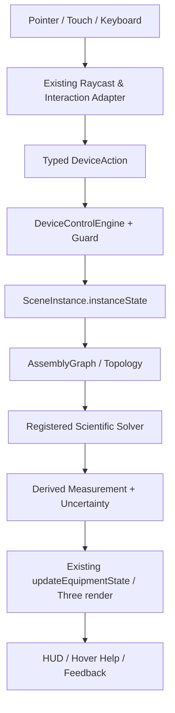

# MOCKUP 05 — MÔI TRƯỜNG PHÒNG THÍ NGHIỆM 3D VÀ HỆ SINH THÁI VẬT LÝ TƯƠNG TÁC

**Mã:** `OL3D-MU-05-LAB-ENVIRONMENT-DIGITAL-TWIN` · **Phạm vi:** không gian, bàn, khí hậu, trọng trường, ánh sáng, nguồn điện, chất lỏng, nhiệt, từ trường và quan hệ môi trường–thiết bị

## 0. Cam kết bảo toàn hệ thống hiện hữu (NON-DESTRUCTIVE UPGRADE)

Tài liệu này là mockup/đặc tả cải tiến, không phải lệnh tái viết dự án. Mọi triển khai phải theo nguyên tắc **ADD / ADAPT / VERIFY — NOT REPLACE**.

1. Giữ nguyên React 19, TypeScript strict, Vite 6, Three.js/WebGL và pipeline PBR đang có.
2. Giữ nguyên kiến trúc 4 lớp `OL3D-MASTER-SPEC v1.0`: Environment → Equipment → Interaction/Physics → App/Pedagogy.
3. Giữ nguyên chu trình nhân quả CIA 6 giai đoạn: User Action → Assembly Graph → Device State → Scientific Solvers → 3D Rendering → HUD/Feedback.
4. Giữ nguyên `AssetDefinition`, `SceneInstance`, `instanceState`, `window.OL3D_EQUIPMENT_MODULE`, `EquipmentModuleContract` và adapter tương thích v2.2/v2.3.
5. Không đổi Asset ID, slug, catalog key, tên node hiện đang được runtime tham chiếu, connector ID, state key hoặc đường dẫn public nếu chưa có migration plan tương thích ngược.
6. Không xóa/đổi tên các file nòng cốt. Ưu tiên thêm adapter, profile extension, solver service, schema version và test.
7. Mỗi thay đổi phải chạy typecheck, build, unit tests, assembly acceptance, scientific interaction regression và kiểm tra trực quan trên scene.
8. Không được gắn nhãn `PASS`, `verified` hoặc `validated` chỉ vì component tồn tại hoặc hình ảnh đẹp. Cần bằng chứng thực thi.
9. Dữ liệu nguồn có trạng thái `reported`, `illustrative`, `not-verified`, `partially-verified` phải tiếp tục giữ nguyên trạng thái và được đưa vào danh sách xác minh.
10. Khi phát hiện mâu thuẫn trong hồ sơ (ví dụ cân 500 g có thông số vỏ/tải bất thường, giá trị đơn vị không đồng nhất), không tự sửa số liệu; tạo `SPEC_CONFLICT` và yêu cầu đối chiếu datasheet/mẫu thật.

### 0.1. Bản đồ module hiện hữu cần kế thừa

| Vai trò | File hiện có | Cách mở rộng an toàn |
|---|---|---|
| Điều phối trạng thái | `src/App.tsx` | Bổ sung action/selector typed; không tạo state gốc song song |
| Viewport, raycast, drag-drop | `src/three-runtime/LabViewport3D.tsx` | Đăng ký hit targets và handler theo profile; tránh cài logic vật lý chuyên ngành dày đặc vào component |
| Mesh 3D | `src/three-runtime/ProceduralLabModels.ts` | Bổ sung named submeshes theo schema; giữ node legacy và alias |
| Kiểu dữ liệu | `src/domain/types.ts` | Mở rộng optional versioned fields; không phá payload cũ |
| Điều khiển | `src/device-control/DeviceControlEngine.ts` | Thêm mapping input→action→state và guard |
| Hồ sơ điều khiển | `src/device-control/DeviceControlProfilesData.ts` | Làm giàu profile từng asset; profile phải khai báo capabilities thực |
| Lắp ráp | `src/three-runtime/AssemblySystem.ts` | Thêm connector/constraint mới theo registry và migration |
| Môi trường | `src/three-runtime/LabEnvironmentEngine.ts` | Thêm environment adapter, không tạo environmental engine thứ hai |
| Hành vi | `src/three-runtime/BehaviorRegistry.ts` | Đăng ký behavior có type, lifecycle, teardown |
| UI hướng dẫn | `EquipmentHoverCard.tsx`, `EquipmentPreviewPanel.tsx`, `StudentGuidedStepPanel.tsx` | Kết nối dữ liệu profile, trạng thái và help content |
| Kiểm thử | `scripts/verify-assembly-acceptance.ts`, `scripts/verify-scientific-interaction.ts`, `scripts/scientific-profiles.ts` | Mở rộng kiểm thử; giữ nguyên test đã đạt |

### 0.2. Luồng dữ liệu đích (giữ nguyên CIA)



### 0.3. Phân loại thay đổi

- **P0 – bảo toàn:** thay đổi có nguy cơ phá vỡ state, module, connector, world units hoặc bộ giải hiện tại; không merge nếu chưa có regression.
- **P1 – đúng định luật:** sai causal dependency, sai dấu, sai đơn vị, hiển thị hiện tượng không có nguyên nhân.
- **P2 – điều khiển thực:** chi tiết 3D không điều khiển được, thiếu travel/range/lock/feedback.
- **P3 – giáo dục/UX:** hướng dẫn, tooltip, chú giải, accessibility, report.

## 1. Tầm nhìn: môi trường là bộ phận của phép thí nghiệm, không phải phông nền

Môi trường phòng lab phải tạo điều kiện vật lý cho thiết bị hoạt động. Gió có thể làm cân dao động; nhiệt độ phòng là nhiệt độ ban đầu của vật; áp suất khí quyển ảnh hưởng điều kiện sôi; trọng trường tác động trọng lượng/lực đẩy; ánh sáng môi trường ảnh hưởng quan sát quang học; thông gió và oxy liên quan đốt cháy; từ trường môi trường là nền cho thí nghiệm cảm ứng; nhiệt độ bàn tác động trao đổi nhiệt khi tiếp xúc. Không biến toàn bộ biến môi trường thành hiệu ứng trang trí hoặc cho mọi thiết bị nhận mọi biến.

## 2. Không gian 3D hiện hữu cần được giữ nguyên

| Thành phần | Giá trị nguồn | Yêu cầu cải tiến không phá vỡ |
| --- | --- | --- |
| Phòng | 12.0 m × 8.0 m × 3.6 m | Giữ dimensions/world frame; mở rộng vùng tương tác và collider nếu cần. |
| Floor | Logic floor y=0.000 m; dày 0.10 m | Giữ mốc va chạm; không đổi gốc world. |
| Walls | Tường sau Z=-4, trái X=-6, phải X=+6; dày 0.15 m | Giữ transparency toggle; không tác động physics collider theo opacity. |
| Ceiling | Y=3.60 m; dày 0.10 m | Giữ vị trí; đèn phòng thuộc lighting subsystem. |
| Bench | 2.40 × 0.75 m; top Y=0.820 m; slab 0.040 m | Giữ `BENCH_SURFACE_Y=0.82`; placement anchor và tests. |
| Bench placement area | X[-1.17,+1.17], Z[-0.345,+0.345], clearance 0.03m | Kẹp thiết bị không xuyên mép/kệ; báo out-of-bounds. |
| Floor placement | y=0.000 m | Cho phép các thiết bị/giá cần đặt sàn theo metadata. |
| Display shelf | 1.38 m rộng, 0.32 m cao, 0.076 m sâu; local y=0.135m | Giữ shelf placement; phân biệt đồ trưng bày với vật đang thí nghiệm. |

### 2.1. Hệ tọa độ kép

- World: X phải, Y lên, Z về phía người xem; gốc ở tâm sàn.
- Bench frame: gốc sau-trái bàn; X dọc cạnh dài, Y dọc cạnh sâu, Z là chiều cao.
- Giữ nguyên công thức đổi tọa độ đã có trong `LabEnvironmentEngine.ts`; viết unit test vector và round-trip.
- Khi thêm environment gizmo, axes, light volumes, airflow vectors, temperature zones phải dùng SI meter; không nhập mm trực tiếp vào Three.js.

## 3. Mô hình phân tầng dữ liệu môi trường

Để vừa bám tài liệu nguồn vừa tránh nhầm biến phòng và biến mẫu, phân chia: (A) `GlobalRoomEnvironment` gồm 13 biến cấp phòng; (B) `SampleEnvironment` gồm 12 biến gắn với mẫu/chất/đối tượng thí nghiệm; (C) `LocalField` cho trường cục bộ do thiết bị tạo ra (ngọn lửa, vùng nhiệt, vùng sáng, trường từ cục bộ) — local field được suy ra từ thiết bị và không ghi đè biến toàn phòng. Bảng nguồn liệt kê tổng cộng 25 biến; 13 biến đầu là Room/Core, 12 biến sau là Sample.

## 4. 25 biến môi trường và profile mô phỏng

| # | Biến | Phạm vi | Đại lượng | Đơn vị | Mặc định | Range | Step |
| --- | --- | --- | --- | --- | --- | --- | --- |
| 1 | `airTemperatureC` | Phòng (Core) | 1. Nhiệt độ không khí (T_air) | °C | 25 | -10 .. 60 | 0.5 |
| 2 | `relativeHumidityPct` | Phòng (Core) | 2. Độ ẩm tương đối (RH) | % | 60 | 0 .. 100 | 1 |
| 3 | `atmosphericPressureKPa` | Phòng (Core) | 3. Áp suất khí quyển (P_atm) | kPa | 101.325 | 50 .. 120 | 0.1 |
| 4 | `gravityMps2` | Phòng (Core) | 4. Gia tốc trọng trường (g) | m/s² | 9.80665 | 0 .. 20 | 0.01 |
| 5 | `illuminanceLux` | Phòng (Core) | 5. Cường độ ánh sáng (Lux) | lux | 500 | 0 .. 2000 | 10 |
| 6 | `airflowMps` | Phòng (Core) | 6. Tốc độ luồng không khí (v_air) | m/s | 0 | 0 .. 20 | 0.1 |
| 7 | `ventilationACH` | Phòng (Core) | 7. Tần suất thông gió (ACH) | 1/h | 2 | 0 .. 30 | 1 |
| 8 | `oxygenPct` | Phòng (Core) | 8. Nồng độ Oxy (O₂) | % | 20.95 | 0 .. 100 | 0.05 |
| 9 | `co2Ppm` | Phòng (Core) | 9. Nồng độ CO₂ | ppm | 420 | 0 .. 10000 | 10 |
| 10 | `ambientMagneticFieldMicroT` | Phòng (Core) | 10. Từ trường môi trường (B) | µT | 50 | 0 .. 200 | 1 |
| 11 | `benchTemperatureC` | Phòng (Core) | 11. Nhiệt độ bề mặt bàn (T_bench) | °C | 22 | -10 .. 150 | 0.5 |
| 12 | `mainsVoltageV` | Phòng (Core) | 12a. Điện áp nguồn AC (V_ac) | V | 220 | 0 .. 250 | 1 |
| 13 | `mainsFrequencyHz` | Phòng (Core) | 12b. Tần số nguồn AC (f_ac) | Hz | 50 | 0 .. 100 | 1 |
| 14 | `sampleTemperatureC` | Mẫu (Sample) | 13. Nhiệt độ mẫu (T_sample) | °C | 25 | 0 .. 100 | 0.5 |
| 15 | `samplePh` | Mẫu (Sample) | 14. Độ pH của mẫu dung dịch | pH | 7 | 0 .. 14 | 0.05 |
| 16 | `sampleConductivityUScm` | Mẫu (Sample) | 15. Độ dẫn điện mẫu (EC) | µS/cm | 100 | 0 .. 2000 | 5 |
| 17 | `sampleTdsMgL` | Mẫu (Sample) | 16. Tổng chất rắn hòa tan (TDS) | mg/L | 50 | 0 .. 2000 | 5 |
| 18 | `sampleSalinityPsu` | Mẫu (Sample) | 17. Độ mặn mẫu (Salinity) | PSU | 0 | 0 .. 42 | 0.5 |
| 19 | `sampleTurbidityNtu` | Mẫu (Sample) | 18. Độ đục của mẫu (Turbidity) | NTU | 0 | 0 .. 1000 | 1 |
| 20 | `sampleDissolvedO2MgL` | Mẫu (Sample) | 19. Oxy hòa tan trong mẫu (DO) | mg/L | 8 | 0 .. 20 | 0.1 |
| 21 | `sampleDensityKgM3` | Mẫu (Sample) | 20. Khối lượng riêng mẫu lỏng (ρ) | kg/m³ | 1000 | 500 .. 5000 | 10 |
| 22 | `sampleViscosityPaS` | Mẫu (Sample) | 21. Độ nhớt chất lỏng (η) | Pa·s | 0.001 | 0.001 .. 10 | 0.001 |
| 23 | `opticalWavelengthNm` | Mẫu (Sample) | 22. Bước sóng nguồn sáng (λ) | nm | 650 | 380 .. 780 | 5 |
| 24 | `thermalHeatPowerW` | Mẫu (Sample) | 23. Công suất nguồn nhiệt (P_heat) | W | 150 | 0 .. 800 | 10 |
| 25 | `surfaceFrictionCoef` | Mẫu (Sample) | 24. Hệ số ma sát bề mặt (μ) | μ | 0.3 | 0 .. 1 | 0.02 |

### 4.01. `airTemperatureC` — 1. Nhiệt độ không khí (T_air)

- **Scope:** Phòng (Core); **đơn vị:** °C; **mặc định nguồn:** 25; **range nguồn:** `-10 .. 60`; **step:** `0.5`.
- **Subsystem/dependency ghi trong hồ sơ:** thermometer-ambient, thermal-exchange, G03, G05.
- **Quan hệ/vật lý ghi trong hồ sơ:** Có mô hình trao đổi nhiệt / Nhiệt kế đặt ngoài không khí.
- **UI mockup:** slider có số nhập chính xác, đơn vị, nút reset theo preset, nút lock/unlock, trạng thái `DEFAULT / MODIFIED / OUT_OF_RANGE / INVALID`; tooltip nêu tác động lên thiết bị.
- **Runtime contract:** biến phải đi qua EnvironmentEngine; validate min/max/step; phát event khi thay đổi; solver chỉ subscribe nếu đăng ký dependency.
- **Phân biệt hiển thị và vật lý:** giá trị lux không được tự thay keyLight PBR; g, áp suất, nhiệt độ, độ ẩm là dữ liệu vật lý riêng. Chỉ adapter đã khai báo mới biến chúng thành tác động đồ họa.
- **Lưu vết:** lưu giá trị, unit, preset, thời điểm, người thay đổi, experimentId, solver subscriber và kết quả tác động.
- **Boundary tests:** min, default, max, min-step, max+step, NaN, null, unit mismatch; chỉ min/max trong range hợp lệ mới commit.
- **Regression:** thay biến phải chỉ ảnh hưởng đúng module đăng ký; khôi phục preset trả thiết bị về baseline tương ứng sau khi solver cập nhật.

**Kiểm thử vật lý cụ thể:**

1. Giữ mọi input khác cố định, thay `airTemperatureC` từ mức thấp đến cao; đối chiếu subsystem thực sự phụ thuộc trong hồ sơ.
2. Đặt `airTemperatureC` ngoài miền `-10 .. 60`; engine từ chối và không phát sự kiện solver.
3. Đổi `airTemperatureC` khi không có thiết bị subscriber; chỉ UI môi trường cập nhật, không phát sinh hiệu ứng vật lý giả.
4. Khôi phục `airTemperatureC` về `25`; baseline được tái lập và MeasurementRecord mới ghi environment snapshot.

### 4.02. `relativeHumidityPct` — 2. Độ ẩm tương đối (RH)

- **Scope:** Phòng (Core); **đơn vị:** %; **mặc định nguồn:** 60; **range nguồn:** `0 .. 100`; **step:** `1`.
- **Subsystem/dependency ghi trong hồ sơ:** evaporation-model, G05, G10.
- **Quan hệ/vật lý ghi trong hồ sơ:** Mẫu/vật liệu có quy tắc hút ẩm, bay hơi hơi nước bão hòa.
- **UI mockup:** slider có số nhập chính xác, đơn vị, nút reset theo preset, nút lock/unlock, trạng thái `DEFAULT / MODIFIED / OUT_OF_RANGE / INVALID`; tooltip nêu tác động lên thiết bị.
- **Runtime contract:** biến phải đi qua EnvironmentEngine; validate min/max/step; phát event khi thay đổi; solver chỉ subscribe nếu đăng ký dependency.
- **Phân biệt hiển thị và vật lý:** giá trị lux không được tự thay keyLight PBR; g, áp suất, nhiệt độ, độ ẩm là dữ liệu vật lý riêng. Chỉ adapter đã khai báo mới biến chúng thành tác động đồ họa.
- **Lưu vết:** lưu giá trị, unit, preset, thời điểm, người thay đổi, experimentId, solver subscriber và kết quả tác động.
- **Boundary tests:** min, default, max, min-step, max+step, NaN, null, unit mismatch; chỉ min/max trong range hợp lệ mới commit.
- **Regression:** thay biến phải chỉ ảnh hưởng đúng module đăng ký; khôi phục preset trả thiết bị về baseline tương ứng sau khi solver cập nhật.

**Kiểm thử vật lý cụ thể:**

1. Giữ mọi input khác cố định, thay `relativeHumidityPct` từ mức thấp đến cao; đối chiếu subsystem thực sự phụ thuộc trong hồ sơ.
2. Đặt `relativeHumidityPct` ngoài miền `0 .. 100`; engine từ chối và không phát sự kiện solver.
3. Đổi `relativeHumidityPct` khi không có thiết bị subscriber; chỉ UI môi trường cập nhật, không phát sinh hiệu ứng vật lý giả.
4. Khôi phục `relativeHumidityPct` về `60`; baseline được tái lập và MeasurementRecord mới ghi environment snapshot.

### 4.03. `atmosphericPressureKPa` — 3. Áp suất khí quyển (P_atm)

- **Scope:** Phòng (Core); **đơn vị:** kPa; **mặc định nguồn:** 101.325; **range nguồn:** `50 .. 120`; **step:** `0.1`.
- **Subsystem/dependency ghi trong hồ sơ:** boiling-point-model, barometer, G05.
- **Quan hệ/vật lý ghi trong hồ sơ:** Thí nghiệm có xét áp suất / nhiệt độ sôi của nước khi đun.
- **UI mockup:** slider có số nhập chính xác, đơn vị, nút reset theo preset, nút lock/unlock, trạng thái `DEFAULT / MODIFIED / OUT_OF_RANGE / INVALID`; tooltip nêu tác động lên thiết bị.
- **Runtime contract:** biến phải đi qua EnvironmentEngine; validate min/max/step; phát event khi thay đổi; solver chỉ subscribe nếu đăng ký dependency.
- **Phân biệt hiển thị và vật lý:** giá trị lux không được tự thay keyLight PBR; g, áp suất, nhiệt độ, độ ẩm là dữ liệu vật lý riêng. Chỉ adapter đã khai báo mới biến chúng thành tác động đồ họa.
- **Lưu vết:** lưu giá trị, unit, preset, thời điểm, người thay đổi, experimentId, solver subscriber và kết quả tác động.
- **Boundary tests:** min, default, max, min-step, max+step, NaN, null, unit mismatch; chỉ min/max trong range hợp lệ mới commit.
- **Regression:** thay biến phải chỉ ảnh hưởng đúng module đăng ký; khôi phục preset trả thiết bị về baseline tương ứng sau khi solver cập nhật.

**Kiểm thử vật lý cụ thể:**

1. Giữ mọi input khác cố định, thay `atmosphericPressureKPa` từ mức thấp đến cao; đối chiếu subsystem thực sự phụ thuộc trong hồ sơ.
2. Đặt `atmosphericPressureKPa` ngoài miền `50 .. 120`; engine từ chối và không phát sự kiện solver.
3. Đổi `atmosphericPressureKPa` khi không có thiết bị subscriber; chỉ UI môi trường cập nhật, không phát sinh hiệu ứng vật lý giả.
4. Khôi phục `atmosphericPressureKPa` về `101.325`; baseline được tái lập và MeasurementRecord mới ghi environment snapshot.

### 4.04. `gravityMps2` — 4. Gia tốc trọng trường (g)

- **Scope:** Phòng (Core); **đơn vị:** m/s²; **mặc định nguồn:** 9.80665; **range nguồn:** `0 .. 20`; **step:** `0.01`.
- **Subsystem/dependency ghi trong hồ sơ:** spring-dynamometer, electronic-balance, G02, G08.
- **Quan hệ/vật lý ghi trong hồ sơ:** Trực tiếp lên Cân (F=m·g), Lực kế lò xo (F=k·Δx) và Mặt nghiêng.
- **UI mockup:** slider có số nhập chính xác, đơn vị, nút reset theo preset, nút lock/unlock, trạng thái `DEFAULT / MODIFIED / OUT_OF_RANGE / INVALID`; tooltip nêu tác động lên thiết bị.
- **Runtime contract:** biến phải đi qua EnvironmentEngine; validate min/max/step; phát event khi thay đổi; solver chỉ subscribe nếu đăng ký dependency.
- **Phân biệt hiển thị và vật lý:** giá trị lux không được tự thay keyLight PBR; g, áp suất, nhiệt độ, độ ẩm là dữ liệu vật lý riêng. Chỉ adapter đã khai báo mới biến chúng thành tác động đồ họa.
- **Lưu vết:** lưu giá trị, unit, preset, thời điểm, người thay đổi, experimentId, solver subscriber và kết quả tác động.
- **Boundary tests:** min, default, max, min-step, max+step, NaN, null, unit mismatch; chỉ min/max trong range hợp lệ mới commit.
- **Regression:** thay biến phải chỉ ảnh hưởng đúng module đăng ký; khôi phục preset trả thiết bị về baseline tương ứng sau khi solver cập nhật.

**Kiểm thử vật lý cụ thể:**

1. Giữ mọi input khác cố định, thay `gravityMps2` từ mức thấp đến cao; đối chiếu subsystem thực sự phụ thuộc trong hồ sơ.
2. Đặt `gravityMps2` ngoài miền `0 .. 20`; engine từ chối và không phát sự kiện solver.
3. Đổi `gravityMps2` khi không có thiết bị subscriber; chỉ UI môi trường cập nhật, không phát sinh hiệu ứng vật lý giả.
4. Khôi phục `gravityMps2` về `9.80665`; baseline được tái lập và MeasurementRecord mới ghi environment snapshot.

### 4.05. `illuminanceLux` — 5. Cường độ ánh sáng (Lux)

- **Scope:** Phòng (Core); **đơn vị:** lux; **mặc định nguồn:** 500; **range nguồn:** `0 .. 2000`; **step:** `10`.
- **Subsystem/dependency ghi trong hồ sơ:** lux-sensor, optical-microscope, G06, G09.
- **Quan hệ/vật lý ghi trong hồ sơ:** Thí nghiệm quang học, Kính hiển vi (G09) & cảm biến quang.
- **UI mockup:** slider có số nhập chính xác, đơn vị, nút reset theo preset, nút lock/unlock, trạng thái `DEFAULT / MODIFIED / OUT_OF_RANGE / INVALID`; tooltip nêu tác động lên thiết bị.
- **Runtime contract:** biến phải đi qua EnvironmentEngine; validate min/max/step; phát event khi thay đổi; solver chỉ subscribe nếu đăng ký dependency.
- **Phân biệt hiển thị và vật lý:** giá trị lux không được tự thay keyLight PBR; g, áp suất, nhiệt độ, độ ẩm là dữ liệu vật lý riêng. Chỉ adapter đã khai báo mới biến chúng thành tác động đồ họa.
- **Lưu vết:** lưu giá trị, unit, preset, thời điểm, người thay đổi, experimentId, solver subscriber và kết quả tác động.
- **Boundary tests:** min, default, max, min-step, max+step, NaN, null, unit mismatch; chỉ min/max trong range hợp lệ mới commit.
- **Regression:** thay biến phải chỉ ảnh hưởng đúng module đăng ký; khôi phục preset trả thiết bị về baseline tương ứng sau khi solver cập nhật.

**Kiểm thử vật lý cụ thể:**

1. Giữ mọi input khác cố định, thay `illuminanceLux` từ mức thấp đến cao; đối chiếu subsystem thực sự phụ thuộc trong hồ sơ.
2. Đặt `illuminanceLux` ngoài miền `0 .. 2000`; engine từ chối và không phát sự kiện solver.
3. Đổi `illuminanceLux` khi không có thiết bị subscriber; chỉ UI môi trường cập nhật, không phát sinh hiệu ứng vật lý giả.
4. Khôi phục `illuminanceLux` về `500`; baseline được tái lập và MeasurementRecord mới ghi environment snapshot.

### 4.06. `airflowMps` — 6. Tốc độ luồng không khí (v_air)

- **Scope:** Phòng (Core); **đơn vị:** m/s; **mặc định nguồn:** 0; **range nguồn:** `0 .. 20`; **step:** `0.1`.
- **Subsystem/dependency ghi trong hồ sơ:** convection-cooling, balance-draft, G02.
- **Quan hệ/vật lý ghi trong hồ sơ:** Mô phỏng gió đối lưu, nhiễu đĩa cân điện tử & bay hơi.
- **UI mockup:** slider có số nhập chính xác, đơn vị, nút reset theo preset, nút lock/unlock, trạng thái `DEFAULT / MODIFIED / OUT_OF_RANGE / INVALID`; tooltip nêu tác động lên thiết bị.
- **Runtime contract:** biến phải đi qua EnvironmentEngine; validate min/max/step; phát event khi thay đổi; solver chỉ subscribe nếu đăng ký dependency.
- **Phân biệt hiển thị và vật lý:** giá trị lux không được tự thay keyLight PBR; g, áp suất, nhiệt độ, độ ẩm là dữ liệu vật lý riêng. Chỉ adapter đã khai báo mới biến chúng thành tác động đồ họa.
- **Lưu vết:** lưu giá trị, unit, preset, thời điểm, người thay đổi, experimentId, solver subscriber và kết quả tác động.
- **Boundary tests:** min, default, max, min-step, max+step, NaN, null, unit mismatch; chỉ min/max trong range hợp lệ mới commit.
- **Regression:** thay biến phải chỉ ảnh hưởng đúng module đăng ký; khôi phục preset trả thiết bị về baseline tương ứng sau khi solver cập nhật.

**Kiểm thử vật lý cụ thể:**

1. Giữ mọi input khác cố định, thay `airflowMps` từ mức thấp đến cao; đối chiếu subsystem thực sự phụ thuộc trong hồ sơ.
2. Đặt `airflowMps` ngoài miền `0 .. 20`; engine từ chối và không phát sự kiện solver.
3. Đổi `airflowMps` khi không có thiết bị subscriber; chỉ UI môi trường cập nhật, không phát sinh hiệu ứng vật lý giả.
4. Khôi phục `airflowMps` về `0`; baseline được tái lập và MeasurementRecord mới ghi environment snapshot.

### 4.07. `ventilationACH` — 7. Tần suất thông gió (ACH)

- **Scope:** Phòng (Core); **đơn vị:** 1/h; **mặc định nguồn:** 2; **range nguồn:** `0 .. 30`; **step:** `1`.
- **Subsystem/dependency ghi trong hồ sơ:** fume-hood-ventilation, G05.
- **Quan hệ/vật lý ghi trong hồ sơ:** Trao đổi khí phòng thực hành Hóa học (G05).
- **UI mockup:** slider có số nhập chính xác, đơn vị, nút reset theo preset, nút lock/unlock, trạng thái `DEFAULT / MODIFIED / OUT_OF_RANGE / INVALID`; tooltip nêu tác động lên thiết bị.
- **Runtime contract:** biến phải đi qua EnvironmentEngine; validate min/max/step; phát event khi thay đổi; solver chỉ subscribe nếu đăng ký dependency.
- **Phân biệt hiển thị và vật lý:** giá trị lux không được tự thay keyLight PBR; g, áp suất, nhiệt độ, độ ẩm là dữ liệu vật lý riêng. Chỉ adapter đã khai báo mới biến chúng thành tác động đồ họa.
- **Lưu vết:** lưu giá trị, unit, preset, thời điểm, người thay đổi, experimentId, solver subscriber và kết quả tác động.
- **Boundary tests:** min, default, max, min-step, max+step, NaN, null, unit mismatch; chỉ min/max trong range hợp lệ mới commit.
- **Regression:** thay biến phải chỉ ảnh hưởng đúng module đăng ký; khôi phục preset trả thiết bị về baseline tương ứng sau khi solver cập nhật.

**Kiểm thử vật lý cụ thể:**

1. Giữ mọi input khác cố định, thay `ventilationACH` từ mức thấp đến cao; đối chiếu subsystem thực sự phụ thuộc trong hồ sơ.
2. Đặt `ventilationACH` ngoài miền `0 .. 30`; engine từ chối và không phát sự kiện solver.
3. Đổi `ventilationACH` khi không có thiết bị subscriber; chỉ UI môi trường cập nhật, không phát sinh hiệu ứng vật lý giả.
4. Khôi phục `ventilationACH` về `2`; baseline được tái lập và MeasurementRecord mới ghi environment snapshot.

### 4.08. `oxygenPct` — 8. Nồng độ Oxy (O₂)

- **Scope:** Phòng (Core); **đơn vị:** %; **mặc định nguồn:** 20.95; **range nguồn:** `0 .. 100`; **step:** `0.05`.
- **Subsystem/dependency ghi trong hồ sơ:** combustion-burner, G05.
- **Quan hệ/vật lý ghi trong hồ sơ:** Đốt cháy đèn cồn (tự tắt khi O₂ < 14%) & phản ứng oxi hóa.
- **UI mockup:** slider có số nhập chính xác, đơn vị, nút reset theo preset, nút lock/unlock, trạng thái `DEFAULT / MODIFIED / OUT_OF_RANGE / INVALID`; tooltip nêu tác động lên thiết bị.
- **Runtime contract:** biến phải đi qua EnvironmentEngine; validate min/max/step; phát event khi thay đổi; solver chỉ subscribe nếu đăng ký dependency.
- **Phân biệt hiển thị và vật lý:** giá trị lux không được tự thay keyLight PBR; g, áp suất, nhiệt độ, độ ẩm là dữ liệu vật lý riêng. Chỉ adapter đã khai báo mới biến chúng thành tác động đồ họa.
- **Lưu vết:** lưu giá trị, unit, preset, thời điểm, người thay đổi, experimentId, solver subscriber và kết quả tác động.
- **Boundary tests:** min, default, max, min-step, max+step, NaN, null, unit mismatch; chỉ min/max trong range hợp lệ mới commit.
- **Regression:** thay biến phải chỉ ảnh hưởng đúng module đăng ký; khôi phục preset trả thiết bị về baseline tương ứng sau khi solver cập nhật.

**Kiểm thử vật lý cụ thể:**

1. Giữ mọi input khác cố định, thay `oxygenPct` từ mức thấp đến cao; đối chiếu subsystem thực sự phụ thuộc trong hồ sơ.
2. Đặt `oxygenPct` ngoài miền `0 .. 100`; engine từ chối và không phát sự kiện solver.
3. Đổi `oxygenPct` khi không có thiết bị subscriber; chỉ UI môi trường cập nhật, không phát sinh hiệu ứng vật lý giả.
4. Khôi phục `oxygenPct` về `20.95`; baseline được tái lập và MeasurementRecord mới ghi environment snapshot.

### 4.09. `co2Ppm` — 9. Nồng độ CO₂

- **Scope:** Phòng (Core); **đơn vị:** ppm; **mặc định nguồn:** 420; **range nguồn:** `0 .. 10000`; **step:** `10`.
- **Subsystem/dependency ghi trong hồ sơ:** co2-sensor, G09, G10.
- **Quan hệ/vật lý ghi trong hồ sơ:** Thí nghiệm quang hợp Sinh học (G09) & vi khí hậu phòng.
- **UI mockup:** slider có số nhập chính xác, đơn vị, nút reset theo preset, nút lock/unlock, trạng thái `DEFAULT / MODIFIED / OUT_OF_RANGE / INVALID`; tooltip nêu tác động lên thiết bị.
- **Runtime contract:** biến phải đi qua EnvironmentEngine; validate min/max/step; phát event khi thay đổi; solver chỉ subscribe nếu đăng ký dependency.
- **Phân biệt hiển thị và vật lý:** giá trị lux không được tự thay keyLight PBR; g, áp suất, nhiệt độ, độ ẩm là dữ liệu vật lý riêng. Chỉ adapter đã khai báo mới biến chúng thành tác động đồ họa.
- **Lưu vết:** lưu giá trị, unit, preset, thời điểm, người thay đổi, experimentId, solver subscriber và kết quả tác động.
- **Boundary tests:** min, default, max, min-step, max+step, NaN, null, unit mismatch; chỉ min/max trong range hợp lệ mới commit.
- **Regression:** thay biến phải chỉ ảnh hưởng đúng module đăng ký; khôi phục preset trả thiết bị về baseline tương ứng sau khi solver cập nhật.

**Kiểm thử vật lý cụ thể:**

1. Giữ mọi input khác cố định, thay `co2Ppm` từ mức thấp đến cao; đối chiếu subsystem thực sự phụ thuộc trong hồ sơ.
2. Đặt `co2Ppm` ngoài miền `0 .. 10000`; engine từ chối và không phát sự kiện solver.
3. Đổi `co2Ppm` khi không có thiết bị subscriber; chỉ UI môi trường cập nhật, không phát sinh hiệu ứng vật lý giả.
4. Khôi phục `co2Ppm` về `420`; baseline được tái lập và MeasurementRecord mới ghi environment snapshot.

### 4.10. `ambientMagneticFieldMicroT` — 10. Từ trường môi trường (B)

- **Scope:** Phòng (Core); **đơn vị:** µT; **mặc định nguồn:** 50; **range nguồn:** `0 .. 200`; **step:** `1`.
- **Subsystem/dependency ghi trong hồ sơ:** electromagnetic-induction, G07.
- **Quan hệ/vật lý ghi trong hồ sơ:** La bàn, lực từ & cảm ứng điện từ (G07).
- **UI mockup:** slider có số nhập chính xác, đơn vị, nút reset theo preset, nút lock/unlock, trạng thái `DEFAULT / MODIFIED / OUT_OF_RANGE / INVALID`; tooltip nêu tác động lên thiết bị.
- **Runtime contract:** biến phải đi qua EnvironmentEngine; validate min/max/step; phát event khi thay đổi; solver chỉ subscribe nếu đăng ký dependency.
- **Phân biệt hiển thị và vật lý:** giá trị lux không được tự thay keyLight PBR; g, áp suất, nhiệt độ, độ ẩm là dữ liệu vật lý riêng. Chỉ adapter đã khai báo mới biến chúng thành tác động đồ họa.
- **Lưu vết:** lưu giá trị, unit, preset, thời điểm, người thay đổi, experimentId, solver subscriber và kết quả tác động.
- **Boundary tests:** min, default, max, min-step, max+step, NaN, null, unit mismatch; chỉ min/max trong range hợp lệ mới commit.
- **Regression:** thay biến phải chỉ ảnh hưởng đúng module đăng ký; khôi phục preset trả thiết bị về baseline tương ứng sau khi solver cập nhật.

**Kiểm thử vật lý cụ thể:**

1. Giữ mọi input khác cố định, thay `ambientMagneticFieldMicroT` từ mức thấp đến cao; đối chiếu subsystem thực sự phụ thuộc trong hồ sơ.
2. Đặt `ambientMagneticFieldMicroT` ngoài miền `0 .. 200`; engine từ chối và không phát sự kiện solver.
3. Đổi `ambientMagneticFieldMicroT` khi không có thiết bị subscriber; chỉ UI môi trường cập nhật, không phát sinh hiệu ứng vật lý giả.
4. Khôi phục `ambientMagneticFieldMicroT` về `50`; baseline được tái lập và MeasurementRecord mới ghi environment snapshot.

### 4.11. `benchTemperatureC` — 11. Nhiệt độ bề mặt bàn (T_bench)

- **Scope:** Phòng (Core); **đơn vị:** °C; **mặc định nguồn:** 22; **range nguồn:** `-10 .. 150`; **step:** `0.5`.
- **Subsystem/dependency ghi trong hồ sơ:** bench-contact-thermal, G05, G08.
- **Quan hệ/vật lý ghi trong hồ sơ:** Truyền nhiệt tiếp xúc từ mặt bàn lên thiết bị (G05, G08).
- **UI mockup:** slider có số nhập chính xác, đơn vị, nút reset theo preset, nút lock/unlock, trạng thái `DEFAULT / MODIFIED / OUT_OF_RANGE / INVALID`; tooltip nêu tác động lên thiết bị.
- **Runtime contract:** biến phải đi qua EnvironmentEngine; validate min/max/step; phát event khi thay đổi; solver chỉ subscribe nếu đăng ký dependency.
- **Phân biệt hiển thị và vật lý:** giá trị lux không được tự thay keyLight PBR; g, áp suất, nhiệt độ, độ ẩm là dữ liệu vật lý riêng. Chỉ adapter đã khai báo mới biến chúng thành tác động đồ họa.
- **Lưu vết:** lưu giá trị, unit, preset, thời điểm, người thay đổi, experimentId, solver subscriber và kết quả tác động.
- **Boundary tests:** min, default, max, min-step, max+step, NaN, null, unit mismatch; chỉ min/max trong range hợp lệ mới commit.
- **Regression:** thay biến phải chỉ ảnh hưởng đúng module đăng ký; khôi phục preset trả thiết bị về baseline tương ứng sau khi solver cập nhật.

**Kiểm thử vật lý cụ thể:**

1. Giữ mọi input khác cố định, thay `benchTemperatureC` từ mức thấp đến cao; đối chiếu subsystem thực sự phụ thuộc trong hồ sơ.
2. Đặt `benchTemperatureC` ngoài miền `-10 .. 150`; engine từ chối và không phát sự kiện solver.
3. Đổi `benchTemperatureC` khi không có thiết bị subscriber; chỉ UI môi trường cập nhật, không phát sinh hiệu ứng vật lý giả.
4. Khôi phục `benchTemperatureC` về `22`; baseline được tái lập và MeasurementRecord mới ghi environment snapshot.

### 4.12. `mainsVoltageV` — 12a. Điện áp nguồn AC (V_ac)

- **Scope:** Phòng (Core); **đơn vị:** V; **mặc định nguồn:** 220; **range nguồn:** `0 .. 250`; **step:** `1`.
- **Subsystem/dependency ghi trong hồ sơ:** power-supply-ac, G03, G07.
- **Quan hệ/vật lý ghi trong hồ sơ:** Mạch điện xoay chiều, nguồn hạ áp & biến tần (G03, G07).
- **UI mockup:** slider có số nhập chính xác, đơn vị, nút reset theo preset, nút lock/unlock, trạng thái `DEFAULT / MODIFIED / OUT_OF_RANGE / INVALID`; tooltip nêu tác động lên thiết bị.
- **Runtime contract:** biến phải đi qua EnvironmentEngine; validate min/max/step; phát event khi thay đổi; solver chỉ subscribe nếu đăng ký dependency.
- **Phân biệt hiển thị và vật lý:** giá trị lux không được tự thay keyLight PBR; g, áp suất, nhiệt độ, độ ẩm là dữ liệu vật lý riêng. Chỉ adapter đã khai báo mới biến chúng thành tác động đồ họa.
- **Lưu vết:** lưu giá trị, unit, preset, thời điểm, người thay đổi, experimentId, solver subscriber và kết quả tác động.
- **Boundary tests:** min, default, max, min-step, max+step, NaN, null, unit mismatch; chỉ min/max trong range hợp lệ mới commit.
- **Regression:** thay biến phải chỉ ảnh hưởng đúng module đăng ký; khôi phục preset trả thiết bị về baseline tương ứng sau khi solver cập nhật.

**Kiểm thử vật lý cụ thể:**

1. Giữ mọi input khác cố định, thay `mainsVoltageV` từ mức thấp đến cao; đối chiếu subsystem thực sự phụ thuộc trong hồ sơ.
2. Đặt `mainsVoltageV` ngoài miền `0 .. 250`; engine từ chối và không phát sự kiện solver.
3. Đổi `mainsVoltageV` khi không có thiết bị subscriber; chỉ UI môi trường cập nhật, không phát sinh hiệu ứng vật lý giả.
4. Khôi phục `mainsVoltageV` về `220`; baseline được tái lập và MeasurementRecord mới ghi environment snapshot.

### 4.13. `mainsFrequencyHz` — 12b. Tần số nguồn AC (f_ac)

- **Scope:** Phòng (Core); **đơn vị:** Hz; **mặc định nguồn:** 50; **range nguồn:** `0 .. 100`; **step:** `1`.
- **Subsystem/dependency ghi trong hồ sơ:** power-supply-ac, G07.
- **Quan hệ/vật lý ghi trong hồ sơ:** Thí nghiệm dòng điện xoay chiều AC (G07).
- **UI mockup:** slider có số nhập chính xác, đơn vị, nút reset theo preset, nút lock/unlock, trạng thái `DEFAULT / MODIFIED / OUT_OF_RANGE / INVALID`; tooltip nêu tác động lên thiết bị.
- **Runtime contract:** biến phải đi qua EnvironmentEngine; validate min/max/step; phát event khi thay đổi; solver chỉ subscribe nếu đăng ký dependency.
- **Phân biệt hiển thị và vật lý:** giá trị lux không được tự thay keyLight PBR; g, áp suất, nhiệt độ, độ ẩm là dữ liệu vật lý riêng. Chỉ adapter đã khai báo mới biến chúng thành tác động đồ họa.
- **Lưu vết:** lưu giá trị, unit, preset, thời điểm, người thay đổi, experimentId, solver subscriber và kết quả tác động.
- **Boundary tests:** min, default, max, min-step, max+step, NaN, null, unit mismatch; chỉ min/max trong range hợp lệ mới commit.
- **Regression:** thay biến phải chỉ ảnh hưởng đúng module đăng ký; khôi phục preset trả thiết bị về baseline tương ứng sau khi solver cập nhật.

**Kiểm thử vật lý cụ thể:**

1. Giữ mọi input khác cố định, thay `mainsFrequencyHz` từ mức thấp đến cao; đối chiếu subsystem thực sự phụ thuộc trong hồ sơ.
2. Đặt `mainsFrequencyHz` ngoài miền `0 .. 100`; engine từ chối và không phát sự kiện solver.
3. Đổi `mainsFrequencyHz` khi không có thiết bị subscriber; chỉ UI môi trường cập nhật, không phát sinh hiệu ứng vật lý giả.
4. Khôi phục `mainsFrequencyHz` về `50`; baseline được tái lập và MeasurementRecord mới ghi environment snapshot.

### 4.14. `sampleTemperatureC` — 13. Nhiệt độ mẫu (T_sample)

- **Scope:** Mẫu (Sample); **đơn vị:** °C; **mặc định nguồn:** 25; **range nguồn:** `0 .. 100`; **step:** `0.5`.
- **Subsystem/dependency ghi trong hồ sơ:** thermometer-probe, liquid-expansion, G03, G04, G10.
- **Quan hệ/vật lý ghi trong hồ sơ:** Nhiệt kế nhúng mẫu, giãn nở thể tích chất lỏng & bù nhiệt ATC.
- **UI mockup:** slider có số nhập chính xác, đơn vị, nút reset theo preset, nút lock/unlock, trạng thái `DEFAULT / MODIFIED / OUT_OF_RANGE / INVALID`; tooltip nêu tác động lên thiết bị.
- **Runtime contract:** biến phải đi qua EnvironmentEngine; validate min/max/step; phát event khi thay đổi; solver chỉ subscribe nếu đăng ký dependency.
- **Phân biệt hiển thị và vật lý:** giá trị lux không được tự thay keyLight PBR; g, áp suất, nhiệt độ, độ ẩm là dữ liệu vật lý riêng. Chỉ adapter đã khai báo mới biến chúng thành tác động đồ họa.
- **Lưu vết:** lưu giá trị, unit, preset, thời điểm, người thay đổi, experimentId, solver subscriber và kết quả tác động.
- **Boundary tests:** min, default, max, min-step, max+step, NaN, null, unit mismatch; chỉ min/max trong range hợp lệ mới commit.
- **Regression:** thay biến phải chỉ ảnh hưởng đúng module đăng ký; khôi phục preset trả thiết bị về baseline tương ứng sau khi solver cập nhật.

**Kiểm thử vật lý cụ thể:**

1. Giữ mọi input khác cố định, thay `sampleTemperatureC` từ mức thấp đến cao; đối chiếu subsystem thực sự phụ thuộc trong hồ sơ.
2. Đặt `sampleTemperatureC` ngoài miền `0 .. 100`; engine từ chối và không phát sự kiện solver.
3. Đổi `sampleTemperatureC` khi không có thiết bị subscriber; chỉ UI môi trường cập nhật, không phát sinh hiệu ứng vật lý giả.
4. Khôi phục `sampleTemperatureC` về `25`; baseline được tái lập và MeasurementRecord mới ghi environment snapshot.

### 4.15. `samplePh` — 14. Độ pH của mẫu dung dịch

- **Scope:** Mẫu (Sample); **đơn vị:** pH; **mặc định nguồn:** 7; **range nguồn:** `0 .. 14`; **step:** `0.05`.
- **Subsystem/dependency ghi trong hồ sơ:** ph-meter, acid-base-indicator, G05, G10.
- **Quan hệ/vật lý ghi trong hồ sơ:** Máy đo pH hiện số & chuẩn độ trung hòa Axit-Bazơ (G05, G10).
- **UI mockup:** slider có số nhập chính xác, đơn vị, nút reset theo preset, nút lock/unlock, trạng thái `DEFAULT / MODIFIED / OUT_OF_RANGE / INVALID`; tooltip nêu tác động lên thiết bị.
- **Runtime contract:** biến phải đi qua EnvironmentEngine; validate min/max/step; phát event khi thay đổi; solver chỉ subscribe nếu đăng ký dependency.
- **Phân biệt hiển thị và vật lý:** giá trị lux không được tự thay keyLight PBR; g, áp suất, nhiệt độ, độ ẩm là dữ liệu vật lý riêng. Chỉ adapter đã khai báo mới biến chúng thành tác động đồ họa.
- **Lưu vết:** lưu giá trị, unit, preset, thời điểm, người thay đổi, experimentId, solver subscriber và kết quả tác động.
- **Boundary tests:** min, default, max, min-step, max+step, NaN, null, unit mismatch; chỉ min/max trong range hợp lệ mới commit.
- **Regression:** thay biến phải chỉ ảnh hưởng đúng module đăng ký; khôi phục preset trả thiết bị về baseline tương ứng sau khi solver cập nhật.

**Kiểm thử vật lý cụ thể:**

1. Giữ mọi input khác cố định, thay `samplePh` từ mức thấp đến cao; đối chiếu subsystem thực sự phụ thuộc trong hồ sơ.
2. Đặt `samplePh` ngoài miền `0 .. 14`; engine từ chối và không phát sự kiện solver.
3. Đổi `samplePh` khi không có thiết bị subscriber; chỉ UI môi trường cập nhật, không phát sinh hiệu ứng vật lý giả.
4. Khôi phục `samplePh` về `7`; baseline được tái lập và MeasurementRecord mới ghi environment snapshot.

### 4.16. `sampleConductivityUScm` — 15. Độ dẫn điện mẫu (EC)

- **Scope:** Mẫu (Sample); **đơn vị:** µS/cm; **mặc định nguồn:** 100; **range nguồn:** `0 .. 2000`; **step:** `5`.
- **Subsystem/dependency ghi trong hồ sơ:** ec-tds-meter, G07, G10.
- **Quan hệ/vật lý ghi trong hồ sơ:** Bút đo EC & khảo sát chất điện li (G07, G10).
- **UI mockup:** slider có số nhập chính xác, đơn vị, nút reset theo preset, nút lock/unlock, trạng thái `DEFAULT / MODIFIED / OUT_OF_RANGE / INVALID`; tooltip nêu tác động lên thiết bị.
- **Runtime contract:** biến phải đi qua EnvironmentEngine; validate min/max/step; phát event khi thay đổi; solver chỉ subscribe nếu đăng ký dependency.
- **Phân biệt hiển thị và vật lý:** giá trị lux không được tự thay keyLight PBR; g, áp suất, nhiệt độ, độ ẩm là dữ liệu vật lý riêng. Chỉ adapter đã khai báo mới biến chúng thành tác động đồ họa.
- **Lưu vết:** lưu giá trị, unit, preset, thời điểm, người thay đổi, experimentId, solver subscriber và kết quả tác động.
- **Boundary tests:** min, default, max, min-step, max+step, NaN, null, unit mismatch; chỉ min/max trong range hợp lệ mới commit.
- **Regression:** thay biến phải chỉ ảnh hưởng đúng module đăng ký; khôi phục preset trả thiết bị về baseline tương ứng sau khi solver cập nhật.

**Kiểm thử vật lý cụ thể:**

1. Giữ mọi input khác cố định, thay `sampleConductivityUScm` từ mức thấp đến cao; đối chiếu subsystem thực sự phụ thuộc trong hồ sơ.
2. Đặt `sampleConductivityUScm` ngoài miền `0 .. 2000`; engine từ chối và không phát sự kiện solver.
3. Đổi `sampleConductivityUScm` khi không có thiết bị subscriber; chỉ UI môi trường cập nhật, không phát sinh hiệu ứng vật lý giả.
4. Khôi phục `sampleConductivityUScm` về `100`; baseline được tái lập và MeasurementRecord mới ghi environment snapshot.

### 4.17. `sampleTdsMgL` — 16. Tổng chất rắn hòa tan (TDS)

- **Scope:** Mẫu (Sample); **đơn vị:** mg/L; **mặc định nguồn:** 50; **range nguồn:** `0 .. 2000`; **step:** `5`.
- **Subsystem/dependency ghi trong hồ sơ:** ec-tds-meter, G10.
- **Quan hệ/vật lý ghi trong hồ sơ:** Bút đo TDS & kiểm tra độ tinh khiết nước (G10).
- **UI mockup:** slider có số nhập chính xác, đơn vị, nút reset theo preset, nút lock/unlock, trạng thái `DEFAULT / MODIFIED / OUT_OF_RANGE / INVALID`; tooltip nêu tác động lên thiết bị.
- **Runtime contract:** biến phải đi qua EnvironmentEngine; validate min/max/step; phát event khi thay đổi; solver chỉ subscribe nếu đăng ký dependency.
- **Phân biệt hiển thị và vật lý:** giá trị lux không được tự thay keyLight PBR; g, áp suất, nhiệt độ, độ ẩm là dữ liệu vật lý riêng. Chỉ adapter đã khai báo mới biến chúng thành tác động đồ họa.
- **Lưu vết:** lưu giá trị, unit, preset, thời điểm, người thay đổi, experimentId, solver subscriber và kết quả tác động.
- **Boundary tests:** min, default, max, min-step, max+step, NaN, null, unit mismatch; chỉ min/max trong range hợp lệ mới commit.
- **Regression:** thay biến phải chỉ ảnh hưởng đúng module đăng ký; khôi phục preset trả thiết bị về baseline tương ứng sau khi solver cập nhật.

**Kiểm thử vật lý cụ thể:**

1. Giữ mọi input khác cố định, thay `sampleTdsMgL` từ mức thấp đến cao; đối chiếu subsystem thực sự phụ thuộc trong hồ sơ.
2. Đặt `sampleTdsMgL` ngoài miền `0 .. 2000`; engine từ chối và không phát sự kiện solver.
3. Đổi `sampleTdsMgL` khi không có thiết bị subscriber; chỉ UI môi trường cập nhật, không phát sinh hiệu ứng vật lý giả.
4. Khôi phục `sampleTdsMgL` về `50`; baseline được tái lập và MeasurementRecord mới ghi environment snapshot.

### 4.18. `sampleSalinityPsu` — 17. Độ mặn mẫu (Salinity)

- **Scope:** Mẫu (Sample); **đơn vị:** PSU; **mặc định nguồn:** 0; **range nguồn:** `0 .. 42`; **step:** `0.5`.
- **Subsystem/dependency ghi trong hồ sơ:** salinity-sensor, buoyancy-force, G02, G10.
- **Quan hệ/vật lý ghi trong hồ sơ:** Đo độ mặn nước biển & lực đẩy Archimedes trong nước muối.
- **UI mockup:** slider có số nhập chính xác, đơn vị, nút reset theo preset, nút lock/unlock, trạng thái `DEFAULT / MODIFIED / OUT_OF_RANGE / INVALID`; tooltip nêu tác động lên thiết bị.
- **Runtime contract:** biến phải đi qua EnvironmentEngine; validate min/max/step; phát event khi thay đổi; solver chỉ subscribe nếu đăng ký dependency.
- **Phân biệt hiển thị và vật lý:** giá trị lux không được tự thay keyLight PBR; g, áp suất, nhiệt độ, độ ẩm là dữ liệu vật lý riêng. Chỉ adapter đã khai báo mới biến chúng thành tác động đồ họa.
- **Lưu vết:** lưu giá trị, unit, preset, thời điểm, người thay đổi, experimentId, solver subscriber và kết quả tác động.
- **Boundary tests:** min, default, max, min-step, max+step, NaN, null, unit mismatch; chỉ min/max trong range hợp lệ mới commit.
- **Regression:** thay biến phải chỉ ảnh hưởng đúng module đăng ký; khôi phục preset trả thiết bị về baseline tương ứng sau khi solver cập nhật.

**Kiểm thử vật lý cụ thể:**

1. Giữ mọi input khác cố định, thay `sampleSalinityPsu` từ mức thấp đến cao; đối chiếu subsystem thực sự phụ thuộc trong hồ sơ.
2. Đặt `sampleSalinityPsu` ngoài miền `0 .. 42`; engine từ chối và không phát sự kiện solver.
3. Đổi `sampleSalinityPsu` khi không có thiết bị subscriber; chỉ UI môi trường cập nhật, không phát sinh hiệu ứng vật lý giả.
4. Khôi phục `sampleSalinityPsu` về `0`; baseline được tái lập và MeasurementRecord mới ghi environment snapshot.

### 4.19. `sampleTurbidityNtu` — 18. Độ đục của mẫu (Turbidity)

- **Scope:** Mẫu (Sample); **đơn vị:** NTU; **mặc định nguồn:** 0; **range nguồn:** `0 .. 1000`; **step:** `1`.
- **Subsystem/dependency ghi trong hồ sơ:** turbidity-meter, laser-attenuation, G06, G10.
- **Quan hệ/vật lý ghi trong hồ sơ:** Máy đo độ đục nước & suy giảm truyền dẫn tia sáng qua chất lỏng.
- **UI mockup:** slider có số nhập chính xác, đơn vị, nút reset theo preset, nút lock/unlock, trạng thái `DEFAULT / MODIFIED / OUT_OF_RANGE / INVALID`; tooltip nêu tác động lên thiết bị.
- **Runtime contract:** biến phải đi qua EnvironmentEngine; validate min/max/step; phát event khi thay đổi; solver chỉ subscribe nếu đăng ký dependency.
- **Phân biệt hiển thị và vật lý:** giá trị lux không được tự thay keyLight PBR; g, áp suất, nhiệt độ, độ ẩm là dữ liệu vật lý riêng. Chỉ adapter đã khai báo mới biến chúng thành tác động đồ họa.
- **Lưu vết:** lưu giá trị, unit, preset, thời điểm, người thay đổi, experimentId, solver subscriber và kết quả tác động.
- **Boundary tests:** min, default, max, min-step, max+step, NaN, null, unit mismatch; chỉ min/max trong range hợp lệ mới commit.
- **Regression:** thay biến phải chỉ ảnh hưởng đúng module đăng ký; khôi phục preset trả thiết bị về baseline tương ứng sau khi solver cập nhật.

**Kiểm thử vật lý cụ thể:**

1. Giữ mọi input khác cố định, thay `sampleTurbidityNtu` từ mức thấp đến cao; đối chiếu subsystem thực sự phụ thuộc trong hồ sơ.
2. Đặt `sampleTurbidityNtu` ngoài miền `0 .. 1000`; engine từ chối và không phát sự kiện solver.
3. Đổi `sampleTurbidityNtu` khi không có thiết bị subscriber; chỉ UI môi trường cập nhật, không phát sinh hiệu ứng vật lý giả.
4. Khôi phục `sampleTurbidityNtu` về `0`; baseline được tái lập và MeasurementRecord mới ghi environment snapshot.

### 4.20. `sampleDissolvedO2MgL` — 19. Oxy hòa tan trong mẫu (DO)

- **Scope:** Mẫu (Sample); **đơn vị:** mg/L; **mặc định nguồn:** 8; **range nguồn:** `0 .. 20`; **step:** `0.1`.
- **Subsystem/dependency ghi trong hồ sơ:** do-meter, G09, G10.
- **Quan hệ/vật lý ghi trong hồ sơ:** Máy đo DO & hô hấp thủy sinh (G09, G10).
- **UI mockup:** slider có số nhập chính xác, đơn vị, nút reset theo preset, nút lock/unlock, trạng thái `DEFAULT / MODIFIED / OUT_OF_RANGE / INVALID`; tooltip nêu tác động lên thiết bị.
- **Runtime contract:** biến phải đi qua EnvironmentEngine; validate min/max/step; phát event khi thay đổi; solver chỉ subscribe nếu đăng ký dependency.
- **Phân biệt hiển thị và vật lý:** giá trị lux không được tự thay keyLight PBR; g, áp suất, nhiệt độ, độ ẩm là dữ liệu vật lý riêng. Chỉ adapter đã khai báo mới biến chúng thành tác động đồ họa.
- **Lưu vết:** lưu giá trị, unit, preset, thời điểm, người thay đổi, experimentId, solver subscriber và kết quả tác động.
- **Boundary tests:** min, default, max, min-step, max+step, NaN, null, unit mismatch; chỉ min/max trong range hợp lệ mới commit.
- **Regression:** thay biến phải chỉ ảnh hưởng đúng module đăng ký; khôi phục preset trả thiết bị về baseline tương ứng sau khi solver cập nhật.

**Kiểm thử vật lý cụ thể:**

1. Giữ mọi input khác cố định, thay `sampleDissolvedO2MgL` từ mức thấp đến cao; đối chiếu subsystem thực sự phụ thuộc trong hồ sơ.
2. Đặt `sampleDissolvedO2MgL` ngoài miền `0 .. 20`; engine từ chối và không phát sự kiện solver.
3. Đổi `sampleDissolvedO2MgL` khi không có thiết bị subscriber; chỉ UI môi trường cập nhật, không phát sinh hiệu ứng vật lý giả.
4. Khôi phục `sampleDissolvedO2MgL` về `8`; baseline được tái lập và MeasurementRecord mới ghi environment snapshot.

### 4.21. `sampleDensityKgM3` — 20. Khối lượng riêng mẫu lỏng (ρ)

- **Scope:** Mẫu (Sample); **đơn vị:** kg/m³; **mặc định nguồn:** 1000; **range nguồn:** `500 .. 5000`; **step:** `10`.
- **Subsystem/dependency ghi trong hồ sơ:** density-measurement, archimedes-buoyancy, G02, G04.
- **Quan hệ/vật lý ghi trong hồ sơ:** Đo khối lượng riêng (Cân, Ống đong, Lực đẩy Archimedes F_A = ρ·g·V).
- **UI mockup:** slider có số nhập chính xác, đơn vị, nút reset theo preset, nút lock/unlock, trạng thái `DEFAULT / MODIFIED / OUT_OF_RANGE / INVALID`; tooltip nêu tác động lên thiết bị.
- **Runtime contract:** biến phải đi qua EnvironmentEngine; validate min/max/step; phát event khi thay đổi; solver chỉ subscribe nếu đăng ký dependency.
- **Phân biệt hiển thị và vật lý:** giá trị lux không được tự thay keyLight PBR; g, áp suất, nhiệt độ, độ ẩm là dữ liệu vật lý riêng. Chỉ adapter đã khai báo mới biến chúng thành tác động đồ họa.
- **Lưu vết:** lưu giá trị, unit, preset, thời điểm, người thay đổi, experimentId, solver subscriber và kết quả tác động.
- **Boundary tests:** min, default, max, min-step, max+step, NaN, null, unit mismatch; chỉ min/max trong range hợp lệ mới commit.
- **Regression:** thay biến phải chỉ ảnh hưởng đúng module đăng ký; khôi phục preset trả thiết bị về baseline tương ứng sau khi solver cập nhật.

**Kiểm thử vật lý cụ thể:**

1. Giữ mọi input khác cố định, thay `sampleDensityKgM3` từ mức thấp đến cao; đối chiếu subsystem thực sự phụ thuộc trong hồ sơ.
2. Đặt `sampleDensityKgM3` ngoài miền `500 .. 5000`; engine từ chối và không phát sự kiện solver.
3. Đổi `sampleDensityKgM3` khi không có thiết bị subscriber; chỉ UI môi trường cập nhật, không phát sinh hiệu ứng vật lý giả.
4. Khôi phục `sampleDensityKgM3` về `1000`; baseline được tái lập và MeasurementRecord mới ghi environment snapshot.

### 4.22. `sampleViscosityPaS` — 21. Độ nhớt chất lỏng (η)

- **Scope:** Mẫu (Sample); **đơn vị:** Pa·s; **mặc định nguồn:** 0.001; **range nguồn:** `0.001 .. 10`; **step:** `0.001`.
- **Subsystem/dependency ghi trong hồ sơ:** fluid-flow-rate, G04, G05.
- **Quan hệ/vật lý ghi trong hồ sơ:** Tốc độ chảy qua vòi Buret / Phễu chiết & lực cản chất lỏng (G04, G05).
- **UI mockup:** slider có số nhập chính xác, đơn vị, nút reset theo preset, nút lock/unlock, trạng thái `DEFAULT / MODIFIED / OUT_OF_RANGE / INVALID`; tooltip nêu tác động lên thiết bị.
- **Runtime contract:** biến phải đi qua EnvironmentEngine; validate min/max/step; phát event khi thay đổi; solver chỉ subscribe nếu đăng ký dependency.
- **Phân biệt hiển thị và vật lý:** giá trị lux không được tự thay keyLight PBR; g, áp suất, nhiệt độ, độ ẩm là dữ liệu vật lý riêng. Chỉ adapter đã khai báo mới biến chúng thành tác động đồ họa.
- **Lưu vết:** lưu giá trị, unit, preset, thời điểm, người thay đổi, experimentId, solver subscriber và kết quả tác động.
- **Boundary tests:** min, default, max, min-step, max+step, NaN, null, unit mismatch; chỉ min/max trong range hợp lệ mới commit.
- **Regression:** thay biến phải chỉ ảnh hưởng đúng module đăng ký; khôi phục preset trả thiết bị về baseline tương ứng sau khi solver cập nhật.

**Kiểm thử vật lý cụ thể:**

1. Giữ mọi input khác cố định, thay `sampleViscosityPaS` từ mức thấp đến cao; đối chiếu subsystem thực sự phụ thuộc trong hồ sơ.
2. Đặt `sampleViscosityPaS` ngoài miền `0.001 .. 10`; engine từ chối và không phát sự kiện solver.
3. Đổi `sampleViscosityPaS` khi không có thiết bị subscriber; chỉ UI môi trường cập nhật, không phát sinh hiệu ứng vật lý giả.
4. Khôi phục `sampleViscosityPaS` về `0.001`; baseline được tái lập và MeasurementRecord mới ghi environment snapshot.

### 4.23. `opticalWavelengthNm` — 22. Bước sóng nguồn sáng (λ)

- **Scope:** Mẫu (Sample); **đơn vị:** nm; **mặc định nguồn:** 650; **range nguồn:** `380 .. 780`; **step:** `5`.
- **Subsystem/dependency ghi trong hồ sơ:** optical-refraction, prism-dispersion, G06.
- **Quan hệ/vật lý ghi trong hồ sơ:** Khúc xạ qua Thấu kính/Lăng kính (chiết suất n(λ) Cauchy) (G06).
- **UI mockup:** slider có số nhập chính xác, đơn vị, nút reset theo preset, nút lock/unlock, trạng thái `DEFAULT / MODIFIED / OUT_OF_RANGE / INVALID`; tooltip nêu tác động lên thiết bị.
- **Runtime contract:** biến phải đi qua EnvironmentEngine; validate min/max/step; phát event khi thay đổi; solver chỉ subscribe nếu đăng ký dependency.
- **Phân biệt hiển thị và vật lý:** giá trị lux không được tự thay keyLight PBR; g, áp suất, nhiệt độ, độ ẩm là dữ liệu vật lý riêng. Chỉ adapter đã khai báo mới biến chúng thành tác động đồ họa.
- **Lưu vết:** lưu giá trị, unit, preset, thời điểm, người thay đổi, experimentId, solver subscriber và kết quả tác động.
- **Boundary tests:** min, default, max, min-step, max+step, NaN, null, unit mismatch; chỉ min/max trong range hợp lệ mới commit.
- **Regression:** thay biến phải chỉ ảnh hưởng đúng module đăng ký; khôi phục preset trả thiết bị về baseline tương ứng sau khi solver cập nhật.

**Kiểm thử vật lý cụ thể:**

1. Giữ mọi input khác cố định, thay `opticalWavelengthNm` từ mức thấp đến cao; đối chiếu subsystem thực sự phụ thuộc trong hồ sơ.
2. Đặt `opticalWavelengthNm` ngoài miền `380 .. 780`; engine từ chối và không phát sự kiện solver.
3. Đổi `opticalWavelengthNm` khi không có thiết bị subscriber; chỉ UI môi trường cập nhật, không phát sinh hiệu ứng vật lý giả.
4. Khôi phục `opticalWavelengthNm` về `650`; baseline được tái lập và MeasurementRecord mới ghi environment snapshot.

### 4.24. `thermalHeatPowerW` — 23. Công suất nguồn nhiệt (P_heat)

- **Scope:** Mẫu (Sample); **đơn vị:** W; **mặc định nguồn:** 150; **range nguồn:** `0 .. 800`; **step:** `10`.
- **Subsystem/dependency ghi trong hồ sơ:** calorimetry-heating, G05.
- **Quan hệ/vật lý ghi trong hồ sơ:** Tốc độ đun nóng nước trên Đèn cồn / Bếp điện (Q = P·t = m·c·ΔT) (G05).
- **UI mockup:** slider có số nhập chính xác, đơn vị, nút reset theo preset, nút lock/unlock, trạng thái `DEFAULT / MODIFIED / OUT_OF_RANGE / INVALID`; tooltip nêu tác động lên thiết bị.
- **Runtime contract:** biến phải đi qua EnvironmentEngine; validate min/max/step; phát event khi thay đổi; solver chỉ subscribe nếu đăng ký dependency.
- **Phân biệt hiển thị và vật lý:** giá trị lux không được tự thay keyLight PBR; g, áp suất, nhiệt độ, độ ẩm là dữ liệu vật lý riêng. Chỉ adapter đã khai báo mới biến chúng thành tác động đồ họa.
- **Lưu vết:** lưu giá trị, unit, preset, thời điểm, người thay đổi, experimentId, solver subscriber và kết quả tác động.
- **Boundary tests:** min, default, max, min-step, max+step, NaN, null, unit mismatch; chỉ min/max trong range hợp lệ mới commit.
- **Regression:** thay biến phải chỉ ảnh hưởng đúng module đăng ký; khôi phục preset trả thiết bị về baseline tương ứng sau khi solver cập nhật.

**Kiểm thử vật lý cụ thể:**

1. Giữ mọi input khác cố định, thay `thermalHeatPowerW` từ mức thấp đến cao; đối chiếu subsystem thực sự phụ thuộc trong hồ sơ.
2. Đặt `thermalHeatPowerW` ngoài miền `0 .. 800`; engine từ chối và không phát sự kiện solver.
3. Đổi `thermalHeatPowerW` khi không có thiết bị subscriber; chỉ UI môi trường cập nhật, không phát sinh hiệu ứng vật lý giả.
4. Khôi phục `thermalHeatPowerW` về `150`; baseline được tái lập và MeasurementRecord mới ghi environment snapshot.

### 4.25. `surfaceFrictionCoef` — 24. Hệ số ma sát bề mặt (μ)

- **Scope:** Mẫu (Sample); **đơn vị:** μ; **mặc định nguồn:** 0.3; **range nguồn:** `0 .. 1`; **step:** `0.02`.
- **Subsystem/dependency ghi trong hồ sơ:** inclined-plane-mechanics, G08.
- **Quan hệ/vật lý ghi trong hồ sơ:** Xe lăn và khối trượt trên mặt phẳng nghiêng (F_ms = μ·N) (G08).
- **UI mockup:** slider có số nhập chính xác, đơn vị, nút reset theo preset, nút lock/unlock, trạng thái `DEFAULT / MODIFIED / OUT_OF_RANGE / INVALID`; tooltip nêu tác động lên thiết bị.
- **Runtime contract:** biến phải đi qua EnvironmentEngine; validate min/max/step; phát event khi thay đổi; solver chỉ subscribe nếu đăng ký dependency.
- **Phân biệt hiển thị và vật lý:** giá trị lux không được tự thay keyLight PBR; g, áp suất, nhiệt độ, độ ẩm là dữ liệu vật lý riêng. Chỉ adapter đã khai báo mới biến chúng thành tác động đồ họa.
- **Lưu vết:** lưu giá trị, unit, preset, thời điểm, người thay đổi, experimentId, solver subscriber và kết quả tác động.
- **Boundary tests:** min, default, max, min-step, max+step, NaN, null, unit mismatch; chỉ min/max trong range hợp lệ mới commit.
- **Regression:** thay biến phải chỉ ảnh hưởng đúng module đăng ký; khôi phục preset trả thiết bị về baseline tương ứng sau khi solver cập nhật.

**Kiểm thử vật lý cụ thể:**

1. Giữ mọi input khác cố định, thay `surfaceFrictionCoef` từ mức thấp đến cao; đối chiếu subsystem thực sự phụ thuộc trong hồ sơ.
2. Đặt `surfaceFrictionCoef` ngoài miền `0 .. 1`; engine từ chối và không phát sự kiện solver.
3. Đổi `surfaceFrictionCoef` khi không có thiết bị subscriber; chỉ UI môi trường cập nhật, không phát sinh hiệu ứng vật lý giả.
4. Khôi phục `surfaceFrictionCoef` về `0.3`; baseline được tái lập và MeasurementRecord mới ghi environment snapshot.

## 5. Bản đồ môi trường–thiết bị cho 36 asset hiện hữu

### 5.01. Cân điện tử hiện số 500 g (`OL3D-EQP-BAL-0001`)

- **Môi trường liên quan:** `gravityMps2`, `airflowMps`, `airTemperatureC`, `benchTemperatureC`.
- **Cơ chế ghép:** đăng ký dependency theo `assetId/archetype`; không subscribe wildcard.
- **Tác động phải thấy được:** giá trị đo, trạng thái thiết bị, trường vật lý cục bộ hoặc điều kiện vận hành thay đổi theo đúng định luật đã khai báo.
- **Tác động không được phép:** đổi texture màu/brightness thuần túy rồi coi là đã mô phỏng vật lý; không để môi trường ghi đè trạng thái do người học điều khiển.
- **Test:** default→perturb→observe→restore; đo output, kiểm tra subscribers và đảm bảo thiết bị không liên quan không đổi.

### 5.02. Ống đong thủy tinh 100 ml (`OL3D-EQP-CYL-0001`)

- **Môi trường liên quan:** `gravityMps2`, `sampleTemperatureC`, `sampleDensityKgM3`, `sampleViscosityPaS`.
- **Cơ chế ghép:** đăng ký dependency theo `assetId/archetype`; không subscribe wildcard.
- **Tác động phải thấy được:** giá trị đo, trạng thái thiết bị, trường vật lý cục bộ hoặc điều kiện vận hành thay đổi theo đúng định luật đã khai báo.
- **Tác động không được phép:** đổi texture màu/brightness thuần túy rồi coi là đã mô phỏng vật lý; không để môi trường ghi đè trạng thái do người học điều khiển.
- **Test:** default→perturb→observe→restore; đo output, kiểm tra subscribers và đảm bảo thiết bị không liên quan không đổi.

### 5.03. Cốc thủy tinh chia độ 250 ml (`OL3D-EQP-BKR-0001`)

- **Môi trường liên quan:** `gravityMps2`, `sampleTemperatureC`, `sampleDensityKgM3`, `thermalHeatPowerW`, `airTemperatureC`.
- **Cơ chế ghép:** đăng ký dependency theo `assetId/archetype`; không subscribe wildcard.
- **Tác động phải thấy được:** giá trị đo, trạng thái thiết bị, trường vật lý cục bộ hoặc điều kiện vận hành thay đổi theo đúng định luật đã khai báo.
- **Tác động không được phép:** đổi texture màu/brightness thuần túy rồi coi là đã mô phỏng vật lý; không để môi trường ghi đè trạng thái do người học điều khiển.
- **Test:** default→perturb→observe→restore; đo output, kiểm tra subscribers và đảm bảo thiết bị không liên quan không đổi.

### 5.04. Bình tràn Eureka 250 ml (`OL3D-EQP-OVF-0001`)

- **Môi trường liên quan:** `gravityMps2`, `sampleDensityKgM3`, `sampleTemperatureC`, `airflowMps`.
- **Cơ chế ghép:** đăng ký dependency theo `assetId/archetype`; không subscribe wildcard.
- **Tác động phải thấy được:** giá trị đo, trạng thái thiết bị, trường vật lý cục bộ hoặc điều kiện vận hành thay đổi theo đúng định luật đã khai báo.
- **Tác động không được phép:** đổi texture màu/brightness thuần túy rồi coi là đã mô phỏng vật lý; không để môi trường ghi đè trạng thái do người học điều khiển.
- **Test:** default→perturb→observe→restore; đo output, kiểm tra subscribers và đảm bảo thiết bị không liên quan không đổi.

### 5.05. Lực kế lò xo ống trụ 5 N (`OL3D-EQP-DYN-0001`)

- **Môi trường liên quan:** `gravityMps2`, `airTemperatureC`.
- **Cơ chế ghép:** đăng ký dependency theo `assetId/archetype`; không subscribe wildcard.
- **Tác động phải thấy được:** giá trị đo, trạng thái thiết bị, trường vật lý cục bộ hoặc điều kiện vận hành thay đổi theo đúng định luật đã khai báo.
- **Tác động không được phép:** đổi texture màu/brightness thuần túy rồi coi là đã mô phỏng vật lý; không để môi trường ghi đè trạng thái do người học điều khiển.
- **Test:** default→perturb→observe→restore; đo output, kiểm tra subscribers và đảm bảo thiết bị không liên quan không đổi.

### 5.06. Thước cặp du xích 150 mm (0.02 mm) (`OL3D-EQP-CAL-0001`)

- **Môi trường liên quan:** `airTemperatureC`, `benchTemperatureC`.
- **Cơ chế ghép:** đăng ký dependency theo `assetId/archetype`; không subscribe wildcard.
- **Tác động phải thấy được:** giá trị đo, trạng thái thiết bị, trường vật lý cục bộ hoặc điều kiện vận hành thay đổi theo đúng định luật đã khai báo.
- **Tác động không được phép:** đổi texture màu/brightness thuần túy rồi coi là đã mô phỏng vật lý; không để môi trường ghi đè trạng thái do người học điều khiển.
- **Test:** default→perturb→observe→restore; đo output, kiểm tra subscribers và đảm bảo thiết bị không liên quan không đổi.

### 5.07. Quả cân chuẩn bằng đồng 50 g (`OL3D-EQP-WGT-0001`)

- **Môi trường liên quan:** `gravityMps2`, `airflowMps`.
- **Cơ chế ghép:** đăng ký dependency theo `assetId/archetype`; không subscribe wildcard.
- **Tác động phải thấy được:** giá trị đo, trạng thái thiết bị, trường vật lý cục bộ hoặc điều kiện vận hành thay đổi theo đúng định luật đã khai báo.
- **Tác động không được phép:** đổi texture màu/brightness thuần túy rồi coi là đã mô phỏng vật lý; không để môi trường ghi đè trạng thái do người học điều khiển.
- **Test:** default→perturb→observe→restore; đo output, kiểm tra subscribers và đảm bảo thiết bị không liên quan không đổi.

### 5.08. Vật rắn hình trụ hợp kim nhôm (`OL3D-EQP-SLD-0001`)

- **Môi trường liên quan:** `gravityMps2`, `sampleDensityKgM3`, `sampleTemperatureC`.
- **Cơ chế ghép:** đăng ký dependency theo `assetId/archetype`; không subscribe wildcard.
- **Tác động phải thấy được:** giá trị đo, trạng thái thiết bị, trường vật lý cục bộ hoặc điều kiện vận hành thay đổi theo đúng định luật đã khai báo.
- **Tác động không được phép:** đổi texture màu/brightness thuần túy rồi coi là đã mô phỏng vật lý; không để môi trường ghi đè trạng thái do người học điều khiển.
- **Test:** default→perturb→observe→restore; đo output, kiểm tra subscribers và đảm bảo thiết bị không liên quan không đổi.

### 5.09. Vật rắn hình cầu thép không gỉ (`OL3D-EQP-SPH-0001`)

- **Môi trường liên quan:** `gravityMps2`, `sampleDensityKgM3`, `sampleTemperatureC`.
- **Cơ chế ghép:** đăng ký dependency theo `assetId/archetype`; không subscribe wildcard.
- **Tác động phải thấy được:** giá trị đo, trạng thái thiết bị, trường vật lý cục bộ hoặc điều kiện vận hành thay đổi theo đúng định luật đã khai báo.
- **Tác động không được phép:** đổi texture màu/brightness thuần túy rồi coi là đã mô phỏng vật lý; không để môi trường ghi đè trạng thái do người học điều khiển.
- **Test:** default→perturb→observe→restore; đo output, kiểm tra subscribers và đảm bảo thiết bị không liên quan không đổi.

### 5.10. Vật rắn hình hộp chữ nhật đồng thau (`OL3D-EQP-BLK-0001`)

- **Môi trường liên quan:** `gravityMps2`, `sampleDensityKgM3`, `sampleTemperatureC`.
- **Cơ chế ghép:** đăng ký dependency theo `assetId/archetype`; không subscribe wildcard.
- **Tác động phải thấy được:** giá trị đo, trạng thái thiết bị, trường vật lý cục bộ hoặc điều kiện vận hành thay đổi theo đúng định luật đã khai báo.
- **Tác động không được phép:** đổi texture màu/brightness thuần túy rồi coi là đã mô phỏng vật lý; không để môi trường ghi đè trạng thái do người học điều khiển.
- **Test:** default→perturb→observe→restore; đo output, kiểm tra subscribers và đảm bảo thiết bị không liên quan không đổi.

### 5.11. Ống trụ kim loại rỗng có khoang kín (`OL3D-EQP-HLW-0001`)

- **Môi trường liên quan:** `gravityMps2`, `sampleDensityKgM3`, `sampleTemperatureC`.
- **Cơ chế ghép:** đăng ký dependency theo `assetId/archetype`; không subscribe wildcard.
- **Tác động phải thấy được:** giá trị đo, trạng thái thiết bị, trường vật lý cục bộ hoặc điều kiện vận hành thay đổi theo đúng định luật đã khai báo.
- **Tác động không được phép:** đổi texture màu/brightness thuần túy rồi coi là đã mô phỏng vật lý; không để môi trường ghi đè trạng thái do người học điều khiển.
- **Test:** default→perturb→observe→restore; đo output, kiểm tra subscribers và đảm bảo thiết bị không liên quan không đổi.

### 5.12. Bình tam giác Erlenmeyer 250 ml (`OL3D-EQP-FLK-0001`)

- **Môi trường liên quan:** `gravityMps2`, `sampleTemperatureC`, `thermalHeatPowerW`, `atmosphericPressureKPa`.
- **Cơ chế ghép:** đăng ký dependency theo `assetId/archetype`; không subscribe wildcard.
- **Tác động phải thấy được:** giá trị đo, trạng thái thiết bị, trường vật lý cục bộ hoặc điều kiện vận hành thay đổi theo đúng định luật đã khai báo.
- **Tác động không được phép:** đổi texture màu/brightness thuần túy rồi coi là đã mô phỏng vật lý; không để môi trường ghi đè trạng thái do người học điều khiển.
- **Test:** default→perturb→observe→restore; đo output, kiểm tra subscribers và đảm bảo thiết bị không liên quan không đổi.

### 5.13. Giá đỡ thí nghiệm kèm khớp nối & tay kẹp (`OL3D-EQP-STD-0001`)

- **Môi trường liên quan:** `gravityMps2`, `airflowMps`.
- **Cơ chế ghép:** đăng ký dependency theo `assetId/archetype`; không subscribe wildcard.
- **Tác động phải thấy được:** giá trị đo, trạng thái thiết bị, trường vật lý cục bộ hoặc điều kiện vận hành thay đổi theo đúng định luật đã khai báo.
- **Tác động không được phép:** đổi texture màu/brightness thuần túy rồi coi là đã mô phỏng vật lý; không để môi trường ghi đè trạng thái do người học điều khiển.
- **Test:** default→perturb→observe→restore; đo output, kiểm tra subscribers và đảm bảo thiết bị không liên quan không đổi.

### 5.14. (3) Thấu kính trên đế trượt quang học (f = +10 cm) (`OL3D-EQP-OPT-0001`)

- **Môi trường liên quan:** `illuminanceLux`, `opticalWavelengthNm`.
- **Cơ chế ghép:** đăng ký dependency theo `assetId/archetype`; không subscribe wildcard.
- **Tác động phải thấy được:** giá trị đo, trạng thái thiết bị, trường vật lý cục bộ hoặc điều kiện vận hành thay đổi theo đúng định luật đã khai báo.
- **Tác động không được phép:** đổi texture màu/brightness thuần túy rồi coi là đã mô phỏng vật lý; không để môi trường ghi đè trạng thái do người học điều khiển.
- **Test:** default→perturb→observe→restore; đo output, kiểm tra subscribers và đảm bảo thiết bị không liên quan không đổi.

### 5.15. (5) Giá quang học 90 cm có thước chia độ (-45 .. 0 .. +45 cm) (`OL3D-EQP-OBN-0001`)

- **Môi trường liên quan:** `illuminanceLux`, `opticalWavelengthNm`.
- **Cơ chế ghép:** đăng ký dependency theo `assetId/archetype`; không subscribe wildcard.
- **Tác động phải thấy được:** giá trị đo, trạng thái thiết bị, trường vật lý cục bộ hoặc điều kiện vận hành thay đổi theo đúng định luật đã khai báo.
- **Tác động không được phép:** đổi texture màu/brightness thuần túy rồi coi là đã mô phỏng vật lý; không để môi trường ghi đè trạng thái do người học điều khiển.
- **Test:** default→perturb→observe→restore; đo output, kiểm tra subscribers và đảm bảo thiết bị không liên quan không đổi.

### 5.16. (1) Đèn chiếu sáng Halogen kèm Đầu chắn khe sáng (`OL3D-EQP-OLP-0001`)

- **Môi trường liên quan:** `mainsVoltageV`, `mainsFrequencyHz`, `illuminanceLux`, `airTemperatureC`.
- **Cơ chế ghép:** đăng ký dependency theo `assetId/archetype`; không subscribe wildcard.
- **Tác động phải thấy được:** giá trị đo, trạng thái thiết bị, trường vật lý cục bộ hoặc điều kiện vận hành thay đổi theo đúng định luật đã khai báo.
- **Tác động không được phép:** đổi texture màu/brightness thuần túy rồi coi là đã mô phỏng vật lý; không để môi trường ghi đè trạng thái do người học điều khiển.
- **Test:** default→perturb→observe→restore; đo output, kiểm tra subscribers và đảm bảo thiết bị không liên quan không đổi.

### 5.17. (2) Vật sáng bằng kính mờ hình chữ F (`OL3D-EQP-FOB-0001`)

- **Môi trường liên quan:** `illuminanceLux`, `opticalWavelengthNm`.
- **Cơ chế ghép:** đăng ký dependency theo `assetId/archetype`; không subscribe wildcard.
- **Tác động phải thấy được:** giá trị đo, trạng thái thiết bị, trường vật lý cục bộ hoặc điều kiện vận hành thay đổi theo đúng định luật đã khai báo.
- **Tác động không được phép:** đổi texture màu/brightness thuần túy rồi coi là đã mô phỏng vật lý; không để môi trường ghi đè trạng thái do người học điều khiển.
- **Test:** default→perturb→observe→restore; đo output, kiểm tra subscribers và đảm bảo thiết bị không liên quan không đổi.

### 5.18. (4) Màn chắn hứng ảnh trên Giá quang học (`OL3D-EQP-SCR-0001`)

- **Môi trường liên quan:** `illuminanceLux`, `opticalWavelengthNm`.
- **Cơ chế ghép:** đăng ký dependency theo `assetId/archetype`; không subscribe wildcard.
- **Tác động phải thấy được:** giá trị đo, trạng thái thiết bị, trường vật lý cục bộ hoặc điều kiện vận hành thay đổi theo đúng định luật đã khai báo.
- **Tác động không được phép:** đổi texture màu/brightness thuần túy rồi coi là đã mô phỏng vật lý; không để môi trường ghi đè trạng thái do người học điều khiển.
- **Test:** default→perturb→observe→restore; đo output, kiểm tra subscribers và đảm bảo thiết bị không liên quan không đổi.

### 5.19. (6) Nguồn điện hạ áp thí nghiệm 3V–12V (`OL3D-EQP-PSU-0001`)

- **Môi trường liên quan:** `mainsVoltageV`, `mainsFrequencyHz`, `airTemperatureC`.
- **Cơ chế ghép:** đăng ký dependency theo `assetId/archetype`; không subscribe wildcard.
- **Tác động phải thấy được:** giá trị đo, trạng thái thiết bị, trường vật lý cục bộ hoặc điều kiện vận hành thay đổi theo đúng định luật đã khai báo.
- **Tác động không được phép:** đổi texture màu/brightness thuần túy rồi coi là đã mô phỏng vật lý; không để môi trường ghi đè trạng thái do người học điều khiển.
- **Test:** default→perturb→observe→restore; đo output, kiểm tra subscribers và đảm bảo thiết bị không liên quan không đổi.

### 5.20. Hộp bộ 6 Thấu kính tiêu chuẩn (+5, +10, +15, -10, -20, ∞) (`OL3D-EQP-LBX-0001`)

- **Môi trường liên quan:** `opticalWavelengthNm`, `illuminanceLux`.
- **Cơ chế ghép:** đăng ký dependency theo `assetId/archetype`; không subscribe wildcard.
- **Tác động phải thấy được:** giá trị đo, trạng thái thiết bị, trường vật lý cục bộ hoặc điều kiện vận hành thay đổi theo đúng định luật đã khai báo.
- **Tác động không được phép:** đổi texture màu/brightness thuần túy rồi coi là đã mô phỏng vật lý; không để môi trường ghi đè trạng thái do người học điều khiển.
- **Test:** default→perturb→observe→restore; đo output, kiểm tra subscribers và đảm bảo thiết bị không liên quan không đổi.

### 5.21. Nhiệt kế chất lỏng -10°C đến 110°C (`OL3D-EQP-THM-0001`)

- **Môi trường liên quan:** `airTemperatureC`, `sampleTemperatureC`, `benchTemperatureC`.
- **Cơ chế ghép:** đăng ký dependency theo `assetId/archetype`; không subscribe wildcard.
- **Tác động phải thấy được:** giá trị đo, trạng thái thiết bị, trường vật lý cục bộ hoặc điều kiện vận hành thay đổi theo đúng định luật đã khai báo.
- **Tác động không được phép:** đổi texture màu/brightness thuần túy rồi coi là đã mô phỏng vật lý; không để môi trường ghi đè trạng thái do người học điều khiển.
- **Test:** default→perturb→observe→restore; đo output, kiểm tra subscribers và đảm bảo thiết bị không liên quan không đổi.

### 5.22. Nguồn sáng Đèn Laser 3 tia song song (SGK KHTN 9) (`OL3D-EQP-LSR-0001`)

- **Môi trường liên quan:** `mainsVoltageV`, `opticalWavelengthNm`, `illuminanceLux`.
- **Cơ chế ghép:** đăng ký dependency theo `assetId/archetype`; không subscribe wildcard.
- **Tác động phải thấy được:** giá trị đo, trạng thái thiết bị, trường vật lý cục bộ hoặc điều kiện vận hành thay đổi theo đúng định luật đã khai báo.
- **Tác động không được phép:** đổi texture màu/brightness thuần túy rồi coi là đã mô phỏng vật lý; không để môi trường ghi đè trạng thái do người học điều khiển.
- **Test:** default→perturb→observe→restore; đo output, kiểm tra subscribers và đảm bảo thiết bị không liên quan không đổi.

### 5.23. Bản bán trụ thuỷ tinh & Bảng chia độ 360° (SGK KHTN 9) (`OL3D-EQP-SLB-0001`)

- **Môi trường liên quan:** `opticalWavelengthNm`, `illuminanceLux`, `airTemperatureC`.
- **Cơ chế ghép:** đăng ký dependency theo `assetId/archetype`; không subscribe wildcard.
- **Tác động phải thấy được:** giá trị đo, trạng thái thiết bị, trường vật lý cục bộ hoặc điều kiện vận hành thay đổi theo đúng định luật đã khai báo.
- **Tác động không được phép:** đổi texture màu/brightness thuần túy rồi coi là đã mô phỏng vật lý; không để môi trường ghi đè trạng thái do người học điều khiển.
- **Test:** default→perturb→observe→restore; đo output, kiểm tra subscribers và đảm bảo thiết bị không liên quan không đổi.

### 5.24. Lăng kính tam giác trên giá đỡ — Tán sắc ánh sáng (SGK KHTN 9) (`OL3D-EQP-PRM-0001`)

- **Môi trường liên quan:** `opticalWavelengthNm`, `illuminanceLux`.
- **Cơ chế ghép:** đăng ký dependency theo `assetId/archetype`; không subscribe wildcard.
- **Tác động phải thấy được:** giá trị đo, trạng thái thiết bị, trường vật lý cục bộ hoặc điều kiện vận hành thay đổi theo đúng định luật đã khai báo.
- **Tác động không được phép:** đổi texture màu/brightness thuần túy rồi coi là đã mô phỏng vật lý; không để môi trường ghi đè trạng thái do người học điều khiển.
- **Test:** default→perturb→observe→restore; đo output, kiểm tra subscribers và đảm bảo thiết bị không liên quan không đổi.

### 5.25. Kính lúp cầm tay độ bội giác 5x (SGK KHTN 9) (`OL3D-EQP-MAG-0001`)

- **Môi trường liên quan:** `illuminanceLux`, `opticalWavelengthNm`.
- **Cơ chế ghép:** đăng ký dependency theo `assetId/archetype`; không subscribe wildcard.
- **Tác động phải thấy được:** giá trị đo, trạng thái thiết bị, trường vật lý cục bộ hoặc điều kiện vận hành thay đổi theo đúng định luật đã khai báo.
- **Tác động không được phép:** đổi texture màu/brightness thuần túy rồi coi là đã mô phỏng vật lý; không để môi trường ghi đè trạng thái do người học điều khiển.
- **Test:** default→perturb→observe→restore; đo output, kiểm tra subscribers và đảm bảo thiết bị không liên quan không đổi.

### 5.26. Điện kế nhạy vạch 0 ở giữa — Galvanometer (SGK KHTN 9) (`OL3D-EQP-GLV-0001`)

- **Môi trường liên quan:** `mainsVoltageV`, `mainsFrequencyHz`, `ambientMagneticFieldMicroT`, `airTemperatureC`.
- **Cơ chế ghép:** đăng ký dependency theo `assetId/archetype`; không subscribe wildcard.
- **Tác động phải thấy được:** giá trị đo, trạng thái thiết bị, trường vật lý cục bộ hoặc điều kiện vận hành thay đổi theo đúng định luật đã khai báo.
- **Tác động không được phép:** đổi texture màu/brightness thuần túy rồi coi là đã mô phỏng vật lý; không để môi trường ghi đè trạng thái do người học điều khiển.
- **Test:** default→perturb→observe→restore; đo output, kiểm tra subscribers và đảm bảo thiết bị không liên quan không đổi.

### 5.27. Đồng hồ đo điện đa năng hiện số (SGK KHTN 9) (`OL3D-EQP-DMM-0001`)

- **Môi trường liên quan:** `mainsVoltageV`, `mainsFrequencyHz`, `airTemperatureC`.
- **Cơ chế ghép:** đăng ký dependency theo `assetId/archetype`; không subscribe wildcard.
- **Tác động phải thấy được:** giá trị đo, trạng thái thiết bị, trường vật lý cục bộ hoặc điều kiện vận hành thay đổi theo đúng định luật đã khai báo.
- **Tác động không được phép:** đổi texture màu/brightness thuần túy rồi coi là đã mô phỏng vật lý; không để môi trường ghi đè trạng thái do người học điều khiển.
- **Test:** default→perturb→observe→restore; đo output, kiểm tra subscribers và đảm bảo thiết bị không liên quan không đổi.

### 5.28. Cuộn dây dẫn kín có 2 đèn LED & Thanh nam châm (SGK KHTN 9) (`OL3D-EQP-COIL-0001`)

- **Môi trường liên quan:** `ambientMagneticFieldMicroT`, `airTemperatureC`.
- **Cơ chế ghép:** đăng ký dependency theo `assetId/archetype`; không subscribe wildcard.
- **Tác động phải thấy được:** giá trị đo, trạng thái thiết bị, trường vật lý cục bộ hoặc điều kiện vận hành thay đổi theo đúng định luật đã khai báo.
- **Tác động không được phép:** đổi texture màu/brightness thuần túy rồi coi là đã mô phỏng vật lý; không để môi trường ghi đè trạng thái do người học điều khiển.
- **Test:** default→perturb→observe→restore; đo output, kiểm tra subscribers và đảm bảo thiết bị không liên quan không đổi.

### 5.29. Bát sứ chịu nhiệt — Cô đặc & Đốt cháy cồn (SGK KHTN 9) (`OL3D-EQP-DSH-0001`)

- **Môi trường liên quan:** `thermalHeatPowerW`, `sampleTemperatureC`, `airTemperatureC`, `relativeHumidityPct`, `oxygenPct`, `atmosphericPressureKPa`.
- **Cơ chế ghép:** đăng ký dependency theo `assetId/archetype`; không subscribe wildcard.
- **Tác động phải thấy được:** giá trị đo, trạng thái thiết bị, trường vật lý cục bộ hoặc điều kiện vận hành thay đổi theo đúng định luật đã khai báo.
- **Tác động không được phép:** đổi texture màu/brightness thuần túy rồi coi là đã mô phỏng vật lý; không để môi trường ghi đè trạng thái do người học điều khiển.
- **Test:** default→perturb→observe→restore; đo output, kiểm tra subscribers và đảm bảo thiết bị không liên quan không đổi.

### 5.30. Phễu chiết có khoá & Phễu lọc trên giá đỡ (SGK KHTN 9) (`OL3D-EQP-SEP-0001`)

- **Môi trường liên quan:** `sampleDensityKgM3`, `sampleViscosityPaS`, `sampleTemperatureC`, `gravityMps2`.
- **Cơ chế ghép:** đăng ký dependency theo `assetId/archetype`; không subscribe wildcard.
- **Tác động phải thấy được:** giá trị đo, trạng thái thiết bị, trường vật lý cục bộ hoặc điều kiện vận hành thay đổi theo đúng định luật đã khai báo.
- **Tác động không được phép:** đổi texture màu/brightness thuần túy rồi coi là đã mô phỏng vật lý; không để môi trường ghi đè trạng thái do người học điều khiển.
- **Test:** default→perturb→observe→restore; đo output, kiểm tra subscribers và đảm bảo thiết bị không liên quan không đổi.

### 5.31. Bình cầu có nhánh 250 mL, Lưới tản nhiệt & Đèn cồn (SGK KHTN 9) (`OL3D-EQP-DST-0001`)

- **Môi trường liên quan:** `thermalHeatPowerW`, `sampleTemperatureC`, `atmosphericPressureKPa`, `oxygenPct`, `airTemperatureC`.
- **Cơ chế ghép:** đăng ký dependency theo `assetId/archetype`; không subscribe wildcard.
- **Tác động phải thấy được:** giá trị đo, trạng thái thiết bị, trường vật lý cục bộ hoặc điều kiện vận hành thay đổi theo đúng định luật đã khai báo.
- **Tác động không được phép:** đổi texture màu/brightness thuần túy rồi coi là đã mô phỏng vật lý; không để môi trường ghi đè trạng thái do người học điều khiển.
- **Test:** default→perturb→observe→restore; đo output, kiểm tra subscribers và đảm bảo thiết bị không liên quan không đổi.

### 5.32. Kính hiển vi quang học (10x, 40x, 100x) & Tiêu bản NST (SGK KHTN 9) (`OL3D-EQP-MIC-0001`)

- **Môi trường liên quan:** `illuminanceLux`, `airTemperatureC`, `relativeHumidityPct`, `co2Ppm`.
- **Cơ chế ghép:** đăng ký dependency theo `assetId/archetype`; không subscribe wildcard.
- **Tác động phải thấy được:** giá trị đo, trạng thái thiết bị, trường vật lý cục bộ hoặc điều kiện vận hành thay đổi theo đúng định luật đã khai báo.
- **Tác động không được phép:** đổi texture màu/brightness thuần túy rồi coi là đã mô phỏng vật lý; không để môi trường ghi đè trạng thái do người học điều khiển.
- **Test:** default→perturb→observe→restore; đo output, kiểm tra subscribers và đảm bảo thiết bị không liên quan không đổi.

### 5.33. Mô hình cấu trúc phân tử DNA xoắn kép (SGK KHTN 9) (`OL3D-EQP-DNA-0001`)

- **Môi trường liên quan:** `airTemperatureC`.
- **Cơ chế ghép:** đăng ký dependency theo `assetId/archetype`; không subscribe wildcard.
- **Tác động phải thấy được:** giá trị đo, trạng thái thiết bị, trường vật lý cục bộ hoặc điều kiện vận hành thay đổi theo đúng định luật đã khai báo.
- **Tác động không được phép:** đổi texture màu/brightness thuần túy rồi coi là đã mô phỏng vật lý; không để môi trường ghi đè trạng thái do người học điều khiển.
- **Test:** default→perturb→observe→restore; đo output, kiểm tra subscribers và đảm bảo thiết bị không liên quan không đổi.

### 5.34. Bình chứa nước có van xả định lượng 1000 ml (`OL3D-EQP-WDP-1000`)

- **Môi trường liên quan:** `gravityMps2`, `sampleTemperatureC`, `sampleDensityKgM3`, `sampleViscosityPaS`.
- **Cơ chế ghép:** đăng ký dependency theo `assetId/archetype`; không subscribe wildcard.
- **Tác động phải thấy được:** giá trị đo, trạng thái thiết bị, trường vật lý cục bộ hoặc điều kiện vận hành thay đổi theo đúng định luật đã khai báo.
- **Tác động không được phép:** đổi texture màu/brightness thuần túy rồi coi là đã mô phỏng vật lý; không để môi trường ghi đè trạng thái do người học điều khiển.
- **Test:** default→perturb→observe→restore; đo output, kiểm tra subscribers và đảm bảo thiết bị không liên quan không đổi.

### 5.35. Bộ đòn bẩy thăng bằng chia vạch đối xứng kèm giá đỡ (`OL3D-EQP-LEV-0001`)

- **Môi trường liên quan:** `gravityMps2`, `surfaceFrictionCoef`, `airflowMps`.
- **Cơ chế ghép:** đăng ký dependency theo `assetId/archetype`; không subscribe wildcard.
- **Tác động phải thấy được:** giá trị đo, trạng thái thiết bị, trường vật lý cục bộ hoặc điều kiện vận hành thay đổi theo đúng định luật đã khai báo.
- **Tác động không được phép:** đổi texture màu/brightness thuần túy rồi coi là đã mô phỏng vật lý; không để môi trường ghi đè trạng thái do người học điều khiển.
- **Test:** default→perturb→observe→restore; đo output, kiểm tra subscribers và đảm bảo thiết bị không liên quan không đổi.

### 5.36. Bình thông nhau 3 nhánh dị hình trên đế (`OL3D-EQP-HYD-0001`)

- **Môi trường liên quan:** `gravityMps2`, `sampleDensityKgM3`, `sampleTemperatureC`.
- **Cơ chế ghép:** đăng ký dependency theo `assetId/archetype`; không subscribe wildcard.
- **Tác động phải thấy được:** giá trị đo, trạng thái thiết bị, trường vật lý cục bộ hoặc điều kiện vận hành thay đổi theo đúng định luật đã khai báo.
- **Tác động không được phép:** đổi texture màu/brightness thuần túy rồi coi là đã mô phỏng vật lý; không để môi trường ghi đè trạng thái do người học điều khiển.
- **Test:** default→perturb→observe→restore; đo output, kiểm tra subscribers và đảm bảo thiết bị không liên quan không đổi.

## 6. Local physical fields — trường cục bộ được sinh ra từ thiết bị

| Field | Nguồn sinh | Subscriber | Quy tắc |
| --- | --- | --- | --- |
| OpticalSourceField | Nguồn sáng đang bật và aperture/hướng phát | OLP, LSR | Ray origin đúng aperture, direction theo transform, intensity theo công suất/nguồn; không có source thì không có beam. |
| ThermalField | Nguồn nhiệt/đèn cồn/bếp đang bật | DSH, DST, BKR, FLK, THM | Cường độ truyền nhiệt phụ thuộc công suất, khoảng cách, diện tích và môi trường; tắt nguồn thì nguội dần theo trao đổi nhiệt. |
| MagneticField | Nam châm/coil/thiết bị từ trong scene | COIL, GLV | Từ trường cục bộ cộng với ambient background; cảm ứng cần dΦ/dt, không chỉ B tồn tại. |
| FluidFlowField | Van/mỏ xả đang mở | WDP, SEP, OVF, CYL, BKR, FLK | Tốc độ dòng phụ thuộc diện tích mở, cột áp, g, ρ, η và topology hứng. |
| MechanicalContactField | Tiếp xúc, va chạm, tải trọng | BAL, DYN, CAL, LEV, STD, solids | Contact normal, friction, normal force, torque, collision; không snap xuyên vật. |
| IlluminationField | Nguồn và vật cản quang học | OLP, LSR, OPT, PRM, SLB, SCR, MIC | Ray tracing/intersection: chỉ nơi có tia mới có chiếu sáng, phản xạ/khúc xạ. |
| AirflowField | Quạt/ventilation và trường gió phòng | BAL, DSH, evaporation/thermal | Drag và convection phụ thuộc vật thể và hướng gió; không giả định cùng lực cho mọi khối lượng/hình dạng. |

### PRESET-00 — Phòng mặc định KHTN

- **Cấu hình:** 25°C; RH 60%; 101.325 kPa; g=9.80665 m/s²; lux=500; airflow=0; ACH=2; O₂=20.95%; CO₂=420ppm; B=50µT; bench=22°C; mains=220V/50Hz.
- **Mục đích:** Baseline cho đo cơ bản; đây là preset nguồn, không phải cam kết điều kiện phòng học thực.
- **Bất biến:** preset chỉ thay các biến được định nghĩa; không ghi đè instance state, calibration hoặc topology.
- **Test:** chọn preset → capture snapshot → chạy một experiment → đổi preset → kiểm tra đúng subscribers → restore.

### PRESET-01 — Quang học – phòng tối

- **Cấu hình:** Giảm illuminance môi trường về mức quan sát laser theo profile; giữ biến nguồn riêng; wavelength 380–780nm hoặc line laser.
- **Mục đích:** Tối hóa quan sát tia; không tắt nguồn vật lý hoặc tự tạo tia.
- **Bất biến:** preset chỉ thay các biến được định nghĩa; không ghi đè instance state, calibration hoặc topology.
- **Test:** chọn preset → capture snapshot → chạy một experiment → đổi preset → kiểm tra đúng subscribers → restore.

### PRESET-02 — Cân đo – ít gió

- **Cấu hình:** airflow gần 0; bench stable; g chuẩn; vật không bị kéo/dao động.
- **Mục đích:** Đối chiếu hiệu ứng draft khi airflow tăng.
- **Bất biến:** preset chỉ thay các biến được định nghĩa; không ghi đè instance state, calibration hoặc topology.
- **Test:** chọn preset → capture snapshot → chạy một experiment → đổi preset → kiểm tra đúng subscribers → restore.

### PRESET-03 — Thí nghiệm nhiệt

- **Cấu hình:** T_air, P_atm, RH, O₂, heat power, T_sample được hiển thị.
- **Mục đích:** Đun nóng/nguội có energy balance và boiling conditions.
- **Bất biến:** preset chỉ thay các biến được định nghĩa; không ghi đè instance state, calibration hoặc topology.
- **Test:** chọn preset → capture snapshot → chạy một experiment → đổi preset → kiểm tra đúng subscribers → restore.

### PRESET-04 — Thí nghiệm dung dịch

- **Cấu hình:** ρ, η, T, pH, EC, TDS, salinity được cấu hình trên sample.
- **Mục đích:** Đo/đong/rót có conservation và calibration.
- **Bất biến:** preset chỉ thay các biến được định nghĩa; không ghi đè instance state, calibration hoặc topology.
- **Test:** chọn preset → capture snapshot → chạy một experiment → đổi preset → kiểm tra đúng subscribers → restore.

### PRESET-05 — Cảm ứng điện từ

- **Cấu hình:** B_ambient rõ; nam châm local field và velocity điều khiển độc lập.
- **Mục đích:** Có thể so sánh ambient offset với biến thiên từ thông.
- **Bất biến:** preset chỉ thay các biến được định nghĩa; không ghi đè instance state, calibration hoặc topology.
- **Test:** chọn preset → capture snapshot → chạy một experiment → đổi preset → kiểm tra đúng subscribers → restore.

### PRESET-06 — Kính hiển vi sinh học

- **Cấu hình:** Illuminance source, focus, specimen temperature and ambient conditions.
- **Mục đích:** Không để CO₂/độ ẩm tự sinh thay đổi tiêu bản nếu không có mô hình sinh học.
- **Bất biến:** preset chỉ thay các biến được định nghĩa; không ghi đè instance state, calibration hoặc topology.
- **Test:** chọn preset → capture snapshot → chạy một experiment → đổi preset → kiểm tra đúng subscribers → restore.

### PRESET-07 — Phòng thông gió/đốt cháy

- **Cấu hình:** ACH và O₂ hiển thị; airflow field ảnh hưởng ngọn lửa nếu mô hình có.
- **Mục đích:** O₂/airflow safety interlock; không tuyên bố ngưỡng an toàn chưa được xác minh.
- **Bất biến:** preset chỉ thay các biến được định nghĩa; không ghi đè instance state, calibration hoặc topology.
- **Test:** chọn preset → capture snapshot → chạy một experiment → đổi preset → kiểm tra đúng subscribers → restore.

## 7. Bộ điều khiển môi trường dạng mockup giao diện

```text
┌ ENVIRONMENT CONTROL ─────────────────────────────────────────────┐
│ Room preset: [Default ▼]   [Save preset] [Reset] [Lock values]   │
├ GLOBAL ROOM VARIABLES ──────────────────────────────────────────┤
│ Temperature 25.0 °C  ─────●────────  RH 60%                      │
│ Pressure 101.325 kPa  ─────●───────  Gravity 9.80665 m/s²         │
│ Illuminance 500 lux   ─────●───────  Airflow 0.0 m/s              │
│ Ventilation 2 ACH     ─────●───────  Oxygen 20.95%                │
│ CO₂ 420 ppm           ─────●───────  Magnetic field 50 µT         │
│ Bench temperature 22 °C       Mains 220V / 50Hz                  │
├ SAMPLE VARIABLES ────────────────────────────────────────────────┤
│ T / pH / EC / TDS / Salinity / Turbidity / DO / Density / η      │
│ Wavelength / Heating power / Surface friction                    │
├ LOCAL FIELDS ────────────────────────────────────────────────────┤
│ [Optical rays] [Thermal zones] [Airflow vectors] [Magnetic lines] │
├ IMPACT INSPECTOR ────────────────────────────────────────────────┤
│ Changed variable → subscribers → solver → predicted output       │
│ Warnings / invalid ranges / unverified settings / audit history  │
└──────────────────────────────────────────────────────────────────┘
```

### 7.1. Inspector tác động

Khi chọn biến, panel liệt kê: giá trị hiện tại, đơn vị, nguồn mặc định, giới hạn, thiết bị subscribe, solver bị gọi, output nào thay đổi, output nào không được thay đổi. Có nút xem `dependency graph`; không có nút “apply all” tác động hàng loạt bất phân biệt.

## 8. Nguyên tắc môi trường tác động thiết bị

| Biến/nhóm | Đúng quan hệ | Không được làm |
| --- | --- | --- |
| gravityMps2 | P=m·g; lực đẩy ρgV; động lực học rơi và đòn bẩy | Chỉ đổi text “g” mà không cập nhật solver. |
| airflowMps | Draft/drag/convection theo hình dạng và khối lượng | Gắn rung ngẫu nhiên cố định mọi thiết bị. |
| airTemperatureC | Nhiệt độ môi trường ban đầu, trao đổi nhiệt, drift nếu hiệu chuẩn hỗ trợ | Tự thay T mọi vật ngay lập tức. |
| atmosphericPressureKPa | Boiling point/phase equilibrium trong model phù hợp | Luôn giả định nước sôi 100°C cho mọi áp suất. |
| illuminanceLux | Lux field đo/độ rọi môi trường; nguồn cục bộ có intensity riêng | Đồng nhất lux vật lý với PBR keyLight intensity. |
| oxygenPct / ACH | Điều kiện cháy/thông gió khi được model | Tự tắt lửa theo một threshold không có nguồn/giả định ghi rõ. |
| magneticField | Ambient + local B; induction cần dΦ/dt | Cho LED sáng chỉ vì có B tĩnh. |
| sampleDensity / viscosity | Archimedes, flow resistance, phase separation | Dùng density của phòng hoặc thay liquid material đơn thuần. |
| wavelength | Dispersion/refractive index n(λ) | Cho lăng kính tự phát phổ khi không có ánh sáng tới. |
| thermalPower | Heat input into thermal mass | Cho dish/flask nóng sẵn khi nguồn tắt. |

## 9. Kiểm định môi trường, độ ổn định và bảo toàn

- **ENV-01:** World/bench coordinate round-trip sai số dưới tolerance.
- **ENV-02:** Thiết bị đặt trên bench/floor/shelf nằm đúng bề mặt, không chìm/bay.
- **ENV-03:** Global variable range/step/unit validation.
- **ENV-04:** Sample variables scoped đúng sampleId, không rò sang mẫu khác.
- **ENV-05:** Dependency registry explicit; thiết bị không subscribe không đổi state.
- **ENV-06:** Environment snapshot được lưu trong mọi MeasurementRecord.
- **ENV-07:** Airflow ảnh hưởng cân theo profile; giảm airflow làm noise/draft giảm.
- **ENV-08:** Thermal field tuân energy balance; nguồn tắt chuyển sang cooling.
- **ENV-09:** Optical field chỉ xuất hiện khi nguồn có công suất và tia giao vật.
- **ENV-10:** Magnetic induction chỉ xuất hiện khi từ thông biến thiên.
- **ENV-11:** Fluid flow bảo toàn volume; bình nhận không thể nhận hơn lượng nguồn.
- **ENV-12:** Rendering quality toggle không đổi giá trị vật lý.
- **ENV-13:** Save/restore environment không thay calibration hoặc device state.
- **ENV-14:** Preset switch không bỏ sót subscribers hoặc để state cũ.
- **ENV-15:** Low FPS/time step clamp không làm mô phỏng vật lý mất ổn định.
- **ENV-16:** No NaN/Infinity khi giá trị chạm biên hoặc solver domain invalid.
- **ENV-17:** Visual debug vectors hiển thị đúng field origin/direction/scale.
- **ENV-18:** Performance: 36 device subscriptions không gây duplicate event.
- **ENV-19:** Replay log với environment snapshot tạo lại cùng output trong deterministic mode.
- **ENV-20:** Unverified environment parameters are visibly flagged and cannot be used as certified reference.

## 10. Kế hoạch triển khai không phá vỡ

1. Rà soát `LabEnvironmentEngine.ts` hiện trạng và snapshot các state/variables.
2. Viết schema typed cho 25 biến đang có; tách `globalRoom` và `sampleSpecific` ở lớp type/adapter nhưng giữ key cũ.
3. Thêm dependency registry cho từng archetype; chuyển dần subscriber từ các cờ môi trường dùng chung sang explicit mapping.
4. Thêm local-field providers cho nguồn sáng, nhiệt, từ trường và dòng chảy; không thay thế các solver hiện có.
5. Bổ sung Environment Control UI trong `LabEnvironmentSpecModal.tsx`; hiển thị biến, preset, impact inspector và validation.
6. Chạy regression `GEO-01..GEO-07`, `CLK-01..CLK-03`, `SEP-01..SEP-03`, `ASM-01..ASM-24`, `SCI-01..SCI-24`.
7. Chỉ chấp nhận khi baseline output được bảo toàn và field/variable mới có test rõ.

## Kết luận mockup 05

Môi trường là một lớp tính toán có dữ liệu, trường cục bộ, quan hệ phụ thuộc và nhật ký; không phải một cảnh nền. Thiết bị vẫn giữ nguyên asset và module hiện tại, nhưng có thêm adapter để phản hồi đúng với môi trường có liên quan.


## Nguồn nội bộ và mức độ xác thực

- **Nguồn chính:** `BAO_CAO_TONG_THE_KIEN_TRUC_VA_HE_THONG_OPENLAB3D.md`, phiên bản `v3.0.0`, ngày 04/11/2026 — tài liệu kiến trúc hợp nhất đang được xem là nguồn có thẩm quyền trong dự án.
- **Nguồn cấu trúc:** `CAY_HE_THONG_OPENLAB3D.md`, phiên bản `v3.0.0`, ngày 04/11/2026 — dùng để định vị file và component hiện hữu.
- Tài liệu mockup là **đề xuất thiết kế**; không chứng minh mã nguồn hiện tại đã có đầy đủ chức năng như mục tiêu.
- Mọi phép đo, dung sai, reference mass/volume, optical constants hoặc safety threshold cần đối chiếu datasheet và mẫu thực trước khi được chuyển từ `reported/illustrative/not-verified` sang `verified`.
- Nếu tài liệu nguồn có hai giá trị không nhất quán, phải ghi issue có owner, evidence, decision và migration; không âm thầm chọn một giá trị.


# PHẦN BỔ SUNG A — CONTRACT VẬT LÝ CHO TỪNG BIẾN MÔI TRƯỜNG

Các mô hình dưới đây là hợp đồng tính toán và phạm vi áp dụng. Công thức chính xác phải chọn theo mức fidelity của bài thực hành; nếu thiếu dữ liệu vật liệu hoặc calibration, sử dụng approximation có nhãn chứ không tự khẳng định độ chính xác thực nghiệm.

## ENV-CONTRACT-01 — `airTemperatureC`

- **Mô hình:** Trao đổi nhiệt Newton / energy balance.
- **Quan hệ/phương trình:** dT/dt=(Q_in−Q_loss)/(m·c); T_air là điều kiện biên, không phải lệnh đặt mọi vật về cùng T.
- **Subscriber hợp lệ:** Nhiệt kế môi trường; thermal masses; evaporation/phase models nếu được bật.
- **Không được phép:** Không áp dụng trực tiếp cho giá trị đo pH/khối lượng hoặc tự thay nhiệt độ mẫu ngay lập tức.
### Input validation

Validate numeric finite value, unit, source range, step and scope; reject NaN/Infinity and unknown unit.

### State ownership

Store the value in the environment state owner; do not duplicate it in every equipment instance unless the sample-scoped semantics require a snapshot.

### Dependency

Require explicit subscriber registration by asset/archetype/solver; no wildcard propagation.

### Causal update

On commit, publish one versioned environment event; subscribers calculate derived outputs from the new snapshot, then render.

### Measurement provenance

Persist input value, unit, variable version, source/default status, affected solver version, and measurement snapshot.

### Rollback

Invalid edit restores previous committed value and must not leave partially updated solver caches.

### Replay

A deterministic replay with identical seed, initial state, dt and environment version should reproduce results within defined tolerance.

### Visual debug

Show this variable’s subscriber graph and derived local field separately from decorative PBR lighting.

### Test cases

- **airTemperatureC-T01:** Set the source default and verify no unintended equipment state changes.
- **airTemperatureC-T02:** Move to minimum and maximum; validate accepted boundary values.
- **airTemperatureC-T03:** Move one step outside range; reject and preserve the last valid state.
- **airTemperatureC-T04:** Change only this variable while all other inputs remain fixed; verify the predicted dependency direction.
- **airTemperatureC-T05:** Change a non-subscriber device; verify it remains unchanged.
- **airTemperatureC-T06:** Restore the previous preset and verify derived outputs return to baseline through the solver, not by visual reset.
- **airTemperatureC-T07:** Save and reload; verify value, unit, scope, version and sampleId identity.
- **airTemperatureC-T08:** Run with low frame rate/time-step clamp; check numerical stability and absence of NaN/Infinity.

## ENV-CONTRACT-02 — `relativeHumidityPct`

- **Mô hình:** Độ ẩm và bay hơi.
- **Quan hệ/phương trình:** Độ ẩm ảnh hưởng gradient vapor pressure và evaporation rate; cần có nhiệt độ, diện tích bề mặt và mô hình truyền khối.
- **Subscriber hợp lệ:** Mẫu chất lỏng hở, thí nghiệm bay hơi và môi trường nhạy ẩm.
- **Không được phép:** Không đổi thể tích ngay khi slider đổi; cập nhật theo thời gian và mô hình.
### Input validation

Validate numeric finite value, unit, source range, step and scope; reject NaN/Infinity and unknown unit.

### State ownership

Store the value in the environment state owner; do not duplicate it in every equipment instance unless the sample-scoped semantics require a snapshot.

### Dependency

Require explicit subscriber registration by asset/archetype/solver; no wildcard propagation.

### Causal update

On commit, publish one versioned environment event; subscribers calculate derived outputs from the new snapshot, then render.

### Measurement provenance

Persist input value, unit, variable version, source/default status, affected solver version, and measurement snapshot.

### Rollback

Invalid edit restores previous committed value and must not leave partially updated solver caches.

### Replay

A deterministic replay with identical seed, initial state, dt and environment version should reproduce results within defined tolerance.

### Visual debug

Show this variable’s subscriber graph and derived local field separately from decorative PBR lighting.

### Test cases

- **relativeHumidityPct-T01:** Set the source default and verify no unintended equipment state changes.
- **relativeHumidityPct-T02:** Move to minimum and maximum; validate accepted boundary values.
- **relativeHumidityPct-T03:** Move one step outside range; reject and preserve the last valid state.
- **relativeHumidityPct-T04:** Change only this variable while all other inputs remain fixed; verify the predicted dependency direction.
- **relativeHumidityPct-T05:** Change a non-subscriber device; verify it remains unchanged.
- **relativeHumidityPct-T06:** Restore the previous preset and verify derived outputs return to baseline through the solver, not by visual reset.
- **relativeHumidityPct-T07:** Save and reload; verify value, unit, scope, version and sampleId identity.
- **relativeHumidityPct-T08:** Run with low frame rate/time-step clamp; check numerical stability and absence of NaN/Infinity.

## ENV-CONTRACT-03 — `atmosphericPressureKPa`

- **Mô hình:** Áp suất khí quyển / cân bằng pha.
- **Quan hệ/phương trình:** Áp suất ảnh hưởng nhiệt độ sôi và áp suất mặt thoáng; áp dụng mô hình pha/Clausius–Clapeyron hoặc bảng dữ liệu phù hợp.
- **Subscriber hợp lệ:** Bộ gia nhiệt, bình đun/chưng cất có đường thoát, thí nghiệm khí.
- **Không được phép:** Không tự đổi nhiệt độ sôi bằng hằng số tuyến tính không có model.
### Input validation

Validate numeric finite value, unit, source range, step and scope; reject NaN/Infinity and unknown unit.

### State ownership

Store the value in the environment state owner; do not duplicate it in every equipment instance unless the sample-scoped semantics require a snapshot.

### Dependency

Require explicit subscriber registration by asset/archetype/solver; no wildcard propagation.

### Causal update

On commit, publish one versioned environment event; subscribers calculate derived outputs from the new snapshot, then render.

### Measurement provenance

Persist input value, unit, variable version, source/default status, affected solver version, and measurement snapshot.

### Rollback

Invalid edit restores previous committed value and must not leave partially updated solver caches.

### Replay

A deterministic replay with identical seed, initial state, dt and environment version should reproduce results within defined tolerance.

### Visual debug

Show this variable’s subscriber graph and derived local field separately from decorative PBR lighting.

### Test cases

- **atmosphericPressureKPa-T01:** Set the source default and verify no unintended equipment state changes.
- **atmosphericPressureKPa-T02:** Move to minimum and maximum; validate accepted boundary values.
- **atmosphericPressureKPa-T03:** Move one step outside range; reject and preserve the last valid state.
- **atmosphericPressureKPa-T04:** Change only this variable while all other inputs remain fixed; verify the predicted dependency direction.
- **atmosphericPressureKPa-T05:** Change a non-subscriber device; verify it remains unchanged.
- **atmosphericPressureKPa-T06:** Restore the previous preset and verify derived outputs return to baseline through the solver, not by visual reset.
- **atmosphericPressureKPa-T07:** Save and reload; verify value, unit, scope, version and sampleId identity.
- **atmosphericPressureKPa-T08:** Run with low frame rate/time-step clamp; check numerical stability and absence of NaN/Infinity.

## ENV-CONTRACT-04 — `gravityMps2`

- **Mô hình:** Trọng trường.
- **Quan hệ/phương trình:** P=m·g; F_A=ρ·g·V_submerged; chuyển động rơi/dao động dùng phương trình động lực học.
- **Subscriber hợp lệ:** Cân/lực kế/đòn bẩy/rơi/Archimedes/bình thông nhau khi cần.
- **Không được phép:** Mass không đổi khi g thay đổi; số đo trọng lượng thay đổi.
### Input validation

Validate numeric finite value, unit, source range, step and scope; reject NaN/Infinity and unknown unit.

### State ownership

Store the value in the environment state owner; do not duplicate it in every equipment instance unless the sample-scoped semantics require a snapshot.

### Dependency

Require explicit subscriber registration by asset/archetype/solver; no wildcard propagation.

### Causal update

On commit, publish one versioned environment event; subscribers calculate derived outputs from the new snapshot, then render.

### Measurement provenance

Persist input value, unit, variable version, source/default status, affected solver version, and measurement snapshot.

### Rollback

Invalid edit restores previous committed value and must not leave partially updated solver caches.

### Replay

A deterministic replay with identical seed, initial state, dt and environment version should reproduce results within defined tolerance.

### Visual debug

Show this variable’s subscriber graph and derived local field separately from decorative PBR lighting.

### Test cases

- **gravityMps2-T01:** Set the source default and verify no unintended equipment state changes.
- **gravityMps2-T02:** Move to minimum and maximum; validate accepted boundary values.
- **gravityMps2-T03:** Move one step outside range; reject and preserve the last valid state.
- **gravityMps2-T04:** Change only this variable while all other inputs remain fixed; verify the predicted dependency direction.
- **gravityMps2-T05:** Change a non-subscriber device; verify it remains unchanged.
- **gravityMps2-T06:** Restore the previous preset and verify derived outputs return to baseline through the solver, not by visual reset.
- **gravityMps2-T07:** Save and reload; verify value, unit, scope, version and sampleId identity.
- **gravityMps2-T08:** Run with low frame rate/time-step clamp; check numerical stability and absence of NaN/Infinity.

## ENV-CONTRACT-05 — `illuminanceLux`

- **Mô hình:** Độ rọi môi trường.
- **Quan hệ/phương trình:** E_v theo photometry; liên hệ quang thông/diện tích và hình học nguồn. PBR lighting là biểu diễn, không phải đại lượng lux trực tiếp.
- **Subscriber hợp lệ:** Điều kiện quan sát, bề mặt đo lux, chiếu sáng phòng.
- **Không được phép:** Không nhân trực tiếp `keyLight.intensity` bằng lux nếu chưa có calibration render.
### Input validation

Validate numeric finite value, unit, source range, step and scope; reject NaN/Infinity and unknown unit.

### State ownership

Store the value in the environment state owner; do not duplicate it in every equipment instance unless the sample-scoped semantics require a snapshot.

### Dependency

Require explicit subscriber registration by asset/archetype/solver; no wildcard propagation.

### Causal update

On commit, publish one versioned environment event; subscribers calculate derived outputs from the new snapshot, then render.

### Measurement provenance

Persist input value, unit, variable version, source/default status, affected solver version, and measurement snapshot.

### Rollback

Invalid edit restores previous committed value and must not leave partially updated solver caches.

### Replay

A deterministic replay with identical seed, initial state, dt and environment version should reproduce results within defined tolerance.

### Visual debug

Show this variable’s subscriber graph and derived local field separately from decorative PBR lighting.

### Test cases

- **illuminanceLux-T01:** Set the source default and verify no unintended equipment state changes.
- **illuminanceLux-T02:** Move to minimum and maximum; validate accepted boundary values.
- **illuminanceLux-T03:** Move one step outside range; reject and preserve the last valid state.
- **illuminanceLux-T04:** Change only this variable while all other inputs remain fixed; verify the predicted dependency direction.
- **illuminanceLux-T05:** Change a non-subscriber device; verify it remains unchanged.
- **illuminanceLux-T06:** Restore the previous preset and verify derived outputs return to baseline through the solver, not by visual reset.
- **illuminanceLux-T07:** Save and reload; verify value, unit, scope, version and sampleId identity.
- **illuminanceLux-T08:** Run with low frame rate/time-step clamp; check numerical stability and absence of NaN/Infinity.

## ENV-CONTRACT-06 — `airflowMps`

- **Mô hình:** Luồng khí / drag / convection.
- **Quan hệ/phương trình:** F_D≈0.5·ρ_air·C_D·A·v²; convection phụ thuộc Re/Nu và hình học trong cấp độ mô hình thích hợp.
- **Subscriber hợp lệ:** Cân nhạy draft, làm nguội, bay hơi, flame ventilation khi có model.
- **Không được phép:** Không gắn rung ngẫu nhiên đồng loạt lên mọi vật.
### Input validation

Validate numeric finite value, unit, source range, step and scope; reject NaN/Infinity and unknown unit.

### State ownership

Store the value in the environment state owner; do not duplicate it in every equipment instance unless the sample-scoped semantics require a snapshot.

### Dependency

Require explicit subscriber registration by asset/archetype/solver; no wildcard propagation.

### Causal update

On commit, publish one versioned environment event; subscribers calculate derived outputs from the new snapshot, then render.

### Measurement provenance

Persist input value, unit, variable version, source/default status, affected solver version, and measurement snapshot.

### Rollback

Invalid edit restores previous committed value and must not leave partially updated solver caches.

### Replay

A deterministic replay with identical seed, initial state, dt and environment version should reproduce results within defined tolerance.

### Visual debug

Show this variable’s subscriber graph and derived local field separately from decorative PBR lighting.

### Test cases

- **airflowMps-T01:** Set the source default and verify no unintended equipment state changes.
- **airflowMps-T02:** Move to minimum and maximum; validate accepted boundary values.
- **airflowMps-T03:** Move one step outside range; reject and preserve the last valid state.
- **airflowMps-T04:** Change only this variable while all other inputs remain fixed; verify the predicted dependency direction.
- **airflowMps-T05:** Change a non-subscriber device; verify it remains unchanged.
- **airflowMps-T06:** Restore the previous preset and verify derived outputs return to baseline through the solver, not by visual reset.
- **airflowMps-T07:** Save and reload; verify value, unit, scope, version and sampleId identity.
- **airflowMps-T08:** Run with low frame rate/time-step clamp; check numerical stability and absence of NaN/Infinity.

## ENV-CONTRACT-07 — `ventilationACH`

- **Mô hình:** Trao đổi khí phòng.
- **Quan hệ/phương trình:** Mô hình well-mixed: dC/dt≈ACH·(C_out−C); vùng hút cục bộ cần field riêng.
- **Subscriber hợp lệ:** Nồng độ khí, tủ hút/thoát khí và điều kiện an toàn.
- **Không được phép:** Không đổi nồng độ tức thì; không đánh đồng ACH với tốc độ gió tại một điểm.
### Input validation

Validate numeric finite value, unit, source range, step and scope; reject NaN/Infinity and unknown unit.

### State ownership

Store the value in the environment state owner; do not duplicate it in every equipment instance unless the sample-scoped semantics require a snapshot.

### Dependency

Require explicit subscriber registration by asset/archetype/solver; no wildcard propagation.

### Causal update

On commit, publish one versioned environment event; subscribers calculate derived outputs from the new snapshot, then render.

### Measurement provenance

Persist input value, unit, variable version, source/default status, affected solver version, and measurement snapshot.

### Rollback

Invalid edit restores previous committed value and must not leave partially updated solver caches.

### Replay

A deterministic replay with identical seed, initial state, dt and environment version should reproduce results within defined tolerance.

### Visual debug

Show this variable’s subscriber graph and derived local field separately from decorative PBR lighting.

### Test cases

- **ventilationACH-T01:** Set the source default and verify no unintended equipment state changes.
- **ventilationACH-T02:** Move to minimum and maximum; validate accepted boundary values.
- **ventilationACH-T03:** Move one step outside range; reject and preserve the last valid state.
- **ventilationACH-T04:** Change only this variable while all other inputs remain fixed; verify the predicted dependency direction.
- **ventilationACH-T05:** Change a non-subscriber device; verify it remains unchanged.
- **ventilationACH-T06:** Restore the previous preset and verify derived outputs return to baseline through the solver, not by visual reset.
- **ventilationACH-T07:** Save and reload; verify value, unit, scope, version and sampleId identity.
- **ventilationACH-T08:** Run with low frame rate/time-step clamp; check numerical stability and absence of NaN/Infinity.

## ENV-CONTRACT-08 — `oxygenPct`

- **Mô hình:** Nồng độ oxy.
- **Quan hệ/phương trình:** O₂ tham gia stoichiometry combustion; cần nhiên liệu, ignition, airflow và reaction model.
- **Subscriber hợp lệ:** Đèn cồn/nguồn đốt hoặc các bài oxy hóa đã mô phỏng.
- **Không được phép:** Không gán threshold tắt lửa tùy tiện nếu chưa chốt nguồn và scope.
### Input validation

Validate numeric finite value, unit, source range, step and scope; reject NaN/Infinity and unknown unit.

### State ownership

Store the value in the environment state owner; do not duplicate it in every equipment instance unless the sample-scoped semantics require a snapshot.

### Dependency

Require explicit subscriber registration by asset/archetype/solver; no wildcard propagation.

### Causal update

On commit, publish one versioned environment event; subscribers calculate derived outputs from the new snapshot, then render.

### Measurement provenance

Persist input value, unit, variable version, source/default status, affected solver version, and measurement snapshot.

### Rollback

Invalid edit restores previous committed value and must not leave partially updated solver caches.

### Replay

A deterministic replay with identical seed, initial state, dt and environment version should reproduce results within defined tolerance.

### Visual debug

Show this variable’s subscriber graph and derived local field separately from decorative PBR lighting.

### Test cases

- **oxygenPct-T01:** Set the source default and verify no unintended equipment state changes.
- **oxygenPct-T02:** Move to minimum and maximum; validate accepted boundary values.
- **oxygenPct-T03:** Move one step outside range; reject and preserve the last valid state.
- **oxygenPct-T04:** Change only this variable while all other inputs remain fixed; verify the predicted dependency direction.
- **oxygenPct-T05:** Change a non-subscriber device; verify it remains unchanged.
- **oxygenPct-T06:** Restore the previous preset and verify derived outputs return to baseline through the solver, not by visual reset.
- **oxygenPct-T07:** Save and reload; verify value, unit, scope, version and sampleId identity.
- **oxygenPct-T08:** Run with low frame rate/time-step clamp; check numerical stability and absence of NaN/Infinity.

## ENV-CONTRACT-09 — `co2Ppm`

- **Mô hình:** CO₂ môi trường.
- **Quan hệ/phương trình:** Dùng mass balance/ventilation; quang hợp chỉ khi có sinh vật, ánh sáng, nước và carbon model.
- **Subscriber hợp lệ:** Phòng, mẫu sinh học hoặc thí nghiệm quang hợp nếu có.
- **Không được phép:** Không cho CO₂ ảnh hưởng thiết bị đo điện/cơ học không đăng ký.
### Input validation

Validate numeric finite value, unit, source range, step and scope; reject NaN/Infinity and unknown unit.

### State ownership

Store the value in the environment state owner; do not duplicate it in every equipment instance unless the sample-scoped semantics require a snapshot.

### Dependency

Require explicit subscriber registration by asset/archetype/solver; no wildcard propagation.

### Causal update

On commit, publish one versioned environment event; subscribers calculate derived outputs from the new snapshot, then render.

### Measurement provenance

Persist input value, unit, variable version, source/default status, affected solver version, and measurement snapshot.

### Rollback

Invalid edit restores previous committed value and must not leave partially updated solver caches.

### Replay

A deterministic replay with identical seed, initial state, dt and environment version should reproduce results within defined tolerance.

### Visual debug

Show this variable’s subscriber graph and derived local field separately from decorative PBR lighting.

### Test cases

- **co2Ppm-T01:** Set the source default and verify no unintended equipment state changes.
- **co2Ppm-T02:** Move to minimum and maximum; validate accepted boundary values.
- **co2Ppm-T03:** Move one step outside range; reject and preserve the last valid state.
- **co2Ppm-T04:** Change only this variable while all other inputs remain fixed; verify the predicted dependency direction.
- **co2Ppm-T05:** Change a non-subscriber device; verify it remains unchanged.
- **co2Ppm-T06:** Restore the previous preset and verify derived outputs return to baseline through the solver, not by visual reset.
- **co2Ppm-T07:** Save and reload; verify value, unit, scope, version and sampleId identity.
- **co2Ppm-T08:** Run with low frame rate/time-step clamp; check numerical stability and absence of NaN/Infinity.

## ENV-CONTRACT-10 — `ambientMagneticFieldMicroT`

- **Mô hình:** Từ trường nền.
- **Quan hệ/phương trình:** Vector B nền phải cộng vector với local magnetic field; flux phụ thuộc diện tích, orientation và thời gian.
- **Subscriber hợp lệ:** La bàn, cuộn dây, điện kế và cảm ứng khi có chuyển động/biến thiên.
- **Không được phép:** B tĩnh không đủ tạo EMF; cần dΦ/dt.
### Input validation

Validate numeric finite value, unit, source range, step and scope; reject NaN/Infinity and unknown unit.

### State ownership

Store the value in the environment state owner; do not duplicate it in every equipment instance unless the sample-scoped semantics require a snapshot.

### Dependency

Require explicit subscriber registration by asset/archetype/solver; no wildcard propagation.

### Causal update

On commit, publish one versioned environment event; subscribers calculate derived outputs from the new snapshot, then render.

### Measurement provenance

Persist input value, unit, variable version, source/default status, affected solver version, and measurement snapshot.

### Rollback

Invalid edit restores previous committed value and must not leave partially updated solver caches.

### Replay

A deterministic replay with identical seed, initial state, dt and environment version should reproduce results within defined tolerance.

### Visual debug

Show this variable’s subscriber graph and derived local field separately from decorative PBR lighting.

### Test cases

- **ambientMagneticFieldMicroT-T01:** Set the source default and verify no unintended equipment state changes.
- **ambientMagneticFieldMicroT-T02:** Move to minimum and maximum; validate accepted boundary values.
- **ambientMagneticFieldMicroT-T03:** Move one step outside range; reject and preserve the last valid state.
- **ambientMagneticFieldMicroT-T04:** Change only this variable while all other inputs remain fixed; verify the predicted dependency direction.
- **ambientMagneticFieldMicroT-T05:** Change a non-subscriber device; verify it remains unchanged.
- **ambientMagneticFieldMicroT-T06:** Restore the previous preset and verify derived outputs return to baseline through the solver, not by visual reset.
- **ambientMagneticFieldMicroT-T07:** Save and reload; verify value, unit, scope, version and sampleId identity.
- **ambientMagneticFieldMicroT-T08:** Run with low frame rate/time-step clamp; check numerical stability and absence of NaN/Infinity.

## ENV-CONTRACT-11 — `benchTemperatureC`

- **Mô hình:** Nhiệt độ mặt bàn.
- **Quan hệ/phương trình:** Trao đổi nhiệt tiếp xúc theo thermal resistance/contact area và chênh nhiệt.
- **Subscriber hợp lệ:** Thiết bị đặt trực tiếp trên bàn, vật liệu tiếp xúc và đo nhiệt.
- **Không được phép:** Không truyền ngay nhiệt độ bàn sang vật; phải có nhiệt dung và thời gian.
### Input validation

Validate numeric finite value, unit, source range, step and scope; reject NaN/Infinity and unknown unit.

### State ownership

Store the value in the environment state owner; do not duplicate it in every equipment instance unless the sample-scoped semantics require a snapshot.

### Dependency

Require explicit subscriber registration by asset/archetype/solver; no wildcard propagation.

### Causal update

On commit, publish one versioned environment event; subscribers calculate derived outputs from the new snapshot, then render.

### Measurement provenance

Persist input value, unit, variable version, source/default status, affected solver version, and measurement snapshot.

### Rollback

Invalid edit restores previous committed value and must not leave partially updated solver caches.

### Replay

A deterministic replay with identical seed, initial state, dt and environment version should reproduce results within defined tolerance.

### Visual debug

Show this variable’s subscriber graph and derived local field separately from decorative PBR lighting.

### Test cases

- **benchTemperatureC-T01:** Set the source default and verify no unintended equipment state changes.
- **benchTemperatureC-T02:** Move to minimum and maximum; validate accepted boundary values.
- **benchTemperatureC-T03:** Move one step outside range; reject and preserve the last valid state.
- **benchTemperatureC-T04:** Change only this variable while all other inputs remain fixed; verify the predicted dependency direction.
- **benchTemperatureC-T05:** Change a non-subscriber device; verify it remains unchanged.
- **benchTemperatureC-T06:** Restore the previous preset and verify derived outputs return to baseline through the solver, not by visual reset.
- **benchTemperatureC-T07:** Save and reload; verify value, unit, scope, version and sampleId identity.
- **benchTemperatureC-T08:** Run with low frame rate/time-step clamp; check numerical stability and absence of NaN/Infinity.

## ENV-CONTRACT-12 — `mainsVoltageV`

- **Mô hình:** Nguồn AC phòng.
- **Quan hệ/phương trình:** Nguồn điện chỉ được kích hoạt qua power supply/transformer đúng topology; voltage, frequency, impedance, current limit phải rõ.
- **Subscriber hợp lệ:** Nguồn AC đầu vào của thiết bị phù hợp, adapter nguồn, phòng lab.
- **Không được phép:** Không cấp trực tiếp 220V tới mọi apparatus; mô phỏng học sinh nên cách ly/hạ áp an toàn.
### Input validation

Validate numeric finite value, unit, source range, step and scope; reject NaN/Infinity and unknown unit.

### State ownership

Store the value in the environment state owner; do not duplicate it in every equipment instance unless the sample-scoped semantics require a snapshot.

### Dependency

Require explicit subscriber registration by asset/archetype/solver; no wildcard propagation.

### Causal update

On commit, publish one versioned environment event; subscribers calculate derived outputs from the new snapshot, then render.

### Measurement provenance

Persist input value, unit, variable version, source/default status, affected solver version, and measurement snapshot.

### Rollback

Invalid edit restores previous committed value and must not leave partially updated solver caches.

### Replay

A deterministic replay with identical seed, initial state, dt and environment version should reproduce results within defined tolerance.

### Visual debug

Show this variable’s subscriber graph and derived local field separately from decorative PBR lighting.

### Test cases

- **mainsVoltageV-T01:** Set the source default and verify no unintended equipment state changes.
- **mainsVoltageV-T02:** Move to minimum and maximum; validate accepted boundary values.
- **mainsVoltageV-T03:** Move one step outside range; reject and preserve the last valid state.
- **mainsVoltageV-T04:** Change only this variable while all other inputs remain fixed; verify the predicted dependency direction.
- **mainsVoltageV-T05:** Change a non-subscriber device; verify it remains unchanged.
- **mainsVoltageV-T06:** Restore the previous preset and verify derived outputs return to baseline through the solver, not by visual reset.
- **mainsVoltageV-T07:** Save and reload; verify value, unit, scope, version and sampleId identity.
- **mainsVoltageV-T08:** Run with low frame rate/time-step clamp; check numerical stability and absence of NaN/Infinity.

## ENV-CONTRACT-13 — `mainsFrequencyHz`

- **Mô hình:** Tần số nguồn AC.
- **Quan hệ/phương trình:** ω=2πf; ảnh hưởng waveform AC, transformer/inductive circuit nếu solver hỗ trợ.
- **Subscriber hợp lệ:** Nguồn AC và mạch phụ thuộc tần số.
- **Không được phép:** Không tác động lên mạch DC thuần.
### Input validation

Validate numeric finite value, unit, source range, step and scope; reject NaN/Infinity and unknown unit.

### State ownership

Store the value in the environment state owner; do not duplicate it in every equipment instance unless the sample-scoped semantics require a snapshot.

### Dependency

Require explicit subscriber registration by asset/archetype/solver; no wildcard propagation.

### Causal update

On commit, publish one versioned environment event; subscribers calculate derived outputs from the new snapshot, then render.

### Measurement provenance

Persist input value, unit, variable version, source/default status, affected solver version, and measurement snapshot.

### Rollback

Invalid edit restores previous committed value and must not leave partially updated solver caches.

### Replay

A deterministic replay with identical seed, initial state, dt and environment version should reproduce results within defined tolerance.

### Visual debug

Show this variable’s subscriber graph and derived local field separately from decorative PBR lighting.

### Test cases

- **mainsFrequencyHz-T01:** Set the source default and verify no unintended equipment state changes.
- **mainsFrequencyHz-T02:** Move to minimum and maximum; validate accepted boundary values.
- **mainsFrequencyHz-T03:** Move one step outside range; reject and preserve the last valid state.
- **mainsFrequencyHz-T04:** Change only this variable while all other inputs remain fixed; verify the predicted dependency direction.
- **mainsFrequencyHz-T05:** Change a non-subscriber device; verify it remains unchanged.
- **mainsFrequencyHz-T06:** Restore the previous preset and verify derived outputs return to baseline through the solver, not by visual reset.
- **mainsFrequencyHz-T07:** Save and reload; verify value, unit, scope, version and sampleId identity.
- **mainsFrequencyHz-T08:** Run with low frame rate/time-step clamp; check numerical stability and absence of NaN/Infinity.

## ENV-CONTRACT-14 — `sampleTemperatureC`

- **Mô hình:** Nhiệt độ mẫu.
- **Quan hệ/phương trình:** State riêng cho từng sampleId; dùng làm initial/boundary state của sample thermal model.
- **Subscriber hợp lệ:** Mẫu lỏng, nhiệt kế, phản ứng, độ hòa tan/DO nếu có model đã hiệu chuẩn.
- **Không được phép:** Không dùng một biến sampleTemperature global cho nhiều mẫu độc lập.
### Input validation

Validate numeric finite value, unit, source range, step and scope; reject NaN/Infinity and unknown unit.

### State ownership

Store the value in the environment state owner; do not duplicate it in every equipment instance unless the sample-scoped semantics require a snapshot.

### Dependency

Require explicit subscriber registration by asset/archetype/solver; no wildcard propagation.

### Causal update

On commit, publish one versioned environment event; subscribers calculate derived outputs from the new snapshot, then render.

### Measurement provenance

Persist input value, unit, variable version, source/default status, affected solver version, and measurement snapshot.

### Rollback

Invalid edit restores previous committed value and must not leave partially updated solver caches.

### Replay

A deterministic replay with identical seed, initial state, dt and environment version should reproduce results within defined tolerance.

### Visual debug

Show this variable’s subscriber graph and derived local field separately from decorative PBR lighting.

### Test cases

- **sampleTemperatureC-T01:** Set the source default and verify no unintended equipment state changes.
- **sampleTemperatureC-T02:** Move to minimum and maximum; validate accepted boundary values.
- **sampleTemperatureC-T03:** Move one step outside range; reject and preserve the last valid state.
- **sampleTemperatureC-T04:** Change only this variable while all other inputs remain fixed; verify the predicted dependency direction.
- **sampleTemperatureC-T05:** Change a non-subscriber device; verify it remains unchanged.
- **sampleTemperatureC-T06:** Restore the previous preset and verify derived outputs return to baseline through the solver, not by visual reset.
- **sampleTemperatureC-T07:** Save and reload; verify value, unit, scope, version and sampleId identity.
- **sampleTemperatureC-T08:** Run with low frame rate/time-step clamp; check numerical stability and absence of NaN/Infinity.

## ENV-CONTRACT-15 — `samplePh`

- **Mô hình:** pH mẫu.
- **Quan hệ/phương trình:** pH=−log10(a_H+); indicator color cần species/concentration/equilibrium model hoặc lookup đã khai báo.
- **Subscriber hợp lệ:** Dung dịch, chỉ thị acid-base, pH meter và chuẩn độ.
- **Không được phép:** Không suy ra chính xác pH từ màu tùy ý hoặc cộng tuyến tính.
### Input validation

Validate numeric finite value, unit, source range, step and scope; reject NaN/Infinity and unknown unit.

### State ownership

Store the value in the environment state owner; do not duplicate it in every equipment instance unless the sample-scoped semantics require a snapshot.

### Dependency

Require explicit subscriber registration by asset/archetype/solver; no wildcard propagation.

### Causal update

On commit, publish one versioned environment event; subscribers calculate derived outputs from the new snapshot, then render.

### Measurement provenance

Persist input value, unit, variable version, source/default status, affected solver version, and measurement snapshot.

### Rollback

Invalid edit restores previous committed value and must not leave partially updated solver caches.

### Replay

A deterministic replay with identical seed, initial state, dt and environment version should reproduce results within defined tolerance.

### Visual debug

Show this variable’s subscriber graph and derived local field separately from decorative PBR lighting.

### Test cases

- **samplePh-T01:** Set the source default and verify no unintended equipment state changes.
- **samplePh-T02:** Move to minimum and maximum; validate accepted boundary values.
- **samplePh-T03:** Move one step outside range; reject and preserve the last valid state.
- **samplePh-T04:** Change only this variable while all other inputs remain fixed; verify the predicted dependency direction.
- **samplePh-T05:** Change a non-subscriber device; verify it remains unchanged.
- **samplePh-T06:** Restore the previous preset and verify derived outputs return to baseline through the solver, not by visual reset.
- **samplePh-T07:** Save and reload; verify value, unit, scope, version and sampleId identity.
- **samplePh-T08:** Run with low frame rate/time-step clamp; check numerical stability and absence of NaN/Infinity.

## ENV-CONTRACT-16 — `sampleConductivityUScm`

- **Mô hình:** Độ dẫn điện.
- **Quan hệ/phương trình:** σ phụ thuộc ion species, concentration, mobility và temperature; cần calibration model cho từng solution.
- **Subscriber hợp lệ:** EC meter, dung dịch điện li, chất lượng nước.
- **Không được phép:** Không đồng nhất EC với TDS bằng một hệ số chung cho mọi mẫu.
### Input validation

Validate numeric finite value, unit, source range, step and scope; reject NaN/Infinity and unknown unit.

### State ownership

Store the value in the environment state owner; do not duplicate it in every equipment instance unless the sample-scoped semantics require a snapshot.

### Dependency

Require explicit subscriber registration by asset/archetype/solver; no wildcard propagation.

### Causal update

On commit, publish one versioned environment event; subscribers calculate derived outputs from the new snapshot, then render.

### Measurement provenance

Persist input value, unit, variable version, source/default status, affected solver version, and measurement snapshot.

### Rollback

Invalid edit restores previous committed value and must not leave partially updated solver caches.

### Replay

A deterministic replay with identical seed, initial state, dt and environment version should reproduce results within defined tolerance.

### Visual debug

Show this variable’s subscriber graph and derived local field separately from decorative PBR lighting.

### Test cases

- **sampleConductivityUScm-T01:** Set the source default and verify no unintended equipment state changes.
- **sampleConductivityUScm-T02:** Move to minimum and maximum; validate accepted boundary values.
- **sampleConductivityUScm-T03:** Move one step outside range; reject and preserve the last valid state.
- **sampleConductivityUScm-T04:** Change only this variable while all other inputs remain fixed; verify the predicted dependency direction.
- **sampleConductivityUScm-T05:** Change a non-subscriber device; verify it remains unchanged.
- **sampleConductivityUScm-T06:** Restore the previous preset and verify derived outputs return to baseline through the solver, not by visual reset.
- **sampleConductivityUScm-T07:** Save and reload; verify value, unit, scope, version and sampleId identity.
- **sampleConductivityUScm-T08:** Run with low frame rate/time-step clamp; check numerical stability and absence of NaN/Infinity.

## ENV-CONTRACT-17 — `sampleTdsMgL`

- **Mô hình:** Tổng chất rắn hòa tan.
- **Quan hệ/phương trình:** TDS là tổng concentration các chất hòa tan; phép đo bút TDS thường suy từ EC bằng conversion factor đã hiệu chuẩn.
- **Subscriber hợp lệ:** Bút TDS/EC và mẫu nước.
- **Không được phép:** Không cho TDS thay đổi độc lập với composition nếu mô phỏng cùng một dung dịch.
### Input validation

Validate numeric finite value, unit, source range, step and scope; reject NaN/Infinity and unknown unit.

### State ownership

Store the value in the environment state owner; do not duplicate it in every equipment instance unless the sample-scoped semantics require a snapshot.

### Dependency

Require explicit subscriber registration by asset/archetype/solver; no wildcard propagation.

### Causal update

On commit, publish one versioned environment event; subscribers calculate derived outputs from the new snapshot, then render.

### Measurement provenance

Persist input value, unit, variable version, source/default status, affected solver version, and measurement snapshot.

### Rollback

Invalid edit restores previous committed value and must not leave partially updated solver caches.

### Replay

A deterministic replay with identical seed, initial state, dt and environment version should reproduce results within defined tolerance.

### Visual debug

Show this variable’s subscriber graph and derived local field separately from decorative PBR lighting.

### Test cases

- **sampleTdsMgL-T01:** Set the source default and verify no unintended equipment state changes.
- **sampleTdsMgL-T02:** Move to minimum and maximum; validate accepted boundary values.
- **sampleTdsMgL-T03:** Move one step outside range; reject and preserve the last valid state.
- **sampleTdsMgL-T04:** Change only this variable while all other inputs remain fixed; verify the predicted dependency direction.
- **sampleTdsMgL-T05:** Change a non-subscriber device; verify it remains unchanged.
- **sampleTdsMgL-T06:** Restore the previous preset and verify derived outputs return to baseline through the solver, not by visual reset.
- **sampleTdsMgL-T07:** Save and reload; verify value, unit, scope, version and sampleId identity.
- **sampleTdsMgL-T08:** Run with low frame rate/time-step clamp; check numerical stability and absence of NaN/Infinity.

## ENV-CONTRACT-18 — `sampleSalinityPsu`

- **Mô hình:** Độ mặn.
- **Quan hệ/phương trình:** Salinity liên quan composition muối; tác động density, conductivity, buoyancy và DO solubility theo model.
- **Subscriber hợp lệ:** Nước muối, thủy sinh và đo độ mặn.
- **Không được phép:** Không dùng PSU như đơn vị khối lượng hoặc nồng độ mg/L trực tiếp.
### Input validation

Validate numeric finite value, unit, source range, step and scope; reject NaN/Infinity and unknown unit.

### State ownership

Store the value in the environment state owner; do not duplicate it in every equipment instance unless the sample-scoped semantics require a snapshot.

### Dependency

Require explicit subscriber registration by asset/archetype/solver; no wildcard propagation.

### Causal update

On commit, publish one versioned environment event; subscribers calculate derived outputs from the new snapshot, then render.

### Measurement provenance

Persist input value, unit, variable version, source/default status, affected solver version, and measurement snapshot.

### Rollback

Invalid edit restores previous committed value and must not leave partially updated solver caches.

### Replay

A deterministic replay with identical seed, initial state, dt and environment version should reproduce results within defined tolerance.

### Visual debug

Show this variable’s subscriber graph and derived local field separately from decorative PBR lighting.

### Test cases

- **sampleSalinityPsu-T01:** Set the source default and verify no unintended equipment state changes.
- **sampleSalinityPsu-T02:** Move to minimum and maximum; validate accepted boundary values.
- **sampleSalinityPsu-T03:** Move one step outside range; reject and preserve the last valid state.
- **sampleSalinityPsu-T04:** Change only this variable while all other inputs remain fixed; verify the predicted dependency direction.
- **sampleSalinityPsu-T05:** Change a non-subscriber device; verify it remains unchanged.
- **sampleSalinityPsu-T06:** Restore the previous preset and verify derived outputs return to baseline through the solver, not by visual reset.
- **sampleSalinityPsu-T07:** Save and reload; verify value, unit, scope, version and sampleId identity.
- **sampleSalinityPsu-T08:** Run with low frame rate/time-step clamp; check numerical stability and absence of NaN/Infinity.

## ENV-CONTRACT-19 — `sampleTurbidityNtu`

- **Mô hình:** Độ đục.
- **Quan hệ/phương trình:** NTU liên quan tán xạ/attenuation; mô hình quang phụ thuộc particle size, concentration và geometry.
- **Subscriber hợp lệ:** Turbidity meter và quan sát ánh sáng xuyên mẫu.
- **Không được phép:** Không đổi opacity texture đơn thuần rồi kết luận phép đo NTU đúng.
### Input validation

Validate numeric finite value, unit, source range, step and scope; reject NaN/Infinity and unknown unit.

### State ownership

Store the value in the environment state owner; do not duplicate it in every equipment instance unless the sample-scoped semantics require a snapshot.

### Dependency

Require explicit subscriber registration by asset/archetype/solver; no wildcard propagation.

### Causal update

On commit, publish one versioned environment event; subscribers calculate derived outputs from the new snapshot, then render.

### Measurement provenance

Persist input value, unit, variable version, source/default status, affected solver version, and measurement snapshot.

### Rollback

Invalid edit restores previous committed value and must not leave partially updated solver caches.

### Replay

A deterministic replay with identical seed, initial state, dt and environment version should reproduce results within defined tolerance.

### Visual debug

Show this variable’s subscriber graph and derived local field separately from decorative PBR lighting.

### Test cases

- **sampleTurbidityNtu-T01:** Set the source default and verify no unintended equipment state changes.
- **sampleTurbidityNtu-T02:** Move to minimum and maximum; validate accepted boundary values.
- **sampleTurbidityNtu-T03:** Move one step outside range; reject and preserve the last valid state.
- **sampleTurbidityNtu-T04:** Change only this variable while all other inputs remain fixed; verify the predicted dependency direction.
- **sampleTurbidityNtu-T05:** Change a non-subscriber device; verify it remains unchanged.
- **sampleTurbidityNtu-T06:** Restore the previous preset and verify derived outputs return to baseline through the solver, not by visual reset.
- **sampleTurbidityNtu-T07:** Save and reload; verify value, unit, scope, version and sampleId identity.
- **sampleTurbidityNtu-T08:** Run with low frame rate/time-step clamp; check numerical stability and absence of NaN/Infinity.

## ENV-CONTRACT-20 — `sampleDissolvedO2MgL`

- **Mô hình:** Oxy hòa tan.
- **Quan hệ/phương trình:** DO phụ thuộc nhiệt độ, salinity, pressure, biological/chemical consumption và aeration.
- **Subscriber hợp lệ:** DO meter, thủy sinh, mẫu nước và phản ứng tiêu thụ oxy nếu có.
- **Không được phép:** Không chỉ lấy DO slider độc lập nếu các điều kiện hòa tan đang được tính.
### Input validation

Validate numeric finite value, unit, source range, step and scope; reject NaN/Infinity and unknown unit.

### State ownership

Store the value in the environment state owner; do not duplicate it in every equipment instance unless the sample-scoped semantics require a snapshot.

### Dependency

Require explicit subscriber registration by asset/archetype/solver; no wildcard propagation.

### Causal update

On commit, publish one versioned environment event; subscribers calculate derived outputs from the new snapshot, then render.

### Measurement provenance

Persist input value, unit, variable version, source/default status, affected solver version, and measurement snapshot.

### Rollback

Invalid edit restores previous committed value and must not leave partially updated solver caches.

### Replay

A deterministic replay with identical seed, initial state, dt and environment version should reproduce results within defined tolerance.

### Visual debug

Show this variable’s subscriber graph and derived local field separately from decorative PBR lighting.

### Test cases

- **sampleDissolvedO2MgL-T01:** Set the source default and verify no unintended equipment state changes.
- **sampleDissolvedO2MgL-T02:** Move to minimum and maximum; validate accepted boundary values.
- **sampleDissolvedO2MgL-T03:** Move one step outside range; reject and preserve the last valid state.
- **sampleDissolvedO2MgL-T04:** Change only this variable while all other inputs remain fixed; verify the predicted dependency direction.
- **sampleDissolvedO2MgL-T05:** Change a non-subscriber device; verify it remains unchanged.
- **sampleDissolvedO2MgL-T06:** Restore the previous preset and verify derived outputs return to baseline through the solver, not by visual reset.
- **sampleDissolvedO2MgL-T07:** Save and reload; verify value, unit, scope, version and sampleId identity.
- **sampleDissolvedO2MgL-T08:** Run with low frame rate/time-step clamp; check numerical stability and absence of NaN/Infinity.

## ENV-CONTRACT-21 — `sampleDensityKgM3`

- **Mô hình:** Khối lượng riêng mẫu.
- **Quan hệ/phương trình:** ρ=m/V; tác động Archimedes, phân lớp chất lỏng và áp suất thủy tĩnh.
- **Subscriber hợp lệ:** Ống đong, bình tràn, lực đẩy, phễu chiết, bình thông nhau.
- **Không được phép:** Đổi density không tự thay mass hoặc volume; chỉ thay quan hệ nếu composition/state đổi.
### Input validation

Validate numeric finite value, unit, source range, step and scope; reject NaN/Infinity and unknown unit.

### State ownership

Store the value in the environment state owner; do not duplicate it in every equipment instance unless the sample-scoped semantics require a snapshot.

### Dependency

Require explicit subscriber registration by asset/archetype/solver; no wildcard propagation.

### Causal update

On commit, publish one versioned environment event; subscribers calculate derived outputs from the new snapshot, then render.

### Measurement provenance

Persist input value, unit, variable version, source/default status, affected solver version, and measurement snapshot.

### Rollback

Invalid edit restores previous committed value and must not leave partially updated solver caches.

### Replay

A deterministic replay with identical seed, initial state, dt and environment version should reproduce results within defined tolerance.

### Visual debug

Show this variable’s subscriber graph and derived local field separately from decorative PBR lighting.

### Test cases

- **sampleDensityKgM3-T01:** Set the source default and verify no unintended equipment state changes.
- **sampleDensityKgM3-T02:** Move to minimum and maximum; validate accepted boundary values.
- **sampleDensityKgM3-T03:** Move one step outside range; reject and preserve the last valid state.
- **sampleDensityKgM3-T04:** Change only this variable while all other inputs remain fixed; verify the predicted dependency direction.
- **sampleDensityKgM3-T05:** Change a non-subscriber device; verify it remains unchanged.
- **sampleDensityKgM3-T06:** Restore the previous preset and verify derived outputs return to baseline through the solver, not by visual reset.
- **sampleDensityKgM3-T07:** Save and reload; verify value, unit, scope, version and sampleId identity.
- **sampleDensityKgM3-T08:** Run with low frame rate/time-step clamp; check numerical stability and absence of NaN/Infinity.

## ENV-CONTRACT-22 — `sampleViscosityPaS`

- **Mô hình:** Độ nhớt.
- **Quan hệ/phương trình:** Lưu lượng/drag theo mô hình phù hợp (Poiseuille cho ống chảy tầng; Reynolds regime checks).
- **Subscriber hợp lệ:** Van/buret/phễu chiết/dòng chảy chất lỏng.
- **Không được phép:** Không áp dụng Poiseuille khi hình học hoặc regime không phù hợp.
### Input validation

Validate numeric finite value, unit, source range, step and scope; reject NaN/Infinity and unknown unit.

### State ownership

Store the value in the environment state owner; do not duplicate it in every equipment instance unless the sample-scoped semantics require a snapshot.

### Dependency

Require explicit subscriber registration by asset/archetype/solver; no wildcard propagation.

### Causal update

On commit, publish one versioned environment event; subscribers calculate derived outputs from the new snapshot, then render.

### Measurement provenance

Persist input value, unit, variable version, source/default status, affected solver version, and measurement snapshot.

### Rollback

Invalid edit restores previous committed value and must not leave partially updated solver caches.

### Replay

A deterministic replay with identical seed, initial state, dt and environment version should reproduce results within defined tolerance.

### Visual debug

Show this variable’s subscriber graph and derived local field separately from decorative PBR lighting.

### Test cases

- **sampleViscosityPaS-T01:** Set the source default and verify no unintended equipment state changes.
- **sampleViscosityPaS-T02:** Move to minimum and maximum; validate accepted boundary values.
- **sampleViscosityPaS-T03:** Move one step outside range; reject and preserve the last valid state.
- **sampleViscosityPaS-T04:** Change only this variable while all other inputs remain fixed; verify the predicted dependency direction.
- **sampleViscosityPaS-T05:** Change a non-subscriber device; verify it remains unchanged.
- **sampleViscosityPaS-T06:** Restore the previous preset and verify derived outputs return to baseline through the solver, not by visual reset.
- **sampleViscosityPaS-T07:** Save and reload; verify value, unit, scope, version and sampleId identity.
- **sampleViscosityPaS-T08:** Run with low frame rate/time-step clamp; check numerical stability and absence of NaN/Infinity.

## ENV-CONTRACT-23 — `opticalWavelengthNm`

- **Mô hình:** Bước sóng.
- **Quan hệ/phương trình:** n(λ) theo Sellmeier/Cauchy hoặc dispersion data; ray tracing/Snell cập nhật.
- **Subscriber hợp lệ:** Laser, nguồn trắng có spectrum, prism, lens, detector.
- **Không được phép:** Bước sóng đơn không tạo phổ liên tục; không tự đổi màu tia không có source.
### Input validation

Validate numeric finite value, unit, source range, step and scope; reject NaN/Infinity and unknown unit.

### State ownership

Store the value in the environment state owner; do not duplicate it in every equipment instance unless the sample-scoped semantics require a snapshot.

### Dependency

Require explicit subscriber registration by asset/archetype/solver; no wildcard propagation.

### Causal update

On commit, publish one versioned environment event; subscribers calculate derived outputs from the new snapshot, then render.

### Measurement provenance

Persist input value, unit, variable version, source/default status, affected solver version, and measurement snapshot.

### Rollback

Invalid edit restores previous committed value and must not leave partially updated solver caches.

### Replay

A deterministic replay with identical seed, initial state, dt and environment version should reproduce results within defined tolerance.

### Visual debug

Show this variable’s subscriber graph and derived local field separately from decorative PBR lighting.

### Test cases

- **opticalWavelengthNm-T01:** Set the source default and verify no unintended equipment state changes.
- **opticalWavelengthNm-T02:** Move to minimum and maximum; validate accepted boundary values.
- **opticalWavelengthNm-T03:** Move one step outside range; reject and preserve the last valid state.
- **opticalWavelengthNm-T04:** Change only this variable while all other inputs remain fixed; verify the predicted dependency direction.
- **opticalWavelengthNm-T05:** Change a non-subscriber device; verify it remains unchanged.
- **opticalWavelengthNm-T06:** Restore the previous preset and verify derived outputs return to baseline through the solver, not by visual reset.
- **opticalWavelengthNm-T07:** Save and reload; verify value, unit, scope, version and sampleId identity.
- **opticalWavelengthNm-T08:** Run with low frame rate/time-step clamp; check numerical stability and absence of NaN/Infinity.

## ENV-CONTRACT-24 — `thermalHeatPowerW`

- **Mô hình:** Công suất nguồn nhiệt.
- **Quan hệ/phương trình:** Q_in=P·t·η; ΔT phụ thuộc m,c và heat losses; có thể phase change nếu data.
- **Subscriber hợp lệ:** Burner/heater, dish, flask, sample thermometer.
- **Không được phép:** Không làm nóng dụng cụ nếu heater chưa bật hoặc không có transfer path.
### Input validation

Validate numeric finite value, unit, source range, step and scope; reject NaN/Infinity and unknown unit.

### State ownership

Store the value in the environment state owner; do not duplicate it in every equipment instance unless the sample-scoped semantics require a snapshot.

### Dependency

Require explicit subscriber registration by asset/archetype/solver; no wildcard propagation.

### Causal update

On commit, publish one versioned environment event; subscribers calculate derived outputs from the new snapshot, then render.

### Measurement provenance

Persist input value, unit, variable version, source/default status, affected solver version, and measurement snapshot.

### Rollback

Invalid edit restores previous committed value and must not leave partially updated solver caches.

### Replay

A deterministic replay with identical seed, initial state, dt and environment version should reproduce results within defined tolerance.

### Visual debug

Show this variable’s subscriber graph and derived local field separately from decorative PBR lighting.

### Test cases

- **thermalHeatPowerW-T01:** Set the source default and verify no unintended equipment state changes.
- **thermalHeatPowerW-T02:** Move to minimum and maximum; validate accepted boundary values.
- **thermalHeatPowerW-T03:** Move one step outside range; reject and preserve the last valid state.
- **thermalHeatPowerW-T04:** Change only this variable while all other inputs remain fixed; verify the predicted dependency direction.
- **thermalHeatPowerW-T05:** Change a non-subscriber device; verify it remains unchanged.
- **thermalHeatPowerW-T06:** Restore the previous preset and verify derived outputs return to baseline through the solver, not by visual reset.
- **thermalHeatPowerW-T07:** Save and reload; verify value, unit, scope, version and sampleId identity.
- **thermalHeatPowerW-T08:** Run with low frame rate/time-step clamp; check numerical stability and absence of NaN/Infinity.

## ENV-CONTRACT-25 — `surfaceFrictionCoef`

- **Mô hình:** Ma sát bề mặt.
- **Quan hệ/phương trình:** F_f≤μ_sN khi nghỉ; F_k=μ_kN khi trượt; có hướng chống chuyển động tương đối.
- **Subscriber hợp lệ:** Xe lăn, mặt phẳng nghiêng, vật tiếp xúc, cơ cấu trượt.
- **Không được phép:** Không dùng cùng một μ cho mọi cặp vật liệu/bề mặt khi có profile riêng.
### Input validation

Validate numeric finite value, unit, source range, step and scope; reject NaN/Infinity and unknown unit.

### State ownership

Store the value in the environment state owner; do not duplicate it in every equipment instance unless the sample-scoped semantics require a snapshot.

### Dependency

Require explicit subscriber registration by asset/archetype/solver; no wildcard propagation.

### Causal update

On commit, publish one versioned environment event; subscribers calculate derived outputs from the new snapshot, then render.

### Measurement provenance

Persist input value, unit, variable version, source/default status, affected solver version, and measurement snapshot.

### Rollback

Invalid edit restores previous committed value and must not leave partially updated solver caches.

### Replay

A deterministic replay with identical seed, initial state, dt and environment version should reproduce results within defined tolerance.

### Visual debug

Show this variable’s subscriber graph and derived local field separately from decorative PBR lighting.

### Test cases

- **surfaceFrictionCoef-T01:** Set the source default and verify no unintended equipment state changes.
- **surfaceFrictionCoef-T02:** Move to minimum and maximum; validate accepted boundary values.
- **surfaceFrictionCoef-T03:** Move one step outside range; reject and preserve the last valid state.
- **surfaceFrictionCoef-T04:** Change only this variable while all other inputs remain fixed; verify the predicted dependency direction.
- **surfaceFrictionCoef-T05:** Change a non-subscriber device; verify it remains unchanged.
- **surfaceFrictionCoef-T06:** Restore the previous preset and verify derived outputs return to baseline through the solver, not by visual reset.
- **surfaceFrictionCoef-T07:** Save and reload; verify value, unit, scope, version and sampleId identity.
- **surfaceFrictionCoef-T08:** Run with low frame rate/time-step clamp; check numerical stability and absence of NaN/Infinity.

# PHẦN BỔ SUNG B — 36 HỒ SƠ MÔI TRƯỜNG TẠI CẤP THIẾT BỊ

Mỗi thiết bị chỉ nhận biến môi trường liên quan được khai báo; giá trị sample-specific phải liên kết với `sampleId` hoặc material instance thực, tránh cùng một biến `sampleTemperatureC` áp dụng nhầm sang mọi mẫu.

**Lưu ý provenance:** Danh sách biến ở từng asset trong phần này là *đề xuất dependency để audit/thiết kế*, được suy luận từ chức năng thiết bị và quan hệ vật lý. Đây không phải xác nhận rằng runtime hiện đã subscribe các biến đó. Trước khi triển khai, phải đối chiếu `DeviceControlProfilesData.ts`, `BehaviorRegistry.ts`, `LabEnvironmentEngine.ts` và solver thực tế; chỉ giữ dependency có căn cứ, các dependency không được kiểm chứng phải đánh dấu `PROPOSED / NEEDS_VERIFICATION`.

## ENV-ASSET-01 — Cân điện tử (`BAL`)

- **Biến môi trường được phép subscribe:** `airflowMps`, `gravityMps2`, `airTemperatureC`, `benchTemperatureC`.
- **Quan hệ thiết bị:** Đặt mẫu hoặc bình lên pan; tổng mass có cả tare và liquid; quá tải bị từ chối.
- **Ràng buộc:** environmental adapter chỉ cung cấp input vật lý; device solver giữ quyền sở hữu state nội tại (switch, valve, focus, tare, position, calibration). Không được để môi trường tự bật/tắt thiết bị hoặc ghi đè thao tác người dùng nếu không có quy tắc vật lý rõ.
- **Kiểm thử:** baseline → perturb từng biến → quan sát output/subscriber → restore; so sánh với thiết bị đối chứng không subscribe để phát hiện tác động lan.
- **Lưu snapshot:** ghi các biến thực sự được solver đọc, không cần sao chép mọi 25 biến vào phép đo nếu chúng không liên quan.

## ENV-ASSET-02 — Ống đong (`CYL`)

- **Biến môi trường được phép subscribe:** `gravityMps2`, `sampleDensityKgM3`, `sampleViscosityPaS`, `sampleTemperatureC`.
- **Quan hệ thiết bị:** Rót, nhận vật chìm, meniscus và volume conservation; aperture guard.
- **Ràng buộc:** environmental adapter chỉ cung cấp input vật lý; device solver giữ quyền sở hữu state nội tại (switch, valve, focus, tare, position, calibration). Không được để môi trường tự bật/tắt thiết bị hoặc ghi đè thao tác người dùng nếu không có quy tắc vật lý rõ.
- **Kiểm thử:** baseline → perturb từng biến → quan sát output/subscriber → restore; so sánh với thiết bị đối chứng không subscribe để phát hiện tác động lan.
- **Lưu snapshot:** ghi các biến thực sự được solver đọc, không cần sao chép mọi 25 biến vào phép đo nếu chúng không liên quan.

## ENV-ASSET-03 — Cốc chia độ (`BKR`)

- **Biến môi trường được phép subscribe:** `gravityMps2`, `sampleDensityKgM3`, `sampleTemperatureC`, `thermalHeatPowerW`.
- **Quan hệ thiết bị:** Chứa/rót/nhận chất lỏng; kiểm tra dung tích, vị trí vòi và khối lượng.
- **Ràng buộc:** environmental adapter chỉ cung cấp input vật lý; device solver giữ quyền sở hữu state nội tại (switch, valve, focus, tare, position, calibration). Không được để môi trường tự bật/tắt thiết bị hoặc ghi đè thao tác người dùng nếu không có quy tắc vật lý rõ.
- **Kiểm thử:** baseline → perturb từng biến → quan sát output/subscriber → restore; so sánh với thiết bị đối chứng không subscribe để phát hiện tác động lan.
- **Lưu snapshot:** ghi các biến thực sự được solver đọc, không cần sao chép mọi 25 biến vào phép đo nếu chúng không liên quan.

## ENV-ASSET-04 — Bình tràn Eureka (`OVF`)

- **Biến môi trường được phép subscribe:** `gravityMps2`, `sampleDensityKgM3`, `sampleViscosityPaS`.
- **Quan hệ thiết bị:** Spout và receiver alignment; displaced volume chỉ khi vật chiếm chỗ trong bình.
- **Ràng buộc:** environmental adapter chỉ cung cấp input vật lý; device solver giữ quyền sở hữu state nội tại (switch, valve, focus, tare, position, calibration). Không được để môi trường tự bật/tắt thiết bị hoặc ghi đè thao tác người dùng nếu không có quy tắc vật lý rõ.
- **Kiểm thử:** baseline → perturb từng biến → quan sát output/subscriber → restore; so sánh với thiết bị đối chứng không subscribe để phát hiện tác động lan.
- **Lưu snapshot:** ghi các biến thực sự được solver đọc, không cần sao chép mọi 25 biến vào phép đo nếu chúng không liên quan.

## ENV-ASSET-05 — Lực kế (`DYN`)

- **Biến môi trường được phép subscribe:** `gravityMps2`, `airflowMps`, `airTemperatureC`.
- **Quan hệ thiết bị:** Hook load, axial alignment, gravity, spring range và damping.
- **Ràng buộc:** environmental adapter chỉ cung cấp input vật lý; device solver giữ quyền sở hữu state nội tại (switch, valve, focus, tare, position, calibration). Không được để môi trường tự bật/tắt thiết bị hoặc ghi đè thao tác người dùng nếu không có quy tắc vật lý rõ.
- **Kiểm thử:** baseline → perturb từng biến → quan sát output/subscriber → restore; so sánh với thiết bị đối chứng không subscribe để phát hiện tác động lan.
- **Lưu snapshot:** ghi các biến thực sự được solver đọc, không cần sao chép mọi 25 biến vào phép đo nếu chúng không liên quan.

## ENV-ASSET-06 — Thước cặp (`CAL`)

- **Biến môi trường được phép subscribe:** `airTemperatureC`, `benchTemperatureC`.
- **Quan hệ thiết bị:** Jaw contact và khoảng mở; không đo xuyên hoặc kẹp ngoài hành trình.
- **Ràng buộc:** environmental adapter chỉ cung cấp input vật lý; device solver giữ quyền sở hữu state nội tại (switch, valve, focus, tare, position, calibration). Không được để môi trường tự bật/tắt thiết bị hoặc ghi đè thao tác người dùng nếu không có quy tắc vật lý rõ.
- **Kiểm thử:** baseline → perturb từng biến → quan sát output/subscriber → restore; so sánh với thiết bị đối chứng không subscribe để phát hiện tác động lan.
- **Lưu snapshot:** ghi các biến thực sự được solver đọc, không cần sao chép mọi 25 biến vào phép đo nếu chúng không liên quan.

## ENV-ASSET-07 — Quả cân (`WGT`)

- **Biến môi trường được phép subscribe:** `gravityMps2`, `airflowMps`.
- **Quan hệ thiết bị:** Đặt, treo, tạo torque hoặc kẹp; reference mass chỉ dùng theo provenance.
- **Ràng buộc:** environmental adapter chỉ cung cấp input vật lý; device solver giữ quyền sở hữu state nội tại (switch, valve, focus, tare, position, calibration). Không được để môi trường tự bật/tắt thiết bị hoặc ghi đè thao tác người dùng nếu không có quy tắc vật lý rõ.
- **Kiểm thử:** baseline → perturb từng biến → quan sát output/subscriber → restore; so sánh với thiết bị đối chứng không subscribe để phát hiện tác động lan.
- **Lưu snapshot:** ghi các biến thực sự được solver đọc, không cần sao chép mọi 25 biến vào phép đo nếu chúng không liên quan.

## ENV-ASSET-08 — Vật trụ nhôm (`SLD`)

- **Biến môi trường được phép subscribe:** `gravityMps2`, `sampleDensityKgM3`, `sampleTemperatureC`, `surfaceFrictionCoef`.
- **Quan hệ thiết bị:** Khối lượng, thể tích, kích thước, lực nổi theo phần chìm.
- **Ràng buộc:** environmental adapter chỉ cung cấp input vật lý; device solver giữ quyền sở hữu state nội tại (switch, valve, focus, tare, position, calibration). Không được để môi trường tự bật/tắt thiết bị hoặc ghi đè thao tác người dùng nếu không có quy tắc vật lý rõ.
- **Kiểm thử:** baseline → perturb từng biến → quan sát output/subscriber → restore; so sánh với thiết bị đối chứng không subscribe để phát hiện tác động lan.
- **Lưu snapshot:** ghi các biến thực sự được solver đọc, không cần sao chép mọi 25 biến vào phép đo nếu chúng không liên quan.

## ENV-ASSET-09 — Vật cầu thép (`SPH`)

- **Biến môi trường được phép subscribe:** `gravityMps2`, `sampleDensityKgM3`, `surfaceFrictionCoef`.
- **Quan hệ thiết bị:** Tương tác tương tự vật rắn; đảm bảo hình cầu và đường kính thực.
- **Ràng buộc:** environmental adapter chỉ cung cấp input vật lý; device solver giữ quyền sở hữu state nội tại (switch, valve, focus, tare, position, calibration). Không được để môi trường tự bật/tắt thiết bị hoặc ghi đè thao tác người dùng nếu không có quy tắc vật lý rõ.
- **Kiểm thử:** baseline → perturb từng biến → quan sát output/subscriber → restore; so sánh với thiết bị đối chứng không subscribe để phát hiện tác động lan.
- **Lưu snapshot:** ghi các biến thực sự được solver đọc, không cần sao chép mọi 25 biến vào phép đo nếu chúng không liên quan.

## ENV-ASSET-10 — Vật hộp đồng (`BLK`)

- **Biến môi trường được phép subscribe:** `gravityMps2`, `sampleDensityKgM3`, `surfaceFrictionCoef`.
- **Quan hệ thiết bị:** Contact theo mặt phẳng; mô phỏng orientation ảnh hưởng thể tích chiếm chỗ không thay đổi.
- **Ràng buộc:** environmental adapter chỉ cung cấp input vật lý; device solver giữ quyền sở hữu state nội tại (switch, valve, focus, tare, position, calibration). Không được để môi trường tự bật/tắt thiết bị hoặc ghi đè thao tác người dùng nếu không có quy tắc vật lý rõ.
- **Kiểm thử:** baseline → perturb từng biến → quan sát output/subscriber → restore; so sánh với thiết bị đối chứng không subscribe để phát hiện tác động lan.
- **Lưu snapshot:** ghi các biến thực sự được solver đọc, không cần sao chép mọi 25 biến vào phép đo nếu chúng không liên quan.

## ENV-ASSET-11 — Ống kim loại rỗng (`HLW`)

- **Biến môi trường được phép subscribe:** `gravityMps2`, `sampleDensityKgM3`, `surfaceFrictionCoef`.
- **Quan hệ thiết bị:** Phân biệt thể tích vật liệu và thể tích khoang; không tự coi khoang kín là rỗng thông nước.
- **Ràng buộc:** environmental adapter chỉ cung cấp input vật lý; device solver giữ quyền sở hữu state nội tại (switch, valve, focus, tare, position, calibration). Không được để môi trường tự bật/tắt thiết bị hoặc ghi đè thao tác người dùng nếu không có quy tắc vật lý rõ.
- **Kiểm thử:** baseline → perturb từng biến → quan sát output/subscriber → restore; so sánh với thiết bị đối chứng không subscribe để phát hiện tác động lan.
- **Lưu snapshot:** ghi các biến thực sự được solver đọc, không cần sao chép mọi 25 biến vào phép đo nếu chúng không liên quan.

## ENV-ASSET-12 — Bình tam giác (`FLK`)

- **Biến môi trường được phép subscribe:** `gravityMps2`, `sampleTemperatureC`, `thermalHeatPowerW`, `atmosphericPressureKPa`, `sampleViscosityPaS`.
- **Quan hệ thiết bị:** Chứa/rót/đun; khối lượng vỏ + chất lỏng; nhiệt truyền và giới hạn nhiệt.
- **Ràng buộc:** environmental adapter chỉ cung cấp input vật lý; device solver giữ quyền sở hữu state nội tại (switch, valve, focus, tare, position, calibration). Không được để môi trường tự bật/tắt thiết bị hoặc ghi đè thao tác người dùng nếu không có quy tắc vật lý rõ.
- **Kiểm thử:** baseline → perturb từng biến → quan sát output/subscriber → restore; so sánh với thiết bị đối chứng không subscribe để phát hiện tác động lan.
- **Lưu snapshot:** ghi các biến thực sự được solver đọc, không cần sao chép mọi 25 biến vào phép đo nếu chúng không liên quan.

## ENV-ASSET-13 — Giá đỡ (`STD`)

- **Biến môi trường được phép subscribe:** `gravityMps2`, `surfaceFrictionCoef`.
- **Quan hệ thiết bị:** Kẹp theo socket/rod, tải trọng và DOF; không snap vào bề mặt không tương thích.
- **Ràng buộc:** environmental adapter chỉ cung cấp input vật lý; device solver giữ quyền sở hữu state nội tại (switch, valve, focus, tare, position, calibration). Không được để môi trường tự bật/tắt thiết bị hoặc ghi đè thao tác người dùng nếu không có quy tắc vật lý rõ.
- **Kiểm thử:** baseline → perturb từng biến → quan sát output/subscriber → restore; so sánh với thiết bị đối chứng không subscribe để phát hiện tác động lan.
- **Lưu snapshot:** ghi các biến thực sự được solver đọc, không cần sao chép mọi 25 biến vào phép đo nếu chúng không liên quan.

## ENV-ASSET-14 — Thấu kính gắn trượt (`OPT`)

- **Biến môi trường được phép subscribe:** `opticalWavelengthNm`, `illuminanceLux`, `airTemperatureC`.
- **Quan hệ thiết bị:** Optical carrier, tiêu cự, trục và focal plane; không đổi asset identity.
- **Ràng buộc:** environmental adapter chỉ cung cấp input vật lý; device solver giữ quyền sở hữu state nội tại (switch, valve, focus, tare, position, calibration). Không được để môi trường tự bật/tắt thiết bị hoặc ghi đè thao tác người dùng nếu không có quy tắc vật lý rõ.
- **Kiểm thử:** baseline → perturb từng biến → quan sát output/subscriber → restore; so sánh với thiết bị đối chứng không subscribe để phát hiện tác động lan.
- **Lưu snapshot:** ghi các biến thực sự được solver đọc, không cần sao chép mọi 25 biến vào phép đo nếu chúng không liên quan.

## ENV-ASSET-15 — Giá quang học (`OBN`)

- **Biến môi trường được phép subscribe:** `gravityMps2`, `surfaceFrictionCoef`, `airTemperatureC`.
- **Quan hệ thiết bị:** Ray alignment, carriage travel, scale origin; khóa DOF đúng trục ray.
- **Ràng buộc:** environmental adapter chỉ cung cấp input vật lý; device solver giữ quyền sở hữu state nội tại (switch, valve, focus, tare, position, calibration). Không được để môi trường tự bật/tắt thiết bị hoặc ghi đè thao tác người dùng nếu không có quy tắc vật lý rõ.
- **Kiểm thử:** baseline → perturb từng biến → quan sát output/subscriber → restore; so sánh với thiết bị đối chứng không subscribe để phát hiện tác động lan.
- **Lưu snapshot:** ghi các biến thực sự được solver đọc, không cần sao chép mọi 25 biến vào phép đo nếu chúng không liên quan.

## ENV-ASSET-16 — Đèn Halogen (`OLP`)

- **Biến môi trường được phép subscribe:** `mainsVoltageV`, `mainsFrequencyHz`, `illuminanceLux`, `opticalWavelengthNm`, `airTemperatureC`.
- **Quan hệ thiết bị:** Electrical terminal và optical source; không có nguồn/mạch kín thì không phát sáng.
- **Ràng buộc:** environmental adapter chỉ cung cấp input vật lý; device solver giữ quyền sở hữu state nội tại (switch, valve, focus, tare, position, calibration). Không được để môi trường tự bật/tắt thiết bị hoặc ghi đè thao tác người dùng nếu không có quy tắc vật lý rõ.
- **Kiểm thử:** baseline → perturb từng biến → quan sát output/subscriber → restore; so sánh với thiết bị đối chứng không subscribe để phát hiện tác động lan.
- **Lưu snapshot:** ghi các biến thực sự được solver đọc, không cần sao chép mọi 25 biến vào phép đo nếu chúng không liên quan.

## ENV-ASSET-17 — Vật chữ F (`FOB`)

- **Biến môi trường được phép subscribe:** `opticalWavelengthNm`, `illuminanceLux`.
- **Quan hệ thiết bị:** Object plane; ảnh thật/ảo phụ thuộc lens và khoảng cách.
- **Ràng buộc:** environmental adapter chỉ cung cấp input vật lý; device solver giữ quyền sở hữu state nội tại (switch, valve, focus, tare, position, calibration). Không được để môi trường tự bật/tắt thiết bị hoặc ghi đè thao tác người dùng nếu không có quy tắc vật lý rõ.
- **Kiểm thử:** baseline → perturb từng biến → quan sát output/subscriber → restore; so sánh với thiết bị đối chứng không subscribe để phát hiện tác động lan.
- **Lưu snapshot:** ghi các biến thực sự được solver đọc, không cần sao chép mọi 25 biến vào phép đo nếu chúng không liên quan.

## ENV-ASSET-18 — Màn chắn (`SCR`)

- **Biến môi trường được phép subscribe:** `opticalWavelengthNm`, `illuminanceLux`.
- **Quan hệ thiết bị:** Chặn tia tại đúng vị trí; chỉ ảnh thật hội tụ mới nét trên screen.
- **Ràng buộc:** environmental adapter chỉ cung cấp input vật lý; device solver giữ quyền sở hữu state nội tại (switch, valve, focus, tare, position, calibration). Không được để môi trường tự bật/tắt thiết bị hoặc ghi đè thao tác người dùng nếu không có quy tắc vật lý rõ.
- **Kiểm thử:** baseline → perturb từng biến → quan sát output/subscriber → restore; so sánh với thiết bị đối chứng không subscribe để phát hiện tác động lan.
- **Lưu snapshot:** ghi các biến thực sự được solver đọc, không cần sao chép mọi 25 biến vào phép đo nếu chúng không liên quan.

## ENV-ASSET-19 — Nguồn điện (`PSU`)

- **Biến môi trường được phép subscribe:** `mainsVoltageV`, `mainsFrequencyHz`, `airTemperatureC`.
- **Quan hệ thiết bị:** Cọc điện cực tính, voltage/current limits, short protection.
- **Ràng buộc:** environmental adapter chỉ cung cấp input vật lý; device solver giữ quyền sở hữu state nội tại (switch, valve, focus, tare, position, calibration). Không được để môi trường tự bật/tắt thiết bị hoặc ghi đè thao tác người dùng nếu không có quy tắc vật lý rõ.
- **Kiểm thử:** baseline → perturb từng biến → quan sát output/subscriber → restore; so sánh với thiết bị đối chứng không subscribe để phát hiện tác động lan.
- **Lưu snapshot:** ghi các biến thực sự được solver đọc, không cần sao chép mọi 25 biến vào phép đo nếu chúng không liên quan.

## ENV-ASSET-20 — Hộp thấu kính (`LBX`)

- **Biến môi trường được phép subscribe:** `opticalWavelengthNm`, `airTemperatureC`.
- **Quan hệ thiết bị:** Lấy lens profile đúng f; khay chứa và holder không gán nhầm thông số.
- **Ràng buộc:** environmental adapter chỉ cung cấp input vật lý; device solver giữ quyền sở hữu state nội tại (switch, valve, focus, tare, position, calibration). Không được để môi trường tự bật/tắt thiết bị hoặc ghi đè thao tác người dùng nếu không có quy tắc vật lý rõ.
- **Kiểm thử:** baseline → perturb từng biến → quan sát output/subscriber → restore; so sánh với thiết bị đối chứng không subscribe để phát hiện tác động lan.
- **Lưu snapshot:** ghi các biến thực sự được solver đọc, không cần sao chép mọi 25 biến vào phép đo nếu chúng không liên quan.

## ENV-ASSET-21 — Nhiệt kế (`THM`)

- **Biến môi trường được phép subscribe:** `airTemperatureC`, `sampleTemperatureC`, `benchTemperatureC`.
- **Quan hệ thiết bị:** Đầu đo vào mẫu đúng vị trí; response lag và immersion depth.
- **Ràng buộc:** environmental adapter chỉ cung cấp input vật lý; device solver giữ quyền sở hữu state nội tại (switch, valve, focus, tare, position, calibration). Không được để môi trường tự bật/tắt thiết bị hoặc ghi đè thao tác người dùng nếu không có quy tắc vật lý rõ.
- **Kiểm thử:** baseline → perturb từng biến → quan sát output/subscriber → restore; so sánh với thiết bị đối chứng không subscribe để phát hiện tác động lan.
- **Lưu snapshot:** ghi các biến thực sự được solver đọc, không cần sao chép mọi 25 biến vào phép đo nếu chúng không liên quan.

## ENV-ASSET-22 — Laser 3 tia (`LSR`)

- **Biến môi trường được phép subscribe:** `mainsVoltageV`, `opticalWavelengthNm`, `illuminanceLux`.
- **Quan hệ thiết bị:** Beam alignment, wavelength, ray origin, eye safety interlock.
- **Ràng buộc:** environmental adapter chỉ cung cấp input vật lý; device solver giữ quyền sở hữu state nội tại (switch, valve, focus, tare, position, calibration). Không được để môi trường tự bật/tắt thiết bị hoặc ghi đè thao tác người dùng nếu không có quy tắc vật lý rõ.
- **Kiểm thử:** baseline → perturb từng biến → quan sát output/subscriber → restore; so sánh với thiết bị đối chứng không subscribe để phát hiện tác động lan.
- **Lưu snapshot:** ghi các biến thực sự được solver đọc, không cần sao chép mọi 25 biến vào phép đo nếu chúng không liên quan.

## ENV-ASSET-23 — Bản bán trụ (`SLB`)

- **Biến môi trường được phép subscribe:** `opticalWavelengthNm`, `airTemperatureC`.
- **Quan hệ thiết bị:** Optical center, normal, angle plate và Snell solver.
- **Ràng buộc:** environmental adapter chỉ cung cấp input vật lý; device solver giữ quyền sở hữu state nội tại (switch, valve, focus, tare, position, calibration). Không được để môi trường tự bật/tắt thiết bị hoặc ghi đè thao tác người dùng nếu không có quy tắc vật lý rõ.
- **Kiểm thử:** baseline → perturb từng biến → quan sát output/subscriber → restore; so sánh với thiết bị đối chứng không subscribe để phát hiện tác động lan.
- **Lưu snapshot:** ghi các biến thực sự được solver đọc, không cần sao chép mọi 25 biến vào phép đo nếu chúng không liên quan.

## ENV-ASSET-24 — Lăng kính (`PRM`)

- **Biến môi trường được phép subscribe:** `opticalWavelengthNm`, `illuminanceLux`.
- **Quan hệ thiết bị:** Material dispersion; chỉ có phổ khi có broadband source.
- **Ràng buộc:** environmental adapter chỉ cung cấp input vật lý; device solver giữ quyền sở hữu state nội tại (switch, valve, focus, tare, position, calibration). Không được để môi trường tự bật/tắt thiết bị hoặc ghi đè thao tác người dùng nếu không có quy tắc vật lý rõ.
- **Kiểm thử:** baseline → perturb từng biến → quan sát output/subscriber → restore; so sánh với thiết bị đối chứng không subscribe để phát hiện tác động lan.
- **Lưu snapshot:** ghi các biến thực sự được solver đọc, không cần sao chép mọi 25 biến vào phép đo nếu chúng không liên quan.

## ENV-ASSET-25 — Kính lúp (`MAG`)

- **Biến môi trường được phép subscribe:** `opticalWavelengthNm`, `illuminanceLux`.
- **Quan hệ thiết bị:** Khoảng cách vật và ảnh ảo; không mô phỏng bằng phóng đại UI đơn thuần.
- **Ràng buộc:** environmental adapter chỉ cung cấp input vật lý; device solver giữ quyền sở hữu state nội tại (switch, valve, focus, tare, position, calibration). Không được để môi trường tự bật/tắt thiết bị hoặc ghi đè thao tác người dùng nếu không có quy tắc vật lý rõ.
- **Kiểm thử:** baseline → perturb từng biến → quan sát output/subscriber → restore; so sánh với thiết bị đối chứng không subscribe để phát hiện tác động lan.
- **Lưu snapshot:** ghi các biến thực sự được solver đọc, không cần sao chép mọi 25 biến vào phép đo nếu chúng không liên quan.

## ENV-ASSET-26 — Điện kế (`GLV`)

- **Biến môi trường được phép subscribe:** `ambientMagneticFieldMicroT`, `airTemperatureC`.
- **Quan hệ thiết bị:** Sign và magnitude current; zero center; coil induction transient.
- **Ràng buộc:** environmental adapter chỉ cung cấp input vật lý; device solver giữ quyền sở hữu state nội tại (switch, valve, focus, tare, position, calibration). Không được để môi trường tự bật/tắt thiết bị hoặc ghi đè thao tác người dùng nếu không có quy tắc vật lý rõ.
- **Kiểm thử:** baseline → perturb từng biến → quan sát output/subscriber → restore; so sánh với thiết bị đối chứng không subscribe để phát hiện tác động lan.
- **Lưu snapshot:** ghi các biến thực sự được solver đọc, không cần sao chép mọi 25 biến vào phép đo nếu chúng không liên quan.

## ENV-ASSET-27 — Đồng hồ vạn năng (`DMM`)

- **Biến môi trường được phép subscribe:** `mainsVoltageV`, `mainsFrequencyHz`, `airTemperatureC`.
- **Quan hệ thiết bị:** Jack/mode/range; voltmeter parallel, ammeter series, ohmmeter de-energized.
- **Ràng buộc:** environmental adapter chỉ cung cấp input vật lý; device solver giữ quyền sở hữu state nội tại (switch, valve, focus, tare, position, calibration). Không được để môi trường tự bật/tắt thiết bị hoặc ghi đè thao tác người dùng nếu không có quy tắc vật lý rõ.
- **Kiểm thử:** baseline → perturb từng biến → quan sát output/subscriber → restore; so sánh với thiết bị đối chứng không subscribe để phát hiện tác động lan.
- **Lưu snapshot:** ghi các biến thực sự được solver đọc, không cần sao chép mọi 25 biến vào phép đo nếu chúng không liên quan.

## ENV-ASSET-28 — Cuộn dây + LED (`COIL`)

- **Biến môi trường được phép subscribe:** `ambientMagneticFieldMicroT`, `airTemperatureC`.
- **Quan hệ thiết bị:** Flux change theo magnet velocity; LED polarity/resistance/threshold.
- **Ràng buộc:** environmental adapter chỉ cung cấp input vật lý; device solver giữ quyền sở hữu state nội tại (switch, valve, focus, tare, position, calibration). Không được để môi trường tự bật/tắt thiết bị hoặc ghi đè thao tác người dùng nếu không có quy tắc vật lý rõ.
- **Kiểm thử:** baseline → perturb từng biến → quan sát output/subscriber → restore; so sánh với thiết bị đối chứng không subscribe để phát hiện tác động lan.
- **Lưu snapshot:** ghi các biến thực sự được solver đọc, không cần sao chép mọi 25 biến vào phép đo nếu chúng không liên quan.

## ENV-ASSET-29 — Bát sứ (`DSH`)

- **Biến môi trường được phép subscribe:** `airTemperatureC`, `oxygenPct`, `airflowMps`, `ventilationACH`, `thermalHeatPowerW`, `atmosphericPressureKPa`.
- **Quan hệ thiết bị:** Thermal mass, support, heat field và cooling.
- **Ràng buộc:** environmental adapter chỉ cung cấp input vật lý; device solver giữ quyền sở hữu state nội tại (switch, valve, focus, tare, position, calibration). Không được để môi trường tự bật/tắt thiết bị hoặc ghi đè thao tác người dùng nếu không có quy tắc vật lý rõ.
- **Kiểm thử:** baseline → perturb từng biến → quan sát output/subscriber → restore; so sánh với thiết bị đối chứng không subscribe để phát hiện tác động lan.
- **Lưu snapshot:** ghi các biến thực sự được solver đọc, không cần sao chép mọi 25 biến vào phép đo nếu chúng không liên quan.

## ENV-ASSET-30 — Phễu chiết/lọc (`SEP`)

- **Biến môi trường được phép subscribe:** `gravityMps2`, `sampleDensityKgM3`, `sampleViscosityPaS`, `sampleTemperatureC`.
- **Quan hệ thiết bị:** Fluid receptacle, valve, phase/interface và gravity orientation.
- **Ràng buộc:** environmental adapter chỉ cung cấp input vật lý; device solver giữ quyền sở hữu state nội tại (switch, valve, focus, tare, position, calibration). Không được để môi trường tự bật/tắt thiết bị hoặc ghi đè thao tác người dùng nếu không có quy tắc vật lý rõ.
- **Kiểm thử:** baseline → perturb từng biến → quan sát output/subscriber → restore; so sánh với thiết bị đối chứng không subscribe để phát hiện tác động lan.
- **Lưu snapshot:** ghi các biến thực sự được solver đọc, không cần sao chép mọi 25 biến vào phép đo nếu chúng không liên quan.

## ENV-ASSET-31 — Bình cầu chưng cất (`DST`)

- **Biến môi trường được phép subscribe:** `airTemperatureC`, `oxygenPct`, `airflowMps`, `ventilationACH`, `thermalHeatPowerW`, `atmosphericPressureKPa`.
- **Quan hệ thiết bị:** Heat input, vapour path, condensation only when cold surface and path exist.
- **Ràng buộc:** environmental adapter chỉ cung cấp input vật lý; device solver giữ quyền sở hữu state nội tại (switch, valve, focus, tare, position, calibration). Không được để môi trường tự bật/tắt thiết bị hoặc ghi đè thao tác người dùng nếu không có quy tắc vật lý rõ.
- **Kiểm thử:** baseline → perturb từng biến → quan sát output/subscriber → restore; so sánh với thiết bị đối chứng không subscribe để phát hiện tác động lan.
- **Lưu snapshot:** ghi các biến thực sự được solver đọc, không cần sao chép mọi 25 biến vào phép đo nếu chúng không liên quan.

## ENV-ASSET-32 — Kính hiển vi (`MIC`)

- **Biến môi trường được phép subscribe:** `illuminanceLux`, `airTemperatureC`, `opticalWavelengthNm`.
- **Quan hệ thiết bị:** Slide stage, illumination, objective, focus, FOV, NA, calibration.
- **Ràng buộc:** environmental adapter chỉ cung cấp input vật lý; device solver giữ quyền sở hữu state nội tại (switch, valve, focus, tare, position, calibration). Không được để môi trường tự bật/tắt thiết bị hoặc ghi đè thao tác người dùng nếu không có quy tắc vật lý rõ.
- **Kiểm thử:** baseline → perturb từng biến → quan sát output/subscriber → restore; so sánh với thiết bị đối chứng không subscribe để phát hiện tác động lan.
- **Lưu snapshot:** ghi các biến thực sự được solver đọc, không cần sao chép mọi 25 biến vào phép đo nếu chúng không liên quan.

## ENV-ASSET-33 — Mô hình DNA (`DNA`)

- **Biến môi trường được phép subscribe:** `airTemperatureC`.
- **Quan hệ thiết bị:** Structural assembly; complementary base constraints; not molecule dynamics.
- **Ràng buộc:** environmental adapter chỉ cung cấp input vật lý; device solver giữ quyền sở hữu state nội tại (switch, valve, focus, tare, position, calibration). Không được để môi trường tự bật/tắt thiết bị hoặc ghi đè thao tác người dùng nếu không có quy tắc vật lý rõ.
- **Kiểm thử:** baseline → perturb từng biến → quan sát output/subscriber → restore; so sánh với thiết bị đối chứng không subscribe để phát hiện tác động lan.
- **Lưu snapshot:** ghi các biến thực sự được solver đọc, không cần sao chép mọi 25 biến vào phép đo nếu chúng không liên quan.

## ENV-ASSET-34 — Bình cấp nước (`WDP`)

- **Biến môi trường được phép subscribe:** `gravityMps2`, `sampleDensityKgM3`, `sampleViscosityPaS`, `sampleTemperatureC`.
- **Quan hệ thiết bị:** Valve and fluid flow; receiver capacity and volume balance.
- **Ràng buộc:** environmental adapter chỉ cung cấp input vật lý; device solver giữ quyền sở hữu state nội tại (switch, valve, focus, tare, position, calibration). Không được để môi trường tự bật/tắt thiết bị hoặc ghi đè thao tác người dùng nếu không có quy tắc vật lý rõ.
- **Kiểm thử:** baseline → perturb từng biến → quan sát output/subscriber → restore; so sánh với thiết bị đối chứng không subscribe để phát hiện tác động lan.
- **Lưu snapshot:** ghi các biến thực sự được solver đọc, không cần sao chép mọi 25 biến vào phép đo nếu chúng không liên quan.

## ENV-ASSET-35 — Đòn bẩy (`LEV`)

- **Biến môi trường được phép subscribe:** `gravityMps2`, `surfaceFrictionCoef`.
- **Quan hệ thiết bị:** Fulcrum, positions, torque and friction/damping.
- **Ràng buộc:** environmental adapter chỉ cung cấp input vật lý; device solver giữ quyền sở hữu state nội tại (switch, valve, focus, tare, position, calibration). Không được để môi trường tự bật/tắt thiết bị hoặc ghi đè thao tác người dùng nếu không có quy tắc vật lý rõ.
- **Kiểm thử:** baseline → perturb từng biến → quan sát output/subscriber → restore; so sánh với thiết bị đối chứng không subscribe để phát hiện tác động lan.
- **Lưu snapshot:** ghi các biến thực sự được solver đọc, không cần sao chép mọi 25 biến vào phép đo nếu chúng không liên quan.

## ENV-ASSET-36 — Bình thông nhau (`HYD`)

- **Biến môi trường được phép subscribe:** `gravityMps2`, `sampleDensityKgM3`, `sampleTemperatureC`.
- **Quan hệ thiết bị:** Fluid topology, same liquid, hydrostatic equilibrium and bubble handling.
- **Ràng buộc:** environmental adapter chỉ cung cấp input vật lý; device solver giữ quyền sở hữu state nội tại (switch, valve, focus, tare, position, calibration). Không được để môi trường tự bật/tắt thiết bị hoặc ghi đè thao tác người dùng nếu không có quy tắc vật lý rõ.
- **Kiểm thử:** baseline → perturb từng biến → quan sát output/subscriber → restore; so sánh với thiết bị đối chứng không subscribe để phát hiện tác động lan.
- **Lưu snapshot:** ghi các biến thực sự được solver đọc, không cần sao chép mọi 25 biến vào phép đo nếu chúng không liên quan.

# PHẦN BỔ SUNG C — CÁC PRESET MÔI TRƯỜNG VÀ KỊCH BẢN THỰC NGHIỆM

## ENV-PRESET-01 — Phòng chuẩn KHTN

- **Cấu hình:** Giữ source defaults; xác minh trước khi dùng làm baseline đo lường.
- **Thiết bị tham gia:** Cân, lực kế, ống đong, kính hiển vi và thiết bị điện.
- **Kết quả mong đợi:** Snapshot hoàn chỉnh; tất cả 25 biến ở trạng thái source default, nhưng dữ liệu chưa verify vẫn mang cờ nguồn.
- Tạo snapshot môi trường ban đầu và topology trước khi bật preset.
- Chỉ thay các biến đã liệt kê; log chính xác delta và subscriber list.
- Chạy workflow ít nhất một lần ở baseline và một lần với preset.
- So sánh output, residual, uncertainty và thiết bị không liên quan.
- Restore preset trước đó; xác nhận không còn state/cache cũ.
- Lưu evidence, solver version, environment version và decision về fidelity.

## ENV-PRESET-02 — Phòng quang học giảm ánh sáng

- **Cấu hình:** Điều chỉnh illuminance môi trường xuống; bật/tắt riêng các nguồn OLP/LSR; giữ wavelength theo đúng nguồn.
- **Thiết bị tham gia:** LSR, SLB, PRM, OLP, OPT, SCR, MIC.
- **Kết quả mong đợi:** Chỉ beam có source active; phòng tối không đồng nghĩa tự tạo tia; đảm bảo eye safety.
- Tạo snapshot môi trường ban đầu và topology trước khi bật preset.
- Chỉ thay các biến đã liệt kê; log chính xác delta và subscriber list.
- Chạy workflow ít nhất một lần ở baseline và một lần với preset.
- So sánh output, residual, uncertainty và thiết bị không liên quan.
- Restore preset trước đó; xác nhận không còn state/cache cũ.
- Lưu evidence, solver version, environment version và decision về fidelity.

## ENV-PRESET-03 — Phép đo khối lượng ít gió

- **Cấu hình:** Giảm airflow về gần zero trong phạm vi hợp lý; giữ gravity và temperature; không can thiệp loadcell noise ngoài profile.
- **Thiết bị tham gia:** BAL, WGT, CAL.
- **Kết quả mong đợi:** Số cân ổn định hơn khi draft giảm; mass reference không đổi.
- Tạo snapshot môi trường ban đầu và topology trước khi bật preset.
- Chỉ thay các biến đã liệt kê; log chính xác delta và subscriber list.
- Chạy workflow ít nhất một lần ở baseline và một lần với preset.
- So sánh output, residual, uncertainty và thiết bị không liên quan.
- Restore preset trước đó; xác nhận không còn state/cache cũ.
- Lưu evidence, solver version, environment version và decision về fidelity.

## ENV-PRESET-04 — Gia nhiệt và thông gió

- **Cấu hình:** Cấu hình airTemperature, airflow, ACH, O2, pressure và local thermalPower theo kịch bản; nguồn nhiệt vẫn cần bật.
- **Thiết bị tham gia:** DSH, DST, THM, FLK, BKR, OLP nếu đúng model.
- **Kết quả mong đợi:** Thermal time series phản ứng theo energy balance; không có heater thì không tăng nhiệt.
- Tạo snapshot môi trường ban đầu và topology trước khi bật preset.
- Chỉ thay các biến đã liệt kê; log chính xác delta và subscriber list.
- Chạy workflow ít nhất một lần ở baseline và một lần với preset.
- So sánh output, residual, uncertainty và thiết bị không liên quan.
- Restore preset trước đó; xác nhận không còn state/cache cũ.
- Lưu evidence, solver version, environment version và decision về fidelity.

## ENV-PRESET-05 — Dung dịch nước tinh khiết và nước muối

- **Cấu hình:** Gán sampleId riêng; density, salinity, conductivity, TDS, DO, temperature phải nhất quán theo solution profile.
- **Thiết bị tham gia:** CYL, OVF, HYD, SEP, WDP, pH/EC/TDS meters nếu có.
- **Kết quả mong đợi:** Các đại lượng mẫu liên kết cùng composition; không sửa độc lập gây mâu thuẫn không cảnh báo.
- Tạo snapshot môi trường ban đầu và topology trước khi bật preset.
- Chỉ thay các biến đã liệt kê; log chính xác delta và subscriber list.
- Chạy workflow ít nhất một lần ở baseline và một lần với preset.
- So sánh output, residual, uncertainty và thiết bị không liên quan.
- Restore preset trước đó; xác nhận không còn state/cache cũ.
- Lưu evidence, solver version, environment version và decision về fidelity.

## ENV-PRESET-06 — Dòng chảy độ nhớt khác nhau

- **Cấu hình:** Chỉ thay viscosity theo mẫu; giữ outlet geometry, pressure head, opening và fluid density để so sánh.
- **Thiết bị tham gia:** SEP, WDP, CYL, BKR.
- **Kết quả mong đợi:** Flow rate đổi theo đúng regime model; ghi rõ laminar/turbulent approximation.
- Tạo snapshot môi trường ban đầu và topology trước khi bật preset.
- Chỉ thay các biến đã liệt kê; log chính xác delta và subscriber list.
- Chạy workflow ít nhất một lần ở baseline và một lần với preset.
- So sánh output, residual, uncertainty và thiết bị không liên quan.
- Restore preset trước đó; xác nhận không còn state/cache cũ.
- Lưu evidence, solver version, environment version và decision về fidelity.

## ENV-PRESET-07 — Thí nghiệm cảm ứng điện từ

- **Cấu hình:** Giữ ambient B; chuyển động nam châm điều khiển dΦ/dt; thay tốc độ/chuyển động chứ không chỉ B tĩnh.
- **Thiết bị tham gia:** COIL, GLV, DMM, LED.
- **Kết quả mong đợi:** EMF bằng zero khi nam châm đứng yên trong mô hình lý tưởng; đổi chiều chuyển động thì dấu output đổi.
- Tạo snapshot môi trường ban đầu và topology trước khi bật preset.
- Chỉ thay các biến đã liệt kê; log chính xác delta và subscriber list.
- Chạy workflow ít nhất một lần ở baseline và một lần với preset.
- So sánh output, residual, uncertainty và thiết bị không liên quan.
- Restore preset trước đó; xác nhận không còn state/cache cũ.
- Lưu evidence, solver version, environment version và decision về fidelity.

## ENV-PRESET-08 — Trọng lực khảo sát

- **Cấu hình:** Thay gravityMps2 trong khoảng nghiên cứu; dùng cho force/motion; giữ mass cố định.
- **Thiết bị tham gia:** DYN, LEV, BAL nếu scale model có gravity dependency, HYD, OVF.
- **Kết quả mong đợi:** Trọng lượng và lực nổi đổi theo g; mass, dimensions và material identity không đổi.
- Tạo snapshot môi trường ban đầu và topology trước khi bật preset.
- Chỉ thay các biến đã liệt kê; log chính xác delta và subscriber list.
- Chạy workflow ít nhất một lần ở baseline và một lần với preset.
- So sánh output, residual, uncertainty và thiết bị không liên quan.
- Restore preset trước đó; xác nhận không còn state/cache cũ.
- Lưu evidence, solver version, environment version và decision về fidelity.

## ENV-PRESET-09 — Không khí ẩm và trao đổi nhiệt

- **Cấu hình:** Thay RH và airTemperature theo kịch bản; tính evaporation/thermal only nếu subsystem hỗ trợ.
- **Thiết bị tham gia:** FLK/BKR open samples, thermal models, biological sample context.
- **Kết quả mong đợi:** Không làm liquid level giảm ngay; cập nhật theo thời gian và geometry/temperature.
- Tạo snapshot môi trường ban đầu và topology trước khi bật preset.
- Chỉ thay các biến đã liệt kê; log chính xác delta và subscriber list.
- Chạy workflow ít nhất một lần ở baseline và một lần với preset.
- So sánh output, residual, uncertainty và thiết bị không liên quan.
- Restore preset trước đó; xác nhận không còn state/cache cũ.
- Lưu evidence, solver version, environment version và decision về fidelity.

## ENV-PRESET-10 — Nước đục và đo quang học

- **Cấu hình:** Thay turbidity và particle optical model cho sampleId; illumination source/geometry giữ ổn định.
- **Thiết bị tham gia:** Turbidity meter/optical path, sample vessel.
- **Kết quả mong đợi:** Detector signal/attenuation đổi theo model; NTU cần calibration curve.
- Tạo snapshot môi trường ban đầu và topology trước khi bật preset.
- Chỉ thay các biến đã liệt kê; log chính xác delta và subscriber list.
- Chạy workflow ít nhất một lần ở baseline và một lần với preset.
- So sánh output, residual, uncertainty và thiết bị không liên quan.
- Restore preset trước đó; xác nhận không còn state/cache cũ.
- Lưu evidence, solver version, environment version và decision về fidelity.

## ENV-PRESET-11 — Môi trường có nhiệt độ mẫu khác nhau

- **Cấu hình:** Cấp sampleTemperature cho một sampleId; giữ room temperature tách biệt.
- **Thiết bị tham gia:** THM, DO, EC, density/viscosity dependent profiles if calibrated.
- **Kết quả mong đợi:** Chỉ sample được chọn đổi; thiết bị khác không tự đổi nhiệt độ.
- Tạo snapshot môi trường ban đầu và topology trước khi bật preset.
- Chỉ thay các biến đã liệt kê; log chính xác delta và subscriber list.
- Chạy workflow ít nhất một lần ở baseline và một lần với preset.
- So sánh output, residual, uncertainty và thiết bị không liên quan.
- Restore preset trước đó; xác nhận không còn state/cache cũ.
- Lưu evidence, solver version, environment version và decision về fidelity.

## ENV-PRESET-12 — Thay đổi áp suất và điểm sôi

- **Cấu hình:** Đổi atmosphericPressureKPa, giữ material/sample, bật thermal model.
- **Thiết bị tham gia:** DST, FLK, thermal/phase-change experiments.
- **Kết quả mong đợi:** Điểm sôi và phase equilibrium chỉ đổi theo model/validated data; nếu model không hỗ trợ, thông báo chỉ là điều kiện mô phỏng.
- Tạo snapshot môi trường ban đầu và topology trước khi bật preset.
- Chỉ thay các biến đã liệt kê; log chính xác delta và subscriber list.
- Chạy workflow ít nhất một lần ở baseline và một lần với preset.
- So sánh output, residual, uncertainty và thiết bị không liên quan.
- Restore preset trước đó; xác nhận không còn state/cache cũ.
- Lưu evidence, solver version, environment version và decision về fidelity.

# PHẦN BỔ SUNG D — TEST MATRIX MÔI TRƯỜNG Ở CẤP HỆ THỐNG

| ID | Nhóm kiểm thử | Ca kiểm thử | Bằng chứng đạt |
|---|---|---|---|
| ENV-SYS-SCOPE | Biến toàn phòng vs biến mẫu | Đổi samplePh/sampleTemperature của sample A; sample B và room variables không đổi. | Log, snapshot, solver trace và assertion tự động. |
| ENV-SYS-UNIT | Đơn vị và chuyển đổi | Thử °C/ K, kPa/Pa, m/s, µT, µS/cm, mg/L, PSU; reject unit mismatch. | Log, snapshot, solver trace và assertion tự động. |
| ENV-SYS-TIME | Cập nhật theo thời gian | Thermal, evaporation, settling, ventilation và diffusion phải cập nhật theo dt, không instant. | Log, snapshot, solver trace và assertion tự động. |
| ENV-SYS-CAUSAL | Nguyên nhân tồn tại | Tắt source → local field biến mất/nguội/tắt theo dynamics; không giữ hiệu ứng vô căn cứ. | Log, snapshot, solver trace và assertion tự động. |
| ENV-SYS-ISOLATION | Cô lập subscriber | Thay một biến; chỉ các solver có dependency mới tính lại. | Log, snapshot, solver trace và assertion tự động. |
| ENV-SYS-CONSERVATION | Bảo toàn | Mass/volume/charge/energy ledger có residual và tolerance. | Log, snapshot, solver trace và assertion tự động. |
| ENV-SYS-BOUNDARY | Giới hạn | Min, max, step, invalid values, zero denominator, singularity. | Log, snapshot, solver trace và assertion tự động. |
| ENV-SYS-PERSIST | Save/load | Environment version, selected preset, sample bindings và local fields tái lập. | Log, snapshot, solver trace và assertion tự động. |
| ENV-SYS-REPLAY | Deterministic replay | Cùng seed/state/dt/input phải cho kết quả trong tolerance. | Log, snapshot, solver trace và assertion tự động. |
| ENV-SYS-PERFORMANCE | Hiệu năng | Thay biến nhanh liên tục không nhân đôi subscriber, không làm leak render resources. | Log, snapshot, solver trace và assertion tự động. |
| ENV-SYS-VISUAL | Visual-physics separation | Quality/brightness/camera controls không đổi kết quả solver. | Log, snapshot, solver trace và assertion tự động. |
| ENV-SYS-AUDIT | Provenance | Mọi giá trị ghi nguồn, status, owner, timestamp, calibration, approximation flag. | Log, snapshot, solver trace và assertion tự động. |
| ENV-SYS-SAFETY | Safety interlock | Oxygen/ventilation/heat/electric state chỉ theo rule được xác nhận và có safe state. | Log, snapshot, solver trace và assertion tự động. |
| ENV-SYS-CONFLICT | Mâu thuẫn profile | Nếu environment input mâu thuẫn sample composition hoặc physical bounds, block/flag; không silently clamp. | Log, snapshot, solver trace và assertion tự động. |
| ENV-SYS-REGRESSION | Hồi quy | Chạy GEO, CLK, SEP, ASM và SCI test suite hiện có sau mọi thay đổi môi trường. | Log, snapshot, solver trace và assertion tự động. |

## Điều kiện nghiệm thu môi trường tổng thể

1. Mọi biến môi trường đều có unit, scope, min/max/step, source status và owner duy nhất.
2. Tất cả sample variables có sampleId; không dùng một biến mẫu global cho mọi bình/chất lỏng.
3. Local fields có source object, position, direction, magnitude, lifetime và subscriber rõ.
4. Global variables không điều khiển trực tiếp PBR texture hoặc mesh nếu không có adapter vật lý.
5. Không có tác động lan sang thiết bị không đăng ký dependency.
6. Environment snapshot được lưu cùng từng MeasurementRecord liên quan.
7. Mô phỏng thời gian ổn định dưới dt clamp; thermal/fluid/airflow không phụ thuộc frame rate một cách tùy tiện.
8. Preset là cấu hình có version và có thể revert; không ghi đè calibration, asset metadata hoặc device state.
9. Các thông số chưa xác minh có cảnh báo trực quan; không xuất chứng nhận đo lường.
10. Chạy regression đầy đủ cho 36 thiết bị, workflow liên thông và environment acceptance trước merge.
