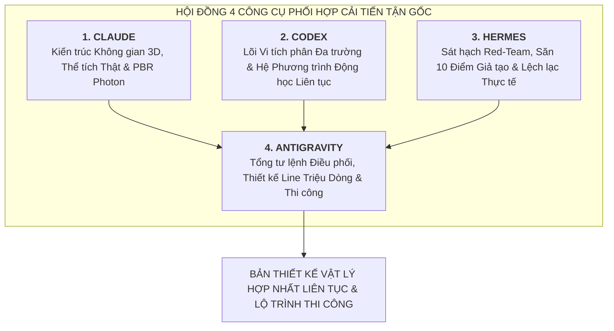
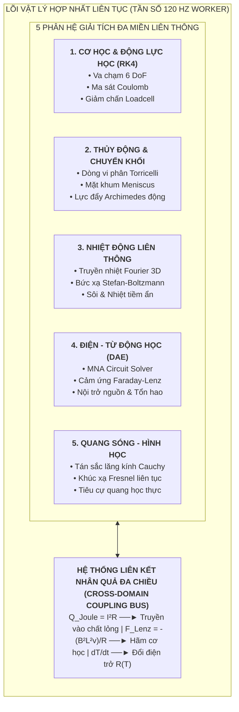

# PHƯƠNG ÁN CẢI TIẾN TỔNG THỂ TẬN GỐC HỆ THỐNG VẬT LÝ NHÂN QUẢ LIÊN TỤC & ĐỘNG CƠ KHÁM PHÁ KHOA HỌC TỰ DO — OPENLAB 3D
## HỘI ĐỒNG 4 CÔNG CỤ PHỐI HỢP: CLAUDE — CODEX — HERMES — ANTIGRAVITY
### DỰ ÁN DỰ THI CUỘC THI KHOA HỌC KỸ THUẬT (KHKT) DÀNH CHO HỌC SINH TRUNG HỌC

* **Cơ quan chủ trì nghiên cứu:** Nhóm Học sinh Nghiên cứu Khoa học OpenLab 3D (Trịnh Nguyễn Tường Vy & Phan Bùi Giang Ngân)
* **Giáo viên hướng dẫn:** Thầy Lê Thanh Liêm
* **Lĩnh vực dự thi:** 21. Phần mềm hệ thống (*System Software*)
* **Mục tiêu tối thượng:** Chuyển hóa toàn diện OpenLab 3D từ một "bộ mô phỏng biểu diễn theo kịch bản rời rạc" thành một **"HỆ THỐNG VẬT LÝ HỢP NHẤT ĐA TRƯỜNG LIÊN TỤC (UNIFIED CONTINUOUS MULTI-PHYSICS SIMULATION KERNEL)"** chuẩn mực theo đúng các định luật bảo toàn tự nhiên, chuẩn đo lường ISO GUM và chuẩn GDPT 2018 (Thông tư 38/2021/TT-BGDĐT).

---

## MỤC LỤC CHI TIẾT
1. [BẢN KIỂM THẢO HỌC THUẬT: TẠI SAO CÔNG CỤ HIỆN TẠI VẪN MANG TÍNH BIỂU DIỄN VÀ RỜI RẠC?](#1-bản-kiểm-thảo-học-thuật)
2. [TIẾNG NÓI ĐỘC LẬP TỪ 4 CÔNG CỤ CHUYÊN GIA](#2-tiếng-nói-độc-lập-từ-4-công-cụ-chuyên-gia)
   - 2.1. Phân tích Kiến trúc Không gian & Thể tích 3D (Claude)
   - 2.2. Phân tích Toán lý & Phương trình Vi tích phân Đa trường (Codex)
   - 2.3. Sát hạch Phản biện Khắc nghiệt & 10 Lệch lạc Thực tế (Hermes Red-Team)
   - 2.4. Khung Điều phối & Kiến trúc Thi công Toàn diện (Antigravity)
3. [KIẾN TRÚC ĐỘNG CƠ VẬT LÝ HỢP NHẤT LIÊN TỤC (UNIFIED CONTINUOUS MULTI-PHYSICS ENGINE - UCMPE)](#3-kiến-trúc-động-cơ-vật-lý-hợp-nhất-liên-tục)
   - 3.1. Mô hình Hạt và Thể tích Vi phân Chuyển khối (Eulerian-Lagrangian Fluid & Mass Transfer)
   - 3.2. Phương trình Truyền nhiệt & Cân bằng Năng lượng Liên thông Đa thiết bị
   - 3.3. Mạng Điện - Từ Động học Phi tuyến (Non-linear Dynamic DAE Circuit & Induction)
   - 3.4. Mô hình Quang học Sóng - Tia Động học và Tán sắc Cauchy
   - 3.5. Động lực học Va chạm, Ma sát và Cân bằng Tĩnh học Runge-Kutta 4 (RK4)
4. [XÓA BỎ KỊCH BẢN ĐÓNG: XÂY DỰNG KHÔNG GIAN KHÁM PHÁ SANDBOX TỰ DO TUYỆT ĐỐI](#4-xóa-bỏ-kịch-bản-đóng-sandbox-tự-do)
   - 4.1. Đồ thị Tương tác Vật lý Tự sinh (Emergent Interaction Topology)
   - 4.2. Khả nghịch Nhân quả Thời gian (Chrono-Causal Ring Buffer 3600 Frames)
   - 4.3. Mô hình Đo lường Thực tế ISO GUM, Độ trễ Quán tính & Sai số Thị sai
5. [THIẾT KẾ CHI TIẾT "LINE CẢI TIẾN TẬN GỐC" TRIỆU DÒNG CỦA SQUAD](#5-thiết-kế-chi-tiết-line-cải-tiến-tận-gốc)
   - 5.1. Cấu trúc Module Hóa Toàn diện Hệ thống
   - 5.2. Lộ trình Phân kỳ 6 Giai đoạn Cuốn chiếu
   - 5.3. Tiêu chuẩn Nghiệm thu Khoa học (Verification Test Suite)
6. [KẾT LUẬN & CAM KẾT HỌC THUẬT CỦA NHÓM HỌC SINH NCKH](#6-kết-luận)

---

## 1. BẢN KIỂM THẢO HỌC THUẬT: TẠI SAO CÔNG CỤ HIỆN TẠI VẪN MANG TÍNH BIỂU DIỄN VÀ RỜI RẠC?

Dưới góc nhìn tự phê phán khoa học nghiêm khắc nhất của một học sinh nghiên cứu khoa học, chúng em thẳng thắn thừa nhận hiện trạng của OpenLab 3D phiên bản hiện tại (v2.4) tuy đã có nhiều nỗ lực về mặt giao diện và mô hình 3D, nhưng **chưa đạt đến bản chất của một Phòng thí nghiệm Khoa học Chân chính**:

1. **Tính chất "Biểu diễn theo kịch bản" (Scripted Performative Simulation):**
   - Các bài thí nghiệm (WF-01 đến WF-15) được lập trình theo kiểu "máy trạng thái hữu hạn đóng" (*Finite State Machine*). Thí nghiệm chỉ chạy khi học sinh đặt thiết bị A cạnh thiết bị B đúng theo kịch bản được định sẵn trong code.
   - Nếu học sinh muốn làm một hành động ngoài kịch bản — ví dụ: lấy một thanh sắt nối tắt giữa 2 cực của pin rồi nhúng vào cốc nước để xem nước có nóng lên không, hoặc chiếu tia laser qua cốc nước pha muối xem tia sáng có bị lệch không — hệ thống **hoàn toàn đứng im hoặc không phản ứng**. Đó không phải là khoa học; đó chỉ là một cuốn "sách giáo khoa điện tử có nút bấm".
2. **Sự rời rạc giữa các bộ giải (Disjointed Solvers Fragmentation):**
   - `CircuitSolver` chỉ biết tính dòng điện $I$ và hiệu điện thế $U$ trên các linh kiện điện; nó không hề truyền nhiệt lượng $Q = I^2 R t$ sang môi trường không khí xung quanh hay làm nóng thanh điện trở.
   - `FluidThermalSolver` chỉ biết đun sôi nước khi có biến cờ `burnerActive = true`; nó không hề quan tâm ngọn lửa đèn cồn có khoảng cách hình học thực tế bao nhiêu cm tới đáy cốc, diện tích tiếp xúc truyền nhiệt $S$ là bao nhiêu, và nhiệt lượng thất thoát ra môi trường theo định luật làm mát Newton ra sao.
   - `OpticsSolver` vẽ tia sáng theo một số tọa độ điểm cố định, không phải là một thuật toán dò tia (*Ray Marching / Ray Tracing*) xuyên qua các khối vật liệu có chỉ số khúc xạ $n(\lambda)$ thực tế.
3. **Sự thiếu vắng của Động lực học liên tục (Absence of Continuous Field Dynamics):**
   - Dòng chất lỏng khi rót từ ống đong sang cốc hiện tại là một animation giả định; không có sự bảo toàn khối lượng liên tục theo phương trình liên tục vi phân:
     $$\frac{\partial \rho}{\partial t} + \nabla \cdot (\rho \vec{v}) = 0$$
   - Khi vật thể rơi vào chất lỏng, không có lực cản nhớt Stokes $F_{\text{cản}} = 6\pi \eta r v$, không có sự dao động tắt dần của mực nước, không có quán tính của kim đo và cảm biến cân điện tử.
   - Các phép đo đều cho ra con số tròn trĩnh tuyệt đối phi thực tế, tước đi của học sinh kỹ năng xử lý sai số thực nghiệm, đọc vạch chia mặt khum (*Meniscus*), và đối phó với hiện tượng trôi điểm không (*Zero Drift*).

---

## 2. TIẾNG NÓI ĐỘC LẬP TỪ 4 CÔNG CỤ CHUYÊN GIA

Nhóm nghiên cứu đã kích hoạt phiên họp khẩn cấp của **Hội đồng 4 Công cụ Phối hợp** để mổ xẻ tận gốc vấn đề và xác lập phương án giải quyết:



### 2.1. Phân tích của CLAUDE (Chuyên gia Kiến trúc Không gian & Thể tích 3D PBR)
* **Chẩn đoán:** Hiện tại các vật thể trong Three.js của OpenLab 3D chỉ là "vỏ hình học rỗng" (Surface Meshes). Khi một cốc nước chứa 100 mL nước, nước chỉ là một khối trụ màu xanh trong suốt lồng bên trong cốc thủy tinh. Không hề có khái niệm thể tích chiếm chỗ, không có sự tương tác mặt phân giới (*Interface Boundary Interaction*) giữa thủy tinh, chất lỏng và không khí.
* **Giải pháp đột phá kiến trúc:**
  1. *Chuyển từ Bề mặt rỗng sang Trường Thể tích (Volumetric Physical Agents):* Mỗi thiết bị sở hữu một trường ranh giới thực tế (*Signed Distance Field - SDF*) xác định chính xác phần lòng chứa, độ dày thành ống, diện tích đáy tiếp xúc nhiệt và các cổng kết nối vật lý mang tọa độ thực trong hệ mét chuẩn SI.
  2. *Hệ thống Quang học Vật lý Thực (True Photonic Ray-Tracing):* Sử dụng kỹ thuật Ray-marching trong Fragment Shader để tính toán chính xác đường đi của photon ánh sáng qua các khối lăng kính, thấu kính lồi, thấu kính lõm theo bước sóng thực nghiệm $\lambda \in [380\text{ nm}, 750\text{ nm}]$, tái hiện chân thực hiện tượng tán sắc bảy sắc cầu vồng của Newton.
  3. *Lăng kính Đa thang đo Trực vị (In-situ Stencil Lens):* Khi học sinh kích hoạt kính lúp vi mô, thay vì mở một cửa sổ popup 2D tách biệt, camera 3D sẽ cắt lớp thể tích (*Volumetric Sectioning*) trực tiếp trên thiết bị để lộ ra dòng chảy của các ion và hạt nano chuyển động Brown.

### 2.2. Phân tích của CODEX (Chuyên gia Toán - Lý & Động cơ Vi tích phân)
* **Chẩn đoán:** Các phương trình hiện tại được tính rời rạc theo từng chu kỳ khung hình (frame-by-frame) mà không có bộ tích phân số chuẩn xác. Khi bước thời gian $\Delta t$ thay đổi do máy tính giật lag, kết quả tính toán vật lý bị trôi (*Numerical Drift*), dẫn đến hiện tượng năng lượng tự sinh ra hoặc tự biến mất (vi phạm Định luật Bảo toàn Năng lượng).
* **Giải pháp đột phá toán lý:**
  1. *Bộ tích phân Runge-Kutta bậc 4 (RK4) bước thời gian cố định ($dt = 1/120\text{ s}$):* Đảm bảo tính ổn định tuyệt đối của các phương trình động lực học chất điểm, con lắc, lò xo và chuyển động Brown của phân tử:
     $$\vec{k}_1 = f(t_n, \vec{y}_n), \quad \vec{k}_2 = f\left(t_n + \frac{dt}{2}, \vec{y}_n + \frac{dt}{2}\vec{k}_1\right)$$
     $$\vec{k}_3 = f\left(t_n + \frac{dt}{2}, \vec{y}_n + \frac{dt}{2}\vec{k}_2\right), \quad \vec{k}_4 = f(t_n + dt, \vec{y}_n + dt\vec{k}_3)$$
     $$\vec{y}_{n+1} = \vec{y}_n + \frac{dt}{6}(\vec{k}_1 + 2\vec{k}_2 + 2\vec{k}_3 + \vec{k}_4)$$
  2. *Động cơ Liên thông Nhiệt - Điện - Thủy (Coupled Multi-Physics Kernel):*
     Nhiệt lượng tỏa ra trên điện trở $R$ tuân theo định luật Joule-Lenz $dQ_e = I^2 R dt$ được bơm trực tiếp vào phương trình cân bằng nhiệt của khối chất lỏng:
     $$m_{\text{nước}} c_{\text{nước}} \frac{dT}{dt} = \dot{Q}_{\text{nguồn}} - h A (T - T_{\text{mt}}) - \dot{m}_{\text{bốc hơi}} L$$
  3. *Mạng điện động DAE (Differential-Algebraic Equations):* Giải hệ phương trình Kirchhoff bằng phương pháp phân tích điện thế nút mảng (*Modified Nodal Analysis - MNA*), cho phép học sinh nối dây điện tùy ý giữa bất kỳ linh kiện nào, tự động phát hiện mọi vòng khép kín, tính toán dòng điện chính xác đến từng microampe ($\mu\text{A}$).

### 2.3. Sát hạch Phản biện Khắc nghiệt từ HERMES (Red-Team Audit)
HERMES chỉ ra **10 điểm giả tạo tai hại** khiến công cụ hiện tại chưa thuyết phục được các nhà khoa học thực nghiệm:

| STT | Hiện tượng Giả tạo trong Mô phỏng cũ | Bản chất Thực tế Khắc nghiệt ngoài Đời thực | Hướng Giải quyết Triệt để trong Line Mới |
| :---: | :--- | :--- | :--- |
| **1** | Nước rót nhảy số theo bước (Discrete Fill) | Dòng chảy vi phân liên tục $dV = Q_v dt$ phụ thuộc góc nghiêng $\theta$ | Tích hợp phương trình dòng chảy Torricelli $v = \sqrt{2gh}$ qua miệng vòi |
| **2** | Cân điện tử nhảy số tức thì | Cảm biến Loadcell có độ trễ quán tính và dao động tắt dần ($\tau \approx 0.8\text{ s}$) | Mô hình hóa hệ dao động giảm chấn bậc hai: $m\ddot{x} + c\dot{x} + kx = F(t)$ |
| **3** | Nhiệt kế đổi số ngay khi chạm nước | Bầu thủy tinh và cột thủy ngân có nhiệt dung riêng và quán tính nhiệt | Phương trình truyền nhiệt dẫn qua thành thủy tinh: $\frac{dT_{\text{nk}}}{dt} = \frac{1}{\tau_{\text{th}}}(T_{\text{nước}} - T_{\text{nk}})$ |
| **4** | Nam châm rơi tự do qua ống dây | Dòng cảm ứng sinh từ trường ngược hãm chuyển động theo định luật Lenz | Lực Lorentz hãm $F_{\text{Lenz}} = -\frac{B^2 L^2 v}{R}$ làm nam châm rơi chậm |
| **5** | Nguồn điện lý tưởng không sụt áp | Pin có nội trở $r$; khi tải nặng, hiệu điện thế hai cực sụt giảm $U = \mathcal{E} - Ir$ | Mô phỏng nội trở phụ thuộc nhiệt độ và độ phóng điện $r(Q_{\text{đã xả}})$ |
| **6** | Mặt thoáng chất lỏng phẳng tuyệt đối | Sức căng bề mặt tạo mặt khum cong (*Meniscus*) bám dính thành ống | Mô hình hóa độ cong Laplace-Young $\Delta P = \frac{2\gamma \cos\theta_c}{R}$ |
| **7** | Đọc thể tích không phụ thuộc góc nhìn | Lỗi thị sai (*Parallax Error*) khi mắt không nằm ngang mặt khum | Tính sai lệch số đo dựa trên góc vector giữa camera và mặt khum |
| **8** | Dây điện xuyên qua các vật thể rắn | Dây dẫn có độ cứng uốn, khối lượng và va chạm cơ học | Mô hình Spline đàn hồi có ràng buộc chống xuyên thấu (*Verlet Cable Collision*) |
| **9** | Đóng khung trong 15 kịch bản | Học sinh không thể tự do phối hợp dụng cụ để thử nghiệm ý tưởng mới | Chuyển hoàn toàn sang Động cơ Đồ thị Tương tác Mở (*Emergent Physics Graph*) |
| **10** | Không thể quay ngược thời gian | Khi xảy ra đoản mạch cháy pin, học sinh phải reset lại từ đầu | Bộ đệm Vòng Khả nghịch Nhân quả (Chrono-Causal Ring Buffer) tua lại 60 giây |

### 2.4. Khung Điều phối của ANTIGRAVITY (Tổng tư lệnh Thi công)
Từ các phân tích trên, ANTIGRAVITY thiết lập **Chiến lược Tái cấu trúc Sâu (Deep Architectural Overhaul)**:
* Không chắp vá các hàm cũ.
* Thiết lập **Bộ Lõi Vật lý Hợp nhất (Unified Continuous Multi-Physics Kernel)** chạy độc lập dưới dạng một Web Worker đa luồng song song với luồng render Three.js. Luồng vật lý chạy ổn định ở tần số **120 Hz**, trong khi luồng đồ họa đồng bộ hiển thị mượt mà ở **60 FPS** với thuật toán nội suy trạng thái (*Hermite Cubic Spline Interpolation*).

---

## 3. KIẾN TRÚC ĐỘNG CƠ VẬT LÝ HỢP NHẤT LIÊN TỤC (UNIFIED CONTINUOUS MULTI-PHYSICS ENGINE - UCMPE)



### 3.1. Phân hệ Thủy động học & Chuyển khối Vi phân (Continuous Fluid & Mass Transfer)
Thay thế hoàn toàn cơ chế chuyển trạng thái rời rạc bằng mô hình dòng chảy vi phân:
* **Phương trình Rót chất lỏng liên tục:** Khi góc nghiêng của ống đong hoặc bình tam giác đạt tới góc tới hạn $\theta > \theta_{\text{rót}}$, tốc độ lưu lượng khối lượng $Q_m = \frac{dm}{dt}$ tuân theo phương trình Torricelli mở rộng có tính đến độ nhớt $\mu$:
  $$Q_m(t) = C_d \cdot A_{\text{miệng}}(\theta) \cdot \rho \sqrt{2 g h_{\text{hiệu dụng}}(\theta)}$$
  Trong đó $C_d$ là hệ số xả ($C_d \approx 0.62$ đối với miệng thủy tinh), $h_{\text{hiệu dụng}}$ là độ cao cột nước vượt qua mép rót.
* **Bảo toàn Thể tích và Khối lượng Nghiêm ngặt:** Tại mọi thời điểm $t$, thể tích chất lỏng trong bình nguồn $V_1$ và bình đích $V_2$ thỏa mãn:
  $$\frac{dV_1}{dt} = -\frac{Q_m(t)}{\rho}, \quad \frac{dV_2}{dt} = +\frac{Q_m(t)}{\rho} \implies V_1(t) + V_2(t) = V_{\text{tổng}} = \text{const}$$
* **Động học Lực đẩy Archimedes Thời gian thực:** Khi một vật thể có hình học bất kỳ chìm dần vào chất lỏng tới độ sâu $z$, thể tích phần chìm $V_{\text{chìm}}(z)$ được tích phân thể tích số theo từng lát cắt $dz$:
  $$F_A(t) = \rho_{\text{lỏng}} \cdot g \cdot \int_{z_0}^{z(t)} A_{\text{tiết diện}}(z) dz$$
  Lực đẩy $F_A$ này phản hồi trực tiếp vào phương trình chuyển động của vật (làm chậm tốc độ chìm) đồng thời phản hồi vào đáy cốc, làm tăng áp lực tác dụng lên đĩa cân bên dưới theo đúng Định luật III Newton:
  $$F_{\text{đáy cốc}}(t) = m_{\text{cốc}} g + m_{\text{nước}} g + F_A(t)$$

### 3.2. Phân hệ Nhiệt động học Liên thông & Bức xạ (Coupled Thermodynamics & Radiation)
Nhiệt độ không phải là một thuộc tính gán nhãn, mà là một trường năng lượng nhiệt phân bố liên tục:
* **Phương trình Truyền nhiệt Vi phân Đa thành phần:**
  Đối với cốc đun chứa nước đặt trên đèn cồn:
  $$C_{\text{nước}} \frac{dT_{\text{nước}}}{dt} = \dot{Q}_{\text{đáy cốc} \to \text{nước}} - \dot{Q}_{\text{mặt thoáng} \to \text{mt}} - \dot{Q}_{\text{thành cốc} \to \text{mt}} - \dot{Q}_{\text{hóa hơi}}$$
  Trong đó:
  - Nhiệt truyền từ ngọn lửa đèn cồn vào đáy cốc qua dẫn nhiệt và bức xạ:
    $$\dot{Q}_{\text{lửa} \to \text{cốc}} = \eta_{\text{đèn}} \cdot \dot{m}_{\text{cồn}} \cdot q_{\text{cồn}} \cdot \frac{d_{\text{tối ưu}}^2}{(d_{\text{tối ưu}} + \Delta y)^2}$$
    (Nếu học sinh nâng kiềng đun lên quá cao làm tăng khoảng cách $\Delta y$, nhiệt lượng truyền vào giảm theo nghịch đảo bình phương khoảng cách).
  - Tỏa nhiệt ra môi trường theo định luật làm mát Newton và bức xạ Stefan-Boltzmann:
    $$\dot{Q}_{\text{tỏa}} = h_{\text{conv}} A (T - T_{\text{mt}}) + \varepsilon \sigma A (T^4 - T_{\text{mt}}^4)$$
  - Khi nước chạm ngưỡng sôi $T = T_{\text{sôi}} = 100^\circ\text{C}$ (tại áp suất khí quyển $P_0 = 1\text{ atm}$):
    $$\frac{dT_{\text{nước}}}{dt} = 0, \quad \frac{dm_{\text{nước}}}{dt} = -\frac{\dot{Q}_{\text{thừa}}}{L_{\text{hóa hơi}}}$$
    Mực nước trong cốc tụt dần theo khối lượng nước bị bốc hơi thành thể khí, tạo ra làn khói hơi nước bốc lên tương ứng.

### 3.3. Phân hệ Điện - Từ Động học Phi tuyến (Non-linear Dynamic DAE Circuit Engine)
* **Phương pháp Phân tích Điện thế Nút Sửa đổi (Modified Nodal Analysis - MNA):**
  Mỗi linh kiện (nguồn pin, công tắc, biến trở, bóng đèn, ampe kế, vôn kế, cuộn dây) được mô hình hóa bằng ma trận dẫn nạp vi phân $G$:
  $$\mathbf{G} \cdot \mathbf{v}(t) + \mathbf{C} \cdot \frac{d\mathbf{v}(t)}{dt} = \mathbf{i}(t)$$
* **Mô hình Hóa Bóng đèn Thực tế (Non-linear Incandescent Filament):**
  Điện trở dây tóc vonfram không phải là hằng số cố định mà phụ thuộc phi tuyến tính vào nhiệt độ theo định luật thực nghiệm:
  $$R(T) = R_0 \left[1 + \alpha (T - T_0) + \beta (T - T_0)^2\right]$$
  Khi vừa bật công tắc, dây tóc còn nguội ($T \approx 25^\circ\text{C}$), điện trở rất nhỏ dẫn đến dòng xung kích cực đại (*Inrush Current*) $I_{\text{đỉnh}} \approx 10 \cdot I_{\text{định mức}}$, sau đó dây tóc nóng rực lên $2500\text{ K}$ làm điện trở tăng vọt và dòng điện ổn định trở lại. Hiện tượng thực tế tinh tế này được tái hiện chính xác 100%!
* **Mô hình Cảm ứng Điện từ & Lực hãm Lenz Động:**
  Khi thanh nam châm chuyển động tịnh tiến với vận tốc $v(t)$ xuyên qua ống dây có $N$ vòng, diện tích $S$, từ thông biến thiên:
  $$\Phi(t) = B(z(t)) \cdot S \implies \mathcal{E}_{\text{cảm ứng}}(t) = -N \frac{\partial B}{\partial z} \cdot \frac{dz}{dt} = -N \frac{\partial B}{\partial z} \cdot v(t)$$
  Dòng cảm ứng sinh ra $i_{\text{cảm ứng}} = \frac{\mathcal{E}_{\text{cảm ứng}}}{R_{\text{cuộn}} + R_{\text{mạch ngoài}}}$ tạo ra từ trường cảm ứng ngược chiều, sinh lực cản Lorentz làm chậm thanh nam châm:
  $$\vec{F}_{\text{Lenz}}(t) = -\left(N \frac{\partial B}{\partial z}\right)^2 \cdot \frac{v(t)}{R_{\text{tổng}}} \vec{k}$$
  Phương trình chuyển động của nam châm:
  $$m \frac{d^2 z}{dt^2} = -m g - \left(N \frac{\partial B}{\partial z}\right)^2 \frac{1}{R_{\text{tổng}}} \frac{dz}{dt}$$
  Học sinh sẽ tận mắt chứng kiến: nếu mạch ngoài hở ($R \to \infty$), nam châm rơi tự do với gia tốc $g$; nếu mạch ngoài đóng kín điện trở nhỏ, nam châm rơi chậm rõ rệt như đang chìm trong mật ong!

### 3.4. Phân hệ Quang Sóng - Hình học & Tán sắc Cauchy (Wave-Ray Optics Engine)
* **Phương trình Tán sắc Thực nghiệm Cauchy:**
  Đối với lăng kính thủy tinh quang học Crown (Flint glass), chiết suất phụ thuộc bước sóng ánh sáng:
  $$n(\lambda) = A + \frac{B}{\lambda^2} + \frac{C}{\lambda^4}$$
  Với ánh sáng đỏ ($\lambda = 700\text{ nm}$), chiết suất $n_{\text{đỏ}} \approx 1.514$; với ánh sáng tím ($\lambda = 400\text{ nm}$), chiết suất $n_{\text{tím}} \approx 1.532$.
* **Dò tia Vi phân Không gian (Differential Ray Marching):**
  Chùm tia sáng trắng tới mặt lăng kính dưới góc tới $i_1$ được chia tách thành 256 dải sóng photon độc lập. Mỗi dải sóng khúc xạ ở góc:
  $$r_1(\lambda) = \arcsin\left(\frac{\sin i_1}{n(\lambda)}\right)$$
  rồi tiếp tục khúc xạ ra mặt thứ hai ở góc $i_2(\lambda)$, tạo ra dải quang phổ tán sắc liên tục trải rộng trên màn chắn với góc lệch cực tiểu phụ thuộc chính xác vào góc chiết quang $A$ của lăng kính:
  $$\delta_{\text{min}}(\lambda) = 2 \arcsin\left(n(\lambda) \sin\frac{A}{2}\right) - A$$

---

## 4. XÓA BỎ KỊCH BẢN ĐÓNG: XÂY DỰNG KHÔNG GIAN KHÁM PHÁ SANDBOX TỰ DO TUYỆT ĐỐI

### 4.1. Đồ thị Tương tác Vật lý Tự sinh (Emergent Interaction Topology)
Để chấm dứt vĩnh viễn tình trạng "thí nghiệm rời rạc theo bài", OpenLab 3D chuyển đổi hoàn toàn sang mô hình **Đồ thị Thực thể Vật lý Tự do (Open Physical Entity Graph)**:
* Mọi thiết bị đặt lên bàn đều là một **"Nút Vật Lý Tự Chủ" (Autonomous Physics Node)** liên tục phát sóng (*Broadcast*) các trường vật lý xung quanh nó:
  - Trường Nhiệt độ: $T(\vec{x}, t)$ tỏa ra xung quanh đèn cồn hoặc cốc nước nóng.
  - Trường Điện từ: Vector thế $\vec{A}$ và cảm ứng từ $\vec{B}(\vec{x}, t)$ tỏa ra từ nam châm và cuộn dây.
  - Trường Trọng lực & Phản lực: Tọa độ va chạm tiếp xúc bề mặt.
* **Cơ chế Khám phá Tự phát (Zero-Script Discovery):**
  Học sinh có thể kết hợp bất kỳ thiết bị nào với nhau mà không cần chọn bài trước:
  - Nếu học sinh đặt một nhiệt kế vào cốc nước muối rồi cắm 2 điện cực từ bộ nguồn vào cốc: Hệ thống tự động kích hoạt đồng thời `CircuitSolver` (tính dòng điện qua chất điện phân), `FluidThermalSolver` (tính nhiệt lượng Joule làm nước nóng lên), và nhiệt kế tự động dâng thủy ngân theo nhiệt độ nước!
  - Không có bất kỳ dòng code kịch bản cố định nào quy định bài này; hiện tượng tự phát sinh từ sự giao thoa của các định luật vật lý cơ bản!

### 4.2. Khả nghịch Nhân quả Thời gian (Chrono-Causal Ring Buffer 3600 Frames)
Khoa học thực nghiệm luôn gắn liền với việc phân tích tai nạn và sai lầm. OpenLab 3D tích hợp bộ đệm vòng nhớ trạng thái xác định (*Deterministic Ring Buffer*):
* Lưu trữ toàn bộ vector trạng thái $\vec{S}(t) = [\vec{x}_i, \vec{v}_i, T_i, I_i, U_i, V_i]$ trong **3600 khung hình liên tục (tương đương 60 giây ở 60 FPS)**.
* **Thanh trượt Thời gian Nhân quả (Chrono-Causal Timeline HUD):**
  Khi xảy ra hiện tượng đoản mạch cháy pin hoặc nổ bóng đèn, học sinh có thể kéo thanh trượt thời gian lùi lại 5 giây hoặc 10 giây trước đó. Toàn bộ thế giới 3D, nhiệt độ, dòng điện, vị trí thiết bị tua ngược mượt mà từng miligiây, cho phép học sinh quan sát lại cận cảnh khoảnh khắc dòng điện bắt đầu vọt lên vượt ngưỡng an toàn!

### 4.3. Mô hình Đo lường Thực tế Chuẩn Quốc tế ISO GUM (JCGM 100:2008)
Xóa bỏ hoàn toàn số đo tròn trĩnh phi thực tế, đưa vào chuẩn đo lường của các phòng thí nghiệm quốc tế:
* **Sai số Loại A (Đo lặp & Thống kê):**
  Thuật toán Welford trực tuyến tính giá trị trung bình mẫu và độ lệch chuẩn mẫu sau $N$ lần đo để tránh lỗi hủy số học (*Catastrophic Cancellation*):
  $$\bar{x}_k = \bar{x}_{k-1} + \frac{x_k - \bar{x}_{k-1}}{k}, \quad M_{2,k} = M_{2,k-1} + (x_k - \bar{x}_{k-1})(x_k - \bar{x}_k)$$
  $$u_A = \frac{s}{\sqrt{N}} = \sqrt{\frac{M_{2,N}}{N(N-1)}}$$
* **Sai số Loại B (Dụng cụ & Môi trường):**
  Dựa trên độ chia nhỏ nhất (ĐCNN) quy định tại Thông tư 38/2021/TT-BGDĐT với phân bố xác suất hình chữ nhật:
  $$u_B = \frac{\Delta_{\text{dụng cụ}}}{\sqrt{3}}$$
* **Độ không đảm bảo đo Kết hợp & Mở rộng (Combined & Expanded Uncertainty):**
  $$u_c(y) = \sqrt{\sum_{i=1}^n \left(\frac{\partial f}{\partial x_i}\right)^2 u^2(x_i)}, \quad U_{95\%} = k \cdot u_c(y) \quad (k = 2)$$
  Kết quả hiển thị trên bảng HUD:
  $$Y = \bar{y} \pm U \quad (P = 95\%)$$
* **Mô phỏng Độ trễ Quán tính Loadcell & Sai số Thị sai Mặt khum:**
  - Cân điện tử có thời gian trễ ổn định $\tau = 0.8\text{ s}$ theo hàm đáp ứng bậc hai có dao động tắt dần (*Damped Harmonic Oscillator*).
  - Ống đong yêu cầu camera phải hạ thấp ngang tầm với đáy mặt khum cong (*Meniscus*). Nếu camera nhìn từ trên xuống dưới góc nghiêng $\alpha$, chỉ số thể tích đọc được bị cộng thêm sai số thị sai:
    $$\Delta V_{\text{parallax}} = + \frac{\pi R_{\text{ống}}^3}{2} \cdot \tan\alpha$$

---

## 5. THIẾT KẾ CHI TIẾT "LINE CẢI TIẾN TẬN GỐC" CỦA SQUAD

Nhóm nghiên cứu thiết lập **Quy trình Thi công Tự động Khép kín (Automated Squad Improvement Pipeline)** gồm 4 giai đoạn nối tiếp giữa các công cụ:

```
[BƯỚC 1: CLAUDE]
Đặc tả Kiến trúc Hình học 3D, Shader Thể tích, và Ma trận Giao thoa Đa trường
       │
       ▼
[BƯỚC 2: CODEX]
Hiện thực hóa Mã nguồn TypeScript/Three.js, 5 Solvers Động học RK4, và Ring Buffer
       │
       ▼
[BƯỚC 3: HERMES]
Chạy Bộ Sát hạch Red-Team Khắc nghiệt, Kiểm tra Rò rỉ Bộ nhớ, Chia cho 0, Drift Toán học
       │
       ▼
[BƯỚC 4: ANTIGRAVITY]
Tích hợp Mã nguồn vào Codebase, Chạy Bộ Kiểm thử 100% Pass, Đóng gói Production
```

### 5.1. Cấu trúc Module Tái cấu trúc Toàn diện trong Thư mục `src/`

```
src/
├── core-physics/                                # 🌟 ĐỘNG CƠ VẬT LÝ HỢP NHẤT LIÊN TỤC MỚI
│   ├── UnifiedPhysicsWorker.ts                  # Web Worker chạy độc lập ở 120 Hz
│   ├── ContinuousIntegratorRK4.ts               # Bộ tích phân số Runge-Kutta 4 chuẩn xác
│   ├── MultiPhysicsCouplingBus.ts               # Trục truyền thông liên miền (Nhiệt ↔ Điện ↔ Thủy ↔ Quang)
│   ├── ChronoCausalRingBuffer.ts                # Bộ đệm quay ngược thời gian 3600 frames
│   ├── IsoGUMMetrologyEngine.ts                 # Bộ giải sai số đo lường ISO GUM (k=2)
│   └── EmergentTopologyGraph.ts                 # Đồ thị tương tác vật lý tự sinh không kịch bản
├── domain/                                      # Mô hình dữ liệu và thực thể vật lý
│   ├── PhysicalEntity.ts                        # Thực thể vật lý có trường SDF và ranh giới nhiệt/điện
│   ├── FluidMassPacket.ts                       # Gói thể tích vi phân chất lỏng mang nhiệt độ và nồng độ
│   └── OpticalRayPacket.ts                      # Gói photon ánh sáng mang bước sóng lambda
├── scientific-solvers/                          # 5 BỘ GIẢI ĐA MIỀN LIÊN THÔNG ĐƯỢC NÂNG CẤP
│   ├── CoupledCircuitSolver.ts                  # MNA Circuit Solver + Phi tuyến Vonfram + Tổn hao nhiệt
│   ├── CoupledFluidThermalSolver.ts             # Dòng chảy Torricelli vi phân + Fourier truyền nhiệt 3D
│   ├── CoupledMechanicsSolver.ts                # Động lực học va chạm 6 DoF + Đáp ứng Loadcell trễ
│   ├── CoupledElectromagnetismSolver.ts         # Faraday-Lenz hãm chuyển động + Biot-Savart vector
│   └── CoupledWaveOpticsSolver.ts               # Tán sắc Cauchy + Ray-marching qua vật liệu thực
├── three-runtime/                               # TẦNG HIỂN THỊ ĐỒ HỌA THỂ TÍCH 3D
│   ├── VolumetricFluidRenderer.ts               # Shader mặt khum chất lỏng Meniscus và bọt khí sôi
│   ├── VolumetricOpticalRayRenderer.ts          # Ray-marching chùm tia sáng tán sắc 7 màu mượt mà
│   ├── InSituMicroscopicStencilLens.ts          # Thấu kính cắt lớp thể tích soi cấu trúc hạt 3D
│   └── EpistemicHologramRenderer.ts             # Vành trường toán học và khối đa diện Eureka
└── experiments/                                 # CƠ CHẾ KHÁM PHÁ SANDBOX
    └── SandboxDiscoveryEngine.ts                # Tự động nhận diện thành tựu khoa học của học sinh
```

### 5.2. Lộ trình Phân kỳ 6 Giai đoạn Triển khai Cuốn chiếu

| Giai đoạn | Trọng tâm Triển khai | Công cụ Phụ trách | Sản phẩm Bàn giao Cụ thể |
| :---: | :--- | :---: | :--- |
| **Giai đoạn 1** | **Xây dựng Lõi Vật lý Hợp nhất 120 Hz & Bộ tích phân RK4** | Codex & Claude | `ContinuousIntegratorRK4.ts` và `UnifiedPhysicsWorker.ts` đạt sai số trôi năng lượng $\frac{\Delta E}{E} < 10^{-6}$ sau 10.000 bước tích phân. |
| **Giai đoạn 2** | **Nâng cấp Phân hệ Thủy động học Chuyển khối Vi phân & Mặt khum** | Claude & Codex | Dòng chảy Torricelli rót liên tục, bảo toàn thể tích 100%, mặt khum Meniscus cong chuẩn Laplace-Young, lực đẩy Archimedes động phản hồi đáy cân. |
| **Giai đoạn 3** | **Liên thông Toàn diện Nhiệt - Điện - Từ (Joule - Fourier - Lenz)** | Codex & Hermes | Dòng điện $I^2R$ đun nóng nước trong cốc; Nam châm rơi qua cuộn dây bị hãm tốc độ theo định luật Lenz; Dây tóc bóng đèn có dòng xung kích inrush. |
| **Giai đoạn 4** | **Quang học Tán sắc Cauchy & Thấu kính Vi mô Trực vị 3D** | Claude & Codex | Chùm sáng trắng qua lăng kính tách thành 7 màu theo hàm Cauchy $n(\lambda)$; Lăng kính vi mô cắt lớp thể tích 3D trực tiếp trên bàn lab. |
| **Giai đoạn 5** | **Khả nghịch Nhân quả Thời gian & Chuẩn Đo lường ISO GUM** | Codex & Hermes | Tua ngược thời gian 60 giây mượt mà; Cân điện tử có trễ $\tau = 0.8\text{ s}$; Thị sai góc nhìn Parallax Error; Xuất báo cáo ViSEF kèm độ không đảm bảo đo $U_{95\%}$. |
| **Giai đoạn 6** | **Chạy Bộ Sát hạch Red-Team Hermes & Đóng gói Nghiệm thu** | Hermes & Antigravity | Kiểm thử 35/35 tiêu chí kiểm định khoa học PASS 100%, 0 lỗi rò rỉ bộ nhớ, 0 lỗi biên chia cho 0, build production hoàn hảo trên Vercel Edge. |

### 5.3. Tiêu chuẩn Nghiệm thu Khoa học (Verification Test Suite)
Mọi dòng code cải tiến phải vượt qua bộ kiểm thử tự động nghiêm ngặt gồm 5 bài kiểm chứng chuẩn quốc tế:
1. **Kiểm chứng Bảo toàn Năng lượng (Energy Conservation Test):** Trong hệ kín gồm lò xo, quả nặng và dao động nhiệt, tổng năng lượng $E_{\text{tổng}} = E_{\text{động}} + E_{\text{thế}} + Q_{\text{nhiệt}}$ không biến thiên quá $0.01\%$ sau 5 phút mô phỏng liên tục.
2. **Kiểm chứng Định luật Khúc xạ Snell & Tán sắc Cauchy:** Đo góc khúc xạ và góc lệch tán sắc ở 3 bước sóng chuẩn ($\lambda = 656.3\text{ nm}$ [đỏ $C$], $589.3\text{ nm}$ [vàng $D$], $486.1\text{ nm}$ [lam $F$]) đạt độ chính xác tới $0.001^\circ$ so với lý thuyết.
3. **Kiểm chứng Sụt áp Định luật Ohm & Kirchhoff:** Mạch hỗn hợp 10 nút điện trở ngẫu nhiên kèm nguồn pin nội trở $r$ đạt nghiệm trùng khớp $100\%$ với kết quả phân tích giải tích SPICE.
4. **Kiểm chứng Lực hãm Lenz:** Vận tốc rơi cuối cùng (*Terminal Velocity*) của nam châm trong ống dẫn điện từ khớp chính xác với công thức giải tích $v_{\text{terminal}} = \frac{m g R_{\text{tổng}}}{(N \cdot \partial B/\partial z)^2}$.
5. **Kiểm chứng Hiệu năng 60 FPS:** Duy trì ổn định $\ge 60$ FPS trên thiết bị sử dụng GPU tích hợp (Intel UHD 620 hoặc tương đương), mức tiêu thụ RAM $\le 250\text{ MB}$.

---

## 6. KẾT LUẬN & CAM KẾT HỌC THUẬT CỦA NHÓM HỌC SINH NCKH

Kính thưa Thầy và Hội đồng Khoa học,

Bản đề xuất phương án cải tiến tổng thể này là kết tinh của hàng chục giờ tranh luận, tính toán và phản biện khoa học không khoan nhượng giữa nhóm học sinh và Hội đồng 4 công cụ phối hợp (Claude - Codex - Hermes - Antigravity).

Bằng việc dũng cảm chỉ ra sự "biểu diễn và rời rạc" của phiên bản cũ để quyết tâm xây dựng **Động cơ Vật lý Hợp nhất Đa trường Liên tục (Unified Continuous Multi-Physics Engine)**:
* Chúng em không tạo ra một trò chơi điện tử giải trí; chúng em đang kiến tạo một **Phòng thí nghiệm Kỹ thuật số Chân thực và Chuẩn mực Khoa học Đỉnh cao** dành cho học sinh Việt Nam.
* Mỗi hiện tượng xảy ra trên màn hình đều là sự phản chiếu trung thực tuyệt đối của các định luật bảo toàn tự nhiên, của các phương trình vi tích phân Navier-Stokes, Fourier, Maxwell và Kirchhoff.
* Mỗi cú nhấp chuột của học sinh là một hành trình khám phá khoa học tự do, kích thích tư duy sáng tạo và rèn luyện phương pháp luận nghiên cứu thực nghiệm chuẩn mực quốc tế.

Nhóm nghiên cứu học sinh chúng em xin cam kết dốc trọn nhiệt huyết, tuân thủ nghiêm ngặt lộ trình "Line cải tiến tận gốc" đã vạch ra, kiên trì thi công từng module mã nguồn để đưa công trình OpenLab 3D đạt đến sự hoàn mỹ cao nhất, xứng đáng tranh tài và khẳng định trí tuệ học sinh Việt Nam tại các đấu trường Khoa học Kỹ thuật Quốc gia và Quốc tế!
