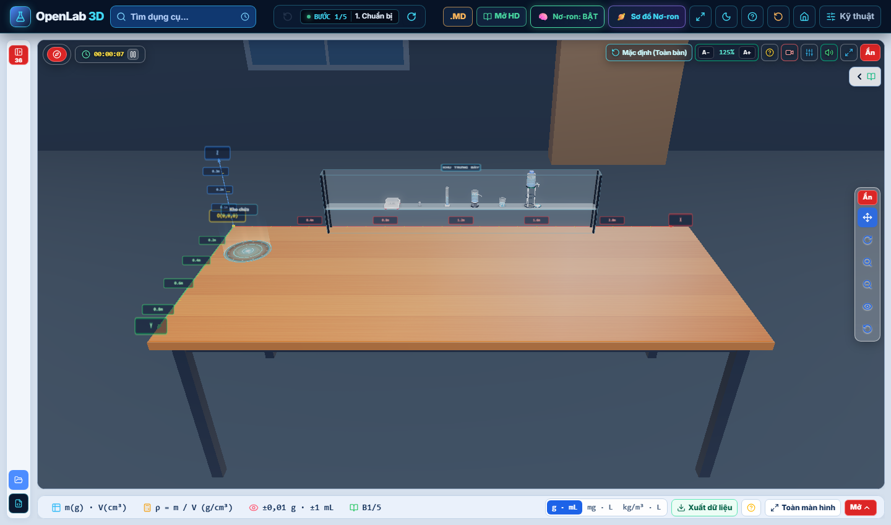
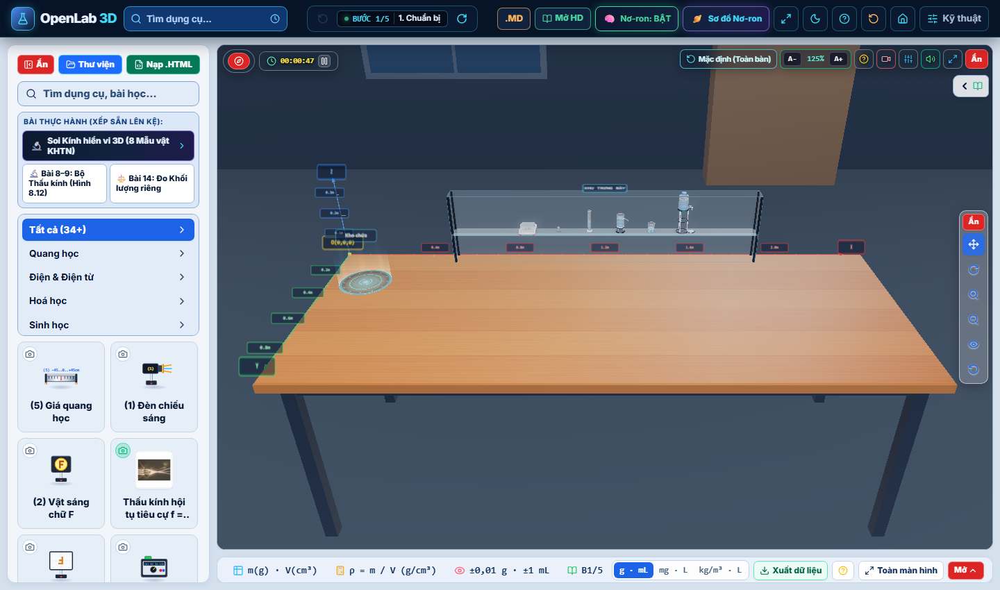
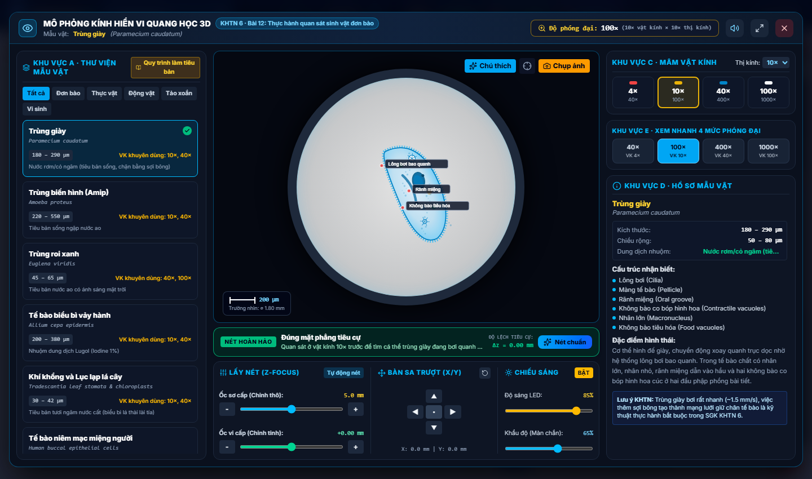
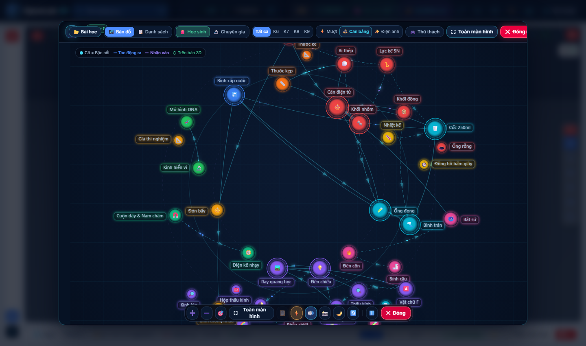
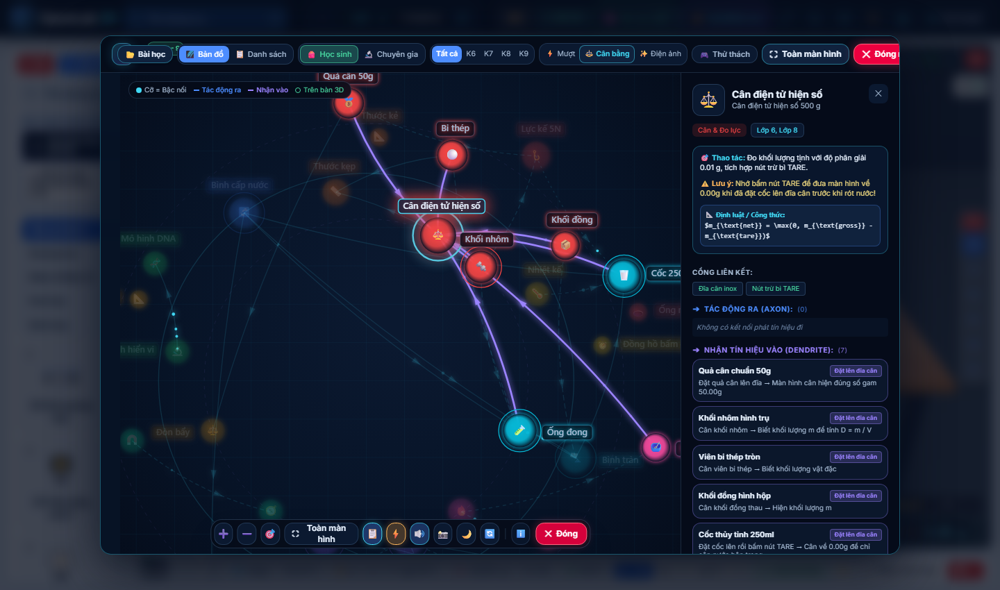
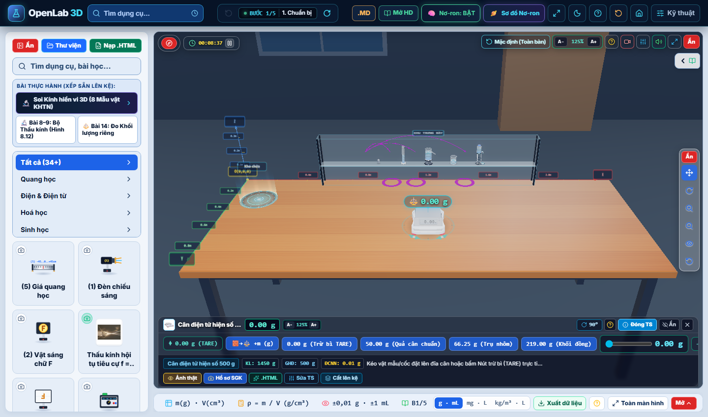

# BÁO CÁO CHẠY THỬ NGHIỆM TRá»°C TIẾP OPENLAB 3D
**Hệ thống thực hành thí nghiệm số 3D — KHTN THCS**  
*Thời gian chạy thử*: 2026-11-07 | *Cổng kết nối*: `http://localhost:3000/`

---

## 1. Tổng quan Trạng thĂ¡i Chạy thá»­

MĂ¡y chủ mĂ´ phỏng OpenLab 3D (Vite 8.3.5 / React 19 / Three.js 0.186 / TypeScript) Ä‘Ă£ được khởi Ä‘á»™ng vĂ  kiểm tra chức năng trá»±c tiếp qua giao diện trình duyệt thá»±c tế.

| Hạng mục kiểm tra | Địa chỉ / Cổng | Trạng thĂ¡i | ÄĂ¡nh giĂ¡ |
| :--- | :--- | :--- | :--- |
| **MĂ¡y chủ Vite Dev Server** | `http://localhost:3000/` | **HOẠT ĐỘNG (Ready in 886ms)** | Mượt mĂ , 0 lá»—i biĂªn dịch |
| **KhĂ´ng gian phĂ²ng thĂ­ nghiệm 3D** | Viewport trung tĂ¢m | **HIỂN THỊ CHĂ‚N THá»°C** | Mặt bĂ n gá»—, kệ kĂ­nh trÆ°ng bĂ y, chốt định vị |
| **MĂ´ phỏng KĂ­nh hiển vi 3D** | Module quang học vi mĂ´ | **HOĂ€N HẢO** | Trường nhìn trĂ²n, lấy nĂ©t Z-focus, mẫu TrĂ¹ng giĂ y |
| **Mạng NÆ¡-ron Planetary Cosmos** | Modal tri thức vÅ© trụ | **HOĂ€N HẢO** | VĂ²ng quỹ đạo đồng tĂ¢m, liĂªn kết nhĂ¢n quả CIA |
| **Bảng Ä‘iều khiển & TÆ°Æ¡ng tĂ¡c cĂ¢n** | Floating Dock & Inspector | **CHÍNH XÁC** | Đo khối lượng 50.00g, trừ bì TARE, đặt lĂªn bĂ n 3D |

---

## 2. Minh chứng Hình ảnh Thá»±c tế khi Chạy thá»­

````carousel

<!-- slide -->

<!-- slide -->

<!-- slide -->

<!-- slide -->

<!-- slide -->

````

---

## 3. CĂ¡c PhĂ©p Thá»­ Chức Năng ÄĂ£ Thá»±c Hiện

1. **PhĂ©p thá»­ 1: Tải mĂ´i trường 3D toĂ n cảnh**
   - Viewport 3D gĂ³c rá»™ng, hệ tọa Ä‘á»™ Ä‘o đạc mặt bĂ n rõ nĂ©t, cĂ¡c thiết bị mẫu trĂªn kệ kĂ­nh được dá»±ng hình đầy đủ.
   - Giao diện Planetary Cosmos Header hiển thị đầy đủ cĂ¡c cĂ´ng cụ Ä‘iều hÆ°á»›ng, phĂ­m tắt vĂ  chế Ä‘á»™ học sinh.

2. **PhĂ©p thá»­ 2: Mở bĂ i thá»±c hĂ nh KĂ­nh hiển vi quang học 3D**
   - Click chọn bĂ i thá»±c hĂ nh *"Soi KĂ­nh hiển vi 3D (8 Mẫu vật KHTN)"*.
   - Khung thị kĂ­nh trĂ²n phĂ³ng đại $100\times$ ($10\times \text{vật kĂ­nh} \times 10\times \text{thị kĂ­nh}$) hiển thị rõ nĂ©t cấu trĂºc TrĂ¹ng giĂ y (*Paramecium caudatum*): LĂ´ng bÆ¡i bao quanh, rĂ£nh miệng, khĂ´ng bĂ o tiĂªu hĂ³a.
   - Trạng thĂ¡i lấy nĂ©t: $\Delta z = 0.00\,\text{mm}$ (NÉT HOĂ€N HẢO), kèm thÆ°á»›c Ä‘o vi mĂ´ $200\,\mu\text{m}$.

3. **PhĂ©p thá»­ 3: KhĂ¡m phĂ¡ Mạng NÆ¡-ron Tri thức VÅ© trụ (Planetary Cosmos)**
   - Mở giao diện mạng nÆ¡-ron: 36 thiết bị được phĂ¢n tầng theo cĂ¡c quỹ đạo đồng tĂ¢m phĂ¡t sĂ¡ng.
   - Khi nhấp Ä‘Ăºp vĂ o CĂ¢n Ä‘iện tá»­ trĂªn bĂ n 3D, hệ thống tá»± Ä‘á»™ng định vị vĂ  lĂ m nổi bật CĂ¢n Ä‘iện tá»­ cĂ¹ng cĂ¡c nĂºt nhận tĂ­n hiệu vĂ o (Quả cĂ¢n 50g, Khối nhĂ´m, Khối đồng, Bi thĂ©p, Cốc 250ml).
   - CĂ´ng thức hiển thị chuẩn xĂ¡c:
     $$m_{\text{net}} = \max(0, m_{\text{gross}} - m_{\text{tare}})$$

4. **PhĂ©p thá»­ 4: TĂ¡c Ä‘á»™ng vật lĂ½ lĂªn CĂ¢n Ä‘iện tá»­**
   - Click đặt quả cĂ¢n chuẩn $50.00\,\text{g}$ lĂªn Ä‘Ä©a cĂ¢n.
   - NhĂ£n 3D bay trĂªn khĂ´ng gian thá»±c tá»± Ä‘á»™ng cập nhật từ `⚖️ 0.00 g` sang `⚖️ 50.00 g`.
   - Hạ cĂ¢n từ kệ kĂ­nh trÆ°ng bĂ y xuống trá»±c tiếp mặt bĂ n gá»— 3D vá»›i nĂºt *"Xuống bĂ n"*. CĂ¢n định vị chĂ­nh xĂ¡c ở tĂ¢m bĂ n lĂ m việc.

