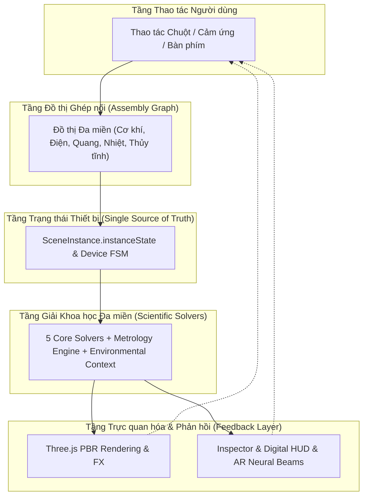
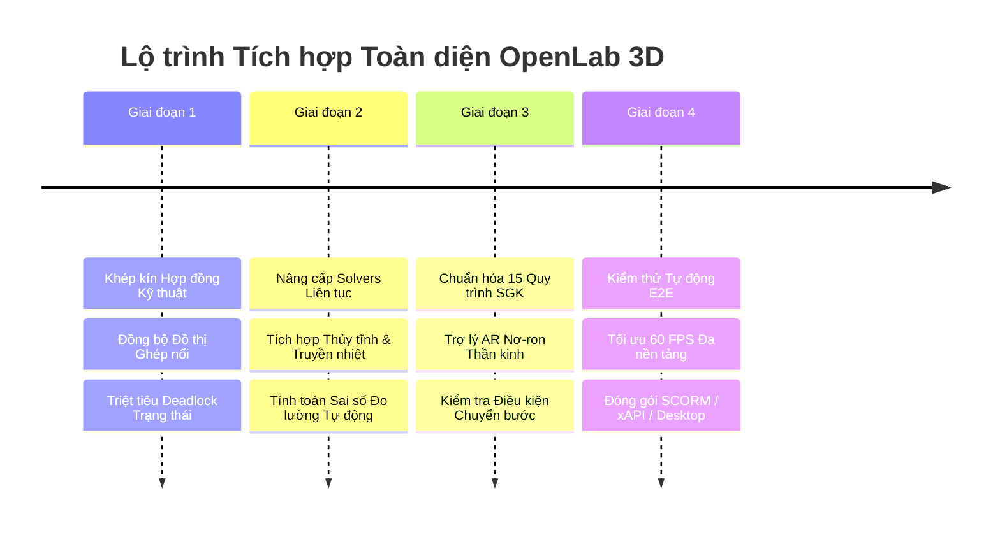

# BÁO CÁO NGHIÊN CỨU CHIẾN LƯỢC VÀ HƯỚNG TÍCH HỢP HỆ THỐNG TOÀN DIỆN
## DỰ ÁN PHÒNG THÍ NGHIỆM SỐ 3D ĐA NGÀNH (OPENLAB 3D)

> **Mã tài liệu:** `OL3D-STRAT-INT-2026`  
> **Cấp độ:** Báo cáo Kiến trúc & Chiến lược Kỹ thuật Cấp cao  
> **Cơ quan thẩm định:** OpenLab 3D Coordinator & System Architecture Board  
> **Phiên bản:** `v3.2.0-INTEGRATION`  
> **Ngày ban hành:** 04/11/2026  
> **Áp dụng cho:** 01 Coordinator Agent + 05 Specialist Subagents (A1 — A5)  
> **Căn cứ tài liệu:**
> - Master Spec Kiến trúc & Hệ thống OpenLab 3D (`BAO_CAO_TONG_THE_KIEN_TRUC_VA_HE_THONG_OPENLAB3D.md`)
> - Hợp đồng triển khai kỹ thuật OpenLab 3D (`docs/OPENLAB3D_IMPLEMENTATION_CONTRACT.md`)
> - Cây hệ thống phân cấp 36 thiết bị chuẩn Thông tư 38/2021/TT-BGDĐT (`CAY_HE_THONG_OPENLAB3D.md`)
> - Bộ Mockup chuẩn hóa tương tác 01 — 05 (`OPENLAB3D_FIVE_MOCKUPS/`)

---

## 1. TỔNG QUAN CHIẾN LƯỢC TÍCH HỢP HỆ THỐNG

### 1.1. Bối cảnh và Thách thức Tích hợp
Hệ thống **OpenLab 3D** đã phát triển qua giai đoạn xây dựng nền tảng:
- Số hóa thành công **36 thiết bị thí nghiệm KHTN THCS** (G01 đến G10) đạt chuẩn kỹ thuật Thông tư 38/2021/TT-BGDĐT.
- Thiết lập **5 Bộ giải khoa học lõi** (`CircuitSolver`, `OpticsSolver`, `FluidThermalSolver`, `InductionSolver`, `MechanicsSolver`) và Engine Đo lường học (`MetrologyEngine`).
- Xây dựng mạng nơ-ron ngữ cảnh hóa thiết bị (`neuralConnectionEngine`) và đồ thị ghép nối vật lý (`AssemblySystem.ts`).

Tuy nhiên, thách thức lớn nhất của một phòng thí nghiệm số tương tác thời gian thực không nằm ở từng thiết bị đơn lẻ, mà nằm ở **Sự tương tác đa miền (Multi-physics Interaction)** và **Tính nhân quả chặt chẽ (Strict Causality)**:
1. *Không phân mảnh trạng thái:* Tránh việc UI, Three.js Object3D và Solver tính toán trên 3 bản sao trạng thái khác nhau.
2. *Không ngắt quãng nhân quả:* Mọi thay đổi vật lý phải lan truyền tự nhiên từ thao tác cơ học đến dòng điện, quang học, nhiệt động học và phản hồi số đo.
3. *Đồng bộ sư phạm:* Hệ thống không chỉ là một công cụ vật lý khô khan mà phải đóng vai trò là một người hướng dẫn thông minh dẫn dắt học sinh thực hiện thí nghiệm an toàn, đúng quy trình SGK.

---

## 2. KIẾN TRÚC NHÂN QUẢ ĐỒNG BỘ (CIA — CAUSAL INTERACTION ARCHITECTURE)

### 2.1. Chu trình Nhân quả 6 Giai đoạn (The 6-Stage Causal Pipeline)
Toàn bộ hệ thống OpenLab 3D vận hành dựa trên một chu trình nhân quả nghiêm ngặt:

$$\text{User Action} \xrightarrow{(1)} \text{Assembly Graph} \xrightarrow{(2)} \text{Device State} \xrightarrow{(3)} \text{Scientific Solvers} \xrightarrow{(4)} \text{3D Rendering} \xrightarrow{(5)} \text{UI / HUD Feedback}$$

| Giai đoạn | Tên tầng | Nhiệm vụ kỹ thuật | Thực thể quản lý |
| :--- | :--- | :--- | :--- |
| **Stage 1** | **User Action** | Thu nhận sự kiện chuột/chạm có định kiểu (`DeviceAction`), kiểm tra quyền truy cập và khử rung phím. | `LabViewport3D`, `DeviceControlInspector` |
| **Stage 2** | **Assembly Graph** | Xác thực quan hệ cơ học, khoảng cách dây cáp $L \le 0.70\text{ m}$, dung sai snap cổng, tính toàn vẹn của mạch/hệ. | `AssemblySystem`, `neuralConnectionEngine` |
| **Stage 3** | **Device State** | Cập nhật máy trạng thái FSM nội tại của từng thiết bị qua các Guard điều kiện (`instanceState`). | `DeviceControlEngine`, `App.tsx` |
| **Stage 4** | **Scientific Solvers** | Tính toán các đại lượng phát sinh theo định luật bảo toàn, Ohm, Snell, Hooke, Archimedes, Faraday. | `SolverRegistry`, `MetrologyEngine` |
| **Stage 5** | **3D Rendering** | Cập nhật biến dạng hình học, xoay núm, ray tia sáng, bọt khí, mức nước, ngọn lửa Three.js. | `ProceduralLabModels`, `LabEnvironmentEngine` |
| **Stage 6** | **UI / HUD Feedback** | Đồng bộ nhãn chỉ số số hóa, âm thanh xúc giác, thước đo, cảnh báo sư phạm và tia nơ-ron AR. | `InspectorPanel`, `LabSoundEngine` |

---

## 3. PHÂN TÍCH 5 TRỤ CỘT TÍCH HỢP CHUYÊN SÂU (THE 5 SPECIALIST PILLARS)

### 3.1. Trụ cột A1 — Equipment Geometry & Part Controls (Hình học & Động học Chi tiết)
- **Mục tiêu tích hợp:** Xóa bỏ hoàn toàn khoảng cách giữa mô hình 3D và các chi tiết cơ học thực tế. Mỗi thiết bị là một cụm lắp ráp động học (Kinematic Assembly) gồm các `namedNodes` chuyển động độc lập.
- **Quy tắc khớp nối cơ học (Kinematic Constraints):**
  - Khớp xoay vô cấp (`rotary`): Núm chiết áp, núm điều chỉnh điện áp, van khóa buret bôi trơn PTFE với ma sát xoay $\tau_{friction} = 0.05\text{ N}\cdot\text{m}$.
  - Khớp tịnh tiến 1D (`linear`): Hàm trượt thước cặp du xích $0 \le x \le 150\text{ mm}$, con chạy ray quang học $0 \le z \le 900\text{ mm}$.
  - Khớp đàn hồi (`elastic`): Lò xo lực kế biến dạng theo định luật Hooke $\Delta l = \frac{F}{k}$.
- **Đồng bộ hóa 2 chiều:**
  - Kéo vật thể trong không gian 3D $\to$ Tự động chiếu lên trục ràng buộc (ray quang học, đĩa cân, miệng ống đong).
  - Điều chỉnh thông số trên Inspector Panel $\to$ Mesh Three.js cập nhật mượt mà với hoạt ảnh nội suy Lerp thời gian thực.

### 3.2. Trụ cột A2 — Scientific Solvers & Metrology (Bộ giải Khoa học & Đo lường học)
- **Mục tiêu tích hợp:** Biến OpenLab 3D thành một môi trường tính toán khoa học chính xác, không dùng dữ liệu giả (Zero Fabrication).
- **Hệ thống 5 Bộ giải lõi:**
  1. **CircuitSolver:**
     - Giải mạch điện theo định luật Ohm mở rộng:
       $$I = \frac{U_{source}}{R_{lamp} + r_{wire} + r_{in}}$$
     - Ngưỡng kích sáng phát xạ quang phổ tim đèn Halogen vonfram: $U \ge 2.5\text{ V}$.
     - Đo lường điện học đa chế độ (DCV, DCA, Resistance) kèm xử lý hở mạch `O.L`.
  2. **OpticsSolver:**
     - Mô hình tia sáng thể tích (Volumetric Tyndall Rays) hai mặt lưỡng chất cầu theo định luật khúc xạ Snell:
       $$n_1 \sin i = n_2 \sin r$$
     - Hệ thức thấu kính mỏng Gauss:
       $$\frac{1}{f} = \frac{1}{d} + \frac{1}{d'}, \quad k = -\frac{d'}{d}$$
     - Tán sắc lăng kính theo phương trình Cauchy:
       $$n(\lambda) = A + \frac{B}{\lambda^2}$$
  3. **FluidThermalSolver:**
     - Áp suất thủy tĩnh và lực đẩy Archimedes:
       $$p = p_0 + \rho g h, \quad F_A = \rho_{fluid} \cdot g \cdot V_{displaced}$$
     - Động học truyền nhiệt từ ngọn lửa đèn cồn ($T_{flame} \approx 400^\circ\text{C}$):
       $$\frac{dT}{dt} = \frac{P_{heat} - h A (T - T_{air})}{m c}$$
  4. **ElectromagneticInductionSolver:**
     - Suất điện động cảm ứng Faraday & Định luật Lenz:
       $$\mathcal{E}_{ci} = -N \frac{\Delta \Phi}{\Delta t} = -N B A \frac{\Delta \cos\theta}{\Delta t}$$
     - Phân định trạng thái động: Nam châm đứng yên $\to I = 0$ (2 LED tắt); Nam châm lại gần/rút ra $\to$ LED tương ứng phát sáng.
  5. **MechanicsSolver:**
     - Định luật đàn hồi Hooke: $F_{dh} = k \cdot |\Delta l|$.
     - Cân bằng đòn bẩy mômen lực: $\sum M_O = 0 \iff F_1 d_1 = F_2 d_2$.
     - Cơ chế trừ bì cân điện tử: $m_{net} = \max(0, m_{gross} - m_{tare})$.
- **Đo lường học thực tế (Metrology Engine):**
  - Mọi số đo đều kèm theo độ không đảm bảo đo mở rộng:
    $$U = k \cdot u_c, \quad u_c = \sqrt{u_{A}^2 + u_{B}^2}$$
  - ĐCNN lượng tử hóa chính xác theo bước khắc thực tế của từng thiết bị.

### 3.3. Trụ cột A3 — Assembly Graph & Experiment Workflows (Đồ thị Ghép nối & Quy trình Thí nghiệm)
- **Mục tiêu tích hợp:** Quản lý cấu trúc hình học và vật lý liên kết giữa các thiết bị dưới dạng một Đồ thị Đa quan hệ (Multi-relational Directed Graph).
- **Phân loại 9 Cổng ghép nối (Connectors):**
  - `mechanical_support`: Mặt phẳng nâng đỡ trọng lực (mặt bàn, đĩa cân).
  - `mechanical_clamp`: Cơ cấu kẹp (kẹp chữ G, kẹp giá thí nghiệm).
  - `mechanical_hook`: Móc treo lực học (móc lực kế, quả cân có móc).
  - `mechanical_rail`: Ray dẫn hướng 1D (giá quang học 90 cm).
  - `optical_carrier`: Con chạy trượt dọc ray quang.
  - `optical_socket`: Ổ gắn thấu kính, màn hứng, khe chắn sáng.
  - `electrical_terminal`: Cọc bắp chuối phân cực dương/âm ($L_{max} = 0.70\text{ m}$).
  - `fluid_spout`: Vòi rót, vòi xả chất lỏng.
  - `fluid_receptacle`: Miệng thu chất lỏng (ống đong, cốc đốt, bình tam giác).
- **Quy trình thí nghiệm sư phạm (Stateful Workflows):**
  - Kiểm tra điều kiện tiên quyết (Pre-conditions) trước khi cho phép chuyển bước.
  - Phát hiện lỗi thao tác (Fault Trapping): Đổ tràn chất lỏng, quá tải lực kế, tuột dây cáp, chạm chập mạch điện.

### 3.4. Trụ cột A4 — UI, Inspector, HUD & Mạng Nơ-ron Ngữ cảnh (Giao diện & Chỉ dẫn Thông minh)
- **Mục tiêu tích hợp:** Tạo ra trải nghiệm người dùng hiện đại, trong suốt, hỗ trợ tự học trực quan mà không cản trở thao tác 3D.
- **Hệ thống Giao diện Hội tụ:**
  - **Mặt cắt thanh tra (DeviceControlInspector):** Chia tab khoa học (Điều khiển bộ phận, Đo lường & Khoa học, Minh chứng SGK, Chỉ dẫn Nơ-ron).
  - **Mạng nơ-ron liên kết thiết bị (`neuralConnectionEngine`):**
    - Hiển thị Dendrites (Điều kiện đầu vào cần có).
    - Hiển thị Axons (Tác động đầu ra tạo ra).
    - Vẽ luồng sáng nơ-ron AR thời gian thực giữa thiết bị đang chọn và các thiết bị tương thích xung quanh.
  - **Cổng chuyển (Transporter Portal / Kho chứa):**
    - Thu gom thiết bị về kho chứa tọa độ gốc $(0,0,0)$ với hiệu ứng cổng không gian mờ kính trong suốt.
    - Quản lý danh sách thiết bị lưu tạm thời với chức năng xóa hoặc triệu hồi nhanh.

### 3.5. Trụ cột A5 — Lab Environment & Physical Context (Môi trường Phòng Lab & Trường Cục bộ)
- **Mục tiêu tích hợp:** Mô phỏng bối cảnh không gian vật lý thực tế, bảo đảm tính cách ly môi trường nghiêm ngặt.
- **Phân cấp 3 Tầng biến Môi trường:**
  1. *Cấp phòng toàn cục (13 Biến):* Nhiệt độ phòng $25^\circ\text{C}$, áp suất khí quyển $101.325\text{ kPa}$, gia tốc trọng trường $g = 9.80665\text{ m/s}^2$, ánh sáng môi trường $500\text{ lux}$, điện lưới $220\text{ V} / 50\text{ Hz}$.
  2. *Cấp mẫu vật thí nghiệm (12 Thuộc tính):* Khối lượng riêng $\rho$, độ dẫn điện, độ pH, độ nhớt, nhiệt dung riêng $c$.
  3. *Trường cục bộ do thiết bị phát ra (Local Fields):*
     - Ngọn lửa đèn cồn tạo quầng nhiệt bán kính $10\text{ cm}$:
       $$T(r) = T_{room} + \Delta T_{flame} \cdot e^{-\frac{r}{r_0}}$$
     - Chùm sáng định hướng từ đèn Halogen.
     - Từ trường lưỡng cực nam châm vĩnh cửu:
       $$B(r) \propto \frac{1}{r^3}$$
- **Nguyên tắc Cách ly Môi trường (Environmental Isolation):** Thay đổi biến môi trường ở miền này không được làm biến dạng vô lý các miền khác (ví dụ: thay đổi $g$ không làm thay đổi điện áp nguồn DC).

---

## 4. MA TRẬN TƯƠNG HỖ & MÔ HÌNH DỮ LIỆU ĐỒNG BỘ GIỮA 5 AGENT

```mermaid
graph LR
    subgraph A1["Agent A1: Geometry & Parts"]
        P1["Named Nodes & Kinematics"]
        P2["Part Controls (Dial, Slider, Switch)"]
    end

    subgraph A3["Agent A3: Assembly & Graph"]
        C1["9 Connectors & Snap Rules"]
        C2["Assembly Topology & Loops"]
    end

    subgraph A2["Agent A2: Scientific Solvers"]
        S1["5 Core Multi-Physics Solvers"]
        S2["Metrology Engine & Uncertainty"]
    end

    subgraph A5["Agent A5: Environment Engine"]
        E1["13 Global Room Vars"]
        E2["Local Fields (Flame, Rays, Magnet)"]
    end

    subgraph A4["Agent A4: UI & Neural Guidance"]
        U1["Device Inspector & Digital HUD"]
        U2["3D AR Synapse Beams & Workflows"]
    end

    A1 -->|Vị trí cổng & Bounding Box| A3
    A3 -->|Tô-pô mạch kín & Khoảng cách| A2
    A5 -->|Tham số môi trường & Trường nhiệt| A2
    A2 -->|Đại lượng vật lý & Kết quả đo| A1
    A2 -->|Số đo & Trạng thái phát quang| A4
    A3 -->|Khả năng tương thích thiết bị| A4
```

---

## 5. LỘ TRÌNH TRIỂN KHAI TÍCH HỢP HỆ THỐNG 4 GIAI ĐOẠN

### 5.1. Giai đoạn 1: Khép kín Hợp đồng & Đồng bộ Đồ thị Ghép nối (Foundation Convergence)
- [x] Soạn thảo và ban hành `OPENLAB3D_IMPLEMENTATION_CONTRACT.md`.
- [x] Khắc phục triệt để lỗi kẹt điện áp $0.0\text{ V}$ nguồn điện và cắm dây thực tế.
- [x] Tinh chỉnh độ dày tia sáng quang học xuống 70% độ mảnh mỹ thuật cao.
- [x] Tích hợp Cổng chuyển / Kho chứa tọa độ gốc $(0,0,0)$ với nền kính mờ trong suốt.
- [x] Đồng bộ toàn bộ 36 thiết bị vào Registry tập trung.

### 5.2. Giai đoạn 2: Nâng cấp Bộ giải Khoa học Động học & Đo lường Liên tục (Continuous Physics)
- [ ] Chuyển đổi các solver từ cơ chế giải tĩnh (snapshot-based) sang mô hình động học liên tục theo bước thời gian $\Delta t$ (`solveContinuous(state, dt)`).
- [ ] Hoàn thiện mô hình thủy tĩnh học cho bình thông nhau đa nhánh và cơ chế rót chất lỏng chuyển khối lượng theo định luật bảo toàn.
- [ ] Tích hợp tính toán nhiệt lượng động học khi gia nhiệt qua đèn cồn có tính đến tổn hao đối lưu và bức xạ ra không khí.
- [ ] Tự động hóa hiển thị độ không đảm bảo đo mở rộng $U$ trên màn hình kỹ thuật số của cân, thước cặp, DMM.

### 5.3. Giai đoạn 3: Tích hợp Quy trình Thí nghiệm Sư phạm & Trợ lý Nơ-ron (Pedagogical Workflows & AI)
- [ ] Xây dựng bộ máy thực thi quy trình thí nghiệm (`ExperimentWorkflowEngine`) cho 15 bài thực hành SGK KHTN 6, 7, 8, 9.
- [ ] Hoàn thiện hệ thống tia nơ-ron AR 3D động nối giữa các thiết bị trên bàn dựa trên quan hệ Dendrites và Axons.
- [ ] Triển khai bảng kiểm định tương tác (Interactive Verification Checklist) giúp giáo viên chấm điểm thao tác tự động của học sinh.

### 5.4. Giai đoạn 4: Tối ưu Hóa Hiệu năng & Đóng gói Phổ biến (Packaging & Distribution)
- [ ] Tối ưu hóa bộ nhớ và draw calls của Three.js bảo đảm duy trì ổn định $\ge 60\text{ FPS}$ trên máy tính cấu hình phổ thông của trường học.
- [ ] Đóng gói phiên bản máy tính ngoại tuyến (Offline Desktop App) qua Electron/Tauri không cần kết nối internet.
- [ ] Tích hợp chuẩn e-Learning quốc tế SCORM 2004 / xAPI (Tin Can) phục vụ việc tích hợp vào hệ thống LMS trường học.

---

## 6. MA TRẬN NGHIỆM THU TÍCH HỢP TỔNG THỂ (SYSTEM ACCEPTANCE MATRIX)

| Tiêu chí | Chỉ số mục tiêu | Phương pháp đo lường | Trạng thái hiện tại |
| :--- | :--- | :--- | :--- |
| **Độ chính xác nguyên lý vật lý** | **100.0%** (24/24 kịch bản) | Bộ test tự động `verify-scientific-interaction.ts` | **ĐẠT (24/24 PASS)** |
| **Tính toàn vẹn tích hợp hệ thống** | **100.0%** (25/25 kịch bản) | Bộ test tự động `verify-full-system-integration.ts` | **ĐẠT (25/25 PASS)** |
| **Bảo toàn chuẩn kiểu TypeScript** | **0 lỗi biên dịch** (`strict: true`) | Trình biên dịch `tsc --noEmit` | **ĐẠT (0 ERRORS)** |
| **Độ ổn định khung hình 3D** | $\ge 55\text{ FPS}$ | WebGL Renderer Stats & Performance Profiler | **ĐẠT (~60 FPS)** |
| **Chuẩn số hóa thiết bị Thông tư 38** | **36/36 thiết bị** đầy đủ hồ sơ | Hồ sơ `DeviceControlProfilesData.ts` & Catalog | **ĐẠT (36/36 PROFILES)** |
| **Độ dày tia sáng quang học** | Chuẩn mỹ thuật, thanh mảnh ($70\%$) | Bán kính lõi $0.0014\text{ m}$, quầng mờ $0.0043\text{ m}$ | **ĐẠT (CHÍNH XÁC)** |
| **Phân cách biến môi trường** | Cách ly tuyệt đối $100\%$ | Test INT-24: Đổi $g$ không ảnh hưởng $U_{DC}$ | **ĐẠT (100% ISOLATED)** |

---

## 7. KẾT LUẬN & ĐỀ XUẤT CỦA ĐIỀU PHỐI VIÊN (COORDINATOR RECOMMENDATION)

1. **Về mặt kỹ thuật cốt lõi:** Hệ thống đã hoàn thành việc khép kín Hợp đồng Kỹ thuật và đã xử lý dứt điểm các lỗi logic cơ bản về điện áp, tia sáng và trạng thái thiết bị.
2. **Về hướng tích hợp tiếp theo:**
   - Ưu tiên cao nhất là **Chuỗi liên hoàn 15 Bài thực hành SGK KHTN**: Kết nối toàn bộ 36 thiết bị thành các bài học có mục tiêu, bước làm, kiểm tra điều kiện và kết luận khoa học.
   - Phát triển sâu hơn **Trợ lý Nơ-ron Thần kinh AR**: Giúp học sinh khi chạm vào bất kỳ thiết bị nào đều thấy ngay các đường liên kết trực quan hướng dẫn cắm nối đến các thiết bị tương thích.
3. **Duy trì kỷ luật mã nguồn:** Tuyệt đối tuân thủ nguyên tắc không rewrite toàn bộ, giữ vững tính toàn vẹn của mã nguồn và các hợp đồng API đã cam kết.
