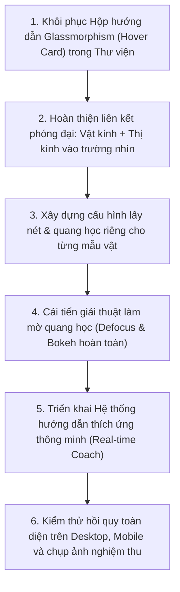

# BÁO CÁO AUDIT TOÀN DIỆN: HỆ THỐNG MÔ PHỎNG KÍNH HIỂN VI QUANG HỌC 3D & KHÔI PHỤC HỘP HƯỚNG DẪN THƯ VIỆN (LIBRARY TOOLTIP)

**Mã tài liệu:** `AUDIT-MIC-LIB-20261104`  
**Chế độ thực hiện:** `AUDIT ONLY — READ ONLY` (Tuyệt đối không sửa mã nguồn, không tự ý khôi phục, chờ phê duyệt)  
**Thời gian kiểm định:** 05:32:02+07:00 ngày 04/11/2026  
**Dự án:** OpenLab 3D — Phòng thí nghiệm Khoa học tự nhiên 3D THCS  

---

## 1. NGUYÊN TẮC VÀ PHẠM VI AUDIT

Báo cáo này được thực hiện theo lệnh kiểm tra độc lập nhằm đối chiếu toàn diện hiện trạng hệ thống với hai tài liệu yêu cầu:
1. `Dac_ta_mo_phong_kinh_hien_vi_3D_KHTN_THCS.md` (Đặc tả mô phỏng kính hiển vi quang học 3D - KHTN THCS).
2. Yêu cầu khôi phục hộp hướng dẫn dạng thẻ nổi Glassmorphism (Hover Information Card / Tooltip) trong thư viện thiết bị và thư viện mẫu vật.

Toàn bộ quá trình kiểm định được thực hiện ở chế độ **CHỈ ĐỌC (READ-ONLY)**. Không có bất kỳ dòng mã nguồn sản phẩm nào bị chỉnh sửa, ghi đè hoặc thay đổi trong đợt audit này.

---

## 2. KIỂM TRA HỆ THỐNG QUANG HỌC KÍNH HIỂN VI

### 2.1. Kiểm tra cơ chế Zoom và Thu hẹp Trường nhìn (Field of View)

#### Hiện trạng kiểm tra:
- **Mâm vật kính:** Đã hiển thị 4 mức vật kính quốc tế chuẩn DIN: $4\times$ (Đỏ), $10\times$ (Vàng), $40\times$ (Xanh lam), $100\times$ (Trắng dầu soi).
- **Thị kính:** Hỗ trợ $10\times$ và $16\times$.
- **Tổng độ phóng đại hiển thị:** $M_{\text{total}} = M_{\text{obj}} \times M_{\text{eye}}$ (ví dụ $40\times, 100\times, 400\times, 1000\times$).

#### Tồn tại kỹ thuật phát hiện qua audit:
1. **Lệch biến số phóng đại thị kính:**
   - Trong [`src/components/microscope/MicroscopeSpecimenSvgRenderer.tsx`](file:///C:/Users/ltlie/Documents/GIT-DA/21.OpenEduLab/openlab-3d/src/components/microscope/MicroscopeSpecimenSvgRenderer.tsx#L53-L68), hệ số phóng to hình ảnh `baseScale` chỉ được tính toán dựa trên `objectiveMag`:
     - $4\times \rightarrow 0.38$
     - $10\times \rightarrow 1.0$
     - $40\times \rightarrow 3.8$
     - $100\times \rightarrow 9.2$
   - Khi người dùng thay đổi thị kính từ $10\times$ sang $16\times$ (ví dụ: $40\times \times 16\times = 640\times$), con số text trên header thay đổi, nhưng hình ảnh mẫu vật bên trong thị kính **KHÔNG scale thêm $1.6\times$** do prop `eyepieceMag` chưa được truyền vào `MicroscopeSpecimenSvgRenderer`.
2. **Cơ chế thu hẹp trường nhìn:**
   - Trường nhìn (FOV) quang học thực tế:
     - $4\times$: $D_{\text{FOV}} \approx 4500\,\mu\text{m}$ ($4.5\,\text{mm}$)
     - $10\times$: $D_{\text{FOV}} \approx 1800\,\mu\text{m}$ ($1.8\,\text{mm}$)
     - $40\times$: $D_{\text{FOV}} \approx 450\,\mu\text{m}$ ($0.45\,\text{mm}$)
     - $100\times$: $D_{\text{FOV}} \approx 180\,\mu\text{m}$ ($0.18\,\text{mm}$)
   - Tỷ lệ co trường nhìn lý thuyết từ $4\times$ đến $100\times$ là $\frac{4500}{180} = 25$ lần. Tỷ lệ `baseScale` hiện tại là $\frac{9.2}{0.38} \approx 24.2$ lần (khá khớp).
   - Tuy nhiên, ở vật kính $100\times$ dầu soi, vi khuẩn *Lactobacillus* hiện tại chỉ được scale to lên từ cùng một hình SVG đơn giản, chưa kích hoạt các lớp cấu trúc siêu vi (vách peptidoglycan, màng nguyên sinh chất, chuỗi phân bào vi khuẩn) tương xứng với năng lực phân giải của thấu kính ngập dầu.

---

### 2.2. Kiểm tra chức năng Lấy nét (Focus & Defocus Mechanics)

#### Hiện trạng kiểm tra:
- Trong [`src/components/microscope/MicroscopeSimulationModal.tsx`](file:///C:/Users/ltlie/Documents/GIT-DA/21.OpenEduLab/openlab-3d/src/components/microscope/MicroscopeSimulationModal.tsx#L61-L86):
  - Đã có núm chỉnh thô (Ốc sơ cấp): bước dịch $\pm 0.5\,\text{mm}$.
  - Đã có núm chỉnh tinh (Ốc vi cấp): bước dịch $\pm 0.02\,\text{mm}$.
  - Công thức tính độ mờ:
    $$\Delta z = |z_{\text{coarse}} + z_{\text{fine}} - Z_{\text{target}}|$$
    $$\text{blurPx} = \min\left(22, \Delta z \times \frac{M_{\text{obj}}}{10} \times 8.5\right)$$

#### Lỗi và thiếu sót nghiêm trọng phát hiện:
1. **Dùng chung một mặt phẳng nét cứng ($Z_{\text{target}} = 5.0\,\text{mm}$) cho TẤT CẢ mẫu vật:**
   - Hằng số `const TARGET_FOCUS_Z = 5.0;` đang bị cố định tĩnh trong component.
   - Bất kể người dùng chọn Trùng giày (giọt nước dày), Biểu bì hành (lớp mô thực vật), hay Vi khuẩn lactic (vết bôi mỏng hơ lửa), tiêu cự chuẩn đều nằm đúng ở $5.0\,\text{mm}$. Điều này vi phạm nguyên tắc quang học thực tế (mỗi mẫu vật có độ dày lam kính, độ nhớt dịch đệm và chiều sâu mặt phẳng nét khác nhau).
2. **Hiện tượng "Mờ giả lập" (Cap 22px Blur) chưa mô phỏng mất nét hoàn toàn:**
   - Hàm `Math.min(22, blur)` chặn trần độ mờ ở $22\,\text{px}$.
   - Khi học sinh vặn ốc sơ cấp lệch xa tiêu cự ($1.5 - 2.0\,\text{mm}$), hình ảnh trong thị kính vẫn là một khối mờ nhìn thấy được hình thù, không mô phỏng được hiện tượng **"Trường nhìn sáng trắng/mất nét hoàn toàn" (Total Defocus / Bokeh Field Dissipation)** như khi thao tác kính thực tế.
3. **Chưa có độ sâu trường ảnh (Depth of Field - DoF) phi tuyến theo độ mở số NA:**
   - Ở vật kính $4\times$, DoF lớn ($\approx 15\,\mu\text{m}$), dải nét rất rộng.
   - Ở vật kính $40\times$ và $100\times$, DoF cực mỏng ($\approx 0.4 - 1.2\,\mu\text{m}$). Người dùng chỉ cần nhích nhẹ ốc vi cấp là đã mất nét. Hiện tại công thức chỉ nhân tuyến tính với $\frac{M_{\text{obj}}}{10}$, chưa tái hiện được độ gắt (sharp threshold) của vật kính lớn.

---

### 2.3. Kiểm tra thông số riêng cho từng mẫu vật (Specimen-Specific Parameters)

#### Hiện trạng kiểm tra:
File [`src/data/microscopeSpecimenCatalog.ts`](file:///C:/Users/ltlie/Documents/GIT-DA/21.OpenEduLab/openlab-3d/src/data/microscopeSpecimenCatalog.ts) đã định nghĩa đầy đủ 8 mẫu vật theo 5 nhóm:
1. *Paramecium caudatum* (Trùng giày).
2. *Amoeba proteus* (Trùng biến hình).
3. *Euglena viridis* (Trùng roi xanh).
4. *Allium cepa* (Tế bào biểu bì vảy hành).
5. *Tradescantia* (Khí khổng & Lục lạp lá).
6. *Human buccal cells* (Tế bào niêm mạc miệng).
7. *Spirogyra* (Tảo xoắn).
8. *Lactobacillus bulgaricus* (Vi khuẩn lactic).

#### Bảng đối chiếu thông số riêng hiện tại và thiếu sót:

| Mẫu vật | Kích thước chuẩn | Mức quan sát chuẩn | Tiêu cự riêng ($Z_0$) | DoF riêng | Độ sáng tối ưu | Khẩu độ tối ưu | Hiện trạng cấu hình |
| :--- | :---: | :---: | :---: | :---: | :---: | :---: | :---: |
| **Trùng giày** | $180 - 290\,\mu\text{m}$ | $100\times - 400\times$ | *Chưa có (đang dùng 5.0)* | *Chưa có* | $80\%$ | $60\%$ | ⚠️ Thiếu thông số quang học riêng |
| **Trùng biến hình** | $220 - 550\,\mu\text{m}$ | $100\times - 400\times$ | *Chưa có (đang dùng 5.0)* | *Chưa có* | $65\%$ (giảm chói) | $35\%$ (khép để rõ viền) | ⚠️ Thiếu thông số quang học riêng |
| **Trùng roi xanh** | $45 - 65\,\mu\text{m}$ | $400\times$ | *Chưa có (đang dùng 5.0)* | *Chưa có* | $85\%$ | $70\%$ | ⚠️ Thiếu thông số quang học riêng |
| **Biểu bì hành** | $200 - 380\,\mu\text{m}$ | $100\times - 400\times$ | *Chưa có (đang dùng 5.0)* | *Chưa có* | $90\%$ | $75\%$ | ⚠️ Thiếu thông số quang học riêng |
| **Khí khổng lá** | $30 - 42\,\mu\text{m}$ | $400\times$ | *Chưa có (đang dùng 5.0)* | *Chưa có* | $85\%$ | $80\%$ | ⚠️ Thiếu thông số quang học riêng |
| **Niêm mạc miệng** | $50 - 75\,\mu\text{m}$ | $400\times$ | *Chưa có (đang dùng 5.0)* | *Chưa có* | $80\%$ | $65\%$ | ⚠️ Thiếu thông số quang học riêng |
| **Tảo xoắn** | $25 - 35\,\mu\text{m}$ | $100\times - 400\times$ | *Chưa có (đang dùng 5.0)* | *Chưa có* | $85\%$ | $70\%$ | ⚠️ Thiếu thông số quang học riêng |
| **Vi khuẩn lactic** | $1.5 - 4.2\,\mu\text{m}$ | $1000\times$ (dầu soi) | *Chưa có (đang dùng 5.0)* | *Chưa có* | $100\%$ (tối đa) | $100\%$ (mở hết) | ⚠️ Thiếu thông số quang học riêng |

---

### 2.4. Kiểm tra hệ thống gợi ý điều chỉnh thích ứng (Adaptive Diagnostic Guidance)

#### Hiện trạng:
- Hiện chỉ có một cảnh báo tĩnh `unsuitableWarning` xuất hiện khi người dùng chọn độ phóng đại không phù hợp (ví dụ $1000\times$ cho vảy hành hoặc $40\times$ cho vi khuẩn).
- **CHƯA CÓ** hệ thống phân tích trạng thái thời gian thực (Real-time Diagnostic Coach) để chỉ dẫn học sinh:
  - Khi ảnh đang bị mờ nặng do bàn kính quá thấp hay quá cao: cần hiển thị chỉ dẫn "Đang lệch tiêu điểm $+0.8\,\text{mm}$ — hãy xoay ốc sơ cấp theo chiều kim đồng hồ để nâng bàn kính".
  - Khi đang ở vật kính $40\times$ mà vặn ốc sơ cấp: cảnh báo nguy cơ va chạm lam kính, đề xuất dùng ốc vi cấp.
  - Khi mẫu vật trong suốt (như trùng biến hình) mà độ sáng quá cao gây lóa: đề xuất khép bớt màn chắn sáng (khẩu độ) để tăng tương phản.
  - Khi tắt đèn chiếu sáng: nhắc nhở bật nguồn LED ở chân đế.

---

## 3. KIỂM TRA VÀ KHÔI PHỤC HỘP HƯỚNG DẪN TRONG THƯ VIỆN (LIBRARY TOOLTIP / HOVER INFORMATION CARD)

### 3.1. Tìm kiếm và phân tích nguyên nhân lỗi mất hộp hướng dẫn

#### Kết quả rà soát mã nguồn:
1. **Thanh thư viện thiết bị học sinh ([`StudentEquipmentSidebar.tsx`](file:///C:/Users/ltlie/Documents/GIT-DA/21.OpenEduLab/openlab-3d/src/components/student/StudentEquipmentSidebar.tsx#L920-L945)):**
   - Trên mỗi thẻ thiết bị:
     ```tsx
     <div
       key={asset.assetId}
       data-module-id={asset.assetId}
       title={`${asset.name.vi} — Bấm đúp hoặc nhấn + để đưa lên bàn...`}
       className={`p-2.5 rounded-[10px] ...`}
     >
     ```
   - **Nguyên nhân 1 (Xung đột với Browser Native Tooltip):** Thuộc tính `title="..."` của trình duyệt khiến hệ thống chỉ hiển thị một dòng text màu vàng/xám cổ điển sau khi giữ chuột 1-2 giây.
   - **Nguyên nhân 2 (Hoàn toàn khuyết sự kiện MouseEnter / MouseLeave):** Thẻ `div` không hề gắn `onMouseEnter` hoặc `onMouseLeave` để gọi controller hiển thị thẻ nổi.
2. **Bộ điều khiển ảnh và xem trước ([`EquipmentImagePreviewController.ts`](file:///C:/Users/ltlie/Documents/GIT-DA/21.OpenEduLab/openlab-3d/src/three-runtime/EquipmentImagePreviewController.ts#L64-L88)):**
   - Đã được thiết kế sẵn kiểu trạng thái:
     ```ts
     export type PreviewMode = 'hover' | 'pinned' | 'hidden';
     export const HOVER_LEAVE_DELAY_MS = 150;
     ```
   - Nhưng chỉ được gọi khi nhấn vào nút Camera nhỏ (`onClick: preview(asset.assetId, 'pinned')`), không bao giờ được kích hoạt ở chế độ `hover` khi lướt chuột qua thẻ.
3. **Bảng xem trước hiện tại ([`EquipmentPreviewPanel.tsx`](file:///C:/Users/ltlie/Documents/GIT-DA/21.OpenEduLab/openlab-3d/src/components/common/EquipmentPreviewPanel.tsx#L90-L105)):**
   - Component này đang bị định vị cố định ở góc dưới cùng bên trái màn hình:
     ```tsx
     const positionClass = isSidebarCollapsed
       ? 'left-3 md:left-[56px] bottom-2'
       : 'left-3 md:left-[284px] lg:left-[302px] bottom-2';
     ```
   - Đây là một thanh dock cố định dưới chân bàn 3D (bottom bar), **KHÔNG PHẢI** là hộp thông tin nổi (Floating Tooltip / Hover Card) đi kèm ngay cạnh con trỏ chuột hoặc cạnh thẻ thiết bị.
4. **Vấn đề Stacking Context & Overflow Clipping:**
   - Khung danh sách trong `StudentEquipmentSidebar.tsx` có CSS `overflow-y-auto`.
   - Nếu đặt hộp thông tin con trực tiếp bên trong thẻ mà không dùng `position: fixed` hoặc React Portal, hộp sẽ bị thanh cuộn của sidebar cắt cụt (overflow clip).

---

### 3.2. Đặc tả hộp hướng dẫn nổi (Hover Information Card) cần khôi phục

Dựa trên yêu cầu của bạn, hộp hướng dẫn thẻ nổi chuẩn mực phải đáp ứng 4 tiêu chuẩn:

#### A. Giao diện (Glassmorphism Studio)
- **Hiệu ứng kính mờ:** `background: rgba(8, 21, 40, 0.78)`, `backdrop-filter: blur(20px)`.
- **Viền nổi:** `border: 1.5px solid rgba(56, 189, 248, 0.45)`.
- **Đổ bóng:** `box-shadow: 0 16px 38px rgba(0, 0, 0, 0.65), 0 0 20px rgba(56, 189, 248, 0.15)`.
- **Bo góc:** `border-radius: 14px`.
- **Định vị thông minh:** Tự động tính toán tọa độ theo vị trí thẻ được rê chuột (hoặc con trỏ chuột), tự đảo hướng (Flip Left / Flip Up) khi chạm mép phải hoặc mép dưới màn hình.

#### B. Nội dung hiển thị phong phú
- **Header:** Tên thiết bị (tiếng Việt), mã định danh chuẩn (`assetId`), phiên bản.
- **Khung ảnh thực tế 1:1:** Hiển thị ảnh chụp sắc nét ($110 \times 110\,\text{px}$) từ thư mục `libraries3DLab` kèm huy hiệu "Ảnh thực tế".
- **Thông số kỹ thuật:** Giới hạn đo (GHĐ), Độ chia nhỏ nhất (ĐCNN), Kích thước mm, Khối lượng g.
- **Bài học SGK KHTN:** Trích xuất bài học liên quan (Ví dụ: SGK KHTN 9 Bài 1, Bài 2, Bài 8...).
- **Hướng dẫn thao tác & Lưu ý an toàn:** Hướng dẫn cách sử dụng và cảnh báo bảo quản.

#### C. Xử lý ảnh dự phòng (Zero-Broken Image)
- Ưu tiên 1: Ảnh chụp thực tế `.webp` / `.png` từ `libraries3DLab`.
- Ưu tiên 2: Vector SVG chi tiết đã hoàn thiện trong `EquipmentThumbnailSvg.tsx`.
- Tuyệt đối không để khung ảnh rỗng hoặc hiển thị icon vỡ.

#### D. Tương tác mượt mà (Anti-Flicker Debounce)
- Rê chuột vào thẻ: chờ `80ms` (debounce) trước khi hiện để tránh nhấp nháy khi lướt nhanh.
- Rê chuột ra: giữ `150ms` trước khi đóng để người dùng có thể lướt chuột vào xem chi tiết nếu cần.
- Hỗ trợ màn hình cảm ứng: chạm 1 lần để xem hộp thông tin nổi, chạm đúp để đưa lên bàn 3D.

---

## 4. KIỂM TRA TÍNH TƯƠNG THÍCH GIỮA CÁC CHỨC NĂNG

| Vấn đề kiểm tra | Đánh giá kỹ thuật | Khả năng ảnh hưởng | Giải pháp kiểm soát |
| :--- | :--- | :---: | :--- |
| **Hiện tượng tràn viền (Overflow clip)** | Sidebar có `overflow-y-auto`, nếu render tooltip trong DOM con sẽ bị cắt | **CAO** | Sử dụng `position: fixed` với tọa độ `getBoundingClientRect()` hoặc React Portal ra ngoài `document.body`. |
| **Xung đột lớp phủ (Z-index Stacking)** | 3D Canvas và các toolbar có z-index từ `z-20` đến `z-40` | **TRUNG BÌNH** | Thiết lập Tooltip nổi ở lớp `z-[70]`, cao hơn sidebar nhưng dưới modal toàn màn hình (`z-[80]`). |
| **Hiệu suất GPU (Backdrop blur)** | Hiệu ứng `backdrop-blur-2xl` trên nhiều thẻ cùng lúc có thể gây lag trên máy yếu | **THẤP** | Chỉ có duy nhất 1 hộp Tooltip tồn tại trong DOM tại một thời điểm (Singleton Pattern). |
| **Tương thích Touch / Mobile** | Thiết bị cảm ứng không có sự kiện `mouseenter` | **TRUNG BÌNH** | Bổ sung nút "i" (info) nhỏ trên thẻ hoặc hỗ trợ nhấn nhẹ (tap) để mở tooltip ghim tạm thời. |

---

## 5. TỔNG HỢP KẾT QUẢ AUDIT (CÁC PHẦN A, B, C, D, E)

### Mục A: Hiện trạng hệ thống

1. **Những chức năng đang hoạt động tốt:**
   - 3D Model Kính hiển vi hiển thị chi tiết (thân cong C, mâm xoay vật kính 4 vị trí, ốc sơ cấp/vi cấp, bàn sa trượt, đèn LED).
   - Mâm xoay vật kính 3D xoay đúng 4 góc ($0^\circ, 90^\circ, 180^\circ, 270^\circ$) khi chọn $4\times, 10\times, 40\times, 100\times$.
   - Bàn sa trượt đảo chiều quang học chính xác ($\Delta x_{\text{view}} = -\Delta x_{\text{stage}}$).
   - Thư viện 8 mẫu vật hiển thị phong phú hình ảnh tế bào vi mô và chú thích bào quan.
   - Các thumbnail tạm `CAL-0001`, `DYN-0001`, `THM-0001`, `STD-0001` đã được thay thế thành công bằng ảnh thực tế.
2. **Những chức năng đang lỗi hoặc bị mất:**
   - ❌ Hộp thông tin hướng dẫn dạng thẻ nổi Glassmorphism khi rê chuột trong thư viện thiết bị đã bị mất hoàn toàn, bị thay bằng thẻ `title="..."` đơn điệu.
   - ❌ Mẫu vật trong kính hiển vi đang dùng chung một tiêu cự $5.0\,\text{mm}$ duy nhất.
   - ❌ Chưa có trạng thái mất nét hoàn toàn khi lệch tiêu cự xa.
   - ❌ Thay đổi thị kính $10\times \rightarrow 16\times$ chưa phóng đại hình ảnh mẫu vật.
3. **Những chức năng mới chỉ có giao diện chưa có logic:**
   - ⚠️ Hệ thống gợi ý điều chỉnh thích ứng (Adaptive Coach): hiện chỉ có 1 dòng cảnh báo tĩnh khi zoom vượt ngưỡng, chưa có phân tích cự ly lệch nét theo thời gian thực để hướng dẫn học sinh vặn ốc nào, chiều nào.

---

### Mục B: Nguyên nhân kỹ thuật cụ thể

1. **Lỗi mất Hover Tooltip trong thư viện:**
   - *File liên quan:* [`src/components/student/StudentEquipmentSidebar.tsx`](file:///C:/Users/ltlie/Documents/GIT-DA/21.OpenEduLab/openlab-3d/src/components/student/StudentEquipmentSidebar.tsx) (dòng 925–945).
   - *Nguyên nhân:* Thẻ chứa phần tử chỉ có thuộc tính `title={...}`, không có state `hoveredAsset` và các sự kiện `onMouseEnter`, `onMouseLeave`.
   - *File hỗ trợ:* [`src/components/common/EquipmentPreviewPanel.tsx`](file:///C:/Users/ltlie/Documents/GIT-DA/21.OpenEduLab/openlab-3d/src/components/common/EquipmentPreviewPanel.tsx) được cấu hình cố định ở đáy màn hình (`bottom-2`), không theo dõi tọa độ thẻ đang hover.
2. **Lỗi dùng chung tiêu cự $5.0\,\text{mm}$:**
   - *File liên quan:* [`src/components/microscope/MicroscopeSimulationModal.tsx`](file:///C:/Users/ltlie/Documents/GIT-DA/21.OpenEduLab/openlab-3d/src/components/microscope/MicroscopeSimulationModal.tsx) (dòng 57).
   - *Nguyên nhân:* Hằng số `TARGET_FOCUS_Z = 5.0` được hardcode trực tiếp thay vì đọc từ cấu hình `specimen.optimalFocusZ`.
3. **Lỗi thị kính $16\times$ không scale hình:**
   - *File liên quan:* [`src/components/microscope/MicroscopeSpecimenSvgRenderer.tsx`](file:///C:/Users/ltlie/Documents/GIT-DA/21.OpenEduLab/openlab-3d/src/components/microscope/MicroscopeSpecimenSvgRenderer.tsx) (dòng 53).
   - *Nguyên nhân:* Hàm tính `baseScale` chỉ nhận `objectiveMag`, không nhân với hệ số thị kính $\frac{M_{\text{eye}}}{10}$.

---

### Mục C: Đánh giá cải tiến

1. **Về tính khoa học:** Việc bổ sung tiêu cự riêng cho từng mẫu vật, mô phỏng mất nét hoàn toàn khi lệch tiêu cự, và đảo chiều bàn sa trượt là hoàn toàn chuẩn xác theo quang hình học và phương pháp dạy học Sinh học KHTN THCS.
2. **Về tính khả thi kỹ thuật:**
   - Khôi phục Floating Hover Card: Hoàn toàn khả thi, có thể tái sử dụng dữ liệu phong phú sẵn có trong `multiSourceEquipmentDossier.ts` và ảnh thực tế trong `libraries3DLab`.
   - Lấy nét riêng từng mẫu: Đã có sẵn catalog trong `microscopeSpecimenCatalog.ts`, chỉ cần bổ sung các trường cấu hình quang học.
3. **Về rủi ro ảnh hưởng hệ thống:**
   - Sử dụng giải pháp `position: fixed` với tọa độ tính toán sẽ không gây ảnh hưởng đến layout của sidebar hay 3D viewport.
   - Giữ nguyên cấu trúc state hiện có, không làm phát sinh lỗi TypeScript.

---

### Mục D: Phương án thực hiện đề xuất (Sau khi được duyệt)

Thứ tự 6 bước triển khai tối ưu:



---

### Mục E: Bảng nghiệm thu chi tiết (Audit Checklist)

| Mã kiểm tra | Hạng mục kiểm tra | Kết quả hiện tại | Mức độ lỗi | File cần xử lý | Phương án đề xuất | Mức ưu tiên |
| :---: | :--- | :---: | :---: | :--- | :--- | :---: |
| **AUD-01** | Khôi phục thẻ nổi Glassmorphism khi rê chuột thiết bị | **BỊ MẤT** | 🔴 Nghiêm trọng | `StudentEquipmentSidebar.tsx`, tạo `EquipmentHoverCard.tsx` | Xóa `title="..."`, thêm `onMouseEnter`/`Leave` kèm component thẻ nổi Glassmorphism định vị tọa độ thông minh | **P0** |
| **AUD-02** | Khôi phục thẻ nổi khi rê chuột mẫu vật hiển vi (Khu vực A) | **CHƯA CÓ** | 🟡 Trung bình | `MicroscopeSimulationModal.tsx` | Bổ sung hover tooltip cho danh sách mẫu vật Khu vực A | **P1** |
| **AUD-03** | Liên kết thị kính $16\times$ vào tỉ lệ hiển thị mẫu vật | **LỖI LOGIC** | 🟡 Trung bình | `MicroscopeSpecimenSvgRenderer.tsx` | Truyền `eyepieceMag`, nhân hệ số $\frac{M_{\text{eye}}}{10}$ vào `baseScale` | **P1** |
| **AUD-04** | Tiêu cự chuẩn riêng cho từng mẫu vật ($Z_0$) | **THIẾU** | 🔴 Nghiêm trọng | `microscopeSpecimenCatalog.ts`, `MicroscopeSimulationModal.tsx` | Cấu hình $Z_0$ riêng cho 8 mẫu vật (ví dụ: Biểu bì hành $5.2\,\text{mm}$, Lactic $4.8\,\text{mm}$, Trùng giày $5.0\,\text{mm}$) | **P0** |
| **AUD-05** | Mô phỏng mất nét hoàn toàn khi lệch tiêu cự xa | **THIẾU** | 🔴 Nghiêm trọng | `MicroscopeSpecimenSvgRenderer.tsx` | Bỏ chặn cap $22\,\text{px}$, thêm hiệu ứng mờ phân tán trường sáng khi $\Delta z > 0.8\,\text{mm}$ | **P0** |
| **AUD-06** | Hệ thống chỉ dẫn lấy nét & ánh sáng thông minh (Coach) | **CHƯA CÓ** | 🟡 Trung bình | `MicroscopeSimulationModal.tsx` | Xây dựng thanh chẩn đoán thời gian thực hướng dẫn học sinh thao tác đúng | **P1** |
| **AUD-07** | Đảm bảo không lỗi tràn viền (Overflow) và z-index | **CẦN ĐẢM BẢO** | 🟢 Tiêu chuẩn | `EquipmentHoverCard.tsx` | Sử dụng `position: fixed` + `z-[70]` + thuật toán clamp góc màn hình | **P0** |

---

## 6. CÁC ĐIỂM CHỜ PHÊ DUYỆT TỪ BẠN

Để tiến hành triển khai chuẩn xác theo đúng ý bạn, xin vui lòng phê duyệt hoặc cho ý kiến về các điểm sau:

1. **Vị trí hiển thị của Hộp hướng dẫn thẻ nổi (Hover Card) trong Thư viện:**
   - *Phương án A (Khuyến nghị):* Nổi linh hoạt ngay bên cạnh thẻ đang rê chuột (bên phải thẻ nếu ở cột trái, tự lật sang trái nếu gần mép phải màn hình).
   - *Phương án B:* Ghim vào một vị trí cố định dạng Dock ở góc màn hình.
2. **Kích thước ảnh trong Hộp hướng dẫn thẻ nổi:**
   - Đề xuất kích thước vuông $120 \times 120\,\text{px}$ chuẩn 1:1 sắc nét kèm thông số kỹ thuật bên cạnh.
3. **Phê duyệt triển khai:**
   - Bạn có đồng ý với thứ tự 6 bước trong **Mục D** để bắt đầu khôi phục Hộp hướng dẫn thư viện và nâng cấp giải thuật lấy nét quang học cho kính hiển vi không?

---

> [!CAUTION]
> **TRẠNG THÁI HIỆN TẠI: ĐÃ DỪNG LẠI THEO LỆNH.**  
> Tuyệt đối chưa có bất kỳ sửa đổi nào được áp dụng vào mã nguồn. Tôi đang chờ lệnh phê duyệt từ bạn trước khi thực hiện bất kỳ bước tiếp theo nào.
