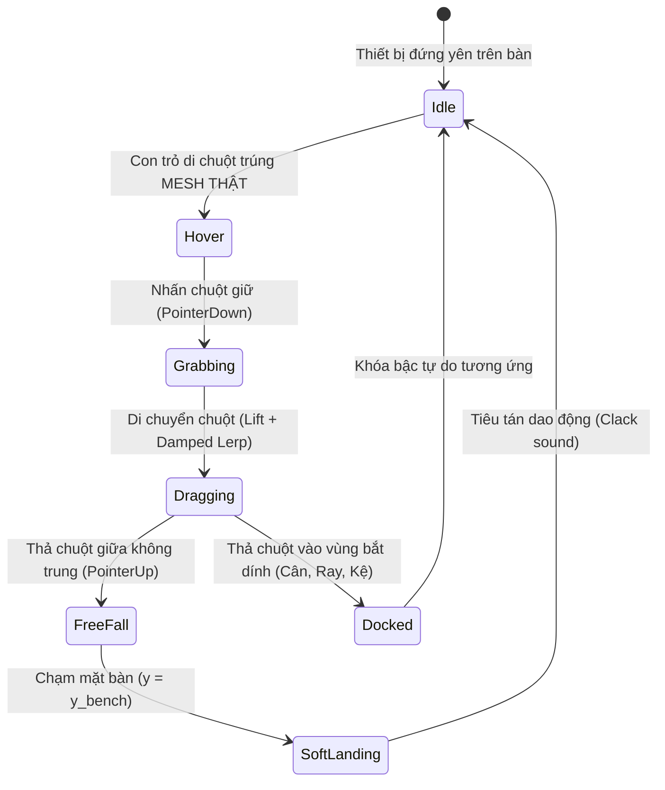

# BÁO CÁO NGHIÊN CỨU VẬT LÝ CẦM NẮM & TƯƠNG TÁC THỰC TẾ OPENLAB 3D
> **Dự án**: OpenLab 3D — Phòng thí nghiệm ảo Khoa học Tự nhiên chuẩn Chương trình GDPT 2018  
> **Chủ đề nghiên cứu**: Mô hình hóa cơ học cầm nắm (Pick & Place), động học rơi tự do (Gravity Drop), tương tác tiếp xúc và động thái thiết bị chân thực như ngoài đời  
> **Tiêu chuẩn áp dụng**: SGK KHTN 6-7-8-9, Thông tư 38/2021/TT-BGDĐT, Quy chuẩn đo lường TCVN  

---

## 1. TỔNG QUAN HIỆN TRẠNG & NGUYÊN TẮC "CẦM NẮM NHƯ NGOÀI ĐỜI"

Trong phòng thí nghiệm thực tế, học sinh tương tác với dụng cụ thí nghiệm theo chu trình vật lý liên tục:
1. **Tiếp cận & Cầm nắm (Approach & Grip)**: Tay chạm vào đúng vị trí cơ học của dụng cụ (quai cầm, thân ống, đế), không chạm vào khoảng không hay bóng đổ.
2. **Nhấc bổng (Lift Clearance)**: Dụng cụ được nhấc cao khỏi mặt bàn một khoảng an toàn ($h_{\text{lift}} = 1.5 - 3.0\text{ cm}$) để tránh va quẹt với thiết bị xung quanh.
3. **Di chuyển có quán tính (Smooth Follower)**: Khối lượng $m$ tạo ra quán tính, chuyển động di chuyển mượt mà theo bàn tay, không dịch chuyển giật cục vô hạn.
4. **Thả tay & Rơi tự do (Release & Gravity Drop)**: Khi buông tay ở trên không trung ($y > y_{\text{surface}}$), vật chịu tác dụng của **trọng lực $P = m \cdot g$**, rơi có gia tốc xuống mặt bàn hoặc bề mặt tiếp xúc.
5. **Tiếp đất mềm (Soft Landing & Restitution)**: Đáy vật chạm mặt bàn/đĩa cân, tiêu tán động năng qua va chạm mềm ($e \approx 0.08 - 0.15$), phát ra âm thanh va chạm thực tế, không bị lún hay xuyên thấu mặt bàn.
6. **Bắt dính vật lý thông minh (Physics Docking)**: Tự động nhận diện mặt đĩa cân (nhún nhẹ lò xo cân), rãnh ray quang học (khóa bậc tự do, chỉ trượt 1D), hoặc phễu chiết/cốc đong.

---

## 2. BẢNG THÔNG SỐ VẬT LÝ ĐỊNH LƯỢNG (PHYSICAL PARAMETERS SPECIFICATION)

### 2.1. Thông số Môi trường & Trọng trường

| Ký hiệu | Đại lượng | Giá trị chuẩn | Đơn vị | Ý nghĩa & Ứng dụng thực nghiệm |
| :--- | :--- | :--- | :--- | :--- |
| $g$ | Gia tốc trọng trường | $9.80665$ (Việt Nam: $9.81$) | $\text{m/s}^2$ | Tính gia tốc rơi tự do và trọng lượng $P = m \cdot g$ |
| $y_{\text{bench}}$ | Cao độ mặt bàn thực hành | $0.000$ (Thế giới: $0.820$) | $\text{m}$ | Mặt phẳng giới hạn va chạm dưới (hard collision floor) |
| $h_{\text{lift}}$ | Độ nhấc bổng khi cầm | $0.020 - 0.035$ | $\text{m}$ | Nâng bổng tự nhiên khi bắt đầu kéo rê trên mặt bàn |
| $v_{\text{term}}$ | Vận tốc giới hạn rơi | $6.5 - 8.5$ | $\text{m/s}$ | Lực cản không khí ngăn vật rơi nhanh bất thường |
| $e_{\text{glass}}$ | Hệ số phục hồi thủy tinh | $0.08$ | Không thứ nguyên | Va chạm rất mềm, triệt tiêu nảy để an toàn cho đồ thủy tinh |
| $e_{\text{metal}}$ | Hệ số phục hồi kim loại | $0.12$ | Không thứ nguyên | Quả cân bằng đồng/thép nảy nhẹ $1 - 2$ dao động siêu nhỏ |
| $e_{\text{plastic}}$ | Hệ số phục hồi nhựa | $0.15$ | Không thứ nguyên | Ống đong PP, đế nhựa chống sốc |
| $\mu_s$ | Hệ số ma sát nghỉ | $0.55 - 0.65$ | Không thứ nguyên | Giữ thiết bị cố định trên mặt bàn laminate/phenolic |
| $\mu_k$ | Hệ số ma sát trượt | $0.35 - 0.45$ | Không thứ nguyên | Giảm tốc khi trượt thiết bị |

---

### 2.2. Động lực học & Phương trình Chuyển động

#### a) Phương trình rơi tự do khi thả tay (Free Fall Kinematics)
Khi người dùng nhấc vật lên độ cao $y_0$ rồi buông chuột:
$$v_y(t) = -g \cdot \Delta t$$
$$y(t) = y(t-\Delta t) + v_y(t) \cdot \Delta t$$
Khi $y(t) \le y_{\text{contact}}$:
$$y(t) = y_{\text{contact}}$$
$$v_y' = -e \cdot v_y$$
Nếu $|v_y'| < 0.05\text{ m/s}$ thì thiết lập $v_y = 0$, kết thúc quá trình rơi và khóa vật ở trạng thái nghỉ ổn định (`settled`).

#### b) Bộ lọc làm mượt quán tính bàn tay (Critically Damped Spring Follower)
Bàn tay người cầm vật có độ êm tự nhiên theo thời gian đáp ứng $\tau$:
$$\vec{x}_{t+\Delta t} = \vec{x}_t + (\vec{x}_{\text{target}} - \vec{x}_t) \cdot \left(1 - e^{-\lambda \Delta t}\right)$$
Với hệ số đáp ứng $\lambda$:
$$\lambda = \frac{30.0}{\sqrt{1 + \frac{m}{500\text{ g}}}}$$
- Vật nhẹ ($m \approx 50\text{ g}$ như thấu kính, cốc không): đáp ứng nhanh ($\lambda \approx 28.5\text{ s}^{-1}$).
- Vật nặng ($m \approx 1000 - 2000\text{ g}$ như quả cân lớn, bình đầy nước): đáp ứng có độ đầm, chống rung lắc vô thức ($\lambda \approx 15.0\text{ s}^{-1}$).

---

## 3. MA TRẬN TƯƠNG TÁC THEO TỪNG NHÓM THIẾT BỊ THỰC TẾ

### 3.1. Thiết bị (1) Đèn chiếu sáng quang học (Optical Lamp)
- **Cơ chế phát sáng thực tế**:
  1. `single` (1 tia): Tia sáng hẹp chính xác dọc quang trục $y = 0$.
  2. `double` (2 tia): Hai tia song song đối xứng $y = \pm 14\text{ mm}$.
  3. `triple` (3 tia): Ba tia kinh điển SGK ($y = [-18, 0, +18]\text{ mm}$), tia giữa qua quang tâm $O$.
  4. `bundle` (Chùm song song): Năm tia song song đều cách nhau $10\text{ mm}$.
  5. `divergent` (Chùm phân kì): Chùm 5 tia phân kì từ khẩu độ đèn với góc $\theta \in \{-8^\circ, -4^\circ, 0^\circ, +4^\circ, +8^\circ\}$ và nón sáng tán xạ Tyndall mở rộng.
  6. `f_rays` (Vật F): Nguồn sáng halogen chiếu qua bản kính chữ F mờ.
- **Tương tác vị trí**:
  - Khi đặt ngoài bàn: Có thể xoay hướng chiếu sáng tự do.
  - Khi đưa lại gần Ray quang học ($|z| \le 0.08\text{ m}$): Tự động bắt dính vào ray, cố định cao độ quang trục $y = 0.125\text{ m}$, hướng chiếu dọc ray $x+$.

### 3.2. Thiết bị Cân điện tử & Quả cân (Mass & Balance)
- **Tương tác đặt lên đĩa cân**:
  - Vùng nhận diện đĩa cân: $R_{\text{pan}} \le 0.065\text{ m}$, cao độ mặt đĩa $y_{\text{pan}} = 0.068\text{ m}$.
  - Khi thả vật lên đĩa: Cân nhún nhẹ lò xo ($\Delta y \approx 0.3\text{ mm}$), số đọc điện tử nhảy số dao động tắt dần trong $0.35\text{ s}$ rồi chốt số đo chuẩn ĐCNN $0.1\text{ g}$.
  - Nút bấm TARE 3D: Nhấp trực tiếp vào nút tròn trên mặt cân để trừ bì về $0.00\text{ g}$.

### 3.3. Dụng cụ thủy tinh & Đong rót chất lỏng (Glassware & Fluids)
- **Trục quay rót tự nhiên (Spout Pivot)**: Khi nhấc lên và nghiêng để rót chất lỏng, tâm quay nằm tại mép vòi rót chứ không phải tâm đáy bình.
- **Dâng chất lỏng theo định luật Ác-si-mét**: Khi thả vật đặc vào ống đong, mực nước dâng lên đúng bằng thể tích $V = \frac{m}{D}$.
- **Mặt khum Meniscus**: Hiển thị đường cong mặt khum lõm chân thật dưới kính lúp.

---

## 4. KẾ HOẠCH TRIỂN KHAI THEO GIAI ĐOẠN

1. **Giai đoạn 1**: Hoàn thiện toàn diện cơ chế phát tia sáng của Đèn quang học (1, 2, 3 tia, song song, phân kì, vật F) và công tắc trực tiếp trên thanh công cụ nổi.
2. **Giai đoạn 2**: Tích hợp động cơ rơi tự do (Gravity Drop Engine) và tiếp xúc mặt bàn (Collision Floor) vào vòng lặp Render Loop của `LabViewport3D.tsx`.
3. **Giai đoạn 3**: Tích hợp bộ đệm làm mượt quán tính (Spring-Damper Follower) cho thao tác cầm nắm, loại bỏ hoàn toàn độ giật cục.
4. **Giai đoạn 4**: Kiểm thử tổng hợp các tình huống kéo - thả - rơi - va chạm - cân đo - chiếu sáng.
