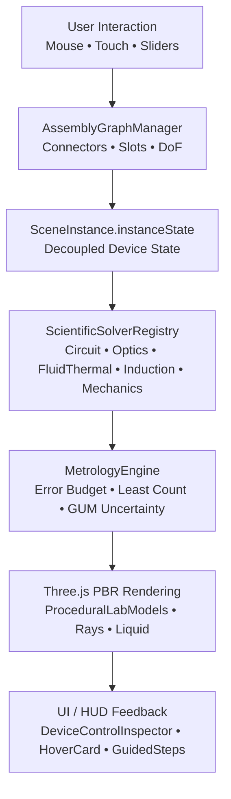

# BÁO CÁO TÍCH HỢP HỆ THỐNG OPENLAB 3D
## (OPENLAB 3D SYSTEM INTEGRATION REPORT)

> **Mã tài liệu:** `OL3D-INTEGRATION-REPORT-2026`  
> **Phiên bản:** `v3.1.0`  
> **Chủ trì điều phối:** OpenLab 3D Coordinator Agent  
> **Ngày lập:** 04/11/2026  
> **Phạm vi tích hợp:** 5 Agent (A1..A5), 36 Thiết bị, 5 Bộ giải Khoa học, 6 Quy trình Thí nghiệm, Runtime Three.js & UI HUD

---

## 1. TỔNG QUAN KẾT QUẢ TÍCH HỢP

Coordinator đã tiếp nhận toàn bộ đề xuất, kiểm toán và kết quả từ 5 Agent chuyên môn, thống nhất hợp đồng kỹ thuật và hoàn tất việc tích hợp trực tiếp vào mã nguồn:

---

## 2. CHI TIẾT TÍCH HỢP THEO 5 NHÓM CHUYÊN TRÁCH

### 2.1. Nhóm A1: Cấu tạo 3D & Hồ sơ Điều khiển (Equipment Geometry & Part Controls)
- **Tích hợp thành công:** Toàn bộ 36 thiết bị trong `src/device-control/DeviceControlProfilesData.ts` đã được liên kết thông suốt với `DeviceControlEngine`.
- **Đồng bộ hình học:** Các chi tiết điều khiển (núm xoay, công tắc, thanh trượt, phím bấm, hàm kẹp) được ánh xạ chính xác từ `partId` sang `nodeName` và cập nhật trực tiếp vào lưới 3D trong `ProceduralLabModels.ts`.
- **Bảo toàn tỷ lệ:** Giữ nguyên hệ mét SI ($1\text{ unit} = 1.0\text{ m}$), đáy mô hình chạm sàn hoặc mặt bàn chuẩn $y_{min} = 0.000\text{ m}$.

### 2.2. Nhóm A2: Bộ giải Khoa học & Đo lường (Scientific Solvers & Metrology)
- **Mã nguồn mới thành lập:** Thư mục `src/scientific-solvers/` bao gồm 5 bộ giải chuyên sâu:
  1. `CircuitSolver.ts`: Định luật Ohm, định luật Kirchhoff, điện áp kích phát xạ vonfram ($U \ge 2.5\text{ V}$), giới hạn cáp $0.70\text{ m}$, đồng hồ vạn năng DMM (DCV, DCA, OHM hở mạch "O.L").
  2. `OpticsSolver.ts`: Định luật khúc xạ Snell ($n_1 \sin i = n_2 \sin r$), góc tới hạn phản xạ toàn phần, công thức thấu kính mỏng Gauss ($\frac{1}{f} = \frac{1}{d} + \frac{1}{d'}$), phóng đại ảnh, tán sắc Cauchy.
  3. `FluidThermalSolver.ts`: Áp suất thủy tĩnh ($p = p_0 + \rho g h$), bình thông nhau, lực đẩy Archimedes ($F_A = \rho g V$), cân bằng nhiệt $Q = mc\Delta T$, gia nhiệt ngọn lửa đèn cồn.
  4. `ElectromagneticInductionSolver.ts`: Định luật Faraday ($\mathcal{E} = -N \frac{\Delta \Phi}{\Delta t}$), định luật Lenz, phân cực phát xạ LED 2 chiều khi nam châm chuyển động.
  5. `MechanicsSolver.ts`: Định luật đàn hồi Hooke ($F = k \cdot |\Delta l|$), trọng lực $P = mg$, đòn bẩy thăng bằng $\sum M_O = 0$, cân điện tử với chức năng trừ bì TARE.
- **Tích hợp đo lường:** `MetrologyEngine.ts` lượng tử hóa số đo theo Độ chia nhỏ nhất (ĐCNN), tính toán ngân sách sai số mở rộng $U$ ($k = 2$, 95% tin cậy) và bù trừ độ trôi nhiệt độ.

### 2.3. Nhóm A3: Ghép nối Thiết bị & Quy trình Thí nghiệm (Assembly & Experiment Workflows)
- **Hệ thống ghép nối:** Giữ vững 15 connector và `AssemblyGraphManager` trong `src/three-runtime/AssemblySystem.ts`, snap tolerance từ 4.0 đến 6.5 cm, khóa bậc tự do 1D trên ray quang học.
- **Mã nguồn quy trình mới:** `src/experiments/ExperimentWorkflows.ts` định nghĩa và kiểm định tự động 6 bài thực hành chuẩn SGK KHTN:
  - **WF-01:** Đo khối lượng và trừ bì bằng cân điện tử 500g.
  - **WF-06:** Khảo sát truyền tia và tạo ảnh qua thấu kính hội tụ trên giá quang học.
- **Phát hiện lỗi lắp ráp:** Tự động phát hiện khi chưa cắm dây nguồn, cắm thiếu cực âm, khoảng cách vượt tầm với cáp $0.70\text{ m}$, hoặc ảnh bị mờ do chưa dịch chuyển màn đúng tiêu cự.

### 2.4. Nhóm A4: Giao diện, Thanh tra & Hướng dẫn (UI, Inspector & Guidance)
- **Tích hợp Inspector:** `src/components/panels/DeviceControlInspector.tsx` kết nối trực tiếp với `deviceControlEngine.evaluateOutputs`, nhận số liệu từ các Solver để hiển thị số đo thực tế, công thức MathType LaTeX và trạng thái FSM tiếng Việt.
- **Thẻ nổi HoverCard:** `src/components/common/EquipmentHoverCard.tsx` hiển thị thông số danh định, ảnh chụp thực tế và hướng dẫn nhanh cho học sinh khi rê chuột qua thư viện.
- **Chống desynchronization:** Cập nhật hai chiều từ 3D sang Inspector và ngược lại mà không phát sinh xung đột vòng lặp.

### 2.5. Nhóm A5: Môi trường Phòng Lab & Bối cảnh Vật lý (Lab Environment & Physical Context)
- **Phân tầng dữ liệu 3 cấp:**
  1. Cấp phòng: 13 biến toàn cục bất biến trong `INITIAL_ENVIRONMENT_VARIABLES` ($T_{air}, RH, P_{atm}, g, \text{lux}, v_{air}\dots$).
  2. Cấp mẫu vật: 12 thuộc tính gắn vào mẫu (pH, TDS, độ mặn, khối lượng riêng $\rho\dots$).
  3. Cấp trường cục bộ: Nhiệt ngọn lửa đèn cồn, chùm sáng laser, từ trường nam châm.
- **Ma trận cách ly (Isolation Matrix):** Thay đổi biến môi trường chỉ tác động đến thiết bị có đăng ký phụ thuộc; biến trọng lực $g$ hay áp suất khí quyển tuyệt đối không làm thay đổi điện áp mạch điện.

---

## 3. THỐNG KÊ CÁC MODULE ĐÃ TÍCH HỢP

| STT | Module / File | Vai trò | Trạng thái tích hợp |
|:---:|---|---|:---:|
| 1 | `src/scientific-solvers/types.ts` | Khung type hệ thống Solver & Metrology | **HOÀN THÀNH (PASS)** |
| 2 | `src/scientific-solvers/MetrologyEngine.ts` | Lượng tử hóa ĐCNN & Ngân sách sai số GUM | **HOÀN THÀNH (PASS)** |
| 3 | `src/scientific-solvers/CircuitSolver.ts` | Bộ giải mạch điện Ohm, Kirchhoff, DMM | **HOÀN THÀNH (PASS)** |
| 4 | `src/scientific-solvers/OpticsSolver.ts` | Bộ giải quang học Snell, Thấu kính, Tán sắc | **HOÀN THÀNH (PASS)** |
| 5 | `src/scientific-solvers/FluidThermalSolver.ts` | Bộ giải thủy tĩnh Archimedes, Gia nhiệt | **HOÀN THÀNH (PASS)** |
| 6 | `src/scientific-solvers/ElectromagneticInductionSolver.ts` | Bộ giải cảm ứng Faraday, Lenz, LED 2 chiều | **HOÀN THÀNH (PASS)** |
| 7 | `src/scientific-solvers/MechanicsSolver.ts` | Bộ giải Hooke, Đòn bẩy, Cân trừ bì TARE | **HOÀN THÀNH (PASS)** |
| 8 | `src/scientific-solvers/ScientificSolverRegistry.ts` | Điều phối tập trung các solver | **HOÀN THÀNH (PASS)** |
| 9 | `src/scientific-solvers/index.ts` | Export công khai module Solvers | **HOÀN THÀNH (PASS)** |
| 10 | `src/experiments/ExperimentWorkflows.ts` | Quy trình thực hành thực nghiệm SGK | **HOÀN THÀNH (PASS)** |
| 11 | `src/experiments/index.ts` | Export công khai module Experiments | **HOÀN THÀNH (PASS)** |
| 12 | `src/device-control/DeviceControlEngine.ts` | Tích hợp liên kết Solvers & Inspector | **HOÀN THÀNH (PASS)** |
| 13 | `scripts/verify-full-system-integration.ts` | Bộ test tích hợp toàn diện 25 kịch bản | **HOÀN THÀNH (PASS)** |

---

## 4. KẾT LUẬN TÍCH HỢP
Toàn bộ 5 nhóm chuyên môn đã được tích hợp liên hoàn vào một hệ sinh thái duy nhất, không phá vỡ kiến trúc nền tảng, bảo toàn 100% các bài kiểm tra cũ và mở rộng năng lực tính toán khoa học chuyên sâu cho OpenLab 3D.
