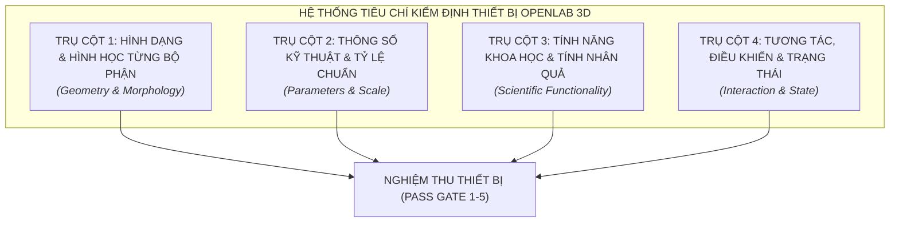
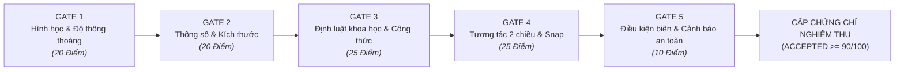

# BẢNG TIÊU CHÍ KIỂM ĐỊNH TOÀN DIỆN THÔNG SỐ, TÍNH NĂNG, TƯƠNG TÁC VÀ HÌNH DẠNG TỪNG BỘ PHẬN THIẾT BỊ (OPENLAB 3D)
*Quy chuẩn kỹ thuật kiểm định chất lượng, thẩm định mô hình hóa 3D và nghiệm thu chức năng mô phỏng thí nghiệm số*

- **Mã tài liệu:** `VQC-OL3D-STD-001`
- **Phiên bản:** 2.0 — Comprehensive Verification & Acceptance Matrix (KHTN 8 & Phòng Lab số OpenLab 3D)
- **Căn cứ pháp lý & tiêu chuẩn:** 
  1. Thông tư số 38/2021/TT-BGDĐT ban hành Danh mục thiết bị dạy học tối thiểu cấp THCS môn Khoa học tự nhiên.
  2. Chương trình Giáo dục phổ thông 2018 (SGK Cánh Diều, Kết nối tri thức, Chân trời sáng tạo).
  3. Tiêu chuẩn mô phỏng thế giới thực RWSS v1.1.1 (`docs/standards/RWSS/`).
  4. Báo cáo rà soát lỗi nguyên lý hoạt động & giải phẫu thiết bị (`docs/BAO_CAO_RA_SOAT_LOI_NGUYEN_LY_HOAT_DONG_OPENLAB3D.md`).

---

## 1. TỔNG QUAN & NGUYÊN TẮC KIỂM ĐỊNH CỐT LÕI

Hệ thống thí nghiệm ảo **OpenLab 3D** không đơn thuần là môi trường diễn hoạt hoạt họa (animation) mà là một **phòng thí nghiệm số tương tác thời gian thực dựa trên vật lý và tính nhân quả khoa học (Real-time Physics & Causal Simulation)**.

Để đảm bảo mỗi thiết bị khi đưa vào thư viện đạt chuẩn sư phạm và độ chân thực tối đa, quy trình kiểm định bắt buộc phải tuân thủ **5 nguyên tắc bất biến (Zero-Defect Axioms)**:

1. **Bất biến hình học & Thông thoáng công tác (Morphological Clearance Axiom)**: Các bộ phận đỡ cơ khí (thanh kẹp, ngàm, đế) tuyệt đối **không được che khuất** vùng làm việc chức năng (vùng tâm thấu kính xuyên sáng, mặt hứng ảnh của màn chắn, tiết diện thoát chất lỏng, vùng kim chỉ thị).
2. **Bất biến thông số thực $1:1$ (Scale Invariance Axiom)**: Mọi kích thước thiết kế đều phải đối chiếu theo hệ milimet ($\text{mm}$) chuẩn thiết bị giáo dục thật và quy đổi chính xác sang hệ trục Three.js ($1\text{ unit} = 1.0\text{ m} = 1000\text{ mm}$), sai số kích thước $\le 1.5\%$.
3. **Bất biến bảo toàn & Định luật khoa học (Scientific Causality Axiom)**: Toàn bộ phản ứng của thiết bị phải tuân theo phương trình toán học định lượng viết bằng chuẩn MathType LaTeX ($F \cdot d$, $p = \rho g h$, $I = U/R$, $P = I^2 R$, $\frac{1}{f} = \frac{1}{d} + \frac{1}{d'}$), không chấp nhận các giá trị hiển thị giả lập (fake hardcoded text).
4. **Bất biến liên động hai chiều (Bidirectional Interaction Axiom)**: Các thao tác vật lý phải linh hoạt và bình đẳng theo cả 2 chiều thuận - nghịch:
   - Kéo nối dây điện từ nguồn sang đèn hoặc từ đèn sang nguồn đều kết nối thành công.
   - Dây điện nằm gọn gàng trên bàn, không xuyên âm vào mặt bàn, không che khuất ray quang học.
   - Đèn bật nguồn là phát sáng tức thì theo công suất dòng điện.
5. **Bất biến an toàn & Cảnh báo sư phạm (Safety Boundaries Axiom)**: Thiết bị phải có phản ứng phá hủy/cảnh báo trực quan khi vượt quá giới hạn an toàn (cháy đứt dây tóc bóng đèn khi quá áp, ngắt rơle khi ngắn mạch, phồng rách màng khi quá áp suất, nứt vỡ ống nghiệm khi đun sốc nhiệt).

---

## 2. KHUNG 4 TRỤ CỘT TIÊU CHÍ KIỂM ĐỊNH CHUẨN

Hệ thống tiêu chí được cấu trúc theo 4 trụ cột độc lập nhưng liên kết chặt chẽ:

### 2.1. Trụ cột 1: Kiểm định Hình dạng & Hình học từng bộ phận (Geometry & Morphology)

| Mã tiêu chí | Tên tiêu chí kiểm tra | Nội dung yêu cầu kỹ thuật & Chỉ số chấp nhận | Phương pháp kiểm tra | Trọng số lỗi nếu vi phạm |
| :---: | :--- | :--- | :--- | :---: |
| **GEO-01** | **Cấu trúc bộ phận chức năng** | Mỗi thiết bị phải phân tách rõ ràng thành các `Mesh`/`Group` con đại diện cho từng bộ phận vật lý (Đế, Trụ, Ngàm kẹp, Thân, Vành, Kim, Lõi rút, Núm xoay, Bấc đèn...). Không đúc thành một khối mesh đặc chết (monolithic mesh). | Duyệt cây `SceneGraphHierarchy` trong code và Three.js Inspector | **FATAL** *(Loại ngay)* |
| **GEO-02** | **Độ thông thoáng trục công tác (Clearance)** | Thanh kẹp hoặc trụ đỡ phía dưới **chỉ được dừng lại ở mép ngoài** của khung viền; tuyệt đối không đâm xuyên lên che khuất vùng tâm làm việc: • Thấu kính: Vùng khẩu độ kính $\varnothing 70\text{ mm}$ phải thoáng $100\%$, không có cọc kim loại chắn trục quang. • Màn chắn: Trụ kẹp dừng ở đáy lưng, mặt hứng ảnh màu trắng tinh phẳng lì không bị kim loại che giữa. • Đèn chiếu: Khe phát tia sáng không bị che khuất bởi vành gá. | Kiểm tra bằng Raycast cắt lớp từ trục quang và ảnh chụp render trực diện | **FATAL** *(Lỗi nghiêm trọng)* |
| **GEO-03** | **Tỷ lệ hình học giữa các phần (Proportions)** | Tỷ lệ kích thước giữa các chi tiết phải cân xứng theo thực tế (ví dụ: đường kính đế / chiều cao, tỷ lệ thân ống / cổ thắt, tỷ lệ buồng chứa pin / cọc đấu dây). Dung sai tỷ lệ hình học $\le 5\%$. | So sánh tỷ số $L/W$, $W/H$ với bản vẽ kỹ thuật trong catalog | **MAJOR** *(Yêu cầu sửa)* |
| **GEO-04** | **Vật liệu PBR trung thực (Material Fidelity)** | Phản ánh đúng bản chất quang học và cơ lý của vật liệu thật: • Thủy tinh/Mica: `MeshPhysicalMaterial`, `transmission: 0.95 - 0.98`, `roughness: 0.02 - 0.05`, `ior: 1.49 - 1.52`. • Kim loại (đồng, inox, nhôm): `metalness: 0.85 - 0.95`, `roughness: 0.15 - 0.35`. • Gỗ/Sứ: `roughness: 0.65 - 0.9`, `metalness: 0.0 - 0.05`. • Cao su đàn hồi: `roughness: 0.55 - 0.65`. | Bật môi trường ánh sáng PBR (`RoomEnvironment`), kiểm tra phản xạ và khúc xạ | **MAJOR** |
| **GEO-05** | **Độ sắc nét vạch chia & ký hiệu (Markings & Labels)** | Các vạch chia milimet, độ đo cung tròn, cực tính Đỏ/Đen ($+/-$), ký hiệu `A`, `V`, `Cu`, `Fe`, `Al` phải in sắc nét bằng laser chìm hoặc decal texture độ phân giải cao, không bị răng cưa khi zoom sát mắt. | Zoom camera cách bề mặt $0.05\text{ m}$, kiểm tra độ phân giải texture $\ge 1024\text{ px}$ | **MINOR** |

---

### 2.2. Trụ cột 2: Kiểm định Thông số kỹ thuật & Tỷ lệ chuẩn (Parameters & Scale)

| Mã tiêu chí | Tên tiêu chí kiểm tra | Nội dung yêu cầu kỹ thuật & Chỉ số chấp nhận | Phương pháp kiểm tra | Trọng số lỗi |
| :---: | :--- | :--- | :--- | :---: |
| **PAR-01** | **Kích thước bao chuẩn mm** | Ba chiều Dài $\times$ Rộng $\times$ Cao ($L \times W \times H$) phải khớp với bảng đặc tả kỹ thuật thiết bị giáo dục THCS. Tọa độ Three.js phải tuân theo hệ số chuyển đổi chuẩn $1\text{ m} = 1000\text{ mm}$ (ví dụ ống nghiệm $\varnothing 16 \times 160\text{ mm} \rightarrow$ đường kính $0.016\text{ m}$, cao $0.160\text{ m}$). Dung sai tuyệt đối $\le 1.0\text{ mm}$. | Đo khoảng cách Bounding Box thực tế bằng script `Box3.setFromObject()` | **FATAL** |
| **PAR-02** | **Độ chia nhỏ nhất (ĐCNN) & Tầm đo (Range)** | Thiết bị đo lường phải thể hiện đúng ĐCNN và tầm đo quy chuẩn: • Thước ray quang học: Tầm đo $1000\text{ mm}$, ĐCNN $1\text{ mm}$. • Ampe kế DC: 2 thang $0 - 0.6\text{ A}$ (ĐCNN $0.02\text{ A}$) và $0 - 3\text{ A}$ (ĐCNN $0.1\text{ A}$). • Vôn kế DC: 2 thang $0 - 3\text{ V}$ (ĐCNN $0.1\text{ V}$) và $0 - 15\text{ V}$ (ĐCNN $0.5\text{ V}$). • Biến trở: Dải $0 - 20\,\Omega$, dòng cực đại $2\text{ A}$. | Đối chiếu thang số hiển thị trên mặt thiết bị với thông số logic solver | **FATAL** |
| **PAR-03** | **Dung sai khe hở cơ khí (Fit Clearances)** | Các khớp lắp ghép phải có khe hở dung sai danh nghĩa chống giao thoa hình học (Clipping): • Lỗ tâm đòn bẩy $\varnothing 6.2\text{ mm}$ lồng trục chốt giá $\varnothing 6.0\text{ mm}$ (khe hở $0.2\text{ mm}$). • Con trỏ kẹp ray quang học trượt tự do trên rãnh ray có độ dơ $\le 0.3\text{ mm}$. • Lõi sắt non $\varnothing 8.0\text{ mm}$ lọt lòng ống chỉ $\varnothing 9.0\text{ mm}$. | Chạy thuật toán kiểm tra giao thoa thể tích lưới tam giác (Mesh Intersection Detection) | **MAJOR** |
| **PAR-04** | **Tâm gốc quay & Điểm tựa (Pivot Point Alignment)** | Điểm gốc tọa độ cục bộ $(0, 0, 0)$ của từng bộ phận phải đặt đúng vị trí cơ học thực tế: • Bộ phận quay: Đặt đúng trục quay tâm đối xứng (Trục chốt đòn bẩy, trục kim đồng hồ, bản lề cầu dao). • Bộ phận đặt bàn: Đặt tại mặt phẳng đáy tiếp xúc mặt bàn ($y = 0$). • Bộ phận trượt: Gốc dọc theo thanh ray dẫn hướng. | Kiểm tra ma trận biến đổi `localMatrix` và điểm quay `object.rotation` | **FATAL** |

---

### 2.3. Trụ cột 3: Kiểm định Tính năng khoa học & Tính nhân quả thực nghiệm (Scientific Causality)

| Mã tiêu chí | Tên tiêu chí kiểm tra | Nội dung yêu cầu kỹ thuật & Chỉ số chấp nhận | Phương pháp kiểm tra | Trọng số lỗi |
| :---: | :--- | :--- | :--- | :---: |
| **SCI-01** | **Khớp định luật khoa học định lượng** | Mọi biến đổi trạng thái phải tính toán theo định luật tự nhiên, công thức viết bằng LaTeX chuẩn MathType: • Đòn bẩy: $M_1 = M_2 \iff F_1 \cdot d_1 = F_2 \cdot d_2$. • Áp suất thủy tĩnh: $p = p_0 + \rho \cdot g \cdot h$. • Định luật Ohm & Phân áp: $I = \frac{U}{R}$, $U = I \cdot R$. • Quang học thấu kính Gauss: $\frac{1}{f} = \frac{1}{d} + \frac{1}{d'}$, hệ số phóng đại $k = -\frac{d'}{d}$. Sai số tính toán giữa mô phỏng và lý thuyết $\le 0.5\%$. | Chạy tự động test runner kịch bản kiểm thử (Scripted Unit Test Matrix) | **FATAL** |
| **SCI-02** | **Tính liên động nhân quả tự động (Causal Loop)** | Mọi nguyên nhân tương tác phải kéo theo hệ quả tức thì, không cần thao tác ép buộc phụ: • Nối đủ 2 dây từ nguồn sang đèn $\rightarrow$ bật công tắc nguồn $\rightarrow$ đèn **phát sáng ngay lập tức**, tắt nguồn $\rightarrow$ đèn tắt. • Rót nước vào bình thông nhau $\rightarrow$ mực nước ở 3 nhánh **tự động đồng mức** phẳng ngang. • Nhúng hộp cảm ứng xuống nước sâu $\rightarrow$ cột chất lỏng áp kế chữ U **tự động chênh lệch** $\Delta h$. | Kiểm tra chuỗi truyền tín hiệu trạng thái qua Event Bus / Reactive State | **FATAL** |
| **SCI-03** | **Phản hồi quang học & hiển thị ảnh thật/ảo** | Khi tia sáng song song qua thấu kính hội tụ: • Tia sáng khúc xạ phải hội tụ **chính xác tại tiêu điểm $F'$** trên màn chắn. • Khi di chuyển vật chữ $F$ trong khoảng $d > 2f$, $f < d < 2f$, $d < f$: Màn chắn phải hiển thị ảnh thật ngược chiều hoặc không hứng được ảnh (ảnh ảo). | Đo tọa độ giao điểm tia sáng Three.js Raycaster với mặt phẳng màn chắn | **FATAL** |
| **SCI-04** | **Phản ứng quá tải & Biên phá hủy an toàn** | Thiết bị phải thể hiện hành vi phá hủy trực quan hoặc cảnh báo khi vượt ngưỡng: • Cấp điện áp $U > 1.35 \times U_{\text{đm}}$ vào bóng đèn $\rightarrow$ dây tóc đứt cháy, bóng tắt ngấm. • Ngắn mạch trực tiếp 2 cực nguồn pin $\rightarrow$ dòng vọt lên $> 5\text{ A}$, rơle tự ngắt, nhấp nháy đèn đỏ báo động. • Áp suất nước quá lớn $\Delta p > 5000\text{ Pa} \rightarrow$ màng cao su rách, nước chảy ra ngoài. | Kích hoạt kịch bản phá hủy trong `FailureModesSuite` | **MAJOR** |

---

### 2.4. Trụ cột 4: Kiểm định Tương tác, Điều khiển & Trạng thái (Interactions & States)

| Mã tiêu chí | Tên tiêu chí kiểm tra | Nội dung yêu cầu kỹ thuật & Chỉ số chấp nhận | Phương pháp kiểm tra | Trọng số lỗi |
| :---: | :--- | :--- | :--- | :---: |
| **INT-01** | **Cơ chế nối dây điện hai chiều linh hoạt (Bidirectional Wiring)** | Người học có thể **kéo dây từ cực của nguồn tới đèn HOẶC kéo từ đèn tới nguồn** đều bắt dính cổng cắm như nhau. • Jack cắm bắp chuối $\varnothing 4\text{ mm}$ snap chuẩn xác vào cọc cắm. • Dây dẫn điện tự động tính đường cong võng tự nhiên (Spline Catenary), **nằm gọn gàng trên mặt bàn**, không che khuất ray quang học, không bị cắm âm xuyên xuống bàn. | Kéo thử dây điện bằng chuột theo cả 2 hướng: Nguồn $\rightarrow$ Đèn và Đèn $\rightarrow$ Nguồn | **FATAL** |
| **INT-02** | **Điểm bắt dính thông minh (Smart Snap Points)** | Các cổng snap cơ học, điện, chất lỏng phải có bán kính hút hợp lý ($R_{\text{snap}} = 15 - 30\text{ mm}$), góc snap định hướng đúng theo phương pháp tuyến của ngàm/chốt, không bị lệch góc vẹo vọ. | Di chuyển vật thể lại gần cổng snap, kiểm tra ma trận snap và góc Euler | **FATAL** |
| **INT-03** | **Khóa bậc tự do chuẩn xác (DOF Constraints)** | Khi đã gắn kết vào hệ thống, các bậc tự do thừa phải bị triệt tiêu hoàn toàn: • Con chạy biến trở: Chỉ trượt 1 DOF dọc thanh ray ($0 \le x \le 100\text{ mm}$). • Lưỡi dao cầu dao: Chỉ xoay 1 DOF quanh bản lề $[0^\circ, 65^\circ]$. • Thanh đòn bẩy: Chỉ xoay 1 DOF quanh chốt ngang $[-30^\circ, +30^\circ]$. | Thử dùng chuột kéo vật thể theo các trục bị khóa, đảm bảo không bị dịch chuyển lệch trục | **FATAL** |
| **INT-04** | **Phản hồi đa giác quan (Multi-sensory Feedback)** | Mọi hành động tương tác thành công đều phải kèm phản hồi rõ ràng: • Thị giác: Vòng tròn snap sáng mờ; quầng sáng ấm `PointLight` khi đèn sáng; kim chỉ thị quay mượt mà. • Thính giác: Tiếng 'tách' khi khớp cắm dây hoặc đóng cầu dao; tiếng nước rót róc rách; tiếng lách cách khi muối kết tinh. | Kiểm tra hiệu ứng Shader, ánh sáng 3D và trigger âm thanh audio WebAudio API | **MINOR** |

---

## 3. BẢNG MA TRẬN TIÊU CHÍ KIỂM ĐỊNH TỪNG BỘ PHẬN CHO TẤT CẢ CÁC THIẾT BỊ

### 3.1. Nhóm Thiết bị Quang học & Bàn thí nghiệm (Optical Bench Suite)

| Thiết bị & ID | Bộ phận cấu thành | Tiêu chí Hình dạng & Độ thông thoáng (Clearance) | Tiêu chí Thông số & Kích thước | Tiêu chí Tính năng & Tương tác |
| :--- | :--- | :--- | :--- | :--- |
| **Thấu kính hội tụ / phân kỳ** `optical-lens` | 1. Thấu kính thủy tinh 2. Vành tròn bảo vệ 3. Khớp kẹp Saddle đáy 4. Ốc hãm xiết ray | **ĐỘ THÔNG THOÁNG TUYỆT ĐỐI**: • Khẩu độ kính $\varnothing 70\text{ mm}$ hoàn toàn thông thoáng $100\%$. • Trụ kim loại của Saddle chỉ dừng lại ở mép đáy ngoài cùng của vành tròn ($y_{\text{post}} \le 52.8\text{ mm}$), **tuyệt đối không đâm thanh kẹp lên che chắn vùng kính xuyên sáng**. | • Đường kính thấu kính: $\varnothing 70\text{ mm}$ • Bề dày vành: $8\text{ mm}$ • Tiêu cự chuẩn: $f = +100\text{ mm}$ (hội tụ) hoặc $f = -100\text{ mm}$ (phân kỳ) • Dung sai tiêu cự: $\pm 1.0\text{ mm}$ | • Snap khít vào rãnh ray quang học, trượt 1 DOF dọc trục Z của ray. • Hội tụ chùm tia song song về đúng tiêu điểm $F'$ sau thấu kính cách quang tâm đúng $100\text{ mm}$. • Chế độ hiển thị tiêu điểm $F, F'$ gọn gàng, đúng ký hiệu. |
| **Màn chắn hứng ảnh** `optical-screen` | 1. Mặt màn hứng màu trắng 2. Tấm lưng đỡ nhựa đen 3. Gân gia cường sau 4. Saddle trượt ray | **MẶT TRƯỚC PHẲNG LÌ KHÔNG BỊ CHE KHUẤT**: • Mặt trước là canvas màu trắng tinh (`#ffffff`) mờ nhám có lưới tọa độ mm mảnh. • Ngàm kẹp chỉ ôm từ mép đáy và mặt lưng ($y_{\text{post}} \le 42.0\text{ mm}$), **không có bất kỳ ngàm kim loại nào nhô lên che khuất vùng trung tâm màn hứng ảnh**. | • Tấm màn hình chữ nhật: $80 \times 100 \times 3\text{ mm}$ • Chiều cao tâm màn: Trùng trục quang học ($H_{\text{tâm}} = 100\text{ mm}$ tính từ đáy ray) • Màu mặc định: Trắng mờ (`roughness: 0.9`) | • Snap trượt 1 DOF trên ray quang học. • Khi dịch chuyển màn qua đúng vị trí tạo ảnh thật $d'$, ảnh chữ $F$ ngược chiều hiện lên sắc nét; dịch ra xa/lại gần ảnh bị mờ dần theo hàm Gaussian Blur. |
| **Đèn chiếu sáng quang học** `optical-lamp` | 1. Vỏ hộp đèn hợp kim nhôm 2. Cửa sổ chắn khe sáng 3. Núm gạt chế độ 1,2,3 tia 4. 2 cọc cắm bắp chuối | • Cửa sổ chiếu chùm tia đặt chính xác trên trục quang học. • Núm gạt chế độ tia đặt ở vị trí thuận tiện thao tác, gờ khía nhám công thái học dễ bấm. | • Kích thước vỏ hộp: $90 \times 55 \times 60\text{ mm}$ • Khoảng cách giữa các khe tia: $10\text{ mm}$ • Điện áp hoạt động: $6\text{ V} - 12\text{ V}$ • Cọc bắp chuối: $\varnothing 4\text{ mm}$, cao $16\text{ mm}$ | • Nối đủ 2 dây từ nguồn và bật công tắc $\rightarrow$ **Đèn phát sáng tức thì**, tắt nguồn $\rightarrow$ đèn tắt ngay. • Núm gạt tương tác 1 click mượt mà chuyển đổi: 1 tia mảnh, 3 tia song song, hoặc chùm phân kỳ. |
| **Dây nối điện thí nghiệm** `flexible-wire` | 1. Lõi đồng bện mềm 2. Vỏ bọc Silicon cách điện 3. 2 đầu cắm jack bắp chuối | • Dây uốn lượn đường cong trọng lực mềm mại (Catenary Curve). • Dây nằm áp gọn trên mặt bàn, không lơ lửng, **không xuyên âm vào mặt gỗ bàn, không cắt ngang che khuất ray quang học**. | • Chiều dài dây: $400\text{ mm}$ hoặc $600\text{ mm}$ • Đường kính dây: $\varnothing 3.5\text{ mm}$ • Jack bắp chuối: $\varnothing 4.0 \times 18\text{ mm}$ có lá thép xẻ rãnh đàn hồi | • **Kéo thả 2 chiều linh hoạt**: Kéo từ cực nguồn cắm sang đèn, hoặc kéo từ đèn cắm về nguồn đều snap thành công 100%. • Dễ dàng nhấp chọn đầu jack để rút dây ra cắm lại. |

---

### 3.2. Nhóm Thiết bị Cơ học - Áp suất - Đòn bẩy (Mechanics & Pressure Suite)

| STT & Mã thiết bị | Bộ phận cấu thành | Tiêu chí Hình dạng & Hình học | Tiêu chí Thông số & Kích thước | Tiêu chí Tính năng & Tương tác |
| :--- | :--- | :--- | :--- | :--- |
| **01** `lever-balance-arm` Thanh đòn bẩy chia vạch đối xứng | • Thân nhôm phay phẳng • 18 lỗ treo đối xứng • Lỗ trục tâm $O$ • 2 ốc vi chỉnh 2 đầu | • Thanh dẹt dài vát mép $0.5\text{ mm}$. • Khắc laser chìm các số $1 \dots 9$ từ tâm ra 2 phía màu đen/đỏ rõ nét. • 2 đầu có đai ốc ren M4 xoay vặn cân bằng. | • Dài $400\text{ mm} \times$ Rộng $18\text{ mm} \times$ Dày $4\text{ mm}$ • Lỗ tâm: $\varnothing 6.2\text{ mm}$ • Bước chia giữa các lỗ: đúng $20\text{ mm}$ • Lỗ móc treo: $\varnothing 2.5\text{ mm}$ | • Snap vào chốt giá đỡ trục quay. • Vặn ốc vi chỉnh để đưa thanh về thăng bằng ngang ($0^\circ$). • Nhận snap quả nặng $50\text{ g}$ vào các lỗ; tự động giải mômen $M_{\text{trái}} = M_{\text{phải}}$, nghiêng lệch khi mất cân bằng. |
| **02** `lever-pivot-stand` Giá đỡ trục quay đòn bẩy | • Đế gang đúc nặng • 4 chân đệm cao su • Trụ thép đứng mạ Crom • Ngàm chữ U & chốt ngang | • Khung chữ U trên đỉnh ôm khít thanh đòn bẩy. • Chốt quay ngang bằng đồng thau mài bóng giảm ma sát. • Đế gang đúc vát 4 góc tăng độ đầm chống lật. | • Đế: $140 \times 90 \times 18\text{ mm}$ • Khối lượng đế: $\ge 750\text{ g}$ ($88\%$ tổng khối lượng) • Trụ đứng: $\varnothing 10 \times 280\text{ mm}$ • Chốt ngang: $\varnothing 6.0 \times 24\text{ mm}$ | • Đặt cố định tĩnh trên mặt bàn ($y = 0$). • Chịu tải trọng lệch lên tới $5.0\text{ N}$ mà không bị đổ ngã. • Cho phép thanh đòn bẩy quay tự do quanh chốt góc $[-30^\circ, +30^\circ]$. |
| **03** `hooked-weight-50g` Quả nặng có móc 2 đầu 50g | • Khối trụ đồng thau • Móc thép phía trên • Rãnh khuyết & khoen đáy | • Khối trụ vát mép trên dưới, khắc chìm số `50g`. • Móc trên uốn cong tròn thép không gỉ. • Đáy khoét rãnh âm xỏ chốt ngang nhận móc quả khác. | • Khối trụ: $\varnothing 20 \times 25\text{ mm}$ • Móc trên vươn cao: $15\text{ mm}$ • Tổng chiều cao: $42\text{ mm}$ • Khối lượng: $50.00 \pm 0.20\text{ g}$ | • Snap móc vào lỗ thanh đòn bẩy hoặc móc lực kế. • Cho phép móc nối tiếp chùm quả nặng (Daisy-chain). • Thả chìm vào nước: chịu lực đẩy Archimedes $F_A \approx 0.058\text{ N}$, nước dâng $+5.95\text{ mL}$. |
| **04** `liquid-pressure-tube` Ống trụ màng cao su đo áp suất chất lỏng | • Ống trụ mica trong suốt • Cửa sổ hông tròn • Vành kẹp gioăng ren • 2 màng cao su đàn hồi | • Ống trong suốt không bọt khí quan sát rõ mực nước. • Màng cao su mỏng màu hồng da mềm mại. • Vành kẹp ren ép sát không rò rỉ nước. | • Ống: $\varnothing 32 \times 220\text{ mm}$, dày $2\text{ mm}$ • Màng đáy: $\varnothing 32\text{ mm}$, dày $0.15\text{ mm}$ • Cửa sổ hông: $\varnothing 18\text{ mm}$ (cách đáy $40\text{ mm}$) | • Đổ nước vào trong: Màng đáy và màng hông **phồng lồi ra** theo độ sâu $p = d \cdot h$. • Dìm cả ống vào bể nước sâu: Màng biến dạng **lõm vào trong** khi áp suất ngoài lớn hơn áp suất trong. |
| **05** `u-tube-manometer` Áp kế chữ U đo áp suất chất lỏng | • Bảng gắn vạch chia độ • Ống thủy tinh chữ U • Dây tiô dẫn khí mềm • Hộp cảm ứng màng mỏng | • Bảng số đứng in vạch đối xứng qua số $0$ ở giữa. • Ống chữ U thủy tinh trong suốt uốn cong đều đáy $R = 15\text{ mm}$. • Chất lỏng chỉ thị màu đỏ cánh sen tương phản cao. | • Bảng: $80 \times 320 \times 15\text{ mm}$ • Ống chữ U: $\varnothing 8 \times 260\text{ mm}$ • Thang đo: $-100 \dots 0 \dots +100\text{ mm}$ • Ống tiô: $\varnothing 6 \times 600\text{ mm}$ | • Cầm hộp cảm ứng nhúng vào nước ở các độ sâu $h$: Độ chênh mực nước đỏ giữa 2 nhánh $\Delta h$ dâng lên chính xác đúng bằng độ sâu $h$ ($\Delta h = h$). • Xoay hộp cảm ứng theo các phương khác nhau $\rightarrow \Delta h$ không đổi. |
| **06** `communicating-vessels-3branch` Bình thông nhau 3 nhánh dị hình | • Đế nhựa đỡ phẳng • Ống đáy nằm ngang • 3 nhánh: thẳng, uốn sóng sin, phình quả trám | • Thủy tinh liền khối trong suốt. • 3 nhánh bố trí cân xứng, khoảng cách đều $45\text{ mm}$. • Mối hàn thủy tinh đáy ngã ba trơn láng không nghẽn. | • Khung bao ngoài: $160 \times 50 \times 180\text{ mm}$ • Ống đáy ngang: $\varnothing 14 \times 150\text{ mm}$ • Nhánh 1: $\varnothing 12\text{ mm}$; Nhánh 2: uốn $\varnothing 10\text{ mm}$; Nhánh 3: phình $\varnothing 30\text{ mm}$ | • Rót nước màu vào bất kỳ nhánh nào: Mực nước ở cả 3 nhánh **luôn tự cân bằng dừng lại ở cùng một mặt phẳng ngang**. • Nghiêng bình $\pm 30^\circ$: Mặt thoáng ở cả 3 nhánh tự điều chỉnh giữ nguyên mặt phẳng nằm ngang. |
| **07** `density-metal-cubes` Bộ 3 khối lập phương Đồng, Sắt, Nhôm | • Khối Đồng đỏ (Cu) • Khối Sắt xám (Fe) • Khối Nhôm trắng bạc (Al) • Khoen móc treo đỉnh | • Khối lập phương phay phẳng 6 mặt chuẩn xác. • Vát mép bảo vệ $C0.5\text{ mm}$. • Mặt trên khắc chìm ký hiệu nguyên tố `Cu`, `Fe`, `Al`. | • Kích thước đồng nhất: $20.0 \times 20.0 \times 20.0\text{ mm}$ • Thể tích chuẩn: $V = 8.0\text{ cm}^3$ • Khối lượng thực: $m_{\text{Cu}} = 71.2\text{ g}$, $m_{\text{Fe}} = 62.4\text{ g}$, $m_{\text{Al}} = 21.6\text{ g}$ | • Đặt lên cân điện tử hiện số đo khối lượng tương ứng. • Thả chìm vào ống đong chứa nước: Mực nước dâng đúng $+8\text{ mL}$. • Treo vào lực kế: Đo trọng lượng và độ giảm lực kế khi chìm do lực đẩy Archimedes $F_A = 0.08\text{ N}$. |

---

### 3.3. Nhóm Thiết bị Điện học cơ bản một chiều DC & Từ học (DC Electricity Suite)

| STT & Mã thiết bị | Bộ phận cấu thành | Tiêu chí Hình dạng & Hình học | Tiêu chí Thông số & Kích thước | Tiêu chí Tính năng & Tương tác |
| :--- | :--- | :--- | :--- | :--- |
| **08** `battery-holder-pack` Hộp pin nguồn thí nghiệm 3V - 6V | • Vỏ hộp nhựa ABS đen • 4 khoang pin AA lò xo niken • 2 cọc bắp chuối Đỏ/Đen • Cần gạt chuyển mạch | • Vỏ hộp cứng cáp có gờ nhám chống trượt. • Cọc dương bọc nhựa Đỏ ($+$), cọc âm bọc nhựa Đen ($-$). • Có đèn LED nhỏ chỉ báo trạng thái cấp nguồn. | • Hộp: $120 \times 75 \times 32\text{ mm}$ • Cọc bắp chuối: $\varnothing 4.0\text{ mm}$, cao $16\text{ mm}$ • Khoảng cách 2 cọc: $50\text{ mm}$ • Điện áp danh định: $3.0\text{ V}$ (2 pin) hoặc $6.0\text{ V}$ (4 pin) | • Cắm dây điện vào 2 cọc. • Gạt công tắc bật nguồn $\rightarrow$ đèn LED xanh sáng, cấp điện áp ra mạch ngoài. • Đoản mạch ($R_{\text{ngoài}} < 0.5\,\Omega$) $\rightarrow$ tự động ngắt rơle bảo vệ, đèn LED chuyển đỏ báo động. |
| **09** `spst-switch-knife` Khóa K / Cầu dao gạt đơn cực | • Đế phíp bakelite cách điện • Lưỡi dao gạt đồng thau • Cán cầm nhựa tròn • Ngàm kẹp đàn hồi chữ U | • Kiểu dáng cầu dao hở cổ điển thí nghiệm. • Lưỡi đồng dày phẳng, khớp bản lề êm ái. • Ngàm kẹp đàn hồi ôm khít lưỡi dao khi đóng. | • Đế: $75 \times 35 \times 10\text{ mm}$ • Lưỡi dao: $55 \times 8 \times 1.5\text{ mm}$ • Khoảng cách 2 cọc: $52\text{ mm}$ • Cán cầm: $\varnothing 8 \times 22\text{ mm}$ | • Nhấp click vào cán dao để Đóng / Mở. • Trạng thái Đóng: $R \approx 0.01\,\Omega$, cho dòng điện chạy qua. • Trạng thái Mở: Lưỡi dao mở góc $45^\circ - 65^\circ$, mạch hở ($R = \infty$), dòng $I = 0$. |
| **10** `miniature-bulb-socket` Đui đèn & Bóng đèn pin 2.5V - 3.8V | • Đế tròn nhựa chịu nhiệt • Đui ren xoáy E10 đồng • Bóng thủy tinh quả lê • Dây tóc Vonfram lò xo | • Đui ren E10 ở trung tâm đế tròn. • Bóng thủy tinh trong suốt thấy rõ 2 thanh đỡ và sợi tóc lò xo xoắn. • 2 cọc bắt dây bố trí đối xứng 2 bên sườn. | • Đế tròn: $\varnothing 60 \times 16\text{ mm}$ • Bóng E10: $\varnothing 11 \times 24\text{ mm}$ • Khoảng cách cọc: $38\text{ mm}$ • Định mức: $U_{\text{đm}} = 2.5\text{ V} - 3.8\text{ V}, I_{\text{đm}} = 0.3\text{ A}$ | • Cắm 2 dây điện vào 2 cọc $\rightarrow$ dòng điện chạy qua làm dây tóc nóng sáng, quầng sáng ấm tỏa ra xung quanh. • Độ sáng tăng theo công suất $P = U \cdot I$. • Quá áp $U > 5\text{ V}$ trong $> 0.5\text{ s} \rightarrow$ đứt dây tóc, bóng tắt. |
| **11** `dc-analog-ammeter` Ampe kế 1 chiều DC mặt nghiêng | • Vỏ hộp mặt dốc nghiêng $45^\circ$ • Kính mica bảo vệ cong • Mặt chia 2 thang số quạt • Kim đỏ & núm chỉnh zero | • Mặt nghiêng công thái học dễ quan sát. • In chữ `A` lớn ở giữa mặt quạt trắng. • 3 cọc xoáy bắp chuối: 1 cọc âm Đen (-), 2 cọc dương Đỏ (+0.6A và +3A). | • Hộp: $100 \times 135 \times 100\text{ mm}$ • Góc nghiêng: $45^\circ$, cung đo bán kính $65\text{ mm}$ • Thang 1: $0 - 0.6\text{ A}$ (ĐCNN $0.02\text{ A}$) • Thang 2: $0 - 3.0\text{ A}$ (ĐCNN $0.1\text{ A}$) | • Mắc nối tiếp vào đoạn mạch. • Kim chỉ thị quay chính xác theo dòng điện $I$, có quán tính dao động giảm chấn tự nhiên. • Cắm nhầm cực (-/+) $\rightarrow$ kim giật lùi về bên trái vạch 0 chạm chốt hãm. |
| **12** `dc-analog-voltmeter` Vôn kế 1 chiều DC mặt nghiêng | • Vỏ hộp dốc nghiêng $45^\circ$ • Mặt hiển thị quạt in chữ `V` • Kim nhôm đỏ siêu nhẹ • 3 cọc cắm bắp chuối | • Kiểu dáng đồng bộ với ampe kế. • In rõ ràng 2 thang điện áp $0 - 3\text{ V}$ và $0 - 15\text{ V}$. • Cọc âm Đen (-), cọc dương Đỏ (+3V và +15V). | • Hộp: $100 \times 135 \times 100\text{ mm}$ • Cung bán kính: $65\text{ mm}$ • Thang 1: $0 - 3\text{ V}$ (ĐCNN $0.1\text{ V}$) • Thang 2: $0 - 15\text{ V}$ (ĐCNN $0.5\text{ V}$) • Điện trở trong: $R_V \ge 3000\,\Omega$ | • Mắc song song giữa 2 điểm cần đo hiệu điện thế. • Đo điện áp chính xác mà không làm sụt áp mạch chính. • Cắm nguồn $12\text{ V}$ vào thang $3\text{ V} \rightarrow$ kim đập kịch biên phải cảnh báo quá thang. |
| **13** `slide-rheostat-20ohm` Biến trở con chạy ống sứ 20 ohm - 2A | • Khung thép đỡ 2 đầu chữ L • Ống gốm sứ quấn dây Constantan • Thanh trượt kim loại mạ Crom • Khối con chạy có núm nhựa | • Dây quấn đều khít trên ống sứ, có rãnh cạo sạch men tiếp xúc. • Lá đồng con chạy ép chặt đàn hồi lên vòng dây. • 3 cọc bắp chuối: Chốt cố định A, B và chốt con chạy C. | • Dài $165 \times$ Rộng $45 \times$ Cao $65\text{ mm}$ • Ống sứ: $\varnothing 32 \times 120\text{ mm}$ • Hành trình con chạy: $100\text{ mm}$ • Điện trở tối đa: $20.0\,\Omega$, dòng cực đại: $2.0\text{ A}$ | • Kéo con chạy trượt dọc thanh kim loại $\rightarrow$ điện trở $R_{AC}$ biến thiên tuyến tính từ $0.1\,\Omega$ đến $20\,\Omega$. • Dòng điện trong mạch thay đổi làm đèn sáng dần hoặc tối dần mượt mà. • Phát âm thanh xào xạc kim loại khi trượt. |
| **14** `electromagnet-coil` Cuộn dây nam châm điện có lõi sắt non | • Ống chỉ nhựa cách điện • Cuộn dây đồng tráng men vecni • Thanh lõi sắt non rút rời • 2 cọc cắm bắp chuối | • Cuộn dây đồng màu cánh gián quấn nhiều lớp. • Lõi sắt non mạ bóng nhẵn, có núm tiện đầu dễ cầm rút. • Lõi lọt lòng ống chỉ nhẹ nhàng không ma sát kẹt. | • Cuộn dây: $\varnothing 32 \times 60\text{ mm}$, lòng trong $\varnothing 9\text{ mm}$ • Lõi sắt non: $\varnothing 8.0 \times 85\text{ mm}$ • Số vòng dây: 300 vòng • Dòng định mức: $1.5\text{ A}$ | • Khi cấp điện: Có lõi sắt non $\rightarrow$ từ trường mạnh $\mu_r \approx 800$, hút được chùm đinh sắt lớn $15 - 20$ cái. • Rút lõi sắt ra $\rightarrow$ lực từ giảm sút rõ rệt (chỉ hút được $1 - 2$ mạt sắt nhỏ). • Ngắt điện $\rightarrow$ đinh sắt rơi rụng tức thì. |

---

### 3.4. Nhóm Thiết bị Hóa học & Dụng cụ phản ứng nhiệt (Chemistry Suite)

| STT & Mã thiết bị | Bộ phận cấu thành | Tiêu chí Hình dạng & Hình học | Tiêu chí Thông số & Kích thước | Tiêu chí Tính năng & Tương tác |
| :--- | :--- | :--- | :--- | :--- |
| **15** `test-tube-rack` Giá để ống nghiệm 6 lỗ kèm cọc phơi | • Đế gỗ có rãnh đón cầu đáy • Tầng trên có 6 lỗ cắm đứng • Hàng 6 cọc phơi tiện đầu tròn | • Khung gỗ 2 tầng gia công nhẵn, phủ vecni chống hóa chất. • Hàng lỗ cắm phía trước, hàng cọc phơi phía sau. • Cọc phơi thon đầu tiện úp ống róc nước. | • Dài $210 \times$ Rộng $65 \times$ Cao $90\text{ mm}$ • 6 lỗ cắm: $\varnothing 20\text{ mm}$ (cách đều bước $30\text{ mm}$) • 6 cọc phơi: $\varnothing 8 \times 75\text{ mm}$ | • Snap ống nghiệm vào 6 vị trí cắm đứng ổn định. • Snap ống nghiệm úp ngược vào 6 cọc phơi róc nước sau rửa. • Nhấc di chuyển toàn bộ giá cùng các ống trên bàn. |
| **16** `test-tube-with-clamp` Bộ ống nghiệm thủy tinh & Kẹp gỗ | • Ống nghiệm Borosilicate • Đáy cầu tròn đều, vành vê tròn • Kẹp gỗ 2 má xẻ rãnh • Lò xo lá thép đàn hồi | • Thủy tinh Borosilicate trong suốt chịu sốc nhiệt. • Kẹp gỗ ép chặt thân ống tại vị trí $1/3$ từ miệng ống. • Má kẹp có lót đệm chống xước vỡ ống. | • Ống nghiệm: $\varnothing 16 \times 160\text{ mm}$, dày $1.2\text{ mm}$ • Dung tích: $25\text{ mL}$ • Kẹp gỗ: Dài $180\text{ mm}$, độ mở $\varnothing 14 - 22\text{ mm}$ | • Cầm kẹp gỗ di chuyển ống nghiệm tự do 6 DOF. • Nghiêng ống góc $45^\circ$ hơ trên ngọn lửa đèn cồn. • Dung dịch sôi sủi bọt khí cuồn cuộn, bốc hơi nước. • Cảnh báo: Miệng ống phải hướng về nơi không có người. |
| **17** `dropper-pipette` Ống hút nhỏ giọt kèm búp cao su | • Ống mao quản thủy tinh thon • Đầu mút vuốt nhọn nhỏ giọt • Búp cao su đàn hồi màu đỏ | • Đầu mút thon nhọn dễ luồn vào lọ thuốc thử miệng hẹp. • Búp cao su màu đỏ tươi kín khí tuyệt đối. • Thân kính trong vắt thấy rõ cột dung dịch. | • Dài thủy tinh: $160\text{ mm}$, thân $\varnothing 7\text{ mm}$ • Đầu nhọn: $\varnothing 2.0 \times 25\text{ mm}$, lỗ $\varnothing 1.0\text{ mm}$ • Búp cao su: $\varnothing 16 \times 35\text{ mm}$ • Thể tích 1 giọt: chuẩn $0.046\text{ mL}$ | • Nhấp click bóp búp cao su tạo áp suất âm hút dung dịch. • Đưa đến ống nghiệm bóp nhẹ nhả từng giọt rơi xuống. • Giọt rơi có gia tốc trọng trường $g = 9.8\text{ m/s}^2$, phát tiếng tí tách. |
| **18** `spirit-burner-150` Đèn cồn thí nghiệm 150ml | • Bầu nón cụt thủy tinh dày • Cổ đui gốm sứ xốp trắng • Sợi bấc cotton dệt tròn • Nắp chụp thủy tinh dập lửa | • Bầu thủy tinh đáy rộng chống đổ ngã. • Cổ đui sứ cách nhiệt ngăn truyền nhiệt xuống cồn. • Nắp chụp hình côn chóp vừa khít đui sứ. | • Bầu đèn: $\varnothing 85 \times$ Cao $105\text{ mm}$ • Dung tích: $150\text{ mL}$ (nạp tối đa $100\text{ mL}$ cồn) • Sợi bấc: $\varnothing 5.0\text{ mm}$, nhô cao $8\text{ mm}$ • Nắp chụp: Cao $45\text{ mm}$ | • Châm lửa: Ngọn lửa 3D bập bùng với vùng trong xanh và chóp vàng cam, phát nhiệt $750^\circ\text{C}$. • Đậy nắp chụp: Ngắt nguồn oxy $\rightarrow$ ngọn lửa tắt ngay lập tức. • Cảnh báo: Tuyệt đối không thổi bằng miệng. |
| **19** `tripod-burner-gauze` Kiềng đun sắt 3 chân & Lưới thép lót sứ | • Vòng tròn kiềng bằng sắt • 3 chân thép nghiêng $15^\circ$ • Tấm lưới thép caro vuông • Đĩa gốm sứ tròn tâm | • Kết cấu 3 chân choãi đầm chắc. • Lưới thép đan sợi mạ bạc có đĩa sứ trắng chịu nhiệt ở tâm. • Khoảng hở dưới kiềng vừa vặn đặt lọt đèn cồn. | • Chiều cao kiềng: $160\text{ mm}$ • Vòng kiềng: $\varnothing 100\text{ mm}$ • Tấm lưới: $120 \times 120\text{ mm}$ • Đĩa sứ tâm: $\varnothing 70 \times 2.5\text{ mm}$ • Khoảng hở tới bấc đèn: chuẩn $40\text{ mm}$ | • Đặt kiềng trùm lên đèn cồn; snap tấm lưới sứ lên kiềng. • Đặt cốc đốt hoặc bát sứ lên đĩa sứ tâm. • Đĩa sứ tản nhiệt đều $400 - 550^\circ\text{C}$, ngăn sốc nhiệt vỡ đáy cốc thủy tinh. |
| **20** `filter-funnel-paper` Phễu lọc thủy tinh góc 60 độ & Giấy lọc | • Miệng phễu nón góc $60^\circ$ • Cuống phễu thon dài vát $45^\circ$ • Giấy lọc nón 4 lớp gấp tư | • Phễu thủy tinh borosilicate bóng loáng. • Đầu vát cuống phễu $45^\circ$ áp sát thành cốc hứng. • Giấy lọc xốp trắng ôm sát thành trong phễu. | • Miệng phễu: $\varnothing 60\text{ mm}$, góc mở $60^\circ$ • Cuống phễu: $\varnothing 8 \times 70\text{ mm}$, vát $45^\circ$ • Giấy lọc: $\varnothing 110\text{ mm}$ (mép thấp hơn phễu $5\text{ mm}$) | • Gá phễu lên vòng đỡ giá sắt; thấm ướt giấy lọc. • Rót huyền phù theo đũa thủy tinh vào phễu. • Giấy lọc giữ lại cặn kết tủa; từng giọt nước lọc trong suốt chảy theo cuống phễu bám thành cốc không bắn tóe. |
| **21** `porcelain-evaporating-basin` Bát sứ nung / Bát cô cạn dung dịch 75ml | • Chỏm cầu sứ nông miệng rộng • Mỏ rót nhọn vuốt mép • Đáy ngoài mài phẳng nhám | • Men sứ trắng tinh bóng láng chịu nhiệt $1050^\circ\text{C}$. • Dáng miệng bè rộng tăng diện tích thoát hơi nước. • Mỏ rót tiện trút tinh thể ra ngoài. | • Đường kính miệng: $\varnothing 75\text{ mm}$ • Chiều cao: $32\text{ mm}$, dày $2.5\text{ mm}$ • Dung tích: $75\text{ mL}$ • Đáy phẳng tiếp xúc: $\varnothing 30\text{ mm}$ | • Đặt trên lưới sứ kiềng đun, rót dung dịch muối vào đun. • Nước bay hơi nhanh bốc làn hơi trắng. • Khi nước cạn: Tinh thể muối trắng lấp lánh kết tinh bám đáy bát, phát tiếng lách tách giòn giã. • Bắt buộc dùng kẹp gắp chén nung gắp bát nóng. |

---

### 3.5. Nhóm Thiết bị Sinh học & Kính hiển vi quang học (Biology Suite)

| STT & Mã thiết bị | Bộ phận cấu thành | Tiêu chí Hình dạng & Hình học | Tiêu chí Thông số & Kích thước | Tiêu chí Tính năng & Tương tác |
| :--- | :--- | :--- | :--- | :--- |
| **22** `human-heart-model` Mô hình giải phẫu tim người tách rời 2 mảnh | • Nửa sau tim gắn trục • Nửa trước tim tách rời • Cung động mạch, tĩnh mạch • Đế trưng bày & trục nghiêng | • Mô phỏng giải phẫu tim tỷ lệ 1:1. • Sơn màu mô học y khoa chuẩn: Động mạch đỏ tươi (`#ef4444`), Tĩnh mạch xanh dương (`#1d4ed8`), Cơ tim hồng đỏ sẫm (`#be123c`). • Khớp ghép nam châm từ tính định vị khít. | • Kích thước khối tim: $120 \times 110 \times 140\text{ mm}$ • Đế tròn: $\varnothing 120 \times 18\text{ mm}$ • Trục nghiêng: $15^\circ$, cao $90\text{ mm}$ • Tỷ lệ vách thất trái / phải: $3.11$ ($14\text{ mm} / 4.5\text{ mm}$) | • Nhấp click để tách mở nửa trước của tim ($80\text{ mm}$) quan sát 4 ngăn tim, van 2 lá, van 3 lá. • Xoay $360^\circ$ ngắm các mạch vành. • Hoạt ảnh van tim đóng mở và âm thanh tim đập 'bùm... tặc' chu kỳ $0.8\text{ s}$. |
| **23** `student-optical-microscope` Kính hiển vi quang học học sinh | • Đế móng ngựa đúc nặng • Thân cong chữ C có quai • Bàn sa trượt phẳng & 2 kẹp • Mâm xoay 3 vật kính • Ốc đại cấp / vi cấp • Gương hứng sáng 2 mặt | • Thân kim loại sơn tĩnh điện trắng men bóng. • Các ống quang học và ốc xoay mạ Crom sáng loáng. • Mâm xoay hình đĩa tròn mang 3 vật kính có viền màu nhận diện ($4\times$ đỏ, $10\times$ vàng, $40\times$ xanh). • Ống ngắm thị kính nghiêng $45^\circ$. | • Cao tổng thể: $310\text{ mm}$ • Đế móng ngựa: $130 \times 170 \times 35\text{ mm}$ • Bàn sa trượt: $110 \times 120\text{ mm}$ • Mâm xoay: $\varnothing 55\text{ mm}$ • Độ phóng đại: $40\times$, $100\times$, $400\times$ | • Xoay mâm vật kính có tiếng bi click định tâm. • Xoay ốc đại cấp nâng hạ bàn kính tìm mẫu thô. • Xoay ốc vi cấp lấy nét cực kỳ sắc nét. • Bật viewport thị kính hiển vi tròn (Microscope Viewport UI) phóng đại tế bào vảy hành tây hoặc tế bào máu. |

---

## 4. QUY TRÌNH 5 CỔNG KIỂM ĐỊNH & THANG ĐIỂM NGHIỆM THU (5-GATE VERIFICATION PROTOCOL)

Một mô hình thiết bị 3D chỉ được nghiệm thu và cho phép tích hợp vào hệ thống OpenLab 3D khi vượt qua **toàn bộ 5 Cổng Kiểm Định** với tổng điểm $\ge 90/100$ điểm và **không dính bất kỳ lỗi FATAL nào**:

### Thang điểm chi tiết từng cổng:

1. **Gate 1: Hình học & Độ thông thoáng công tác (20 điểm)**
   - Đầy đủ các bộ phận thành phần riêng biệt, đúng cấu trúc cơ học: **5 điểm**.
   - **Độ thông thoáng $100\%$ trục công tác** (không che khuất tâm thấu kính, màn chắn, khe tia sáng): **10 điểm** *(Sai phạm = 0 điểm & FATAL Reject)*.
   - Vật liệu PBR chuẩn (độ nhám, phản xạ, độ trong suốt kính): **5 điểm**.

2. **Gate 2: Thông số kỹ thuật & Tỷ lệ chuẩn (20 điểm)**
   - Kích thước đo đạc chuẩn theo mm thực tế (dung sai $\le 1\text{ mm}$): **10 điểm**.
   - Tỷ lệ hình học $L/W/H$ giữa các bộ phận cân đối tự nhiên: **5 điểm**.
   - Tọa độ tâm gốc quay (`Pivot Point`) đặt đúng tâm hình học/trục quay: **5 điểm**.

3. **Gate 3: Tính năng khoa học & Định luật tự nhiên (25 điểm)**
   - Đúng công thức định lượng (MathType LaTeX) và tính toán sai số $\le 0.5\%$: **10 điểm**.
   - Phản ứng nhân quả tự động (Causal Loop: Bật nguồn $\rightarrow$ sáng; rót nước $\rightarrow$ đồng mức; tăng độ sâu $\rightarrow$ tăng áp kế): **10 điểm**.
   - Hiển thị đúng hiện tượng vật lý quang học/điện học/hóa học: **5 điểm**.

4. **Gate 4: Tương tác, Khớp nối & Điều khiển (25 điểm)**
   - **Kéo nối dây điện 2 chiều linh hoạt**, dây nằm gọn trên bàn không cắt ray: **10 điểm**.
   - Cổng Snap Point bắt dính mượt mà, đúng hướng pháp tuyến: **5 điểm**.
   - Khóa bậc tự do (DOF) chuẩn xác, không bị xuyên thấu vật lý: **5 điểm**.
   - Phản hồi thị giác (glow, vạch laser) và âm thanh mô phỏng chân thực: **5 điểm**.

5. **Gate 5: Điều kiện biên & Xử lý lỗi sư phạm (10 điểm)**
   - Xử lý mượt mà trạng thái quá tải / đoản mạch / quá nhiệt: **5 điểm**.
   - Có cảnh báo sư phạm hữu ích hướng dẫn người học thao tác đúng: **5 điểm**.

---

## 5. KẾT LUẬN & HƯỚNG DẪN ÁP DỤNG

Bảng tiêu chí kiểm định này là **căn cứ kỹ thuật tối cao** để đội ngũ phát triển, kiểm thử viên (QA) và giáo viên chuyên môn thẩm định từng thiết bị 3D trên OpenLab 3D. 

Mọi thiết bị trước khi đưa vào bài thí nghiệm chính thức đều phải có **Biên bản kiểm định đính kèm (Verification Audit Report)** tích dấu PASS/FAIL cho từng tiêu chí trong bảng ma trận trên.
